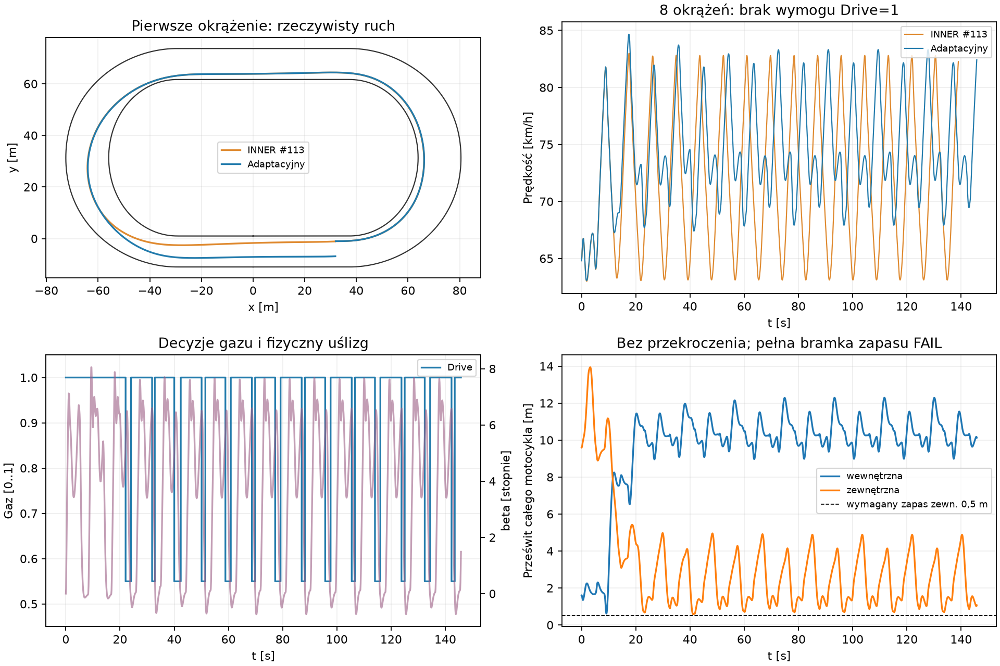

# Pierwszy adaptacyjny zawodnik — PROVISIONAL, pełna bramka FAIL

Prototyp **podejmuje decyzje i kończy osiem okrążeń**, ale nie kwalifikuje się
jeszcze jako bezpieczny kontroler wyścigowy. Pierwszy łuk zalicza dotychczasową
bramkę; w dalszej jeździe dolne oszacowanie prześwitu zewnętrznego wynosi
**0,470845 m przy wymaganych 0,5 m**. Brak zaobserwowanego przekroczenia granic
nie zmienia tego wyniku. Nie rozluźniano bramki ani nie strojono kolejnych wariantów.

## Baza i granice architektury

Sprawdzono otwarte Drafty #113 (`fc5d184e95fa3d6d12c27abd59ab8de7e2630bee`)
i #114 (`7f7ff47c926e2ecbd8a34f82abf27dbc0de14f77`); w chwili rozpoczęcia nie
było późniejszego Draftu. Nowa gałąź bazuje na #114, ale
`EnableDynamicAxleLoad=false`, `AxleLoadHeightMeters=null`.
Niezaliczony transfer nacisku pozostaje wyłączony.

`EnableAdaptiveRiderControl=false` domyślnie. Włączenie wymaga jednego aktywnego
zawodnika, dwóch kontaktów, fizycznego regulatora kierownicy #113 i tylnego koła.
Odrzucane są ruch rywali, #108/#109, autorskie ścieżki/komendy oraz autorski
`EnableLocalOffsetLimit`: tymczasowy cel AI ocenia pełna geometria toru, nie
walidator aktywacji wcześniej napisanej linii. To ograniczenie celów nie zmienia
granic fizycznych ani kolizji. `src/CoreSim`, opony, silnik, Grip, masa147 kg,
I52,72097 kg·m², osie+0,70/−0,60 m, statyczne40/60 i gabaryty pozostają identyczne.
Brak sterowania ciałem, dodatkowego yaw, korekt pozycji i bonusów prędkości.

## Minimalna decyzja podczas jazdy

Co0,2 s, z ostatniego zaakceptowanego stanu, kontroler sprawdza najwyżej pięć
możliwości (duplikaty usuwa w stałej kolejności):

1. Utrzymanie dotychczasowego wyboru.
2. Pełny gaz i cel przy aktualnym odsunięciu od wewnętrznej krawędzi.
3. Pełny gaz i cel o1,5 m szerzej.
4. Drive0,55 i cel o1,5 m ciaśniej.
5. Drive0,55 i cel przy aktualnym odsunięciu.

Cele są tymczasowe, mogą się zmieniać w środku łuku; nie istnieje zapisana
trajektoria INNER ani tabela offsetów dla kolejnych metrów toru.
Istniejący regulator przekłada wybrany cel i aktualną prędkość na żądanie skrętu;
nie wymusza osiągnięcia tego celu. Oryginalna nieliniowa inwersja #113 wybiera
kierownicę, a cały ruch wynika z sił dwóch kontaktów i oporów.

Prognoza0,6 s wykonuje30 lokalnych kroków po20 ms z oryginalnymi siłami i r×F.
Regulator #113 odpytuje co100 ms prognozy; między nimi zachowuje żądanie
kierownicy z jej oryginalnym limitem szybkości. To celowo mały model predykcyjny,
nie kopia przyszłych stanów Box2D. Wykonanie rzeczywiste nadal używa10 ms
i regulatora co rzeczywisty interwał. Różnic tych **nie uznano za certyfikat
zgodności predykcji z wykonaniem**. Realne koło/kierownica, RNG i tor nie są
modyfikowane przez ocenę odrzuconych akcji; lokalne kopie są wyrzucane.

Ocena nagradza rzeczywisty przewidywany przyrost odniesienia toru, pomniejszony
o koszt przekroczenia dostępnego przyspieszenia normalnego i małych prześwitów.
Nie nagradza samego Drive1 ani samej krótkiej drogi. Przekroczenie budżetu
nie zwiększa sił: żądanie pozostaje nieosiągalnym zamiarem, rzeczywiste opony
zachowują limity. Sprawdzana jest cała mechaniczna sylwetka, z prognozowanym
zapasem0,5 m od wewnętrznej i1 m od zewnętrznej granicy. Przełączenie wymaga
poprawy oceny o0,15 m, jeśli dotychczasowy wybór spełnia zapas. Stałe kosztu
i marginesów są jawne, PROVISIONAL i nie były optymalizowane.

Gdy żadna akcja nie spełnia prognozowanego zapasu, `Emergency=true` oznacza
wybór najmniejszego naruszenia. **Nie oznacza akceptacji bezpieczeństwa.**
Niezależny audyt zatrzymuje rzeczywisty ruch przy przekroczeniu granicy lub
niedopuszczalnym wzroście energii; końcowa bramka zachowuje dotychczasowe
oszacowanie prześwitu między krokami i limit0,5 m od bandy.

## Egg Mild / progressive-b — wyniki

Identyczne wejście #113: C3 INNER w wariancie odniesienia, start s32 m,
v18 m/s, koło toczące się, kierownica0, Grip1/ruts0/moisture0,5.
Powierzchnia jest zamrożona. Najpierw pierwszy łuk, do s133,439375 m;
osiem okrążeń dopuszczono dopiero po jego zielonej bramce.

| Pierwszy łuk | Sztywne INNER #113 | Adaptacyjny |
|---|---:|---:|
| Czas końca próby [s, kwant10 ms] | 5,82 | 5,82 |
| Zakres odsunięcia CoM [m] | 0,785–1,733 | 0,784–1,707 |
| Prędkość min/średnia/max [km/h] | 63,00 /65,24 /67,22 | 63,06 /65,28 /67,23 |
| Max \|β\| [°] / wheelspin [%] | 7,138 /12,643 | 7,140 /12,646 |
| Min prześwit wewn./zewn. [m] | 1,349 /8,948 | 1,348 /8,925 |
| Dolne oszacowanie wewn./zewn. [m] | 1,241 /8,844 | 1,240 /8,821 |
| Zmiany gazu | 0 | 0 |
| Rzeczywiste kroki / commit koła | 584 /584 | 584 /584 |
| Bramka | PASS | PASS |

Pierwszy łuk sam nie dowodzi adaptacji: wszystkie trzydzieści ocen pozostawiło
pełny gaz. Jego wykonany prefiks w dłuższym przejeździe jest identyczny bajtowo
w zapisanych stanach i siłach. Powtórzony INNER ma dokładny fingerprint #113.

| Osiem okrążeń | Sztywne INNER #113 | Adaptacyjny |
|---|---:|---:|
| Czas przecięcia mety [s] | 139,00266 | 145,83668 |
| Pierwsze okrążenie [s] | 17,26887 | 17,16601 |
| Ostatnie okrążenie [s] | 17,38867 | 18,40258 |
| Rzeczywista droga [m] | 2778,80 | 3009,12 |
| Zakres odsunięcia CoM [m] | 0,086–8,694 | 0,081–11,758 |
| Rozpiętość wykorzystanych odsunięć [m] | 8,609 | 11,677 |
| Prędkość min/średnia/max [km/h] | 63,00 /71,96 /83,01 | 63,06 /74,28 /84,67 |
| Średnie/max \|β\| [°] | 3,858 /8,074 | 3,749 /8,101 |
| Średni/max wheelspin [%] | 9,142 /12,643 | 7,841 /12,646 |
| Zmiany gazu / czas Drive0,55 [s] | 0 /0 | 28 /22,80 |
| Min odstęp zmian gazu [s] | — | 1,00 |
| Min rzeczywisty prześwit wewn./zewn. [m] | 0,620 /5,296 | 0,613 /0,580 |
| Dolne oszacowanie wewn./zewn. [m] | 0,492 /5,192 | 0,485 /**0,471** |
| Pełna bramka bezpieczeństwa | PASS | **FAIL** |

Zakresy odsunięcia w tabelach pochodzą z niezależnego rzutowania na zamrożony
eksport geometrii co≤0,2 m; dokładne ekstremalne offsety z rzeczywistego runnera
są także w plikach `metrics.json`. β to fizyczny kąt nadwozie–prędkość,
wheelspin to oryginalny poślizg tylnego koła. Nie są wymuszanymi celami.
Średnie są ważone czasem. Dłuższa, szersza droga daje większą średnią prędkość,
ale **gorszy czas o6,834 s /4,92%** — krótsza linia nie była założeniem oceny.
Osiem okrążeń INNER pochodzi z zachowanego #113; nie uruchamiano ich ponownie.

Przy t9,6 s w prognozie zachowanie ciasnego celu wymaga do1,461× dostępnego
budżetu przyspieszenia. Kontroler wybiera pełny gaz i szerszy cel2,237 m;
nadal do1,384×, więc nawet ten zamiar nie jest w pełni osiągalny. Nie ukryto
tego przez zwiększenie sił. Następnie zwiększa odsunięcie przy t10,0/10,4/10,8 s.

Przy t22,0 s następuje świadomy wybór Drive0,55 i ciaśniejszego celu8,710 m:
przewidywany prześwit zewnętrzny0,911 m jest lepszy niż0,769 m utrzymania
dotychczasowego pełnego gazu, ale nadal poniżej prognozowanego1 m.
To pierwszy wybór awaryjny; w całej próbie jest ich **110/730**.
Są91 aktywacje planu oznaczone `Changed`, w tym inicjalizacja, nie91 przełączeń gazu. Brak szybkiego chatter gazu
(min1 s); nie udowodniono ogólnej stabilności wszystkich decyzji.

Najmniejszy rzeczywisty prześwit zewnętrzny występuje około t41,13 s.
Brak przekroczenia jest potwierdzony dodatnim dolnym oszacowaniem odległości,
lecz nie wystarcza do wymaganego zapasu. Kontroler reaguje przy bandzie
za późno, aby zachować ten zapas w obecnej krótkiej prognozie.
Nie przyjęto dodatniego wyniku prognozy jako dowodu bezpieczeństwa wykonania.



## Koszt i niezmienniki

Pierwszy łuk: bez dodatkowych kroków native;28 826→28 896 lokalnych query
wykonania, plus41 790 query i4200 ocen sił prognozy. Pełny przejazd:

| Praca | INNER #113 | Adaptacyjny |
|---|---:|---:|
| Rzeczywiste kroki / commit koła | 13 933 /13 933 | 14 616 /14 616 |
| Query inwersji w wykonanych interwałach | 613 865 | 705 656 |
| Oceny sił / query inwersji prognoz | 0 /0 | 106 290 /1 031 688 |
| Pełne oceny geometrii w prognozach | 0 | 109 833 |
| Dodatkowe native światy/kroki prognoz | 0 /0 | 0 /0 |

Łącznie query inwersji jest **2,83×** więcej (2,70× na sekundę symulowanego
czasu). Same pełne zapytania kontaktu obejmują także bezpośrednie oceny sił
prognozy; po ich doliczeniu oryginalnych rozwiązań kontaktu jest około2,96× więcej.
Małe odrębne query h0 przy granicach krzywizny nie są zawarte w tych sumach
inwersji; runner raportuje ich43 w adaptacyjnym przejeździe. Różnica liczby
rzeczywistych kroków to głównie dłuższy czas przejazdu, nie kroki predykcji.
Planowanie zajęło lokalnie3449 ms /730 ocen, około4,72 ms na ocenę w Release.
To pomiar diagnostyczny z eksportem, nie benchmark porównawczy ani limit CI.

Wszystkie skutki realne powstają wyłącznie po jednym zaakceptowanym kroku
Box2D. Testy potwierdzają pojedynczy commit, oryginalne budżety40/60,
limity kierownicy, deterministyczną decyzję i niezmienność wyniku pod wpływem
obserwatorów. Zamrożona nawierzchnia oznacza0 zapisów zużycia i0 RNG w planowaniu.
Nie rozszerzono tego dowodu na dynamiczny tor ani inne warunki początkowe.

Niezależny ledger pełnego przejazdu: praca silnika1004,262 kJ; brak kroków
z niedopuszczalnym nadmiarem energii. Residual C#0,12856 J, niezależny0,12741 J;
różnica wynika z float/zapisu. Niezależny residual jest wyjaśniony pracą błędu
impulsu native z różnicą<5e−9 J. Max residual impulsu0,000620 Ns,
momentu0,00000631 Nms. Brak dodatkowego aktuatora yaw.
Zweryfikowano **997/997** historycznych hashy, fingerprint #113 OFF
i dotychczasowe celowane testy zgodności. Nie zmieniano dawnych danych ani kalibracji.

## Walidacja i odtworzenie

Końcowe pomiary Release obejmują trzy światy torowe: INNER pierwszy łuk,
adaptacyjny pierwszy łuk, adaptacyjne8 okrążeń. W pracach integracyjnych były
także dwa krótkie światy Debug i jedna przerwana próba dłuższa: ujawniła
konflikt z walidatorem autorskich celów. Dwa wywołania adaptacyjne odrzucono
jeszcze przed utworzeniem świata przez walidację autorskiego preview/ścieżki.
Poprawiono sposób podłączenia kontrolera, bez strojenia modelu lub poszukiwania
wariantów. Celowane testy native wykonują osobne krótkie scenariusze.

```powershell
dotnet restore tests/CoreSim.Tests/CoreSim.Tests.csproj --locked-mode
dotnet build tests/CoreSim.Tests/CoreSim.Tests.csproj -c Release --no-restore --warnaserror
dotnet test tests/CoreSim.Tests/CoreSim.Tests.csproj -c Release --no-build --filter "FullyQualifiedName~AdaptiveRiderControlTests|FullyQualifiedName~PhysicalSteeringControlTests|FullyQualifiedName~DynamicAxleLoadTests|FullyQualifiedName~TwoContactBikeDynamicsTests"
$outDir = 'results/adaptive-rider-recapture' # nowy katalog; raw eksport nie nadpisuje
dotnet tools/shared-world-speedway/bin/Release/net8.0/shared-world-speedway.dll adaptive-rider $outDir first-bend
# Program odmówi dłuższej próby przy czerwonej bramce pierwszego łuku:
dotnet tools/shared-world-speedway/bin/Release/net8.0/shared-world-speedway.dll adaptive-rider $outDir eight-laps
python tools/shared-world-speedway/adaptive-rider-report.py --data $outDir --plots --compact
```

`matplotlib` jest potrzebny tylko dla `--plots`. Raport czyta dane i odtwarza
ledger; nie wykonuje symulacji. Szczegóły: [analysis.json](adaptive-rider-decisions/analysis.json),
[walidacja](adaptive-rider-decisions/validation.json), CSV/JSON.gz i manifest.
Ostateczne standardowe Windows Draft CI dla końcowego HEAD jest wskazane
w opisie PR; bez merge i bez włączania eksperymentu domyślnie.

**Jeden następny krok:** zweryfikować prognozę odzyskania zapasu do bandy na
zachowanych stanach21–24 i40–42 s, aby uruchamiać odjęcie gazu wcześniej.
Najpierw ten ograniczony test, bez optymalizacji setek wariantów lub dodawania rywali.
