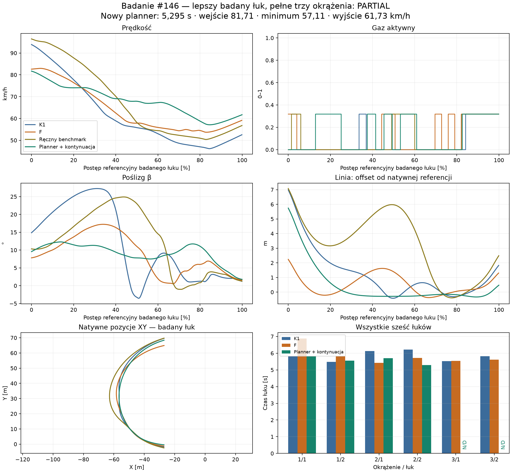

# Badanie #146 — autonomiczne planowanie łuków

**Wynik: PARTIAL.** Nowy kontroler sam uzyskał 5,295 s na łuku 2 drugiego okrążenia, lecz nie ukończył trzech okrążeń w dostępnym budżecie. Nie przyznano PASS. Draft PR, bez merge.

Baza: HEAD Draft PR #144, `3b9180d957bcc596c5e8b2756f280a65fb40670f`. Nowa gałąź: `experiment/autonomous-corner-planning-146`. Etykieta badania #146 nie określa numeru PR nadanego przez GitHub.

## Sześć odpowiedzi

1. **Dlaczego poprzedni planner wypadł?** Nie przechowywał drugiej komendy, wielokrotnie odkładał przewidywane odjęcie gazu, oceniał tylko 0,9 s i wykonywał nawet kandydatów Unsafe. W 5,0 s przewidywał częściowy gaz od obserwacji 5,2 s, ale faktycznie znowu zażądał pełnego; w 5,2 i 5,4 s odkładał gaz 0. Od 5,6 s wybrany plan był Uncertain, od 5,8 s przewidywał przekroczenie. Native potwierdził je w 6,57 s. Wymuszenie samej przewidzianej pary nie uratowało manewru: jedna interwencja przekroczyła obrys w 6,25 s, druga limit β w 6,92 s. To również błąd krótkiego horyzontu/warunku końcowego, nie tylko ponownego planowania.

2. **Czy sekwencje są spójne?** W sprawdzonym zakresie tak: plan jest przesuwany, ponownie symulowany z zaakceptowanego stanu i rzeczywistej kolejki, porównywany z nowymi kandydatami, a komenda ma osobny preflight. Lokalna próba ma 131 pełnych zapisów decyzji; dłuższa próba ma 192 decyzje natywne, ale odzyskano tylko 72 kompletne plany (0–14,2 s). W tych 72 zachowano 71/71 oczekiwanych następnych komend, zgodne były kolejki i aktywacje. Nie deklarujemy pełnej weryfikacji zamiaru planera dla brakujących 120 zapisów.

3. **Czy autonomicznie wybrał lepszy badany łuk?** Tak w zachowanym przebiegu natywnym: 6,211 → 5,295 s, minimum 46,160 → 57,107 km/h, wyjście 52,587 → 61,726 km/h. Prędkość wejścia spadła do 81,709 km/h. Sterownik nie otrzymał ręcznego skrętu ani czasu przełączenia. Archiwum prognoz z tego późniejszego manewru jest niepełne, więc wynik nie dowodzi poprawności jego oryginalnego rankingu. Osobny audyt wykonanych komend potwierdza zgodność modelu, nie odtwarza utraconego zamiaru.

4. **Czy poprawił trzy okrążenia?** Nie ustalono. Dłuższa próba ukończyła dwa w 36,679 s (K1: 37,345 s), po czym zatrzymał ją limit CPU w 38,4 s. Czas trzech okrążeń pozostaje N/D. Krótsza wersja poprawia lokalny łuk powtarzalnie do 6,140 s, ale pogarsza następny z 5,520 do 9,729 s; nie spełnia kryterium braku pogorszeń.

5. **Szersza linia i poślizg?** Są dozwolone i wynikają z fizyki, nie z zapisanej trajektorii. Na badanym łuku dłuższa wersja zajmuje zakres offsetu −0,333…5,743 m, szerszy od F (do 2,236 m), przy |β| max 12,286°. Jest węższa od wejścia K1 (do 6,989 m). Nie ma zasady „zawsze szerzej” ani nagrody za duży poślizg. Nie dowiedziono optymalności tych linii.

6. **Koszt i czterech zawodników?** Obecny prototyp jest za drogi: 410,141 CPU-s kontrolera na 38,4 s jazdy; jedna decyzja w 22,6 s kosztowała 107,594 CPU-s i 20 271 prognoz. Proste przeliczenie na czterech daje około 42,7 CPU-s na sekundę wyścigu, jeszcze bez prognoz rywali. Nie jest gotowy do symulacji czterech zawodników.

## Wszystkie sześć łuków

Czasy dotyczą wspólnych natywnych granic referencyjnych łuku. N/D oznacza nieukończony lub nieosiągnięty łuk; nie jest zerowym czasem. „Lokalny 29” ma pierwsze trzy łuki odziedziczone dokładnie z K1.

|Okr./łuk|K1 s|F s|Pierwszy pełny s|Z kontynuacją s|Δ kontynuacja−K1 s|Lokalny 29 s|
|---|---:|---:|---:|---:|---:|---:|
|1/1|5.822|6.885|5.818|5.822|0.000|5.822|
|1/2|5.481|5.830|N/D|5.553|0.072|5.481|
|2/1|6.129|5.421|N/D|5.699|-0.429|6.129|
|2/2|6.211|5.720|N/D|5.295|-0.916|6.140|
|3/1|5.520|5.548|N/D|N/D|N/D|9.729|
|3/2|5.826|5.617|N/D|N/D|N/D|N/D|

Pełne wartości prędkości, gazu 0/częściowego/1, β, yaw, offsetu, odstępów od obu granic, długości linii, prognoz i CPU dla każdego łuku zawiera [corners.csv](corners.csv).

## Łuk referencyjny: okrążenie 2, łuk 2

|Sterownik|Czas s|Wejście/minimum/wyjście km/h|Droga m|Gaz 0/częściowy/1 s|β max °|CPU decyzji w łuku s|
|---|---:|---|---:|---|---:|---:|
|K1|6.211|93.886/46.160/52.587|102.07|4.843/1.368/0.000|27.255|3.312|
|F|5.720|82.599/53.689/59.191|99.18|3.600/2.120/0.000|17.222|2.797|
|joint-grid-29|6.054|96.458/50.376/56.791|108.42|3.849/2.205/0.000|24.899|5.609|
|local-K1-29|6.140|93.886/49.551/55.829|103.30|4.443/1.600/0.097|27.255|34.766|
|autonomous146-viable|5.295|81.709/57.107/61.726|99.33|2.852/2.443/0.000|12.286|31.953|

`joint-grid-29` jest ręcznym benchmarkiem #145, nie sterownikiem autonomicznym. CPU w łuku sumuje decyzje zaobserwowane między jego granicami; drogie przygotowanie przed wejściem może leżeć poza tym przedziałem. Historyczne CPU K1/F/benchmarku pochodzą z ich zachowanych uruchomień.



## Dlaczego F wygrywał mimo wolniejszego wejścia

F nie musi wytracić tak dużej energii: od wejścia do minimum zmiana energii translacji wynosi −22,345 kJ, wobec −37,906 kJ dla K1. Gaz 0 trwa w tym okresie 3,600 s zamiast 4,843 s. F jedzie o 2,892 m krótszą linią, utrzymuje wyższe minimum i szybciej wychodzi. Średnie β w pierwszej trzeciej łuku wynosi około 12,74° wobec 23,12° K1. Różnią się też położenie, yaw i późniejsze decyzje, więc sama prędkość wejścia nie została przyczynowo odizolowana. [F-explanation.json](F-explanation.json) zawiera fazy i energię.

Nowy dłuższy planner również osiąga lepszy czas przy niższej prędkości wejścia. Nie dostał wartości 81,709 km/h jako celu ani wagi premiującej taką prędkość.

## Diagnoza i kolejne wersje

- **Etap A:** diagnoza powstała i została zatwierdzona w historii Git przed implementacją planera. Dokładny replay od zera odtwarza fingerprint porażki #145. Obie sekwencje wymuszone diagnostycznie mają 91 zgodnych próbek w 0,9 s, max błąd XY poniżej 0,000088 m. Samo utrzymanie starej pary nie wystarcza. [DIAGNOSIS.md](DIAGNOSIS.md), [stage-A/sequence-checks.json](stage-A/sequence-checks.json).
- **Wersja 1:** zapamiętywany plan i ograniczony beam do trzech korekt, potem endogeniczna kontynuacja K1. Lokalny łuk 6,140 s powtarza się bitowo w 3609 próbkach do 36 s, lecz późniejszy łuk jest gorszy. Pierwsza pełna próba zatrzymuje się bezpiecznie w 12 s: punkt końcowy poprzedniego manewru osiągnięto z około 102 km/h, a następnego nie udało się certyfikować. To wada terminalnej wykonalności. [FIRST-FULL-FAILURE.md](FIRST-FULL-FAILURE.md).
- **Wersja 2:** dopuszcza niebezpieczne węzły pośrednie w samym wyszukiwaniu, aby późniejsza korekta mogła je uratować. W stanie 12 s sprawdza 100 kandydatów, ale nadal nie znajduje legalnego pełnego manewru. Żaden taki kandydat nie jest wykonywany. Nie dowodzi to fizycznej niemożliwości ratunku.
- **Wersja 3:** wymaga także legalnej kontynuacji przez następny łuk do kolejnego wspólnego celu. Ukończone cztery łuki i dwa okrążenia nie mają potwierdzonego naruszenia obrysu; badany łuk zyskuje 0,916 s. Dalszą walidację blokuje koszt, nie stwierdzony wypadek.
- **Końcowe zabezpieczenia narzędzia:** limit prognoz na decyzję 25 000, limit CPU sprawdzany wewnątrz prognoz, kompaktowy dziennik zapisywany i opróżniany po każdej decyzji. Zastępują niewystarczający pierwotny limit sprawdzany tylko między decyzjami. Nie wykonano kolejnej pełnej próby po tych zabezpieczeniach; sukcesu nie ekstrapolujemy.

## Algorytm i zakres autonomii

Plan startuje wyłącznie z aktualnej obserwacji oraz znanej geometrii i nawierzchni. K1 jest uruchamiany na stanach przewidzianych, aby utworzyć endogeniczny ogon; nie czytamy gotowej przyszłej linii ani ręcznego wyniku. Kandydaci zmieniają pierwszą, drugą i trzecią korektę w istniejącej siatce. Wersje 1/2: beam 2, limit 128 kandydatów, plan do 16 s, wyszukiwanie harmonogramowe co 0,8 s. Wersja 3: beam 1, limit 80, plan do 26 s, wyszukiwanie co 1,2 s. Nie jest to pełny iloczyn wszystkich komend.

Decyzje pozostają co 0,2 s. Każda ocena odtwarza nieodwracalną kolejkę, opóźnienie 0,24 s, rzeczywistą szybkość zmiany skrętu, koło, wał i sprzęgło. Stary plan jest przesuwany i propagowany od nowego stanu. Zmiana wymaga legalnej poprawy czasu o co najmniej 0,02 s (dwa kroki nominalne) albo braku bezpieczeństwa starego planu. Niepewna zgodność modelu wymusza natychmiastowe przeszukanie. Niezależna kontrola przed wykonaniem symuluje najbliższe 0,8 s; obejmuje obrys ciągły, rezerwę 0,10 m, limit β 45° i ruch do przodu. Brak certyfikowanego rozwiązania przerywa eksperyment; nie wysyła znanej niebezpiecznej komendy.

Cel porównania leży 3 m przed następnym łukiem, po całym bieżącym łuku i prostej. Najpierw porównujemy czas dotarcia do wspólnego celu, potem prędkość w kierunku prostej, β i yaw w stanie końcowym. Dłuższy wariant dodatkowo wymaga legalności do kolejnego takiego celu. Brak skalarnej premii za wysoką prędkość i brak narzuconego offsetu. Limit horyzontu może odrzucić wolną legalną kontynuację; seed K1 i wąski beam ograniczają odnajdywane rozwiązania. To metoda ograniczona, nie solver globalnego optimum.

Offset jest odległością od natywnej linii odniesienia biegnącej 1 m od wewnętrznej krawędzi. Ujemny offset nie oznacza sam w sobie wyjazdu. Legalność określa pełny obrys i natywne odstępy/certyfikaty.

## Prognoza a rzeczywiste wykonanie

Wymuszona walidacja pierwszego planu z 29 s odtwarza 1002 próbki do wspólnego celu: max XY 0,005016 m, błąd czasu celu 0,0000957 s. Prefiks od prawidłowego startu jest dokładny. [validate-local-K1-29-plan-result.json](native/validate-local-K1-29-plan-result.json).

Dodatkowy audyt zapisanych, faktycznie wykonanych sekwencji od 28,4/29/31 s nie tworzy świata. Maksymalny błąd XY to 0.008969 m, maksymalny błąd czasu wyjścia 0.0002492 s. Ten audyt otrzymuje przyszłe komendy wyłącznie retrospektywnie: weryfikuje model, nie poprawność wyboru ani utracone plany. [executed-sequence-audit.json](executed-sequence-audit.json).

Proces dłuższej próby zatrzymano podczas kompresji archiwum po natywnym stopie CPU w 38,4 s. Zachował się cały plik stanów i wykonanych 192 decyzji. Z uszkodzonego gzip odzyskano wyłącznie 72 kompletne obiekty JSON do 14,2 s; oryginalne niepełne bajty zachowano. Nie odtworzono brakujących 120 ocen kandydatów i zamierzonych kontynuacji. [Manifest odzysku](native/autonomous146-viable-recovery.json). Viewer jawnie pokazuje ten zakres i nie przedstawia wczesnego planu jako aktualnego w późniejszym łuku.

## Bezpieczeństwo i koszt

|Próba|Ukończone okrążenia|Czas trzech s|Stop s|Min. gap wew./zew. m|Min. certyfikat m|CPU natywne z kontrolerem s|
|---|---:|---:|---:|---|---:|---:|
|K1|3|54.795|54.800|0.2008/0.2949|0.0883|35.484|
|F|3|58.866|58.870|0.2033/0.6959|0.1045|36.000|
|autonomous146-first|0|N/D|12.000|0.2046/2.8655|0.1175|82.062|
|autonomous146-viable|2|N/D|38.400|0.2046/1.3751|0.1097|420.266|
|local-K1-29|2|N/D|55.200|0.2040/0.1345|0.0807|213.219|

Rezerwacje: **11 nowych światów, 880.625000 CPU-s**. Osobny audyt sekwencji: 1.875000 CPU-s i zero światów. Razem: **882.500000 CPU-s**, poniżej 900. Wliczono przerwany proces oraz koszt zapisu w rezerwacjach. Kompilacja, testy regresji i formatowanie raportu nie są eksperymentami natywnymi. [Pełny ledger](analysis.json).

Dłuższa próba wykonała 99,077 prognoz oraz 4,960,507 obliczeń sił w prognozach. Mediana/p95/max CPU decyzji dla wszystkich 192 wykonanych decyzji to 0.234/6.953/107.594 s. Zakres planów odzyskanych jest krótszy od zakresu tych natywnych liczników.

Limit liczby kandydatów nie ogranicza wystarczająco kosztu: każdy kandydat może wymagać wielu odcinków modelu, a wyczerpany ogon w wariancie terminalnym uruchamia kolejne decyzje K1, każda z własnymi prognozami H09. Szczyt w 22,6 s to 1 730 008 obliczeń sił w jednej decyzji. To konkretny blokujący koszt, a nie dowód, że wieloetapowa kontrola jest fizycznie nieskuteczna. Potrzebne jest ograniczenie i ponowne użycie obliczeń ogona; zmiana mocy lub przyczepności nie rozwiązuje tego problemu.

Pomiary: Windows, AMD Ryzen 5 3500X (6 rdzeni logicznych), target .NET 8. CPU jest czasem procesu, nie czasem symulacji ani gwarancją wydajności innego sprzętu. Nie przeprowadzono tu próby czterech motocykli; prognoza nadal opisuje pojedynczy motocykl bez zachowania rywali.

## Powtarzalność i ograniczenia

- Lokalna autonomia od 29 s została uruchomiona ponownie: identyczne 3609 próbek do 36 s i identyczny łuk 6,140273 s. To wynik lokalny, nie pełny sukces.
- Sprawdzono także wcześniejszy stan K1 od 28,4 s, stan porażki 12 s i start od zera. Wcześniejszy lokalny wariant przerwał limit CPU w 31,2 s; nie ma wyniku całego jego łuku.
- Brak powtórzenia całego dłuższego przejazdu i brak trzeciego okrążenia. Budżet nie pozwala na wniosek o odporności na różne wejścia ani brak pogorszenia pozostałych łuków.
- Kryteria sukcesu nie zostały spełnione łącznie. Najmocniejszy dodatni wynik to samodzielnie uzyskany, legalny przebieg badanego łuku; najsilniejszy wniosek negatywny dotyczy obecnego kosztu i niepełnej walidacji całego dystansu.

## Odtworzenie i walidacja

Dla interwencji PrefixExact porównuje wszystkie próbki pełnego prefiksu; dla startu od zera porównuje wyłącznie początkowy stan fizyczny, bez nowo wybranej komendy. Dlatego hash całej próbki startowej może się różnić przy identycznym motocyklu w spoczynku. Sterownik i natywny CLI są domyślnie OFF. Uruchomienia wymagają `--enable-native146` oraz jawnego pliku treatment. Gotowych wyników nie nadpisujemy; ledger zachowuje wszystkie rezerwacje. Warianty źródeł i kolejne diagnozy są zachowane w historii Git. Parametry silnika, sprzęgła, opon, masy, geometrii i fizyki #144 oraz wszystkie dane/parametry #145 są niezmienione.

```powershell
dotnet restore SpeedwayManager.sln
dotnet build SpeedwayManager.sln -c Release --no-restore --warnaserror
dotnet test tests/CoreSim.Tests/CoreSim.Tests.csproj -c Release --no-build --filter "Shard=core|Shard=trajectory"
python -m unittest discover -s tests/calibration -p "test_*.py"
python -m unittest discover -s tools/ci -p "test_*.py"
node --test tools/replay-viewer/replay.test.mjs
python tools/autonomous-corner-planning/analyze146.py
python tools/autonomous-corner-planning/report146.py
```

Ponowne tworzenie świata: `dotnet run --project tools/autonomous-corner-planning -c Release -- --enable-native146 <nowy-katalog> <treatment.json>`. Treatment diagnostyczny z `NativePrefixSource` lub `PlanSource` wymaga wskazanych plików zależności w tym katalogu. Nie należy uruchamiać całej listy poza budżetem nowego badania. Retrospektywny audyt jest osobnym `--audit-native146 <nowy-katalog>` i nigdy nie steruje zawodnikiem.

Viewer: `/tools/replay-viewer/?case=planning146&run=autonomous146-viable&t=29`. Obraz, stany, linie porównania i telemetria pochodzą z zapisów, nie z nowej symulacji.

Lokalne testy i Windows CI dla końcowego SHA są opisane w [VALIDATION.md](VALIDATION.md).
