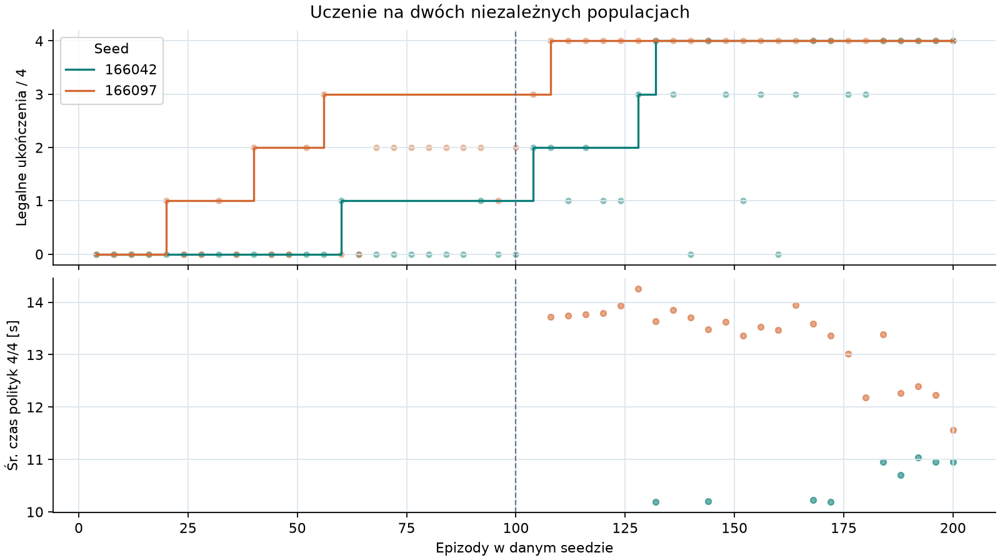
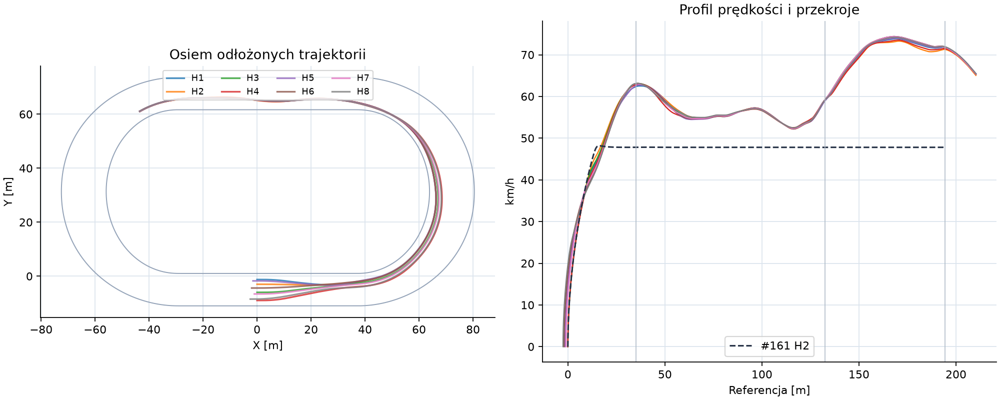
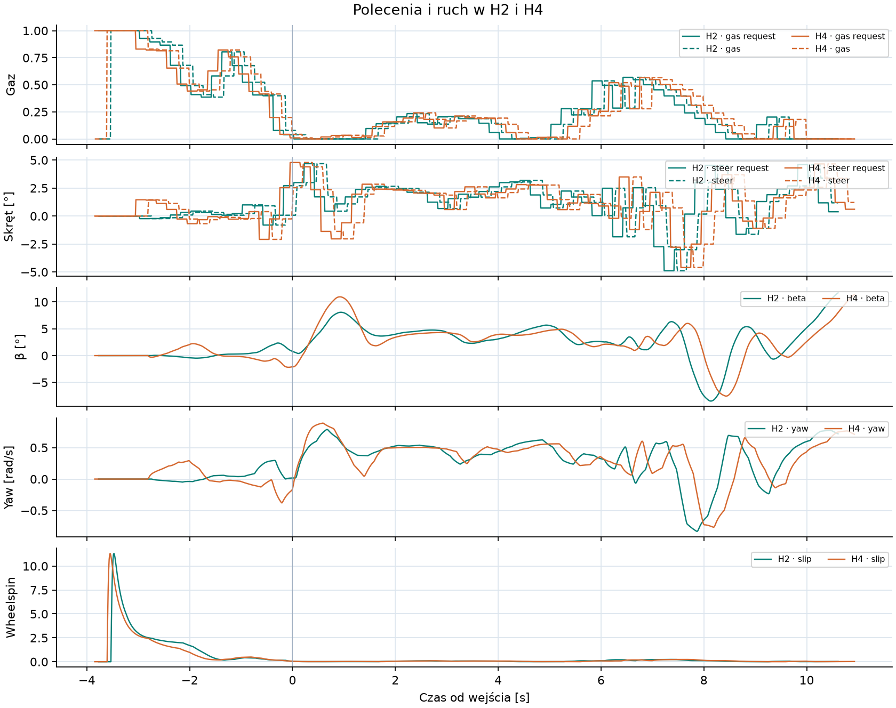
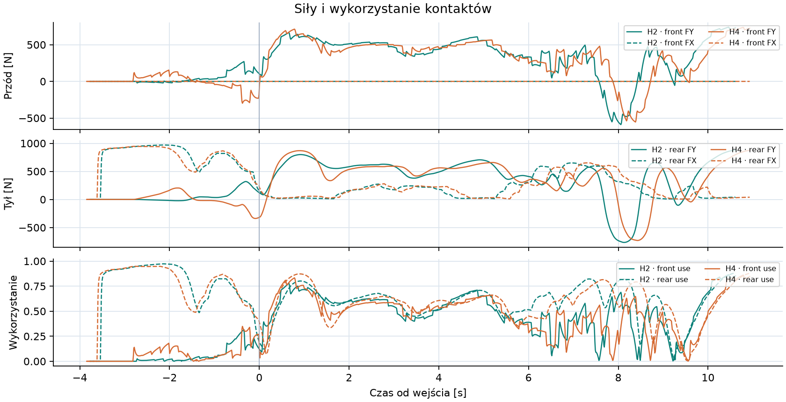
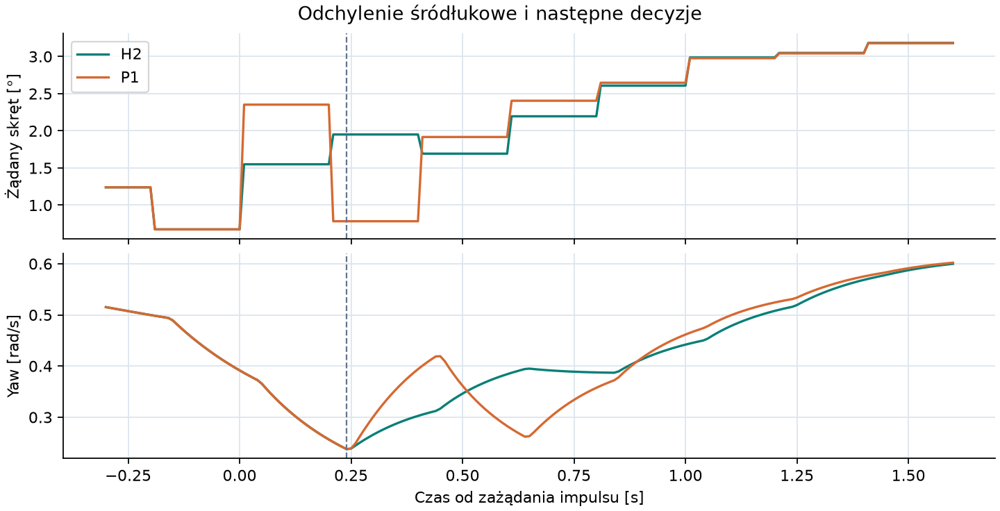

# Badanie #166 — autonomiczny szybki łuk

**Werdykt PARTIAL.** Cztery ramiona referencyjne #161 zakończyły się przed wspólnym celem, więc poprawę czasu można obliczyć dla czterech par.

**Wynik jazdy — 8/8 odłożonych startów i 8/8 legalnych kontynuacji przez dodatkowe 0,9 s.** Zamrożona polityka uzyskała medianę **10,672 s** od 15 m przed pierwszym łukiem do wejścia w następny łuk. Minima na łuku wyniosły **52,18–52,52 km/h**, a prędkości wyjścia **58,91–59,20 km/h**. Wynik Full Windows CI dla końcowego SHA podano w Draft PR.

Baza techniczna `0446cd3bb7eb6142eefeef07899969855f6dcc51` (#165, Draft PR #164), referencja autonomii `85a5ee3295c2dd983fbacb21859649f794cc5ba5` (#161). Narzędzie PROVISIONAL, domyślnie OFF. Zakres to zatrzymany start, pełny pierwszy łuk, cała 62-metrowa prosta i krótka kontynuacja na progressive-b.

## Demonstracje i obserwacja

C-B101 i C-B245 dostarczyły 134 rzeczywiste decyzje. Każda ma obserwację z XY, wektorem prędkości, θ, χ, β, βdot, yaw, prędkością poprzeczną, gazem i skrętem, aktywną akcją, pending, kołem, wałem, sprzęgłem i siłami obu opon. Zapis obejmuje podgląd granic i krzywizny na 4/8/16/32 m oraz rzeczywiste następne stany po 0,24/0,44/0,84 s, gdy demonstracja je zawiera. Dopasowanie używa próbek do wyjścia z pierwszego łuku wraz z wąskim brzegiem okna uśredniania. Późna prosta i ryzykowna końcówka służą do analizy. W odrzuceniach #165 wysoki β i nasycenie kontaktów kierowały wyborem cech, a utrata swept uzasadniła oddzielne śledzenie błędu poprzecznego. [Decyzje demonstracyjne](evidence/demo-decisions.jsonl.gz), [przygotowanie bez nowych światów](evidence/preparation.json), [odrzucenia #165](../fast-corner-feasibility/evidence/trials.jsonl).

#129 pokazało regresję holdoutów po zmianie kohort i ryzyko późnego narastania agresywności. #130 utrzymało powracające warunki i osobną selekcję. W #131 horyzont 0,9 s zwiększał ukończenia treningowe względem 0,6 s, a większa niezawodność nie wystarczyła do poprawy czasu. #132 rozszerzyło historyczną przestrzeń akcji o pełny gaz. Tu warunki treningowe powracają, ukończenie i stan terminalny poprzedzają czas w rankingu, a odłożone starty mają osobny plik i hash. [#129](../free-racing-learning/README.md), [#130](../robust-free-racing-learning/README.md), [#131](../autonomous-speedway-extended-learning/README.md), [#132](../full-throttle-learning/README.md).

## Polityka

Dwie przestrzenne funkcje referencyjne powstały przez ważone uśrednienie wykonanych stanów i sterowania w 30 węzłach odległości na demonstrację. Kodują linię, kierunek ruchu, β, yaw, prędkość, skręt i gaz. Zawodnik obserwuje aktualny stan i używa predyktora #153 do propagacji już złożonych poleceń przez 0,24 s. Każda decyzja oblicza korektę z błędu offsetu, kierunku ruchu, orientacji korpusu, yaw, prędkości i wheelspinu. Czas obsługuje zegar i pending. Przekroje oraz geometria wyznaczają punkt odniesienia. Polityka wykonawcza przyjmuje dopasowane współczynniki.

Sprzężenie boczne używa LQR z lokalną aproksymacją sztywności kontaktów, która projektuje wyłącznie wzmocnienia. Każdą kandydaturę ocenia natywny Box2D z pełnym sprzęgłem, oponami i oryginalnym aktuatorem. W rozszerzeniu można zachować część zewnętrznej linii przy starcie z dalszego pola. Gaz ma sprzężenie z prędkością i wheelspinem. Ranking preferuje legalne ukończenie, potem ekran stanu końcowego i krótszy czas. Pełny gaz, Vmax i konkretny kąt β nie są składnikami nagrody.

Wstępna polityka odpadła w czterech pilotach. D2 przejechał cały pierwszy łuk, ale przekroczył β45° na prostej przy ref. 162,50 m. Naprzemienne korekty uzasadniły ograniczenie korekty propozycji do ±0,115 rad i zmniejszenie jej wzmocnienia na prostej do 56% wartości łukowej. Fizyczny aktuator zachował ±35° i 90°/s. [Diagnostyki](evidence/diagnostics.json), [zmiana po pilocie](evidence/pilot-revision.json).

## Krzywa uczenia

| Seed | Partia | Ukończenia | Ekran terminalny | Śr. legalny czas | Najlepszy legalny czas |
|---|---|---:|---:|---:|---:|
| 166042 | pierwsze 100 | 2/100 | 2/100 | 10,480 s | 10,091 s |
| 166097 | pierwsze 100 | 26/100 | 26/100 | 13,020 s | 11,671 s |
| 166042 | kolejne 100 | 67/100 | 55/100 | 10,411 s | 9,871 s |
| 166097 | kolejne 100 | 99/100 | 99/100 | 13,335 s | 11,421 s |

Każdą politykę oceniano z czterech zatrzymanych stanów treningowych. Pierwsze polityki miały 0/4. Po 200 epizodach najlepsi mieli odpowiednio 1/4 i 3/4. To otworzyło rozszerzenie. W nim oba seedy osiągnęły 4/4. Checkpoint 166042 (indeks 46 od zera) miał 4/4 ukończeń i 4/4 przejść ekranu terminalnego ze średnią **10,706 s**. Najlepszy checkpoint 166097 (indeks 49) osiągnął **11,565 s** przy tych samych dwóch wynikach 4/4. Wybrano szybszy przed walidacją.

W 400 epizodach odpadło **206** prób. Pierwszy wykryty powód to 102 razy swept, 101 razy β45° i 3 razy obrys pozy. Średnie w tabeli obejmują ukończenia. Rejestr każdego DNF zachowuje chwilę, przekrój, wynikowe metryki i przyczynę. Gęsta natywna telemetria obejmuje pilota, walidację, odtworzenia i nowe próby referencji. [Rejestr](evidence/training-episodes.jsonl), [zamrożenie](evidence/freeze.json).

## Odłożona walidacja

Prędkości w km/h, czasy w sekundach. Odcinek porównawczy zaczyna się na ref. 20 m. Przekroje wejścia, wyjścia i końca prostej są na ref. 35,000 m, 132,389 m i 194,389 m. Potem w tym samym świecie wykonywano autonomiczne decyzje przez 0,9 s. Osobny audyt przeliczył obrys i dolną granicę swept z rzeczywistych próbek obu krawędzi. Minima swept obejmują rezerwę.

| Próba | Wejście | Vmin | Apex | Wyjście | +20 m | +40 m | +62 m | Łuk [s] | Odcinek [s] | Swept [m] | #161 [s] |
|---|---:|---:|---:|---:|---:|---:|---:|---:|---:|---:|---:|
| H1 | 62,35 | 52,25 | 52,48 | 58,92 | 71,05 | 73,68 | 71,75 | 6,496 | 10,627 | 0,917 | 13,866 |
| H2 | 63,03 | 52,23 | 52,39 | 58,97 | 70,62 | 73,17 | 71,26 | 6,488 | 10,634 | 0,915 | 13,919 |
| H3 | 63,03 | 52,25 | 52,65 | 59,14 | 71,56 | 74,13 | 71,75 | 6,603 | 10,705 | 0,892 | 14,011 |
| H4 | 62,82 | 52,52 | 53,31 | 59,16 | 70,74 | 73,38 | 71,47 | 6,815 | 10,969 | 0,833 | 14,107 |
| H5 | 62,52 | 52,24 | 52,47 | 58,91 | 71,15 | 73,79 | 71,82 | 6,507 | 10,640 | 0,915 | — |
| H6 | 63,10 | 52,18 | 52,42 | 59,15 | 71,54 | 74,13 | 71,83 | 6,512 | 10,620 | 0,907 | — |
| H7 | 63,04 | 52,28 | 52,75 | 59,20 | 71,55 | 74,14 | 71,77 | 6,651 | 10,760 | 0,882 | — |
| H8 | 63,11 | 52,46 | 53,13 | 59,12 | 71,34 | 73,97 | 71,92 | 6,765 | 10,888 | 0,843 | — |

Na początku drugiego łuku obserwowano β **2,31–3,47°**, βdot **+6,84 do +10,25°/s**, yaw **0,449–0,463 rad/s**, prędkość poprzeczną **1,64–1,67 m/s do wewnątrz** i obrys od bliższej bandy **3,56–3,68 m**. Najmniejszy swept we wszystkich odłożonych światach wraz z rezerwą wyniósł **0,833 m**. Stan koła, napędu, oba kontakty i pending są w natywnych danych. W odłożonych warunkach zróżnicowano pozycję zatrzymanego startu. Użyto nominalnej przyczepności. Stabilność przez cały następny łuk i na innych nawierzchniach pozostaje nierozstrzygnięta.

Skrócenie demonstracji #165 do wspólnego przekroju daje 9,489 s dla C-B101 i 10,424 s dla C-B245. Te czasy są odniesieniem jakościowym. Polityka ma niższą prędkość wejścia, a jej wynik obejmuje również natywne potwierdzenie legalności do 0,9 s za końcem odcinka.

## Reakcja na odchylenie

W P1 odtworzono warunek H2 z pojedynczym +0,014 rad dodanym do żądania skrętu w t = 6,8 s. Impuls przeszedł przez oryginalną kolejkę w t = 7,04 s. W t = 7,0 s stan fizyczny był jeszcze identyczny, lecz następne żądanie wyniosło **0,78°** zamiast **1,95°**, bo polityka widziała inny pending. Po aktywacji, w t = 7,2 s, yaw wynosił **0,394** zamiast **0,303 rad/s**, a żądania skrętu odpowiednio **1,92°** i **1,69°**. Oba przejazdy ukończyły manewr i rezerwę. Wszystkie różnice po pierwszym impulsie wynikły z zamrożonej polityki. [Porównanie stanów i akcji](evidence/analysis.json).

## Koszt i porównanie #161

Do mediany trafiły **4/8 ukończonych par**. Mediana indywidualnych popraw czasu wynosi **23,48%**. H1–H4 wykorzystują rzeczywiste fragmenty wcześniej zapisanych, dokładnie dopasowanych startów #161. Dla H5–H8 uruchomiono oryginalny #161 na identycznych startach. Poniżej zachowano także nieukończone ramiona.

| Ramię #161 | Wynik | Końcowa ref. [m] | CPU [s] |
|---|---|---:|---:|
| H5 | Niezgodność niezależnego prefiksu | 89,803 | 186,750000 |
| H6 | Wyczerpany przydział CPU | 163,046 | 212,265625 |
| H7 | Wyczerpany przydział CPU | 155,203 | 212,218750 |
| H8 | Wyczerpany przydział CPU | 83,899 | 211,953125 |

| Faza | Natywne światy lub rezerwacje | CPU [s] |
|---|---:|---:|
| Przygotowanie | 0 | 0,890625 |
| Pilot | 4 | 1,343750 |
| Pierwszy trening | 200 | 11,937500 |
| Rozszerzenie | 200 | 23,390625 |
| Walidacja i odtworzenia | 8 + 2 | 6,265625 |
| Przerwana inicjalizacja referencji | 1 bez kroku | 5,000000 |
| Dodatkowe ramiona oryginalnego #161 | 4 | 823,250000 |
| **Łącznie obciążono** | **419 rezerwacji, 418 wykonanych światów** | **872,078125 / 900** |

Pierwsza rezerwacja REF-H5 zatrzymała się przy brakującym pliku choices.json w rzadkim checkoucie, przed pierwszym krokiem natywnym. Po pobraniu zamrożonego pliku wykonano nowe, osobno policzone REF2-H5. Pierwszej rezerwacji przypisano konserwatywnie 5 CPU-s, ponieważ proces przerwał się przed zapisaniem końcowego pomiaru. Natywne odtworzenia wyuczonego kontrolera odbyły się przed tym wznowieniem.

[Porównania #161](evidence/pairing.json), [zapis przerwania](evidence/pairing-interruption.json), [liczby i pary](evidence/analysis.json).

Fizyka, siły, wymiary motocykla, nawierzchnia, progressive-b, próg β45°, opóźnienie, review 0,2 s, krok 0,01 s i pełny pending pochodzą z zamrożonego kodu. Izolowany wykonawca buforuje tę samą geometrię przy odczycie obrysu i dopuszcza ograniczony czas po przekroju. Predykcje #153 to krótkie propagacje obserwacji, rozliczane oddzielnie od uruchomień światów Box2D. W treningu wykonały 459 631 zapytań kontaktowych, a w ośmiu odłożonych próbach 13 458. Audyt kolejki odtworzył każde żądanie, aktywację i stan pending na końcu archiwów. Pełny 13/9 wykonywał oryginalny kontroler referencyjny w nowych ramionach porównania. Zakres #166 kończy się przed ukończeniem drugiego łuku.

## CI i dowody

W #165 checkout zadania Python trwał 7 min 40 s, a najwolniejszy checkout shardów ponad 20 min. Ostatni udany audyt historyczny trwał 32 min 39 s. Podniesiono wyłącznie limity czasu Python 10→30 min, coverage 15→25 min, .NET 30→45 min i audytu historycznego 45→60 min. Zachowano testy, historyczne hashe i kryteria wszystkich bramek. [#165 CI](https://github.com/arturgladysz91/zuzel/actions/runs/41724974221), [ostatni zaplanowany audyt](https://github.com/arturgladysz91/zuzel/actions/runs/41421382062).

[Plan](budget.json), [odłożone warunki](held.json), [rozpoczęte światy](evidence/started.jsonl), [wyniki](evidence/validation.json), [archiwa natywne](evidence/native), [manifest SHA256](SHA256SUMS), [instrukcja](../../../tools/autonomous-fast-corner/README.md).
