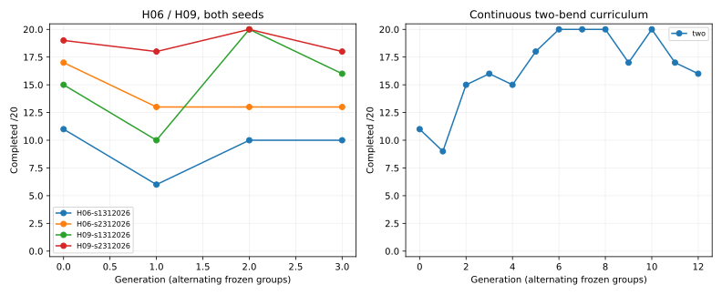
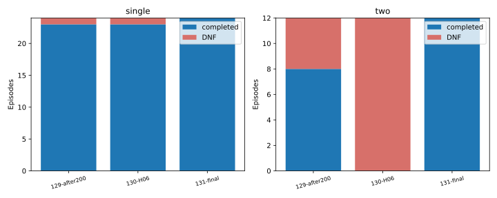

# Autonomous Speedway Rider #131 — PARTIAL

Status **PROVISIONAL**, default OFF. Baza dokładnie `5dbdbd53145c39ec27356bd43cdeb41983a119cf`. Fizyka, geometria, ograniczenia oraz produkcyjny CoreSim bez zmian. Jeden Draft PR, bez merge.

Zamrożona polityka: **two #4061**, horyzont **0.9 s**; [parametry](winner.json), [hash przed finałem](winner-lock.json), [protokół](protocol.json). Werdykt **PARTIAL** według niezmienionych kryteriów; wyników finału nie użyto do dalszego strojenia.

**Wynik końcowy: 24/24 pojedynczych łuków i 12/12 dwóch łuków**, wobec23/24 i0/12 dla#130. Na23 wspólnie ukończonych pojedynczych łukach mediana regresji czasu wynosi8.41%, a maksimum32.88%; zamrożone tolerancje to5% i15%. To przyczynaPARTIAL mimo poprawy niezawodności. Przy zerze wspólnych ukończeń dwóch łuków z#130 nie ma par czasowych; pełne porównanie z#129 po200 pozostaje w tabeli par.

| Parametr zwycięskiej polityki | Dokładna wartość |
| --- | --- |
| PreviewSeconds | 0.9910648400046381 |
| DirectionWeight | 3.2251494695972176 |
| YawWeight | 1.7641558104925692 |
| Drive | 0.3936023368138517 |
| ThrottleWeight | 4 |
| ProgressWeight | 1.5144165233089346 |
| SteeringChangeWeight | 0.05958697340438881 |
| GeometrySpeedWeight | 0.5440168959155742 |

## 1–3. H06/H09, dwa seedy i efekt bez ponownego uczenia

 Wyniki oddzielne dla seedów: seed1312026: H06 37/80 treningu i3/4Q, H09 61/80 i3/4Q; seed2312026: H06 56/80 treningu i3/4Q, H09 75/80 i4/4Q. Bez retreningu #130: H06 3/4Q, H09 4/4Q. W obu seedach H09 zwiększył liczbę ukończeń treningowych; przewaga ukończeń selekcyjnych nie wystąpiła w obu seedach. Selekcja całego A/B wybrała `130-H09` — retrening nie pokonał checkpointu początkowego naQ. To częściowy, zależny od stanu dowód korzyści horyzontu, a nie globalna przewaga przy dowolnym wejściu.

Wyłącznie horyzont różni ramiona podstawowego A/B. Postęp jest przeliczany do jednostek 0,6 s; pozostałe składniki to pojedyncze koszty akcji lub stanu końcowego. Reprezentacja, zakresy, CEM, bezpieczeństwo, reakcja 0,24 s, decyzje 0,2 s i działania są wspólne. Dwa seedy używają tego samego checkpointu A #1020. Selekcja Q jest mała i nie stanowi testu generalizacji.

| Wariant | ID | Ukończenia /4 Q | Najgorszy czas gdy4/4 | Najgorszy postęp DNF |
| --- | --- | --- | --- | --- |
| H06-s1312026 | 10015 | 3 | DNF | 110.65 |
| H09-s1312026 | 20015 | 3 | DNF | 34.62 |
| H06-s2312026 | 11015 | 3 | DNF | 105.23 |
| H09-s2312026 | 21015 | 4 | 7.3 | 0 |
| 130-H06 | 1020 | 3 | DNF | 105.23 |
| 130-H09 | 1020 | 4 | 7.3 | 0 |

Wiersze `130-H06` i `130-H09` mierzą zmianę horyzontu bez retreningu. Każdy seed jest pokazany osobno; pojedynczy rekord nie dowodzi przewagi. [Cała selekcja](ab-selection.json), [zamrożony wybór](ab-winner.json).

H09: **6/6** walidacji, największy błąd XY 0.00008566 m. Porównano XY, v, χ, ψ, β, yaw, kierownicę, koło i optymizm prześwitu; wszystkie prefiksy są bitowo identyczne. Źródła to faktycznie osiągnięte stany #130, kontynuowane natywnie z zachowaną kolejką. Wyższy uślizg w zamrożonej próbie wynosił 10.37° — uzupełniono ją odrębną walidacją91 natywnych punktów doβ=40.303°, bez zmiany tolerancji. [Dodatkowy audyt](high-slip-prediction.json) zachował cały prefiks, reakcję i wykonał prognozę0,9s z utrzymanym+35°/gaz0. Jest to diagnostyka fizyki, nie wyuczona jazda. [Wszystkie błędy](predictor.json).

## 4–5. Dwa łuki i stan po pierwszym

Każda pełna próba jest jednym WorldRunner/Box2D. Nie ma transferu przez reset ani sztucznych checkpointów. Trening zawiera jeden krótki pierwszy łuk i trzy pełne przejazdy na politykę; ich fizycznie osiągnięte przejścia i przygotowanie kolejnego łuku są częścią wyniku. Wszystkie pełne próby muszą przekroczyć bramkę całego motocykla po drugim łuku i utrzymać jeszcze1s legalnej kontynuacji. Sam pierwszy łuk nie daje ukończenia pełnego epizodu.

| Finał | Ukończenia | Próby | DNF | Średni czas ukończonych (pomocniczy) |
| --- | --- | --- | --- | --- |
| 129-after200-single | 23 | 24 | {'uncertified interval': 1} | 7.449 |
| 129-after200-two | 8 | 12 | {'uncertified interval': 3, 'confirmed crossing': 1} | 16.42 |
| 130-H06-single | 23 | 24 | {'uncertified interval': 1} | 6.966 |
| 130-H06-two | 0 | 12 | {'uncertified interval': 4, 'control envelope': 8} | None |
| 131-final-single | 24 | 24 | {} | 7.801 |
| 131-final-two | 12 | 12 | {} | 17.031 |

Ukończenia i DNF są osobnymi miarami. Czasy porównano parami wyłącznie na wspólnie ukończonych stanach; [wszystkie pary](paired-times.json). Brak wspólnych ukończeń nie zalicza warunku braku regresji czasu. Nowe U00–U23 i V00–V11 były zamrożone przed treningiem; stare T00–T11 nie uczestniczą w nowej selekcji ani treningu.

## 6–7. Przyczyna β45 i wcześniejsze rozpoznanie

#130 odtworzono dokładnie: fingerprint `51AAC28A019C3845A0888D8C3A81781FDBDFB5E44F13BB5FC73FAD859C895592`, stop 10.35s, legalny postęp 193.441m, β 45.235°, certyfikowany prześwit 0.1068m. Jest to przekroczenie obwiedni modelu, a nie potwierdzony kontakt ani dowód upadku.

W audycie ostatnich3s są wszystkie natywne stany i siły obu opon, wheelspin, wykorzystanie budżetu, yaw/ψ/χ, gaz, żądany i wykonany skręt, pending oraz pełne oceny kandydatów H06/H09. Pochodne β i yaw należy liczyć z kolejnych rzeczywistych timestampów. Uślizg zmienia znak po decyzjach8,6–9,2s i potem gwałtownie narasta; duże żądanie+15° jest utrzymywane od9,2s. To korelacja czasowa, nie dowód jednej przyczyny. O9,6s H09 nie znajduje bezpiecznej opcji, gdy H06 nadal klasyfikuje wybraną jako bezpieczną. Wcześniejsza alternatywa8,4s daje lokalnie lepszą klasę przewidywania, ale jej pojedyncza natywna zamiana nie uratowała całego epizodu. Nie ma dowodu, że sam błąd wyjścia z pierwszego łuku wystarcza do wyjaśnienia późniejszego DNF. Przy narastaniu β ograniczony zestaw±15° i opóźnienie pozostawiają mało czasu; brak bezpiecznego kandydata nie dowodzi, że żaden fizyczny manewr w±35° nie istnieje.

| Obserwacja | Natywny wynik jednej komendy | Legalny postęp | Fizyczny prefiks do reakcji | Pierwotna flaga całego Rider |
| --- | --- | --- | --- | --- |
| 8.4 | control envelope | 190.24 | True | False |

Pierwotna flagaFalse obejmowała zmianę metadanychDrive dokładnie w8,64s, w chwili legalnej aktywacji komendy. Cały stan mechaniczny jest identyczny do tego terminu włącznie. [Pełne porównanie i zachowany pierwotny wynik](counter-prefix-alignment.json).

[Pełny audyt](beta-audit.json). Rozszerzony, wyłącznie diagnostyczny grid180 prognoz wykazał o9,6s bezpieczne w horyzoncie opcje±35°/gaz0, których obecny zbiór kandydatów nie zawiera. Natywne utrzymanie+35° przez0,9s pozostało poniżejβ45°; nie dowodzi ukończenia dwóch łuków. Po9,8s w tym gridzie nie znaleziono bezpiecznej opcji. O8,4s także gaz1 przy skręcie0 był bezpieczny lokalnie. To dowód ograniczenia dostępnych akcji i lokalnej zachowawczości wyboru, nie uzasadnienie globalnego zwiększenia gazu. [Pełne dostępne działania](action-availability.json). Siły są ograniczane oryginalnymi budżetami opon. Zgodność numeryczna predyktora nie stanowi empirycznej kalibracji sił rzeczywistego żużla ani uzasadnienia jazdy pozaβ45. Nie rozszerzano obwiedni ani nie dodawano momentu prostującego.

## 8. Czy osiem parametrów wystarcza?

Zachowano osiem parametrów. Wystarczyły tu do24/24 i12/12 niezależnych ukończeń, lecz nie dowiedziono wystarczalności do szybkiej jazdy. CEM aktualizuje te same preferencje; nie jest to ogólny algorytm uczenia dowolnej strategii. [Archiwum](checkpoints.json) pokazuje parametry wszystkich kandydatów i granice. Samo trafianie w granice nie uzasadnia zmiany reprezentacji. Trwałe DNF oraz niedostępne większe akcje rozdzielają ograniczenie preferencji od ograniczenia przestrzeni działań. Nie przeprowadzano odrębnego eksperymentu reprezentacji i nie przypisujemy jej udowodnionej winy. PreviewSeconds jest podglądem orientacji geometrii; prognoza fizycznego stanu pozostaje0,9s.

## 9–11. Próby, uczenie i szybkość

W ledgerze: **736** nowych światów; A/B **320**, trening ciągły **260**. Kategorie: `{'evaluation': 156, 'train-ab': 320, 'train-two': 260}`. Audyty offline mają0 światów i osobny koszt. Techniczne testy jednostkowe/CI nie są epizodami uczącymi i ich koszt nie jest dopisywany do ledgeru eksperymentu.

| Wariant | Generacja | Ukończenia /20 | ID zwycięzcy | Zwycięzca /4 | CPU s | Najgorszy czas przy4/4 | v wyjścia ukończonych |
| --- | --- | --- | --- | --- | --- | --- | --- |
| H06-s1312026 | 0 | 11 | 10003 | 4 | 43.516 | 7.2 | 18.676 |
| H06-s1312026 | 1 | 6 | 10005 | 4 | 44.172 | 7.28 | 19.04 |
| H06-s1312026 | 2 | 10 | 10010 | 4 | 52.375 | 7.2 | 18.676 |
| H06-s1312026 | 3 | 10 | 10015 | 4 | 43.828 | 7.28 | 19.04 |
| H06-s2312026 | 0 | 17 | 11000 | 4 | 68.078 | 7.38 | 18.678 |
| H06-s2312026 | 1 | 13 | 11005 | 4 | 51.781 | 7.36 | 17.892 |
| H06-s2312026 | 2 | 13 | 11010 | 4 | 58.984 | 7.38 | 18.678 |
| H06-s2312026 | 3 | 13 | 11015 | 4 | 56.906 | 7.36 | 17.892 |
| H09-s1312026 | 0 | 15 | 20003 | 4 | 63.266 | 7.52 | 19.297 |
| H09-s1312026 | 1 | 10 | 20005 | 4 | 64.359 | 7.33 | 18.742 |
| H09-s1312026 | 2 | 20 | 20012 | 4 | 78.969 | 7.3 | 18.409 |
| H09-s1312026 | 3 | 16 | 20015 | 4 | 61.625 | 7.34 | 18.861 |
| H09-s2312026 | 0 | 19 | 21000 | 4 | 84.516 | 7.52 | 19.086 |
| H09-s2312026 | 1 | 18 | 21005 | 4 | 71.656 | 7.53 | 18.804 |
| H09-s2312026 | 2 | 20 | 21010 | 4 | 70.531 | 7.52 | 19.086 |
| H09-s2312026 | 3 | 18 | 21015 | 4 | 66.656 | 7.53 | 18.804 |
| two | 0 | 11 | 4004 | 4 | 93.078 | 20.91 | 14.897 |
| two | 1 | 9 | 4005 | 4 | 79.625 | 20.55 | 15.567 |
| two | 2 | 15 | 4013 | 4 | 108.688 | 18.43 | 18.084 |
| two | 3 | 16 | 4015 | 4 | 117.672 | 18.16 | 17.922 |
| two | 4 | 15 | 4020 | 4 | 109.281 | 18.43 | 18.084 |
| two | 5 | 18 | 4028 | 4 | 120.5 | 16.92 | 19.371 |
| two | 6 | 20 | 4030 | 4 | 128.953 | 16.81 | 19.517 |
| two | 7 | 20 | 4035 | 4 | 120.062 | 16.92 | 19.371 |
| two | 8 | 20 | 4040 | 4 | 132.875 | 16.81 | 19.517 |
| two | 9 | 17 | 4045 | 4 | 104.906 | 16.92 | 19.371 |
| two | 10 | 20 | 4050 | 4 | 128.453 | 16.81 | 19.517 |
| two | 11 | 17 | 4057 | 4 | 114.281 | 16.75 | 18.604 |
| two | 12 | 16 | 4061 | 4 | 121.25 | 19.49 | 17.924 |

Scenariusze powracają co drugą generację; porównania między grupami nie mierzą czystej poprawy. Mieszanka zawiera różne cele zakończenia, więc suma ukończeń jest opisowa. Kontrola plateau korzysta z tej samej grupy i zapisuje przyczynę w `stop-two.json`, jeżeli wystąpiła. [Pełna tabela generacji](generations.csv) zawiera również prędkość wejścia, minimum i gaz. Prędkość wyjścia to średnia z ukończonych zadań danej grupy, pomocnicza względem liczbyDNF.

## 12. Gaz i rzeczywista jakość

W odziedziczonym zbiorze działań gaz ma wartości0 lub `policy.Drive` (do0,8); pełny1 może zostać jedynie z aktywnej komendy początkowej. Mały udział pełnego gazu jest więc także ograniczeniem reprezentacji działań. Nie wolno wyjaśniać go samą fizyką. Gdy sterownik wybiera0 mimo bezpiecznego dodatniego kandydata, rozstrzyga koszt preferencji/stanu; gdy wszystkie dodatnie są niepewne, ogranicza go bieżąca prognoza bezpieczeństwa. Po pierwszym zmniejszeniu gazu nie ma nowego kandydata1. W#130 udział2,3188% odpowiada dokładnie początkowym0,24s z10,35s epizodu. Nie jest to wyuczone ponowne otwieranie pełnego gazu. Nie zwiększano gazu ręcznie.

| Replay | Wynik | Czas bramki | Gaz średni | Pełny gaz % | β max° | XY m | Bez safe | Gaz0 mimo safe+ |
| --- | --- | --- | --- | --- | --- | --- | --- | --- |
| ab-select-130-H06-1020-Q0 | completed | 7.28 | 0.358 | 2.9 | 10.09 | 142.06 | 0 | 14 |
| ab-select-H06-s1312026-10015-Q0 | uncertified interval | None | 0.31 | 3.31 | 13.78 | 120.88 | 5 | 11 |
| ab-select-H09-s2312026-21015-Q0 | completed | 7.3 | 0.321 | 2.89 | 12.04 | 135.75 | 0 | 17 |
| two-select-130-H09-1020-Q0 | control envelope | None | 0.273 | 2.14 | 45.33 | 199.99 | 3 | 24 |
| two-select-two-4061-Q0 | completed | 17.330000000000002 | 0.183 | 1.31 | 7.15 | 301.72 | 0 | 51 |
| ab-select-130-H06-1020-Q1 | uncertified interval | None | 0.272 | 3.62 | 15.36 | 117.01 | 5 | 14 |
| ab-select-H06-s1312026-10015-Q1 | completed | 6.74 | 0.359 | 3.1 | 16.88 | 140.99 | 0 | 11 |
| ab-select-H09-s2312026-21015-Q1 | completed | 7.28 | 0.27 | 2.9 | 10.04 | 138.33 | 0 | 21 |
| ab-select-130-H06-1020-Q2 | completed | 6.82 | 0.269 | 3.07 | 9.45 | 136.29 | 0 | 20 |
| ab-select-H06-s1312026-10015-Q2 | completed | 7.94 | 0.305 | 2.68 | 13.7 | 164.41 | 0 | 18 |
| ab-select-H09-s2312026-21015-Q2 | completed | 6.83 | 0.256 | 3.07 | 8.47 | 135.55 | 0 | 21 |
| two-select-130-H09-1020-Q2 | control envelope | None | 0.237 | 2.45 | 45.3 | 179.49 | 4 | 24 |
| two-select-two-4061-Q2 | completed | 16.86 | 0.168 | 1.34 | 8.86 | 302.82 | 0 | 53 |
| final-129-after200-U00 | completed | 8.14 | 0.279 | 2.63 | 8.22 | 143.75 | 0 | 10 |
| final-130-H06-U00 | completed | 7.12 | 0.368 | 2.96 | 9.75 | 136.86 | 0 | 13 |
| final-131-final-U00 | completed | 8.77 | 0.199 | 2.46 | 6.37 | 133.92 | 0 | 26 |
| final-129-after200-V00 | completed | 17.5 | 0.232 | 1.3 | 17.46 | 311.44 | 0 | 31 |
| final-130-H06-V00 | uncertified interval | None | 0.348 | 2.41 | 30.56 | 181.13 | 4 | 15 |
| final-131-final-V00 | completed | 17.48 | 0.197 | 1.3 | 9.26 | 300.81 | 0 | 48 |
| audit130-two | control envelope | None | 0.295 | 2.32 | 45.23 | 195.2 | 3 | 22 |
| counter-8.40 | control envelope | None | 0.288 | 2.34 | 45.37 | 192.08 | 3 | 23 |
| validate-high-beta | probe | None | 0.29 | 2.29 | 40.3 | 197.79 | 0 | 21 |
| validate-full-gas | probe | None | 0.388 | 9.68 | 10.47 | 171.87 | 0 | 16 |

[Pełna jakość](representative-quality.json): wejście/minimum/wyjście i czas każdego łuku, prosta, duże zmiany skrętu, czasβ>20/35°, yaw, oscylacje trajektorii, XY, prześwit, energia silnika i straty. Straty opon rozdzielono na zapisane straty poślizgu wzdłużnego koła i pracę bocznych sił/momentów na rzeczywistym przemieszczeniu; osobno pokazano łożysko i całkowity bilans strat. Jest to bilans pracy modelu, bez kalibracji rzeczywistego podłoża. Oscylacja oznacza odwrócenie trendu fizycznego offsetu po wychyleniu co najmniej1m na całym epizodzie; liczba zmian kierownicy jest osobną miarą. Zapisane serie natywne są w viewerze. Średnia prędkość prostej jest średnią próbek, nie dokładną średnią czasową; pozostałe całki gazu/energii pochodzą z natywnych przedziałów.

## 13–14. Viewer i generalizacja

Uruchom serwer HTTP z katalogu repo i otwórz `tools/replay-viewer/?case=extended-learning`. Grupy AB-Q0/Q1/Q2 porównują#130 i wybranych naQ kandydatów H06/H09, TWO-Q0/Q2 początek i koniec ciągłego treningu; U/V pokazują niezależny finał. Nakładki mają identyczne pełne stany początkowe. Odtwarzane są wyłącznie stany Box2D, bez idealnej trajektorii i ekstrapolacji. BETA130 pokazuje narastający uślizg i pojedynczą kontrfaktyczną komendę. Sukces dwóch łuków jest udostępniony tylko jeśli naprawdę wystąpił.

Generalizację ocenia wyłącznie powyższy finał. Po otwarciu nie zmieniano zwycięzcy, horyzontu, seeda ani momentu zakończenia. Mała selekcjaQ może się przeuczyć i nie gwarantuje dobrego wynikuU/V.

## 15. Koszt i odtwarzalność

CPU epizodów+audytów offline **2798.734s**, prognozy **751281**, oceny kontaktu **63082861**, natywne kroki **827252**. Pomiar to process CPU, bez kompilacji, agregacji i CI; koszt natywnych epizodów wyłącza zapis raw, a audyty koordynujące obejmują także swój narzut zapisu. Limity6000 CPU s/90M kontaktów/1000 światów były zamrożone. Koszt każdego epizodu i jego hash są w [CSV](attempts.csv) i [ledgerze](attempts.json).

Pełne raw są lokalne, nie wszystkie dostępne z Git. [Manifest](raw-manifest.json) zawiera ścieżkę, hashe i rozmiary; Git zawiera jeden skompresowany bundle reprezentatywnych przejazdów. Deterministyczne odtworzenie: na Windows z tą wersją.NET i Box2D uruchom `dotnet build -c Release`, następnie `extended-learning <nowy-katalog-danych> <nowy-katalog-raw> freeze`, `audit`, `ab`, `select-ab`, `two`, `freeze-winner`, `final`; uruchamiaj przez `dotnet tools/shared-world-speedway/bin/Release/net8.0/shared-world-speedway.dll`. Nie nadpisuj zamrożonych danych. Przelicz raport: `python tools/extended-learning-report.py <raw>`.

## 16–17. Ograniczenia i jeden kolejny krok

Ograniczenia: mały zbiór selekcyjny, ograniczony zestaw działań, brak gwarancji bezpieczeństwa poza horyzontem i brak kalibracji prawdziwych opon; walidacja numeryczna obejmuje stany doβ40.30°, ale nie jest kalibracją prawdziwej nawierzchni. WynikPARTIAL nie oznacza spełnienia całego kryterium niezawodnej i szybkiej jazdy. Jeden uzasadniony następny etap: odrębny kontrolowany eksperyment dodający gaz1 do zwykłych kandydatów wyboru, przy tych samych ośmiu wagach, kątach, fizyce i opóźnieniu. Uzasadnienie stanowią regresja szybkości, strukturalny brak możliwości ponownego pełnego gazu i bezpieczna natywna sonda8,4–9,3s. Nowy protokół, dwa seedy i niewidziane stany powinny rozstrzygnąć, czy dostępna moc daje trwałą korzyść; zawodnik nadal sam wybiera0, poziom wyuczony lub1, bez wymuszenia gazu i bez sekwencji komend.

## Weryfikacja

Testy celowane, standardowe shardy Windows core/trajectory, Python i Node oraz status zdalnego Windows CI są zapisane w [verification.json](verification.json). CoreSim i oryginalne pliki fizyki pozostają identyczne względem wskazanego HEAD; historyczne wyniki#129/#130 nie są nadpisywane.

[Audyt β krok po kroku](beta-timeline.csv) zawiera obliczone tempo narastaniaβ i przyspieszenie yaw, siły/wykorzystanie obu opon, wheelspin, kierownicę, gaz i pełne pending. [Podsumowanie dynamiki](beta-dynamics-summary.json) raportuje maksima i momenty przekroczenia20/35°.

[Korekta interpretacji prefiksu kontrfaktycznego](counter-prefix-alignment.json): oryginalna flaga porównania całegoRider wyniosłaFalse wyłącznie przez zmianę polaDrive dokładnie w8,64s, gdy komenda po pełnych0,24s staje się aktywna. Pozycja, prędkość, heading, yaw, koło i kierownica są bitowo identyczne do tego terminu włącznie; całyRider jest identyczny ściśle przed nim. Zachowano pierwotną flagę i pełne raw. Nie ma wcześniejszego działania ani zmiany tolerancji.

[Natywna sonda pełnego gazu](full-gas-prediction.json): komenda skręt0/gaz1 obserwowana o8,4s i wykonana po0,24s, utrzymana w diagnostyce do9,3s. Wszystkie91 porównań predykcji zBox2D przeszły; maksymalneβ=0.852°. Dowodzi to lokalnej fizycznej możliwości mocniejszego gazu, który był niedostępny po wcześniejszym odpuszczeniu w zbiorze działań. Sonda nie jest wyuczoną jazdą ani ukończeniem dwóch łuków.

Dokładny podział nowych światów według celu: {'diagnostic': 2, 'reproduction': 2, 'predictor-validation': 8, 'train-ab': 320, 'selection': 36, 'train-two': 260, 'final-validation': 108}. `Role` wCSV rozróżnia trening, selekcję, niezależną walidację, walidację predyktora, diagnostykę i odtworzenie; kategoria budżetowaevaluation jest wspólną pulą limitu180, nie liczbą jednego rodzaju prób.

Zatrzymanie głównego treningu według wcześniej zamrożonej reguły: {'Generation': 12, 'Reason': 'three recurring anchor evaluations without declared gain'}. Nie uruchamiano dalszych generacji na podstawie wyników finału.

Pełny nowy przebieg z audytami uruchamia `pwsh -File tools/run-extended-learning.ps1 -Data <nowy-katalog-danych> -Raw <nowy-katalog-raw>`. Skrypt odmawia nadpisania protokołu, zamraża dodatkowe audyty przed ich wykonaniem i uruchamia właściwą kolejność etapów. Raport nowego przebiegu: `python tools/extended-learning-report.py <raw> --data <dane>`. Archiwalne populacje i aktualizacjeCEM odtwarza test C# bez nowych światów. Fizyczne fingerprinty i polityki są deterministyczne; czasyCPU i zawierające je hashe raw mogą się zmienić. Strażniki kosztu mogą wcześniej zatrzymać przebieg na wolniejszym środowisku — zapisany punkt zatrzymania i archiwum pozostają częścią pochodzenia wyniku.

Korekta techniczna końców linii: zachowano [oryginalny protokół](protocol-before-line-ending-correction.json) i [jawną zmianę hashy formatowania](line-ending-correction.json). Przywrócono dokładne historyczne bajty Git oraz wymagane przez `.gitattributes` źródłaCRLF. Progi, stany, harmonogram i semantyka binarna nie zmieniły się. Historyczne testy najpierw weryfikują dokładne nowe rozszerzenie, a następnie odtwarzają i sprawdzają zamrożony kod#130; żadne stare oczekiwanie nie zostało poluzowane.

Przenośność liczb CEM: pierwszy Windows CI ujawnił różnicę 2,22×10⁻¹⁶ we współczynniku kandydata-immigranta 4014 między Windows 10 i Windows Server 2025. Odziedziczony sampler używa Math.Cos/Math.Tanh; dokładne wyniki tych funkcji zależą od biblioteki C systemu, co opisuje [dokumentacja Microsoft](https://learn.microsoft.com/en-us/dotnet/api/system.math.tanh). Nowy test wymaga bitowo identycznego powtórzenia każdego losowania w jednym runtime, a współczynniki z archiwum porównuje między runtime z absolutną granicą 1e-12. Zamrożone polityki, surowe dane, algorytm CEM, fizyka, tolerancje H09 i kryteria PASS pozostały bez zmian. Nie deklarujemy bitowej identyczności ponownego losowania wag między wszystkimi wersjami Windows; do dokładnego odtworzenia epizodów służą zapisane parametry. [Jawny zapis pierwszego błędu CI i zakres poprawki](cem-portability.json).
