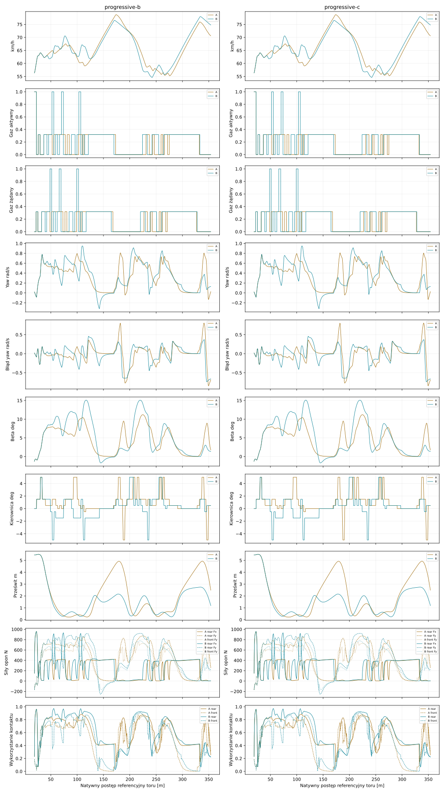
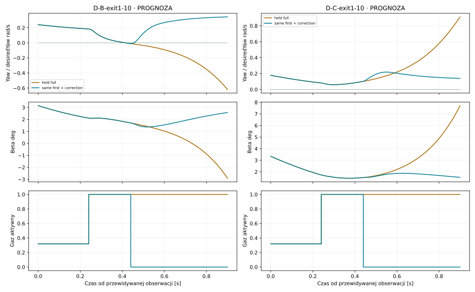

# #137 — Causal Yaw & Throttle Continuation

**PARTIAL · PROVISIONAL, domyślnie OFF.** Baza `060d6819cbae1ab701f3439d74a6e6266230419a`. Oryginalne fizyczne źródła, polityka #16015, tor i zabezpieczenia bez zmian. Bez CEM i bez merge.

Zamrożona selekcja wybrała **B**. Porównanie finałowe obejmuje4 wcześniej zamknięte pary stan/geometria, a ich przedłużenia nie są kolejnymi niezależnymi przypadkami. Wyniki poniżej rozróżniają prognozę, kontrolowaną sekwencję diagnostyczną i samodzielne replanowanie.

Cztery held przypadki to tylko DWIE rodziny fizycznych początków, każda na B/C. Nie traktujemy ich jako czterech niezależnych zawodników. W badanych śladach wewnętrznych oba profile dały identyczne czasy; szerszy zewnętrzny brzeg nie musiał zostać wykorzystany.

## Odpowiedzi 1–6: co robi koszt yaw?

1. Duży koszt wynika z `YawWeight*(r−desiredYaw)^2*10` na końcu utrzymanej komendy H09. Gaz wpływa na oryginalny rozkład Fx/Fy i moment tylnej opony; nie jest wyłącznie wejściem przyspieszenia. Ten koszt nie jest osobnym twardym ograniczeniem yaw.

2. Dotychczasowy predyktor prawidłowo prognozuje fizykę UTRZYMANIA komendy. Nie przewiduje sam z siebie kolejnej korekty. #137 porównuje inną fizyczną sekwencję, a nie naprawia równania Box2D. W czterech preflightach wspólny prefiks i monolityczny causalPolicy mają identyczne XY; rozbieżność Native jest poniżej0,00013m.

3. Przy tej samej pierwszej akcji gaz1 i tej samej kierownicy korekta zmniejsza terminalny koszt yaw w **17/18** skończonych porównań, bez pogorszenia klasy H09. Nie jest to globalny dowód osiągalności. Pełny r/desiredYaw/beta/chi/psi/krzywizna/Fx/Fy/utilization przy0/.2/.24/.4/.44/.6/.9s: [yaw-checkpoints.csv](yaw-checkpoints.csv), z jawnym rozdzieleniem prognoz i native.

Cztery natywne sondy z pełnym gazem i korektą potwierdzają tylko H09. W sześciu innych stanach wybranych do pełnych24 kontynuacji A/B/C/D wygrały w praktyce te same komendy częściowego gazu; nie liczymy tych ukończeń jako24 dowodów korzyści z różnych korekt. [sampled-oracle.json](sampled-oracle.json) jest wyłącznie retrospektywnym minimum tej skończonej próbki, nie sterownikiem.

4. Dwie komendy wystarczają do sprawdzenia części lokalnych korekt. Ich aktywacje to+.24/+.44s; w+.2s pierwsza nadal oczekuje. Wszystkie stare pending pozostają. Wspólny fizyczny prefiks liczymy raz przez oryginalny Predict, następnie≤5 korzeni ×≤7 korekt. To ograniczony zbiór, nie przeszukiwanie całej przestrzeni.

5. C/D używają trapezoidalnej średniej błędu yaw w całym H09, w tych samych jednostkach i z tą samą wagą. Stały błąd ma dokładnie dawny koszt. To porównanie wariantów kosztu, bez założenia, że średnia jest lepszą miarą bezpieczeństwa; późny groźny stan może dostać mniejszy koszt średni. W selekcji C ma dwa DNF (brak certyfikacji), a D przejeżdża wolniej od A i B. Nie potwierdzono przewagi uśredniania yaw.

6. Wyniki autonomicznej selekcji wybrały B regułą niezawodność→średni legalny czas→koszt CPU→nazwa. C i D nie miały zapewnionej wygranej. Dane wszystkich A/B/C/D pozostają w raporcie.

|Diagnoza offline|A: held/terminal|B:2/terminal|C:held/średnia|D:2/średnia|
|---|---:|---:|---:|---:|
|Pierwsze żądanie gaz1 w18stanach|0|0|0|4|

Koszt throttle i zmiany skrętu uwzględnia obie planowane komendy, ważone czasem aktywnego działania w[.24,.9]. Identyczne żądania kanału są scalane: hold→hold ma dokładnie stary koszt. Druga komenda nie jest darmowa. Pozostałe koszty, normalizacja postępu0,6/0,9 i kolejność klas bezpieczeństwa pozostają oryginalne. Nie ma premii za gaz1, małego beta jako celu ani nowego twardego progu yaw.

## Samodzielna selekcja i finał

|Przejazd|Ramię|Dwa łuki s|Łuk1 s|Łuk2 s|Gaz1 żądania|Gaz wyjście1/2|Vmax obserwowane km/h|Wynik|
|---|---|---:|---:|---:|---:|---:|---:|---|
|final-V0-b-A|A|15.75|5.64|5.85|0|0.32/0.32|78.74|completed|
|final-V0-b-B|B|15.76|5.55|5.90|3|0.32/0.32|76.56|completed|
|final-V0-c-A|A|15.75|5.64|5.85|0|0.32/0.32|78.74|completed|
|final-V0-c-B|B|15.76|5.55|5.90|3|0.32/0.32|76.56|completed|
|final-V1-b-A|A|15.70|5.80|5.63|2|0.32/0.32|78.25|completed|
|final-V1-b-B|B|15.56|5.52|5.86|3|0.32/0.32|76.85|completed|
|final-V1-c-A|A|15.70|5.80|5.63|2|0.32/0.32|78.25|completed|
|final-V1-c-B|B|15.56|5.52|5.86|3|0.32/0.32|76.85|completed|
|select-S-B-A|A|15.73|5.80|5.67|0|0.32/0.32|77.54|completed|
|select-S-B-B|B|15.88|5.62|6.07|3|0.32/0.32|78.17|completed|
|select-S-B-C|C|N/D|5.91|N/D|2|0.32/N/D|76.27|uncertified interval|
|select-S-B-D|D|16.12|5.84|6.30|9|0.32/0.32|89.38|completed|
|select-S-C-A|A|15.73|5.80|5.67|0|0.32/0.32|77.54|completed|
|select-S-C-B|B|15.88|5.62|6.07|3|0.32/0.32|78.17|completed|
|select-S-C-C|C|N/D|5.91|N/D|2|0.32/N/D|76.27|uncertified interval|
|select-S-C-D|D|16.12|5.84|6.30|9|0.32/0.32|89.38|completed|
|transfer-A|A|15.50|5.75|5.70|0|0.32/0.32|81.14|completed|
|transfer-B|B|16.37|5.96|6.08|1|0.32/0.32|73.95|completed|

## Odpowiedzi 7–16: prędkość i legalna kontynuacja

7. B samodzielnie żąda gaz1 częściej: w normalnych held V0 są3 żądania wobec0 dla A; w V1 są3 wobec2. W przedłużeniu V1 B dochodzi do4 żądań. To nie jest wymuszony gaz.

8–9. Częstsze żądania NIE dają pełnego gazu na geometrycznym wyjściu. Na obu wyjściach wszystkich czterech held A i B mają aktywne około31,82%. Planowana druga komenda jest jedynie prognozą: następny rzeczywisty review ponownie obserwuje i wybiera. Nie twierdzimy, że każda zapowiedziana korekta została wykonana. Dokładne czasy i miejsca otwarcia: [drive-utilization.json](drive-utilization.json), [native-checkpoints.json](native-checkpoints.json).

10–12. B nie przyspiesza pełnym gazem przez całą dostępną prostą. Maksimum w normalnym dwubendowym held wynosi76,56–76,85km/h, a po przedłużeniu maksimum B to83,43km/h. D osiągnął89,38km/h w selekcji, lecz był wolniejszy całościowo. Żaden nowy autonomiczny wariant nie osiągnął100km/h. Osiągi napędu z izolowanej próby #136 nie zostały wykorzystane: na wyjściu pozostaje częściowy gaz, potem występuje odpuszczenie przed następnym łukiem. Poniżej zmierzony podział czasu i wykorzystanie tylnego kontaktu na obu prostych.

|Przejazd / prosta po łuku|Czas gaz0 s|Czas częściowy s|Czas pełny s|Średnie rear utilization|Średni abs slip ratio|Pierwszy coast przed następnym łukiem m|
|---|---:|---:|---:|---:|---:|---:|
|extended-V0-b-A / 1|1.01|2.06|0.00|0.470|0.068|26.47|
|extended-V0-b-A / 2|1.07|2.14|0.00|0.452|0.069|26.64|
|extended-V0-b-B / 1|1.18|1.95|0.00|0.385|0.068|29.47|
|extended-V0-b-B / 2|0.98|2.12|0.00|0.385|0.070|25.80|
|extended-V1-b-A / 1|1.19|2.02|0.00|0.450|0.066|28.91|
|extended-V1-b-A / 2|1.20|1.98|0.00|0.455|0.065|29.28|
|extended-V1-b-B / 1|1.04|2.09|0.00|0.290|0.069|26.83|
|extended-V1-b-B / 2|1.03|1.71|0.20|0.398|0.099|28.80|

W tej próbie nie wykazano, że stale nasycona opona uniemożliwia100km/h: średnie wykorzystanie kontaktu na prostej trzeba czytać razem z częściowym gazem. Nie mamy globalnego dowodu bezpiecznego wejścia w następny łuk przy100km/h. Rozdzielamy niewykorzystany napęd i konserwatywne/lokalne sterowanie od niepotwierdzonej osiągalności szybkiej całej trajektorii.

13. Każde przekroczenie beta45, granicy obrysu, utrata certyfikacji, reverse/projection i fizycznych zakresów aktuatora zatrzymuje świat. Duże yaw samo nie jest DNF. Pełny gaz przy DNF nie stanowi sukcesu. [dnf.json](dnf.json) zawiera każdy stan końcowy i przyczynę, także po historycznym ukończeniu dwóch łuków.

14–15. Czasy obu łuków są oddzielone powyżej. Poniższe porównanie jest niezależną pulą, nie najlepszym przypadkiem wybranym po wyniku.

|Held przypadek|A−nowy czas s|Średni zysk na2wyjściach km/h|Zysk po40m km/h|Wspólne kryteria poprawy|Nowy DNF|
|---|---:|---:|---:|---|---|
|V0-b|-0.01|0.65|-1.99|False|False|
|V0-c|-0.01|0.65|-1.99|False|False|
|V1-b|0.14|2.49|1.18|False|False|
|V1-c|0.14|2.49|1.18|False|False|

16. Oddzielny transfer na istniejący egg-asymmetric ma ten sam początek V1 i wybór zamrożonego wariantu; brak strojenia na tym torze. B kończy legalnie, lecz jest o 0,87 s wolniejszy od A. Transfer nie potwierdza poprawy; [transfer.json](transfer.json) pozostaje poza czterema held przypadkami.

## Pełna następna prosta — osobny zakres

|Przejazd|Historyczne2łuki PASS|Prędkość wyjścia2|+10m|+20m|+40m|+62m|Zaobserwowany zakres m|Wynik całego przedłużenia|
|---|---|---:|---:|---:|---:|---:|---:|---|
|extended-V0-b-A|True|60.65|64.77|68.62|75.74|70.62|61.96|completed|
|extended-V0-b-B|True|62.99|66.86|70.55|77.45|74.76|62.00|completed|
|extended-V0-c-A|True|60.65|64.77|68.62|75.74|70.62|61.96|completed|
|extended-V0-c-B|True|62.99|66.86|70.55|77.45|74.76|62.00|completed|
|extended-V1-b-A|True|61.77|65.74|69.58|75.81|69.62|61.97|completed|
|extended-V1-b-B|True|65.97|69.71|73.29|82.76|80.43|61.93|completed|
|extended-V1-c-A|True|61.77|65.74|69.58|75.81|69.62|61.97|completed|
|extended-V1-c-B|True|65.97|69.71|73.29|82.76|80.43|61.93|completed|

Definicja historyczna pozostaje: pełny obrys za drugą bramką +1s legalnej kontroli. Przedłużenie kończy się na faktycznych62m następnej prostej albo wcześniejszym DNF. Odrębny scope zachowuje ukończenie historyczne nawet przy późniejszej porażce. Żadne N/D nie jest zerem. Dokładne zgodne prefiksy zostały sprawdzone.

## Odpowiedzi 17–20 i werdykt

17. Wybrany wariant na held: **0.156718s CPU/dec**, budżet GO z preflight **0.163482s**. Poszczególne mean/p95/max, prognozy, oceny kontaktów oraz fizyka Native są rozdzielone w [native-summaries.json](native-summaries.json) i planach. Nie chowamy wyszukiwania w czasie epizodu.

18. Ekstrapolacja czterech zawodników przy5decyzjach/s to **3.134 CPU-s/s** samych wyszukiwań, przed fizyką i rywalami. To nie jest zmierzony bieg czterech zawodników i nie dowodzi gotowości czasu rzeczywistego.

19. Największą granicą jest zgodność lokalnie korzystnej, skończonej kontynuacji z dalszym replanowaniem i długim przejazdem. Prognozowana korekta może zostać zmieniona przy następnym review. Średni yaw może też osłabić znaczenie końcowego złego stanu. Nie rozwiązujemy tego obniżeniem YawWeight, zwiększeniem gripu ani sztywnym gaz1 na wyjściu.

20. **PARTIAL.** Bramki: `{'JointThreeHeldCases': False, 'TwoHeldGeometries': False, 'NoNewHeldDnf': True, 'AutonomousFullExitBothProfiles': False, 'MeanSearchCpu': True, 'FourRiderCpuProjection': True, 'PredictionPreflight': True}`. GO wymaga≥3/4 jednoczesnych popraw czasu/wyjścia/prostej, obu profili, braku nowych DNF i spełnienia kosztu. Niespełnione kryteria pozostają jawne; mechanizm nie trafia do domyślnego sterownika.

## Metodologia, dowody i koszt

**60 nowych światów; 520.453125s CPU epizodów i wyszukiwań; 13442811 ocen kontaktu; 153955 prognoz.** Twarde limity60/900s/30M/300k. Read-only analiza i raportowanie mają oddzielne pomiary CPU i dodane koszty zapytań; brak nowych światów podczas analizy. Budżet nie był podnoszony po wynikach. Pomiar epizodów/search obejmuje 520,453125 s CPU; serializacja raw po timerze, build i testy są poza tym pomiarem. Odczyt i metryki to osobne 8,859375 s CPU, 0 nowych światów i 3292 niezatwierdzane zapytania o siły stanów prognozy; główny raport ma osobny report-cost.json. Nie jest to czas całego procesu wraz z I/O.

Pule:18 diagnostycznych obserwacji z dwóch zapisów #136,24 kontrolowane sekwencje,2 selekcyjne początki/geometrie ×4ramiona,4 wcześniej zamknięte pary held A/wybrany wariant, oddzielne przedłużenia i transfer. Wszystkie ramiona używają identycznych początków i nawierzchni w danym przypadku. Root/correction set, źródła, thresholds i evaluation-definition zamknięto przed finałem.

Geometria to oryginalne zmienne łuki, progressive-b12→16,6→12, progressive-c12→17/16,2→12, 318,78m, szerokość prostych12m i historyczne35+27. Cztery neutralne pola3m bez bonusów. Brak zmiany band, kredy i obrysu. Kierunek przeciwny do wskazówek zegara.

DesiredYaw w CSV jest dokładnym, oryginalnym odczytem geometrii z preview polityki przy bieżącym stanie Native: ahead=max(0,1m, ReferenceSpeed*PreviewSeconds), preview=RoadAt(s+ahead,offset), desiredYaw=Speed/preview.RadiusMeters na łuku i 0 na prostej. To nie jest krzywizna wektora prędkości: tę obliczamy osobno z rzeczywistego przyspieszenia. Fx/Fy/energia w wierszu odnoszą się do ostatniego ukończonego przedziału, a gaz do bieżącego accepted stanu. Prognozowe siły w traces są jawnym, niezatwierdzanym zapytaniem dt0 do oryginalnego kontaktu.

Pełne raw wszystkich światów: [raw-manifest.json](raw-manifest.json), native/, CSV telemetry/, oddzielne plany i prognozy. Testy źródeł i fingerprintów zachowują wszystkie dowody #129–#136. Uruchom tools/run-causal-yaw.ps1 do świeżych katalogów; nie nadpisuj rezerwacji. Release, testy i końcowy standardowy Windows CI opisane w validation.json oraz Draft PR.

[Protokół](protocol.json) · [Próg GO](thresholds.json) · [Selekcja](selection-lock.json) · [Wyniki held](held-comparisons.json) · [Replay lokalny](../../../tools/replay-viewer/?case=causal-yaw)

