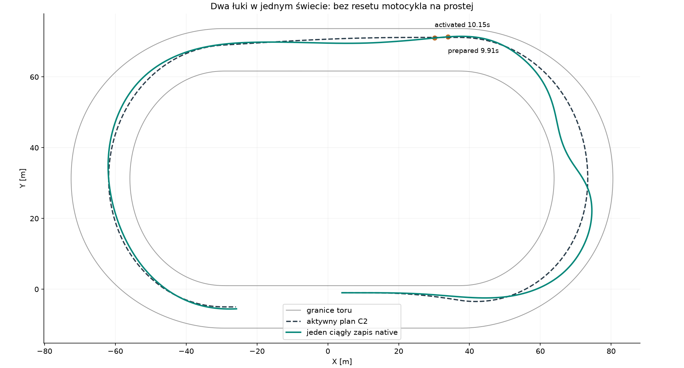
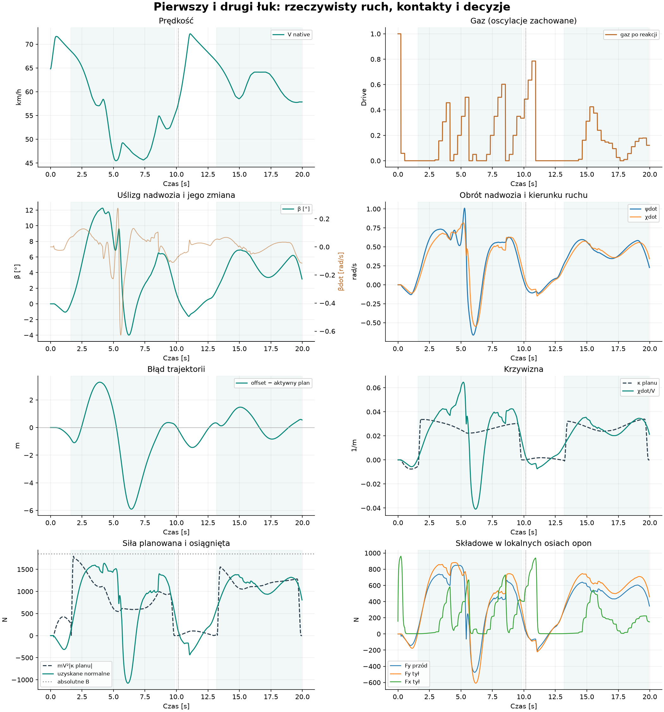

# #123 — dwa kolejne łuki w jednym przebiegu

**PASS. Oba łuki Egg Mild ukończono w jednym świecie Box2D, bez resetu
motocykla i bez strojenia. Drugi łuk ma mniejszy błąd i mniejszą utratę
prędkości. Nie jest to certyfikat realistycznie szybkiej jazdy ani pełnego biegu.**

Baza: zweryfikowany, otwarty Draft #122,
`f9d4dd7d8d09a755830c716c3f34af9e7daecc58`. Zachowano silnik #116, oryginalne
opony i µ, masę 147 kg, I=52,72097 kgm², geometrię, #117, 90°/s kierownicy
i wszystkie stałe/opcje planera #122. #120, #114 i #121 pozostają poza wariantem.
Nowe `EnableContinuousCornerPlanning` jest domyślnie OFF i wymaga istniejącego
`EnablePreparedCornerPlan` z aktywną ścieżką oraz gazem C.

## Minimalna zmiana cyklu życia planu

`ContinuousCornerPlanning` wybiera następny łuk po zaakceptowanym wyjeździe
całych kapsuł motocykla przez płaszczyznę wyjścia poprzedniego. Warunek wymaga
również rzeczywistego postępu s przez poprzedni łuk; sam znak odległości od
płaszczyzny nie wystarcza. Następny łuk wynika z istniejącej topologii,
z rozwiniętymi współrzędnymi kolejnych okrążeń. Test czysty sprawdza zawinięcie
z drugiego łuku do pierwszego w następnym okrążeniu; takiego przejazdu nie wykonano.

Nowy plan czeka oryginalne 0,24 s. W tym czasie działa poprzedni plan i jego
reguła gazu. Przy aktywacji przenoszona jest **najnowsza** pamięć żądania gazu
oraz zegar następnej oceny; oczekujący `DecisionEvent` nie jest anulowany ani
przesuwany. Przewidywana praca podczas reakcji uwzględnia termin i wartość tego
rozkazu. Nie ma ponownego ustawienia gazu na 1.

Nowa ścieżka korzysta z `AuthoredRacingPath.Connected`. Zachowuje stary plan
przed złączeniem, a quintic Hermite dopasowuje d, d′ i d″ w złączeniu do nowego
celu. Działa także przy niezerowych pochodnych starej ścieżki. Nie przyciąga
motocykla do nowej linii i nie usuwa istniejącego błędu pozycji/kierunku. Pozycja,
velocity, heading, β, yaw, kierownica i koło pozostają stanami zaakceptowanej fizyki.
Reguła `Observe` #122, jej progi, rezerwy, horyzont i gains nie zostały zmienione.

## Najpierw diagnostyka zapisanego C — zero światów

Punkt diagnostyczny: koniec C #122 w 9,91 s, s=133,47935 m,
offset 8,65976 m, V=15,40279 m/s, β=1,7695°. Zachowano koło, kierownicę,
gaz 0,335416, pamięć gazu 0,535416 i oczekujące polecenie 0,485416 na 10,04 s.

Plan wybiera preferowane 5 m, przejście od starej linii 8,5 m rozpoczyna
w s=137,53023 m i kończy w środku drugiego łuku s=243,08406 m.
Wejście drugiego łuku: 194,38937 m; wyjście: 291,77875 m. Wszystkie te wartości
pochodzą z topologii i stanu, nie z harmonogramu wpisanego do AI.

- Ciągłość złączenia: skok XY=0 m, stycznej=0 rad, krzywizny=0 m⁻¹.
- Pełny planowany obrys przy stycznej i ±45°, próbkowany co 0,25 m:
  min prześwity 5,213 / 1,713 m. Kandydaci zachowują dotychczasowy zapas
  0,5 m i oszacowanie interpolacji. Użyto rzeczywistej szerokości drugiego łuku.
- Przy stałej prędkości zapisanego stanu max mV²|κ|=1183,03 N.
  Bieżący kontakt h0: osiągalne kąty 10 ms dają około 528,18 N,
  pełne statyczne ±35° około 1019,97 N, górna granica po Fx/β 1778,90 N.
- Początkowy błąd kierunku ruchu względem zachowanej ścieżki wynosi
  0,068586 rad. Nie zerowano go. Profil widzi jeszcze łagodną prostą;
  nie przewiduje rzeczywistego przyszłego przyspieszenia Box2D.

To konieczne sprawdzenie geometrii i lokalnej odpowiedzi, **nie potwierdzenie
dynamicznej wykonalności**. Po diagnostyce nie zmieniano parametrów.

## Jedna próba native i dokładny prefix

Przed próbą zapisano `protocol.json` z normalizowanymi SHA źródeł. `attempt.json`
powstał przed utworzeniem świata; exporter odmawia nadpisania. Dokładnie jeden
nowy świat od s=4 m, V=18 m/s, offsetu 1 m, β=0, toczącego koła i kierownicy 0.
Jedno `WorldRunner.Run`, 2002 zaakceptowane interwały i 2002 commity koła.
Stop nastąpił po wyjeździe całego obrysu przez drugie wyjście, w 19,98 s,
s=292,98225 m. Rzeczywista droga XY całego zapisu: 331,834 m. Nie ukończono okrążenia.

Pierwsze **993 interwały** i wszystkie **25 poleceń** do końca C #122 są
identyczne, łącznie z oczekującym rozkazem. Read-only hash zaakceptowanych
stanów w 9,91 s:
`A44925BFD8741A5E6ECA89EB9D635EFF27BC0AC1857227EB5F55D718F24E62A9`.
Zgadza się z pełnym fingerprintem C #122. Dodatkowo porównano wszystkie pola
surowych wierszy, stan początkowy i polecenia, bez nowego przejazdu kontrolnego.

Plan powstał w **9,91 s**, aktywował się w **10,15 s**. Zostało wtedy
57,163 m referencji i 3,037 s rzeczywistej jazdy do wejścia drugiego łuku.
To wcześniejsze przygotowanie niż pierwsze wejście po 1,601 s od startu.

### Pełny stan w chwili aktywacji 10,15 s

| Wielkość | Stan zaakceptowany / obserwacja |
|---|---|
| XY [m] | (30,162766; 71,001650) |
| s / rzeczywista droga od startu [m] | 137,226609 / 158,611988 |
| offset / dotychczasowy cel [m] | 8,338628 / 8,5 |
| velocity XY [m/s] | (−15,915977; −1,529341) |
| V | 15,989284 m/s = 57,5614 km/h |
| ψ / χ [rad] | −3,035190 / −3,045798 |
| β | +0,010608 rad = +0,6078° |
| ψdot / χdot / βdot [rad/s] | −0,028444 / +0,040947 / −0,069391 |
| Kierownica | −0,008352 rad = −0,4785° |
| Koło | 57,159683 rad/s; 545,835 rpm; obwodowo 18,862695 m/s |
| Wheelspin κ lokalnego kontaktu | 0,179687 |
| Gaz wykonany / pamięć żądania | 0,485416 / 0,635416 |
| Oczekujący gaz | decyzja 10,10 s → aktywacja 10,34 s, gaz 0,635416 |
| Następna ocena | 10,20 s, bez resetu zegara |
| Wybrany nowy cel / koniec przejścia [m] | 5 / 243,084062 |

χdot/βdot w tabeli pochodzą z faktycznie zastosowanego kontaktu pierwszego
interwału nowego planu. Różnice zaakceptowanych kierunków przez ten interwał
dają +0,040865 / −0,071645 rad/s. Pełne zdarzenie zawiera również oddzielną
obserwację h0; nie mylimy tych próbek. Mechanicznie powiązane obroty silnika
#116 wynikają nadal z tego samego koła i przełożenia; nie dodano stanu sprzęgła.

Rozkaz oczekujący przy tworzeniu planu aktywował się prawidłowo w 10,04 s.
Rozkaz oczekujący przy aktywacji nowego planu wykonał się w 10,34 s.
Żadne polecenie nie zostało anulowane; nie przywracano stanu startowego.

## Porównanie łuków

V i czas CoM dotyczą interpolowanych przekroczeń referencyjnego wejścia,
środka i wyjścia. Droga jest sumą rzeczywistych odcinków XY, nie przyrostem s.
Ekstrema, RMS i energia obejmują zaakceptowane interwały od pierwszego stanu
za wejściem do pełnego wyjazdu obrysu: 1,601359–9,91 s i 13,186709–19,98 s.
Istniejący podział kroku przy granicach krzywizny ogranicza odchylenie początku
od interpolowanego wejścia do około 0,20 / 1,04 µs. Dlatego RMS pierwszego
łuku różni się od RMS całego, obejmującego dojazd zapisu C #122 (2,539 m).

| Miara | Pierwszy łuk | Drugi łuk |
|---|---:|---:|
| Wynik | PASS | PASS |
| V wejście / środek / wyjście [km/h] | 68,62 / 46,65 / 54,92 | 66,33 / 64,11 / 57,84 |
| V minimum [km/h] | 45,48 | 57,74 |
| Czas wejście→wyjście CoM [s] | 8,2374 | 6,7184 |
| Droga XY wejście→wyjście CoM [m] | 122,729 | 114,785 |
| Pełny wyjazd obrysu [s] | 9,91 | 19,98 |
| Max / RMS błąd własnej ścieżki [m] | 5,906 / 2,770 | 1,475 / 0,766 |
| Max offset [m] | 11,347 | 6,821 |
| Konserwatywne prześwity wewn./zewn. [m] | 2,547 / 1,735 | 4,627 / 3,769 |
| Max \|β\| [°] | 12,248 | 6,897 |
| β na końcu pełnego wyjazdu [°] | 1,770 | 3,112 |
| Końcowe βdot z różnicy stanów [rad/s] | −0,1001 | −0,1192 |
| Zakres βdot z kontaktów [rad/s] | −0,628…+0,276 | −0,115…+0,068 |
| Zakres ψdot [rad/s] | −0,663…+1,010 | +0,227…+0,596 |
| Zakres χdot [rad/s] | −0,548…+0,816 | +0,223…+0,576 |
| κ planu [m⁻¹] | −0,00524…+0,03427 | −0,00093…+0,03392 |
| Rzeczywiste χdot/V [m⁻¹] | −0,04094…+0,06460 | +0,01211…+0,03540 |
| Max planowane mV²\|κ\| [N] | 1797,14 | 1555,07 |
| Faktyczna siła normalna [N] | −1077,43…+1637,89 | +604,43…+1380,31 |
| Fy przód / tył [N, zakres] | −474…848 / −609…882 | 293…639 / 311…746 |
| Fx tył [N, zakres] | 1,59…730,12 | 3,95…541,60 |
| Średni gaz | 0,1650 | 0,1269 |
| Gaz min…max / odjęcia do zera | 0…0,603 / 4 | 0…0,425 / 1 |
| Wheelspin κ min…max | 0,00049…0,43690 | 0,00099…0,23711 |
| Zmiany kierunku ruchu kierownicy* | 29 | 15 |
| Aktywność limitu 90°/s | 10,83% | 0% |

*Zliczane zmiany znaku przyrostu wykonanej kierownicy po pominięciu przyrostów
≤1e−5 rad. To opis oscylacji, nie nowy parametr regulatora. Oba łuki używają
tych samych budżetów przód 854,926 N / tył 997,413 N. W drugim max wykorzystanie
wynosi około 74,80% przodu i 82,39% normy Fx/Fy tyłu; µ nie zostało zwiększone.*




Nie obserwujemy narastającego błędu ani postępującego załamania prędkości
na drugim łuku: błąd i β są mniejsze, a minimum, środek i wyjście szybsze.
W drugim łuku V nadal spada 66,33→57,84 km/h. Obserwacji sprzyjają dłuższy
dojazd, już zajęta szeroka linia i łagodne przejście do 5 m. Pojedynczy test
nie rozdziela przyczynowego udziału każdego z tych elementów.

Pierwszy łuk zachowuje znane duże przestrzelenie i oscylacje #122; drugi ich
nie usuwa wstecz. Gaz na prostej rośnie zgodnie z obecną polityką, osiąga
około 0,79, a następnie zostaje odjęty przed drugim wejściem. Nie optymalizowano
tego zachowania ani czasu. 38,6% interwałów drugiego łuku nadal ma żądanie
regulatora poza próbkowaną lokalną odpowiedzią; sam PASS nie jest idealnym
trackingiem ani dowodem globalnej stabilności. Realizm opony pozostaje osobną
nierozstrzygniętą kalibracją #118.

## Energia i zachowanie fizyki

Niezależny ledger odtwarza pracę na faktycznych punktach kontaktu, obrót
ciała i koła dokładnie raz. Okna obejmują pełny wyjazd obrysu, jak powyżej.

| Energia [kJ, poza resztą] | Łuk 1 | Łuk 2 | Cały zapis wraz z dojazdem/prostą |
|---|---:|---:|---:|
| Praca silnika na kole | +29,751 | +20,815 | +80,121 |
| Straty boczne przód / tył | 12,230 / 10,449 | 5,798 / 7,239 | 18,180 / 17,874 |
| Straty wzdłużne / łożysko | 5,457 / 0,413 | 2,154 / 0,407 | 15,400 / 1,219 |
| Praca oporów | −10,733 | −11,435 | −32,459 |
| Zmiana energii ciała / koła | −9,264 / −0,267 | −5,972 / −0,244 | −4,833 / −0,179 |
| Reszta [J] | +0,104638 | +0,143998 | +0,097721 |

Niewyjaśniona część każdego bilansu <1e−6 J, dla całego zapisu około
−1,7e−10 J. Resztę wyjaśnia zmierzona praca błędu impulsu float Box2D.
Brak kroków z niedopuszczalnym nadmiarem energii. Wszystkie Fx/Fy i zmiany
kierownicy mieszczą się w oryginalnych granicach; nie dodano siły, momentu yaw,
hamulca ani zapisów położenia/velocity/heading.

Cały zapis ma konserwatywne minima 1,490 / 1,735 m (obejmujące także początek
dojazdu). Na drugim wyjściu β=3,112° maleje. Ta lokalna obserwacja odzyskania
nie jest dowodem bezpiecznych kolejnych okrążeń.

## Walidacja, koszt i zakres

- Release całego rozwiązania: 0 ostrzeżeń/błędów. 21 celowanych C# PASS:
  7 nowych przypadków i 14 dotychczasowych #122. Nowe testy obejmują cykl życia,
  obrys, C2 przy niezerowych pochodnych, brak resetu/odwołania rozkazu, zawinięcie
  topologii oraz odtworzenie **całych 2002 kontaktów i 200 ocen** bez świata.
- Niezależne testy Python sprawdzają bilans, reakcje, prefix, bezpieczeństwo,
  metryki obu łuków i wszystkie zachowane bajty. Końcowe Windows CI dla
  dokładnego HEAD jest wskazane w Draft PR.
- **1215 historycznych SHA-256 zachowanych**, w tym wszystkie 37 plików
  manifestu #122. Dane i fingerprint C pozostają nietknięte. Historyczny guard
  źródeł #122 zawężono do niezmiennych silnika/kontaktów/#117: zatwierdzone
  rozwijanie geometrii/integracji nie może wymagać wiecznego zamrożenia ich
  kodu. Surowe i kanoniczne SHA dawnych źródeł nadal są w dawnym manifeście;
  zgodność działania zastępuje dokładny prefix i pełny replay.
- 200 ocen ×13 h0 =2600 zapytań planera; 2 dodatkowe h0 obserwacje zdarzeń.
  Oryginalne kontakty regulatora/zastosowania/granic: 104364 zapytania.
  Nie ma świata dla kandydatów. Geometria następnego planu powstaje raz,
  oceny prędkości zachowują dotychczasowy okres 0,1 s.
- Jeden nowy świat pomiarowy, zero powtórzeń ON, zero pełnych okrążeń,
  brak czterech zawodników i merge. Nie uruchomiono automatycznie dalszego testu.

Fingerprint całej próby:
`33741F49880FADBCA5C7ECE240B32EF0017463A30B1BF85B32E06131D5CD4A03`.
Dowody: [analysis.json](continuous-corner-planning/analysis.json),
[pełne zdarzenia zmiany planu](continuous-corner-planning/changes.json),
[protokół](continuous-corner-planning/protocol.json),
[prefix](continuous-corner-planning/prefix.json), CSV.gz i manifest.

```powershell
dotnet restore SpeedwayManager.sln --locked-mode
dotnet build SpeedwayManager.sln -c Release --no-restore --warnaserror
# Nowy pusty katalog; każdy etap osobno:
dotnet tools/shared-world-speedway/bin/Release/net8.0/shared-world-speedway.dll continuous-corners results/continuous-recapture diagnostic
# Następnie freeze, potem dokładnie jedno trial.
python tools/shared-world-speedway/continuous-corners-report.py --plots
python -m unittest discover -s tests/calibration -p test_continuous_corners.py
```

Raport Python analizuje dostarczone zapisy, nie uruchamia fizyki. Parametry
pozostają PROVISIONAL i wszystkie nowe flagi OFF.
