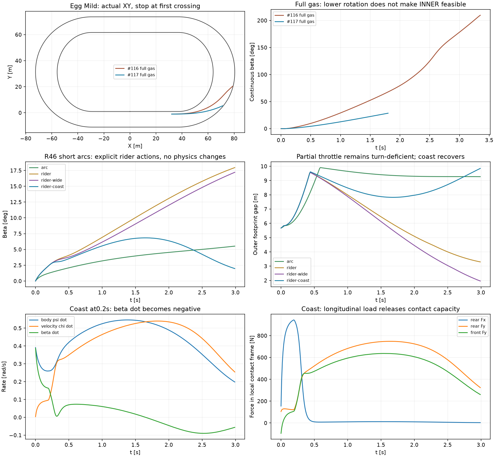

# #117 — kontrolowany uślizg i rzeczywisty kierunek jazdy (PROVISIONAL)

**Krótka próba wykonalnego łuku i jawne odzyskanie kontroli po zamknięciu gazu
przechodzą. Pełny gaz po INNER na Egg Mild nadal nie przechodzi.** Nowy regulator
ogranicza narastanie rotacji, ale nie wytwarza brakującej siły opon. Na Egg
przekracza zewnętrzną granicę wcześniej niż #116; nie jest to poprawa bezpieczeństwa
tej trajektorii. Nie uruchomiono okrążeń ani wyścigów.

Baza: aktualny otwarty Draft #116, `653c702bccefaa6bc83b20f1c646ddb869a58223`,
`experiment/500cc-engine-contact-performance`. Jeden kolejny Draft na tej gałęzi,
bez merge. `EnableTravelDirectionSteering` domyślnie OFF i nieobecny w serializacji
OFF. Wymaga izolowanych dwóch kontaktów i #113. #114 pozostaje OFF/odrzucany.

## Kinematyka i siły

Współrzędne świata: dodatni kąt i obrót przeciwnie do wskazówek zegara.
`ψ` to orientacja nadwozia, `χ=atan2(vy,vx)` to kierunek prędkości środka masy,
`β=wrap(ψ−χ)` to uślizg. Dodatni β oznacza nadwozie obrócone w lewo względem
prędkości. `ψdot=body.AngularVelocity`, `χdot=cross(v,Fnet)/(m|v|²)`;
`βdot=ψdot−χdot`. Opory są w Fnet; przy obecnym prawie są równoległe do −v.
Poniżej0,5 m/s kierunek jest jawnie oznaczony jako niezdefiniowany, zamiast
interpretacji ilorazu przez niemal zerową prędkość. Dane kontaktów pozostają float;
odejmowanie raportowanych pochodnych jest double, aby zachować tożsamość βdot.

`TravelDirectionState` mierzy te wielkości. `Motion` w decyzji dotyczy zapytania
przy poprzedniej kierownicy; `*-control.csv.gz` zapisuje pochodne **rzeczywiście
przyłożonych** sił po ograniczeniu prędkości kierownicy. Te dwa pomiary nie muszą
być identyczne. Dodatkowo raport wylicza zmianę χ z rzeczywistych końców kroków
Box2D; największa różnica od chwilowego χdot sił to0,000587 rad/s (skończone dt).
XY i prześwity pochodzą wyłącznie z zaakceptowanych stanów świata.

## Diagnoza zachowanych C — zero światów Box2D

Wykorzystano wszystkie337 zapisanych stanów `C-both-egg-first.csv.gz` #116.
Odtworzenie wszystkich czterech składowych sił kontaktów starego regulatora jest
dokładne: maksymalna różnica0 N. Zapytania nie zatwierdzają koła ani kierownicy,
nie uruchamiają RNG, zużycia toru ani drugiego świata. Nie odtworzono prefiksu
przez ponowną jazdę. Późniejsza poprawka double dotyczyła wyłącznie wyprowadzonej
kolumny βdot i metadanych; zapisane stany, siły i fingerprinty nie były zmieniane.

| C, t [s] | β [°] | ψdot [rad/s] | χdot [rad/s] | żądane χdot | maksimum próbkowane χdot | absolutna granica B/(mV) |
|---|---:|---:|---:|---:|---:|---:|
|0,50|9,70|0,8262|0,2749|0,9256|0,4059|0,6140|
|1,00|29,06|1,2485|0,4831|1,2939|0,5212|0,5730|
|1,50|52,48|1,4110|0,5511|1,4266|0,5521|0,6014|

β przekracza1° przy dodatnim βdot>0,1 rad/s już w0,16 s. To jawnie określony
próg diagnostyczny, nie uniwersalny punkt utraty stabilności. W0,5 s βdot wynosi
0,5513 rad/s. Tył zużywa923,97 N z997,41 N pojemności na Fx (92,64% promienia
koła sił; 85,82% jego kwadratu). Pozostaje najwyżej375,65 N bocznej pojemności
przy tym Fx; faktyczny Fy wynosi319,05 N. Ta reszta nie jest dodatkowym budżetem
poza kołem sił ani obietnicą odzyskania kontroli.

**Od0,27 s potrzebnego skrętu nie zapewni żadna kierownica przy tym stanie
prędkości i budżecie kontaktów:** żądanie przekracza nawet `B/(mV)`, gdzie B jest
sumą obu niezmienionych pojemności. To górna granica niezależna od próbkowania
kierownicy; rzeczywiste combined slip i równowaga momentów dają mniej. Utrzymanie
żądanego skrętu przy niezmienionym pełnym gazie wymaga decyzji o gazie/torze jazdy.

W0,5 s zakres kierownicy zawiera jeszcze odpowiedzi zmniejszające prognozowany
βdot (minimum−0,394 rad/s w lokalnym horyzoncie0,1 s). Nowy regulator żąda
−8,45°, ale ograniczenie90°/s nie pozwala natychmiast osiągnąć tego kąta;
wykonany lokalny χdot wynosi0,2646, a nie0,4059. Na starej, już rozpędzonej
rotacyjnie trajektorii od1,13 s (β34,90°) wszystkie **próbkowane** odpowiedzi mają
dodatni prognozowany βdot. To lokalny alarm braku odzyskania w horyzoncie0,1 s,
nie matematyczny dowód nieodwracalności przyszłego ruchu ani pełna certyfikacja
ciągłego zakresu kątów. Nie utożsamiamy go z mocniejszym dowodem B/(mV).

## Nowy regulator

W tych samych zamrożonych stanach i przy tym samym gazie ocenia oryginalne oba
kontakty. Dla każdego kąta δ oblicza rzeczywiste χdot oraz lokalną prognozę
`q=ψdot+T·τcontacts/I−χdot`, gdzie T to istniejące0,1 s #113. Minimalizuje
`(χdot−χdot_request)² + q² + excess²`. `excess` jest częścią q, która w lokalnej
prognozie wyprowadza β poza robocze±45°. To jawne, wstępne założenie regulatora,
nie zmiana opony, korekta β ani twardy ogranicznik fizycznej rotacji.

q tłumi narastanie różnicy pochodnych. W #113 odniesieniem momentu był żądany
obrót, nawet gdy opona nie potrafiła zmienić kierunku prędkości. Tutaj odniesienie
zależy od **dostępnego χdot przy danym δ**. Nie ma celu β=0: dla dowolnego
stałego niezerowego β wewnątrz roboczego zakresu, równych pochodnych i żądanego
χdot koszt stabilności jest zerowy. Nie ma pamiętanego błędu, windup ani ukrytego
stanu. Wagi równych błędów prędkości kątowej i robocze45° są PROVISIONAL;
nie strojono ich przeszukiwaniem wariantów.

32 przedziały pełnego zakresu,16 zapytań lokalnego doprecyzowania, początkowe
i końcowe zapytanie dają stałe51 zapytań. Stare±35° i90°/s nadal obowiązują.
Po ograniczeniu szybkości sprawdzana jest odpowiedź dla użytego midpoint kąta.
Flagowane są nieosiągalność w próbkach, przekroczenie absolutnej granicy siły,
narastanie β przy ryzyku wyjścia z roboczego zakresu oraz brak próbkowanego
lokalnego odzyskania. Horyzont jest algebraiczną prognozą odpowiedzi momentu;
nie symuluje drugiego motocykla/świata ani nie przewiduje dokładnie przyszłego χdot.

Jedynym wyjściem wykonawczym jest polecenie kierownicy. Box2D dostaje dokładnie
stare siły w punktach styku i opór w środku masy. Brak bezpośredniego momentu yaw,
zmiany prędkości, pozycji, mocy, przełożenia, µ, wymiarów, parametrów opon czy #55.
Fizyka i kierownica nigdy nie zmieniają Drive. Nie włączono #115 AI.

## Próby w kolejności i ich granice

Najpierw diagnoza337 stanów bez świata; następnie krótki łuk wykonalny. Dopiero
po jego przejściu wykonano Egg Mild Drive1 jako diagnostykę. Jedno ręczne polecenie
częściowego gazu pozostawiło niedobór skrętu, więc dodano dwie jawne krótkie
kontrole: ten sam częściowy gaz z szerszym celem oraz pełne zamknięcie gazu.
Łącznie **pięć krótkich światów diagnostycznych, zero okrążeń**, bez automatycznego
przeszukiwania. Wszystkie próby są zachowane, również słabsze warianty.

| Próba | Warunki | β max / koniec [°] | V końcowa [km/h] | konserwatywny min inner / outer [m] | Wynik |
|---|---|---:|---:|---:|---|
|R46 wykonalny,3 s|V14 m/s, Drive0,35|5,52 /5,54|69,66|5,521 /5,583|krótki zakres przechodzi|
|Egg Mild INNER, Drive1|identyczny start C #116|28,54 /28,75|89,63|1,443 /−0,189|STOP1,81 s, zewnętrzna granica|
|R46 częściowy,3 s|V18, Drive1→0,35 w0,2 s, cel5 m|17,96 /18,00|77,88|5,501 /3,174|bez przekroczenia, ale niedobór skrętu przez całą próbę|
|R46 szerszy,3 s|to samo, cel5→7 m w0,2 s|17,21 /17,26|79,09|5,501 /1,834|bez przekroczenia, nadal niedobór; niezaliczona stabilizacja|
|R46 zamknięcie gazu,3 s|V18, Drive1→0 w0,2 s, cel5 m|6,83 /1,94|56,22|5,501 /5,569|odzyskanie krótkiej kontroli|

R46 to osobny istniejący fixture #116: wewnętrzny promień41 m, cel offset5 m,
s35,05, rolling wheel, początkowy body yaw V/46. Początkowe β≈0, kierownica0.
Nie zmieniono Egg Mild na okrąg ani nie porównuje się czasów różnych odcinków
jako wyniku sportowego. Ostatnia próba nie stanowi walidacji odjęcia gazu na Egg.

Na wykonalnym łuku βdot na końcu to+0,0199 rad/s: uślizg pozostaje mały w3 s,
ale nie udowodniono długookresowego stanu ustalonego. Brak nawrotów sterowania
o szybkości ponad1°/s. W próbie coast βdot od około1,7 s staje się ujemne;
na końcu−0,0561 rad/s. Wheelspin spada z maksimum72,76% do0,0915%.
Przed zamknięciem gazu wykorzystano45,89 kW na kole; późniejsza utrata prędkości
wynika z oporów i dyssypacji, nie ogranicznika. Peak mocy na Egg to46,32 kW.
Zakres rzeczywistych offsetów: wykonalny4,9999999–5,986 m; coast5–7,450 m.
Obie częściowe próby zużywają znacznie więcej szerokości:6,891/8,266 m.



## Inwarianty, koszt i odtwarzanie

Wszystkie pięć prób zachowuje oryginalne pojemności sił i dodatnie łączne straty
opon. Brak dodatkowej pracy poza silnikiem. Maksymalny błąd impulsu liniowego
0,0006041 Ns <0,001; kątowego0,000006266 Nms <0,00003. Oryginalnych granic nie
zwiększano. Niezależny bilans double ma resztę od−0,144 do+0,179 J; zmierzona
praca błędów impulsów native wyjaśnia ją z niewyjaśnioną resztą ≤1,05·10⁻¹⁰ J.
Energia przodu/tyłu zawiera pracę obrotową dokładnie raz; η i straty przekładni
pozostają takie jak #116. Każdy wykonany krok ma jeden commit koła i kierownicy.

Na **tych samych337 stanach C** stary regulator używa16639 zapytań, nowy17187:
**+3,293%**; wraz z jedną główną oceną sił na stan:16976→17524 (+3,228%).
To nie są tysiące dodatkowych prób czasu. Regulator wykonuje51 zapytań na ocenę,
nie dodaje kroku Box2D, rewind ani prefiksu. Próby R46 mają300 kroków/15300
zapytań każda. Egg:182 kroki/9282 zapytania oraz jeden istniejący probe granicy
krzywizny (dodatkowe51 zapytań i główna ocena); całość9516 ocen kontaktu.
Geometryczny audyt wykonanej sylwetki odbywa się raz na zaakceptowany krok.

Jeden ograniczony pomiar CPU na tych samych odkodowanych stanach (rozgrzewka
i3 naprzemienne batch old/new) wykazał silny dryf JIT: stare72,68/72,20/11,75 ms,
nowe78,52/40,13/12,69 ms. **Nie twierdzimy, że nowy regulator jest szybszy**;
wiarygodne porównanie kosztu to liczba zapytań. Nie wykonano szerokiego benchmarku.

54 testy celowane przeszły, w tym deterministyczne fingerprinty obu krótkich
prób, dokładny OFF prefiks C oraz dawne testy #112–#116. Poprawka wyłącznie
obserwacyjnego odejmowania βdot otrzymała osobną ponowną walidację13 nowych testów.
1092 historyczne pliki dowodowe mają niezmienione SHA256; kanoniczne źródła
silnika, obciążeń opon, tylnego kontaktu i starego regulatora są identyczne z #116.
Standardowa końcowa walidacja Windows jest wykonywana jeden raz na finalnym SHA
tego Draft PR; wynik i URL są w opisie PR. Brak merge i domyślnego włączenia.

Dane i dokładne liczniki: [analysis.json](controlled-slip-travel-direction/analysis.json),
[saved-states.json](controlled-slip-travel-direction/saved-states.json),
[matched-cost.json](controlled-slip-travel-direction/matched-cost.json),
[manifest.json](controlled-slip-travel-direction/manifest.json). `*-control.csv.gz`
zawierają pochodne, osiągalność, pojemności, energię i liczniki; `*.csv.gz` —
rzeczywiste XY, oba Fx/Fy, wheelspin, kierownicę, prześwity i Drive.

```powershell
dotnet tools/shared-world-speedway/bin/Release/net8.0/shared-world-speedway.dll travel-direction <NEW_EMPTY_DIR> freeze
# Kolejno: saved, arc, egg, rider, rider-wide, rider-coast; cost nie tworzy świata.
python tools/shared-world-speedway/travel-direction-report.py --plots --compact
```

CLI nie nadpisuje zachowanych prób; do ponownej jazdy służy nowy folder. Skrypt
raportu czyta opublikowany folder i weryfikuje historię bez tworzenia światów.

## Co jest błędem, a co ograniczeniem

- **Regulator #113:** utożsamiał potrzebny obrót nadwozia z osiągalnym skrętem
  prędkości. To podtrzymywało βdot i rotację. Nowy wariant rozdziela te wartości,
  tłumi różnicę i przechodzi krótkie fizycznie wykonalne próby. Nie dowodzi to
  globalnej stabilności; ograniczony horyzont i próbkowanie pozostają ograniczeniami.
- **Kontakt opony:** przy pełnym nowym napędzie duży Fx pozostawia za mało
  zdolności skręcania. Niezmienione B i combined slip naturalnie ograniczają tor
  jazdy. #117 nie kalibruje rzeczywistego µ ani charakterystyki opon.
- **Decyzja zawodnika:** Drive1 + ciasna INNER na Egg narusza osiągalność.
  Łagodniejsze0,35 i szerszy cel7 w krótkim fixture też nie wystarczyły. Jawne
  zamknięcie gazu pozwala odzyskać kontrolę bez żadnego pozafizycznego aktuatora.

**Pierwszym ograniczeniem dla badanego Egg pozostaje po poprawce przyczepność
przy wybranym gazie/trajektorii; decyzja zawodnika musi respektować ten limit.**
Sam regulator nie uzasadnia dalszej jazdy po nieosiągalnej trajektorii.
Jedna rekomendacja: połączyć ten sygnał osiągalności z jawną, wcześniejszą decyzją
zawodnika o odjęciu gazu i przeprowadzić jeden krótki test pierwszego łuku Egg.
Na razie nie rozszerzać do pełnego biegu czterech motocykli ani strojenia opon.
