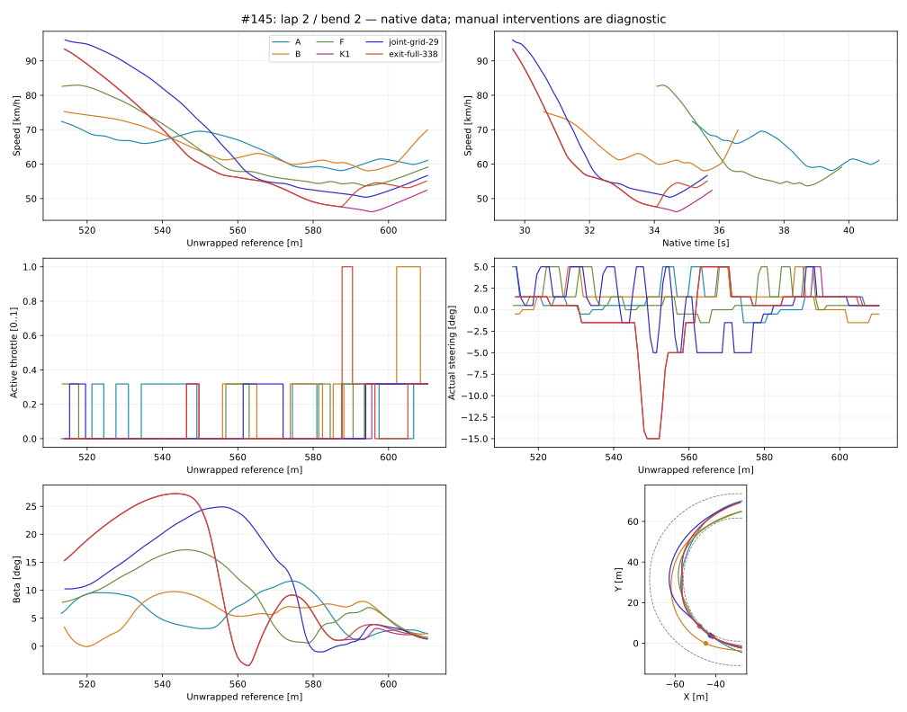

# #145 — Corner Speed Loss: trzy nieprzerwane okrążenia

**Werdykt: diagnoza potwierdzona częściowo; legalna poprawa diagnostyczna, brak zatwierdzonej poprawki autonomicznej.**

Baza `experiment/standing-start-three-laps-144`, dokładnie `9342ac506c6fc7b713c91842b4e6fff55b4891b6`. Eksperyment domyślnie OFF. Bez zmiany produkcyjnej fizyki, silnika, przyczepności, geometrii, wag i historycznych danych. Bez CEM i bez merge.

## Sześć odpowiedzi

1. **Dlaczego K1 traci 47,73 km/h?** Wjeżdża z 93,886 km/h, narasta β do 27,255°, a siły poprzeczne wykonują dużą ujemną pracę w kierunku ruchu. Gaz pozostaje zamknięty przez 4,843 z 5,073 s do minimum. Praca przedniej opony −14,666 kJ, tylnej siły poprzecznej −18,653 kJ, oporów −9,364 kJ i tylnej siły napędowej +4,777 kJ sumuje się do spadku energii postępowej −37,906 kJ. To pomiar bilansu; nie procentowa atrybucja winy sterownika.
2. **Sterownik czy fizyka?** Oba mechanizmy są powiązane. Ubytek energii bezpośrednio realizują siły opon i opory; sterownik ogranicza dopływ mocy i kształtuje yaw/linię. Przy tej samej kierownicy samo dodanie gazu w 29,0 s kończy się naruszeniem obrysu lub brakiem certyfikacji. Skoordynowane gaz+skręt dają legalną poprawę. Nie wyizolowano wiarygodnego udziału procentowego ani jednej wyłącznej przyczyny. Moment do koła do minimum jest dodatni; nie wykazano hamowania silnikiem w tej fazie.
3. **Czy linia jest zła i wydłuża drogę?** Drugie okrążenie K1 ma 343,97 m, lecz jego pierwszy łuk ma 117,13 m (A: 104,35 m). Badany drugi łuk K1 ma 102,07 m, nawet nieco mniej niż A: 102,84 m. Dodatkowy dystans całego okrążenia pochodzi głównie z pierwszego łuku. Drugi łuk łączy szybki zjazd z offsetu około 7 m w okolice wewnętrznej i oscylacje yaw. To obserwacja linii; globalnie optymalnej linii nie wyznaczono.
4. **Czy można szybciej bez zmiany fizyki?** Tak, lokalnie i z legalną kontynuacją do trzech okrążeń: `joint-grid-29` skraca badany łuk 6,211→6,054 s, podnosi minimum 46,160→50,376 km/h i wyjście 52,587→56,791 km/h. `exit-full-338` także legalnie skraca łuk. Te ręczne działania nie są autonomicznym sterownikiem ani dowodem wykonalności utrzymania 90 km/h przez cały łuk.
5. **Opóźnienie, akcje czy planowanie?** Opóźnienie 0,24 s, review 0,2 s i szybkość skrętu 90°/s są zachowane. W 29,0 s do wejścia pozostaje około 15,6 m; aktywacja następuje 0,24 s później. Alternatywa gaz+skręt istnieje już w dotychczasowym zbiorze. Wartość pośrednia −10° i większy skręt −25° nie dały legalnego pełnego dystansu. Ten sam manewr wcześniej i później ma gorszą legalność. H09 z utrzymanym działaniem błędnie porządkuje niektóre rzeczywiste kontynuacje; prosty prototyp dwóch komend zawodzi na pierwszym okrążeniu. Krótki horyzont i niewykonana przyszła korekta pozostają ograniczeniem, a nie samodzielnie udowodnioną wyłączną przyczyną.
6. **Co zmienić w algorytmie?** Kolejny uzasadniony etap to ocenianie skoordynowanego manewru do wyjścia z łuku i następnej prostej, z pełnym stanem napędu, kolejką oraz sprawdzaniem, czy planowana druga korekta rzeczywiście pozostaje wybierana przy kolejnych obserwacjach. Kryterium czasu i wyjścia trzeba zweryfikować przyczynowo. Nie ma podstaw do podnoszenia przyczepności, mocy ani globalnego zwiększania gazu. Dostarczony default-OFF prototyp dwóch komend jest **odrzucony** po natywnym teście; nie rekomendujemy jego wdrożenia.

## Każdy z sześciu łuków każdego wariantu

Wejście/wyjście interpoluje się wyłącznie jako skalarną metrykę w tych samych przekrojach referencyjnych. Minimum jest dokładnym zachowanym stanem natywnym (rozdzielczość nominalnie 10 ms), nie obietnicą minimum ciągłego między próbkami. Trzy fazy są równymi częściami długości referencyjnej całego łuku.

| Wariant / okr. / łuk | V wejście | V min | V wyjście km/h | Czas s | Droga m | Min: t / ref m | Główna zmierzona ujemna praca | Dowód |
|---|---:|---:|---:|---:|---:|---|---|---|
|A / 1 / 1|37.813|37.813|64.714|6.885|99.18|6.690 / 35.000|opory|[fazy i bilans](saved-analysis.json), `A-intervals.csv.gz`|
|A / 1 / 2|72.070|57.955|63.675|6.000|103.86|19.140 / 236.966|opory|[fazy i bilans](saved-analysis.json), `A-intervals.csv.gz`|
|A / 2 / 1|74.617|55.048|61.012|6.232|104.35|30.890 / 434.727|tylna Fy / scrub|[fazy i bilans](saved-analysis.json), `A-intervals.csv.gz`|
|A / 2 / 2|72.431|58.115|61.161|5.762|102.84|39.470 / 587.348|opory|[fazy i bilans](saved-analysis.json), `A-intervals.csv.gz`|
|A / 3 / 1|74.012|59.155|62.678|5.736|101.40|49.270 / 759.723|opory|[fazy i bilans](saved-analysis.json), `A-intervals.csv.gz`|
|A / 3 / 2|72.730|61.087|67.153|5.607|102.78|57.390 / 906.638|opory|[fazy i bilans](saved-analysis.json), `A-intervals.csv.gz`|
|B / 1 / 1|63.872|55.771|63.758|5.866|98.99|5.530 / 65.665|opory|[fazy i bilans](saved-analysis.json), `B-intervals.csv.gz`|
|B / 1 / 2|76.721|52.374|58.499|5.779|100.55|17.310 / 276.697|tylna Fy / scrub|[fazy i bilans](saved-analysis.json), `B-intervals.csv.gz`|
|B / 2 / 1|78.181|51.091|58.281|6.140|102.65|26.500 / 437.451|tylna Fy / scrub|[fazy i bilans](saved-analysis.json), `B-intervals.csv.gz`|
|B / 2 / 2|75.441|58.082|70.165|6.051|108.23|35.550 / 594.676|opory|[fazy i bilans](saved-analysis.json), `B-intervals.csv.gz`|
|B / 3 / 1|80.105|58.155|63.782|5.971|106.85|44.350 / 753.390|przednia opona|[fazy i bilans](saved-analysis.json), `B-intervals.csv.gz`|
|B / 3 / 2|82.018|56.127|68.765|5.909|107.05|50.980 / 879.818|tylna Fy / scrub|[fazy i bilans](saved-analysis.json), `B-intervals.csv.gz`|
|F / 1 / 1|37.813|37.813|64.714|6.885|99.18|6.690 / 35.000|opory|[fazy i bilans](saved-analysis.json), `F-intervals.csv.gz`|
|F / 1 / 2|79.367|52.930|59.475|5.830|100.77|21.260 / 274.561|tylna Fy / scrub|[fazy i bilans](saved-analysis.json), `F-intervals.csv.gz`|
|F / 2 / 1|77.425|60.379|64.561|5.421|101.58|30.190 / 436.097|tylna Fy / scrub|[fazy i bilans](saved-analysis.json), `F-intervals.csv.gz`|
|F / 2 / 2|82.599|53.689|59.191|5.720|99.18|38.710 / 594.035|tylna Fy / scrub|[fazy i bilans](saved-analysis.json), `F-intervals.csv.gz`|
|F / 3 / 1|77.073|57.060|61.947|5.548|99.96|47.690 / 756.692|tylna Fy / scrub|[fazy i bilans](saved-analysis.json), `F-intervals.csv.gz`|
|F / 3 / 2|80.204|54.240|56.638|5.617|103.71|56.820 / 922.105|tylna Fy / scrub|[fazy i bilans](saved-analysis.json), `F-intervals.csv.gz`|
|K1 / 1 / 1|65.609|55.197|65.247|5.822|97.71|5.580 / 67.124|opory|[fazy i bilans](saved-analysis.json), `K1-intervals.csv.gz`|
|K1 / 1 / 2|80.719|55.657|60.481|5.481|98.79|16.950 / 276.713|tylna Fy / scrub|[fazy i bilans](saved-analysis.json), `K1-intervals.csv.gz`|
|K1 / 2 / 1|80.954|59.264|72.744|6.129|117.13|24.130 / 412.624|opory|[fazy i bilans](saved-analysis.json), `K1-intervals.csv.gz`|
|K1 / 2 / 2|93.886|46.160|52.587|6.211|102.07|34.670 / 595.420|tylna Fy / scrub|[fazy i bilans](saved-analysis.json), `K1-intervals.csv.gz`|
|K1 / 3 / 1|79.380|55.030|61.441|5.520|101.08|43.090 / 748.039|tylna Fy / scrub|[fazy i bilans](saved-analysis.json), `K1-intervals.csv.gz`|
|K1 / 3 / 2|78.584|53.862|59.044|5.826|100.02|52.480 / 915.581|tylna Fy / scrub|[fazy i bilans](saved-analysis.json), `K1-intervals.csv.gz`|

## Ranking mechanizmów potwierdzonych pomiarem i próbami

1. **Scrub poprzeczny i orientacja sił opon względem prędkości.** Największe ujemne składniki pracy w K1: tylna Fy i przednia opona. Przy największym opóźnieniu 31,050 s: −5,690 m/s², β=27,230°, front/rear utilization=0,966/0,975. Siły są prawie wyczerpane poprzecznie. Zmiana samego skrętu zmienia minimum i wyjście; dobry wynik lokalny nie gwarantuje legalności kolejnego okrążenia.
2. **Zbyt długa przerwa w dopływie mocy przy odzyskiwaniu prędkości.** Jedna decyzja gazu w 33,8 s daje legalną szybszą kontynuację. Nie oznacza to, że wcześniejsze zamknięcie gazu jest w całości zbędne: analogiczna ingerencja w 29,0 s zawodzi.
3. **Ograniczona siła i promień.** 90 km/h na R=36 m wymaga 2552 N przy absolutnym budżecie 1852 N. To niewykonalne w tym zamrożonym modelu. Dla R=50 m zostaje tylko około 15 N rezerwy w idealnej sumie kontaktów, przed sprzężeniem Fx/Fy i wymaganiami momentu yaw. Scalarna granica jest warunkiem koniecznym, nie certyfikatem wykonalności.
4. **Opory ruchu.** Ich zmierzona praca do minimum wynosi −9,364 kJ. Nie stosowano osobnego eksperymentu wyłączającego opory, więc nie podajemy przyczynowego zysku po ich hipotetycznym usunięciu.
5. **Linia, przejściowy yaw i krótka ocena utrzymanej komendy.** Wspólna ingerencja jest lepsza niż sam gaz, istniejący score odrzuca ją. To potwierdza błąd lokalnego porządkowania rzeczywistych kontynuacji. Nie dowodzi, że samo wydłużenie horyzontu albo poszerzenie kierownicy rozwiąże problem.

Duży wheelspin nie jest dominującym składnikiem badanego spadku: praca strat tylnego poślizgu wzdłużnego wynosi około 0,488 kJ, w porównaniu z dużo większymi pracami poprzecznymi. Sprzęgło: 1,970 J ciepła; dodatkowy drag wału: 0. Moment koła pozostaje dodatni, a energia obrotowa wału i koła jest oddawana. Nie utożsamiamy dodatniego momentu z wystarczającą mocą do utrzymania prędkości.

## K1: bilans trzech faz drugiego łuku drugiego okrążenia

|Faza|Czas s|ΔK postęp. kJ|Przód kJ|Tył Fx kJ|Tył Fy kJ|Opory kJ|Spalanie kJ|Gaz 0 s|
|---|---:|---:|---:|---:|---:|---:|---:|---:|
|entry|1.638|-26.993|-11.285|2.669|-13.237|-5.141|0.000|1.638|
|middle|2.128|-8.938|-2.899|1.920|-5.038|-2.921|1.640|1.928|
|exit|2.445|1.624|-0.752|5.484|-0.607|-2.501|7.200|1.277|

Cały bilans zawiera osobno energię postępową, yaw, koła i wału, pracę spalania, ciepło sprzęgła, straty przekładni, łożyska, oba kierunki poślizgu i opory. Reszta bilansu do minimum: −0,079 J (zaokrąglenia float/native), wobec około 38 kJ zmiany energii postępowej. Prace yaw nie są ponownie dodawane do strat postępowych. Wszystkie 72 fazy bazowe oraz fazy interwencji i zakresy gazu/skętu/yaw/β/Fx/Fy/utilizacji/gapów znajdują się w [saved-analysis.json](saved-analysis.json); pełne chwilowe wartości w CSV.gz.

## Wykonalność fizyczna i promień

|Promień m|Absolutna granica km/h|Wymagana siła przy 90 km/h N|Wymagany yaw przy 90 rad/s|
|---:|---:|---:|---:|
|24|62.61|3828.1|1.042|
|30|69.99|3062.5|0.833|
|36|76.68|2552.1|0.694|
|42|82.82|2187.5|0.595|
|50|90.36|1837.5|0.500|
|55|94.77|1670.5|0.455|

Rzeczywiste promienie K1 na badanym łuku (najbliższy zachowany przedział):

|Punkt|t s|V km/h|R trajektorii m|R lokalnej geometrii z offsetem m|F wymagane na lokalnym R przy 90 N|
|---|---:|---:|---:|---:|---:|
|wejście|29.597|93.886|60.472|155031890467.599|0.000|
|maksymalne opóźnienie|31.050|67.444|31.455|32.522|2825.028|
|minimum|34.670|46.160|29.038|26.104|3519.590|

Obliczenie: `F=m v²/R`, `v_upper=sqrt((C_front+C_rear) R/m)`, masa 147 kg, µ=1,2845, Fz przód/tył 665,571/776,499 N; C przód/tył 854,926/997,413 N. Obciążenia są statyczne, jak w #144, nie dodano transferu masy. Rozdzielenie Fx/Fy ogranicza tylna opona; moment yaw wynika wyłącznie z r×F dwóch kontaktów. Maksymalny moment przy pełnym poprzecznym budżecie obu kół jest tylko luźną granicą — nie można równocześnie dowolnie wybrać maksymalnego Fy i yaw.

Fx/Fy w CSV są opisane w układzie korpusu. Przedni kontakt ma w układzie skręconego koła tylko Fy (Fx=0); projekcja tej siły na oś korpusu może mieć Fx. Nie jest to osobny przedni napęd ani mechaniczny hamulec.

Są to promienie porównawcze z zakresu skali geometrii, a nie założona idealna linia ani sztuczny limit w sterowniku. Rzeczywisty promień trajektorii z wektora v i jego zmiany oraz promień lokalnej geometrii są osobnymi polami w CSV. Szerszy tor nie gwarantuje dłuższego odcinka o R=50 m: trzeba jeszcze legalnie osiągnąć tę pozycję i przejść zwężenie. Wyłącznie legalne natywne kontynuacje dowodzą wykonalności konkretnej alternatywy. `full-gas-entry-sequence` zaczyna z identycznego prefiksu przy około 94 km/h i przekracza β45; nie podtrzymuje 90 km/h przez łuk. To nie dowód globalnej niemożliwości dowolnej szerokiej linii.

## Konkretne decyzje i pełna punktacja

Pełne rozbicie wszystkich wybranych i odrzuconych działań dla dziewięciu odtworzonych decyzji (A/B/F i sześć K1), wraz z dodatkowymi hipotezami przestrzeni akcji, jest w [score-audit.json](native/score-audit.json). Odtworzenie wyniku każdej pierwotnej kandydatury jest dokładne: maksymalna różnica punktacji = 0. Prognozy nie tworzą nowych światów. Safety jest porządkowane przed score; nie wolno tłumaczyć odrzucenia wyłącznie niższym score.

### Obserwacja 29.0 s

Stan: v=96.674 km/h; ref=497.518 m; offset=9.941 m; β=6.212°; yaw=0.582 rad/s; koło=91.842 rad/s; wał=7902.1 RPM; oczekujące komendy=1. Pełny stan przed decyzją i fingerprint w JSON. Aktywacja 29.24 s, bez obchodzenia kolejki.

|Skręt °|Gaz|Safety|Score K1|Progress|Kierunek|Yaw|Zmiana skrętu|Clearance + unsafe|
|---:|---:|---:|---:|---:|---:|---:|---:|---:|
|-5.0|0.318|0|19.900|-23.730|5.765|37.227|0.638|0.000|
|1.5|0.000|0|-21.237|-23.064|1.668|0.138|0.021|0.000|
|1.5|0.318|0|-19.535|-23.329|2.149|1.623|0.021|0.000|
|1.5|1.000|2|2.610|-23.558|2.651|23.486|0.021|0.010|

K1 usuwa składniki Throttle i Geometry; ich pierwotne wartości pozostają zapisane w pełnym audycie. W 29,0 s gaz 0 wygrywa z częściowym głównie przez prognozowany yaw i kierunek. W 33,8 s częściowy gaz przegrywa głównie przez kierunek, a pełny przez yaw; wszystkie te trzy kandydatury mają Safety=Safe. Legalna natywna ingerencja w 33,8 s pokazuje zbyt późny powrót do napędu w tej konkretnej kontynuacji.
### Obserwacja 33.8 s

Stan: v=48.110 km/h; ref=583.938 m; offset=-0.016 m; β=1.938°; yaw=0.132 rad/s; koło=40.565 rad/s; wał=3486.4 RPM; oczekujące komendy=1. Pełny stan przed decyzją i fingerprint w JSON. Aktywacja 34.04 s, bez obchodzenia kolejki.

|Skręt °|Gaz|Safety|Score K1|Progress|Kierunek|Yaw|Zmiana skrętu|Clearance + unsafe|
|---:|---:|---:|---:|---:|---:|---:|---:|---:|
|-5.0|0.318|0|43.105|-12.266|29.111|25.622|0.638|0.000|
|1.5|0.000|0|-5.083|-12.384|6.520|0.760|0.021|0.000|
|1.5|0.318|0|-4.094|-12.810|7.922|0.774|0.021|0.000|
|1.5|1.000|0|10.436|-13.486|8.418|15.483|0.021|0.000|

K1 usuwa składniki Throttle i Geometry; ich pierwotne wartości pozostają zapisane w pełnym audycie. W 29,0 s gaz 0 wygrywa z częściowym głównie przez prognozowany yaw i kierunek. W 33,8 s częściowy gaz przegrywa głównie przez kierunek, a pełny przez yaw; wszystkie te trzy kandydatury mają Safety=Safe. Legalna natywna ingerencja w 33,8 s pokazuje zbyt późny powrót do napędu w tej konkretnej kontynuacji.

## Interwencje: identyczny pełny prefiks od startu

Każdy nowy świat zaczyna się od właściwego v=0, koła=0, wału i sprzęgła #144. Prefiks wykonuje zapisane oryginalne decyzje przez natywną kolejkę i aktuator. Nie wczytuje się uproszczonego checkpointu i nie ustawia po fakcie pozycji, prędkości, yaw ani β. Pierwsze fingerprinty stanów przed ingerencją są identyczne. Następne punkty sekwencji celowo różnią się od bazy po wcześniejszej ingerencji. Powtórka `replay-K1` odtwarza fingerprint **całego** oryginalnego dystansu.

|Próba|Wynik / ukończone okr.|Łuk L2 B2 s|V min / wyjście km/h|Następna prosta s|Całość s|
|---|---|---:|---:|---:|---:|
|autonomous-two-command-K1|confirmed footprint crossing / 0|N/D|N/D|N/D|N/D|
|early-joint-284|confirmed footprint crossing / 1|N/D|N/D|N/D|N/D|
|exit-full-338|completed / 3|6.066|47.610 / 55.340|3.128|54.544|
|exit-partial-338|completed / 3|6.166|47.595 / 54.819|3.185|54.600|
|full-gas-entry-sequence|experimental beta45 envelope / 1|N/D|N/D|N/D|N/D|
|gas-full-29|uncertified swept interval / 1|N/D|N/D|N/D|N/D|
|gas-partial-29|confirmed footprint crossing / 1|N/D|N/D|N/D|N/D|
|joint-29|completed / 3|6.054|50.376 / 56.791|2.986|54.217|
|joint-grid-29|completed / 3|6.054|50.376 / 56.791|2.986|54.217|
|late-joint-296|confirmed footprint crossing / 2|5.438|58.889 / 60.707|2.958|N/D|
|prepare-284|confirmed footprint crossing / 1|N/D|N/D|N/D|N/D|
|prepare-coast-284|confirmed footprint crossing / 1|N/D|N/D|N/D|N/D|
|replay-K1|completed / 3|6.211|46.160 / 52.587|3.139|54.795|
|sequence-29|uncertified swept interval / 2|6.274|46.624 / 54.659|3.146|N/D|
|steer-29|completed / 3|6.068|48.985 / 58.399|3.090|55.359|
|steer-intermediate-31|confirmed footprint crossing / 1|N/D|N/D|N/D|N/D|
|steer-large-31|confirmed footprint crossing / 2|5.603|57.038 / 60.038|3.135|N/D|

Zmiany i dokładne czasy są zamrożone w `treatments-initial.json`, `treatments-followup.json`, `treatments-autonomous.json`, `treatments-exact-grid.json`. Osobne `*-result.json` zawierają cały stan przed ingerencją, fingerprint, legalność, minimalne gapy i źródłowe SHA. Duży skręt −25° skraca badany łuk, ale narusza obrys na kolejnym okrążeniu: **nie jest sukcesem**. Interwencja złożona z trzech korekt także kończy się brakiem certyfikacji. Nie ukrywamy późnych porażek.

Pierwsza interwencja `joint-29` używała matematycznie obliczonego −5°, co różni się o jeden ULP float32 od zapisanego kąta siatki. Dodatkowy `joint-grid-29` powtarza próbę z dokładnym bitem oryginalnej kandydatury −0,08726647 rad. Także kończy legalnie i daje ten sam zaokrąglony wynik łuku. Wszystkie wcześniejsze próby pozostają w kosztach i danych.

Legalna szersza linia `joint-grid-29` ma na badanym łuku 108,42 m wobec 102,07 m K1, a jednak jest o 0,157 s szybsza. To bezpośredni przykład, dlaczego najmniejszy dystans nie oznacza najmniejszego czasu.

## Pełne trzy okrążenia: porównanie z A/B/F/K1

|Wariant|Okr.1 s|Okr.2 s|Okr.3 s|Razem s|Okr.2+3 s|Min. gap inner/outer m|Wynik|
|---|---:|---:|---:|---:|---:|---:|---|
|A|24.070|18.388|17.600|60.058|35.988|0.2003 / 0.3426|completed|
|B|19.738|18.126|17.649|55.512|35.775|0.2013 / 2.0470|completed|
|F|23.951|17.355|17.560|58.866|34.915|0.2033 / 0.6959|completed|
|K1|19.318|18.027|17.450|54.795|35.477|0.2008 / 0.2949|completed|
|joint-grid-29|19.318|17.823|17.077|54.217|34.899|0.2046 / 0.2949|completed|
|exit-full-338|19.318|17.860|17.366|54.544|35.226|0.2040 / 0.2949|completed|
|steer-large-31|19.318|17.397|N/D|N/D|N/D|0.2046 / -0.0421|confirmed footprint crossing|
|autonomous-two-command-K1|N/D|N/D|N/D|N/D|N/D|-0.0088 / 7.0992|confirmed footprint crossing|

## Prototyp autonomiczny — wynik negatywny

`autonomous-two-command-K1`: jedna zmiana algorytmiczna, bez zmiany wag — zamiast utrzymania pierwszej komendy przez H09 ocenia się do 36 opóźnionych par spośród maksymalnie sześciu korzeni wybranych z dotychczasowej siatki. Obie komendy zachowują reakcję 0,24 s; druga jest obserwowana hipotetycznie w +0,2 s. W świecie natywnym wykonywana jest tylko pierwsza, po czym sterownik ponownie podejmuje decyzję. Wał/koło i nieodwracalne kolejki są przenoszone między częściami prognozy.

Próba od właściwego startu **narusza obrys w 6,57 s**, przed końcem pierwszego okrążenia. Nie ma dowodu, że sam dodatkowy krok planowania wystarcza. Planowana korzystna druga korekta nie jest zobowiązaniem kolejnej decyzji; receding-horizon może zmienić przyszłość, na której opierał ocenę. Zapis planów pokazuje ten problem, ale pełnego związku przyczynowego tej porażki nie izolowano osobnym eksperymentem. Prototyp pozostaje OFF i nie jest proponowany do produkcji.

## Koszt, zakres i odtworzenie

**17 nowych światów, 360.984 CPU-s rezerwacji natywnych**; dodatkowo 5.031 CPU-s audytu bez światów. Wszystkie próby zachowano. Budżet nie obejmuje kompilacji, testów regresji i prezentacji danych; nie są to trening ani nowe próby badawcze. Bez szerokiego przeszukiwania wag. Wszystkie 4×6 łuków zachowanych #144 przeanalizowano przed pierwszym nowym światem.

Generator `generate.py --check` dowodzi, że nowy collector jest dokładnie #144 z nazwą klasy i jednym wstrzyknięciem chooser. Używa publicznych rekordów #144 i tego samego ContactAdapter/Box2D, nie alternatywnego solvera. Historyczne źródła #144 oraz dane bazowe są nienaruszone. `provenance.json` podaje hashe końcowych źródeł i surowych zapisów; jest manifestem odtwarzania, nie deklaracją prerejestracji powstałą przed badaniem.

Odtworzenie: `powershell -File tools/corner-speed-loss/run.ps1 -Evidence work/repro145`. Analiza zapisów sama nie uruchamia światów. Pełne natywne odtworzenie wymaga .NET 8 i Windows. Skrypt zachowuje niekompletne rezerwacje i nie ponawia ich po cichu.

[Rozbudowany istniejący viewer](http://127.0.0.1:8018/tools/replay-viewer/?case=corner145&run=K1&t=29): porównanie A/B/F/K1, legalnych ingerencji, późnej porażki większego skrętu i nieudanego prototypu. Wybór każdego okrążenia/łuku, prędkość po czasie i pozycji, gaz żądany/aktywny, skręt żądany/rzeczywisty, β/wheelspin, wspólne linie XY i skoki do Vmin/maksymalnego opóźnienia. Wykresy są próbkowane do prezentacji; surowe 10ms dane pozostają w zapisach.

Walidacja jest raportowana osobno w `validation.json`. Lokalny wynik ani zielony Draft CI nie oznacza pełnej walidacji gotowego zawodnika. Wniosek o realnym żużlu pozostaje ograniczony prowizoryczną oponą i modelem płaskiego motocykla.
