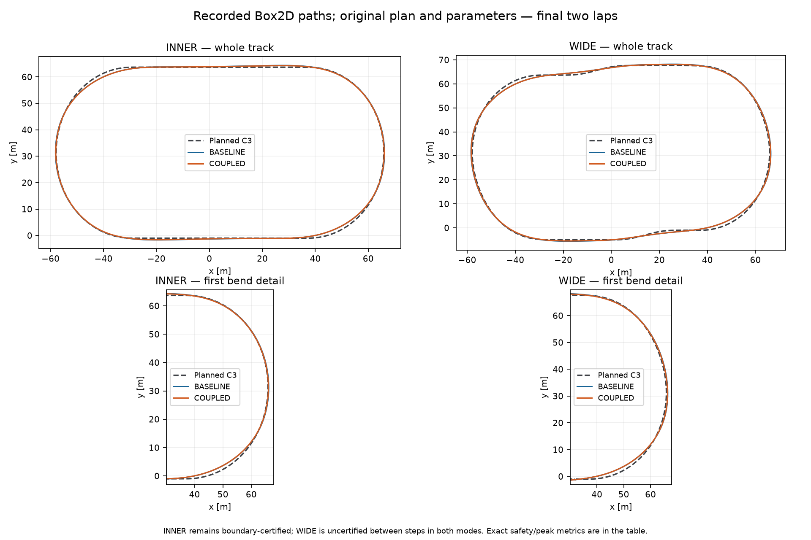
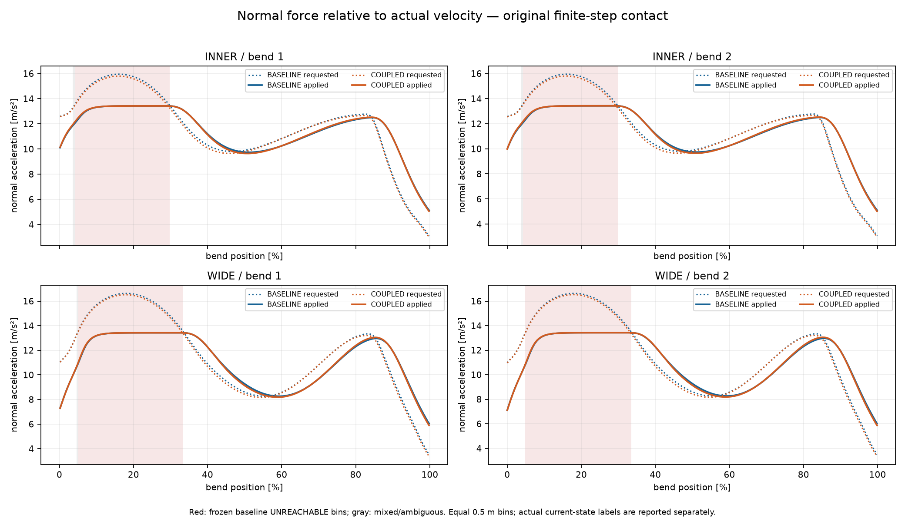
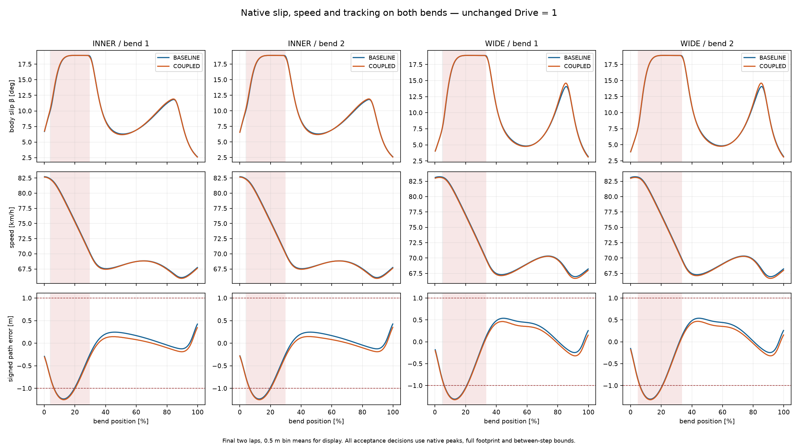

# Coupled Slip Inverse — kontrolowany eksperyment (#108)

**Wynik wariantu: FAIL. Ocena wykonania: A.** Nowa odwrotność działa zgodnie z oryginalnym kontaktem w przebadanym zakresie numerycznym, ale nie rozwiązuje błędów prowadzenia. RMS poprawia się nieznacznie, błąd maksymalny rośnie, prześwit od kredy maleje. Wariant pozostaje domyślnie OFF, wyłącznie do badań; **nie jest kandydatem do produkcji**.

Baza: Draft #107, HEAD **67204a2ad417de05b313b4a54bf301cb27356825**, baza #106 **5648c4263739e46df40a366c96fabe4978cc1b3c**, zweryfikowane przed pracą. Jeden nowy Draft, bez zmian wcześniejszych PR i bez merge. Produkcyjne `src/CoreSim` pozostaje bez zmian.

## Protokół i matematyka przed jazdą

`SlipCoupledDynamics.Forces` oblicza istniejące żądanie `demand`, po czym stara ścieżka używa `ratio=clamp(m·demand/B,±0.95)` i `atan(δy/V·ratio/sqrt(1−ratio²))`. To odwrotność wcześniejszej pojedynczej Fy. Nie uwzględnia sprzężenia rear Fx/Fy ani normalnej składowej Fx. Dalej ten sam yaw PD dostaje `targetSlip−actualSlip`, z niezmienionymi czasami, bezwładnością, authority, limitem momentu i guardem pracy.

Nowe `EnableCoupledSlipInverse` jest OFF i nie serializuje dodatkowego pola przy OFF. ON jest ograniczone do pojedynczej trajektorii C3 bez traffic, z oryginalnym rear wheel i path-frame guidance. Zmienia **wyłącznie targetSlip**. Przy badaniu kandydackiego β zamrażamy zaakceptowane v, ω, surface/B, masę, promień/inercję koła, available/requested/delivered torque i rzeczywisty h. Osie ciała obracają się hipotetycznie względem kierunku v; otrzymujemy u/w i δy z tej samej oryginalnej funkcji. `RearWheelDynamics.Evaluate` liczy niezmieniony skończony kontakt, jego implicit midpoint i podział60/40. Nie wykonuje Body Step, Prepare/Commit, prognozy przyszłego świata, RNG lub wear.

Rozwiązywane równanie, ze znakiem skrętu zgodnym z lewą normalną n=(-vy,vx)/|v|:

`Fn(β)=dot(forward(β)·Fx_rear + side(β)·(Fy_front+Fy_rear) + Fres, n)=m·demand`.

W idealnej arytmetyce jest to `Fx·sinβ+(Fy_front+Fy_rear)·cosβ`; implementacja projektuje pełny oryginalny wektor float. Fres pozostaje przeciwne v. Opona, napęd, wheelspin, yaw, gains/preview, h, Egg Mild/progressive-b i C3 XY nie zmieniają się. Nie ma drugiego modelu opony ani dodanej siły.

Domena kątów **[-45°,45°]**, zamrożona przed wynikami.24 interwały plus refinement każdego wykrytego minimum/maksimum (20 iteracji złotego podziału), następnie wszystkie przedziały zmiany znaku i bisekcja do24 iteracji. Nie zakładamy monotoniczności; test pokazuje dwa rozwiązania i żądanie poniżej skalarnego B bez rozwiązania. Wybieramy najmniejsze |β|, przy dokładnym remisie mniejszy podpisany β: preferowana gałąź ma mniejsze ustawienie bokiem i nie zależy od historii wykonania. Tolerancja siły **0,05N** (≈0,00034m/s² przy147kg), kąta1e-6rad; pas niepewności obwiedni0,25N. `SOLVED` wymaga sprawdzonej reszty; brak pierwiastka poza obwiednią jest `UNREACHABLE` w tej domenie. Tangencje/pas niepewności/niedookreślony kierunek małej v trafiają do `AMBIGUOUS`. Absolutny limit pętli to1682 ocen (25+23·23+47·24), a zaobserwowany w obu światach93; koszt dla innych konfiguracji nie jest zatwierdzony.

To **ograniczona numeryczna ocena obwiedni**, nie uniwersalny dowód interval-arithmetic dla dowolnej konfiguracji. Przed jazdą sprawdzono128 stanów (V5/18/24/35, rω/V0,5/1/1,4/2, Drive0/1, h0/5/10/20ms),1152 żądania i niezależną siatkę1441 kątów na stan. Największy miss obwiedni0,000366N, reszta rozwiązania0,049988N. Po przejazdach dodatkowo sprawdzono **każdy z1984 nie-SOLVED stanów final2** obu trybów, niezależną siatką: 2858944 offline zapytań, max miss0,000733N, **zero fałszywych odrzuceń względem siatki**. Nie zmieniano zamrożonych etykiet. Niezbadane konfiguracje wymagają ponownej walidacji tego ograniczonego solvera.

Obsługa `UNREACHABLE` i `AMBIGUOUS` była ustalona przed jazdą: zachować **dokładnie stary ograniczony targetSlip**. Każdy fallback jest zapisany w `*-decisions.csv.gz`, z żądaniem, obwiednią, starym/wybranym kątem i liczbą ocen. Lokalnie SOLVED nie oznacza wykonalnej całej trajektorii: yaw i ω wciąż muszą rzeczywiście przejść do nowego stanu.

[freeze.json](coupled-slip-inverse/freeze.json), [matematyka](coupled-slip-inverse/mathematics.json), [weryfikacja native](coupled-slip-inverse/native-envelope-validation.json).

## Dwa rzeczywiste światy i wyniki

Reuse pełnych native LEGACY #106/#107; **0 powtórzeń starej macierzy**. Tylko dwa główne nowe światy COUPLED: INNER/WIDE, jeden motocykl, Grip1/Ruts0/Moisture0,5, Drive1, start reference32 / v18m/s / ω=18/0,33, h10ms z oryginalnymi podziałami granic,8lap. Initial snapshot ciała i koła jest dokładnie identyczny pomiędzy trybami. Krótkie scenariusze deterministyczności testów nie są ukrywane jako reuse.

Statystyki trackingu i normalnej siły: końcowe dwa pełne okrążenia; normalna siła oznacza faktycznie przyłożony F względem v początku interwału. Bezpieczeństwo obejmuje cały8lap i pełny footprint, z oryginalnym konserwatywnym bound między krokami. Dane pokazują momenty/siły z zaakceptowanych stanów. Nie używamy sztucznie narzuconego β podczas jazdy.

|Metryka|INNER LEGACY|INNER COUPLED|WIDE LEGACY|WIDE COUPLED|
|---|---|---|---|---|
|RMS boczny [m]|0.456|0.444|0.535|0.513|
|Max boczny [m]|1.235|1.253|1.311|1.325|
|RMS kierunku v [°]|2.320|2.273|3.364|3.322|
|Max kierunku v [°]|7.589|7.575|9.104|9.051|
|RMS błędu a normalnego w łuku [m/s²]|1.475|1.467|1.782|1.787|
|Min pełnego footprintu: kreda [m]|0.184|0.165|0.112|0.097|
|Min pełnego footprintu: banda [m]|8.925|8.990|5.051|5.140|
|Between-step: kreda [m]|0.057|0.039|-0.016|-0.031|
|Between-step: banda [m]|8.816|8.881|4.940|5.030|
|Średni czas łuku [s], diagnostyczny|5.108|5.105|5.198|5.200|
|UNREACHABLE: czas łuków [%]|23.298|22.626|25.302|24.952|
|AMBIGUOUS: czas łuków [%]|0.000|0.049|0.000|0.000|
|UNREACHABLE: kroki całego8lap|1783|1732|1972|1944|
|AMBIGUOUS: kroki całego8lap|0|1|0|0|
|Okresowość last3 max/min|1.0000019|1.0000714|1.0000007|1.0001014|
|Bezpieczeństwo z between-step|TAK|TAK|NIE|NIE|
|Ocena końcowa|FAIL #106 tracking|FAIL|FAIL #106 tracking / uncertified|FAIL|

INNER: RMS **−2,57%**, max **+17,43mm**, accepted min od kredy **−19,02mm**. WIDE: RMS **−4,06%**, max **+14,46mm**, min od kredy **−15,08mm**. WIDE w obu trybach ma dodatni prześwit w zaakceptowanych końcach interwałów, ale ujemny konserwatywny inner bound. To **brak certyfikatu pomiędzy krokami**, a nie zaobserwowane przecięcie kredy. Oba8lap ukończone; okresowość dobra, lecz żaden COUPLED nie przechodzi wszystkich progów. **Nie zmieniono progów #106 i nie kwalifikujemy wyników jako PARTIAL wyłącznie dzięki RMS. Czasy są diagnostyczne; nie ma rankingu.**

|Próba|entry km/h|middle km/h|exit km/h|β mean/max °|κ max|
|---|---|---|---|---|---|
|baseline-inner|82.72|68.07|67.79|10.70/18.91|0.2267|
|coupled-inner|82.65|68.04|67.67|10.72/18.91|0.2261|
|baseline-wide|83.09|67.73|68.27|10.50/18.91|0.2284|
|coupled-wide|82.97|67.62|68.04|10.53/18.91|0.2283|

## Zamrożone grupy i te same położenia

**Przed COUPLED** sklasyfikowano wszystkie oryginalne native stany LEGACY, zachowując źródłowe hashe. Final2 baseline zamieniono na stałe biny0,5m reference, z zamrożonym przypisaniem:1=jednolicie SOLVED,2=jednolicie UNREACHABLE,3=mieszane/niejednoznaczne/brak danych. `baseline-bins.json` powstał przed światami, a jego SHA zapisano w obu runs. Nie klasyfikujemy według późniejszego wyniku COUPLED. W tabeli poniżej oba tryby używają **tych samych wspólnych binów i równej wagi binu**, więc różna v nie przestawia wag czasowych porównania. Liczby dotyczą binów w łukach. Aktualna osiągalność każdego trybu jest dodatkowo wyliczona i raportowana niezależnie.

|Linia / grupa|biny|RMS XY LEGACY→COUPLED [m]|max [m]|RMS a error [m/s²]|v mean [m/s]|
|---|---|---|---|---|---|
|inner/1|288|0.193→0.167|0.709→0.729|1.288→1.338|19.050→19.027|
|inner/2|100|0.970→0.992|1.235→1.253|1.977→1.832|21.332→21.291|
|inner/3|2|0.746→0.756|0.768→0.785|1.442→1.306|22.884→22.861|
|wide/1|278|0.368→0.327|0.840→0.851|1.450→1.510|19.309→19.270|
|wide/2|111|0.961→0.975|1.311→1.325|2.563→2.456|21.467→21.424|
|wide/3|1|0.869→0.881|0.883→0.902|2.621→2.554|23.103→23.070|

W grupie1 RMS XY poprawia się **13,48% INNER /11,13% WIDE**, ale max także rośnie, a RMS błędu a normalnego **1,288→1,338** i **1,450→1,510m/s²** pogarsza się o≈3,9/4,2%. Nie ma dowodu, że dokładniejsza matematyczna odwrotność usunęła dynamiczny błąd wykorzystania siły. W grupie2 max całego przejazdu pozostaje i rośnie. Zmiana wcześniejszych stanów wpływa także na późniejsze fallbacki.

Przy aktualnym stanie raw żądanie regulatora jest UNREACHABLE przez23,30→22,63% czasu łuków INNER i25,30→24,95% WIDE; to **nie jest** procent błędu XY przyczynowo przypisany fizyce. Żądanie zawiera feed-forward oraz korekcję PD i różni się od `v²κ_path` badanego w #107. Odrzucenia występują na obu wejściach: około4–30% łuku INNER i5–33% WIDE. Pełne lokalizacje i wszystkie zdarzenia, nie tylko zakres min/max, są w [unreachable-locations.csv](coupled-slip-inverse/unreachable-locations.csv) oraz native `*-decisions.csv.gz`. Grupa3 pozostaje osobno:2 biny INNER/1 WIDE; jej mieszane etykiety nie zostały zaliczone do osiągalnych.

## Yaw, stabilność i energia

Reszta odwrotności ≤0,05N dotyczy kandydata β z zamrożonym zaakceptowanym ω i h. Błąd rzeczywistej normalnej siły jest większy, bo motocykl nie przeskakuje do β. Korelacja β(t) z targetβ(t−lag), na siatce0–0,5s co10ms, daje LEGACY≈0,19s; COUPLED INNER≈0,20s, WIDE≈0,19s (korelacje>0,993). Jest to diagnostyka fazy w tym przejeździe, nie uniwersalna identyfikacja czasu odpowiedzi. RMS yaw/slip error w łukach INNER2,386→2,384°, WIDE2,848→2,897°. Oryginalny clamp momentu i guard energetyczny były aktywowane przez **0%** czasu łuków; opóźnienie nie jest dowodem ich saturacji.

Niezmieniony yaw feed-forward nadal projektuje tylko `side·Fy`, pomijając normalną składową Fx. Z native wynika średnio≈0,40–0,41m/s² takiej składowej. To konkretna zachowana niespójność z pełną normalną siłą; **nie udowodniono**, że wyjaśnia cały błąd1,3–1,5m/s² w grupie1. Opóźnienie yaw, preview i wspólna ewolucja ω/β nadal mogą mieć udział. Nie przypisujemy pozostałego błędu pojedynczej przyczynie.

Oba COUPLED mają ograniczoną prędkość i okresowy ruch do8lap (last3 max/min1,0000714 /1,0001014). β≥3° utrzymuje się przez98,29% czasu łuków INNER i100% WIDE, w środkowych90% obu łuków zawsze100%. To potwierdza utrzymanie driftu w tych próbach. **Tylko INNER ma kompletny certyfikat bezpieczeństwa**; nie ogłaszamy bezpiecznej stabilnej WIDE. Nie wykonywano nowej perturbacyjnej macierzy i nie twierdzimy o globalnej stabilności.

Whole-system ledger body+yaw+wheel, z oryginalnymi engine/resistance/bearing/slip pracami: residual LEGACY INNER0,0338J, COUPLED−0,0485J; WIDE−0,9714J /+1,3878J. Każdy rzeczywisty Fx/Fy/globalF odtworzono oryginalnym kontaktem: **max różnica0N** we wszystkich czterech zapisach. Różnica zapisanej i odtworzonej wartości raw żądania przez float round-trip ≤0,000141N; runtime/offline etykiety są identyczne w każdym kroku. Wheel commits = solver calls; brak kontaktów, decyzji traffic, RNG/wear i drugiego naliczania skutków. Solver odwrotności nigdy nie zatwierdza koła ani ciała.

## Koszt i walidacja

|Nowy świat|wywołania odwrotności|dodatkowe Evaluate kontaktu|mean/max na wywołanie|czas z native exportem [s]|
|---|---|---|---|---|
|coupled-inner|12953|1072198|82.78/93|3.038|
|coupled-wide|13116|1077551|82.16/93|2.156|

Są to **dodatkowe** pytania o kontakt obok jednego prawdziwego kontaktu na krok i istniejących boundary ocen. Nie tworzą nowych Body Step. Jedna ocena kontaktu ma swój niezmieniony scalar wheel root (max8 iteracji); nie jest drugim integratorem. Liczniki zapisano per-step i zsumowano, więc koszt nie jest ukryty w `WorldWork.RearWheelForceEvaluations`. Offline klasyfikacja/weryfikacja to oddzielne zapytania po danych, nie koszty bieżącej jazdy.

Na czterech zaakceptowanych baseline stanach, ten sam pełny `SlipCoupledDynamics.Forces` z gotową guidance: **5.32–7.92×** czasu OFF, około20,6–24,4µs ON wobec3,0–4,5µs OFF; **0B alokacji** obu ścieżek na dedykowanym rozgrzanym wątku. Osobny koszt samej odwrotności≈24µs /82 kontaktów w próbce,≈88,5× kosztu pojedynczego Evaluate. To **nie** jest mnożnik całej gry ani Box2D: podane czasy światów zawierają export, nie mają nowego odpowiadającego legacy wall-time i nie są benchmarkiem wyścigu. Negatywny wynik nie uzasadnia obecnie optymalizowania solvera. [force-cost.json](coupled-slip-inverse/force-cost.json).

Release --warnaserror:0 warnings/errors. Testy celowane odwrotności obejmują znak/Fx, rzeczywisty h, gałęzie, brak rozwiązania poniżej B, niejednoznaczność, domyślny OFF/zakres,0B i krótki native replay z jednoznacznym commitem. Adekwatne dotychczasowe testy wheel/slip oraz stary fingerprint #100 sprawdzają legacy. Dokładne liczniki testów i standardowy końcowy Windows CI Draft są w [validation.json](coupled-slip-inverse/validation.json) i opisie PR. **810/810 historycznych SHA-256 zachowane**, w tym cały #107. Manifest obejmuje wszystkie nowe surowe zapisy, analizy i wykresy. Nie uruchamiano historycznych macierzy #95–#107.

Reprodukcja w nowym katalogu: `coupled-slip-inverse DIR math`, `freeze`; helper Python `--data-dir DIR --freeze-bins`; następnie `runs`, `cost`, `verify-envelope`, `verify-forces`. TRX obu grup celowanych testów należy skierować do DIR przez `--ResultsDirectory:DIR` (8 inverse +32 wheel/slip/legacy fingerprint). Helper raportu `--data-dir DIR --report --plots` używa dostarczonych ścieżek i oryginalnych native danych; nie zawiera fizyki. Wykresy wymagają matplotlib. Zapisane8lap nie są ponawiane przy generowaniu raportu.

## Jednoznaczne odpowiedzi

1. **Stara odwrotność nie była dominującym źródłem problemu.** Ma mierzalny wkład w RMS XY (globalnie2,6/4,1%, w osiągalnych binach11–13,5%), ale jej zastąpienie nie poprawia max, bezpieczeństwa ani dynamicznego błędu siły w grupie1.
2. **Tracking: FAIL.** INNER RMS0,456→0,444m, max1,235→1,253m; WIDE0,535→0,513m, max1,311→1,325m. Margines przy kredzie zmalał. Zgodnie z kryteriami ten kompromis nie jest sukcesem.
3. **Drift pozostał okresowy w badanych8lap.** INNER jest bezpieczny; WIDE pozostaje niecertyfikowana pomiędzy krokami. Nie rozszerzamy tego wniosku na inne warunki.
4. **Limity sił i regulator rozdzielono, bez fałszywego procentowego podziału winy.** Aktualne żądania poza obwiednią:22,63/24,95% czasu łuków COUPLED. W grupie1 nadal duży dynamiczny błąd a i≈190–200ms opóźnienia. Wielkości te nie pozwalają przypisać określonego procentu RMS do jednej przyczyny; geometria/profil nie zostały zmienione.
5. **Nie promować do produkcji; zachować OFF tylko do badań.** Jeden następny eksperyment: przy zamrożonym COUPLED target porównać wyłącznie yaw feed-forward liczony z pełnej faktycznej normalnej siły kontaktu (łącznie z Fx), bez zmiany gains, guardów lub opony. Uzasadnienie: obecny feed-forward pomija zmierzone≈0,40m/s², a dokładniejsza odwrotność nie poprawiła dynamicznego wykorzystania siły. To test przyczyny, nie obietnica PASS.
