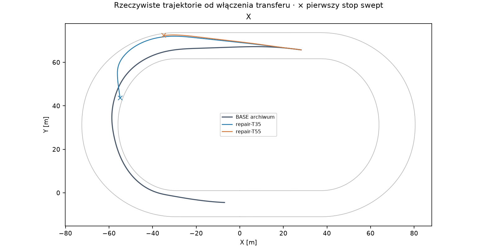
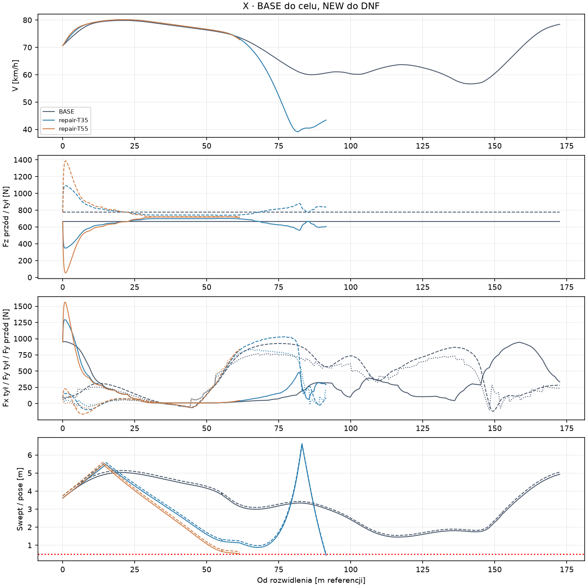
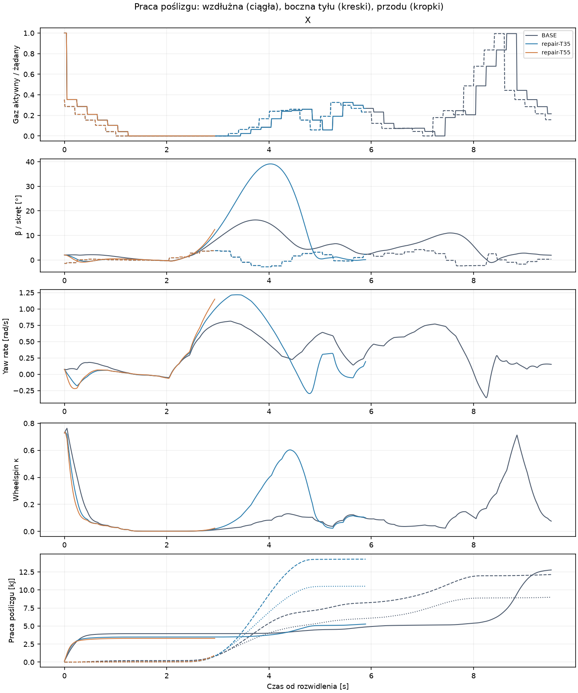

# Badanie #176 · PARTIAL

**Diagnostyka: PARTIAL. Funkcjonalnie: niepotwierdzone. Sportowo: nie badano. Pełne S3: UNKNOWN.** W dwóch wiarygodnych próbach z tego samego stanu X dynamiczny rozkład nacisku zwiększył tylny Fx w chwili aktywacji. Zysk Vmax przed łukiem wyniósł około 0,28 km/h. Oba ramiona naruszyły swept 0,5 m w następnym łuku. Nie ma pomiaru czasu całego manewru ani S3 dla transferu.

Badanie jest PROVISIONAL, działa jako osobny program i jest domyślnie OFF. Baza #175 `2a32aec30a50b8640c8dcb34a7b573d12395fecb`. Oryginalny K4 i jego dane referencyjne pochodzą z #172 `c5f0a4cc4de34fc4c8c47ef912cafabf34055f29`. Geometria, μ, wilgotność, prawo Fx/Fy, silnik, masa, rozstaw osi, przekładnia, sprzęgło, opóźnienie i progi legalności zachowują wartości bazowe.

## Błąd integracji i zakres dowodu

Pierwsza wersja kolektora korzystała z `Contact169`, który zwraca rozwiązane stany wału, koła i skrętu. Po kroku Box2D zatwierdzała wał, lecz wywoływała stare `Commit()` na obiektach koła i kierownicy, do których ten kontakt nie wpisuje pola `Prepared`. Stan zapisany po kroku różnił się od wyliczonego nawet o **4,092 rad/s koła** i **0,015708 rad skrętu**. Analiza energetyczna wykryła ten błąd. Pierwszych **12 światów** ma status **INVALID_INTEGRATION**. Zachowano ich pełne zapisy i wliczono je do budżetu. Ich prędkości, DNF i zachowanie regulatora nie stanowią dowodu o poprawnie zaimplementowanym transferze.

Poprawiony kolektor zatwierdza dokładnie rozwiązane `AfterOmega` i `SteeringAfter`, tak jak `NativeWorld169`. Sprawdza też zgodność trzech stanów w każdym kroku. W dwóch rezerwowych światach odtworzono ten sam stan X oraz tę samą sekwencję komend. Po naprawie zweryfikowano ciągłość koła, skrętu i wału, pasywność, bilans i brak dublowania impulsu. Osobne, poprawnie zintegrowane E1/E2 oraz porównanie regulatora pozostają niewykonane.

Światy łącznie: **14/24**, w tym 9 pierwszego etapu rozwojowego, 3 weryfikacje predyktora w nieważnej integracji i 2 poprawione próby rezerwowe. Dziesięć światów przewidzianych na końcowe pary nie zostało użytych. Zarejestrowano **39,0625 CPU-s** wraz z analizami i audytem błędu. Okres 0,20 s jest czasem symulacji. Czas obliczeń decyzji nie był kryterium przerwania. Maksymalne czasy decyzji 8,99 i 0,25 ms w dwóch poprawionych światach dotyczą odczytu ustalonej taśmy, więc nie mierzą kosztu autonomicznego sterownika. Pełne Windows CI i końcowy SHA są przy Draft PR.

## 1. Jak przenoszony jest nacisk?

Po każdym zaakceptowanym kroku obliczamy `ax=(Vnowe−Vstare)·e_heading_nowe/Δt`. Następny krok używa tego pomiaru i wzoru `ΔFz=m·ax·h/L`. Nie stosujemy filtru, mnożnika przyczepności ani pętli algebraicznej. W chwili przełączenia transfer otrzymuje również rzeczywiste ax z poprzedniego bazowego kroku. T35 i T55 różnią się tylko h równym 0,35 i 0,55 m. Obie wartości pozostają hipotezami.

Fz tyłu to `mg·0,70/L+ΔFz`, Fz przodu to `mg−Fz_tyłu`, gdzie L≈1,30 m. Przy hamowaniu ΔFz jest ujemne. Suma Fz=1442,07 N i całkowity limit μmg≈1852,34 N pozostają stałe. `Contact169` otrzymuje oryginalne prawo kontaktu i zmienione budżety obu osi. Zmiana nacisku wpływa także na istniejącą skalę relaksacji tylnej opony, zgodnie z tym samym równaniem. Brak dodatniego Fz któregokolwiek koła kończy próbę jawnie, przed zaliczeniem kroku lub mety. Nie dodano minimalnej siły skrętu.

Siły działają w oryginalnych punktach styku i w COM dla oporu. Box2D wykonuje jeden natywny krok, wał/sprzęgło/koło rozwiązują jeden zaakceptowany kontakt i zachowują stan. Niezależny audyt porównuje rzeczywiste Δv i Δyaw z zapisanym impulsem sił i momentu. Przeliczenie Fz z poprzedniego kroku różni się od zapisu o mniej niż 0,00003 N. Dwie poprawione próby mają zerową różnicę między stanem zatwierdzonym a obliczonym dla wszystkich trzech wielkości.

## 2. Czy rośnie dostępny napęd?

Tak, w zbadanym stanie X z dużym wheelspin. Start interwencji t=28,60 s, s=457,998 m, V=70,648 km/h, κ≈0,728, poprzednie ax=5,693 m/s². Oba nowe światy odtwarzają 2866 identycznych próbek prefiksu oraz 144 obserwacje decyzji, włącznie z pełnym pending i wałem. Na rozwidleniu mają wspólny hash. Przez cały rollout dostają identyczne żądania K4 w tym samym czasie fizycznym.

| Pierwszy krok po przełączeniu | BASE | T35 | T55 |
|---|---:|---:|---:|
| Fz przodu [N] | 665,57 | 440,26 | 311,51 |
| Fx tyłu [N] | 952,72 | 1200,81 | 1334,20 |
| Fy przodu [N] | 64,61 | 42,74 | 30,24 |
| Fy tyłu [N] | 88,02 | 137,92 | 170,96 |
| Moment yaw [Nm] | −7,60 | −52,84 | −81,42 |

W zapieczętowanych 56 stanach #175 mediana zmiany Fx w grupie dużego wheelspinu wynosi +239 N dla T35 i +367 N dla T55. Na prostym odcinku z małym poślizgiem ten sam test daje +12 i +18 N. Efekt zależy od stanu.

## 3. O ile zmienia się wheelspin?

W archiwalnej sondzie ze stałym stanem początkowe κ jest identyczne. Przy wysokim spinie mediana zmiany κ w połowie kroku wynosi −0,0047 dla T35 i −0,0071 dla T55. W poprawionych natywnych próbach maksimum od rozwidlenia do naruszenia to 0,736 dla obu wariantów, wobec 0,763 w odcinkach BASE do odpowiadającego punktu. To około −0,027 wartości bezwzględnej. Nie jest to statystyka całego okrążenia.

## 4. Czy maleje praca poślizgu?

Zależy od okna. Sonda w stanie dużego spinu zwiększa pracę wzdłużną o medianę 31 i 48 J na krok, ponieważ większy Fx przeważa nad spadkiem poślizgu. Natywnie porównano każdy wariant z BASE na tym samym przedziale postępu do jego rzeczywistego końca. W T35 wzdłużna praca poślizgu rośnie z 4,224 do 5,141 kJ, w T55 maleje z 3,808 do 3,154 kJ. Dla T35 suma boczna rośnie z 12,133 do 24,792 kJ. Krótsze okno T55 kończy się tuż po wejściu i nie obejmuje środka łuku. Nie należy porównywać jego pracy bezpośrednio z dłuższym T35.

Reszta bilansu energii dla porównywanych okien NEW to **+0,014 J i +0,053 J**. Bilans zawiera pracę silnika, sprzęgło, przekładnię, łożysko, opór, poślizg wzdłużny, pracę boczną obu styków oraz zmianę energii ciała, yaw, koła i wału. Nie odejmuje yaw dwukrotnie.

## 5. Jak zmienia się Fy i moment?

Przy dodatnim ax maleje pojemność przodu i rośnie pojemność tyłu. W chwili przełączenia X przedni Fy spadł z 64,61 do 42,74 lub 30,24 N, a tylny wzrósł z 88,02 do 137,92 lub 170,96 N. Moment przechodzi do silniejszej reakcji w przeciwnym kierunku obrotu. W sondzie wejścia, przy hamowaniu, mediany są odwrotne: T35/T55 zwiększają Fy przodu o 33,5/52,6 N i zmniejszają Fy tyłu o 32,8/51,5 N. Zmienia to moment wokół COM przy tej samej komendzie. Środek łuku zachowuje μmg, więc transfer nie daje nowej całkowitej rezerwy do utrzymania większej prędkości.

## 6. Czy przy mocnym gazie można sterować?

W poprawionych X nie stwierdzono oderwania koła. T55 obniża Fz przodu do **53,73 N**, co odpowiada tylko około 69 N chwilowej pojemności przodu. Jest to duża utrata autorytetu, nawet przy dodatnim Fz. W tym porównaniu aktywny gaz ≥95% trwa 0,04 s po rozwidleniu w obu wariantach i BASE. Próby nie wykazały dłuższej, stabilnej jazdy na wysokim gazie. Krótkie legalne okna #169 zachowują swój osobny zakres dowodu.

## 7. Czy poprawia wejście?

W X prędkość wejścia wynosi 75,50 km/h w BASE, 75,78 w T35 i 75,74 w T55. Różnica w położeniu jest większa. Przy pierwszej próbce za linią wejścia offset od referencji wynosi 3,40 m w BASE, 9,26 w T35 i 9,83 w T55. Pose spada z 3,91 m do 1,34 i 0,77 m. Zysk prędkości nie kompensuje utraty zapasu toru. Bez poprawnych osobnych prób E1/E2 odpowiedź o innych wejściach pozostaje UNKNOWN.

## 8. Czy przejeżdża cały następny łuk?

Nie w dwóch poprawionych ramionach ze stałą komendą. Cel s=630,5575 m, pełny łuk od 513,1681 do 610,5575 m oraz 20 m prostej. BASE osiąga go po 38,120807 s od startu, czyli 9,520807 s od rozwidlenia.

| Wariant | Postęp w następnym łuku do stopu | Czas od rozwidlenia | Bramka | Pose / swept [m] |
|---|---:|---:|---|---:|
| T35 | 36,265 m | 5,890 s | wewnętrzny swept | 0,506 / 0,444 |
| T55 | 6,291 m | 2,940 s | zewnętrzny swept | 0,600 / 0,492 |

T35 przed stopem osiąga |β|=39,11° i schodzi w zarejestrowanej części łuku do 39,18 km/h. T55 zbliża się do zewnętrznej krawędzi przy |β|=12,45°. Oba zatrzymania wynikają z oryginalnej bramki swept, nie z Fz=0 ani przekroczenia 45°. Wcześniejsze próby techniczne są wyłączone z tej oceny.

## 9. Czy przewaga utrzymuje się na prostej?

Vmax przed następnym wejściem wynosi BASE 79,889, T35 80,179 i T55 80,165 km/h. W chwili wejścia pozostaje tylko około +0,27/+0,24 km/h. Punkt rozwidlenia był już za poprzednim wyjściem, więc nie mierzymy poprawy samego przekroju poprzedniego wyjścia. Porównania do wspólnego, wcześniejszego postępu przy DNF pokazują straty odpowiednio 1,178 i 0,054 s do BASE. Nie ma wartości prędkości wyjścia z następnego łuku ani Vmax za nim.

## 10. Czy T35 i T55 są jakościowo podobne?

Kierunek zmiany sił w chwili przełączenia jest ten sam, a większe h wzmacnia efekt. T55 ma znacznie niższy minimalny Fz przodu i kończy już na wejściu. T35 wchodzi dalej, wytraca więcej energii bocznie i dochodzi do przeciwnej krawędzi. Oba warianty nie zaliczyły pełnego manewru, więc wybór wariantu do S3 nie był uzasadniony.

## 11. Czy wystąpiło oderwanie przedniego koła?

Nie w poprawionych próbach. Minima Fz przodu to 348,78 N i 53,73 N. Tylna oś pozostaje dodatnia, odpowiednio co najmniej 739,12 N i 718,00 N. Wynik h=0,75 m z #169 pozostaje znanym przypadkiem granicznym. Nie uruchomiono go ponownie.

## 12. Czy konieczna była zmiana sterownika?

Stałe komendy K4 nie przechodzą próby X po zmianie nacisku. Czy autonomiczny, zamrożony K4 wystarcza, pozostaje UNKNOWN: próby z aktualnym sprzężeniem oraz podmianą predyktora #169 miały błąd integracji. Podmiana predyktora była osobnym wariantem, bez zmian wag, sterowania kierownicą czy yaw. Po naprawie wiarygodne próby rezerwowe porównały fizykę na stałych komendach. Nie ma podstaw do przypisywania skuteczności lub nieskuteczności poprawnie zintegrowanej adaptacji.

## 13. Co można przypisać samemu transferowi?

Zmiany natywne w poprawionym X wynikają z rozdziału Fz i jego dalszej interakcji z dynamiką motocykla. Prefiks, komendy, opóźnienie i geometria są zgodne. Mierzalne są silniejszy początkowy Fx, zmiana Fy i momentu oraz odejście od bazowej trajektorii. Nie wykazano poprawy manewru po dostosowaniu sterownika.

## 14. Czy pełne S3 jest szybsze?

**UNKNOWN.** Pięć odłożonych, niezależnych stanów zapieczętowano przed próbami. Etap S3 nie miał kwalifikacji i nie uruchomiono żadnego świata walidacyjnego. Próg sportowy pozostaje 5%, funkcjonalny wymaga 5/5 legalnych, dopasowanych ukończeń oraz mediany w granicy 1% względem BASE. Historyczne 56,331 s z #172 nie jest wynikiem NEW.

## 15. Co nadal ogranicza prędkość?

Zysk siły napędowej może zostać utracony przez zmianę kierunku i boczną pracę opon. W X przy podobnej prędkości wejścia NEW ma dużo mniej miejsca do zewnętrznej krawędzi. T35 dochodzi do dużego poślizgu i ma około dwukrotnie większą boczną pracę opon niż BASE do tego samego postępu. Wynik jest spójny z niedopasowaniem oryginalnych komend do zmienionego momentu yaw. Nie stanowi dowodu, że transfer jest nieprzydatny przy innej, legalnej linii.

## 16. Co sprawdzić dalej?

Najbliższym problemem ujawnionym w tym porównaniu jest **przygotowanie trajektorii i kierunku przed wejściem**, zanim dodatkowy Fx zmieni odpowiedź motocykla na stare komendy. Rozdział nacisku nie usuwa ograniczenia μmg i krzywizny z #175. Osobny eksperyment kontrolera powinien najpierw przejść pełny łuk i 20 m prostej przy zweryfikowanej ciągłości, opóźnieniu i tej samej fizyce. Dane nie uzasadniają strojenia μ ani zwiększania mocy.

## Dowody i odtwarzanie

- [Pełna tabela prób i pięciu niewykonanych par](TABELE.md), [sondy w zapisanych stanach](stany-osi.csv), [metryki i bilans](summary176.json).
- `176-repair.zip` zawiera obie poprawione historie Box2D, komendy, wał/sprzęgło/koło, pełny pending, siły, naciski i naruszenia. `176-tape.zip`, `176-live.zip` i `176-aware.zip` zachowują wszystkie próby technicznie nieważne. `176-protokol.zip` zawiera źródła kolejnych wykonanych wersji, rachunek rezerwacji, dowód błędu i zamknięcie etapu.
- `INPUTS.json` i `SHA256SUMS` identyfikują zamrożone źródła i artefakty. `generate176.py --check` kontroluje pochodne starego świata i dyspozytora K4. `verify176.py` sprawdza zapisy, bilans nacisku, zmiany prędkości, stan koła i skrętu, kolejkę oraz dwa rodzaje dowodów, bez nowych światów.

