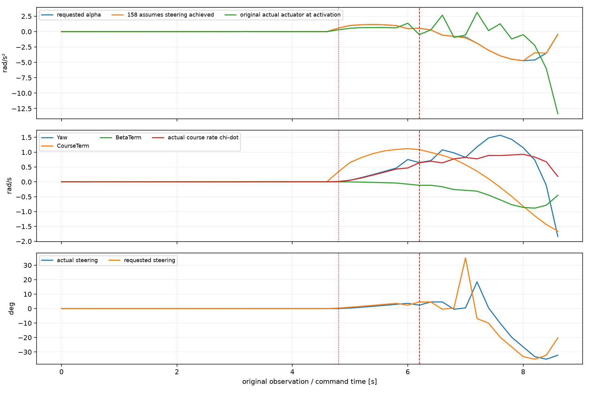
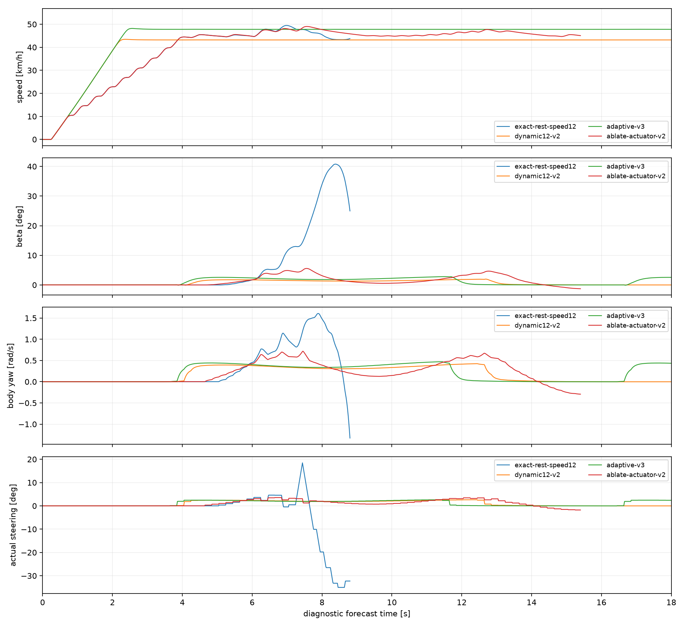
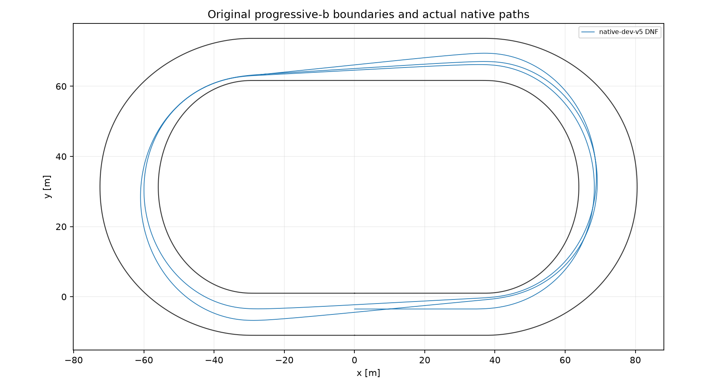
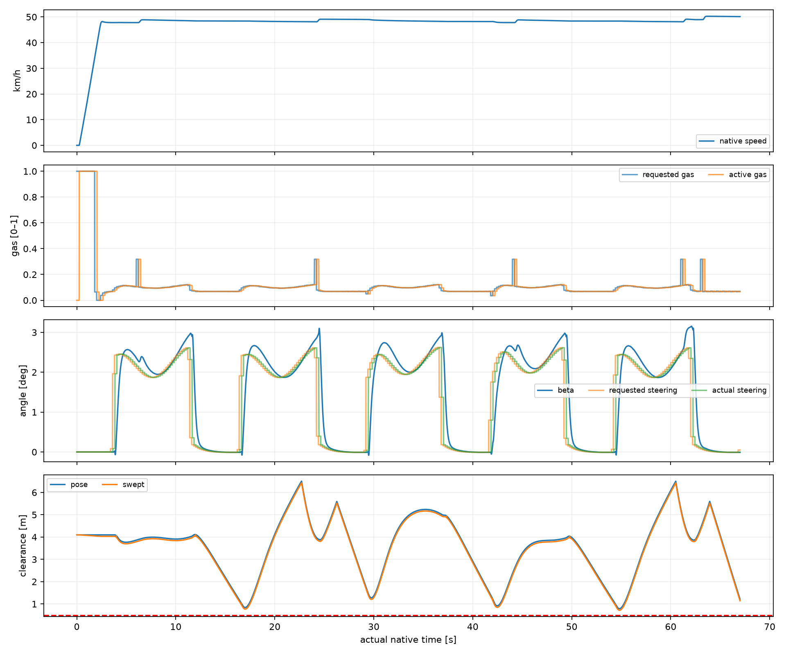

# Badanie #160 — dynamiczne sterowanie β, yaw i prędkością

**Werdykt: PARTIAL.** Baza: `9fb071ba3129aae88a6ec8c401d51a784be2da2b`. Eksperyment PROVISIONAL, domyślnie OFF; nowa gałąź i Draft PR, bez merge. Prognozy, certyfikaty i rzeczywiste biegi są raportowane osobno.

## Cztery odpowiedzi

1. **Pierwszy łuk:** status natywny complete, czas 8.020 s wobec 10.679 s w identycznej bazie (około 24,9% krócej), Vmin 47.797 km/h. Dokładna prognoza #159 przy 12 m/s nadal wypada w 8,8 s; dynamiczna prognoza 12 m/s kończy pełny dystans w 86,4 s z βmax 2,00°.

2. **Pełne S3: nie uzyskano nowego ukończenia.** Nominalny v5 zakończył się technicznym DNF przy 67,0 s, po dwóch okrążeniach i pięciu łukach. Nowe światy 1, ukończenia 0, odłożone 0, DNF odłożonych 0. Mediana ukończeń odłożonych — s. PASS wymaga co najmniej pięciu różnych ukończeń i przewagi nad identyczną bazą. Pojedyncza prognoza 78,2 s ani zielone CI nie spełniają tego warunku.

3. **Składniki:** najmocniejszy dowód dotyczy zastąpienia chwilowej inwersji rzeczywistą odpowiedzią opóźnionego układu skręt–gaz. Ablacja tego kroku narusza obrys przy 15,4 s. Wyłączenie β feed-forward i skrócenie horyzontu do reakcji + jednego review nadal kończą prognozy 12 m/s, więc ich konieczność nie została wykazana. Dłuższy preview zmniejsza szczyt prędkości w tym teście.

4. **Potencjał:** pozostaje istotny zapas do punktów lokalnej równowagi #159 (57,6 km/h w ciasnej części i 72 km/h w środku) i lokalnego przyspieszania na prostej. To propozycje równowagi i lokalne wyniki, bez dowodu osiągalności całego szybszego biegu. W natywnym prefiksie średnie wykorzystanie sił przedniej i tylnej opony wyniosło 25,1% i 31,8%, a średni aktywny gaz 11,7%. Te średnie nie są miarą bezpośrednio dostępnego przyrostu prędkości: ograniczenia momentu yaw, sprzężenia, przejścia i bezpieczeństwo mogą wiązać wcześniej. Nowa polityka rezerwuje 50% skalarnego budżetu siły normalnej na etapie propozycji; certyfikat nadal używa pełnej oryginalnej fizyki i twardych ograniczeń. Nie wyznaczono globalnego optimum silnika/opon.

## Pierwsza przyczyna i łańcuch utraty kontroli

Odtworzono **wszystkie bity stanów, kolejkę, komendy i wszystkie gęste punkty** `rest-speed12`. Ślad porównuje odpowiedzi w tym samym przewidzianym stanie aktywacji +0,24 s. `Control158.Response` tworzy `new TwoContactBikeState(proposedSteering)`, podczas gdy oryginalny kontakt zaczyna od faktycznego skrętu i używa średniej kąta przed/po zmianie. Nawet gdy docelowy kąt mieści się w limicie szybkości, moment w pierwszym kroku jest inny. Śladowe błędy kwantyzacji występują już na prostej; pierwsza duża rozbieżność wejścia w łuk (|αzad| > 0,1 i błąd > 0,1 rad/s²) przypada na komendę 4,8 s.

|Komenda [s]|β aktywacji [°]|α zad.|α założone|α fizyczne|yaw r|χdot|skręt żądany [°]|
|---|---|---|---|---|---|---|---|
|4.8|0.01|0.573|0.573|0.287|0.001|0.013|0.37|
|5.0|0.10|1.000|0.998|0.541|0.053|0.058|0.95|
|6.0|3.52|0.482|0.477|1.362|0.753|0.469|2.35|
|6.2|5.29|0.539|0.543|-0.485|0.649|0.645|4.61|
|6.6|7.52|-0.580|-0.579|2.673|1.079|0.640|-0.45|
|7.0|12.98|-0.885|-1.010|-0.548|0.826|0.823|35.00|
|7.2|14.36|-1.886|-1.889|3.114|1.177|0.776|-6.88|
|7.6|27.65|-3.927|-3.933|1.266|1.572|0.887|-19.78|
|8.2|40.59|-4.611|-3.422|-2.232|0.738|0.834|-35.00|

W 4,8 s α zadane ≈0,573 rad/s², a fizyczne ≈0,287. W 6,2 s żądane α≈+0,539, lecz rzeczywiste ≈−0,485; w 6,6 s żądanie ≈−0,580 daje ≈+2,673. Występują też nieliniowe i niemonotoniczne odpowiedzi przy dużych skrętach, na których bisekcja #158 nie daje gwarancji inwersji. Gaz chwilowej inwersji oscyluje między 0 i 1, zmieniając dostępny moment yaw przez sprzężone siły tylnej opony. W 7,0 s pojawia się żądanie +35°; aktuator i pending nie mogą go odwołać natychmiast. θ obraca się szybciej niż χ, więc β rośnie. Późniejsze tłumienie β i korekta powrotu na linię wzmacniają przeciwne żądania, zamiast usunąć istniejący pęd i kolejkę. Przecięcie obrysu następuje w 8,8 s.

Znaki bazowej krzywizny i skrętu na wejściu są poprawne. Problemem nie jest brak pending w #158: `ActivationState` już przewiduje cały nieodwołalny prefiks. Problemem jest dalsza ocena kandydatów jak osiągniętych kątów i chwilowego gazu oraz utożsamianie celu yaw z kierunkiem ruchu bez przewidzenia rzeczywistego rozwoju β. Nie wykazano, że samo osłabienie tłumienia β usuwa tę przyczynę.

## Algorytm i granice jego znaczenia

`β = wrap(θ−χ)`, `χ = atan2(vy,vx)`, `χdot = cross(v,F)/(m |v|²)`, `κXY = cross(v,a)/|v|³`. Yaw r jest prędkością orientacji motocykla; `βdot = r−χdot`. Telemetria przechowuje wszystkie te wielkości osobno.

Feed-forward β i kierownicy pochodzi z numerycznego rozwiązania trzech reszt **oryginalnej** funkcji kontaktów: wzdłużnej siły, normalnej siły wymaganej przez V²κ oraz momentu yaw. Nie ma kopii prawa opon ani nowego integratora. Jest to lokalna propozycja, a nie dowód stabilności; faktyczny wał, sprzęgło, koło, ich energię i aktualny gaz rozstrzyga oryginalny predyktor. Gdy reszta punktu przekracza 0,05 w skalowanych jednostkach, β feed-forward nie jest uznawane za znalezioną równowagę.

Każda propozycja dynamiczna zaczyna od bieżącej obserwacji i **całej** kolejki. Nowa komenda aktywuje się dokładnie po 0,24 s, bez podwójnego dodawania opóźnienia. Horyzont to reakcja + dwa review + czas wykonania zmiany skrętu wynikający z oryginalnego limitu 90°/s, ograniczony interfejsem predyktora do 0,9 s. Przyszły odczyt geometrii pochodzi z rzeczywistej prognozowanej pozycji przy kandydacie gazu i skrętu. To nie stałe przesunięcie w metrach.

Profil propozycji wynika z maksymalnej krzywizny aktualnej linii przez pełny następny manewr i jego kontynuację oraz oryginalnego budżetu sił i wykonalności lokalnej równowagi. To konserwatywna obwiednia: na symetrycznym torze bywa prawie płaska, a przy wyjściu zmienia się z celem. Nie jest globalnym optimum ani kompletnym rozwiązaniem problemu hamowania — bezpieczną osiągalność od aktualnego stanu sprawdzają dopiero pełne kontynuacje. Nie ma osobnych limitów prosta/łuk. Szersza linia 6 m została zbadana, ale odrzucona za β45 podczas przejścia; nie przypisujemy jej korzyści z samego większego promienia.

Lokalne ograniczone strzelanie gaz–skręt wykorzystuje do trzech iteracji 2×2 z rzeczywistym predyktorem; reszty yaw i prędkości służą wyłącznie propozycji. Wybór planu wykonuje odziedziczony planner z `RankPolicies=true`: najwyżej trzy korzenie, co piąte review ograniczone dodatkowe próby, **rzeczywisty czas do wspólnego celu**, minimum 0,02 s korzyści przed kolejnym pełnym drzewem, legalna kontynuacja i niezależna recertyfikacja. Nie ma nagrody za Vmax, β=0 ani pełny gaz.

Dla perturbowanych stanów rezerw używany jest feedback do własnego świeżo wygenerowanego planu, z lokalną pochodną momentu oryginalnego, rzeczywistego aktuatora. Taki feedback jest tylko propozycją: każda jego kontynuacja jest fizycznie repropagowana. Własny zatrzymany plan jest ponownie certyfikowany; nie ma importu starej taśmy #158 ani automatycznego fallbacku ON do starego kontrolera. OFF bezpośrednio deleguje do niezmienionego `Planner158`. `Planner160.Generated.cs` zmienia wyłącznie nazwy i trzy haki propozycji względem #158; `Runtime158`, 13 węzłów, 9 pełnych rezerw i niezależny preflight pozostają oryginalne.

## Wszystkie prognozy i ablacje

|Próba|Cel osiągnięty|Legalna|Koniec [s]|I łuk [s]|βmax [°]|swept min [m]|CPU [s]|Powód|
|---|---|---|---|---|---|---|---|---|
|ablate-actuator-v2|False|False|15.4|8.741|5.56|0.341|1.50|footprint reserve|
|ablate-beta-v2|True|True|86.6|9.055|1.97|3.768|15.97|diagnostic goal|
|ablate-preview-v2|True|True|86.4|9.013|2.21|3.930|13.72|diagnostic goal|
|adaptive-bounded-v6|True|True|78.2|8.135|2.85|3.699|14.41|diagnostic goal|
|adaptive-v2|False|True|12.4|8.128|3.49|3.699|3.05|Lateral position must be finite and between 0 and 4 inclusive. (Parameter 'lateralPosition')|
|adaptive-v3|True|True|78.2|8.135|2.85|3.699|14.20|diagnostic goal|
|adaptive-wide-v5|False|False|3.6|—|58.51|3.652|1.19|beta45 envelope|
|bounded-tail-v6|False|False|78.4|—|49.20|-0.666|4.59|footprint reserve|
|dynamic12-v2|True|True|86.4|9.003|2.00|3.706|15.59|diagnostic goal|
|exact-rest-speed12|False|False|8.8|—|40.78|-1.177|1.09|footprint reserve|
|mpc12-v1|True|True|86.4|9.004|2.00|3.709|15.47|diagnostic goal|
|off-base10|True|True|101.0|10.591|6.49|1.401|3.94|diagnostic goal|

Ablacje v2 zmieniają po jednym przełączniku względem dynamic12-v2. „Actuator=false” wraca do chwilowej inwersji gaz–skręt, zachowując β feed-forward i odczyt przyszłej geometrii. β=false usuwa tylko fizyczny cel β. Preview=false skraca horyzont do reakcji + jednego review; nie usuwa nieodwołalnego prefiksu. To lokalna identyfikacja mechanizmu, bez deklaracji odporności ablowanych polityk. Pierwsze v1/v2 i późniejsze v3/v5 są wersjami rozwojowymi, nie pojedynczym czystym porównaniem.

## Certyfikaty i bramki

|Próba|Pełne 13/9 + independent|CPU [s]|Węzły|Rezerwy|
|---|---|---|---|---|
|adaptive-v3-initial.json|True|33.83|13|9|
|adaptive-v4-entry.json|True|9.30|13|9|
|adaptive-v4-initial.json|True|6.70|13|9|
|adaptive-v5-bend.json|True|11.78|13|9|
|adaptive-v5-initial.json|True|6.97|13|9|
|terminal-cause-v5.json|False|4.53|0|0|

A: odtworzenie #159 i całego OFF/base10 dokładne, łącznie z wszystkimi punktami;  B: stabilna szybsza prognoza pierwszego łuku przy 12 m/s; C: pełna adaptacyjna prognoza 78,2 s, swept 3,699 m; D: pełne certyfikaty kandydatów v3–v5. Szósty, ostatni probe odtwarza techniczny błąd z natywnego końca, bez własnego zachowanego portfolio. V6 zawiera późniejszą poprawkę numeryczną i nie uzyskał nowego pełnego certyfikatu — limit sześciu probe pozostał zamknięty. E i F rozstrzygają wyłącznie poniższe światy natywne. Certyfikat w wybranym stanie nie gwarantuje braku przyszłego ABSTAIN.

## Światy natywne i pary #158

|Próba|Status|Okrążenia|Czas S3 [s]|Baza [s]|Δ [s]|Obrys [m]|Swept [m]|βmax [°]|CPU [s]|
|---|---|---|---|---|---|---|---|---|---|
|native-dev-v5|DNF|2|—|101.390|—|0.789|0.719|3.15|1252.84|

Pary wymagają równości pełnego stanu startowego (w tym wału, koła, aktywnej komendy, pending i review), pierwszej próbki, specyfikacji masy i bezwładności oraz niezmienionych drzew fizyki i geometrii. DNF pozostaje w mianowniku i nie otrzymuje fikcyjnego czasu mety. Mediana i rozrzut obejmują ukończenia odłożone; rozwój jest oddzielny. Warunki są wcześniej ustalonym zestawem final-v6 #158, bez wykorzystania odłożonych wyników do dostrajania.

### native-dev-v5: DNF

Okrążenia [s]: 26.742, 25.067. Droga XY: 884.796 m. Zaakceptowane decyzje: 335; ABSTAIN: 0; kontakty: 0; odrzucone próby planów: 102. CPU callbacków: suma 1232.312 s, mediana 3.141 s, maksimum 12.281 s.

|Łuk|Status|Wejście [s]|Wejście [km/h]|Vmin [km/h]|Wyjście [km/h]|Czas [s]|
|---|---|---|---|---|---|---|
|1|complete|3.978|47.811|47.797|48.441|8.020|
|2|complete|16.613|48.410|48.106|49.104|8.143|
|3|complete|29.323|49.018|48.226|48.226|8.029|
|4|complete|41.989|48.207|47.799|48.403|7.811|
|5|complete|54.417|48.375|48.119|48.948|8.122|
|6|unreached|—|—|—|—|—|

|Okrążenie / prosta|Obserwowany czas [s]|Vśrednia [km/h]|Vmax [km/h]|
|---|---|---|---|
|1/1|3.970|31.683|48.192|
|1/2|4.620|48.432|48.454|
|1/3|1.990|49.093|49.107|
|2/1|2.580|49.045|49.071|
|2/2|4.630|48.222|48.235|
|2/3|2.010|48.410|48.418|
|3/1|2.610|48.387|48.401|
|3/2|4.470|49.959|50.262|
|3/3|0.000|—|—|

Pierwsza odmowa: `technical invariant: Finite physical actions required.`, t=67.000 s. Pełne stany, odrzucenia i rezerwy w surowej polityce wskazanej w analysis.json.

CPU faz: hierarchical_generation: 242.250 s, conditional_continuations: 724.875 s, independent_preflight: 117.750 s, outside_decision: 34.031 s, nominal_propagation: 3.875 s, causal_reserve_generation: 0.094 s, candidate_generation: 0.172 s, uncertainty_scenarios: 0.000 s, recertification: 104.344 s. Nie sumować tego ponownie z CPU callbacków.

## Rzeczywisty DNF i poprawka v6

Przy 67,0 s motocykl nadal był fizycznie legalny: β≈−0,008°, r≈−0,00144 rad/s, prędkość 50,13 km/h, brak kontaktów. Cały bieg ma minimum obrysu 0,789 m i swept 0,719 m; maksimum β 3,154°. Do motocykla trafiło 335 legalnych, świeżo certyfikowanych komend. Nielegalny kandydat nie został wykonany. To **techniczne DNF planowania**, nie naruszenie faktycznej trajektorii ani wyczerpanie CPU. Licznik ABSTAIN wynosi 0, ponieważ ArgumentException opuścił callback przed zapisaniem wiersza odmowy; natywny harness zachował wyjątek w Outcome i zakończył bieg.

Zmiana wspólnego celu przy wejściu w szósty łuk wymagała już rezerwy do 988,336 m, czyli 32 m za metą. W poprzednim review cel wynosił 828,947 m, a safetyGoal 956,336 m. Pełny natywny stan przy 67 s ma offset 0,679 m i składową prędkości do wewnątrz około 1,413 m/s, mimo β bliskiego zeru. To pokazuje, dlaczego sam mały β nie jest bezpieczeństwem linii.

Szósty probe uruchomiony z dokładnego stanu natywnego, lecz ze świeżym plannerem bez zachowanego portfolio, odtworzył ten sam wyjątek. W prognozowanej rezerwie przy t=78,0 s, referencji 976,403 m (już za metą, przed obowiązkowym końcem rezerwy) skończona różnica żądała 0,6258652 rad, tj. 35,859°, ponad fizyczne 35° = 0,61086524 rad. Punkt próbny powstał jako maksymalny dopuszczalny iterat + 0,015 rad. Oryginalna walidacja słusznie go odrzuciła; błąd generatora zamienił odrzucenie kandydatu w przerwanie całej decyzji. Surowe LastProbe i pełny stack są w certificates/terminal-cause-v5.json.gz. To reprodukcja mechanizmu, nie odtworzenie utraconego wewnętrznego portfolio natywnego.

V6 stosuje jednostronną różnicę skierowaną do wnętrza dopuszczalnego zakresu i rzeczywisty mianownik kroku. Test regresji używa zapisanego stanu błędu. Nominalna prognoza v6 nadal kończy trzy okrążenia w 78,2 s, ale nie jest nowym biegiem. Kontynuacja v6 z końca DNF, z pełną kolejką i bez resetu jej fizyki, nie osiąga safetyGoal: przy 78,4 s i 981,752 m narusza obrys (swept −0,666 m, βmax 49,20°). Nie ma już wyjątku, lecz istnieje nielegalny proponowany manewr. To nie dowód niemożliwości innej kontynuacji.

**Następna konkretna zmiana:** utrzymać dopuszczalne różnice skończone i odrzucać pojedyncze nieudane propozycje; następnie włączyć rzeczywisty błąd linii i prędkość poprzeczną do pełnego manewrowego wyboru gaz–skręt, tak aby profil nie przyspieszał na podstawie samej nominalnej krzywizny podczas powrotu na linię i rozszerzenia rezerwy. Wymaga ponownego C/D i nowego jawnego budżetu badania. Nie usuwać 32 m rezerwy, nie zmniejszać 13/9 ani nie maskować tego starą taśmą. Seria jest zamknięta po pierwszym DNF; brama F nie została uruchomiona.

W porównaniu z nominalną bazą swept zmalał z 1,704 do 0,719 m, mimo zmniejszenia βmax z 6,263 do 3,154°. Udokumentowano lokalną poprawę tempa i β, ale **nie poprawę marginesu bezpieczeństwa ani skuteczności S3**. Czasu DNF 67 s nie porównuje się procentowo z pełnym czasem bazy 101,390 s.

## Budżet, negatywne wyniki i dalsza praca

|Rodzaj|Wykonano|CPU rozliczone [s]|Limit liczby|
|---|---|---|---|
|diagnostic|12|126|60|
|certificate|6|82|6|
|native|1|1254|11|

Deklaracja sprzed pierwszej próby: diagnostyka 1800 CPU-s / 60 kontynuacji, certyfikacja 6 × 60 CPU-s, nowe światy najwyżej 11 × 1800 CPU-s, łącznie 19800 CPU-s natywnych, maksymalnie 60 CPU-s/review. Nie zwiększano limitów automatycznie. Błąd mapowania nawierzchni adaptive-v2 i nielegalna szersza linia pozostają w danych. Zasada F: po pierwszym S3 zamrozić źródła przed odłożonymi; 10 prób przy CPU rozwoju ≤900 s, inaczej pierwsze 5.

**Brak udowodnionego szybszego, powtarzalnego S3.** Pierwszą przerwę spowodował nielegalny numeryczny punkt próbny, a po jego poprawieniu zbadana kontynuacja nadal narusza obrys. Następny krok opisano powyżej. Nie uruchamiać kolejnych identycznych nieudanych światów.

Dane CSV.gz mają gęstą telemetrię natywną: XY/droga, żądany/aktywny gaz i skręt, θχβyaw, krzywizna XY, wheelspin, Fx/Fy obu kół, wykorzystanie opon, wał/sprzęgło, obrys i swept. JSON polityk zachowuje wszystkie świeże 13/9 i powody odrzuceń. Replay używa wyłącznie oryginalnych indeksów próbek; przy DNF zamraża ostatni stan. Wszystkie wyniki są deterministycznymi eksperymentami tego niekalibrowanego modelu, bez twierdzenia o rzeczywistym motocyklu czy geodezyjnej Motoarenie.
