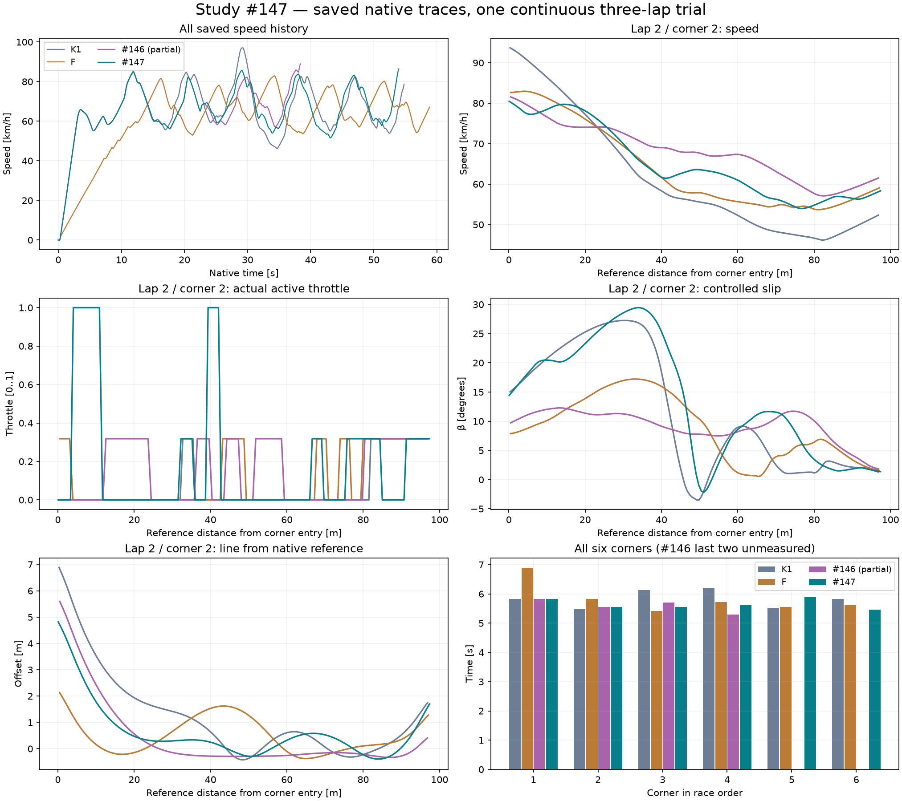

# Badanie #147 — wydajniejszy planner i pełne trzy okrążenia

**Wynik: PASS techniczny i potwierdzona przewaga sportowa w jednej pełnej próbie solo.** Autonomiczny sterownik ukończył trzy legalne, nieprzerwane okrążenia od 0 km/h w **53,989766 s**, o **0,804764 s (1,47%) szybciej od K1**. Wszystkie 270 wykonanych decyzji zachowano. Koszt kontrolera: **154,500 CPU-s**, o 62,33% mniej niż 410,141 CPU-s częściowego #146, lecz nadal 5,716 razy więcej niż K1. **Pozostały problem to wydajność; ekonomiczna symulacja czterech zawodników nie jest potwierdzona.**

Baza: Draft PR #145, `9828656024eda4177d39f0a29d10d3f2c5287ff6`. Gałąź: `experiment/efficient-autonomous-planner-147`. Numer badania jest niezależny od numeru PR. Wariant PROVISIONAL, domyślnie OFF; Draft PR, bez merge.

## Co dokładnie zmieniono

Rozszerzono wykonanie istniejącego Planner146. Zachowano jego ocenę całego bieżącego i następnego łuku, model predykcyjny #144, natywną integrację Box2D, napęd, sprzęgło, koło, opony oraz pełny obrys. Obserwacje i komendy pozostają co 0,2 s, aktywacja po 0,24 s; fizyczna szybkość skrętu i nieodwracalna kolejka są odtwarzane w prognozie. Nie ma celu prędkości, ręcznej linii ani gotowych przyszłych komend.

1. **Optymalizacje zachowujące semantykę:** cache pełnego stanu IEEE (również wał, koło, skręt, czas i cała uporządkowana kolejka), dokładny cache wyników K1 oraz ponowne użycie niezmiennej geometrii. Prefiks 0,2 s przed aktywacją nowej komendy jest fizycznie wspólny; każdy kandydat dostaje własną końcową kolejkę. Stan podobny nie jest trafieniem cache. Zmiana warunków czy parametrów czyści cache.

2. **Osobno badana zmiana strategii:** shortlist dwóch propozycji na poziom gazu, kolejność H09 wyłącznie do propozycji, dalej pełna ocena czasu do wspólnego celu. W pełnej próbie dodatkowo wyszukiwanie zdarzeniowe: zmiana segmentu/celu albo dryf przewidywanego czasu >0,02 s; utrata bezpieczeństwa lub zgodności zawsze wymusza reakcję. Istniejący plan jest przesuwany i od nowa certyfikowany przy każdej obserwacji. Wcześniejsze odrzucanie prefiksu stosuje te same warunki bezpieczeństwa. Przewaga jazdy należy do całego zmienionego wariantu, nie do samego cache.

3. **Jawne limity:** 8192 rzeczywiste prognozy, 700000 zapytań kontaktowych i 30 CPU-s na decyzję; opcjonalne wyszukiwanie ma osobny limit 500000 kontaktów z rezerwą na preflight. Wyczerpanie opcjonalnego budżetu pozostawia świeżo certyfikowanego legalnego kandydata i niezależny preflight. Brak certyfikacji oznacza jawny abstain. Budżet/wyjątek w obowiązkowej certyfikacji nie pozwala wykonać nieznanej akcji. Test wymusza wyczerpanie opcjonalnego budżetu i potwierdza fallback. W udanej próbie fallback nie wystąpił. Limit CPU jest zabezpieczeniem narzędzia zależnym od sprzętu; przekroczenie może zmienić zakres wyszukiwania, więc nie obiecujemy identycznego zachowania na wolniejszej maszynie.

4. **Bezpieczeństwo:** niezmienione warunki #146: rezerwa 0,10 m, ciągła dolna granica odstępu, β ≤45°, ruch do przodu i legalność dalszego manewru. Niezależne sprawdzenie najbliższych 0,8 s omija cache prognoz. Wariant nie obsługuje jeszcze ruchomych rywali.

## Profilowanie przed optymalizacją

Najpierw wykonano profil zimnego startu oraz przyczynowe odtworzenie pamięci sterownika od 14,2 do 22,6 s. Nie podmieniano stanu motocykla w nowym świecie: profile używają zapisanych obserwacji tylko jako wejścia diagnostycznego. Wszystkie 42 odtworzone komendy i logiczne liczniki zgadzają się z #146. Pełny bieg później ruszył normalnie od zera. [PROFILE-NOTES.md](PROFILE-NOTES.md), [replay-profile-result.json](profiles/replay-profile-result.json).

Pomiar: wyłączne przedziały CPU procesu przy zmianie fazy. Oddzielny podział według roli obejmuje te same operacje; tabel nie sumujemy ze sobą. Rozdzielczość licznika w tych danych wynosi 0,015625 s; zero oznacza poniżej rozdzielczości. Koszt zawiera instrumentację i przypisanie GC procesu; nie jest estymacją nieinstrumentowanego programu.

|Faza|43 decyzje #146: CPU s / %|270 decyzji #147: CPU s / %|
|---|---:|---:|
|decision_dispatch|0.093750 / 0.0365|0.078125 / 0.0507|
|model_step|61.031250 / 23.7317|19.734375 / 12.7976|
|outside_decision|0.000000 / 0.0000|0.125000 / 0.0811|
|rollout_bookkeeping|0.343750 / 0.1337|0.343750 / 0.2229|
|safety_check|0.031250 / 0.0122|0.296875 / 0.1925|
|seed_k1|195.671875 / 76.0860|133.625000 / 86.6552|

To różne zakresy decyzji, nie porównanie identycznej trajektorii. ModelStep i Rollout nie są darmowe: generowanie ogona wewnątrz K1 trafia do `seed_k1`, natomiast `model_step` obejmuje propagację poza tą fazą. `rollout_bookkeeping` mierzy samą obsługę planu.

W krytycznej decyzji **22,6 s** nieoptymalizowany planner wykonał **695 pełnych wyborów K1**, 20271 logicznych prognoz i 1730008 zapytań kontaktowych. Nowy instrumentowany pomiar wyniósł **105,234375 CPU-s** (historyczny zapis: 107,593750). K1/SeedAction zajmuje **100,937500 s =95,9169%**, ModelStep poza K1 **4,265625 s =4,0535%**, obsługa Rollout **0,031250 s =0,0297%**. Bezpośrednie safety jest poniżej kwantu; koszt fizycznej propagacji do certyfikacji jest ujęty w modelu.

Podział tej samej decyzji według roli: beam drugiej korekty **90,5568%**, świeży seed **7,5427%**, rewalidacja starego planu **0,1485%**, niezależny preflight **0,01485%**, pozostałe role w zapisanym profilu. Dominującym problemem jest zagnieżdżone generowanie dalszego ogona K1 podczas rozwijania drugiej korekty, a nie sama rewalidacja co 0,2 s.

## Porównania tych samych stanów przed pełnym biegiem

|Eksperyment|Stan s|Wynik|CPU s|Rzeczywiste prognozy|Zmiana strategii|
|---|---:|---|---:|---:|---|
|budget-only-22-6|22.6|abstain|8.296875|2876|tak|
|buffered-events-22-6|22.6|abstain|6.421875|2223|tak|
|exact-0|0.0|certified decision|10.625000|4696|nie|
|exact-22-6|22.6|certified decision|58.468750|19992|nie|
|retained-budget-0|0.0|certified decision|8.656250|4092|tak|
|retained-budget-22-6|22.6|abstain|5.140625|1896|tak|
|retained-tape-22-6|22.6|abstain|6.578125|1896|tak|
|shortlist-0|0.0|certified decision|8.328125|3379|tak|
|shortlist-22-6|22.6|certified decision|17.625000|5835|tak|

Cache dokładny w 22,6 s: **58,468750 CPU-s**, 19992 rzeczywiste prognozy, 279 trafień, 695 żądań seed i zero seed-hit. Komenda, końcowy stan IEEE, czas wspólnego celu i logiczna liczba prognoz są identyczne z bazą. Mechaniczne współdzielenie geometrii zmniejsza też koszt każdej prognozy. To kontrola równoważności, nie nowy wynik sportowy. Przy zimnym starcie również zachowano komendę i stan.

Samo ograniczenie budżetu w krytycznym stanie kończy się abstain. Buforowany ogon i zachowana taśma propozycji nie znalazły użytecznego rozwiązania w tym stanie; jeden wariant naruszył inwariant pasywności sprzęgła. Zostały odrzucone bez zmiany fizyki i bez uruchamiania kolejnych pełnych biegów. Negatywne wyniki i ich CPU są zachowane. [STAGE-B.md](STAGE-B.md).

Shortlist w 22,6 s: **17,625 CPU-s**, 5835 rzeczywistych prognoz, 497223 kontakty, 20 kandydatów zamiast 65. Wybiera **0°/gaz częściowy**, podczas gdy stara metoda **+0,5°/gaz częściowy**; nowy przewidywany czas celu 29,425189 s jest gorszy niż 29,259118 s starego planera. Obie sekwencje mają legalny pełny manewr i niezależny preflight. Ten benchmark używał starego harmonogramu, bez EventSearch; pełna próba badała połączenie shortlist, EventSearch i wcześniejszego odrzucania prefiksów. Nie przypisujemy oddzielnego udziału każdej zmianie.

## Trzy nieprzerwane okrążenia

|Sterownik|Okrążenia|Czas trzech s|Stop s|CPU kontrolera s|CPU świata razem s|
|---|---:|---:|---:|---:|---:|
|K1|3|54.794530|54.80|27.031250|35.484375|
|F|3|58.865997|58.87|27.093750|36.000000|
|#146 częściowy|2|N/D|38.40|410.140625|420.265625|
|#147|3|53.989766|53.99|154.500000|168.281250|

K1 i F pochodzą z zachowanych natywnych przebiegów #144, #146 z zachowanego częściowego przebiegu; nie uruchamiano ich ponownie kosztem #147. Nowy przejazd to jeden nowy świat Box2D od pola B i 0 km/h, bez resetów, wstrzykiwania stanów i plików sterujących. Zakończenia okrążeń: **19,540281 /36,743671 /53,989766 s**. Dwa okrążenia są o 0,064421 s wolniejsze niż #146; całych trzech #146 nie ma.

|Okrążenie/łuk|K1 s|F s|#146 częściowy s|#147 s|Δ #147−K1 s|
|---|---:|---:|---:|---:|---:|
|1/1|5.822|6.885|5.822|5.822|0.000|
|1/2|5.481|5.830|5.553|5.553|0.072|
|2/1|6.129|5.421|5.699|5.554|-0.575|
|2/2|6.211|5.720|5.295|5.606|-0.606|
|3/1|5.520|5.548|N/D|5.881|0.361|
|3/2|5.826|5.617|N/D|5.466|-0.361|

## Pełna telemetria sześciu łuków

W każdym wierszu prędkości oznaczają wejście/minimum/wyjście, gaz oznacza czas gaz 0/częściowy/1, linia oznacza zakres offsetu. Ujemny offset jest dopuszczalny: linia odniesienia biegnie 1 m od wewnętrznej krawędzi. O legalności rozstrzyga pełny obrys. Granice łuku wynikają ze wspólnych natywnych segmentów, czasy i prędkości przejścia interpolowano między próbkami. β/yaw i minimalne odstępy w tej tabeli są ekstremami próbek; odrębnie sprawdzono certyfikat ciągły. CPU łuku sumuje decyzje zaobserwowane w jego granicach — koszt przygotowania przed wejściem może leżeć poza nim. [corners.csv](corners.csv) zawiera także yaw i liczniki prognoz.

|Łuk|Sterownik|V wej./min./wyj. km/h|Droga m|Gaz 0/cz./1 s|β max °|Linia min/max m|Gap wew./zew. m|CPU s|
|---|---|---|---:|---|---:|---|---|---:|
|1/1|K1|65.609/55.197/65.247|97.715|2.364/3.457/0.000|10.613|-0.378/1.794|0.205/8.772|2.891|
|1/1|F|37.813/37.813/64.714|99.179|1.000/5.885/0.000|6.934|-0.004/2.849|0.528/7.849|3.375|
|1/1|#146 częściowy|65.609/55.197/65.247|97.715|2.364/3.457/0.000|10.613|-0.378/1.794|0.205/8.772|21.047|
|1/1|#147|65.609/55.197/65.247|97.715|2.364/3.457/0.000|10.613|-0.378/1.794|0.205/8.772|2.906|
|1/2|K1|80.719/55.657/60.481|98.793|3.423/2.058/0.000|13.338|-0.344/3.576|0.207/6.855|2.719|
|1/2|F|79.367/52.930/59.475|100.768|4.046/1.784/0.000|16.778|-0.378/4.989|0.203/5.481|3.016|
|1/2|#146 częściowy|80.719/56.149/57.667|100.119|4.023/1.530/0.000|13.338|-0.302/3.576|0.227/6.855|20.766|
|1/2|#147|80.719/56.149/57.667|100.119|4.023/1.530/0.000|13.338|-0.302/3.576|0.227/6.855|2.938|
|2/1|K1|80.954/59.264/72.744|117.126|3.000/2.929/0.200|13.374|-0.365/10.202|0.205/1.630|3.844|
|2/1|F|77.425/60.379/64.561|101.582|2.198/3.223/0.000|15.171|-0.338/7.649|0.207/2.856|2.703|
|2/1|#146 częściowy|78.057/58.170/60.430|102.316|4.049/1.451/0.200|12.668|-0.369/7.795|0.205/2.706|241.641|
|2/1|#147|78.057/59.170/66.379|102.046|3.049/2.305/0.200|12.668|-0.297/7.795|0.246/2.706|86.359|
|2/2|K1|93.886/46.160/52.587|102.069|4.843/1.368/0.000|27.255|-0.422/6.989|0.204/3.377|3.312|
|2/2|F|82.599/53.689/59.191|99.176|3.600/2.120/0.000|17.222|-0.375/2.236|0.218/8.300|2.797|
|2/2|#146 częściowy|81.709/57.107/61.726|99.331|2.852/2.443/0.000|12.286|-0.333/5.743|0.207/4.714|31.953|
|2/2|#147|80.549/53.960/58.342|99.873|3.595/1.410/0.600|29.455|-0.394/4.847|0.185/5.560|23.031|
|3/1|K1|79.380/55.030/61.441|101.081|3.600/1.720/0.200|12.002|-0.289/3.652|0.212/6.763|3.016|
|3/1|F|77.073/57.060/61.947|99.962|3.200/2.348/0.000|13.082|-0.341/3.329|0.240/7.113|2.672|
|3/1|#146 częściowy|86.472/N/D/N/D|N/D|N/D/N/D/N/D|N/D|N/D/N/D|N/D/N/D|N/D|
|3/1|#147|81.648/51.595/59.360|100.625|4.310/1.400/0.171|15.444|-0.269/4.558|0.318/5.854|2.953|
|3/2|K1|78.584/53.862/59.044|100.023|4.298/1.329/0.200|16.033|-0.384/5.067|0.201/5.355|3.156|
|3/2|F|80.204/54.240/56.638|103.707|3.160/2.457/0.000|18.337|-0.353/8.463|0.209/2.050|2.984|
|3/2|#146 częściowy|N/D/N/D/N/D|N/D|N/D/N/D/N/D|N/D|N/D/N/D|N/D/N/D|N/D|
|3/2|#147|80.660/57.805/63.929|100.272|3.426/1.600/0.440|18.932|-0.368/4.525|0.206/5.935|1.922|

Badany łuk 2/2 poprawia się względem K1 o **0,605901 s**, ale jest o **0,310358 s wolniejszy od #146**. Wejście spada z 93,886 do 80,549 km/h; minimum rośnie z 46,160 do 53,960 km/h. Linia ma 99,873 m zamiast 102,069 m. Maksymalne β nowego wariantu jest jednak wyższe: 29,455° wobec 27,255° K1 i 12,286° #146. Nie jest to dowód optymalnej kontroli poślizgu. Szerszy przebieg nie daje automatycznie lepszego czasu; algorytm nie wymusza offsetu. Pierwszy łuk trzeciego okrążenia oraz drugi pierwszego są wolniejsze od K1. Wygrana dotyczy całego dystansu, nie wszystkich łuków.



## Spójność prognoz, komend i trwałego zapisu

Dziennik JSONL zapisuje stan obserwowany, całą wybraną sekwencję, przyczynę i pochodzenie planu, przewidywany koniec i czas celu, certyfikację, prognozy, kontakty i CPU. Każdy rekord ma SHA-256 poprzednika i `Flush(true)` **zanim chooser zwróci komendę do kolejki**. Wszystkie **270** rekordy zgadzają się z natywnymi decyzjami; łańcuch jest poprawny. Pełne drzewo nie jest potrzebne do trwałości. Niekompletna końcowa linia jest ignorowana, uszkodzona kompletna linia odrzucana; test obejmuje przerwaną końcówkę i odczyt przy otwartym writerze.

253 decyzje zachowują i ponownie certyfikują odziedziczony plan, 17 certyfikuje nowy. `Disposition` rozróżnia pochodzenie; historyczne `Reason="retained legal suffix"` z #146 może wystąpić też po ponownym seeding, więc sam napis Reason nie jest licznikiem utrzymania starego planu. Wszystkie aktywne komendy i kolejki prognozowane na następną obserwację zgadzają się.

Maksymalne błędy na następnej obserwacji: XY **0.000038254 m**, V **0.000112534 m/s**, β **0.000042573 rad**, yaw **0.000242561 rad/s**, koło **0.001009767 rad/s**, wał **0.009076389 rad/s**.

W **224** planach, których efektywne komendy pozostały zgodne aż do wspólnego celu, maksymalny błąd czasu celu wynosi **0.001273052 s**. To retrospektywna weryfikacja na natywnej jeździe, bez nowych światów i bez przekazywania późniejszych komend do autonomicznego wyboru. Dla zmienionych sekwencji nie udajemy, że pierwotny koniec został wykonany.

Po ukończeniu native wystąpił błąd współdzielenia pliku Windows podczas odczytu nadal otwartego dziennika. Wszystkie decyzje, summary i kompletny gzip native były już zapisane. Ledger zachowuje wpis `exception`. Poprawiono współdzielenie odczytu oraz zamknięcie writera; osobny `--finalize147` tylko sprawdził istniejące pliki i zapisał werdykt. Nie było drugiego biegu ani rekonstrukcji sterowania. Końcowe liczniki seed-hit/cross-review-hit nie znalazły się w pierwotnym summary: **1686 seed requests zawiera memo-hit i nie oznacza liczby pełnych uruchomień K1**. Tych brakujących niekrytycznych liczników nie dopisano z domysłu.

Minimum natywnego odstępu wewnętrznego/zewnętrznego: **0.184870/1.375081 m**, minimum ciągłej dolnej granicy: **0.105992 m**. Wszystkie pełne certyfikaty i preflight są legalne. Fingerprint: `EA342AF146E248C411CB7C409D26AEFAB4ED79A307AD1D03D80AE9F5F478AAE0`.

## Koszt i przydatność dla czterech zawodników

|Sterownik|CPU/dec mediana s|p95 s|max s|suma s|Prognozy|Kontakty prognoz|Fizyka native + obserwacje/certyfikacja s|
|---|---:|---:|---:|---:|---:|---:|---:|
|K1|0.093750|0.140625|0.312500|27.031250|7404|669512|8.453125|
|F|0.093750|0.125000|0.296875|27.093750|7965|720352|8.906250|
|#146 częściowy|0.234375|6.953125|107.593750|410.140625|99077|4960507|10.125000|
|#147|0.046875|5.156250|21.265625|154.500000|72448|4584136|13.781250|

W #147 wykonano 5411 kroków native, 5427 natywnych zapytań kontaktowych i 60898 zapytań koło/sprzęgło. **13,781250 CPU-s obejmuje fizykę, obserwację i certyfikację**, nie jest osobnym pomiarem samego `Box2D.Step`. Planowanie: 154,203125 CPU-s; pozostałe 0,296875 CPU-s w chooser obejmuje dziennik i bookkeeping, nie sam koszt fsync. Cache prognoz: 10884 trafienia.

K1-seed nadal zajmuje **86,6552%** mierzonego czasu faz nowego planera. Maksimum jednej decyzji spadło ze 107,594 do 21,266 s, ale p95 nadal wynosi 5,156 s. Prosta projekcja czterech niezależnych kontrolerów daje **11,45 CPU-s na sekundę symulowanego biegu** (4×154,5/53,989766), bez kosztu rywali i wspólnego świata. To estymacja liniowa, nie pomiar czterech zawodników. Koszt 5,716×K1 pozostaje nieakceptowalny dla deklaracji ekonomicznej wspólnej symulacji. Następny kierunek to ograniczenie liczby endogenicznych seedów przy zachowaniu pełnej końcowej certyfikacji.

Cały ledger #147: **561.156250 CPU-s /900**, **1 nowy świat**. Wliczono profile, wszystkie porównania i nieudane strategie, błąd postprocessingu i audyt finalizujący. Pozostawiono **338.843750 CPU-s**. Kompilacja, regresja i renderowanie zapisanych danych nie są eksperymentami. [budget.json](budget.json). Nie wykonywano drugiego pełnego biegu; powtarzalność całego nowego dystansu i odporność na inne wejścia nie są potwierdzone. Parametry wybrano po krótkich próbach startu i stanu 22,6 s, nie przez losowe strojenie.

## Niezmienność źródeł i odtwarzanie

Wszystkie `src`, `data` oraz historyczne dane #144/#145/#146 pozostały niezmienione. Regresje wymagające surowych hashy wykryły dodany do starej geometrii identity guard i opcjonalny argument predyktora. Ostatecznie oba zamrożone pliki przywrócono bajt w bajt. Wydajna wersja predyktora jest mechanicznie wygenerowanym adapterem: różni się nazwą i przekazaniem tej samej geometrii, z kontrolą właściciela w osobnym wrapperze. `check-source147.py` porównuje cały wygenerowany tekst z zamrożonym źródłem; test porównuje wszystkie wartości prognozy i odrzucenie obcego frame. To nie jest niezależny model fizyki. [source-proof.json](source-proof.json).

Źródła sterujące zmierzonego biegu: commit `1607ae7`. Po nim poprawiono wyłącznie finalizację/zapis oraz przeniesiono neutralny adapter cache w celu zachowania historycznych hashy. Równania, polityka i kryteria bezpieczeństwa pozostają zgodne, co kontrolują porównanie źródeł i testy parytetu. Czas CPU i fingerprint należą do zapisanej próby; nie przedstawiamy ich jako nowego pomiaru po tej relokacji.

```powershell
dotnet restore SpeedwayManager.sln
dotnet build SpeedwayManager.sln -c Release --no-restore --warnaserror
dotnet test tests/CoreSim.Tests/CoreSim.Tests.csproj -c Release --no-build --filter "Shard=core|Shard=trajectory"
python -m unittest discover -s tests/calibration -p "test_*.py"
python -m unittest discover -s tools/ci -p "test_*.py"
node --test tools/replay-viewer/replay.test.mjs
python tools/efficient-autonomous-planner/check-source147.py
python tools/efficient-autonomous-planner/analyze147.py
python tools/efficient-autonomous-planner/report147.py
```

Nowy świat wymaga jawnego `--enable-native147 <nowy-katalog> <trial.json>` i `Enabled:true`. CLI odmawia nadpisania wyniku i kolejnego świata w tym samym badaniu. `full-trial.json` zachowuje dokładną konfigurację. Przy ponawianiu w osobnym badaniu trzeba jawnie przydzielić nowy budżet; nie odtwarzać wszystkich prób automatycznie. Viewer: `/tools/replay-viewer/?case=efficient147&run=autonomous147-shortlist&t=29` pokazuje zapisany pełny przebieg i decyzje. Windows CI i lokalne regresje dla finalnego SHA: [VALIDATION.md](VALIDATION.md).
