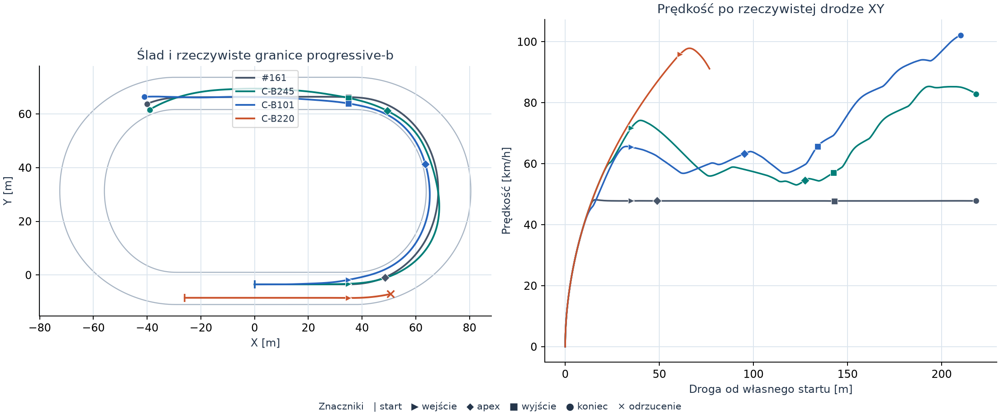
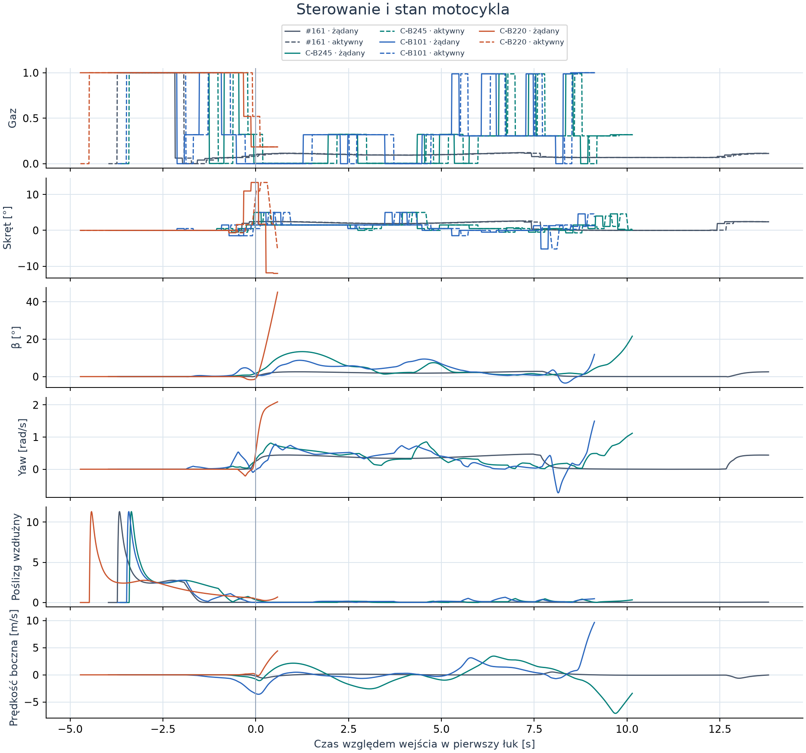
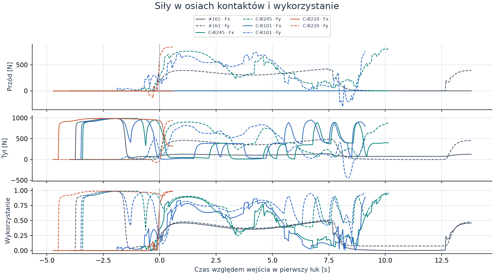
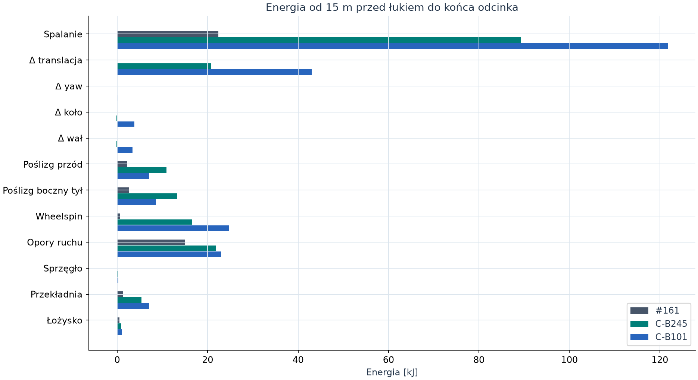

# Badanie #165 — wykonalność szybkiego łuku

**PASS w zadanym oknie progressive-b.** Natywny C-B245 wjechał w pierwszy łuk z prędkością **71,69 km/h**, przejechał go z minimum **53,06 km/h**, wyszedł z **57,13 km/h** i przyspieszył do **85,26 km/h** na 62 m prostej. Przejechał legalnie pierwsze 12 m następnego łuku. Cały wspólny odcinek trwał **10,984 s**, o **26,45%** krócej niż w zapisanej próbie #161 z identycznego zatrzymanego startu. Najmniejszy certyfikowany swept wyniósł **1,035 m**. **Stabilność za końcem okna pozostaje INCONCLUSIVE.**

Baza techniczna `c2023dc82c6771f8799cfc05f6e69ed798d1355c` (#164, Draft PR #163). Referencja `85a5ee3295c2dd983fbacb21859649f794cc5ba5` (#161). Narzędzie PROVISIONAL, domyślnie OFF. Wynik dotyczy pojedynczych manewrów w tym modelu.

## Wyniki natywne

Zakres klasy to cel ±2,5 km/h, według prędkości zmierzonej na przekroju wejścia. Czas obejmuje odcinek od referencji 20,000 m (15 m przed wejściem) do 206,389 m. Łuk ma 97,389 m referencji. Dystans po prostej liczony jest wzdłuż referencji. Osobna kolumna poniżej pokazuje rzeczywistą drogę XY. Wiersze nieukończone pokazują tylko wielkości rzeczywiście zmierzone. Swept w tych wierszach obejmuje prefiks wraz z pierwszym niecertyfikowanym interwałem, jeśli wystąpił.

| Cel wejścia | Próba i wejście [km/h] | Legalny cały manewr | Vmin łuku [km/h] | V wyjścia [km/h] | V po 62 m [km/h] | Czas [s] | Min swept [m] | Pierwszy powód zatrzymania |
|---|---:|:---:|---:|---:|---:|---:|---:|---|
| 60 | C-B067 · 62,47 | Nie | 54,48 | 67,50 | — | — | 0,439 | Swept, 11,260 s, ref. 152,577 m, około 20,19 m po wyjściu |
| 70 | C-B245 · 71,69 | Tak | 53,06 | 57,13 | 85,26 | 10,984 | 1,035 | — |
| 80 | C-B178 · 79,80 | Nie | — | — | — | — | 0,771 | β −45,12°, 8,180 s, ref. 96,602 m |
| 90 | C-B242 · 88,78 | Nie | — | — | — | — | 0,490 | Swept, 7,860 s, ref. 81,686 m |

| Próba porównywalna z #161 | Wejście | Vmin | Apex | Wyjście | +20 m | +40 m | +62 m | +12 m następnego łuku | Czas od ref. 20 m | Czas od startu | Droga XY od startu |
|---|---:|---:|---:|---:|---:|---:|---:|---:|---:|---:|---:|---:|
| #161, odczyt archiwum | 47,81 | 47,78 | 47,81 | 47,79 | 47,80 | 47,80 | 47,81 | 47,81 | 14,934 s | 17,783 s | 218,31 m |
| C-B245, szybsze wejście | 71,69 | 53,06 | 54,59 | 57,13 | 69,24 | 79,20 | 85,26 | 82,92 | 10,984 s | 13,797 s | 218,26 m |
| C-B101, najlepszy czas | 65,45 | 56,85 | 63,27 | 65,65 | 79,68 | 88,93 | 94,54 | 102,14 | 10,001 s | 12,846 s | 210,18 m |

Wartości prędkości w km/h. Apex to najbliższe podejście środka motocykla do wewnętrznej linii w środkowych 80% łuku, mierzone po rzeczywistej trajektorii. W C-B245 przypadł przy ref. 118,27 m, a w C-B101 przy ref. 93,84 m. C-B101 był na wspólnym odcinku o **33,03%** szybszy od #161. Jego minimalny swept **0,542 m** daje zaledwie około **42 mm** zapasu ponad wymagany próg. Najwyższe legalne wyjście spośród odtworzeń C wyniosło **65,65 km/h** w C-B101. Najwyższe wyjście wśród kompletnych rolloutów B wyniosło **66,54 km/h** w B107, poza wyborem do C.

## Zapas przy następnym wejściu

| Próba | Czas od wejścia do +12 m | β końcowe | βdot końcowe | Yaw [rad/s] | χ | Prędkość na zewnątrz [m/s] | Obrys od wewn. / zewn. [m] | Wheelspin |
|---|---:|---:|---:|---:|---:|---:|---:|---:|
| #161 | 0,999 s | +2,55° | +0,11°/s | +0,439 | −157,59° | −0,03 | 3,792 / 7,908 | 0,044 |
| C-B245 | 0,560 s | +21,61° | +34,92°/s | +1,119 | −149,23° | −3,40 | 1,157 / 9,928 | 0,325 |
| C-B101 | 0,512 s | +11,88° | +65,45°/s | +1,497 | −177,57° | +9,66 | 6,779 / 4,931 | 0,472 |

Tabela końcowa używa ostatniej zaakceptowanej próbki. C-B245 już zwalnia po wejściu w drugi łuk. Nadal porusza się ku wewnętrznej krawędzi, a obie opony przekraczają 94% wykorzystania. Z prędkości poprzecznej i zapasu obrysu, przy prostym przedłużeniu ruchu bez uwzględniania zmian sił i obrotu, wychodzi około 0,19 s do progu 0,5 m. To krócej niż 0,24 s na aktywację nowego żądania. Oczekująca komenda 31,82% gazu i +0,10° skrętu ma się aktywować około 0,04 s po ostatniej próbce. C-B101 niesie większy zapas przy zewnętrznej krawędzi, ale kończy na aktywnym pełnym gazie z rosnącym β. Oba przejazdy potwierdzają legalne pokonanie wymaganego wejścia. Żaden wynik nie certyfikuje pełnego następnego łuku ani bezpiecznej reakcji na perturbację.

## Mechanizm i odrzucenia

W C-B245 signed β na pierwszym łuku wynosi od **+1,12° do +13,35°**. Średnie wykorzystanie przodu i tyłu wynosi odpowiednio **58,4% i 63,6%**, ze szczytami **89,2% i 90,4%**. Na ostatniej próbce przód ma 94,7%, tył 96,7%. Przednia opona jest pasywna i w osiach własnego kontaktu jej Fx jest numerycznie bliskie zeru. W CSV zachowano także rozkład przedniej siły w osiach nadwozia. W modelu tylna opona dzieli jeden budżet na Fx i Fy.

Na wspólnym odcinku C-B245 spalanie dostarcza **89,30 kJ**. Zmiana energii translacji, yaw, koła i wału razem wynosi **+20,46 kJ**. Straty poślizgu wynoszą **10,91 kJ** na przodzie, **13,20 kJ** bocznie na tyle oraz **16,47 kJ** wzdłużnie na tyle. Opory pochłaniają **21,84 kJ**, przekładnia **5,36 kJ**, łożysko **0,88 kJ**, a sprzęgło **0,18 kJ**. Reszta zamknięcia bilansu to **+0,004 J**. Pełny bilans od zera, dla pierwszego łuku i dla przygotowania drugiego, wraz z wielkościami chwilowymi, znajduje się w analizie i plikach CSV. Obliczenia wykorzystują pracę sił przy średniej prędkości w interwale, prędkości lokalne obu punktów kontaktu i ułamek interwału przecinającego granicę zakresu.

Najszybsze nielegalne **wejście** w próbie wyniosło **95,93 km/h** w C-B220. Rzeczywisty rozbieg rozpoczął się 26 m przed nominalną linią startu. Próba odpadła po około **12,11 m** pierwszego łuku, w t = **5,320 s**, przy β **+45,13°**, βdot **+96,09°/s**, yaw **+2,095 rad/s** i wykorzystaniu przodu/tyłu **98,7% / 99,4%**. Swept w całym prefiksie pozostawał ≥0,895 m. Nie ma porównywalnego czasu całego manewru. C-B178 osiągnął granicę β z przeciwnym znakiem przy wykorzystaniu **97,4% / 99,4%**. C-B242 stracił swept przy zapasie samej pozy **0,568 m** i β **−8,07°**. C-B067 stracił swept już na prostej, z β **+40,34°** oraz poprzecznym ruchem **7,60 m/s** do wewnątrz. Chwila odrzucenia to koniec pierwszego zakwestionowanego interwału, bez wnioskowania o wcześniejszym punkcie braku jakiegokolwiek rozwiązania.

W 249 zachowanych wynikach B było **8 pełnych legalnych**, **170 odrzuconych przez β** oraz **71 odrzuconych przez swept**. Pierwszeństwo ma wcześniejsze wykryte naruszenie, dlatego zliczenia nie są rozłącznym opisem wszystkich mechanizmów mogących wystąpić później. Ukończone legalne B obejmują trzy punkty odniesienia #156 i pięć zmienionych sekwencji. W klasach rzeczywistego wejścia 60/70/80/90 km/h zachowano odpowiednio **8/56/16/34** prób, w tym **0/3/0/0** pełnych legalnych. Reszta miała prędkość poza koszykami albo zakończyła się przed wejściem. Z 249 trajektorii 211 miało różne fingerprinty. 38 różnych propozycji zbiegało się do wcześniej widzianego śladu, np. kiedy różnica parametrów miała zadziałać dopiero za miejscem porażki. Rejestr liczy je do budżetu. B113 został rozpoczęty, ale zapis jego wyniku przerwał brak miejsca.

## Odpowiedzi P1–P7

1. **P1. Tak.** Dwa świeże przebiegi zachowały ponad 48 km/h przez cały pierwszy łuk. Minima wyniosły 53,06 i 56,85 km/h.
2. **P2. Tak, dla wejścia około 72 km/h.** C-B245 legalnie przejechał cały wymagany odcinek. Dla klas 80 i 90 uzyskano rzeczywiste wejścia, po których wszystkie sprawdzone kandydatury straciły wykonalność w pierwszym łuku.
3. **P3.** Najwyższa zweryfikowana prędkość wyjścia i najwyższe zweryfikowane minimum w całym łuku to **65,65 i 56,85 km/h** w C-B101. C-B245 ma odpowiednio 57,13 i 53,06 km/h.
4. **P4.** Bezpośrednio ograniczały β i geometria całego obrysu. Tuż przed niektórymi porażkami nasycały się oba kontakty. Wheelspin zajmował część budżetu tyłu. Dopuszczalne sterowanie pozostawało aktywne z kolejką 0,24 s, a żadne odrzucenie nie zaczęło się od przekroczenia limitu aktuatora. Nie przeprowadzono ablacji momentu yaw, wheelspinu ani opóźnienia, więc wyniki nie pozwalają rozdzielić ich udziałów.
5. **P5. INCONCLUSIVE.** C-B245 pojechał z większym β od C-B101 (13,35° wobec 9,39° w pierwszym łuku), ale różniły się prędkością wejścia, linią i gazem. Szybszy czas wariantu z mniejszym β nie izoluje efektu poślizgu. Nie powstała para z porównywalnym szybkim stanem wejścia i niezależną zmianą samej strategii poślizgu.
6. **P6.** Przy 71,69 km/h istnieje legalna strategia w obecnych równaniach. Dla wejść 80–90 km/h rozróżnienie ograniczenia fizyki od ograniczenia wyszukiwania pozostaje **INCONCLUSIVE**. Dla ciasnej, stałej linii o promieniu 27,98 m prędkość 90 km/h wymaga ok. 3,28 kN bocznie wobec ok. 1,85 kN całkowitej pojemności obu kontaktów. Ten rachunek dotyczy lokalnej krzywizny. Rzeczywista linia i prędkość mogą się zmieniać.
7. **P7.** C-B245 i C-B101 nadają się jako demonstracje krótkiego manewru i materiał startowy do uczenia w #166. Końcówka ma udokumentowany dług poprzeczny. Materiał obejmuje wyłącznie zapisane okno, a stabilny dalszy przejazd wymaga osobnego sprawdzenia.

## Fazy, porównywalność i koszt

- **A.** Bez nowych symulacji. #119 dało historyczne wejście 74,05 km/h z wyjściem 44,58 km/h, a #123 wykazało znaczenie zachowanej kolejki przy przejściu na drugi łuk. Starsze #149 miało szybsze minima w reżimie z mniejszym zapasem swept, a #148 wykazało szybkość na izolowanej prostej. #118 wskazało sprzężenie napędu z boczną przyczepnością i brak empirycznej kalibracji opon. #159 udokumentowało sztuczny pułap generatora i koszt utrzymywania toru. #164 osiągnęło około 52,24 km/h i pogorszyło czas. #156 dostarczyło kierunków perturbacji na progressive-b z tą samą konfiguracją wykonawczą. Jego trzy zapisane sekwencje posłużyły za punkty odniesienia, odtworzone wyłącznie jako kandydatury we wspólnym wykonawcy. Wyniki #119, #123, #148 i #149 są historyczne i nie zasilają stanów #165. [#118](../tyre-surface-diagnostic.md), [#119](../feasible-500cc-corner-entry.md), [#123](../continuous-corner-planning.md), [#148](../planner-speed-root-cause/REPORT.md), [#149](../tyre-physics-corner-limits/README.md), [#156](../line-throttle-physics/REPORT.md), [#159](../geometry-speed-audit/REPORT.md), [#161](../trajectory-continuation/REPORT.md), [#164](../feasible-speed-profile/REPORT.md).
- **B.** Pierwsze 100 dopuszczonych kandydatów dało 4 pełne legalne wyniki, w tym zmodyfikowany B086. To otworzyło rozszerzenie do 250 łącznie. Szukano całych sekwencji z wczesnym odrzuceniem. Zmieniano łącznie tor podejścia, położenie, opóźnienie fazowe, moment odjęcia gazu, gaz w łuku, skręt przygotowujący, linię przez apex, wyjście i prostą. Po pierwszej partii dodano tłumioną propozycję yaw z osobnym profilem szerokości i gazu. Cel wejścia steruje tylko doborem gazu na dojeździe tej rodziny. Pozostałe fazy dostają swobodne profile 0–1. Ranking końcowy preferował legalność, następnie czas wspólnej sekcji, a w odstępie do 0,02 s prędkość wyjścia i prześwit. Kandydatów o najszybszym wejściu bez celu porównano według głębokości legalnego prefiksu. Wszystkie stany powstały z fizycznego rozbiegu w tym samym świecie co badany łuk. Szybsze wejścia wymagały startu z wcześniejszego miejsca tej samej prostej. Podpisano pełne komendy, stan początkowy, stan końcowy, przekroje i powód zatrzymania dla każdego zapisanego rolloutu.
- **C.** Najpierw zapisano [wybór](evidence/selection.json). Potem sześć różnych sekwencji uruchomiono po jednej w świeżych natywnych światach, z tym samym rzeczywistym profilem startu i oryginalnymi komendami. Wszystkie fingerprinty i kolejki końcowe zgadzają się z fazą B. Ponowny audyt pełnego obrysu i dolnej granicy swept wykorzystuje zamrożone próbki, tworzy nowy audytor krawędzi i przelicza wszystkie interwały. Różnica względem zapisanej wartości wynosi najwyżej 1,1·10⁻¹⁴ m. Dwa przebiegi ukończyły cały odcinek. Cztery odtworzyły negatywne wyniki. Wykorzystano oryginalny Box2D, `NativeWorld156` jak w #161 i #164, `Contact144`, kroki 0,01 s z podziałem przy zdarzeniach, review 0,2 s, opóźnienie 0,24 s, fizyczny limit ±35° i 90°/s, β45° oraz obrys i swept 0,5 m. Masa, bezwładność, opony, nawierzchnia, silnik, wał i sprzęgło pochodzą z tej bazy. Świeży pomiar jest niezależnym odtworzeniem trajektorii. Pełnego certyfikatora 13/9 w badaniu nie uruchamiano.

| Operacja | Liczba światów | CPU [s] | Pomiar |
|---|---:|---:|---|
| B, pierwsze 100 | 100 | 124,296875 | Proces |
| B, przerwana sesja | 13 | 45,000000 | Rezerwa obciążająca budżet. Ostatni zmierzony stan procesu przed B113 to 28,953125 s |
| B, wznowienie od B114 | 137 | 161,859375 | Proces |
| C, odtworzenia i zapis dowodów | 6 | 11,578125 | Proces |
| **Łącznie obciążono** | **256** | **342,734375 / 900** | W tym jedna rezerwa zamiast pomiaru końcowego |

Zmierzony koszt zakończonych procesów to **297,734375 CPU-s**, a z ostatnim checkpointem sesji przerwanej **co najmniej 326,687500 CPU-s**. Limit przyjęcia kolejnego świata to 880 CPU-s, z marginesem na zakończenie i zapis. Nie wykonywano nowych światów po wyborze sześciu prób C poza tą weryfikacją.

## Dane i odtwarzanie

- [Budżet](budget.json), [rozpoczęte próby](evidence/started.jsonl), [wyniki B](evidence/trials.jsonl), [przerwanie B113](evidence/interruption.json), [wyniki C](evidence/verification.json) i [SHA256](SHA256SUMS).
- [Pełne natywne archiwa C](evidence/native) w formacie #162. Każde zawiera stany natywne, próbki pośrednie, siły, napęd, komendy, aktywacje, pending, CRC ZIP, osobny hash archiwum i hashe dokładnych rekordów komend. Dla B zachowano rejestr i parametry z pełnymi komendami, stanami granicznymi, przekrojami i powodami. Gęste szeregi próbek przechowano dla fazy C. B113 ma wpis startu i jawnie brak wyniku.
- [Metryki i bilanse](evidence/analysis.json), [przekroje #161](evidence/reference.json) i [instrukcja odtworzenia](../../../tools/fast-corner-feasibility/README.md). Historyczna próba referencyjna pozostaje w swoim archiwum.
