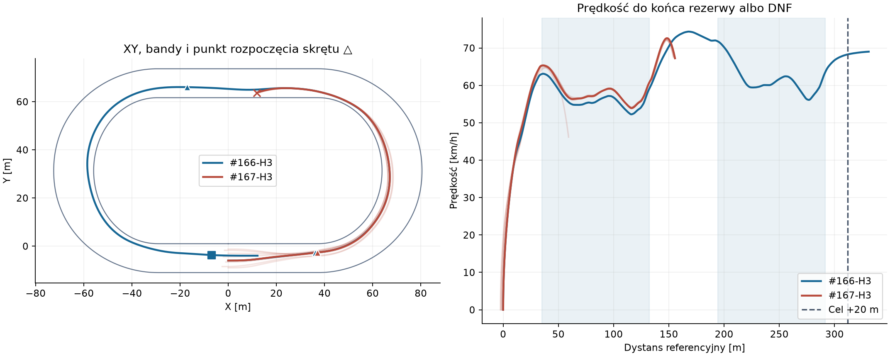
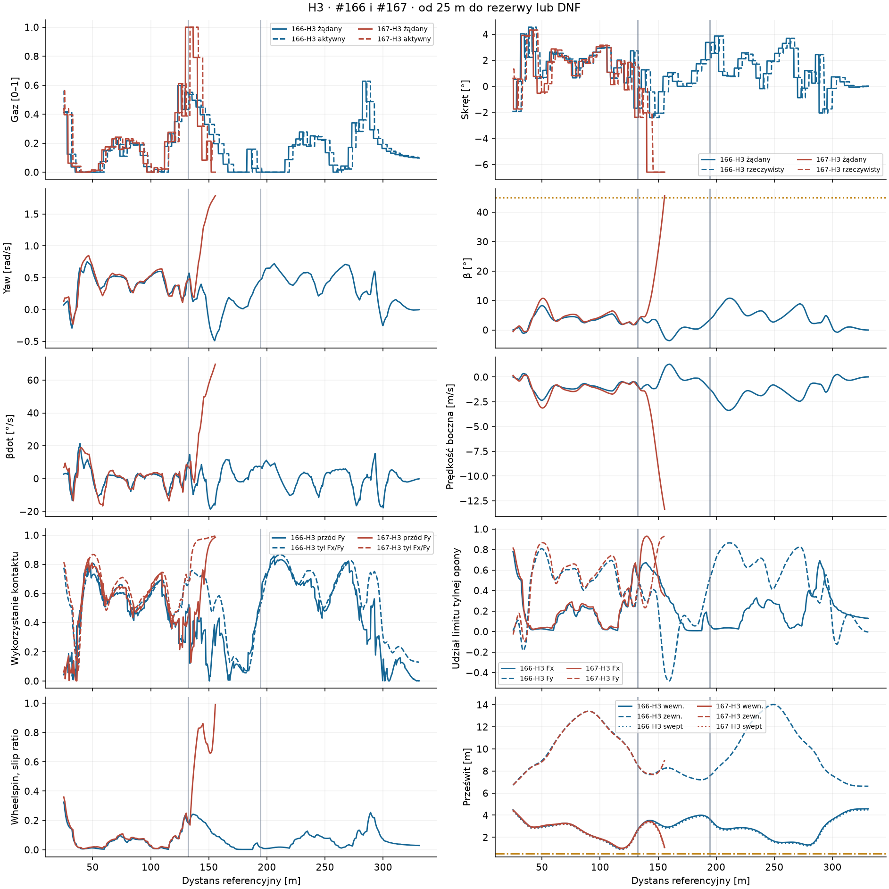
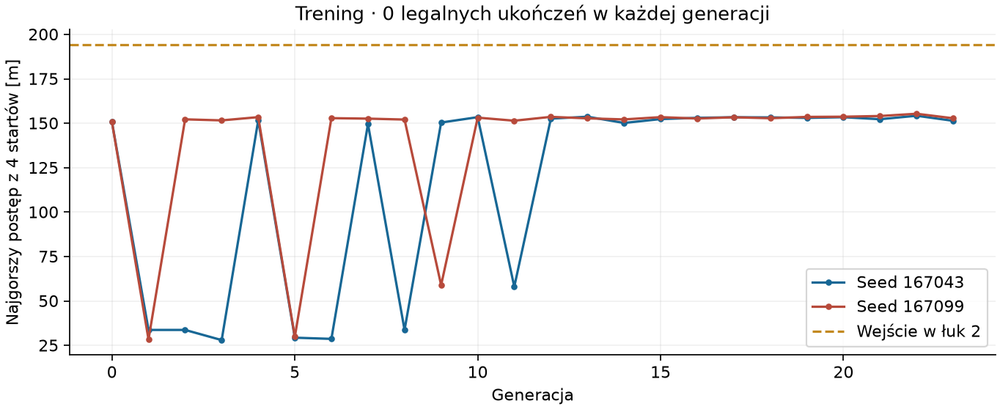

# Badanie #167 · dwa pełne łuki

**FAIL.** Zamrożony #167 ukończył **0/8** manewrów i **0/8** rezerw. Niezmieniony #166 ukończył **6/6** pełnych porównań z rezerwą. Na żadnym identycznym starcie nie ma dwóch ukończeń #166 i #167, więc poprawa całkowitego czasu jest niewyznaczalna.

Baza techniczna `7754819d5e96ad8808e4de560262c7993fdad008` (Draft PR #165). Referencja #161 `85a5ee3295c2dd983fbacb21859649f794cc5ba5`. Izolowane narzędzie PROVISIONAL, uruchamiane wyłącznie jawną komendą. Oryginalny Box2D i model obu kontaktów z #166.

## Geometria i protokół

Przekroje z `TrackFrame` [m] wynoszą 35,000, 132,389, 194,389, 291,779 i 311,779. Prosta pomiędzy łukami ma 62 m. Mierzymy od t=0 na zatrzymanym starcie, łącznie z reakcją, do interpolowanego przekroju +20 m. Po pierwszej próbce za celem świat pracuje co najmniej 1 s z nowymi decyzjami co 0,2 s i pełną kolejką opóźnioną o 0,24 s.

Kontrola audytowa przelicza obrys i dolne ograniczenie swept na wszystkich klatkach pełnych prób i rezerw, z ponowną projekcją obrysu przez `RacingLineGeometry` i wzorem `Clearance153`. Wybrano zerowy budżet dodatkowych certyfikacji 13/9. Rezerwa obejmuje tylko zmierzony czas jazdy. Stage 4 ma osobny zakres.

## Wyniki na identycznych stanach

| Kontroler / start | Łuk 1 czas [s] | V wyjścia 1 [km/h] | V prostej max [km/h] | Łuk 2 czas [s] | V wyjścia 2 [km/h] | Czas całości [s] | Min swept [m] | Status |
|---|---:|---:|---:|---:|---:|---:|---:|---|
| #167-H1 | 6,300 | 60,62 | 72,23 | — | — | — | 0,971 | DNF · 154,52 m |
| #166-H1 | 6,496 | 58,92 | 73,87 | 6,029 | 63,59 | 20,629 | 0,917 | ukończenie + 1 s |
| #161-H1 | 8,067 | 47,80 | 47,81 | 8,140 | 48,21 | 26,356 | 1,803 | ukończenie + 1 s |
| #167-H2 | 6,303 | 60,68 | 72,30 | — | — | — | 0,971 | DNF · 154,28 m |
| #166-H2 | 6,488 | 58,97 | 73,27 | 6,039 | 63,53 | 20,614 | 0,915 | ukończenie + 1 s |
| #161-H2 | 8,120 | 47,79 | 47,81 | 8,137 | 47,79 | 26,411 | 3,467 | ukończenie + 1 s |
| #167-H3 | 6,405 | 60,81 | 72,61 | — | — | — | 0,928 | DNF · 155,57 m |
| #166-H3 | 6,603 | 59,14 | 74,37 | 6,015 | 63,64 | 20,685 | 0,892 | ukończenie + 1 s |
| #161-H3 | 8,212 | 47,79 | 47,81 | 8,142 | 48,28 | 26,500 | 3,212 | ukończenie + 1 s |
| #167-H4 | 6,584 | 60,99 | 72,06 | — | — | — | 0,845 | DNF · 154,15 m |
| #166-H4 | 6,815 | 59,16 | 73,53 | 6,033 | 63,47 | 21,001 | 0,833 | ukończenie + 1 s |
| #161-H4 | 8,304 | 47,79 | 47,81 | 8,147 | 47,99 | 26,619 | 1,562 | ukończenie + 1 s |
| #167-H5 | — | — | — | — | — | — | 1,754 | DNF · 59,22 m |
| #166-H5 | 6,507 | 58,91 | 73,99 | 6,027 | 63,63 | 20,836 | 0,915 | ukończenie + 1 s |
| #161-H5 | — | — | — | — | — | — | — | brak pełnej pary |
| #167-H6 | 6,305 | 60,63 | 72,53 | — | — | — | 0,958 | DNF · 155,37 m |
| #166-H6 · archiwum | 6,512 | 59,15 | — | — | — | — | 0,907 | skrócony zakres #166 |
| #161-H6 | — | — | — | — | — | — | — | brak pełnej pary |
| #167-H7 | 6,448 | 60,78 | 72,42 | — | — | — | 0,911 | DNF · 155,23 m |
| #166-H7 · archiwum | 6,651 | 59,20 | — | — | — | — | 0,882 | skrócony zakres #166 |
| #161-H7 | — | — | — | — | — | — | — | brak pełnej pary |
| #167-H8 | 6,569 | 60,71 | 72,00 | — | — | — | 0,859 | DNF · 154,44 m |
| #166-H8 | 6,765 | 59,12 | 74,20 | 6,026 | 63,68 | 21,243 | 0,843 | ukończenie + 1 s |
| #161-H8 | — | — | — | — | — | — | — | brak pełnej pary |

Vmax w wierszu DNF obejmuje osiągniętą część prostej. Swept obejmuje cały zapis łącznie z rezerwą albo krokiem, w którym przerwano przejazd. Cztery wiersze #161 pochodzą z pełnych archiwów na identycznych startach. H5–H8 są niedostępne dla #161. Wydłużonego #166 H6/H7 nie uruchamiano. Historyczny zapis kończył się po 0,9 s od wejścia w drugi łuk.

## Tempo i stan w łukach

Apex to próbka najmniejszego offsetu w środkowych 80% odcinka. Minima DNF obejmują dostępny zapis.

| Kontroler / start | Łuk 1 wejście / min / apex / wyjście [km/h] | Łuk 2 wejście / min / apex / wyjście [km/h] |
|---|---:|---:|
| #167-H1 | 64,59 / 53,85 / 54,27 / 60,62 | — / — / — / — |
| #167-H2 | 65,12 / 53,81 / 54,19 / 60,68 | — / — / — / — |
| #167-H3 | 65,30 / 53,91 / 54,48 / 60,81 | — / — / — / — |
| #167-H4 | 65,12 / 54,15 / 55,04 / 60,99 | — / — / — / — |
| #167-H5 | 64,17 / 46,17 / 63,58 / — | — / — / — / — |
| #167-H6 | 65,34 / 53,83 / 54,27 / 60,63 | — / — / — / — |
| #167-H7 | 65,23 / 53,99 / 54,62 / 60,78 | — / — / — / — |
| #167-H8 | 65,14 / 54,21 / 55,01 / 60,71 | — / — / — / — |
| #166-H1 | 62,35 / 52,25 / 52,48 / 58,92 | 71,75 / 56,02 / 56,87 / 63,59 |
| #166-H2 | 63,03 / 52,23 / 52,39 / 58,97 | 71,26 / 56,04 / 56,87 / 63,53 |
| #166-H3 | 63,03 / 52,25 / 52,65 / 59,14 | 71,75 / 56,12 / 57,06 / 63,64 |
| #166-H4 | 62,82 / 52,52 / 53,31 / 59,16 | 71,47 / 56,06 / 56,91 / 63,47 |
| #166-H5 | 62,52 / 52,24 / 52,47 / 58,91 | 71,82 / 56,03 / 56,90 / 63,63 |
| #166-H8 | 63,11 / 52,46 / 53,13 / 59,12 | 71,92 / 56,05 / 56,88 / 63,68 |
| #161-H1 | 47,81 / 47,79 / 47,82 / 47,80 | 47,81 / 47,80 / 47,81 / 48,21 |
| #161-H2 | 47,81 / 47,79 / 47,82 / 47,79 | 47,81 / 47,78 / 47,81 / 47,79 |
| #161-H3 | 47,81 / 47,78 / 47,81 / 47,79 | 47,81 / 47,79 / 47,81 / 48,28 |
| #161-H4 | 47,81 / 47,78 / 47,81 / 47,79 | 47,81 / 47,79 / 47,80 / 47,99 |

Zmiana czasu pierwszego łuku #167 minus #166, w sekundach, na identycznych startach.

| Start | H1 | H2 | H3 | H4 | H5 | H6 | H7 | H8 |
|---|---:|---:|---:|---:|---:|---:|---:|---:|
| Łuk 1 Δ [s] | -0,195 | -0,185 | -0,198 | -0,231 | — | -0,208 | -0,204 | -0,195 |
| Pierwsze 20 m prostej Δ [s] | -0,040 | -0,054 | -0,038 | -0,051 | — | -0,036 | -0,036 | -0,036 |

Nowy wariant skrócił pierwszy łuk we wszystkich siedmiu przypadkach, w których go ukończył. Na prostej H1–H4 i H8 osiągnął niższy szczyt niż baza, po czym przerwał jazdę. Pełny czas prostej jest dostępny wyłącznie dla #166 i archiwalnego #161.

Trójkąty wskazują pierwszy utrzymany skręt w pobliżu wejścia w łuk (skręt >0,7°, yaw >0,10 rad/s przez co najmniej 0,09 s). Kwadrat oznacza cel #166-H3, a krzyżyk DNF #167-H3. Jasne czerwone linie pokazują pozostałe H1–H8.

## Diagnostyka i przyczyny DNF

- **#166 H3/H4.** Drugi łuk zaczynał przy 71,75 i 71,47 km/h. Wzrost β i yaw był kontrolowany, bez dowodu nadmiernego zwalniania przed łukiem. H3 miał 73,1 km/h przy 180 m i 71,7 km/h na wejściu. Przy 208 m kontakt przedni wykorzystywał ok. 82% Fy, tylny ok. 86% łącznego Fx/Fy, a gaz aktywny wynosił 0 podczas wytracania prędkości. H3 przesunął się z offsetu 3,38 m przy 185 m na 2,25 m przy 208 m. Przygotowanie rozpoczęło się przed granicą łuku.

- **#167 H3.** Gaz osiągnął 100% już na wyjściu z pierwszego łuku. Przy 140 m wykorzystanie tyłu wyniosło 96%, wobec 72% w #166, a yaw wyniósł 0,58 wobec 0,20 rad/s. Przy 148 m β wzrosło do 21,4°, a prędkość poprzeczna do −7,36 m/s. Wycofywanie gazu po wzroście β nie odzyskało wykonalności. Przy ok. 155,57 m β przekroczyło 45°. Przejazd pokazuje współwystąpienie pełnego gazu, wheelspinu i utraty zapasu bocznego. Rozdzielenie wpływu gazu, linii i wzmocnień wymagałoby osobnego eksperymentu.

- **#167 H5.** W odróżnieniu od pozostałych prób utracił kontrolę już przy 59,22 m. Oscylacja yaw i kąta znoszenia pojawiła się przed przełączeniem sterowania na plan drugiego łuku. Ten start obnażył ryzyko zmiany skali prędkości i marginesu pierwszego łuku.

| Start | Pierwsza bramka | t [s] | Referencja [m] | Maks. β bez znaku [°] |
|---|---|---:|---:|---:|
| H1 | β >45° | 11,260 | 154,524 | 45,15 |
| H2 | β >45° | 11,200 | 154,281 | 45,00 |
| H3 | β >45° | 11,400 | 155,571 | 45,60 |
| H4 | β >45° | 11,550 | 154,150 | 45,27 |
| H5 | β >45° | 5,550 | 59,218 | 45,28 |
| H6 | β >45° | 11,560 | 155,375 | 45,47 |
| H7 | β >45° | 11,570 | 155,228 | 45,16 |
| H8 | β >45° | 11,890 | 154,439 | 45,03 |

## Straty energii i możliwość dalszej jazdy

Strata netto to praca spalania pomniejszona o przyrost energii kinetycznej układu. Pochodzi z natywnego `EnergyExcessJoules`. Składowe boczne i opory są oszacowane z pracy siły w kroku. Kroki na granicach rozdzielono proporcjonalnie do dystansu referencyjnego. W tabeli energii raportujemy pełne łuki.

| Kontroler / start | Łuk 1 netto [kJ] | Łuk 2 netto [kJ] |
|---|---:|---:|
| #166-H1 | 20,96 | 30,01 |
| #166-H2 | 21,15 | 29,91 |
| #166-H3 | 21,42 | 29,64 |
| #166-H4 | 21,94 | 29,84 |
| #166-H5 | 21,57 | 30,05 |
| #166-H8 | 21,23 | 30,13 |
| #167-H1 | 23,96 | — |
| #167-H2 | 23,96 | — |
| #167-H3 | 24,12 | — |
| #167-H4 | 24,02 | — |
| #167-H5 | — | — |
| #167-H6 | 24,20 | — |
| #167-H7 | 24,23 | — |
| #167-H8 | 24,15 | — |

W #166-H3 przy celu β wyniosło 0,88°, βdot 2,59°/s, yaw 0,14 rad/s, prędkość boczna −0,29 m/s, a prześwit do bliższej bandy 4,33 m. Przód wykorzystywał ok. 13% Fy, tył ok. 23% Fx/Fy. Gaz aktywny wynosił 0,131, a w kolejce czekało polecenie 0,121. Następna sekunda legalnej jazdy jest w archiwum. #167 nie dostarczył stanu przy celu. Wyniki wszystkich składowych strat, próbki na przekrojach, aktywne polecenia i pending są dostępne w pakiecie.

## Polityka, trening i koszty

Polityka korzystała z profilu #166 dla pierwszego łuku z uczoną skalą prędkości i marginesem. W ostatnich 17 m pierwszego łuku rozpoczęła podgląd krzywizny do 86 m. Na podstawie prognozy stanu po całej kolejce pending obliczała wsteczne ograniczenie prędkości z krzywizny, oszacowanego dostępnego Fy i drogi wytracania. Sterowanie reagowało na XY, χ, θ, yaw, β i βdot, prędkość, wheelspin, prześwit, rezerwę kontaktów oraz stan wału, sprzęgła i koła. Wykonalność propozycji ustalała dopiero natywna jazda.

Selekcja zamroziła seed **167099**, generację **21** i źródła przed H1–H8. C-B101 i C-B245 występują wyłącznie jako historyczne źródła profili #166. Ich wyniki sportowe nie są wynikami #167.

| Etap | Próby | Ukończenia z rezerwą | Najgorszy postęp [m] | Najlepszy postęp [m] |
|---|---:|---:|---:|---:|
| diagnosis | 2 | 2 | 330,96 | 331,04 |
| training | 192 | 0 | 28,01 | 157,83 |
| selection | 8 | 0 | 68,98 | 157,49 |
| validation | 8 | 0 | 59,22 | 155,57 |
| comparison | 4 | 4 | 330,89 | 330,99 |

Łączny koszt badania **40,20 CPU-s z 900**. Dwie przerwane rezerwacje przed pierwszym krokiem świata doliczono do pomiaru. Trening zakończył się po 192 epizodach i 8 oddzielnych epizodach selekcji. Żaden kandydat nie dotarł do drugiego łuku, więc nie uruchomiono rozszerzenia do 400. Selekcja przeniosła do walidacji wariant o najwyższym najgorszym postępie na odrębnym zestawie. W treningu 182 DNF wynikały z β, 10 ze swept. W selekcji odpowiednio 6 i 2. Pełny rejestr przypisuje powód każdemu epizodowi.

Łącznie 214 przejazdów natywnych i 229 869 kroków oraz 279 459 zapytań kontaktowych predyktora lub sondy opon. Archiwizowane przebiegi z licznikiem wywołań odnotowały 854 wywołania prognozy (walidacja i cztery porównania). Dwa pola licznika w natywnych metadanych zostały zamienione przez kolejność argumentów konstruktora. Raport odczytuje je zgodnie ze znaczeniem i zachowuje surowe archiwa. Pełny licznik rolloutów treningu jest niedostępny, a zapytania kontaktowe wszystkich epizodów są w rejestrze. W 8 próbach #167 zarejestrowano 432 decyzje, średnio 0,70 ms czasu ściennego na decyzję. CPU procesu ma zgrubną rozdzielczość Windows. Rozruch i zapis danych są ujęte w całkowitym CPU.

## Dowody

- `evidence.zip` zawiera natywne historie z decyzjami, aktywacjami, kolejkami i 100 Hz telemetrii, rejestr prób, zamrożone parametry i hashe źródeł, geometrię oraz metryki z archiwów #161.
- `summary.json` zawiera m.in. początki skrętu, energię według składowych i próbki diagnostyczne. `SHA256SUMS` wiąże pliki dowodowe.
