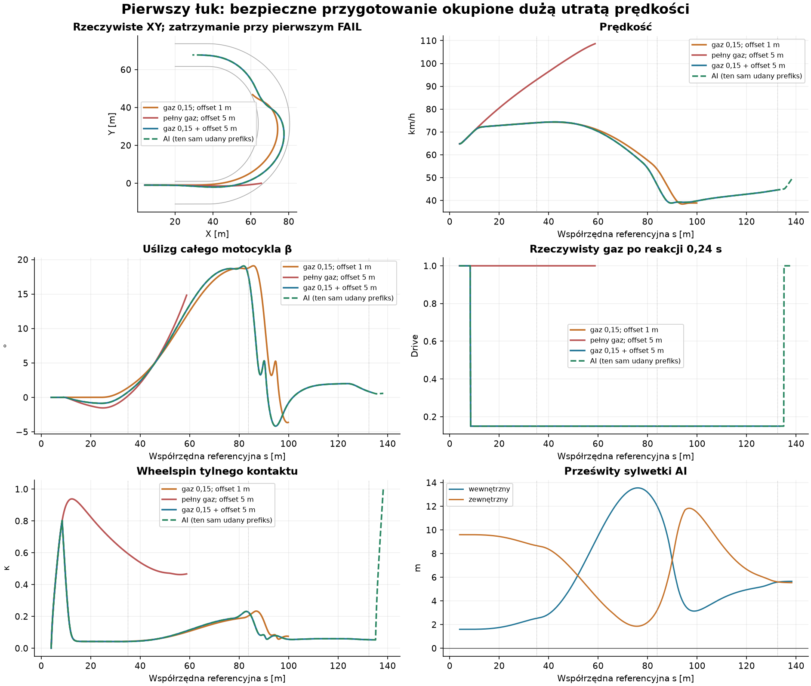
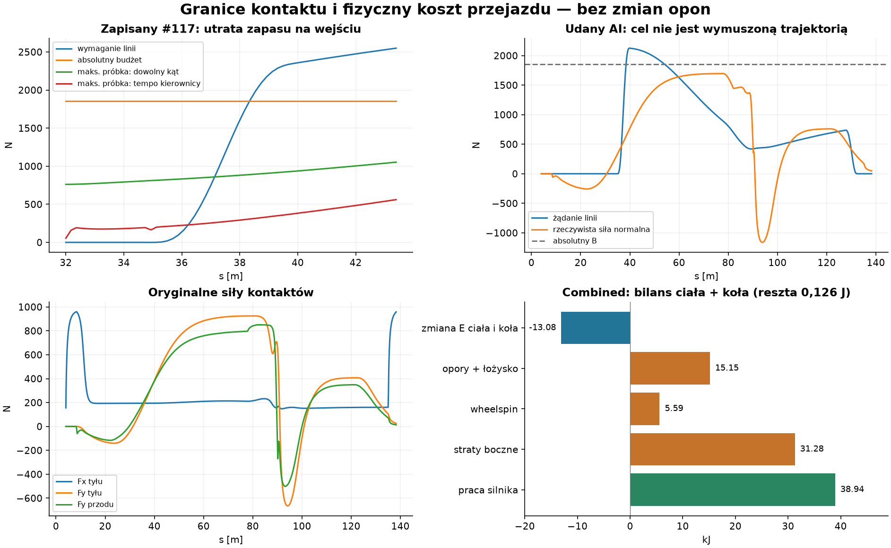

# #119 — fizycznie wykonalne wejście w pierwszy łuk Egg Mild

**Bezpieczny przejazd: TAK. Szybki, kontrolowany przejazd: jeszcze NIE WYKAZANY.**
Połączenie wczesnego gazu 0,15 i celu offsetu 5 m przechodzi pierwszy łuk
z zapasem obu granic, poprawną energią i opanowanym β. Minimalne AI wykonuje
dokładnie ten udany prefiks i potem przywraca pełny gaz. Prędkość spada jednak
**74,05 → 47,08 → 44,58 km/h**, a minimum wynosi **38,86 km/h**.
Nie uznajemy tego za kalibrację szybkiej jazdy żużlowej.

Baza: aktualny otwarty Draft [#118](https://github.com/arturgladysz91/zuzel/pull/118),
HEAD `895cffe3df5a2486d6876c0798c494fc061f9308`. Jeden Draft, bez merge.
Silnik #116, µ, charakterystyki kontaktów, geometria, gabaryty, masa/inercja,
parametry regulatora i cały `TravelDirectionSteering` #117 pozostają bez zmian.
Nowa flaga `EnableFeasibleCornerEntry` jest domyślnie **OFF**; #114 i #115 OFF.

## 1. Co pozwalają stwierdzić zapisane stany

Wykorzystano #116–#118 oraz istniejący zapis Egg #117, bez ponawiania historycznej
jazdy. [Analiza dojazdu](feasible-500cc-corner-entry/approach.json) odtwarza siły
na zapisanych stanach do 0,6 s z maksymalną różnicą **0 N**.

| Stan zapisanego #117 | s [m] | V [m/s] | Wymaganie lokalnej linii [N] | Absolutne B [N] | Maks. próbka dowolnej kierownicy [N] | Maks. próbka w następnym interwale [N] |
|---|---:|---:|---:|---:|---:|---:|
| t=0 |32,00|18,00|0|1852,34|761,81|54,98|
| t=0,20 |35,68|18,93|47,41|1852,34|826,17|214,88|
| t=0,50 |41,44|20,64|2442,54|1852,34|984,55|454,54|

Na prostej lokalna krzywizna wynosi zero, ale podgląd regulatora już żąda skrętu:
w t=0 żądanie z wyprzedzeniem to **1075,21 N**, przekraczające próbkowaną
odpowiedź kontaktów. Ocenę kolejnego interwału ogranicza rzeczywiste tempo
kierownicy **90°/s** i aktualne ω; pełna obwiednia dowolnego kąta tego ograniczenia
nie respektuje. Obie obwiednie są próbkami przy zamrożonym stanie, nie certyfikatem
przyszłego odzyskania kontroli.

W tym zapisie żądanie regulatora przekracza absolutny B od **t=0,24 s / s=36,44 m**;
wymaganie samej lokalnej linii przekracza go od **t=0,34 s / s=38,35 m**.
To odrębne kryteria. Wcześniejsza analiza #118 używała stanów #116, dlatego jej
liczb nie podstawiono bezpośrednio do nowego zapisu #117.

Na gęstości 1 m maksymalna krzywizna stałego offsetu 1 m daje absolutną granicę
około **17,92 m/s**, a offsetu 5 m około **19,28 m/s**. To granice µFz bez napędu,
nie prędkości gwarantowane przez coupled contact lub regulator. Dane zawierają
krzywiznę, wymagane siły, rzeczywistą siłę normalną, zapas koła sił tyłu po Fx,
obwiednie oraz różnice między wymaganiem a tymi oszacowaniami.

Nie wyznaczono wiarygodnego **najpóźniejszego** początku przygotowania. Historyczny
zapis zaczyna się przy s=32 m, tylko 3 m przed wejściem s=35 m. Sam istniejący
czas reakcji wynosi **0,24 s**, czyli około 4,32 m przy 18 m/s. Do tego dochodzą
zmiana ω, bezwładność nadwozia I=52,72097 kg·m², czas odpowiedzi yaw 0,1 s,
odpowiedź linii 1,05 s i przejazd kierownicy: 35° wymaga co najmniej 0,389 s,
a przejście pomiędzy skrajnymi kątami 0,778 s. Nie wolno ich interpretować jako
jednej gwarantowanej stałej hamowania. Brak natychmiastowej osiągalności w s=32
nie dowodzi też nieuchronnego wypadnięcia dla każdej innej przyszłej decyzji.

## 2. Trzy jawne przygotowania, bez strojenia

[Protokół sprzed prób](feasible-500cc-corner-entry/protocol.json) wydłuża rzeczywisty
dojazd do s=4 m: we wszystkich trzech wariantach V początkowe=18 m/s, offset=1 m,
β=0, yaw=0, koło toczy się, gaz początkowo 1. Nie zmieniano zaakceptowanej
prędkości ani pozycji w trakcie jazdy. Jedna komenda wchodzi po oryginalnej
reakcji 0,24 s. Moment aktywacji wypada około s=8,5 m, znacznie przed łukiem.

Gaz 0,15 pochodzi z punktu pracy #118, nie z przeszukania czasu przejazdu.
Offset 5 m to istniejący środkowy cel. Użyto zwykłego `TargetOffsetMeters`,
bez narzucanej C3 z #116/#117: zmienia się cel decyzji, a nie równania regulatora.
Przy braku prowadzenia C3 wyłączona jest niepotrzebna autorska obwiednia #102;
cel 5 m pozostaje wewnątrz jej normalnych granic. Tor nadal jest tym samym Egg Mild
progressive-b. Nie utożsamiamy tego z próbą utrzymania historycznej INNER C3.

| Wariant | V wejście / środek / wyjście [km/h] | β max [°] | Wynik |
|---|---:|---:|---|
|1. Gaz 0,15; cel 1 m|74,06 /53,84 /—|19,10|wewnętrzna granica w 6,41 s, V=38,89 km/h|
|2. Pełny gaz; cel 5 m|92,77 /— /—|14,99|zewnętrzna granica w 2,51 s, V=108,72 km/h|
|3. Gaz 0,15 + cel 5 m|74,05 /47,08 /44,58|19,07|pierwszy łuk PASS|
|AI po zaliczeniu wariantu 3|74,05 /47,08 /44,58|19,07|ten sam fizyczny prefiks; PASS|

Niekompletnym próbom nie przypisano prędkości wyjścia ani czasu ukończenia łuku.
Wariant 3 dodano dopiero po obu porażkach. Nie wybierano dalszych wartości gazu,
offsetów ani momentów aktywacji. Żaden wariant nie jedzie do drugiego łuku.



Wariant 3 kończy całe przejście sylwetki za wyjście przy s=133,514 m i t=10,15 s.
Konserwatywne, również między krokami, minimalne prześwity wynoszą
**1,491 m wewnętrzny /1,761 m zewnętrzny**. β kończy na **0,713°**, βdot=−0,0262 rad/s.
Przejście od wejścia do wyjścia trwa **8,504 s**. Droga od początku do zatrzymania
wynosi **153,355 m**; jest to rzeczywista droga XY, nie przyrost s.

Cel 5 m nie jest wykonany dokładnie: rzeczywisty offset dochodzi do **13,138 m**,
w poszerzonej części toru. Motocykl wykorzystuje istniejącą szerokość, potem wraca
do środka. Maksymalny błąd względem celu wynosi około **8,14 m**. Próbkowane żądanie
kierunku pozostaje poza lokalną odpowiedzią przez około **42,6%** czasu próby.
**Bezpieczeństwo i ograniczony β nie oznaczają dokładnego śledzenia linii ani
dobrze skalibrowanej techniki wyścigowej.**

## 3. Skąd strata prędkości

Odjęcie gazu nie hamuje natychmiast. Pomimo aktywacji 0,15 w 0,24 s prędkość
rośnie z 18 do **20,568 m/s na wejściu**: początkowy napęd i energia koła pozostają
w układzie, a częściowy dodatni moment nadal napędza motocykl. Wheelspin rośnie
najpierw do około 0,8, a dopiero potem maleje do **0,0423** na wejściu.
W środku łuku ponownie wynosi **0,2267**, a na wyjściu **0,0535**.

Później duży boczny poślizg i oryginalne siły odbierają więcej energii, niż
utrzymywany mały gaz dostarcza. Niezależny bilans double dla wariantu 3, od początku
do pierwszego wyjścia +1,05 m, daje:

| Składnik | kJ |
|---|---:|
| Praca silnika na kole |+38,935|
| Straty boczne przodu /tyłu |16,383 /14,895|
| Straty wheelspinu |5,588|
| Opory ruchu /łożysko |14,598 /0,550|
| Zmiana energii nadwozia /koła |−12,448 /−0,630|

Łączne straty to około **52,01 kJ**, wobec 38,94 kJ dostarczonych na kole.
Prędkość wejście→wyjście maleje o **39,8%**, a minimum jest o **47,5%** niższe
od prędkości wejścia. Nie ma dodatkowego hamulca ani odejmowania energii poza
pracą oryginalnych sił.



Reszta bilansu C# wynosi 0,1263 J, niezależnego double 0,1258 J. Zmierzona praca
błędu impulsów native wyjaśnia ją; największa niewyjaśniona reszta czterech prób
jest mniejsza niż **2·10⁻¹⁰ J**. W każdym interwale zachowano pierwotny limit
pracy silnika i pojemności kontaktów. Maksymalny błąd impulsu liniowego wynosi
0,0006081 Ns <0,001; kątowego 0,00001079 Nms <0,00003. Limitów nie zwiększano.

Pierwszym ograniczeniem wariantu pełnego gazu jest osiągalna krzywizna przy
narastającej prędkości i zajętym budżecie kontaktu. Przy małym gazie granicą
ciasnego celu okazuje się wykonanie kierowania i linii: wewnętrzna krawędź
jest przecięta dopiero przy małej prędkości, gdy ogólny brak µFz już nie wystarcza
jako wyjaśnienie. Połączenie działań unika obu przekroczeń, ale duży błąd linii
i zachowawczo utrzymywany gaz nadal blokują wykazanie szybkiej jazdy. Nie jest
to dowód fizycznej niemożliwości szybszego przejazdu z innymi dobrymi decyzjami.

## 4. Minimalne AI, bez planera #115

[FeasibleCornerEntry.cs](../../tools/shared-world-speedway/FeasibleCornerEntry.cs)
wykonuje jeden niezatwierdzany kontakt h=0 na ocenę i próbkuje wyłącznie geometrię
w 33 punktach. Nie całkuje kandydatów, nie tworzy światów i nie optymalizuje czasu.

- Z aktualnego V wyznacza odległość podglądu. Horyzont sumuje istniejącą reakcję,
  odpowiedź linii, fizyczny czas przestawienia kierownicy i roboczy zapas uspokojenia
  koła 0,55 s. Ostatnia liczba to zaokrąglone trzy lokalne stałe czasu #118,
  **PROVISIONAL**, nie globalny certyfikat hamowania. Początkowy podgląd wynosi 40,12 m.
- Porównuje mV²κ nadchodzącej linii z górnym oszacowaniem siły normalnej przy
  aktualnym Fx i wheelspinie. Przód zachowuje własną pojemność; tył dostaje resztę
  koła sił i projekcję do normalnej v. To optymistyczna granica, nie obietnica
  osiągnięcia jej przy bieżących α i kierownicy.
- Po przekroczeniu istniejącej rezerwy 0,95 wybiera gaz 0,15 oraz środek użytecznej
  szerokości, jeżeli zmniejsza on nadchodzącą krzywiznę. Nie ma czasu ani numeru
  segmentu Egg w tej decyzji.
- Podtrzymuje przygotowanie, aż krzywizna podglądu spadnie poniżej 0,001 m⁻¹,
  |β|≤3° i |κkoła|≤0,1. Wtedy wraca do gazu 1. Te progi są roboczymi progami decyzji,
  nie nowymi parametrami sił opony lub regulatora.
- Obie komendy korzystają z istniejącej, zatrzaśniętej reakcji zawodnika.
  Kolejne obserwacje nie odsuwają terminu wykonania.

Decyzja przygotowania zapada w t=0 i aktywuje się w **0,24 s**. Powrót do pełnego
gazu jest wybrany z aktualnego stanu w **10,04 s**, aktywuje się w **10,28 s**.
Do końca ręcznego udanego prefiksu wszystkie zapisane stany, siły i komendy AI
są **dokładnie identyczne** z wariantem 3. AI obserwowano jedynie do wyjścia +6 m,
aby potwierdzić opóźnioną aktywację gazu, bez drugiego łuku. Kończy przy
s=138,407 m, V=49,62 km/h, β=0,583°. Wheelspin na tej krótkiej prostej po otwarciu
gazu ponownie rośnie do około 1,01; to nie walidacja dalszego wejścia w kolejny łuk.

Zachowano początkowe diagnostyczne oszacowanie boczne oraz jego korektę projekcji
do normalnej prędkości. Pure replay 103 zapisanych ocen daje **0 zmienionych działań**;
test native na finalnej formule zachowuje ten sam fingerprint. Nie strojono polityki
po wyniku czasu lub prędkości. Polityka celowo długo utrzymuje niski gaz, dlatego
nie przedstawiamy jej jako gotowego szybkiego AI.

## Walidacja i odtworzenie

**4 światy diagnostyczne:** trzy jawne przygotowania i jeden AI po bramce PASS.
Testy celowane to osobne powtórzenia weryfikacyjne, nie nowe warianty parametrów.
Nie uruchomiono drugiego łuku, pełnego okrążenia ani historycznej macierzy.

Release:0 warnings/errors. **24/24** testy celowane, w tym 6 nowych, istniejące
#117 i #115: OFF, zależności flagi, stan zamiast harmonogramu, histereza poślizgów,
opóźnienia komend, oryginalne siły, steering rate, energia, pojedynczy commit,
fingerprint i niezależność od obserwatora. **7/7** testów polityki CI.
**1132/1132** historycznych SHA-256 zachowane. Finalne Windows CI dla dokładnego
HEAD tego Draft jest podane w opisie PR; nie utożsamiamy lokalnych testów z jego wynikiem.

[analysis.json](feasible-500cc-corner-entry/analysis.json),
[protokół AI](feasible-500cc-corner-entry/ai-protocol.json),
[decyzje](feasible-500cc-corner-entry/ai-decisions.json),
[bramka](feasible-500cc-corner-entry/ai-gate.json) i
[manifest](feasible-500cc-corner-entry/manifest.json) zawierają pełne dane.
Każde `*.csv.gz` przechowuje wszystkie zaakceptowane przedziały; `*-control`
zawiera siły, krzywiznę, gaz, pochodne i zdolność skrętu; `*-geometry` rzeczywisty offset.

```powershell
dotnet restore tests/CoreSim.Tests/CoreSim.Tests.csproj --locked-mode
dotnet build tests/CoreSim.Tests/CoreSim.Tests.csproj -c Release --no-restore --warnaserror
dotnet test tests/CoreSim.Tests/CoreSim.Tests.csproj -c Release --no-build --filter "FullyQualifiedName~FeasibleCornerEntryTests|FullyQualifiedName~TravelDirectionSteeringTests|FullyQualifiedName~AdaptiveRiderControlTests"
# Nowy pusty katalog; nie nadpisywać zamrożonych dowodów.
dotnet tools/shared-world-speedway/bin/Release/net8.0/shared-world-speedway.dll corner-entry NEW_DIR freeze
# Kolejno: approach, partial, wide, combined, freeze-ai, ai, post.
# Raport czyta opublikowany katalog bez symulowania jazdy:
python tools/shared-world-speedway/corner-entry-report.py --plots --compact
```

**Wniosek:** obecna fizyka umożliwia bezpieczne przygotowanie i opanowany pierwszy
łuk. Nie wykazano utrzymania dużej prędkości: zbyt dużo energii znika w bocznym
poślizgu i oporach przy długo utrzymanym niskim gazie, a regulator wykonuje linię
z dużym błędem. Następne ograniczone badanie powinno rozdzielić te dwie przyczyny,
z zachowaniem opon, zamiast podnosić µ dla uzyskania wyniku.
