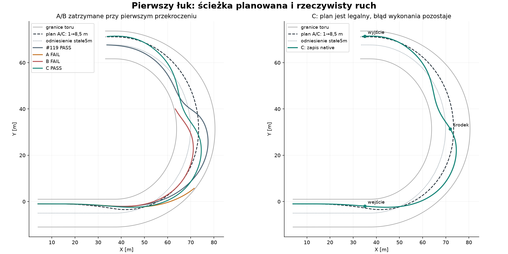
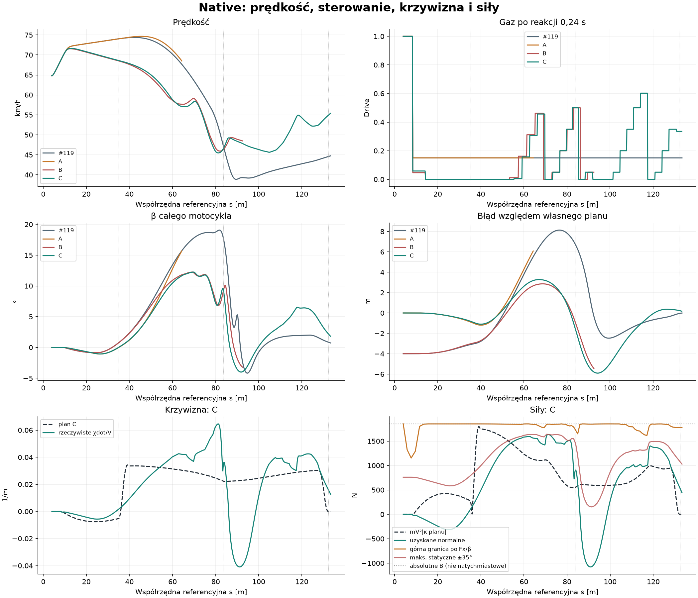

# Fizycznie wykonalna trajektoria i prędkość — ograniczony eksperyment

**Ocena B: poprawiona trajektoria, ale bez zadowalającej poprawy prędkości.**
Połączenie C kończy pierwszy łuk bezpiecznie: wyjście **54,92 zamiast44,58 km/h**,
minimum45,48 zamiast38,86km/h. Błąd względem własnego planu maleje z8,14 do5,91m,
ale pozostaje za duży. Nie uzyskano celu<3m ani60km/h. Gaz nadal oscyluje;
nie jest to gotowy planner pełnego wyścigu ani potwierdzona kalibracja żużla.

Baza: zweryfikowany, otwarty Draft #120,
`46129d74cf725c33d67040663262062ac9067281`. Bez zmian #116, #117,
opon, µ, masy147kg, I=52,72097kgm², geometrii oraz90°/s kierownicy.
#120 i #114 pozostają OFF. Start spod taśmy #121 nie należy do tej gałęzi.
Nowe `EnablePreparedCornerPlan` jest domyślnie OFF i pomijane w JSON przy OFF.

## 1. Co konkretnie było błędne w #119?

Polecenie „5m” nie opisywało drogi dojścia, stycznej ani zatrzymania ruchu
bocznego. Motocykl przecinał5m z ponad6m/s na zewnątrz. W #120 wykazano już
2098N wymagania linii przy1852N całkowitego budżetu. Nie powtarzano tamtego
audytu ani próby zmiany kierownicy; pozostawiono oryginalny #117.

Przeczytane #101/#106 rozdzielają geometrię i siły; #107 potwierdza realne
straty uślizgu; #115 pokazuje koszt planera i brak certyfikatu bezpieczeństwa;
#116–#120 dostarczają silnik, kontakty, regulator i pełny zapis odniesienia.
W szczególności nie wyprowadzamy z granicy µFz dowodu osiągalności ani z tego
eksperymentu wniosku o empirycznie poprawnej oponie na luźnym gruncie (#118).

## 2. Wybór wejścia, środka i wyjścia

Rozszerzono **istniejący `AuthoredRacingPath`**, bez drugiej geometrii.
Punkty `OffsetKnot` łączy quintic `10u³−15u⁴+6u⁵`; na końcach d′=d″=0.
Istniejące `At` liczy XY, styczną i krzywiznę z **d,d′,d″ oraz krzywizny
referencji i jej pochodnej**. `CurvatureDerivative` podaje dκ/długość XY;
κ jest ciągła, κ′ może mieć skończony skok na węźle C2. Nie utożsamiamy
krzywizny przejścia z k/(1+kd).

Z aktualnego stanu, reakcji i topologii wybierany jest najbliższy przyszły
łuk. Początek przejścia ma zapas drogi na reakcję i możliwe przyspieszenie;
koniec to środek geometryczny łuku albo dłuższy wymagany horyzont odpowiedzi.
Tu: **s=8,683→83,695m**. Po przejściu utrzymywany jest wybrany offset przez
wyjście. Nie dodawano osobnego agresywnego cięcia szczytu łuku.

Dwa jawne intenty to preferowane5m i alternatywne8,5m. Tańszy geometryczny
test wykonalności toczenia wybiera łagodniejszy legalny wariant, tutaj8,5m.
Parametry pozwalają wybrać inne linie; test wolnego podejścia do drugiego
łuku wybiera preferowane3m. To nie jest zasada „zawsze szeroko”. Topologia
i `TrackFrame` obsługują oba łuki oraz zawinięcie okrążenia; żaden numer
zakrętu, czas przejazdu ani współrzędna Egg nie steruje decyzją.

Plan sprawdza pełne kapsuły motocykla z `RacingLineGeometry`, co0,25m,
przy orientacji stycznej i ±45°, z0,5m zapasu i dodatkowym przybliżonym
zapasem interpolacji. Dla pozy stycznej min prześwity planu1,599/2,098m.
Zakres κ planu: **−0,007618 do+0,034265m⁻¹**. Kontrola rzeczywistego obrysu
i konserwatywne prześwity między zaakceptowanymi krokami są oddzielną bramką
native; sam legalny plan nie certyfikuje wykonania.

`PathGuidanceSample` przekazuje #117 pozycję, styczną oraz istniejący preview
krzywizny. Feedback w ramie ścieżki uwzględnia prędkość poprzeczną względem
niej, nie tylko offset. Nie zmieniono żadnego równania ani gain regulatora.

## 3. Jak oceniamy prędkość i brak hamulców?

Co0,1s planner wykonuje **13 h0 zapytań** oryginalnego kontaktu: stan bieżący,
9 kątów w±35° oraz3 kąty osiągalne w10ms. Nie tworzy światów ani nie commituje
koła. Raportuje oddzielnie natychmiastową odpowiedź, statyczny pełny zakres
kierownicy, przód854,926N i tył997,413N oraz górną granicę po rzeczywistym Fx/β.
Lokalne α tylnej opony nie jest β całego motocykla; α znajduje się w kontrolnym
CSV, β w danych native i decyzjach.

Co2m przyszłego planu obliczane są mV²|κ|, obrys, κ′ i orientacyjna obwiednia
prędkości. Dostępność siły rozwija się od lokalnej odpowiedzi do granicy
combined slip w czasie obejmującym reakcję, odpowiedź boczną, obrót kierownicy,
I/moment z kontaktów i0,55s zapasu na koło. Pozostawiono15% rezerwy siły.
To **PROVISIONAL konieczny filtr**, nie rozwiązanie sprzężonej dynamiki ani
gwarancja stabilnego trackingu. Nie nazywamy tej obwiedni dowiedzionym profilem
wykonalnym. Wynik C pokazuje także jej niedostateczną predykcję późniejszego
odzyskania linii.

Toczenie jest szacowane bilansem pracy **oryginalnego oporu** wzdłuż drogi.
Uwzględnia możliwą pracę napędu podczas reakcji (maksimum istniejącej krzywej)
i w wariancie górnym całą energię zgromadzoną w kole jako potencjalny dopływ
do translacji. Nie zakłada dodatkowych strat bocznych jako dostępnego hamulca.
To konserwatywne, jednowymiarowe oszacowanie, nie przyszły wynik Box2D.
Nie wyznaczono wiarygodnego „ostatniego momentu” manewru.

Początkowy cel obwiedni wynosi64,25km/h, a warunek
`NoCertifiedCoastSolution=true` jawnie odmawia certyfikacji osiągnięcia go
przed zakrętem. Planner wybiera łagodniejszą linię i ogranicza gaz;
nie wpisuje brakującego ujemnego przyspieszenia. W C po reakcji0,24s
prędkość nadal wynosi19,164m/s, wheelspin0,802 i Fx=958,24N. Przy gazie0
w0,54s prędkość jeszcze19,882m/s. Samo odjęcie nie usuwa energii koła.

Gaz wynika z bilansu aktualnych strat i dostępnej mocy, błędu względem
obwiedni oraz obserwowanego wheelspinu/ββdot. Wzrost żądania ograniczono
PROVISIONAL do0,5/s, obniżenie może być natychmiastowe. Każda aktywacja ma
oryginalną reakcję0,24s; oczekujący rozkaz nie dostaje stale nowej daty.
Nie ma clampa V, hamulca, yaw actuator, korekt velocity/heading ani pozycji.
Zmiany pozy w `Pose` służą tylko zapytaniom o **hipotetyczny obrys** planu.

## 4–5. Rzeczywisty tracking i prędkość

Najpierw przeanalizowano1017 zachowanych stanów #119 i geometrię bez światów.
Potem zamrożono parametry i SHA źródeł w `protocol.json`; **dokładnie trzy**
próby native A/B/C, bez strojenia po wynikach. Wszystkie zaczynają s4,18m/s,
offset1, β0, toczące koło, kierownica0 i gaz1 przez reakcję0,24s.

| Miara | #119 | A: ścieżka/gaz0,15 | B: stare5m/nowy gaz | C: oba |
|---|---:|---:|---:|---:|
| Pierwszy łuk | PASS | FAIL zewnętrzna3,44s | FAIL wewnętrzna5,97s | PASS |
| V wejście [km/h] |74,05|74,04|68,52|68,62|
| V środek [km/h] |47,08|—|46,34|46,65|
| V wyjście [km/h] |44,58|—|—|54,92|
| V minimum [km/h] |38,86|64,80*|45,94*|45,48|
| Maks. offset [m] |13,138|13,806*|7,859*|11,347|
| Max błąd własnego planu [m] |8,138|6,135*|5,483*|5,906|
| RMS błąd własnego planu [m] |3,918|2,081*|2,828*|2,539|
| RMS w łuku [m] |3,963|2,795*|2,398*|2,782|
| Max błąd względem stałych5m [m] |8,138|8,806*|5,483*|6,347|
| Max \|β\| [°] |19,07|15,75*|12,25*|12,25|
| Końcowe βdot [rad/s] |−0,0262|+0,1295*|−0,0575*|−0,1020|
| Konserwatywne prześwity wewn./zewn. [m] |1,491/1,761|1,490/−0,112|−0,083/5,872|1,490/1,735|
| Czas zapisu [s] |10,15|3,44*|5,97*|9,91|
| Rzeczywista droga [m] |153,36|69,31*|99,90*|154,85|

*Niekompletny prefix do FAIL; mniejsze RMS/czas lub wysokie minimum A nie
oznaczają lepszego przejazdu. Nowy błąd odnosi się do **zmiennego planu**;
oddzielny wiersz stałych5m zapobiega myleniu zmiany intencji z poprawą sterowania.*




C zmniejsza max błąd o27,42%, RMS o35,18% oraz max offset o1,79m. Jednak
odchylenie zmienia znak: po nadmiernym wyjściu następuje przestrzelenie
**do wewnątrz**. Największy błąd−5,906m występuje w6,42s/s94,239m.
Na końcu offset8,660m, błąd+0,160m, β1,770° i βdot−0,102rad/s: uślizg
maleje. Nie wyciągamy wniosku o stabilności okresowej z samej końcowej równowagi.

Zakończenie potwierdza rzeczywiste XY: przejście1,090m za płaszczyznę wyjścia
i skumulowany obrót kierunku prędkości3,210rad, a nie wyłącznie licznik s.
Obrys pozostaje legalny również według dotychczasowej konserwatywnej bramki.

| Niezależny bilans całego zapisu [kJ, poza resztą] | #119 | C |
|---|---:|---:|
| Praca silnika na kole |+38,935|+39,528|
| Straty boczne przód / tył |16,383/14,895|12,262/10,489|
| Poślizg wzdłużny / łożysko |5,588/0,550|8,398/0,554|
| Praca oporu |−14,598|−14,306|
| Zmiana energii ciała / koła |−12,448/−0,630|−6,376/−0,103|
| Reszta [J] |+0,125845|+0,014798|

Straty boczne maleją27,26%, przy podobnej pracy silnika (+1,52%), więc
więcej energii zostaje w ruchu. Jednocześnie straty wheelspinu rosną50,27%:
nie osiągnięto dobrego wykorzystania napędu. Resztę niezależnego ledgera
wyjaśnia zmierzona praca błędu impulsu float; niewyjaśniona część<1e−6J.
Wszystkie trzy próby przechodzą bramkę energii; nieudane A/B nie są usuwane.

## 6. Co nadal ogranicza prędkość?

W C w2,00s: s42,003m, V18,735m/s, β1,884°, α tyłu−2,511°,
Fx≈4,60N w h0. Plan wymaga1735,07N, mniej niż1852,34N, lecz pełne statyczne
±35° daje **1096,51N**, a kąty osiągalne w10ms około754,23N. Zastosowany
skończony kontakt daje676,80N. PD z preview żąda1878,50N.
Rear Fy≈338N; całego jego budżetu nie można wykorzystać bez rozwinięcia
lokalnego poślizgu i obrotu nadwozia. Limiter kierownicy w tym kroku nie działa.
Prędkość na zewnątrz nadal3,99m/s.

To **brak osiągalności z aktualnego stanu**, mimo zmieszczenia geometrycznego
w absolutnym budżecie. Profile B/C nie przekraczają samego absolutnego budżetu
na planie, ale to nadal nie wystarcza. Korekty PD i późniejsze odzyskanie
kierunku generują duże, przemienne krzywizny. Ponadto progi wheelspinu
i opóźnione rozkazy powodują cykle gaz→odjęcie. Na wyjściu gaz rośnie
stopniowo, lecz z przerwami; nie uzyskano płynnego ciągłego przyspieszania.
Sam C nie dowodzi, że limit prędkości wymaga zmiany opony. Empiryczne braki
modelu gruntu z #118 pozostają osobną, nierozstrzygniętą sprawą.

Następny mały test, **tylko proponowany**: kontynuacja bezpiecznego stanu C
do końca drugiego łuku, z dokładnie tą samą polityką, bez strojenia, z bramką
obrysu/energii/β i kontrolą powtarzalności oscylacji gazu. Nie wykonano go.
Przed próbami szybszej jazdy potrzebna jest lepsza predykcja rozwoju β/yaw
i powrotu na ścieżkę, a nie samo podnoszenie mocy lub µ.

## Koszt, walidacja i odtworzenie

C:993 zaakceptowane interwały,100 ocen,1300 dodatkowych zapytań h0.
51 query #117 +1 zastosowanie kontaktu na interwał pozostają bez zmian.
Razem z3 ocenami granicznymi: **53092** kontakty wobec52988 w #119;
dodatkowy koszt planowania to2,51% samych zapytań kontaktu C. Geometria
jest buforowana w wybranej ścieżce, nie są tworzone światy kandydatów.
Lokalny czas ocen C162,8ms,1,63ms/ocenę; konstrukcja ścieżki/eksport poza
tym pomiarem. To diagnostyka, nie benchmark dla czterech zawodników.

- Release całego rozwiązania:0 ostrzeżeń/błędów;45 celowanych C# PASS,
  w tym14 nowych przypadków geometrii, reakcji, obrysu, energii toczenia,
  opcji drugiego łuku oraz odtworzenia kontaktów i decyzji bez nowych światów.
- Replay A/B/C:0 różnicy sił i kierownicy,0 zmienionych decyzji.
  Jedna rekonstrukcja ω daje3,55e−15m/s różnicy wyłącznie w górnym oszacowaniu
  toczenia; nie zmienia żadnego polecenia. Nie wykonano czwartego przejazdu ON.
- Niezależne testy Python weryfikują bilans, obrys, opóźnienie, flagi,
  zachowane dane i uczciwe oznaczenie niespełnionych celów.
- **1178 historycznych SHA-256 zachowanych**. Fingerprinty #119/OFF pozostają
  w historycznych testach CI. `source-canonical.json` potwierdza dokładnie te
  same zamrożone źródła po normalizacji wyłącznie CRLF/LF; surowe SHA z chwili
  prób pozostają w niezmienionym `protocol.json`.
- Końcowe standardowe Draft Windows CI dla dokładnego HEAD jest wskazane
  w PR. Bez kosztownych historycznych audytów, pełnych okrążeń i merge.

Fingerprint C: `A44925BFD8741A5E6ECA89EB9D635EFF27BC0AC1857227EB5F55D718F24E62A9`.
Pozostałe: [analysis.json](feasible-path-speed-planning/analysis.json),
[protokół](feasible-path-speed-planning/protocol.json),
[replay](feasible-path-speed-planning/replay.json), raw CSV.gz, decyzje i manifest.

```powershell
dotnet restore SpeedwayManager.sln --locked-mode
dotnet build SpeedwayManager.sln -c Release --no-restore --warnaserror
# Każdy etap osobno, nowy pusty katalog:
dotnet tools/shared-world-speedway/bin/Release/net8.0/shared-world-speedway.dll prepared-corner results/prepared-recapture geometry
# Następnie freeze, A, B, C; dokładnie po jednym wywołaniu.
dotnet tools/shared-world-speedway/bin/Release/net8.0/shared-world-speedway.dll prepared-post results/prepared-recapture
# Analiza dostarczonych zapisów; matplotlib tylko dla --plots:
python tools/shared-world-speedway/prepared-corner-report.py --plots
python -m unittest discover -s tests/calibration -p test_prepared_corner.py
```

Eksporter odmawia nadpisania; plik attempt powstaje przed światem, również
przerwana próba zużywa swój slot. Parametry pozostają PROVISIONAL/OFF.
