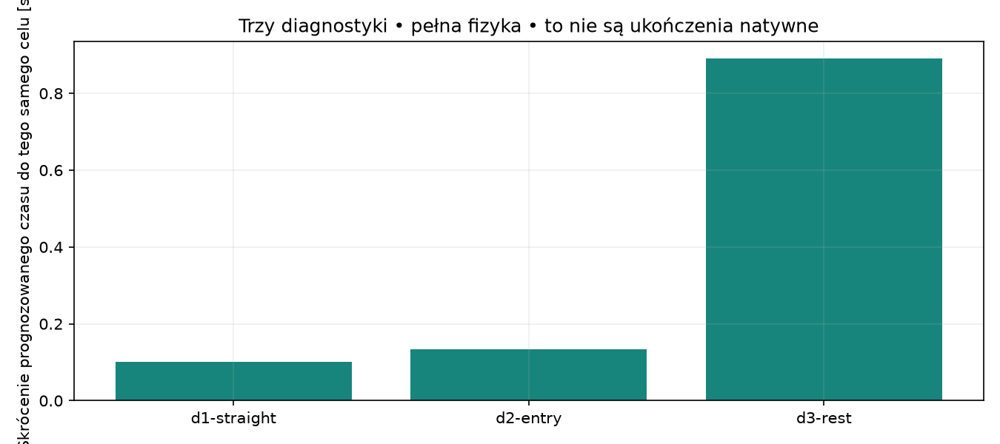
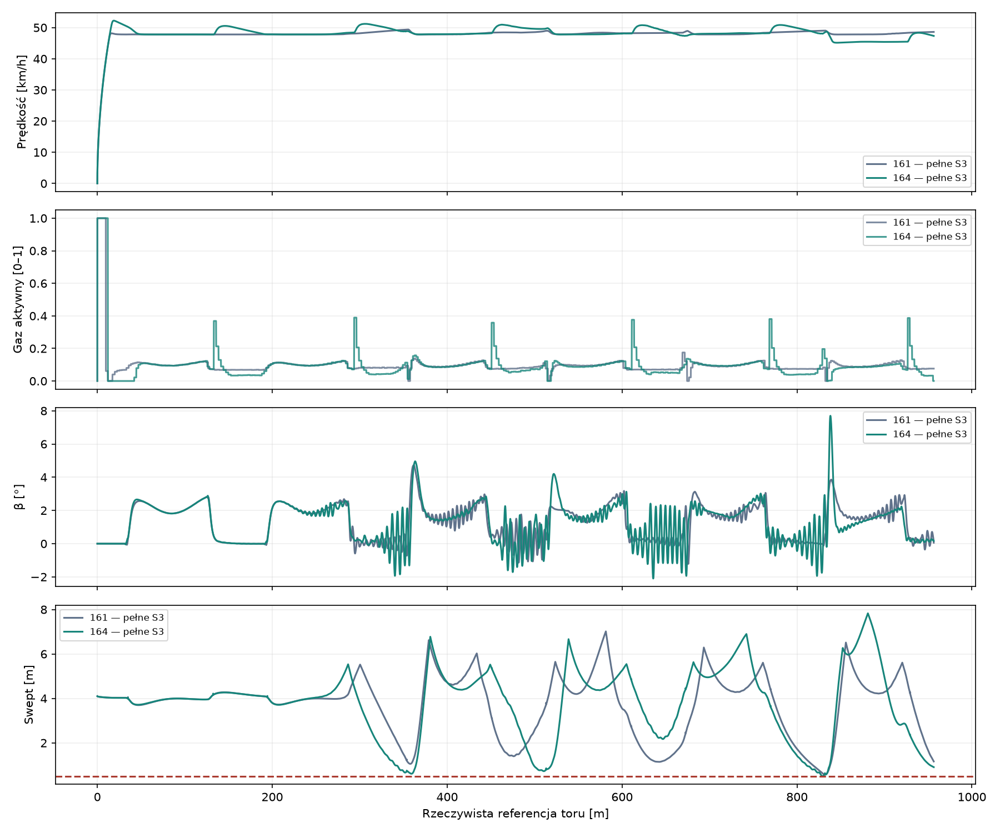
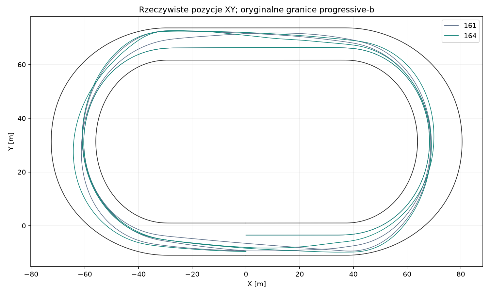

# Badanie #164 — wykonalny profil prędkości

**Wynik: PARTIAL. PROVISIONAL, domyślnie OFF, osobny Draft PR, bez merge.**

Baza techniczna: `75c208c28225005589b5ad84eb5825c1abcf3e1b`. Kontroler referencyjny: `85a5ee3295c2dd983fbacb21859649f794cc5ba5`. Nie zmieniono oryginalnej fizyki ani nie wykorzystano odrzuconych ResponseCache162 i agregacji163.

**Rekomendacja: odrzucić wariant jako poprawę sportową.** Jeden rzeczywisty bieg ukończył legalne S3, lecz był wolniejszy o 0,438601s (0,549%) i kosztował 68,75% więcej CPU. Brama szybszego development nie przeszła:0/5 odłożonych walidacji, bez powtórki i bez strojenia po wyniku.

## Interwencja i niezmienione wymagania

Jedna stała propozycja: zachowano Track ForceFraction0,5 (Prepare0,42, Recover0,32) i równowagowy pułap161 na łukach; na prostej cel zwiększa się przez wsteczną obwiednię prędkości `sqrt(v_bend²+2*a*d*stability)`. Droga dostępna kończy się przed następnym wejściem w łuk, z odjęciem przygotowania aktuatora,0,24s reakcji,0,2s review,2m dodatkowego przygotowania oraz długu ruchu poprzecznego/yaw. Opóźniony stan pochodzi z oryginalnego fizycznego ActivationState z pełną kolejką pending.

Propozycja `a` to najwyżej0,25m/s² oraz połowa oryginalnej siły oporów/m147kg. Nie jest to udowodniona gwarancja hamowania: koło, wał, sprzęgło, aktywny napęd i poślizg mogą ją unieważnić. Wyłącznie pełna oryginalna propagacja i niezależny13/9 dopuszczają polecenie. Stabilność zależy od χ względem drogi, θ,β, prędkości poprzecznej i obu prześwitów; poniżej0,75m pose dodatkowy bonus znika. Próg akceptacji nadal wynosi0,5m.

Proponowana linia3,5m, Track/Prepare/Recover, oryginalny optymalizator wspólnego gazu i yaw, koło/wał/sprzęgło, silnik/opony/μ, geometria, Box2D, aktuator, pending,β≤45°, cały13/9 i niezależny preflight, trzy okrążenia od legalnego startu oraz32m rezerw pozostają oryginalne. Cel profilu obejmuje także okresową geometrię za metą. Nie podnoszono samego ForceFraction.

Jedyną zmianą reguły propozycji jest cel prędkości. Żądany gaz, skręt i rzeczywista linia mogą zmienić się wspólnie jako wynik sprzężonego regulatora. Nie przypisujemy zysku osobno gazowi, skrętowi lub skróceniu drogi bez niezależnego dowodu przyczynowego.

## Trzy diagnostyki i dwie osobne certyfikacje

|Próba|Start [s]|Cel / koniec rezerwy [m]|Przybycie161 /164 [s]|Zysk [s]|Brama|
|---|---|---|---|---|---|
|d1-straight|12,600|191,389 / 350,779|16,558 / 16,456|0,101|True|
|d2-entry|4,000|191,389 / 350,779|16,558 / 16,423|0,135|True|
|d3-rest|0,000|956,336 / 988,336|78,179 / 77,288|0,891|True|

To prognozy, a nie ukończenia natywne. d1/d2 używają dokładnych zapisanych stanów161 z pending i celu nominalnej taśmy tego samego review; d3 porównuje istniejącą prognozę161 od rest przez pełny dystans. Bazy nie uruchamiano ponownie.

### d1-straight — wszystkie ocenione manewry

|Manewr|Legalny|Arrival [s]|Koniec ref [m]|Swept [m]|CPU [s]|Powód|
|---|---|---|---|---|---|---|
|Track|True|16,456|351,831|3,705|3,906|legal complete forecast; swept physical footprint>=0.5m|
|Prepare|True|16,719|351,670|3,994|3,422|legal complete forecast; swept physical footprint>=0.5m|
|Recover|True|16,825|352,144|2,765|3,156|legal complete forecast; swept physical footprint>=0.5m|

### d2-entry — wszystkie ocenione manewry

|Manewr|Legalny|Arrival [s]|Koniec ref [m]|Swept [m]|CPU [s]|Powód|
|---|---|---|---|---|---|---|
|Track|True|16,423|352,250|3,699|5,578|legal complete forecast; swept physical footprint>=0.5m|
|Prepare|True|17,434|352,830|3,518|5,250|legal complete forecast; swept physical footprint>=0.5m|
|Recover|True|19,002|351,962|2,381|4,688|legal complete forecast; swept physical footprint>=0.5m|

### d3-rest — wszystkie ocenione manewry

|Manewr|Legalny|Arrival [s]|Koniec ref [m]|Swept [m]|CPU [s]|Powód|
|---|---|---|---|---|---|---|
|Track|True|77,288|990,371|3,706|15,297|legal complete forecast; swept physical footprint>=0.5m|
|Prepare|True|84,008|988,666|3,713|15,781|legal complete forecast; swept physical footprint>=0.5m|
|Recover|False|—|843,339|2,709|12,969|bounded terminal maneuver incomplete|

|Osobny certyfikat|13/9|Independent|Brama|CPU snapshot [s]|
|---|---|---|---|---|
|c1-rest|13/9|True|True|19,031|
|c2-straight|13/9|True|True|21,812|

Pierwszy CPU snapshot wyniku poprzedza końcową kompresję. Rozliczony koszt poniżej pochodzi z ukończonego budget-journal.CpuSeconds. ChargedCpuSeconds to konserwatywne zaokrąglone obciążenie budżetu; oba pola pozostają w dowodach. Runtime158.Forecasts nie obejmuje osobnych prognoz Control164/ActivationState; zerowy licznik tego adaptera w diagnostyce nie oznacza zerowego kosztu fizyki.

W d1 dodatkowy niezobowiązujący probe sił używał bieżącego gazu i proponowanego skrętu; nie jest faktycznym ledgerem przyszłej komendy. Przed d2 poprawiono wyłącznie obserwację na active steering i dodano liczniki Control; kod pięciu plików polityki i jego hash pozostał identyczny. Nie powtarzano d1. Raport sił wykonanej jazdy opiera się na natywnym ledgerze100Hz.

## Rzeczywiste biegi i porównywalne pary

|Próba|Status|S3 161 /164 [s]|Δ [s]|CPU161 /164 [s]|Swept161 /164 [m]|Zapas164 [m]|Certyfikaty|
|---|---|---|---|---|---|---|---|
|native-dev|S3|79,868 / 80,306|0,439|1370,781 / 2313,250|0,575523 / 0,505102|0,005102|402|

Zapas to swept−0,5m. Legalność nie oznacza jednakowej odporności: wynik z pojedynczymi milimetrami zapasu wymaga ostrożniejszej interpretacji niż przejazd z dużym marginesem. Nie zwiększano tolerancji ani nie obniżano progu w celu uzyskania ukończeń.

Odłożone warunki: 0/5; DNF: 0. Mediana pełnych odłożonych S3: —s. Brama legalności: False; sportowa: False; profilu prędkości: False; CPU: False. Brak pięciu odłożonych legalnych ukończeń oznacza PARTIAL.

PASS wymaga pięciu różnych startów identycznych z odpowiadającymi #161, każdej pary szybszej i mediany<79,602830s. Profil prędkości musi poprawić rzeczywistą średnią po prostych w każdej parze; samo Vmax i krótsza droga nie wystarczają. Zadeklarowane CPU: suma i mediana pięciu par≤125%161, każdy przypadek≤150%, twardy limit2400CPU-s/world. Nie jest to sterowanie online co0,2s.

Największa zmierzona prędkość164: 52,235km/h. Nie osiągnięto100km/h; to badanie nie wyznacza globalnego fizycznego Vmax.

### native-dev — okrążenia, sześć łuków i proste

Okrążenia161 [s]: 26,943, 26,558, 26,366. Okrążenia164 [s]: 26,641, 26,312, 27,353. Rzeczywista droga161 /164: 1049,218 / 1057,633m.

|Łuk|Stan164|Czas161 /164 [s]|Wejście161 /164 [km/h]|Minimum161 /164|Wyjście161 /164|
|---|---|---|---|---|---|
|1|complete|8,136 / 8,111|47,811 / 50,235|47,781 / 47,782|47,788 / 47,790|
|2|complete|8,140 / 8,188|47,812 / 47,839|47,797 / 47,796|48,077 / 48,405|
|3|complete|8,754 / 8,692|49,372 / 48,850|47,771 / 47,815|48,392 / 48,253|
|4|complete|8,592 / 8,656|48,986 / 49,694|47,843 / 47,787|48,217 / 48,123|
|5|complete|8,511 / 8,600|48,763 / 47,379|47,795 / 47,372|48,427 / 48,733|
|6|complete|8,635 / 9,605|49,042 / 48,482|47,786 / 45,142|48,374 / 46,875|

|Okr./prosta|Stan|Średnia164 [km/h]|Vmax164 [km/h]|
|---|---|---|---|
|1/1|complete|32,496|52,235|
|1/2|complete|49,269|50,545|
|1/3|complete|50,523|51,198|
|2/1|complete|49,593|50,649|
|2/2|complete|50,038|50,948|
|2/3|complete|50,169|50,784|
|3/1|complete|48,457|49,835|
|3/2|complete|49,585|50,843|
|3/3|complete|47,936|48,330|

Średnia ważona czasem po prostych161 /164: 46,129 / 47,167km/h. Dla DNF nowy profil obejmuje tylko zachowany prefiks i nie jest pełną parą sportową.

Natywne statystyki164: {"mean_speed_kph": 47.41201956935731, "maximum_speed_kph": 52.234639200000004, "mean_front_util": 0.29279696437535235, "mean_rear_util": 0.32289838264747184, "mean_active_gas": 0.11181518119782703, "mean_requested_gas": 0.11181646203753202, "maximum_abs_yaw": 1.1566402, "maximum_abs_wheel_slip": 11.31631502211948, "mean_drive_torque_fraction": 0.11197604823492664, "straight_mean_kph": 47.166686168069916, "baseline_straight_mean_kph": 46.12878639857613, "mean_combustion_power_W": 2219.259665919678, "mean_available_engine_power_W": 17288.42981670897, "baseline_mean_front_util": 0.26381894383419174, "baseline_mean_rear_util": 0.3089409775970138}. Maksimumβ=7,701°, pose=0,575718m. Wszystkie100Hz gaz żądany/aktywny, skręt,θχβ/yaw, wheelspin, siły, grip utilization, moment dostępny i użyty, XY i swept są w telemetry/native-dev.csv.gz oraz pełnym native.json bundle. Frakcja momentu to stosunek momentu faktycznie oddanego na koło do pełnego dostępnego momentu Engine500 przy RPM tego samego kroku, nie procentem szczytowej mocy całej mapy silnika. Osobno zachowano moc spalania z oryginalnego ledgeru i moc dostępną przy aktualnym RPM.

Odrzuconych propozycji: 2216; ABSTAIN=0; kontakty=0. Wszystkie odrzucenia pozostają w Review.Attempts/RejectedTrees i Outcomes/Rejections w policies.jsonl; wszystkie błędy: [].

Koszt piątego łuku: {"reference_start_m": 672.5574998855591, "reference_end_m": 769.9468748569489, "new_callback_cpu_s": 990.375, "baseline_callback_cpu_s": 152.515625, "scope": "Same fifth-bend geometric reference interval, actual callback CPU including evidence writing; if DNF, new coverage can be incomplete."}. Powody zapisanych odrzuceń: {"footprint reserve": 1448, "swept physical footprint reserve0.5m": 768}.

Liczniki generowania: {"PrimitiveCandidates": 261, "PhysicalSteps": 24391, "FullPlans": 248, "GenerationBatches": 87}. CPU faz nowego planera: {"hierarchical_generation": 980.703125, "conditional_continuations": 984.984375, "outside_decision": 50.953125, "independent_preflight": 133.09375, "causal_reserve_generation": 0.5, "candidate_generation": 0.28125, "uncertainty_scenarios": 0.015625, "recertification": 135.6875}. Najciaśniejszy interwał natywny: [68.45, 68.46000000000001]s; dokładne stany/pending/siły przed i po w native-dev-tightest.json.

Ostatni zaakceptowany safetyGoal=988,336250m, czyli rezerwa za metą 32,000000m, wciąż z dziewięcioma kompletnymi legalnymi terminalami.

|Faza, ta sama instrumentacja161|CPU161 [s]|CPU164 [s]|
|---|---|---|
|candidate_generation|0,172|0,281|
|causal_reserve_generation|0,016|0,500|
|conditional_continuations|961,484|984,984|
|hierarchical_generation|75,500|980,703|
|independent_preflight|128,766|133,094|
|outside_decision|50,391|50,953|
|recertification|126,344|135,688|
|uncertainty_scenarios|0,047|0,016|

## Budżet, integralność i walidacja

Proste były szybsze, lecz cały bieg nie był. Zaobserwowano dłuższą rzeczywistą drogę, gorszą końcówkę ostatniego łuku i znacznie większy koszt generowania/rezerw w piątym łuku. Nie dowodzi to osobnej przyczynowej wielkości wkładu każdego z tych efektów. Następny konkretny cel to profil zachowujący wykonalność całej rodziny13/9 i stabilny kierunek/linię także w trzecim okrążeniu; nie zwiększanie globalnego celu ani zmniejszanie certyfikacji. Bieżącego wariantu nie należy promować.

|Operacja|Rodzaj|Ukończona|CPU rzeczywiste [s]|Obciążenie [s]|Powód|
|---|---|---|---|---|---|
|d1-straight|diagnostic|True|11,188|13,000|diagnostic gate passed|
|d2-entry|diagnostic|True|16,453|18,000|diagnostic gate passed|
|d3-rest|diagnostic|True|47,016|49,000|diagnostic gate passed|
|c1-rest|certificate|True|19,141|21,000|full13/9 independent certification gate passed|
|c2-straight|certificate|True|21,922|23,000|full13/9 independent certification gate passed|
|native-dev|native|True|2313,250|2315,000|completed|

Pełne źródła kontrolera zamraża się dopiero po sukcesie development, przed odłożonymi wynikami. Wcześniejsze hashe pięciu plików polityki są identyczne w diagnostykach i certyfikacjach. Zapisane trajektorie nigdy nie dostarczają komend lub certyfikatu. Każdy zaakceptowany natywny review wykonuje nowy pełny13/9 i niezależny preflight.

Skonsolidowany format162: jeden ZIP na operację, policies.jsonl z dokładnymi SHA256 payloadów, CRC, źródła, pełny native i journal. Nie powielamy starszych archiwów. Jedna pochodna tabela CSV na nowy świat ułatwia audyt100Hz; nie jest dodatkowym eksperymentem. Manifest pieczętuje dane, kod i78 starszych drzew.

Walidacja końcowego SHA: jedna pełna lokalna regresja C#/Python/Node w zakresie Draft i jeden Windows CI. Wszystkie cztery shardy pozostają w discovery, core+trajectory wykonują się w całości; historical473 i four-rider48 discovery-only według niezmienionej polityki Draft. Końcowe receipts Local-validation-164.json i Windows-CI-164.json są dostarczane poza Git, bez kolejnego commitu lub ponowienia identycznej walidacji.
