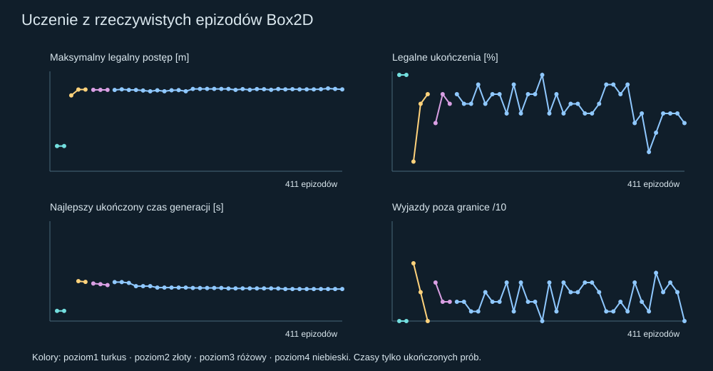
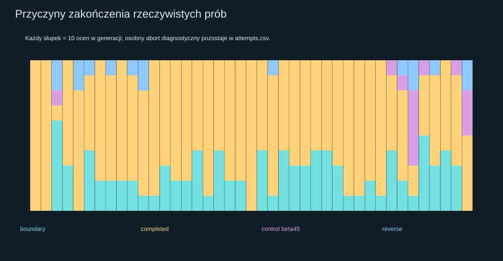
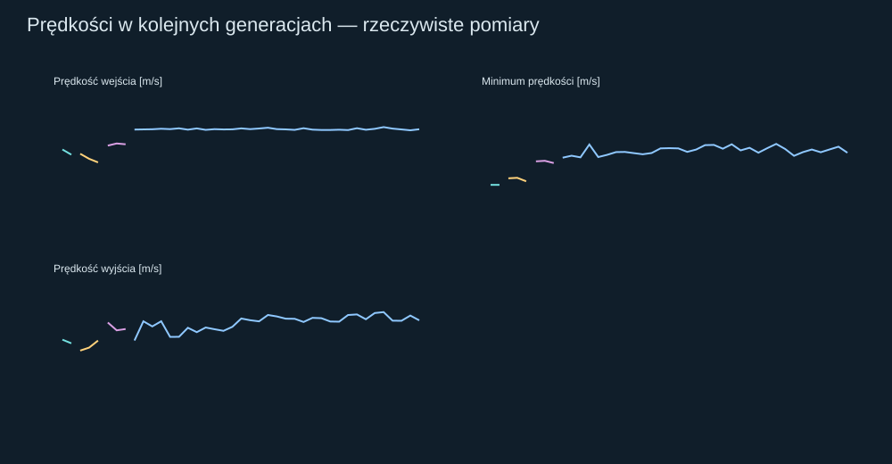
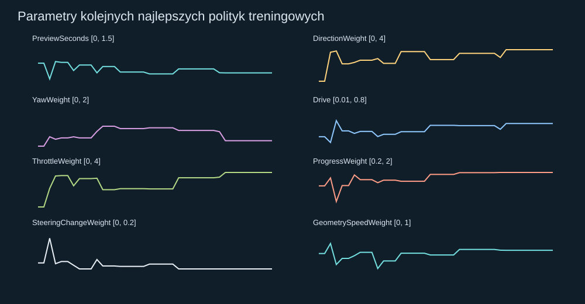
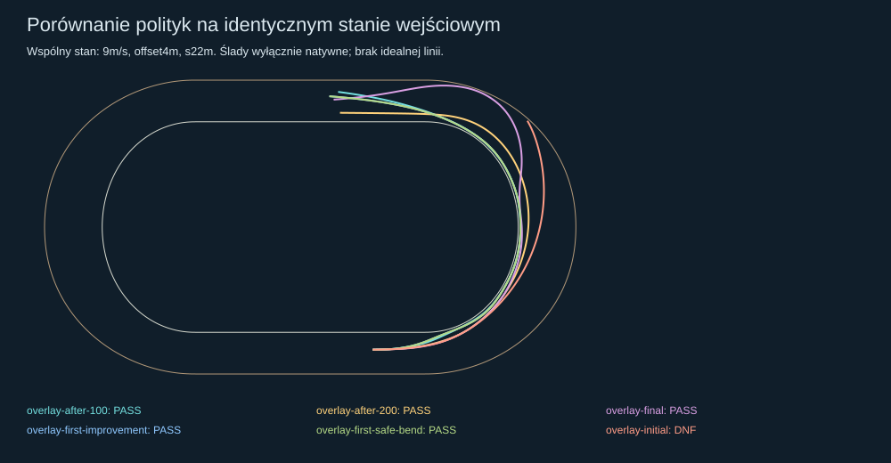

# Free Racing Learning #129 — PARTIAL

Status **PROVISIONAL**, narzędzie badawcze domyślnie OFF. Jeden zawodnik, istniejąca natywna fizyka Box2D. Wynik dotyczy tego modelu oraz zbadanych stanów, nie dowodzi optymalności ani realizmu skalibrowanego motocykla.

## 1. PR i baza

[Draft PR #129](https://github.com/arturgladysz91/zuzel/pull/129), bez merge. Dokładny HEAD jest w opisie PR. Gałąź `experiment/free-racing-learning-129` zaczyna się dokładnie od `e23261afe1205c71a8db3733b6553485f4de29f5` (#128). Stare wyniki #128 i wcześniejszych audytów pozostają zachowane.

## 2. Kontrola fizycznego skrętu przed treningiem

Pięć natywnych światów: 8m/s, offset5m, s4m, gaz1; do0,24s kierownica0, potem impuls0/±5/±15° do0,5s. [Wyniki](physics.json), [protokół](physics-protocol.json), pełne siły obu opon i momenty w `impulse-*.json`.

Globalnie +X to kierunek prostej, +Y lewo/do wnętrza; dodatni moment i kąt są CCW. Dla+5°: Δψ=0,12638rad, Δχ=0,07141rad, Δβ=0,05497rad, ΔY=+0,08286m; dla+15° odpowiednio0,19240/0,11417/0,07823rad i+0,12070m. Ujemne impulsy dają lustrzaną reakcję. Dodatni skręt prowadzi w lewo, lecz ψ, χ i β nie są tym samym. Geometria lewego łuku zwiększa heading. Nie znaleziono błędu znaków i nie zmieniono sił ani momentów.

## 3. Przyczyna pierwszej decyzji #128

[Przeliczenie zapisanych ocen bez nowego świata](128-root-cause.json) potwierdza lokalną przyczynę: koszt przekroczenia geometrycznej obwiedni prędkości przeważył niewielką przewagę postępu i wybrał−0,666°. Po odjęciu tego jednego członu, na tym samym wąskim zbiorze wygrywa+0,034°. Nie jest to pełny dowód przyczyny późniejszego nasycenia−35°. Zbiór±0,7° wokół nominalnej decyzji ograniczał możliwość ucieczki z błędnego wyboru.

## 4. Rzeczywisty wybór działań

18–23 odrębne pary (maksimum25 w teście API): kierownica0/±0,5/±1,5/±5/±15°, wykonany i aktywnie żądany kąt, gaz0 lub wyuczona wartość oraz zachowanie aktywnej pary. Co0,2s każdy kandydat przechodzi predyktor0,6s. Wszystko trafia do kolejki z pełną reakcją0,24s i oryginalnego aktuatora±35°,90°/s. Bezpieczne w horyzoncie, niepewne i niebezpieczne są odrębnymi klasami; bezpieczeństwo ma pierwszeństwo przed kosztem. `NoSafeContinuation` jawnie oznacza brak bezpiecznego kandydata, nie sukces decyzji. To lokalna ocena, nie gwarancja całego przejazdu.

## 5. Jak CEM uczy się z niepowodzeń

Pięć polityk na generację × dwa identyczne dla nich stany. Populacja: zachowany najlepszy kandydat, trzy mutacje Gaussa oraz jeden szeroki kandydat z ograniczonego rozkładu tanh(normal). Dwie elity aktualizują średnią0,4starej+0,6nowej, z dolnym ograniczeniem odchylenia15% zakresu. Seed1292026, osiem preferencji. W protokole słowo „uniform” przy imigrancie jest nieprecyzyjne; kod i zapisane wartości używają tanh(normal).

Porządek: liczba legalnych ukończeń; przy2/2 najgorszy czas bramki; następnie minimalny i średni legalny postęp, zbliżanie do granic i odzyskiwanie prześwitu na metr. Sam czas przetrwania nie daje nagrody. Krok powodujący wyjazd nie zwiększa legalnego postępu; reverse, oszustwo projekcją, brak postępu i naruszenia obrysu kończą epizod. Nieukończona polityka nie wygrywa z ukończoną. W generacji2 było1/10 ukończeń i żadnej pary2/2, a elity mimo tego zmieniły rozkład; generacje3/4 osiągnęły7/10 i8/10.

## 6. Faktyczna liczba prób i budżet

**411 natywnych prób treningowych**, w tym jeden zachowany abort kontroli pomiarowej; 7 światów fizyki/probe i 24 walidacji (w tym powtórzenia, replay i#124). Razem **442 światów**. [Każda rezerwacja i koszt](attempts.csv), [budżet](budget.json).

Przed treningiem: limity200/1000/opcjonalnie2000, CPU2400/7200/12000s, kontakty50/160/300mln, fizyka≤8, walidacja≤36, epizod≤90CPU s, generacja≤150CPU s. Po200 rozszerzono na podstawie natywnych ukończeń, nie samej liczby prób. Zakończenie: **eight generations at plateau**. Fazy2000 nie uruchomiono. Rezerwacja następuje przed utworzeniem świata; krótka prognoza nie jest epizodem.

## 7. Wyniki kolejnych generacji

Kolory na wykresach rozdzielają poziomy; zmiana zadania powoduje skok metryk. Licznik epizodów od generacji5 obejmuje także zachowany abort pomiarowy, dlatego nie zawsze jest wielokrotnością10. Pełne populacje, średnie, odchylenia, przyczyny i koszty: [generations.json](generations.json).

| Generacja | Poziom | Licznik prób | Ukończenia /10 | Max / średni legalny postęp [m] | Najlepszy czas 2/2 [s] | Przyczyny |
|---:|---:|---:|---:|---:|---:|---|
| 0 | 1 | 10 | 10 | 41.85 / 38.54 | 2.110 | completed: 10 |
| 1 | 1 | 20 | 10 | 41.85 / 37.66 | 2.110 | completed: 10 |
| 2 | 2 | 30 | 1 | 125.96 / 73.75 | — | boundary: 6, reverse: 2, control beta45: 1, completed: 1 |
| 3 | 2 | 40 | 7 | 135.71 / 115.20 | 8.290 | boundary: 3, completed: 7 |
| 4 | 2 | 50 | 8 | 135.71 / 111.59 | 8.130 | completed: 8, reverse: 2 |
| 5 | 3 | 61 | 5 | 135.20 / 89.88 | 7.800 | completed: 5, boundary: 4, reverse: 1 |
| 6 | 3 | 71 | 8 | 135.15 / 119.71 | 7.660 | completed: 8, boundary: 2 |
| 7 | 3 | 81 | 7 | 135.15 / 116.67 | 7.470 | completed: 7, reverse: 1, boundary: 2 |
| 8 | 4 | 91 | 8 | 135.03 / 120.50 | 8.090 | completed: 8, boundary: 2 |
| 9 | 4 | 101 | 7 | 136.02 / 107.10 | 8.090 | completed: 7, boundary: 2, reverse: 1 |
| 10 | 4 | 111 | 7 | 135.03 / 111.70 | 7.920 | completed: 7, reverse: 2, boundary: 1 |
| 11 | 4 | 121 | 9 | 135.01 / 128.45 | 7.250 | completed: 9, boundary: 1 |
| 12 | 4 | 131 | 7 | 134.12 / 114.80 | 7.250 | completed: 7, boundary: 3 |
| 13 | 4 | 141 | 8 | 132.80 / 121.81 | 7.250 | completed: 8, boundary: 2 |
| 14 | 4 | 151 | 8 | 134.42 / 120.89 | 6.950 | completed: 8, boundary: 2 |
| 15 | 4 | 161 | 6 | 132.85 / 102.34 | 6.950 | completed: 6, boundary: 4 |
| 16 | 4 | 171 | 9 | 134.47 / 122.87 | 6.950 | completed: 9, boundary: 1 |
| 17 | 4 | 181 | 6 | 134.76 / 116.66 | 6.950 | completed: 6, boundary: 4 |
| 18 | 4 | 191 | 8 | 132.85 / 122.25 | 6.950 | completed: 8, boundary: 2 |
| 19 | 4 | 201 | 8 | 136.70 / 122.40 | 6.870 | completed: 8, boundary: 2 |
| 20 | 4 | 211 | 10 | 136.70 / 133.30 | 6.870 | completed: 10 |
| 21 | 4 | 221 | 6 | 136.70 / 115.15 | 6.870 | completed: 6, boundary: 4 |
| 22 | 4 | 231 | 8 | 136.70 / 121.13 | 6.870 | completed: 8, reverse: 1, boundary: 1 |
| 23 | 4 | 241 | 6 | 136.70 / 111.01 | 6.870 | completed: 6, boundary: 4 |
| 24 | 4 | 251 | 7 | 136.70 / 115.53 | 6.780 | completed: 7, boundary: 3 |
| 25 | 4 | 261 | 7 | 135.13 / 114.87 | 6.780 | completed: 7, boundary: 3 |
| 26 | 4 | 271 | 6 | 136.41 / 123.08 | 6.780 | completed: 6, boundary: 4 |
| 27 | 4 | 281 | 6 | 135.13 / 106.98 | 6.780 | completed: 6, boundary: 4 |
| 28 | 4 | 291 | 7 | 136.47 / 113.38 | 6.780 | completed: 7, boundary: 3 |
| 29 | 4 | 301 | 9 | 136.23 / 128.05 | 6.780 | completed: 9, boundary: 1 |
| 30 | 4 | 311 | 9 | 135.24 / 127.74 | 6.780 | completed: 9, boundary: 1 |
| 31 | 4 | 321 | 8 | 136.55 / 127.21 | 6.760 | completed: 8, boundary: 2 |
| 32 | 4 | 331 | 9 | 135.97 / 128.23 | 6.650 | completed: 9, boundary: 1 |
| 33 | 4 | 341 | 5 | 136.28 / 106.28 | 6.650 | completed: 5, control beta45: 1, boundary: 4 |
| 34 | 4 | 351 | 6 | 135.96 / 101.99 | 6.650 | completed: 6, control beta45: 1, boundary: 2, reverse: 1 |
| 35 | 4 | 361 | 2 | 135.96 / 73.29 | 6.650 | completed: 2, reverse: 2, control beta45: 5, boundary: 1 |
| 36 | 4 | 371 | 4 | 135.96 / 84.10 | 6.650 | completed: 4, boundary: 5, control beta45: 1 |
| 37 | 4 | 381 | 6 | 136.28 / 104.66 | 6.650 | completed: 6, boundary: 3, reverse: 1 |
| 38 | 4 | 391 | 6 | 137.58 / 106.49 | 6.650 | completed: 6, boundary: 4 |
| 39 | 4 | 401 | 6 | 136.66 / 107.91 | 6.650 | completed: 6, boundary: 3, control beta45: 1 |
| 40 | 4 | 411 | 5 | 135.96 / 93.87 | 6.650 | completed: 5, reverse: 2, control beta45: 3 |

## 8. Prosta

Poziom1: dwa różne stany6/8m/s, offset3/6m, s4m i drobne odchylenia. Obie pierwsze generacje ukończyły10/10 prób. Początkowy ogólny regulator z szerokim wyborem działań już kontrolował tę prostą; nie przypisujemy CEM całej tej zdolności. CEM poprawił czas przed przejściem na łuk. Nie ma nagrody za środek ani konkretny offset.

## 9. Pierwszy bezpieczny łuk

Poziom 2: 8/10m/s, poziom 3: 12/14m/s, poziom 4: 16/18m/s. Przejście wymaga dwóch kolejnych generacji ≥6/10 oraz najlepszej pary 2/2. Bramka to cały obrys za stałą płaszczyzną 3m po pierwszym łuku, następnie 1s legalnej jazdy. Zachowano pełny pierwszy bezpieczny przejazd i końcową politykę zweryfikowaną tylko przez natywne ukończenia. Pierwsza istotna poprawa na łuku i pierwszy bezpieczny łuk to ta sama polityka 19 z generacji 3; dwa replaye są osobno policzonymi odtworzeniami.

## 10. Prędkość i czas

Tabela poniżej porównuje identyczny, ustalony przed treningiem stan:9m/s, offset4m, s22m, lateral+0,12m/s, heading+0,025rad, yaw+0,02rad/s. Prędkość początkowa nie jest prędkością wejścia: silnik rozpędza motocykl przed łukiem. Minimum łuku wyliczono z próbek `Road.IsTurn`; `MinimumSpeed` w surowych metrykach obejmuje cały epizod. CPU zależy od długości epizodu i komputera; DNF nie ma czasu bramki ani prędkości wyjścia.

| Metryka — wspólny stan 9m/s, offset4m | Początkowa | Po100 | Po200 | Końcowa |
|---|---:|---:|---:|---:|
| Legalne ukończenia | 0 | 1 | 1 | 1 |
| Legalny postęp [m] | 85.664 | 133.361 | 132.819 | 134.648 |
| Czas pierwszego łuku +3m [s] | — | 8.110 | 7.990 | 8.200 |
| Maksymalne β [°] | 10.290 | 6.367 | 9.016 | 19.750 |
| Prędkość wejścia [m/s] | 14.480 | 12.523 | 12.498 | 13.742 |
| Minimum prędkości w łuku [m/s] | 14.480 | 12.523 | 12.498 | 13.663 |
| Prędkość wyjścia na bramce [m/s] | — | 18.166 | 17.157 | 18.331 |
| Średni gaz [0–1] | 0.254 | 0.269 | 0.286 | 0.374 |
| Pełny gaz — udział czasu [0–1] | 0.134 | 0.026 | 0.027 | 0.026 |
| Oscylacje poprzeczne ≥1m | 2.000 | 2.000 | 4.000 | 3.000 |
| Droga XY [m] | 96.962 | 134.599 | 138.746 | 149.862 |
| Minimalny prześwit swept [m] | -0.028 | 0.127 | 1.113 | 0.156 |
| CPU epizodu [s] | 2.906 | 3.453 | 3.375 | 3.703 |
| Oceny kontaktu epizodu | 35598.000 | 50982.000 | 49930.000 | 51110.000 |

## 11. Trajektoria i wyuczone preferencje

Nie ma listy XY, target-offsetu, komend przypisanych do czasu ani fabryki przygotowanej ścieżki w sterowniku. Geometria daje kierunek i promień oraz granice; osiem preferencji wybiera działania z bieżącego stanu. Twarda ocena ryzyka i ogólna struktura kosztu są zaprogramowanym algorytmem, a nie wynikiem uczenia. CEM uczy wartości preferencji z rzeczywistych wyników Box2D.

Na wspólnym przypadku obserwowany offset w łuku zmienił się z0.99–12.80m (DNF) do-0.13–11.08m. To wynik sterowania, nie zadany korytarz. Dowód korzystniejszej trajektorii jest lokalny: ukończenie i czas na badanych stanach. Nie twierdzimy, że odkryto globalną linię optymalną.

| Preferencja | Początkowa | Końcowa |
|---|---:|---:|
| PreviewSeconds | 0.500 | 0.509 |
| DirectionWeight | 0.250 | 4.000 |
| YawWeight | 0.050 | 0.312 |
| Drive | 0.150 | 0.520 |
| ThrottleWeight | 0.200 | 4.000 |
| ProgressWeight | 1.000 | 2.000 |
| SteeringChangeWeight | 0.010 | 0.000 |
| GeometrySpeedWeight | 0.100 | 0.531 |

## 12. Niezależne przypadki i baseline#124

Walidacja została ustalona przed treningiem; nigdy nie uczestniczy w elitach, średniej ani awansie curriculum. Końcowa polityka ma2/3 ukończenia, poprawę ukończenia/czasu na2/3 przypadków względem początkowej. Nie wybrano polityki według walidacji. Wyniki po200 nie muszą być lepsze od po100 — ten brak monotoniczności jest zachowany. Końcowy przypadek14m/s pozostaje DNF po115m legalnego postępu, mimo wcześniejszych ukończeń przez polityki po100/200. To dowód niepełnej generalizacji i powód wyniku PARTIAL, a nie podstawa do wyboru polityki na walidacji.

| Stały przypadek | Początkowa | Po100 | Po200 | Końcowa |
|---|---:|---:|---:|---:|
| holdout-9-4 | DNF | 8.110s | 7.990s | 8.200s |
| holdout-11-7 | 9.120s | 7.590s | 8.290s | 7.010s |
| holdout-14-5 | DNF | 8.050s | 6.960s | DNF |

Baseline#124 uruchomiono ponownie na pierwszym, z góry wskazanym przypadku9m/s/offset4m, tych samych oponach, masie, silniku, geometrii, perturbacjach i zamrożonej nawierzchni. Zmieniono wyłącznie sposób sterowania, używając oryginalnego kontrolera#124. Wynik **ukończony**, czas8.760s, legalny postęp131.46m, minimalny swept prześwit3.9609m. [Pełny nowy zapis](matched-124.json). Historyczne19,98s obejmuje dwa łuki i inne warunki, więc nie jest tutaj porównaniem czasu.

## 13. Odtwarzanie i weryfikacja

Uruchom z katalogu repo `python -m http.server 8012`, następnie [polityka początkowa](http://127.0.0.1:8012/tools/replay-viewer/?case=free-learning&run=overlay-initial), [po100](http://127.0.0.1:8012/tools/replay-viewer/?case=free-learning&run=overlay-after-100), [po200](http://127.0.0.1:8012/tools/replay-viewer/?case=free-learning&run=overlay-after-200), [końcowa](http://127.0.0.1:8012/tools/replay-viewer/?case=free-learning&run=overlay-final). Selektor zawiera wszystkie kompletne zapisy, także DNF. Niekompletny eksport jest zachowany osobno, bez udawania pełnego replay.

Snapshoty XY i orientacja są natywne, bez ekstrapolacji. Nakładki kamieni milowych porównują ten sam stan. Można odtwarzać, przewijać, oglądać gaz, wykonaną/żądaną kierownicę, β, yaw, koło, prześwity, kolejkę i kandydatów. Żadna prognoza nie jest pokazywana jako wykonany przejazd.

Przed pierwszą próbą19 testów C# (FreeRacing+FreeLearning), przed wznowieniem21; pięć impulsów i18 porównań prognoza/natywna kontynuacja. Po treningu12 dodatkowych porównań na łuku dla0,3/0,6/0,9s i78 bitowo identycznych rekonstrukcji decyzji. Progi: XY≤0,1m, v≤0,2m/s, χ/β≤1°, kierownica≤1,5°, koło≤2rad/s, yaw≤0,05rad/s. Wynik prognoz: **True**. Powtórzenie końcowej polityki ma ten sam fingerprint: **True**. Testy C#/Python/Node oraz standardowy Windows Draft CI opisano w PR. Dane historyczne chronią dotychczasowe testy oraz jawny łańcuch rozszerzeń#128→#129.

## 14. Całkowity koszt

CPU symulacji, decyzji i audytów offline: **1347.953s**, **18,323,957 ocen kontaktu**, **297,657 prognoz** (w tym293,982 przy decyzjach natywnych epizodów) i **322,649 kroków natywnych**. Prognozy obejmują zagnieżdżone działania w sprawdzeniach przyczynowych; oryginalne18 prognoz przeliczono osobno w celu dokładnego zliczenia, a dodatkowy koszt tego audytu również uwzględniono. Nie dodawano kroków predyktora do liczby światów. Kompilacja, serializacja po pomiarze CPU epizodu, testy jednostkowe, agregacja i rendering są kosztem narzędzi poza tym pomiarem; nie określamy tej liczby jako całkowitego czasu pracy komputera.

## 15. Ograniczenia i zachowane problemy

* Jeden eksport walidacji przerwała legalna metadata nieskończonego promienia przy zerowej krzywiźnie. Ciało pozostało skończone. Zachowano częściowy gzip i odzyskane metryki/koszt; ponowny świat policzono osobno. Naprawa dotyczy wyłącznie serializacji. [Dowód](export-failure.json).
* Próba52 została przerwana przez fałszywy alarm kontroli90°/s na kroku1µs: różnicowanie zaokrąglonych kątów float dało1,57207 zamiast1,57080rad/s. Błąd kąta1,276e−9rad był mniejszy od połowyULP1,863e−9. Poprawiono sprawdzenie na bitowo dokładny oryginalny clamp; nie zmieniono aktuatora. Abort i ponowny świat są policzone oddzielnie, RNG wznowiono z zachowaniem sekwencji. [Dowód](rate-guard-recovery.json), [wznowienie](resume.json), zachowane wcześniejsze protokoły.
* Predykcja0,6s i reakcja0,24s nie gwarantują bezpieczeństwa całego łuku. Mutacje nadal dają DNF. Walidacja to tylko trzy ustalone stany, a nie szeroki dowód odporności na nawierzchnie, pogodę i wyższe prędkości.
* Końcowy DNF14m/s zatrzymano w6,92s: od6,2s brak bezpiecznego działania, od6,4s wszystkie prognozowane warianty niebezpieczne. Ostatni punkt ma jeszcze0,0865m prześwitu od bandy, ale konserwatywne dolne ograniczenie prześwitu w całym kroku wynosi−0,0057m. `boundary` oznacza tu odrzucenie niecertyfikowanego przedziału, nie udowodnione przecięcie bandy w ostatnim snapshotcie. Ten konserwatyzm może odrzucać także fizycznie legalny krok. [Audyt](validation-failure-audit.json), [replay DNF](http://127.0.0.1:8012/tools/replay-viewer/?case=free-learning&run=final-holdout-14-5).
* Po awansie curriculum ocenia tylko dwa bieżące stany treningowe. Brak utrzymywania wcześniejszych poziomów może sprzyjać zapominaniu; jest to hipoteza, nie potwierdzona przyczyna tego DNF. Nie wykorzystano walidacji do zastąpienia końcowej polityki wcześniejszą.
* Zachowano obwiednię wiarygodnościβ≤45° z#128; nie ma kary za dążenie doβ=0 ani nagrody za duży uślizg. To ograniczenie modelu, nie dowód fizycznej utraty kontroli powyżej45°. Kontra i uślizg pozostają możliwe.
* Brak dowodu globalnej optymalności linii, brak kalibracji do rzeczywistego motocykla i brak treningu drugiego łuku. Nie uruchomiono rywalizacji czterech zawodników.

## Odtworzenie procesu w nowym katalogu danych

Z katalogu repo, po `dotnet build SpeedwayManager.sln -c Release`, uruchom kolejno `dotnet tools/shared-world-speedway/bin/Release/net8.0/shared-world-speedway.dll free-learning NOWY_KATALOG ETAP` dla etapów `freeze-physics`, `physics`, `freeze`, `probe`, `train`, `final`. Nigdy nie nadpisuj zamrożonych wyników. Następnie `dotnet run --project tools/free-learning-audit -c Release -- NOWY_KATALOG offline` oraz `baseline`. Skrypt `free-learning-report.py` agreguje wyłącznie zapisane dane w katalogu tego raportu i nie uruchamia symulacji. Poprawiony harness nie generuje dwóch zachowanych awarii narzędziowych; logiczna sekwencja CEM i fizyka pozostają deterministyczne, ale liczniki/checkpointy nowego treningu mogą się przez to różnić.
