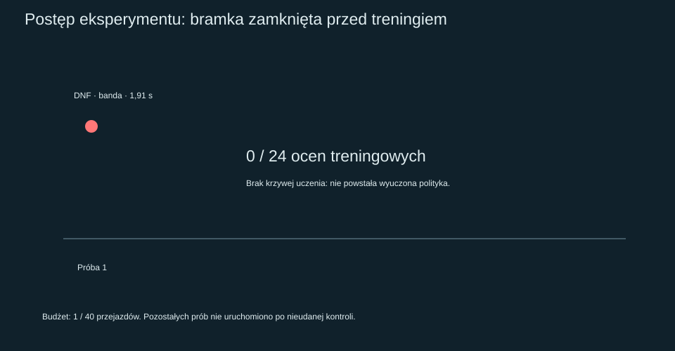
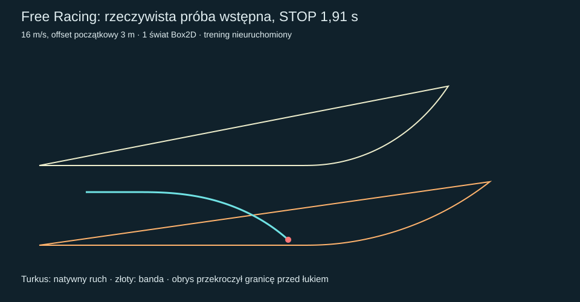
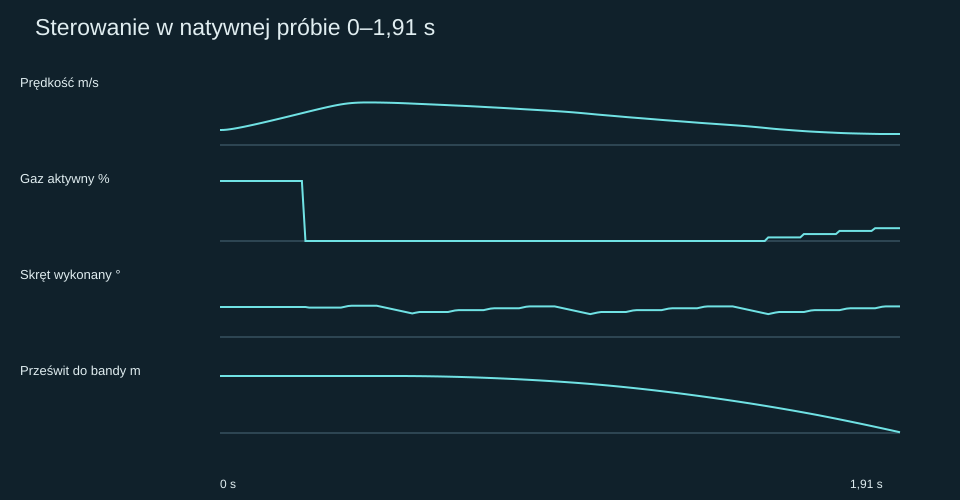

# Free Racing #128 — PARTIAL, zatrzymany przed treningiem

**Zawodnik wybiera gaz i kierownicę bez gotowej trajektorii, ale początkowa polityka
nie przeszła kontroli legalnej jazdy. Nie wykazano uczenia ani poprawy jazdy.**
Pierwszy i jedyny nowy natywny przejazd zatrzymano po **1,91 s**, jeszcze przed
wejściem w pierwszy łuk. Zgodnie z bramką zadania nie wykonano drugiej próby,
24 ocen treningowych, sześciu porównań walidacyjnych ani finału dwóch łuków.

Baza: HEAD #127 `9a7ba4daef3e7702e1bac3e9bc9271eedeca64df`.
Gałąź: `experiment/free-racing-128`. Jeden Draft, bez merge.
Status: **PROVISIONAL / PARTIAL — izolowany fundament, cel uczenia nieosiągnięty**.

## Sterowanie bez linii

Nowa flaga `EnableFreeRacing` jest domyślnie OFF i pomijana przy serializacji OFF.
Tryb wymaga jednego aktywnego zawodnika, oryginalnych kontaktów #116, silnika
500cc i statycznych budżetów opon. Odrzuca równoczesne plany, #117, stare
regulatory, zewnętrzne komendy, dynamiczne obciążenia i własne parametry fizyki.

Co 0,1 s zawodnik przewiduje nieunikniony ruch przez pełną reakcję 0,24 s,
zachowując wszystkie wcześniejsze komendy. Z geometrii bierze orientację,
krzywiznę i zagrożenie zbliżenia do granic. Lokalne zapytania oryginalnych kontaktów
wyznaczają nominalny skręt. Następnie 6–9 par skręt/gaz jest ocenianych z tego
samego zaakceptowanego stanu na horyzoncie 0,9 s. Wybrana para trafia do
nieodwołalnej kolejki z pełną reakcją. Oryginalne ±35° i 90°/s ograniczają wykonanie.

Nie ma listy XY, lateralnego celu ani kary błędu ścieżki. Wnętrze toru nie ma
preferowanego offsetu; reakcja na krawędź zależy od prześwitu i prędkości zbliżania.
Pomocnicza ocena prędkości z przyszłej krzywizny jest **jawnym modelem zagrożenia**,
nie długim rolloutem Box2D. Nie wydłużono zweryfikowanego horyzontu.
Koszt używa postępu, prześwitu, przyszłego zbliżania do granic i przekroczenia
geometrycznego budżetu. Sam kontrolowany β nie jest karany.

`RiderView.TargetOffsetMeters` pozostaje w odziedziczonym typie snapshotu.
W funkcji sił jest używany do nieaktywnej diagnostyki `Demand`; przy zawsze
obecnym `steeringOverride` nie wybiera skrętu i nie wchodzi do sił kontaktów.
Test zmiany tego pola na 9 m zachowuje dokładnie wszystkie akcje i koszty.
Fabryka dotychczasowego profilu zawodnika przygotowuje historyczny obiekt ścieżki,
lecz z niej do nowego trybu przechodzą wyłącznie profil/setup, zastąpione warunki
startowe i nieużywany target. Żaden plan, punkt lub metoda #117 nie trafia do polityki.

Pozycję, prędkość i yaw rzeczywistego motocykla nadal całkuje wyłącznie istniejący
`ContactAdapter`/Box2D. Nie zmieniono silnika, kontaktów, µ, masy 147 kg,
bezwładności 52,72097 kg·m², geometrii, reakcji ani `src/CoreSim`.
[Dokładne odwracalne rozszerzenia integracji](free-racing/source-extensions.json)
odtwarzają źródło OFF z #127; stare manifesty i wyniki #123–#127 są zachowane.
Jawne ustawienia końców linii w `.gitattributes` odtwarzają Windowsowe bajty
źródeł zapieczętowane przed próbą. Nie zmieniają równań.

## Co podlegałoby uczeniu

Wdrożono ograniczony, deterministyczny proces CEM, ale **nie uruchomiono go**.
Nie nazywamy pliku parametrów początkowych wyuczoną polityką.

| Parametr | Początek | Zakres | Znaczenie |
| --- | ---: | ---: | --- |
| PreviewSeconds | 1,8 | 0,8–2,8 s | Zasięg orientacji i geometrycznej oceny zagrożeń |
| DirectionGain | 1 | 0,5–1,6 | Reakcja na orientację kierunku ruchu względem toru |
| YawResponseSeconds | 0,25 | 0,12–0,45 s | Lokalna prognoza odpowiedzi yaw kontaktów |
| EdgeHorizonSeconds | 1 | 0,5–1,5 s | Przewidywanie zbliżania do kredy/bandy |
| GripFraction | 0,65 | 0,35–0,85 | Zachowawczość geometrycznego budżetu prędkości |
| ThrottleOpening | 0,22 | 0,05–0,50 | Otwieranie gazu przy ocenie prędkości |
| SteeringSpreadDegrees | 0,7 | 0,25–1,5° | Szerokość rozpatrywanych korekt skrętu |

Ziarno `1282026`, xorshift32 i Box–Muller. Dwie generacje po sześć polityk:
incumbent i pięć próbek. Każda ma te same dwa scenariusze 16 m/s / offset3 m
oraz 18 m/s / offset6 m. Wyłącznie elity bezpieczne w obu scenariuszach mogą
zmienić rozkład. Wynik pochodzi z rzeczywistych przejazdów Box2D; predyktor
nie ocenia końcowego wyniku polityki. Kolejność selekcji: ukończenia, najgorszy
czas, suma czasów; przy porównywalnych 20 ms — prędkość wyjściowa.
Nieukończona jazda nie wygrywa krótkim czasem lub postępem poza granicą.

Trzy wcześniej zapisane, niezależne stany to 17/4, 19/5 i 20/7 (m/s / m).
Zamrożono także bramkę PASS przed wynikami: bezpieczne 3/3, poprawa >=20 ms
w przynajmniej dwóch przypadkach, bez regresji >20 ms i legalny finał dwóch łuków.
Żadnego z tych porównań nie wykonano. Implementacja CEM i finału pozostaje
niezweryfikowana natywnie; testy jednostkowe nie zastępują procesu uczenia.

## Wynik rzeczywistej próby

| Metryka | Polityka początkowa — kontrola wstępna | Etap pośredni | Wyuczona |
| --- | ---: | --- | --- |
| Czas pierwszego łuku | nie osiągnięto wejścia | nie wykonano | nie powstała |
| Legalne ukończenie | NIE, STOP 1,91 s | — | — |
| Prędkość wejścia w łuk | nie osiągnięto; start 16 m/s | — | — |
| Minimalna prędkość zapisu | 15,7310 m/s | — | — |
| Prędkość wyjścia z łuku | nie osiągnięto; koniec zapisu 15,7316 m/s | — | — |
| Maksymalny moduł β | 7,5752° | — | — |
| Średni gaz | 15,1466% | — | — |
| Czas pełnego gazu | 12,5654% (0,24 s przed pierwszą aktywacją) | — | — |
| Duże oscylacje XY | 0 według progu 1 m; odcinek zbyt krótki do oceny naturalności | — | — |
| Rzeczywista droga XY | 32,1609 m | — | — |
| Minimum konserwatywnego prześwitu | −0,08151 m | — | — |
| Natywny prześwit do bandy w ostatniej próbce | −0,000159 m | — | — |

Raw `EntrySpeed`/`ExitSpeed` w metrykach są odziedziczonym fallbackiem start/koniec,
gdy bramka nie została osiągnięta. Nie są zmierzonym wejściem/wyjściem z łuku.
Ocena ukończenia nie opiera się na tych polach. Finał/bramka w kodzie wymagają
przejścia **całego obrysu** przez stałą płaszczyznę oraz dalszej legalnej jazdy 1 s.
Wyjazd, obrót, skok projekcji, brak postępu lub naruszenie energii ma pierwszeństwo
przed zaliczeniem. Między krokami stosowany jest konserwatywny bound ruchu obrysu.

Najlepszego ukończonego wyniku nie ma. Najgorsza i jedyna próba:
`preflight-train-16-3`, **1 nieukończenie / 1 przejazd**, bez rankingu treningowego.
[Każda wykonana próba](free-racing/attempts.csv), [20 decyzji i natywne stany](free-racing/preflight-train-16-3.json.gz).





## Blokada i granice diagnozy

W t=0 polityka żąda gazu0 i skrętu−0,666°. Aktywacja następuje w0,24 s.
Później żądania zawierają także −34,3°/−35°, lecz wykonany kąt nadal narasta
z oryginalnym limitem. Motocykl stopniowo skręca na zewnątrz już na prostej.
W1,10 s wszystkie rozważane prognozy przekraczają granicę. W1,91 s
zapisany obrys faktycznie przecina bandę: s=34,4594 m przy początku łuku35 m,
offset10,1745 m, ψ=−48,58°, χ około−41,44°. Trzy kolejne komendy pozostają pending.

Przeszkodą jest **nieadekwatna początkowa polityka i zbiór działań dla opóźnionego
sterowania**, a nie brak API do samodzielnego sterowania. Lokalna inwersja i
mały rozrzut wokół niej nie zapewniają odpowiedniego manewru ratunkowego.
Koszt bezpieczeństwa jest skończony; przy braku legalnych kandydatów wybiera
najmniej zły wynik i nie daje certyfikatu legalności. Nie dodano sztucznego ratowania.
Nie udowodniono, który pojedynczy składnik kosztu lub lokalnej inwersji jest przyczyną;
sam brak poprawy trackingu nie jest tu kryterium. Dalsze strojenie po wyniku
byłoby kolejnym eksperymentem — nie wykonano go i nie zmieniono protokołu.

Nie odkryto korzystnej trajektorii, nie wykazano lepszej jazdy w kolejnych próbach,
uczenia gazu/uślizgu ani uogólnienia. Nie da się ocenić zygzakowania pełnego łuku.
Obecnie ogranicza jazdę kontrola kierunku i granic; nie ma pomiaru maksymalnej
prędkości bezpiecznego łuku. To optimum nieskalibrowanego modelu, nie dowód
techniki rzeczywistego żużlowca.

## Predykcja i koszt

Siedem dostępnych przyczynowych kontynuacji nowego trybu przeszło zamrożone
tolerancje. Horyzonty0,3/0,6/0,9 s, obserwacje0,1/0,6/1,5 s; dwie brakujące
kontynuacje po zatrzymaniu nie są zaliczone. Maksymalny końcowy błąd XY
0,00003879 m, maksymalny wzdłuż kontynuacji0,00004114 m. To ograniczona
walidacja tego prefixu; nie certyfikuje przyszłych polityk ani łuków.
Ponowne obliczenie wszystkich20 decyzji z zapisanego ówczesnego stanu i pending
dało dokładnie te same akcje. Odtworzenie koła/kierownicy ma błąd <=1,43e−14.
Maksymalne wykorzystanie opon przedniej/tylnej0,88969/0,96275; szybkość kierownicy
1,570797 rad/s w tolerancji float. Nie stwierdzono naruszenia energii.

**Koszt nowych natywnych przejazdów: 1/40 światów, 191 kroków Box2D / 764 podkroki.**
14 437 ocen fizyki obejmuje native i wybór sterowania; 20 736 ocen obejmuje
pierwotną walidację prognoz. Niezależny audit offline: 35 173 ocen, zero światów.
Razem eksperyment i ponowny audit: **70 346 ocen**; testy jednostkowe są poza
tym licznikiem diagnostycznym. CPU native+polityka1,328125 s, osobny audit1,984375 s.
Pierwszych siedmiu walidacji nie zmierzono osobnym zegarem CPU, więc nie podajemy
pozornie dokładnej sumy CPU. Pomiary jednego komputera, nie benchmark.

## Obejrzyj i sprawdź

Z głównego katalogu checkoutu uruchom wyłącznie serwer statyczny:

```powershell
python -m http.server 8012 --bind 127.0.0.1
```

- [Początkowa polityka — jedyny natywny zapis](http://127.0.0.1:8012/tools/replay-viewer/?case=free-racing).
- [Stan przy zamknięciu legalnych prognoz](http://127.0.0.1:8012/tools/replay-viewer/?case=free-racing&t=1.1).
- [Ostatni zapisany stan](http://127.0.0.1:8012/tools/replay-viewer/?case=free-racing&t=1.91).
- [Historyczny baseline #124](http://127.0.0.1:8012/tools/replay-viewer/?case=zigzag-baseline).

Etap pośredni i jazda po treningu nie istnieją — nie zastąpiono ich kopią początkowego
zapisu. Pomarańczowa warstwa to wyłącznie historyczna **rzeczywista** trajektoria #124,
nie jego idealna linia. Warunki18 m/s / offset1 m różnią się od16 m/s / offset3 m,
więc czas19,98 s nie jest równoważnym porównaniem skuteczności. Overlay nie jest
dostępny sterownikowi. Replay pokazuje XY, ψ/χ/β, gaz żądany/aktywny,
skręt żądany/wykonany, oba prześwity, koło, yaw, parametry oraz wyniki wszystkich
rozpatrywanych działań. Wygładzanie domyślnie OFF; bez ekstrapolacji.

Lokalnie: Release warnaserror, 9/9 nowych C#, **2351/2351 core+trajectory**,
156/156 Python calibration, 7/7 CI policy, 32/32 Node replay; pełne discovery
2872 testów, każdy w dokładnie jednym shardzie. Nie uruchamiano lokalnie
historycznej macierzy ani czteroosobowego benchmarku. Standardowy Draft Windows
CI i jego dokładny HEAD są podane w PR. Źródła i dowody:
[protokół](free-racing/protocol.json), [bramka](free-racing/preflight.json),
[audit offline](free-racing/offline-validation.json), [analiza](free-racing/analysis.json),
[licznik](free-racing/budget.json), [manifest](free-racing/manifest.json).

Nie uruchamiaj dalszych etapów na tym protokole: `preflight.Passed=false` twardo
blokuje trening, walidację i finał. Zapisany budżet nie resetuje się po błędzie,
restartach lub powtórzeniu komendy.
