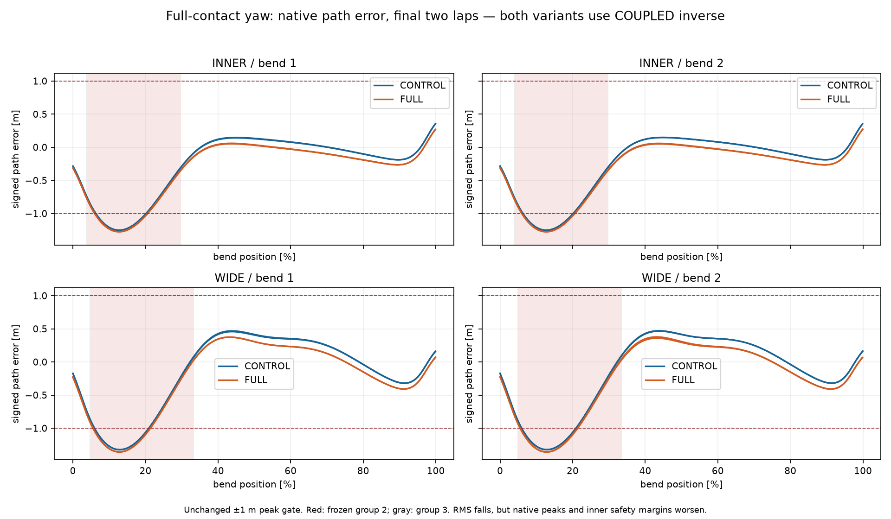
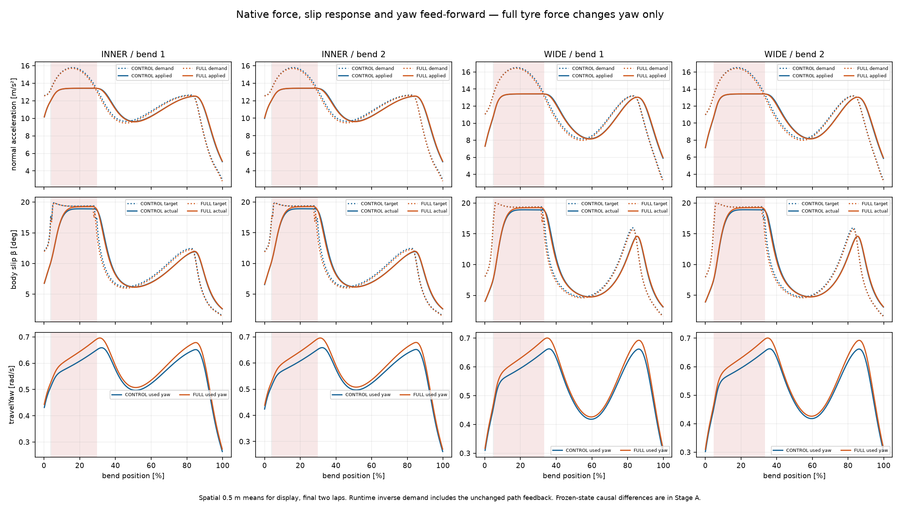

# Full Contact Yaw Feed-Forward Experiment — #109

Status: **PROVISIONAL, domyślnie OFF. Wynik fizyczny: FAIL dla INNER i WIDE.**
Ocena wykonania: **A**; etapy A/B/C ukończone w zadanym zakresie. Pominięta
składowa napędowa jest mierzalna, ale w tych dwóch próbach **nie była istotną
przyczyną błędu prowadzenia, której usunięcie rozwiązuje problem**. RMS boczny
spada o 1,69% / 2,79%, lecz maksymalny błąd i margines przy kredzie pogarszają
się, a błąd normalnego przyspieszenia i yaw rośnie. Flaga pozostaje OFF.
Kończymy serię małych korekt regulatora.

Podstawa: Draft [#108](https://github.com/arturgladysz91/zuzel/pull/108), dokładny
HEAD `d394a177856662467d78b559236533f3a649ac84`. Nie zmieniono wcześniejszych PR.
Dowody i ich SHA-256: [manifest](full-contact-yaw-feedforward/manifest.json),
[freeze](full-contact-yaw-feedforward/freeze.json),
[analiza](full-contact-yaw-feedforward/analysis.json).

## A. Matematyka na zapisanych stanach

Nie wykonano nowego świata, kroku ciała ani ewaluacji kontaktu. Wzięto wszystkie
26 069 native stanów CONTROL #108 wraz z ich dokładnymi Fx/Fy, prędkością,
heading, omega, h, masą, bezwładnością i zapisanymi pracami koła. Dla tego samego
stanu, z `f` wzdłuż motocykla i `s` poprzecznie:

```text
F_old = s Fy
F_full = f Fx + s Fy
travelYaw(F) = cross(v,F) / [m (|v|² + 0.5²)]
delta travelYaw = |v| Fx sin(beta) / [m (|v|² + 0.5²)]
alpha = error / tau² + 2 (travelYaw - omega) / tau, tau = 0.1 s
```

Jednostką `travelYaw` jest rad/s, alpha rad/s², a I·alpha Nm. Przy beta=0 wkład
Fx jest zerowy; zmiana znaku beta zmienia znak tego wkładu. Testy obejmują oba
kierunki skrętu oraz obrót całej sceny, zachowując dotychczasową regularizację.
Opór przeciwny do v daje zerowy iloczyn wektorowy. W native zapisach maksymalny
resztkowy yaw oporów wynosi 3,22·10⁻⁸ rad/s, na poziomie zaokrąglenia float.

|Różnica FULL − stary yaw, ten sam stan|INNER|WIDE|
|---|---:|---:|
|Średni travelYaw w łukach [rad/s]|0,020411|0,019796|
|Średnia alpha [rad/s²]|0,408227|0,395918|
|Proponowany moment [Nm]|21,522|20,873|
|Moment po dotychczasowym authority i guardzie [Nm]|18,832|18,264|
|Zmiana błędu targetSlip − actualSlip [°]|0|0|

Średnie w tej tabeli obejmują łuki całego zapisu. Arytmetyczne odtworzenie
starego proponowanego, ograniczonego i końcowego momentu daje **0 Nm różnicy**
w każdym kroku. Nie zmienia się target ani stan ciała w tym porównaniu;
zmiana przyszłego błędu slip wymaga rzeczywistego przejazdu w etapie C.
Ta sama rekonstrukcja dla wykonanych FULL również daje 0 Nm różnicy.
[native-mathematics.json](full-contact-yaw-feedforward/native-mathematics.json),
`control-*-yaw.csv.gz` oraz `full-*-yaw.csv.gz` zawierają wszystkie wartości,
również rzeczywisty moment po guardzie.

## B. Izolacja zmiany

`EnableFullContactYawFeedForward=false` zachowuje stary lateral-only wektor
i dotychczasową arytmetykę. ON wybiera **już obliczony `tyreForce`** wyłącznie
w `travelYaw`. Oba warianty mają `EnableCoupledSlipInverse=true`.
Konstruktor ogranicza eksperyment do istniejącego zakresu #108: jeden zawodnik,
autorska C3, rear wheel, bez traffic. Flaga OFF nie pojawia się w JSON parametrów;
serializowany CONTROL jest identyczny z zamrożonym #108.

`force`, `passiveForce`, targetSlip, PD, czasy odpowiedzi, authority, clamp
momentu, guard i ledger energii zachowują poprzednie równania. Bez zmian są
opona, koło, silnik, opory, masa, I, geometria Egg Mild/progressive-b i ścieżki
C3. `src/CoreSim`, dane historyczne, kalibracja i domyślne A/B/C nie są zmienione.
Test na identycznym stanie potwierdza równość force, wybranego targetu,
wyniku odwrotności, przygotowanego koła i kredytu energetycznego, przy różnym
momencie yaw. Nie ma nowego aktuatora ani korekty pozycji/prędkości.

## C. Dwa rzeczywiste przejazdy

A: wykorzystano bez ponawiania `coupled-inner` / `coupled-wide` #108 po
sprawdzeniu hashy i konfiguracji. B: **dokładnie dwa nowe główne światy**,
`full-inner` / `full-wide`. Identyczne stany początkowe: reference32 m,
v18 m/s, omega=18/0,33 rad/s; standardowy silnik, Grip1/Ruts0/Moisture0,5,
Drive1 przez cały przejazd. Krok10 ms z oryginalnymi podziałami fizycznymi,
osiem okrążeń, tracking z końcowych dwóch. Bezpieczeństwo i energia dotyczą
całych ośmiu. Krótkie jednosekundowe replays są testami walidacji, nie kolejną
macierzą przejazdów.

|Metryka|INNER CONTROL|INNER FULL|WIDE CONTROL|WIDE FULL|
|---|---:|---:|---:|---:|
|RMS boczny [m], próg≤0,5|0,443902|0,436419|0,512927|0,498619|
|Max boczny [m], próg≤1|1,252536|1,275866|1,325138|1,359894|
|RMS kierunku v [°], próg≤3|2,2733|2,2198|3,3216|3,2706|
|Max kierunku v [°], próg≤10|7,5754|7,5467|9,0506|8,9448|
|RMS błędu normalnego przyspieszenia [m/s²]|1,4668|1,5008|1,7867|1,8007|
|RMS yaw/slip error [°]|2,3841|2,4413|2,8973|2,9443|
|Korelacyjne przesunięcie yaw/slip [s]|0,20|0,20|0,19|0,20|
|Minimum kreda, pełny footprint [m]|0,164534|0,139717|0,097262|0,060794|
|Between-step kreda, bound [m]|0,038605|0,013921|−0,031087|−0,067440|
|Minimum banda, pełny footprint [m]|8,9904|9,0974|5,1401|5,2546|
|Between-step banda, bound [m]|8,8813|8,9885|5,0297|5,1445|
|Pełny certyfikat granic|TAK|TAK|NIE|NIE|
|UNREACHABLE, czas łuków [%]|22,626|21,853|24,952|24,192|
|AMBIGUOUS, czas łuków [%]|0,049|0|0|0|
|Ukończone okrążenia|8|8|8|8|
|Last3 max/min, próg≤1,005|1,0000714|1,0000180|1,0001014|1,0000842|
|Wynik|FAIL|**FAIL**|FAIL|**FAIL**|

Normalne przyspieszenie to projekcja **faktycznie przyłożonego F** na normalną
do początkowej v interwału, podzielona przez masę. Porównujemy je z oryginalnym
runtime demand odwrotności; to żądanie zawiera niezmieniony feedback ścieżki,
nie wyłącznie v²κ planu. Nie dodano ewaluacji kontaktu do tej analizy.

INNER nadal ma certyfikat, ale traci 24,82 mm minimalnego prześwitu i 24,68 mm
between-step bound. WIDE traci 36,47 / 36,35 mm. Minimalny zaakceptowany
footprint WIDE FULL jest dodatni i przekracza próg50 mm tylko o 10,79 mm;
ujemny konserwatywny bound oznacza **brak dowodu bezpieczeństwa między krokami**,
nie zaobserwowane przecięcie kredy. W obu FULL max boczny przekracza1 m;
WIDE dodatkowo nie spełnia RMS kierunku i pełnego certyfikatu.



Największe odchylenie nadal występuje na obu wejściach, około12,8% długości
łuku. RMS pierwszych15% łuku rośnie INNER1,011→1,033 m / WIDE1,049→1,085 m.
RMS końcowych15% także rośnie:0,174→0,213 m /0,244→0,324 m; WIDE zwiększa
tam również max0,322→0,410 m. Mniejszy całkowity RMS nie opisuje tych regresji.
[phase-errors.csv](full-contact-yaw-feedforward/phase-errors.csv) zachowuje
wejście/środek/wyjście oraz położenie ekstremów.

|Pozostałe miary w łukach|INNER CONTROL|INNER FULL|WIDE CONTROL|WIDE FULL|
|---|---:|---:|---:|---:|
|Prędkość wejście [km/h]|82,652|82,570|82,969|82,887|
|Środek [km/h]|68,038|67,936|67,622|67,484|
|Wyjście [km/h]|67,669|67,541|68,045|67,909|
|Średnie / max beta [°]|10,718 /18,908|10,745 /19,262|10,533 /18,912|10,564 /19,266|
|Średni / max wheelspin κ|0,1374 /0,2261|0,1381 /0,2308|0,1352 /0,2283|0,1360 /0,2335|
|Średnia rzeczywista krzywizna [1/m]|0,029927|0,030029|0,028489|0,028602|
|Średnia krzywizna planu [1/m]|0,031162|0,031161|0,029969|0,029969|
|Średnia normalna składowa Fx/m [m/s²]|0,40844|0,40980|0,39949|0,40102|
|Residual energii całego8lap [J]|−0,04846|−0,22766|+1,38779|−0,47886|

Prędkości są średnimi interpolowanych punktów wejścia/środka/wyjścia obu
łuków w final2, nie rankingiem czasów niezaliczonych prób. Okresowość obu
FULL jest zachowana; te dwa deterministyczne przebiegi nie dowodzą globalnej
stabilności przy dowolnym zaburzeniu. Korelacyjne dopasowanie beta(t) do
targetBeta(t−lag) na siatce0–0,5 s co10 ms daje korelacje>0,993. **Nie jest to
dokładny czas reakcji fizycznego motocykla.** Clamp momentu i guard energetyczny
są aktywne przez0% czasu analizowanych łuków, więc nie tłumaczymy opóźnienia
ich saturacją.



## Zamrożone grupy osiągalności

Użyto bajt w bajt `baseline-bins.json` #108 (klasyfikacja wykonana przed jego
COUPLED, bez ponownej klasyfikacji po wyniku #109). SHA:
`FEC550783E78BF3515CB3E784E12321176295CB952869CB30B6A88CC811C0E3D`.
Oba warianty porównują te same wspólne0,5 m biny reference, z równą wagą binu.
Grupa1=jednolicie osiągalne,2=nieosiągalne,3=mieszane/niejednoznaczne/brak.
Aktualne etykiety runtime raportujemy osobno. Liczby poniżej dotyczą łuków.

|Linia / grupa / liczba binów|RMS boczny A→B [m]|Max A→B [m]|RMS normalny A→B [m/s²]|RMS yaw A→B [°]|
|---|---:|---:|---:|---:|
|INNER G1 /289|0,1674→0,1845|0,7292→0,7592|1,3445→1,4299|2,2733→2,3409|
|INNER G2 /100|0,9922→1,0173|1,2525→1,2759|1,8319→1,7288|2,7436→2,7645|
|INNER G3 /2|0,7560→0,7837|0,7851→0,8146|1,3059→1,2606|7,4110→7,3505|
|WIDE G1 /279|0,3264→0,2947|0,8512→0,9001|1,5251→1,5987|2,6989→2,7775|
|WIDE G2 /111|0,9754→1,0068|1,3251→1,3599|2,4562→2,3453|3,5186→3,4733|
|WIDE G3 /1|0,8809→0,9243|0,9015→0,9405|2,5536→2,4878|9,6619→9,3144|

W G1 INNER tracking pogarsza się. G1 WIDE poprawia RMS, ale pogarsza peak,
normalne przyspieszenie i yaw. W G2 błąd normalny maleje, ale lateral peak
rośnie. Nie przypisujemy lokalnie nieosiągalnych żądań wyłącznie regulatorowi;
również udział UNREACHABLE nie jest procentem błędu XY powodowanym fizyką.
Demand obejmuje korekcję dynamiczną. Grupa3 pozostaje osobna; mała liczba
binów nie pozwala uogólniać jej wyniku.

## Koszt, energia i zgodność

|Przejazd A→B|BodyStep = commits koła|Ewaluacje kontaktu w odwrotności|Czas z exportem [s]|
|---|---:|---:|---:|
|INNER|12 953→12 954|1 072 198→1 072 607|3,038→2,924|
|WIDE|13 116→13 118|1 077 551→1 078 143|2,156→2,116|

Różnica liczby kroków wynika ze zmienionego przejazdu do mety. Sam feed-forward
nie dodaje kontaktu, BodyStep, commitu ani alokacji. Koszt odwrotności #108
pozostaje: łącznie2 149 749→2 150 750 jej ewaluacji (+0,047%). To nie nowy
koszt odczytu tyreForce. Czasy światów obejmują export i pochodzą z oddzielnych
uruchomień; nie są kontrolowanym benchmarkiem ani dowodem przyspieszenia.

Ograniczony pomiar pełnego `Forces` na czterech identycznych zapisanych stanach
#108, z gotową guidance, oba tryby COUPLED: po100 rozgrzewkach i2000 wywołań
na tryb/stan. OFF12,33–26,83 µs, ON12,33–26,07 µs; iloraz ON/OFF0,922–1,002,
**0 B w obu**, identyczny target i91/71/83/82 kontaktów odwrotności na wywołanie.
Brak mierzalnego wzrostu kosztu; krótkie sekwencyjne próbki nie dowodzą zysku
czasu. Benchmark wykonuje istniejący `Forces`, ale nie zatwierdza stanu ani
nie tworzy świata. [force-cost.json](full-contact-yaw-feedforward/force-cost.json).

Oryginalny ledger obejmuje body+yaw+wheel oraz prace silnika, oporów, bearing
i obu poślizgów. Maksymalny nadmiar guardu0 W; wszystkie reszty energii<1,4 J
na około1 MJ pracy silnika. Nie zmieniono sposobu autoryzacji pracy yaw.
Native Δv i Δomega zachowują zgodność z przyłożonym impulsem: największa reszta
ciała≤0,000622 Ns, yaw≤0,00001257 Nms we wszystkich czterech zapisach.
Wartości przeliczone na siłę/moment są większe przy bardzo krótkich oryginalnych
podziałach h i pozostają w analizie, bez filtrowania takich interwałów.
Nie dodano powtórnego `RearWheelDynamics.Evaluate` dla feed-forward.

**850/850 historycznych SHA-256 zachowanych**, w tym cały #108. OFF zachowuje
stary fingerprint #100 oraz jednosekundowy fingerprint COUPLED, zapisany przed
zmianą travelYaw:
`3FB8E13BC3D6EB8961101C792491DB2F4FD1D01DE996865C17C931CFF2DF0CFB`.
Powtórzenie FULL daje identyczny fingerprint; każdy zaakceptowany interwał ma
jeden BodyStep i jeden commit koła. Brak traffic/kontaktów/RNG i zużycia toru
w tych próbach. Nie uruchomiono ponownie historycznych macierzy #95–#108.

Release `--warnaserror`:0 ostrzeżeń/błędów. Celowane testy C#:8 nowych oraz32
wheel/slip/legacy fingerprint; Python:4 nowe testy analizy. Dokładne liczniki
i TRX: [validation.json](full-contact-yaw-feedforward/validation.json).
Standardowe Windows CI Draft na końcowym HEAD i jego link są w opisie PR.

Reprodukcja do pustego DIR: polecenie narzędzia `full-contact-yaw DIR math`,
następnie `off-reference`, `freeze`, `runs`, `cost`. Przy pierwotnym capture
etapy math i off-reference wykonano przed zmianą travelYaw. Obecny kod
off-reference odtwarza OFF; nie tworzy nowego dowodu kolejności pre-edit.
Do samej ponownej analizy dostarczonych danych służy helper
`python tools/shared-world-speedway/full-contact-yaw-report.py --data-dir DIR --plots`
czyta istniejące native dane, bez ponawiania przejazdów; wykresy wymagają
matplotlib. Trasy i stare źródła są zawsze z zamrożonego #108 w repozytorium.

## Decyzja i jeden następny krok

**FAIL**, ponieważ mniejszy RMS nie równoważy pogorszenia peak i prześwitu.
Zidentyfikowana niespójność matematyczna nie wyjaśnia w istotnym stopniu
problemu prowadzenia w sprawdzonych warunkach. Nie wdrażać flagi i nie
proponować kolejnej małej korekty obecnego regulatora.

Następny krok: **zaprojektować fizycznie wykonalny profil trajektorii**,
wspólnie Q(s), v(s), beta(s) i omega koła, ograniczony rzeczywistą obwiednią
sił, momentu i energii, z wyprzedzeniem wejścia w łuk. Dopiero taki profil
może być celem kolejnej walidacji native przy dotychczasowych progach.
