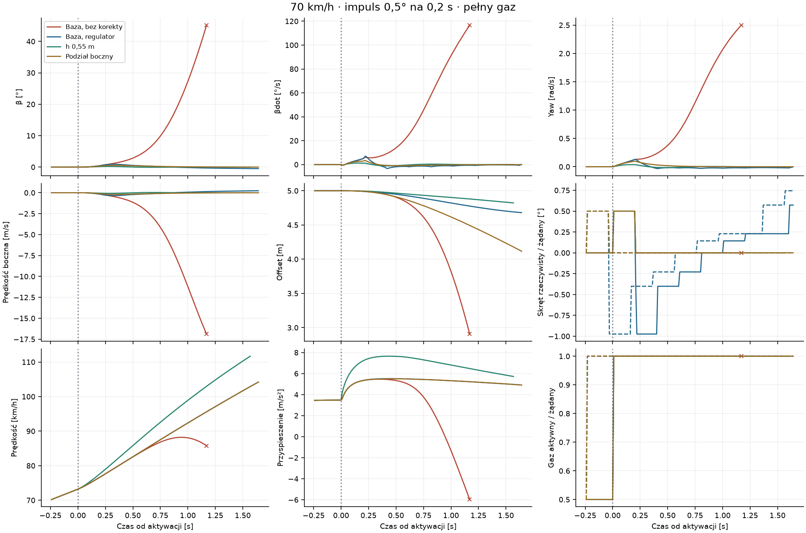
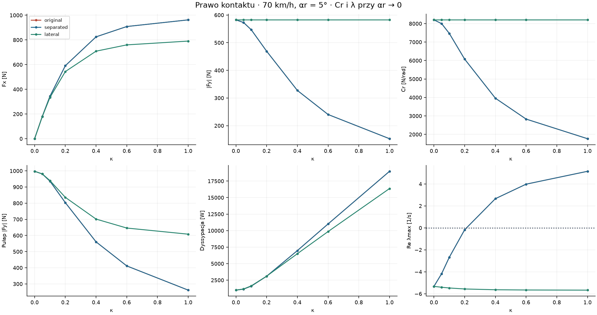
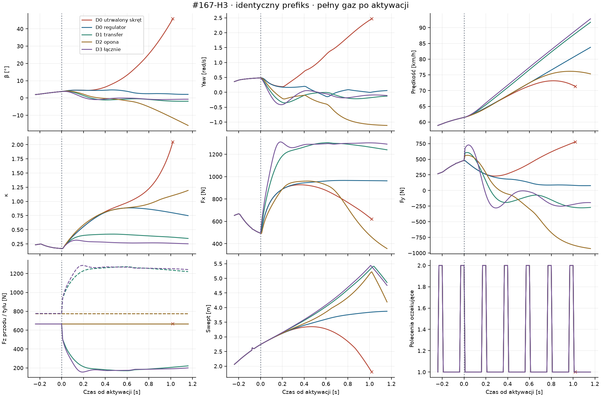
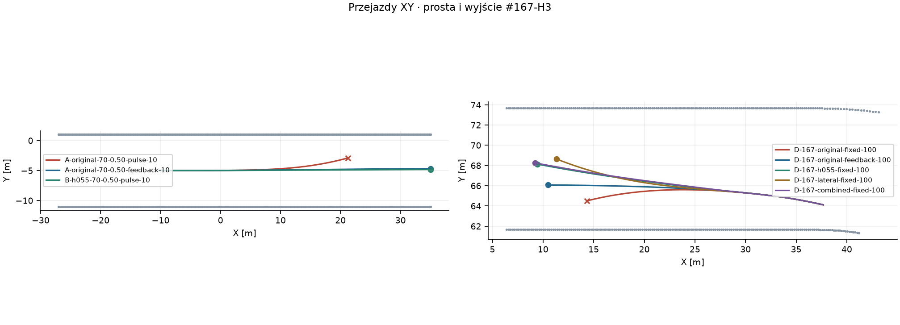

# Badanie #169 · pełny gaz, nacisk i stateczność

**PASS diagnostyczny.** Na oryginalnej fizyce jeden regulator utrzymał 100% gazu w sześciu próbach krótkiej korekty i w obu krótkich wyjściach H3. Przy identycznych utrwalonych żądaniach skrętu zarówno quasi-statyczny transfer nacisku, jak i zmiana podziału Fx/Fy osobno zapobiegły DNF. Wynik rozdziela wykonalność sterowania od wrażliwości modelu kontaktu.

Baza #168 `84f193f9a3538a88841dad6dbfd9b8f4345c898c`. Wszystkie warianty działają w osobnym, jawnie uruchamianym narzędziu. Trzy reprodukcje natywne zachowały pełne fingerprinty #168. Dwie odtwarzają od zatrzymania fizyczne stany #166-H3 i #167-H3. Użyto oryginalnego Box2D, progressive-b, μ, masy, silnika 500 cm³ i sprzęgła.

## Faza 0 · aktywna ścieżka

- `Contact144.Forces` wyznacza dwie prędkości styku z prędkości COM i składnika ωyaw×r. Przód ma tylko Fy w osi obróconej skrętem. Tył ma Fx/Fy w osiach nadwozia. Yaw wynika z r×F. Opór działa w COM.
- `LoadBasedTyreGrip` liczy statyczne Fz z masy i ramion osi. Nominalnie μ ≈ 1,2845, przód 665,6 N, tył 776,5 N, tylny budżet 997,4 N. Historyczny `DynamicAxleLoad` istnieje w osobnej gałęzi `TwoContactBikeDynamics` i jest wyłączony na ścieżce #168.
- `CrankClutch144.Prepare` rozwiązuje pasywny moment sprzęgła wraz z `RearWheelDynamics.Evaluate`. κ opisuje Rω−ur względem lokalnej prędkości kontaktu. Fx i Fy korzystają z tego samego budżetu, a solver koła z poślizgu w środku kroku. Bezwładność Iw występuje w równaniu ruchu koła i w starej skali konstytutywnej δx także dla Δt=0. Zachowano wnioski #118, #140, #149 i #168.
- `PredictorA153` używa `ContactA152` i zoptymalizowanego rozwiązania koła i wału. Postać sił nominalnych i kolejka odpowiadają #144, a trajektoria prognozy ma osobny integrator. W #169 pochodna `Predictor144` i natywna gałąź korzystają z tego samego `Contact169` oraz poprzedniego zaakceptowanego ax.
- Ograniczenia obejmują żądanie gazu 0–100%, skręt 35°, jego szybkość 90°/s, charakterystykę silnika, sprzęgło, kontakt i bramki β45 oraz swept 0,5 m. W ścieżce tej brak zacisku prędkości ciała i bezpośredniego stabilizatora yaw. Każda zmiana skrętu i gazu przechodzi przez zwykłą kolejkę.

## A · sterowanie przy 100%

Użyto mechanicznie spójnych rozbiegów #168, bliskich 60, 70 i 80 km/h. Po 0,8 s żądano pełnego gazu i impulsu 0,25° lub 0,5° przez jeden review, czyli 0,2 s. Polecenia aktywowały się po 0,24 s. Po impulsie A1 żądało 0°, a A2 wybierało skręt z 17 propozycji w prognozie 0,44 s. Funkcja celu uwzględnia β, mierzone i prognozowane βdot, yaw, χ, ruch poprzeczny, błąd linii i prześwit. Jedna konfiguracja dla wszystkich stanów. Gaz po aktywacji wynosił 100% w każdym kroku.

A1 zakończyło się β45 w **6/6**, A2 ukończyło **6/6**. Maksymalne β wyniosło 0,99°, maksymalny yaw 0,136 rad/s, a min swept 5,060 m. Wariant 1° z #168 został odtworzony jako osobna kontrola. Legalność dotyczy rzeczywistego końca prostej albo końca okna. Dalsza jazda i kolejny łuk mają osobny zakres walidacji.



## B · transfer nacisku

Najpierw wykonano dziewięć sond bez świata na trzech zaakceptowanych stanach #168. Próg wejścia do B wynosił 50 N zmiany Fx, Fy lub pojemności przodu. Sondy przeszły próg, a natywne B użyło tego samego impulsu 0,5°, pełnego gazu i stanu co B0, którym jest oryginalne A1.

Rozdział Fz = mg pochodzi z poprzedniego zaakceptowanego kroku. Zmianę prędkości rzutujemy na oś nadwozia, a następnie stosujemy ΔFz = m·ax·h/L dla L = 1,30 m. Jest to jawne przybliżenie z opóźnieniem jednego kroku. Koło i sprzęgło rozwiązują kontakt przy ustalonych naciskach w kroku, bez pętli algebraicznej. Udział tyłu jest ograniczony do [0,1], a przód traci odpowiednią część Fy. μ i łączny budżet pozostają takie same. To quasi-statyczny eksperyment płaskiego motocykla, bez pitch ani zawieszenia.

| Hipotetyczne h | Legalne okna przy 10 ms | Max β | Min Fz przodu | Kroki z zerem Fz przodu |
|---|---:|---:|---:|---:|
| 0,35 m | 3/3 | 0,57° | 370,5 N | 0 |
| 0,55 m | 3/3 | 0,24° | 173,2 N | 0 |
| 0,75 m | 3/3 | 0,08° | 0 N | 61 |

B0 zakończyło się β45 w 3/3. W B większy nacisk tyłu zmniejszył κ i poprawił stateczność. Odciążenie przodu zmniejszało również jego autorytet. Przy h=0,75 m zero Fz w dwóch próbach oznacza granicę modelu płaskiego. Do D wybrano h=0,55 m zgodnie z regułą preferującą ukończenia bez pełnego odciążenia i niższe maksymalne β.

## C · prawo opony

**C1** wykorzystuje referencyjne skale #140 wyznaczone raz w nominalnym punkcie #139. Parametr Iw pozostaje w solverze. W sondzie Δt=0 podwojenie Iw w oryginale zmienia (Fx,Fy) z (909,−240) do (957,−165) N przy 70 km/h, κ=0,6 i αr=5°. W C1 i C2 siły statyczne przy takiej zmianie Iw pozostają identyczne. C1 zachował nominalne krzywe i odtworzył trzy DNF impulsu 0,5°. Sama separacja poprawia konstrukcję modelu bez poprawy jazdy w nominalnym punkcie.

**C2** zachowuje skale C1 i krzywe czystych poślizgów. Przy poślizgu łączonym przydziela Fy z krzywej bocznej, a Fx z pozostałego budżetu. Dla a=smid/δx i b=wr/δy

```text
Fy = −Br b / sqrt(1+b²)
Fx = Br a / (sqrt(1+a²) sqrt(1+b²))
Fx² + Fy² ≤ Br²
Fx·smid − Fy·wr ≥ 0
```

Fx pozostaje monotoniczne w smid. Solver #140 oblicza ten sam rodzaj unikalnego korzenia midpoint, z budżetem wzdłużnym Br/√(1+b²). Reakcja na koło i siła w Box2D są tą samą wartością. Przy a=0 C2 zachowuje Fy, a przy b=0 zachowuje Fx. W poślizgu łączonym większe |Fy| ma koszt w Fx. C2 jest celowo silną granicą wrażliwości, bez kalibracji priorytetu bocznego. Ukończył wszystkie trzy próby z impulsem 0,5° przy β do 0,63°.

| 70 km/h, κ=0,6, αr=5° | Fx [N] | Fy [N] | Cr [N/rad] | Pułap Fy bez znaku [N] | Dyssypacja [W] | Re λmax [1/s] |
|---|---:|---:|---:|---:|---:|---:|
| Oryginał i C1 | 909 | −240 | 2830 | 411 | 11 012 | +3,98 |
| C2 | 760 | −583 | 8202 | 646 | 9860 | −5,66 |

Cr i Re λmax dotyczą αr→0 przy tym samym κ. Lokalna macierz [β,yaw] zamraża prędkość i poślizg, uwzględnia ramiona osi, sztywności i rzut Fx. Wynik sprawdza kierunek reakcji na małe zaburzenie w modelu planarnym. Siatka dla wszystkich αr i prędkości jest w pakiecie.



## D · wyjście z pierwszego łuku

Rozwidlenia #166-H3 i #167-H3 miały 56,70 i 58,91 km/h, a przekroje wyjścia 59,14 i 60,81 km/h. Każdy wariant odtwarza cały prefiks od zatrzymania. Natywne stany nadwozia, koła, wału, siły i aktywne komendy są identyczne do aktywacji zmienionego żądania. Zegar i pełny pending przechodzą bez przerwy. Wariant kontaktu włącza się przy tej aktywacji.

D0, D1 i D2 najpierw korzystają z tej samej sekwencji żądanego skrętu i 100% gazu. Oba efekty osobno przywróciły legalność, więc wykonano D3. Potem D0/D1/D2 otrzymały identyczny regulator zależny od stanu, przewidujący kontakt odpowiadający fizyce danego ramienia. Najbardziej informacyjny D1 został osobno porównany przy 50% i 100%, z tym samym regulatorem i fizyką.

| Stan | D0 utrwalony | D1 transfer | D2 alokacja | D3 razem | D0 regulator |
|---|---:|---:|---:|---:|---:|
| #166-H3, max β | 45,09° DNF | 3,50° | 3,70° | 3,26° | 5,57° |
| #167-H3, max β | 45,81° DNF | 3,92° | 15,87° | 3,81° | 4,69° |

Na utrwalonym skręcie D1 dał +30,95 i +30,26 km/h od aktywacji. D2 ukończył oba okna, ale na trudniejszym H3 #167 osiągnął wyższe β i +13,85 km/h. D3 obniżył κ względem D1 i przyniósł około 0,84–1,10 km/h dodatkowego przyrostu. Wzrost względem samego transferu był mały. Na oryginalnej fizyce regulator dał +22,06 i +22,30 km/h. D1 z regulatorem dał +30,75 i +30,60 km/h na 100% oraz +14,09 i +14,09 km/h na 50%. Wszystkie cztery okna D1 z regulatorem były legalne i bez pełnego odciążenia. Zakres D nie obejmuje kolejnego łuku.





## Realizm i protokół kalibracji

W przeszukanych publikacjach, źródłach federacji i kartach producenta nie znaleziono publicznej mapy Fx/Fy(κ,α,Fz) opony żużlowej w zakresie 60–80 km/h. Karta Mitas opisuje zastosowanie i dane rozmiarowe. Metodyka PZM opisuje zmianę ułożenia zawodnika na łuku. Te źródła nie zawierają potrzebnych krzywych siłowych. [Mitas Speedway](https://www.mitas-moto.com/en-gb/products/motorcycle-off-road-tyres/speedway-tyres/speedway), [PZM, Metodyka szkolenia](https://www.pzm.pl/pliki/zg/zuzel/2026/metodyka_szkolenia_a5ver_z_160322.pdf)

Badania na suchym piasku pokazują pomiar combined slip w piaście i geometrii koleiny. Stanowisko z regulacją kąta znoszenia pokazuje pomiar sił i momentów napędzanego koła na odkształcalnym podłożu. To wzorce metodyki dla innej opony i podłoża. [Ravichandran, Virginia Tech](https://hdl.handle.net/10919/118421), [Stanowisko z regulacją kąta znoszenia](https://www.sciencedirect.com/science/article/pii/S0022489815000300)

1. Użyć stanowiska jednokołowego z pomiarem sześciu składowych w piaście. Rejestrować na wspólnym zegarze ≥200 Hz Fx/Fy/Fz, momenty, ω, ur/wr, camber, temperaturę, ciśnienie i głębokość koleiny. Wyznaczyć efektywny promień toczenia przy Fx≈0 dla każdego nacisku i przygotowania nawierzchni.
2. Rozpocząć przy 70 km/h i Fz 0,4/0,8/1,3 kN. Próbkować κ 0, 0,05, 0,10, 0,20, 0,40, 0,60, 1,0 oraz αr 0, ±1, ±2, ±5, ±10, ±15°. Najpierw czysty poślizg, następnie kombinacje. 60 i 80 km/h jako oddzielne bloki. Zmierzyć narastający i malejący slip dla oceny szczytu, spadku i histerezy.
3. Mierzyć uziarnienie, grubość luźnej warstwy, wilgotność masową, zagęszczenie i opór penetracji przed blokiem. Odtwarzać świeży przejazd i analizować kolejny ślad oddzielnie. Randomizować kolejność wewnątrz bloku. Co najmniej trzy niezależnie odtworzone powtórzenia na komórkę, więcej w pobliżu maksimum i dla małego αr.
4. Dopasować czyste krzywe, potem sprzężenie Fx/Fy z jawnym Fz. Weryfikować Cr(κ), maksimum, boczną rezerwę, energię i czas odpowiedzi. Odłożyć całe bloki wilgotności, opon i prędkości. Osobną telemetrią pojazdu z IMU i pomiarem nacisków sprawdzić odpowiedź na impuls oraz wyjście.

## Pięć odpowiedzi i jedna decyzja

1. **Tak, w badanym zakresie.** Jeden regulator utrzymał pełny gaz w 6/6 prób A2 i 2/2 krótkich wyjść D0 na oryginalnej fizyce.
2. **Brak transferu istotnie pogarszał stabilność przy tych samych komendach.** h=0,55 m zamieniło oba DNF wyjścia na legalne okna z β poniżej 4°. h=0,75 m pokazało granicę odciążenia przodu.
3. **Zależność konstytutywna od Iw jest sprzężeniem konstrukcyjnym.** Konkurencja Fx i Fy ma podstawę fizyczną. Obecna skala osłabienia bocznego mocno wpływa na wynik i wymaga pomiaru na żużlu.
4. **h=0,55 i C2 poprawiły stateczność w wykonanych testach.** Zachowały pasywność i bilans, a zmniejszenie kroku zachowało bramki. C2 wymienia część Fx na Fy. D3 ma dodatkową kontrolę kroku na poziomie lokalnej prognozy. Pomiary obejmują krótkie okna.
5. **Rozwijać regulator na oryginalnej fizyce.** Istnieje już wykonalne sterowanie na bazie. Następny test powinien rozszerzyć sprzężenie na pełny drugi łuk z odłożonymi startami. Transfer i materiał są odrębnymi hipotezami badawczymi.

<!-- measurements -->

## Energia, sondy i wrażliwość na krok

Porównania o wspólnym czasie do pierwszego DNF oraz pomiary przed aktywacją są w pakiecie. Archiwalne 50% na oryginalnej fizyce i utrwalonym skręcie dało +13,73 i +8,40 km/h. To osobna para gazu, bez przypisywania jej efektu do fizyki.

Maksymalna różnica w sondzie transferu wyniosła 601,6 N. Siły i Fz ze wszystkich sond zapisano obok przebiegów.

Bilans obejmuje pracę spalania, ΔK nadwozia, koła i wału, ciepło sprzęgła, transmisję, łożysko, opory i straty poślizgu. Prace kontaktu odtworzono z przyłożonych sił i średnich zaakceptowanych prędkości. Sprawdzono znak dyssypacji w lokalnych osiach i limity obu kontaktów. Maksymalne bezwzględne residuum po aktywacji wyniosło 0,236 J.

| Wyjście #167 | Spalanie [kJ] | ΔK [kJ] | Strata podłużna [kJ] | Strata boczna obu opon [kJ] | Residuum [J] |
|---|---:|---:|---:|---:|---:|
| D-167-original-fixed-100 | 43,24 | 19,05 | 13,98 | 5,40 | -0,109 |
| D-167-original-feedback-100 | 50,94 | 28,19 | 16,44 | 0,33 | 0,054 |
| D-167-h055-fixed-100 | 51,11 | 32,40 | 11,69 | 0,53 | 0,040 |
| D-167-lateral-fixed-100 | 46,05 | 23,06 | 14,02 | 3,50 | 0,022 |
| D-167-combined-fixed-100 | 47,84 | 32,52 | 8,52 | 0,43 | -0,005 |
| D-167-h055-feedback-50 | 18,50 | 12,38 | 2,17 | 0,27 | 0,015 |

Okna mają różną długość tam, gdzie wystąpił DNF. Przy 70 km/h i impulsie 0,5° zagęszczenie natywnego kroku 20/10/5 ms zachowało wynik bramek dla A2, h=0,55, C1 i C2. Poniżej β w tej samej chwili 0,6 s po aktywacji.

| Próba | β przy 20 ms | β przy 10 ms | β przy 5 ms |
|---|---:|---:|---:|
| A-original | 0,352° | 0,377° | 0,412° |
| B-h055 | -0,059° | -0,050° | -0,046° |
| C-separated | 4,779° | 4,731° | 4,699° |
| C-lateral | 0,325° | 0,325° | 0,325° |

Każda gałąź fizyki ma też lokalne sondy predyktora 20/10/5/2,5 ms od identycznego zaakceptowanego stanu i pending. W D3 różnica β po 0,4 s pomiędzy 20 a 10 ms wyniosła 0,068°, a pomiędzy 5 a 2,5 ms 0,014°. To lokalna kontrola numeryczna także dla h=0,35 i h=0,75. Nie modeluje ruchu po oderwaniu przodu ani pełnej zbieżności Box2D przy odciążeniu. Przy regulatorze krok może zmienić wybór z dyskretnej siatki skrętu.

| Sonda | β przy 20 ms | β przy 10 ms | β przy 5 ms | β przy 2,5 ms |
|---|---:|---:|---:|---:|
| A-original-70-0.50-feedback-10 | 0,641° | 0,640° | 0,638° | 0,640° |
| B-h035-70-0.50-pulse-10 | 0,503° | 0,478° | 0,467° | 0,464° |
| B-h055-70-0.50-pulse-10 | 0,070° | 0,069° | 0,069° | 0,069° |
| B-h075-70-0.50-pulse-10 | -0,025° | -0,021° | -0,019° | -0,018° |
| C-separated-70-0.50-pulse-10 | 2,301° | 2,234° | 2,200° | 2,190° |
| C-lateral-70-0.50-pulse-10 | 0,485° | 0,471° | 0,465° | 0,465° |
| D-167-combined-fixed-100 | -0,230° | -0,298° | -0,328° | -0,342° |

## Pełna tabela natywna

V start oznacza stan przed opóźnieniem. ΔV i maksima obejmują czas po aktywacji do końca okna, prostej lub pierwszej bramki. Max κ, β, yaw, Fx i Fy to maksima wartości bezwzględnych.

| Wariant | Gaz | V start [km/h] | ΔV [km/h] | Max κ | Max β [°] | Max yaw [rad/s] | Min swept [m] | Max Fx [N] | Max Fy [N] | Wynik |
|---|---:|---:|---:|---:|---:|---:|---:|---:|---:|---|
| A-original-60-0.25-pulse-10 | 100% | 60,24 | 16,93 | 1,725 | 45,96 | 2,606 | 2,890 | 963 | 798 | β45 · 1,340 s |
| A-original-60-0.25-feedback-10 | 100% | 60,24 | 34,54 | 0,818 | 0,38 | 0,059 | 5,317 | 967 | 20 | koniec okna · 1,760 s |
| A-original-60-0.50-pulse-10 | 100% | 60,24 | 14,41 | 1,815 | 46,07 | 2,637 | 2,864 | 959 | 793 | β45 · 1,210 s |
| A-original-60-0.50-feedback-10 | 100% | 60,24 | 34,53 | 0,819 | 0,81 | 0,118 | 5,079 | 967 | 40 | koniec okna · 1,760 s |
| A-original-70-0.25-pulse-10 | 100% | 70,22 | 14,76 | 1,491 | 45,94 | 2,479 | 2,769 | 954 | 814 | β45 · 1,310 s |
| A-original-70-0.25-feedback-10 | 100% | 70,22 | 31,01 | 0,659 | 0,46 | 0,064 | 5,224 | 958 | 22 | koniec prostej · 1,641 s |
| A-original-70-0.50-pulse-10 | 100% | 70,22 | 12,55 | 1,516 | 45,13 | 2,497 | 2,841 | 949 | 805 | β45 · 1,170 s |
| A-original-70-0.50-feedback-10 | 100% | 70,22 | 31,00 | 0,660 | 0,89 | 0,128 | 5,136 | 958 | 44 | koniec prostej · 1,642 s |
| A-original-80-0.25-pulse-10 | 100% | 80,06 | 12,91 | 1,274 | 45,42 | 2,330 | 2,582 | 941 | 828 | β45 · 1,310 s |
| A-original-80-0.25-feedback-10 | 100% | 80,06 | 25,58 | 0,530 | 0,47 | 0,068 | 5,292 | 945 | 25 | koniec prostej · 1,413 s |
| A-original-80-0.50-pulse-10 | 100% | 80,06 | 10,72 | 1,317 | 45,23 | 2,363 | 2,659 | 936 | 823 | β45 · 1,170 s |
| A-original-80-0.50-feedback-10 | 100% | 80,06 | 25,57 | 0,530 | 0,99 | 0,136 | 5,060 | 945 | 52 | koniec prostej · 1,413 s |
| A-original-70-1.00-replay168-10 | 100% | 70,22 | 8,91 | 1,670 | 46,12 | 2,514 | 2,832 | 936 | 802 | β45 · 1,000 s |
| A-original-70-0.50-feedback-5 | 100% | 70,21 | 31,00 | 0,660 | 0,89 | 0,130 | 5,144 | 958 | 44 | koniec prostej · 1,642 s |
| A-original-70-0.50-feedback-20 | 100% | 70,22 | 31,01 | 0,659 | 0,87 | 0,126 | 4,981 | 958 | 43 | koniec prostej · 1,641 s |
| B-h035-60-0.50-pulse-10 | 100% | 60,24 | 42,85 | 0,524 | 0,40 | 0,065 | 4,873 | 1230 | 46 | koniec okna · 1,760 s |
| B-h035-70-0.50-pulse-10 | 100% | 70,22 | 36,79 | 0,453 | 0,49 | 0,070 | 4,866 | 1196 | 52 | koniec prostej · 1,586 s |
| B-h035-80-0.50-pulse-10 | 100% | 80,06 | 30,17 | 0,382 | 0,57 | 0,073 | 4,919 | 1151 | 60 | koniec prostej · 1,377 s |
| B-h055-60-0.50-pulse-10 | 100% | 60,24 | 45,13 | 0,408 | 0,18 | 0,037 | 5,239 | 1297 | 33 | koniec okna · 1,760 s |
| B-h055-70-0.50-pulse-10 | 100% | 70,22 | 38,47 | 0,368 | 0,21 | 0,038 | 5,264 | 1276 | 35 | koniec prostej · 1,568 s |
| B-h055-80-0.50-pulse-10 | 100% | 80,06 | 31,61 | 0,326 | 0,24 | 0,039 | 5,282 | 1233 | 38 | koniec prostej · 1,365 s |
| B-h075-60-0.50-pulse-10 | 100% | 60,24 | 46,08 | 0,351 | 0,07 | 0,019 | 5,362 | 1314 | 17 | koniec okna · Fz przodu 0 · 1,760 s |
| B-h075-70-0.50-pulse-10 | 100% | 70,22 | 39,31 | 0,324 | 0,07 | 0,018 | 5,377 | 1302 | 17 | koniec prostej · Fz przodu 0 · 1,559 s |
| B-h075-80-0.50-pulse-10 | 100% | 80,06 | 32,41 | 0,290 | 0,08 | 0,018 | 5,383 | 1274 | 17 | koniec prostej · 1,357 s |
| B-h055-70-0.50-pulse-5 | 100% | 70,21 | 38,47 | 0,368 | 0,21 | 0,037 | 5,343 | 1275 | 34 | koniec prostej · 1,568 s |
| B-h055-70-0.50-pulse-20 | 100% | 70,22 | 38,48 | 0,370 | 0,22 | 0,039 | 5,105 | 1277 | 37 | koniec prostej · 1,567 s |
| C-separated-60-0.50-pulse-10 | 100% | 60,24 | 14,41 | 1,815 | 46,07 | 2,637 | 2,864 | 959 | 793 | β45 · 1,210 s |
| C-separated-70-0.50-pulse-10 | 100% | 70,22 | 12,55 | 1,516 | 45,13 | 2,497 | 2,841 | 949 | 805 | β45 · 1,170 s |
| C-separated-80-0.50-pulse-10 | 100% | 80,06 | 10,72 | 1,317 | 45,23 | 2,363 | 2,659 | 936 | 823 | β45 · 1,170 s |
| C-separated-70-0.50-pulse-5 | 100% | 70,21 | 12,37 | 1,572 | 45,58 | 2,506 | 2,867 | 949 | 810 | β45 · 1,175 s |
| C-separated-70-0.50-pulse-20 | 100% | 70,22 | 12,50 | 1,519 | 46,49 | 2,519 | 2,648 | 949 | 806 | β45 · 1,180 s |
| C-lateral-60-0.50-pulse-10 | 100% | 60,24 | 34,52 | 0,820 | 0,44 | 0,090 | 4,651 | 967 | 76 | koniec okna · 1,760 s |
| C-lateral-70-0.50-pulse-10 | 100% | 70,22 | 30,99 | 0,661 | 0,54 | 0,097 | 4,554 | 958 | 88 | koniec prostej · 1,642 s |
| C-lateral-80-0.50-pulse-10 | 100% | 80,06 | 25,54 | 0,532 | 0,63 | 0,102 | 4,608 | 943 | 101 | koniec prostej · 1,414 s |
| C-lateral-70-0.50-pulse-5 | 100% | 70,21 | 30,99 | 0,661 | 0,53 | 0,096 | 4,627 | 958 | 87 | koniec prostej · 1,643 s |
| C-lateral-70-0.50-pulse-20 | 100% | 70,22 | 30,99 | 0,661 | 0,55 | 0,097 | 4,406 | 958 | 91 | koniec prostej · 1,642 s |
| D-166-original-fixed-100 | 100% | 56,70 | 7,50 | 2,175 | 45,09 | 2,710 | 2,227 | 912 | 767 | β45 · 0,870 s |
| D-167-original-fixed-100 | 100% | 58,91 | 9,87 | 2,048 | 45,81 | 2,467 | 1,798 | 928 | 777 | β45 · 1,020 s |
| D-166-h055-fixed-100 | 100% | 56,70 | 30,95 | 0,427 | 3,50 | 0,544 | 2,669 | 1305 | 575 | koniec okna · 1,160 s |
| D-167-h055-fixed-100 | 100% | 58,91 | 30,26 | 0,423 | 3,92 | 0,455 | 2,760 | 1304 | 607 | koniec okna · 1,160 s |
| D-166-lateral-fixed-100 | 100% | 56,70 | 21,92 | 0,930 | 3,70 | 0,563 | 2,669 | 971 | 538 | koniec okna · 1,160 s |
| D-167-lateral-fixed-100 | 100% | 58,91 | 13,85 | 1,193 | 15,87 | 1,113 | 2,760 | 961 | 929 | koniec okna · 1,160 s |
| D-166-combined-fixed-100 | 100% | 56,70 | 31,79 | 0,320 | 3,26 | 0,535 | 2,669 | 1310 | 699 | koniec okna · 1,160 s |
| D-167-combined-fixed-100 | 100% | 58,91 | 31,36 | 0,316 | 3,81 | 0,447 | 2,760 | 1311 | 729 | koniec okna · 1,160 s |
| D-166-original-feedback-100 | 100% | 56,70 | 22,06 | 0,938 | 5,57 | 0,572 | 2,669 | 961 | 429 | koniec okna · 1,160 s |
| D-167-original-feedback-100 | 100% | 58,91 | 22,30 | 0,885 | 4,69 | 0,483 | 2,760 | 966 | 477 | koniec okna · 1,160 s |
| D-166-h055-feedback-100 | 100% | 56,70 | 30,75 | 0,441 | 3,47 | 0,546 | 2,669 | 1307 | 575 | koniec okna · 1,160 s |
| D-167-h055-feedback-100 | 100% | 58,91 | 30,60 | 0,432 | 3,87 | 0,462 | 2,760 | 1307 | 605 | koniec okna · 1,160 s |
| D-166-lateral-feedback-100 | 100% | 56,70 | 22,35 | 0,942 | 3,68 | 0,563 | 2,669 | 968 | 538 | koniec okna · 1,160 s |
| D-167-lateral-feedback-100 | 100% | 58,91 | 22,18 | 0,902 | 3,98 | 0,473 | 2,760 | 970 | 563 | koniec okna · 1,160 s |
| D-166-h055-feedback-50 | 50% | 56,70 | 14,09 | 0,188 | 3,42 | 0,543 | 2,669 | 634 | 585 | koniec okna · 1,160 s |
| D-167-h055-feedback-50 | 50% | 58,91 | 14,09 | 0,185 | 3,86 | 0,457 | 2,760 | 638 | 620 | koniec okna · 1,160 s |

## Dowody i budżet

52 natywne rollouty (A 15, B 11, C 10, D 16), 16,750 CPU-s wraz z sondami i zapisem oraz 1,297 CPU-s lokalnej kontroli kroku bez nowych światów. Natywna jazda, weryfikacja i zapis analizy łącznie zajęły 24,84 z 300 CPU-s w zmierzonym protokole. Testy zgodności biegną osobno.

Pakiet zawiera pełne telemetrie od rozbiegu lub zatrzymania, aktywacje i pending, rejestr wszystkich DNF, trzy dowody zgodności z #168, sondy, siatkę, pełne bilanse i hashe źródeł. SHA256 wiąże raport, wykresy i archiwum.
