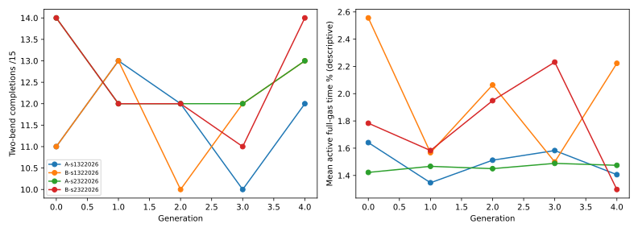
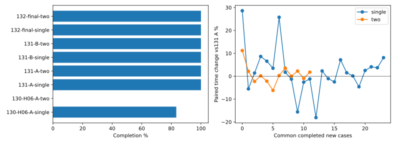
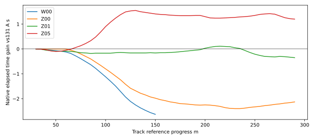

# Full Throttle Learning #132 — PARTIAL

Status **PROVISIONAL**, domyślnie OFF. Baza dokładnie `52519764ca5338f73c610a4302fe13656ffe1b05`. Jeden Draft PR, bez merge. Fizyczne źródła, produkcyjny CoreSim, obwiednia β45°, H09, reakcja0,24s, decyzje0,2s, ±35° i90°/s pozostają bez zmian.

Zwycięzca **B-s1322026 #6022**, przestrzeń **B (gaz0/Drive/1)**, H09. [Parametry](winner.json), [hash przed finałem](winner-lock.json), [zamrożony protokół](protocol.json). Wybór nastąpił wyłącznie na treningu i K; W/Z nie sterowały doborem, zatrzymaniem ani kontynuacją.

| Parametr | Punkt wyjścia #4061 | Wybrana polityka #6022 |
| --- | --- | --- |
| PreviewSeconds | 0.9910648400046381 | 0.8374892057382612 |
| DirectionWeight | 3.2251494695972176 | 3.697504202500974 |
| YawWeight | 1.7641558104925692 | 1.1282982264655206 |
| Drive | 0.3936023368138517 | 0.39900787514450314 |
| ThrottleWeight | 4 | 2.7084121675137465 |
| ProgressWeight | 1.5144165233089346 | 0.970712390377596 |
| SteeringChangeWeight | 0.05958697340438881 | 0.08672549595196599 |
| GeometrySpeedWeight | 0.5440168959155742 | 0.5521351794931451 |

Werdykt **PARTIAL**. Nowa polityka ukończyła 24/24 pojedynczych i 12/12 dwóch łuków. Mediana zmiany czasu dwóch łuków względem #131-A: **+0.23%**. Pojedynczy łuk wobec #130: mediana **+12.10%**, maksimum **+43.48%**. Kryteria23/24,11/12, zysk2%, regresja≤5%/15% zamrożono przed treningiem.

## 1–4. Baza, audyt gazu, rozszerzenie i test bez uczenia

Punkt wyjścia: #4061, dokładne osiem wag #131. A zachowuje oryginalną kolejność działań i wynik bitowy. B dodaje1 dla tych samych dziewięciu kątów i bieżących kątów kierownicy/aktywnej komendy. Stabilne `Distinct` usuwa duplikaty. Nie dodano±25°/±35° do gridu. Wybrany gaz trafia do istniejącej kolejki i silnika po pełnych0,24s, bez bezpośredniej zmiany koła lub mocy.

Istotny szczegół kolejki A: przy wciąż aktywnym1 można zażądać jego utrzymania, zanim wcześniejsze zero zostanie wykonane. W próbie A #5001 F0 zero zażądano w0,0s, utrzymanie1 w0,2s; aktywacje wystąpiły w0,24s i0,44s. To zaplanowany wcześniej powrót do1. Gdy w chwili obserwacji aktywny gaz jest już poniżej1, A nie może ponownie go zażądać; B może. Raport oddziela takie nowe żądanie od samej późniejszej aktywacji100% i od zmiany sekwencji żądań.

Przy `Drive=0,3936023`, `ThrottleWeight=4` koszt preferencji wynosi: gaz0 **0,6197**, Drive **0**, gaz1 **1,4708**. Kara sama w sobie preferuje częściowy gaz, a pełny obciąża bardziej niż zero. Częste zero nie wynika więc z nagrody za zamknięcie; postęp, kierunek, yaw, geometria i bezpieczeństwo mogą przeważyć utratę preferowanego Drive. Klasy bezpieczeństwa rozstrzygają przed kosztem. Lokalny safe H09 nie dowodzi bezpieczeństwa następnego łuku.

Znany V00 #131 odtworzono z identycznym fingerprintem: gaz średni **19.70%**, pełny gaz **1.30%**, gaz0 mimo lokalnie safe+ w **48** decyzjach. [Pełna jakość odtworzenia](reference131-quality.json). To odniesienie historyczne, nie nowy holdout W/Z.

Na czterech diagnostycznych wejściach A **194** decyzji gaz0 miało dodatnią alternatywę tej samej bezpiecznej klasy. O zamknięciu gazu rozstrzygnął koszt, nie brak safe+. Dodatni gaz miał większy składnik kierunku w **176** z tych stanów; mediana różnicy tego składnika wyniosła **2.014**, wobec median korzyści postępu **-0.596** i preferencji gazu **-0.620**. To oddzielne mediany, nie składniki mediany sumy. [Obliczenie](starting-cost-findings.json). Samo obniżenie kary gazu nie rozwiązuje zatem całego kompromisu orientacji i tempa.

| Replay | Decyzje | gaz1 niedostępny | gaz0 mimo safe+ | safe1 przegrywa koszt | gaz1 przy wadze0 (offline) |
| --- | --- | --- | --- | --- | --- |
| diag-A-D0 | 49 | 47 | 24 | 49 | 0 |
| diag-A-D1 | 101 | 99 | 60 | 88 | 3 |
| diag-A-D2 | 88 | 86 | 53 | 88 | 1 |
| diag-A-D3 | 89 | 87 | 57 | 86 | 0 |
| diag-B-D0 | 49 | 0 | 24 | 49 | 0 |
| diag-B-D1 | 101 | 0 | 60 | 88 | 3 |
| diag-B-D2 | 88 | 0 | 53 | 88 | 1 |
| diag-B-D3 | 89 | 0 | 57 | 86 | 0 |

[Pełny audyt wszystkich stanów i kandydatów (gzip)](throttle-audit.json.gz) zapisuje wejście, pending, klasę, pełny koszt, składnik gazu/postępu/kierunku i rankingi przy wadze0/1/4. [Hash oryginalnych bajtów](throttle-audit-archive.json) potwierdza archiwum bez skrótów. [Różnice kosztów najlepszego dodatniego/pełnego kandydata tej samej klasy](cost-differences.json) oddzielają gaz, postęp, kierunek i pozostały koszt. [Podsumowanie według segmentów](throttle-audit-summary.json) rozdziela prostą0/4, wejście1/5, środek2/6, wyjście3/7. `FullUnavailable` dotyczy rzeczywistego zbioru danego ramienia. `safe1 przegrywa` bada rozszerzony zbiór na identycznym stanie. Przeliczenie wag jest wyłącznie offline; nie zmieniono funkcji celu i nie trenowano alternatywnej kary.

| Bez treningu | Wynik | Bramka s | Gaz średni | Pełny gaz % | Decyzje1 | Ponowne otwarcia | βmax° | Prześwit m |
| --- | --- | --- | --- | --- | --- | --- | --- | --- |
| diag-A-D0 | completed | 8.66 | 0.213 | 2.48 | 0 | 0 | 4.83 | 0.1634 |
| diag-A-D1 | completed | 19.02 | 0.165 | 1.2 | 0 | 0 | 9.24 | 0.1592 |
| diag-A-D2 | completed | 16.59 | 0.166 | 1.36 | 0 | 0 | 8.52 | 0.1276 |
| diag-A-D3 | completed | 16.77 | 0.149 | 1.35 | 0 | 0 | 8.91 | 0.1407 |
| diag-B-D0 | completed | 8.66 | 0.213 | 2.48 | 0 | 0 | 4.83 | 0.1634 |
| diag-B-D1 | completed | 19.02 | 0.165 | 1.2 | 0 | 0 | 9.24 | 0.1592 |
| diag-B-D2 | completed | 16.59 | 0.166 | 1.36 | 0 | 0 | 8.52 | 0.1276 |
| diag-B-D3 | completed | 16.77 | 0.149 | 1.35 | 0 | 0 | 8.91 | 0.1407 |

To pary D0–D3 ustalone przed światem; D0 jeden łuk, D1–D3 dwa. [Cała jakość](diagnostic-quality.json). Przed uczeniem wykonano testy celowane, parytet dokładnego fingerprintu #131 V00, powtórzenie A i B oraz cztery natywne kontynuacje H09 na stanach B. [Preflight](preflight.json), [deterministyczność](determinism.json), [pierwotny walidator](predictor-initial.json), [porównanie wspólnych czasów](predictor-aligned.json). Pierwotny walidator uznał brak dokładnie wspólnego czasu zdarzenia za błąd: przejście krzywizny12,696531s wobec12,696530s. Doprecyzowanie przed treningiem zachowuje obie próbki i różnicę1µs, porównuje wszystkie91 wymaganych punktów co10ms i koniec0,9s, bez interpolacji i bez zmiany tolerancji fizycznych. [Protokół audytu wyrównania](predictor-alignment-protocol.json). Wagi0/1 pokazują osiągalność innych wyborów w tej samej reprezentacji, bez ręcznego narzucania gazu. Klasy nie blokują komend; pending przesuwa ich aktywację, zachowując wszystkie wcześniejsze żądania.

## 5–8. CEM, dwa seedy, A/B i kontynuacja

Jedyna różnica A/B: dostępny kandydat gaz1. Ten sam odziedziczony CEM,32 losowania normalne/generację, zakresy ośmiu parametrów i funkcja celu. Każda populacja ma5 polityk, ocenianych na tych samych4 stanach (1 pojedynczy,3 pełne dwa łuki). Dwie grupy wejść powracają co drugą generację. Ranking priorytetyzuje legalne ukończenia dwóch łuków; szybki DNF nie wygrywa z ukończeniem. Aktualizacja dwóch elit, średnia0,4/0,6, minimum std15% zakresu. Nie ma gotowej ścieżki ani reguł gazu według segmentu.

| Ramię / seed | Trening ukończone / próby | Selekcja K: ID i ukończenia (w tym dwa) |
| --- | --- | --- |
| A-s1322026 | 83/100 | 5020: 5/6, dwa 3/4 |
| B-s1322026 | 84/100 | 6022: 6/6, dwa 4/4 |
| A-s2322026 | 88/100 | 7020: 6/6, dwa 4/4 |
| B-s2322026 | 88/100 | 8020: 6/6, dwa 4/4 |

| Próby uczące | Żądania gaz1 | Żądania1 po aktywnym<1 | Faktyczne ponowne otwarcia1 | Średni gaz % czasu | Pełny gaz % czasu |
| --- | --- | --- | --- | --- | --- |
| A-s1322026 | 3 | 0 | 1 | 15.63 | 1.49 |
| B-s1322026 | 49 | 43 | 36 | 15.33 | 1.98 |
| A-s2322026 | 0 | 0 | 0 | 14.96 | 1.46 |
| B-s2322026 | 29 | 23 | 22 | 13.93 | 1.75 |

[Archiwa generacji](generations-summary.json), [oba seedy](seed-results.json), [osobna selekcja](selection.json), [decyzja o kontynuacji](continuation-decision.json). Kontynuacja wymagała6/6 i zysku≥0,10s najgorszego czasu dwóch łuków wobec A i #131-A bez obniżenia minimalnego prześwitu; maksymalnie100 prób. Nie wykonywano prób wyłącznie dla zapełnienia limitu. Trzy powtarzalne oceny kotwicy bez deklarowanego zysku zatrzymują dłuższy trening. Każda generacja zapisuje wszystkie czasy, gaz, β, prześwit, DNF i CPU; [CSV](generations.csv). Brak przewagi B wymaga oceny wag, predykcji i bezpieczeństwa na zapisanych stanach, a nie automatycznego usuwania kary.

Selekcja nie spełniła zamrożonego warunku kontynuacji; zakończono uczenie po400 próbach.

W selekcji K najgorszy czas dwóch łuków najlepszej B wynosił **18.51s**, A **18.63s**, #131-A **18.80s**. Minimalny prześwit B **0.1164m** wobec **0.1213m** #131-A; warunek rezerwy: **False**. [Dokładny kompromis selekcji](selection-tradeoffs.json). Mediana sparowanego czasu dwóch łuków wybranego #6022 na K: **+3.50%**. Zamrożony ranking najpierw chroni ukończenia i najgorszy czas; nie optymalizuje bezpośrednio mediany kryterium finałowego. Zachowano ten kompromis oraz niezmieniony wybór, także gdy wynik medianowy jest gorszy.

## 9–13. Finał, rzeczywisty gaz, prędkości i obwiednia

| Polityka / zestaw | Ukończenia | DNF |
| --- | --- | --- |
| 130-H06-A-single | 20/24 | {'uncertified interval': 4} |
| 130-H06-A-two | 0/12 | {'control envelope': 11, 'uncertified interval': 1} |
| 131-A-single | 24/24 | {} |
| 131-A-two | 12/12 | {} |
| 131-B-single | 24/24 | {} |
| 131-B-two | 12/12 | {} |
| 132-final-single | 24/24 | {} |
| 132-final-two | 12/12 | {} |

| Zestaw | Odniesienie → nowa | Wspólne pary | Mediana | Maksimum |
| --- | --- | --- | --- | --- |
| single | 130-H06-A → 132-final | 20 | +12.10% | +43.48% |
| single | 131-A → 132-final | 24 | +1.62% | +28.61% |
| single | 131-A → 131-B | 24 | +0.00% | +0.00% |
| single | 131-B → 132-final | 24 | +1.62% | +28.61% |
| single | 130-H06-A → 131-A | 20 | +11.31% | +29.39% |
| single | 130-H06-A → 131-B | 20 | +11.31% | +29.39% |
| two | 130-H06-A → 132-final | 0 | brak wspólnych ukończeń | brak wspólnych ukończeń |
| two | 131-A → 132-final | 12 | +0.23% | +11.20% |
| two | 131-A → 131-B | 12 | +0.00% | +0.00% |
| two | 131-B → 132-final | 12 | +0.23% | +11.20% |
| two | 130-H06-A → 131-A | 0 | brak wspólnych ukończeń | brak wspólnych ukończeń |
| two | 130-H06-A → 131-B | 0 | brak wspólnych ukończeń | brak wspólnych ukończeń |

| Finał: 36 światów na politykę | Żądania gaz1 | Żądania1 po aktywnym<1 | Faktyczne ponowne otwarcia1 | Średni gaz % czasu | Pełny gaz % czasu |
| --- | --- | --- | --- | --- | --- |
| 130-H06-A | 0 | 0 | 0 | 29.82 | 2.79 |
| 131-A | 0 | 0 | 0 | 18.94 | 2.0 |
| 131-B | 0 | 0 | 0 | 18.94 | 2.0 |
| 132-final | 1 | 1 | 1 | 18.79 | 2.03 |

Wszystkie4 polityki mają identyczne36 nowe stany W00–W23 i Z00–Z11. W porównaniach użyto wyłącznie wspólnych ukończeń; DNF i liczebności pozostają jawne. Nie porównano średnich z różnych zestawów sukcesów. W/Z mają nowe kombinacje prędkości,offsetu,heading,yaw oraz start21m; nie są to U/V #131. [Pełne pary](paired-times.json), [pełny finał](final-results.json).

Efekt dostępności bez uczenia: **True** dla identyczności wszystkich36 natywnych fingerprintów A/B #4061. B zażądał gaz1 **0** razy, faktycznie ponownie otworzył100% **0** razy. [Dokładne porównanie](no-retraining-comparison.json). Początkowy aktywny gaz1 pozostaje częścią oryginalnego stanu, a nie dowodem wyuczonego otwarcia.

| Reprezentatywny replay | Decyzje0/część/1 | Otwarcia1 po odpuszczeniu | Pełny gaz % | v wejścia/min/wyjścia łuk1; łuk2 m/s |
| --- | --- | --- | --- | --- |
| final-130-H06-A-Z00 | 28/30/0 | 0 | 2.1 | 14.43/14.43/16.51; 24.66/14.05/— |
| final-131-A-Z00 | 61/38/0 | 0 | 1.22 | 12.60/11.68/16.06; 18.75/13.04/16.50 |
| final-131-B-Z00 | 61/38/0 | 0 | 1.22 | 12.60/11.68/16.06; 18.75/13.04/16.50 |
| final-132-final-Z00 | 68/42/0 | 0 | 1.1 | 12.62/8.89/11.94; 17.17/13.95/17.17 |

[Jakość każdego reprezentatywnego przejazdu](representative-quality.json) zawiera czasy obu łuków, prędkość prostej, gaz, ponowne otwarcia, ψ/χ/yaw/β, obrys, oscylacje całej drogi XY, pracę silnika, bilans i oszacowanie strat opon. [Liczby żądań gazu0/część/1 we wszystkich próbach](throttle-by-attempt.json), [sumy według ramienia/seeda/roli](throttle-totals.json) oddzielają żądanie ponownego100% od faktycznej aktywacji po0,24s. Pełne próbki oraz siły obu opon,wheelspin,steering,pending są w natywnych replayach. Straty boczne to praca modelowych sił i momentów na wykonanym przemieszczeniu, nie pomiar prawdziwej nawierzchni. Naturalna kontra i uślizg nie są osobną karą; β45 pozostaje granicą wiarygodności. Wszystkie przekroczenia kończą próbę DNF. Numeryczna zgodność H09 z Box2D nie stanowi kalibracji rzeczywistego motocykla.

## 14. Replay i miejsce zysku

Viewer: `tools/replay-viewer/?case=full-throttle-learning`. Wspólny tor i wejście, osobne kolory #130,#131-A,#131-B,#132. Wykres gazu rozdziela żądany, pierwszą oczekującą komendę (luka gdy brak pending) i aktywny. Kropki oznaczają żądanie1 przy już obniżonym aktywnym gazie; kwadraty ponowną aktywację1. To rzeczywiste przebiegi Box2D; nie animacja predyktora. [Indeks](index.json), [hash bundle](selected-manifest.json). Dostępne W00/Z00, Z01 z nowym żądaniem1 w10,40s i aktywacją10,64s, największy zysk i regresja, nieudana mutacja B oraz przykład wcześniejszego pending A. Domyślny finał pokazuje przypadek nowego ponownego żądania gaz1.

[Nakładka czasu](time-gain.json) pokazuje różnicę zegarów przy pierwszym faktycznym przekroczeniu kolejnych5m odniesienia; rozdzielczość0,01s, XY z natywnych próbek. Pozwala odróżnić zysk pierwszego łuku od konsekwencji na drugim. Wysoki gaz sam nie jest sukcesem.

## 6,15. Budżet i odtwarzalność

**595 nowych natywnych światów**, w tym **400 uczących**. Role: `{'diagnostic': 15, 'train-ab': 400, 'selection': 36, 'final': 144}`. CPU **3953.672s**, prognozy **1044869**, oceny kontaktu **94541553**. Limity750 światów/6000s/1,2M prognoz/100M kontaktów zamrożono z kosztów #131 i mnożnika1,5 dla B. Rezerwacja przed każdym światem, osobny koszt offline. Techniczne testy i CI nie są epizodami uczącymi. [Ledger](attempts.json), [CSV](attempts.csv), [manifest wszystkich raw](raw-manifest.json). Pełne raw są lokalnie, Git przechowuje agregaty i wybrane replaye. [Sprawdzenia techniczne](verification.json).

Odtworzenie z katalogu repo na Windows: `python -m pip install -r tools/full-throttle-report.requirements.txt`, następnie `pwsh -File tools/run-full-throttle-learning.ps1 -Data work/reproduce132 -Raw work/reproduce132-raw`. Skrypt wymaga świeżych katalogów i zachowuje oryginalny błąd wyrównania czasów. Historyczne dane pozostają zamrożone; testy weryfikują dokładne rozszerzenia źródeł, a następnie odtwarzają oryginalne bajty #131/#130 do dawnych sprawdzeń hashy. [Jawne trzy rozszerzenia](source-extensions.json).

## 16–17. Szybkość i dalsze ograniczenia

Mediana dwóch łuków +0.23% wobec #131-A. Wybrany #6022 zażądał gaz1 **1** razy w36 finałowych światach; rzeczywiste ponowne aktywacje100%: **1**, średni aktywny gaz **18.79%**. Dostępność gaz1 rozdzielono od efektu uczenia przez wariant #131-B z niezmienionymi wagami.

[Audyt](throttle-audit-summary.json) wykazuje częste zamykanie gazu przy safe+ oraz duży koszt kierunku dodatnich alternatyw. To bezpośredni dowód kompromisu funkcji celu. [Kontrolowane przeliczenie na wszystkich zapisanych stanach uczącego się B](learned-cost-audit.json) porównuje niezmienione koszty i wagi0/1/4, z tymi samymi prognozami i klasami bezpieczeństwa. Wysoki ThrottleWeight asymetrycznie utrudnia wybór1 przy Drive<0,5, lecz sam nie wyjaśnia gaz0 zamiast Drive. CEM może zmieniać te parametry w dotychczasowych zakresach. Ranking chroniący ukończenia i najgorszy czas wybiera kompromis, który może przegrać na medianie; szybsze nieukończone kandydatury pozostają DNF.

Grid kierownicy,0,9s lokalnego podglądu i osiem globalnych preferencji pozostały stałe. Ten A/B nie rozdziela ich samodzielnego wpływu, więc nie dowodzi, że poszerzenie kątów lub horyzontu rozwiąże szybkość. Natywne mutacje z gaz1 pokazują zarówno ponowne otwieranie, jak i ryzyko β/bandy; nie ustalają fizycznego minimum czasu legalnych dwóch łuków. Fizyka pozaβ45 nadal wymaga osobnego badania. Rankingi offline zachowano oddzielnie od podstawowego A/B; nie uruchomiono treningu zmienionej funkcji celu ani nie zmieniono wybranego checkpointu po finale.

**Werdykt: PARTIAL.**
