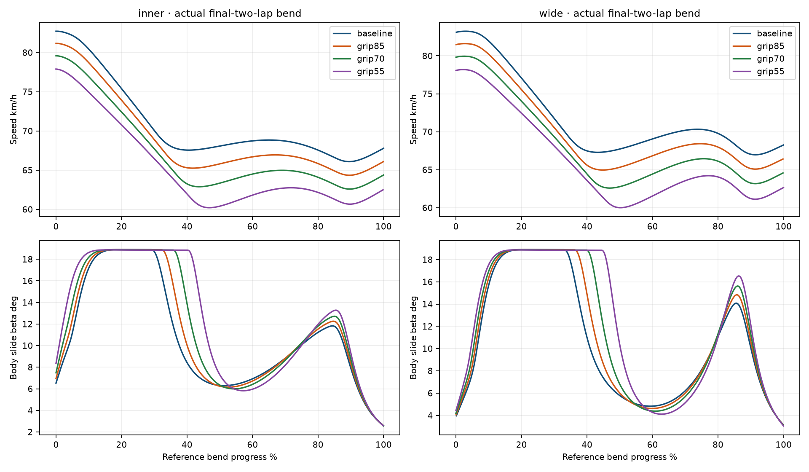
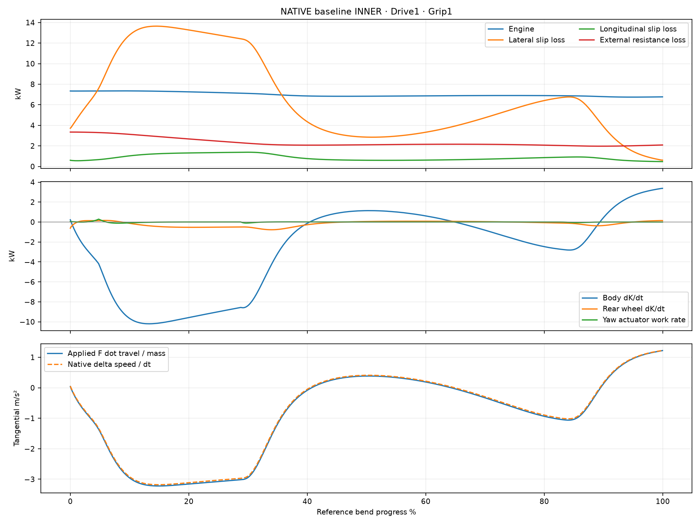
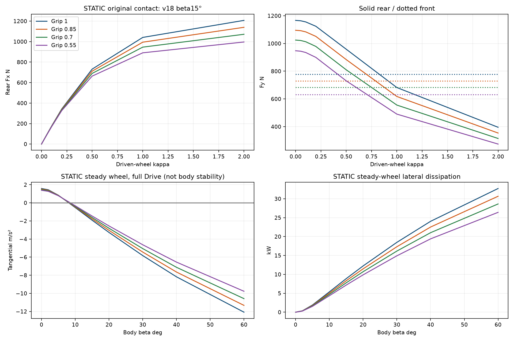
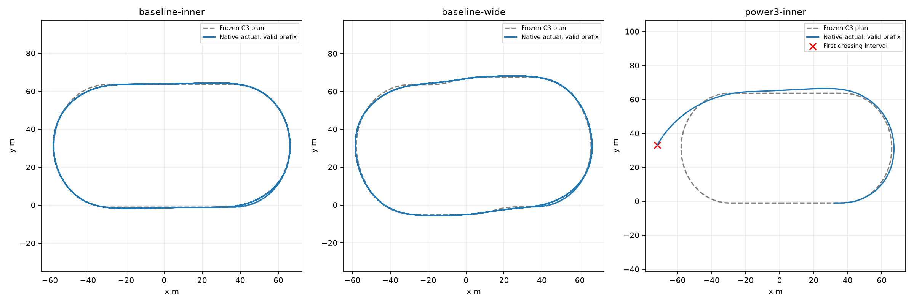
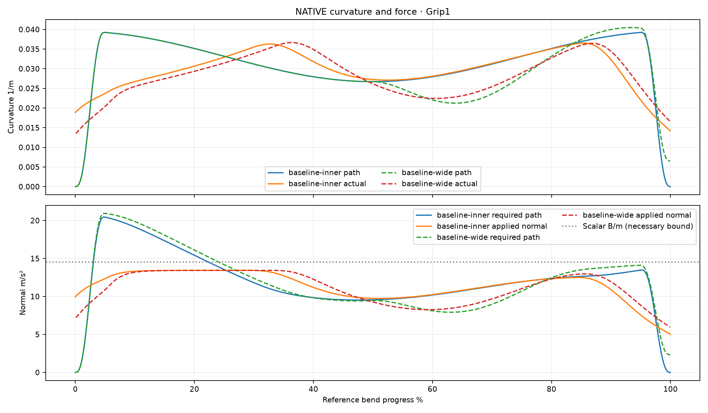

# Full Throttle Slide & Grip Audit (#107)

**A — wykonany audyt, bez zmiany fizyki.** Uślizg rzeczywiście rozprasza energię i może zmniejszać prędkość przy Drive1. Obecny model dopuszcza bezpieczny, okresowy ruch z uślizgiem w łuku, ale nie zapewnia dokładnego wykonania obu zamrożonych planów #106. Empiryczna wiarygodność opony/nawierzchni nadal nie jest rozstrzygnięta.

Baza: ostatni właściwy Draft #106 `experiment/speed-grip-line-crossover`, HEAD **5648c4263739e46df40a366c96fabe4978cc1b3c**, sprawdzony lokalnie i zdalnie. Jeden nowy Draft, bez merge. Egg Mild/progressive-b, C3 A INNER/B WIDE STRAIGHT, gains, yaw, engine baseline, wymiary, masa, koło i opona nie zmieniają się. Produkcyjne `src/CoreSim` bez zmian. Nie dodano hamowania, roll-off, speed clampu, ściany ani korekty stanu.

## Źródła i koszt eksperymentu

Wszystkie8 wymaganych przypadków istnieje w #106. Zachowano i wykorzystano ich pełne native `*-tracking.csv.gz`, `*-forces.csv.gz` i JSON: baseline INNER/WIDE oraz Grip0,85/0,70/0,55. Dodano tylko **3 standardowe światy INNER/Grip1 po8lap**: dokładny repeat18 oraz początkowe17,1/18,9m/s (±5%). Koło początkowo toczy się, Drive1 w całym przejeździe, bez późniejszego przestawiania. Power3 wykorzystuje wyłącznie istniejący zapis, do pierwszego fizycznego naruszenia bandy9,42s; nie wykonano nowego power3 ani historycznej macierzy. Testy celowane zawierają swoje niewielkie istniejące scenariusze; nie są ukryte jako reuse.

[freeze.json](full-throttle-slide-grip-audit/freeze.json) utrwala źródłowe hashe i procedurę przed nowymi próbami. Ekstrakcja ponownie wywołuje **oryginalne** Forces/Evaluate na zapisanych stanach, nie integruje drugiego świata. Dla wszystkich użytych native kroków odtworzone Fx/Fy i globalne F są **bitowo identyczne: max błąd0N**. Dzięki temu brakujący podział Fy front/rear pochodzi z tego samego równania i tych samych stanów; nie został dopasowany do prędkości.

Nowe `*-decomposition.csv.gz` zapisują każdy użyty krok, u/w, Fy front/rear, rzeczywistą pracę strat, ΔKbody/ΔKwheel, yaw work i przyspieszenia. Pełny pierwotny zapis położeń, sił i momentów pozostaje w #106. Każdy wiersz jest połączony dokładnym t, dt i kolejnością, z kontrolą długości. Dla odrzuconego power3 przechowujemy także końcowy interwał przecinający granicę, a pomijamy późniejszy ruch. Nie ma rankingu niepoprawnych czasów.

## 1. Równania i faktyczna utrata energii

β=`heading_body−heading_velocity`; u to prędkość wzdłuż motocykla, w to jego prędkość boczna (dla dodatniego β: u=Vcosβ, w=−Vsinβ; V jest modułem rzeczywistej v). Osobno κ=`(Rω−u)/sqrt(u²+u₀²)`. Obrót koła szybszy od jazdy nie oznacza większego kąta motocykla. Przód i tył nie mają osobnych punktów kontaktu ani osobnych bocznych prędkości wynikających z yaw.

W oryginalnym `RearWheelDynamics` Br=0,6B, Bf=0,4B. Dla a=(Rω−u)/δx, b=w/δy: `Fx_rear=Br·a/sqrt(1+a²+b²)`, `Fy_rear=−Br·b/sqrt(1+a²+b²)`, `Fy_front=−Bf·w/sqrt(w²+δy²)`. **Front Fx=0** w tym modelu. W skończonym kroku używa się oryginalnego implicit midpoint kontaktu, nie tej chwilowej wersji h0. Oba Fy i tylny Fx działają w środku ciała. Opory rolling/aero są osobnym F w kierunku przeciwnym do rzeczywistej v; yaw pochodzi z osobnego aktuatora/guard.

Straty: `P_lat=−(Fy_front+Fy_rear)w≥0`, `P_long=Fx_rear(Rω−u)≥0`; silnik `Pengine=Tdrive·ω`. Koło: `Iw·ωdot=Tdrive−R·Fx−cω`. Box2D dostaje raz `F=forward·Fx+side·Fy+Fres` i moment yaw. Po jego jednym kroku następuje jeden commit ω. Nie istnieje drugi odejmowany składnik `Pslip/V` ani hamulec driftu. Wartości loss są diagnostycznym **pomiarem pracy rzeczywistych sił**, a nie diagnostyką bez skutku fizycznego. Samo odjęcie ich jeszcze raz od napędu podwoiłoby stratę.

Weryfikacja na rzeczywistych końcach interwałów, z frozen axes początku i fizycznym float32 h:

`ΔKbody+ΔKwheel = Wengine − Llong − Llat − Lbearing + Wresistance + Wyaw + ε`.

Do ledger użyto faktycznego u_mid/w_mid z zaakceptowanych prędkości, nie wyłącznie konstytutywnego przewidywania midpoint. To rozróżnienie jest zachowane w źródłowym ledger #100/#106. Body obejmuje translację i yaw. Rozliczono dokładnie tę samą siłę float, która trafiła przez `ContactAdapter.Force` do `b2Body_ApplyForceToCenter` oraz torque do Box2D. Brak kontaktów/ściany i ukrytej siły.

|8lap INNER|kJ|
|---|---|
|engine|955.943892|
|lateral loss|519.610449|
|longitudinal loss|93.424433|
|external resistance work|-315.450469|
|bearing loss|11.529285|
|yaw actuator work|0.009973|
|body ΔK|14.800775|
|wheel ΔK|1.138487|

Residual tego8lap wynosi **0.032922J**, przy955,944kJ pracy silnika. Największy |residual| dziewięciu użytych prefiksów: **1.540437J**. To niezależne rozliczenie native zmian v/ω i zapisanych sił, zgodne ze starym ledger w skali float. Przy mikrosekundowych podziałach sam residual siłowy Δv/h jest wrażliwy na round-off; przechowujemy też residual impulsu. Wyjście przyspieszenia po normalnym10ms różni się od F·travel/m o około0,05m/s² wskutek skończonego kroku i zmiany kierunku, nie dodatkowego hamulca.

## 2. Przejazdy pełnego gazu — istniejące dane native

|Próba|entry / middle / exit km/h|max pełnej prostej km/h|β mean/max °|κ max|RMS/max błąd m|
|---|---|---|---|---|---|
|baseline-inner|82.72 / 68.07 / 67.79|82.72|10.70/18.91|0.2267|0.456/1.235|
|baseline-wide|83.09 / 67.73 / 68.27|83.09|10.50/18.91|0.2284|0.535/1.311|
|grip85-inner|81.17 / 65.80 / 66.10|81.17|11.13/18.89|0.2340|0.471/1.204|
|grip85-wide|81.47 / 65.33 / 66.45|81.46|10.94/18.90|0.2358|0.594/1.275|
|grip70-inner|79.59 / 63.35 / 64.39|79.59|11.61/18.88|0.2419|0.542/1.171|
|grip70-wide|79.82 / 62.78 / 64.62|79.81|11.41/18.88|0.2438|0.726/1.423|
|grip55-inner|77.89 / 60.41 / 62.53|77.90|12.22/18.87|0.2522|0.723/1.534|
|grip55-wide|78.08 / 60.01 / 62.66|78.08|12.02/18.87|0.2539|1.007/2.197|

Entry/middle/exit są interpolacją **zapisanych stanów** przy landmarkach obu łuków, średnią z końcowych dwóch okrążeń. Maksimum prostej wymaga kompletnej prostej; ostatnie niepełne62m pominięto. β, κ i pozostałe średnie poniżej dotyczą czasu w obu łukach tej samej końcowej pary. To nie prędkości nakazane solverowi. Wszystkie8 przejazdów nie przechodzą trackingu #106, dlatego tabela **nie zawiera rankingu czasowego**. Dodatnie accepted clearance baseline-wide nie rozstrzygają jego brakującego certyfikatu pomiędzy krokami.

|Próba|Pengine kW|Llat kW|Llong kW|dKbody/dt kW|a travel m/s²|czas hamowania %|Fx / Fy front / rear N|
|---|---|---|---|---|---|---|---|
|baseline-inner|6.974|6.399|0.847|-2.498|-0.846|64.36|324.7/673.4/977.2|
|baseline-wide|7.003|6.313|0.835|-2.451|-0.824|57.24|322.4/655.8/952.1|
|grip85-inner|6.705|6.155|0.851|-2.395|-0.827|63.62|319.2/638.5/923.5|
|grip85-wide|6.733|6.076|0.839|-2.352|-0.808|57.78|317.1/621.4/899.1|
|grip70-inner|6.437|5.901|0.855|-2.288|-0.806|63.09|313.6/603.4/869.3|
|grip70-wide|6.464|5.829|0.845|-2.247|-0.788|58.66|311.5/586.9/845.9|
|grip55-inner|6.165|5.631|0.868|-2.171|-0.781|63.12|307.9/564.9/809.4|
|grip55-wide|6.193|5.566|0.857|-2.134|-0.766|60.39|305.8/549.7/788.0|

Baseline INNER traci w jednym łuku średnio **12,759kJ energii body**, pomimo pełnego napędu. Średnio Pengine6,974kW, strata boczna6,399kW i wzdłużna0,847kW; dochodzą opory i łożysko. Średnie dKbody/dt≈−2,498kW. Prędkość entry82,72→exit67,79km/h; chwilami ponownie rośnie na spłaszczonym środku/wyjściu. Nie jest stałym equilibrium w każdym punkcie łuku, lecz okresową wymianą energii w całym okrążeniu. Hamowanie dotyczy64,36% czasu łuku, z samych oryginalnych sił.

[cases.csv](full-throttle-slide-grip-audit/cases.csv) zawiera Fx, osobne Fy, krzywizny, przyspieszenia, błędy i prześwity; [corner-phases.csv](full-throttle-slide-grip-audit/corner-phases.csv) zachowuje oba łuki osobno. Wszystkie native pozycje i bieżące κ_path/κ_actual/κ_feedforward są w źródłach #106; uzupełnienia mają to samo t. Wielkości w tabelach nie są statycznymi próbkami.

## 3. Osobne statyczne próby oryginalnych równań

756 h0 zapytań: Grip4×V3×β9×κ7;108 steady-wheel,24 warianty surowej nawierzchni i72 zapytania odwrotności sterowania. Bez kroków Box2D i bez siły podtrzymującej kąt. `steady-wheel` oznacza tylko Tdrive−R·Fx−cω≈0 w zadanym stanie; **nie** dowód stabilności nadwozia. Bracket i42 iteracje rozwiązują tylko scalar ω. Nie szukano szybkiej linii.

Stała V18m/s, Grip1, Drive1; każdy wiersz ma oddzielny β i równowagę koła:

|β °|κ steady wheel|Llat kW|Llong kW|a travel m/s²|a normal m/s²|
|---|---|---|---|---|---|
|-0|0.0793|0.000|0.481|1.582|0.000|
|2|0.0824|0.361|0.499|1.442|3.982|
|5|0.0971|1.909|0.584|0.837|8.446|
|10|0.1379|5.377|0.810|-0.527|11.915|
|15|0.1897|8.879|1.078|-1.922|13.098|
|20|0.2499|12.233|1.365|-3.273|13.453|
|30|0.4033|18.471|1.991|-5.829|13.168|

Przy10° model już hamuje≈0,527m/s², przy15°≈1,922m/s². Nie wymaga β40–60°, aby dać istotne straty. Zmiana β z5 na10° przy stałym V zmienia bilans tak, że napęd nie równoważy strat. Korzeń między tymi β jest **lokalnym bilansem sił stycznych**, bez dowodu realizacji koła/ruchu po wymaganym łuku lub zgodności yaw.

Zwiększenie κ przy stałych V/β/E podnosi tylny Fx i P_long, zmniejsza tylny Fy; front Fy pozostaje niezmienny. Tylny budżet jest wspólny. To poprawny kierunek mechanizmu combined slip, ale charakterystyka jest monotonicznie nasycająca i bez empirycznej identyfikacji; nie dowodzi realistycznego maksimum siły czy zachowania konkretnej opony w materiale toru. Przy h0 Drive zmienia moment, nie zmienia natychmiast stanu ω — energię na chwilę może dostarczać również zapisany obrót koła.

## 4. Grip, Ruts, Moisture i ograniczenia nawierzchni

`EffectiveGrip=clamp01(Grip·(1−0,45 Ruts)−|Moisture−0,35|·(Moisture>0,35?0,55:0,20))`.

W badanej fizyce surowe parametry zapadają się do tego jednego skalaru. Identyczne EffectiveGrip z różnych raw inputs daje identyczne siły/koło — test sprawdza to bitowo. Ruts nie zmienia tutaj kierunkowej krzywej opony, a Moisture nie tworzy innej zależności ścinania. Nawierzchnia jest zamrożona, nie wykonuje pracy deformacji podczas biegu.

E dla Grip1/0,85/0,70/0,55 przy Ruts0/Moisture0,5:0,9175/0,7675/0,6175/0,4675. B/m maleje14,546→13,651→12,765→11,800m/s², czyli o18,9% na końcach. **Grip nie jest μ.** B pochodzi z kalibracji `m·v_safe²/R`, a zależność v_safe∝sqrt(R) usuwa tu bezpośrednią zależność budżetu od promienia.

To **nie tylko mnożenie całej charakterystyki przez B**. E zmienia dostępny engine torque oraz regularizację: δy²=0,12²(u²+0,5²)+(0,03 B/m)²; δx²=0,1²(u²+0,5²)+[0,03 Br(R²/Iw+1/m)]². Minimum relaxation30ms wpływa na statyczny kształt nawet przy h0. Spadek Grip zmienia więc też znormalizowane krzywe κ–Fx/Fy, lecz poprzez tę samą zadaną rodzinę równań, nie nowe własności materiału. Nie jest to stanowa relaksacja długości kontaktu ani model historii ścinania.

W native INNER niższy Grip obniża corner mean engine6,974→6,165kW i boczne straty6,399→5,631kW. Mimo tego βmean rośnie10,70→12,22°, κmax0,2267→0,2522 i tracking RMS0,456→0,723m. Mniejsze siły i inna osiągnięta prędkość mogą polepszać clearance; to nie dowód większej przyczepności. Bezpieczny okresowy ruch nadal istnieje, przy innej krzywej prędkości.

Brakuje empirycznej krzywej opona–żużel, pionowych obciążeń i ich transferu, camber/sterowanego przedniego koła, odrębnych kontaktów, śladu naprężeń, histerezy, zapadania i przesuwania materiału. Rozdział60/40 jest stały, yaw jest skutecznym aktuatorem, nie wynikiem osi/torque contact. To wystarcza do kontrolowanych testów obecnego modelu, **nie** do zatwierdzenia absolutnych prędkości/uślizgu lub doboru Grip pod rzeczywisty tor.

Kontekst, nie kalibracja: [badanie McIntyre, Auburn2015](https://auetd.auburn.edu/handle/10415/4630) badało połączone siły na przygotowanej odkształcalnej glinie z kontrolą kąta, camber, obciążenia i ciśnienia. Nie jest pomiarem opony żużlowej. [Dokumentacja Project Chrono](https://api.projectchrono.org/vehicle_terrain.html) odróżnia modele handling oparte na zapytaniach o tarcie od kontaktu z odkształcalnym gruntem. Te źródła uzasadniają ostrożność wobec jednego skalaru; nie uzasadniają teraz dobudowy SCM lub zwiększenia Grip.

## 5. Czy istnieje stabilny ruch z pełnym gazem?

|Próba|bezpieczny okresowy ruch 8lap|β≥3° czas łuku %|β≥3° core90% %|path demand>B %|tracking/ranking|
|---|---|---|---|---|---|
|baseline-inner|TAK|98.46|100.00|16.84|FAIL / niedopuszczony|
|baseline-wide|brak certyfikatu|100.00|100.00|17.80|FAIL / niedopuszczony|
|grip85-inner|TAK|98.44|100.00|17.58|FAIL / niedopuszczony|
|grip85-wide|TAK|100.00|100.00|18.56|FAIL / niedopuszczony|
|grip70-inner|TAK|98.51|100.00|18.59|FAIL / niedopuszczony|
|grip70-wide|TAK|100.00|100.00|19.48|FAIL / niedopuszczony|
|grip55-inner|TAK|98.49|100.00|19.74|FAIL / niedopuszczony|
|grip55-wide|TAK|100.00|100.00|20.75|FAIL / niedopuszczony|

**Tak, w skończonym eksperymencie.** INNER/Grip1 ma dodatnie prześwity przez8lap, powtarzalną prędkość oraz β dodatni przez cały łuk (minimum2,59°, maksimum18,91°). |β|≥3° przez98,46% czasu całego łuku i100% środkowych90%. Pozostałe≈1,54% to łagodne wygaszanie poślizgu przy końcu, a nie brak kontrolowanej jazdy. Każda z8 prób ma uślizg przez100% środkowych90% łuku. **Nie** oznacza to dokładnego wykonania zamierzonej linii: baseline INNER ma max lateral1,235m, powyżej limitu1m.

Trzy nowe próby, ta sama fizyka i Drive1; porównanie faktycznego XY/v w ostatnim okrążeniu na wspólnej fazie reference:

|v początkowe m/s|ostatnie 3 lap max/min|max różnica XY ostatniego lap m|max Δv m/s|safety|
|---|---|---|---|---|
|17.1|1.000001816|0.0001723|0.0000992|True|
|18|1.000001920|0.0000000|0.0000000|True|
|18.9|1.000002314|0.0006027|0.0003528|True|

Po perturbacji±5% końcowy ślad różni się od bazowego o≤0,603mm, v o≤0,000353m/s. Wszystkie przechodzą safety native/between-step. Repeat18 ma **identyczny fingerprint #106**. To dowód lokalnego przyciągania do okresowego ruchu w zbadanej parze perturbacji i8lap, bez dowodu globalnej stabilności dla dowolnego startu. Prędkość rośnie na prostych i spada w częściach łuku; bilans cyklu ogranicza ją bez clampu. Nie twierdzimy, że jeden stały β/v opisuje cały zmiennokrzywiznowy łuk.

## 6. Co blokuje #106: A, B i C osobno

**A — POTWIERDZONE w konkretnych fragmentach.** Przy założeniu śledzenia Q i tej prędkości `v²|κ_path|>B/m` przez16,84% czasu łuków baseline INNER i17,80% WIDE. To konieczna granica: nawet większy β nie dostarczy wymaganej normalnej siły z tego B. Rzeczywista κ maleje/ślad odchodzi, zamiast otrzymać brakującą siłę. Dla power3 istniejący prefix obejmuje52,99% takiego czasu przed pierwszym fizycznym crossing9,42s. Na planie brak siły pojawia się wcześniej niż duży błąd. Nie potrzeba hipotezy o „braku strat”, by wyjaśnić ten przypadek. Wszystkie późniejsze power3 po crossing wykluczono z audytu sił na torze.

**B — potwierdzona niespójność odwrotności; jej udział w całym błędzie NIEROZSTRZYGNIĘTY.** Steering wyznacza target β odwrotnością historycznej pojedynczej Fy, a następnie przykłada combined rear/front contact #100. Znormalizowane żądanie jest przycinane do0,95B; ogranicznik yaw physical/energy nie był aktywny w #106. Poniższy h0 test bierze target z dokładnego obecnego kodu w stanie β0, a potem mierzy normalną siłę właściwego kontaktu przy tym β i steady wheel. To pojedyncza próba feed-forward, nie zamknięta pętla yaw i nie eksperyment przyczynowy ze zmienionym regulatorem:

|żądanie/B|target β °|żądane a normal|uzyskane a normal|uzyskane/żądane|
|---|---|---|---|---|
|0.25|1.811|3.6366|3.6306|0.99835|
|0.5|4.045|7.2731|7.2638|0.99872|
|0.75|7.906|10.9097|10.8937|0.99853|
|0.85|11.178|12.3643|12.3175|0.99622|
|0.9|14.191|13.0916|12.9830|0.99170|
|0.95|20.436|13.8189|13.4623|0.97419|

Przy0,95B uzyskujemy97,42% żądanego przyspieszenia. To pokazuje, dlaczego scalar demand≤B i brak clampu yaw nie są certyfikatem śledzenia. Rozmiar efektu nie dowodzi, że wyjaśnia wszystkie1–2m błędu; preview, czasowe przejścia, dostępny coupled force i położenie też mają znaczenie. Nie uznano każdego momentu poniżej B za fizycznie wykonalny i automatycznie „winę regulatora”.

**C — POTWIERDZONE uproszczenie, wpływ na realny tor NIEROZSTRZYGNIĘTY.** Płynny, nasycający shared budget, stałe obciążenia i skalar E nie przedstawiają luźnego żużla w sposób zidentyfikowany eksperymentalnie. Natomiast równania generują faktyczne straty, spadek v i ograniczony ruch przy pełnym gazie. Nie ma dowodu, że zwiększenie strat lub Grip naprawi #106; bardziej energochłonna opona może po prostu maskować overspeed niższą prędkością.

## Siedem odpowiedzi

|Pytanie|Ocena|Uzasadnienie|
|---|---|---|
|1. Czy jazda bokiem rzeczywiście zmniejsza v?|POTWIERDZONE|Native INNER:82,72→67,79km/h w łuku przy Drive1; F·v/m i Δv są zgodne.|
|2. Ile energii i jaki wpływ?|POTWIERDZONE|Średnio6,399kW lateral+0,847kW longitudinal; body traci≈12,759kJ/łuk, bez podwójnego odejmowania.|
|3. Czy większy wheelspin działa realistycznie?|NIEROZSTRZYGNIĘTE|Poprawny jakościowy shared-budget kierunek i dodatnie straty potwierdzone; brak empirycznej walidacji Fx/Fy/κ konkretnego żużla.|
|4. Wpływ Grip przy pełnym gazie?|POTWIERDZONE|Mniejszy budżet/napęd, większy κ i średni β, niższe v; RMS trackingu rośnie. Grip nie jest μ.|
|5. Stabilny slide przez cały łuk?|POTWIERDZONE w badanym zakresie|Dodatni β w całym łuku,98,46% czasu≥3°, bezpieczeństwo i powrót po±5% przez8lap. Nie dowodzi dokładnego Q ani globalnej stabilności.|
|6. Co blokuje szybszy plan?|POTWIERDZONE częściowo|Przy osiągniętych v wymaganie Q przekracza B; pozostałego błędu nie przypisano jednej przyczynie. Geometria i energia decydują o legalnym profilu v.|
|7. Który następny eksperyment poprawi wiarygodność?|NIEROZSTRZYGNIĘTE do porównania|Sprawdzić constitutive-consistent inverse zamiast uznawać scalar B i historyczny inverse za wykonalność.|

**Jeden następny krok:** izolowane porównanie obecnego target-slip feed-forward z odwrotnością **normalnej siły oryginalnego coupled rear/front contact i aktualnego ω**. Odwrotność musi umieć zwrócić „nieosiągalne”; B nie jest obietnicą osiągalnej siły normalnej przy pełnym gazie. Zachować Drive1, Q, progressive-b, gains, yaw i oponę. Z góry rozdzielić fragmenty powyżej osiągalnej obwiedni (A) od pozostałych i sprawdzić, czy zmiana ogranicza błąd tylko w tych drugich (B). Nie dodawać hamulca, nowego Grip ani arbitralnej straty. Oczekiwany zysk wymaga testu; nie obiecujemy wykonania power3 ponad limitem sił.

## Walidacja i granice dostarczenia

Release zmienionych projektów:0 warnings/errors. **41/41 celowanych C#** (21 audyt/koło/crossover oraz20 slip dynamics), **4/4 nowych Python**. Nie powtarzano pełnej historycznej macierzy. Standardowe końcowe Windows CI Draft ma link i wynik w PR/dostarczeniu. Historyczne audyty pozostają opt-in.

**765/765 historycznych SHA-256 zachowane**, włącznie ze wszystkimi132 plikami manifestu #106. Żaden plik fizyki opony/koła/Box2D ani geometry/controller nie zmienia się. Repeat18 potwierdza stary fingerprint, a read-only dekompozycja jest identyczna w każdym przebadanym Fx/Fy/F. Targeted TRX, [analysis.json](full-throttle-slide-grip-audit/analysis.json), [extraction.json](full-throttle-slide-grip-audit/extraction.json), [statyczne próby](full-throttle-slide-grip-audit/static-grid.json), [steady-wheel](full-throttle-slide-grip-audit/steady-wheel.json) i manifest pozwalają oddzielić native od statycznych próbek i hipotez.

Reprodukcja do pustego katalogu: Release narzędzia, `full-throttle-slide DIR freeze`, `extract`, `probes`, `perturbations`. `extract` czyta dostarczone źródła #106 i nie wywołuje Box2D Step. Probes tworzą także jeden niekrokowany fixture świata dla odczytu aktualnej masy/inercji. Raport/helper Python nie implementuje fizyki. Wykresy wymagają matplotlib, analiza standardowej biblioteki. Trzy nowe światy i surowe native zapisy zachowano, bez nowego UI i bez merge.
