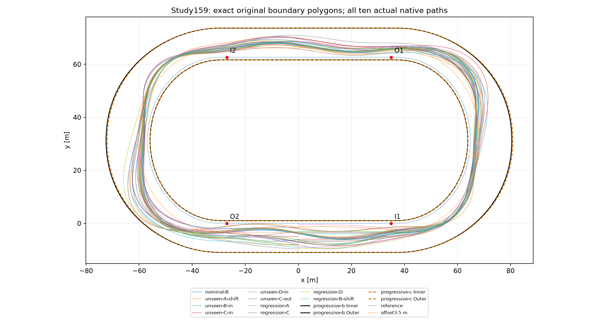
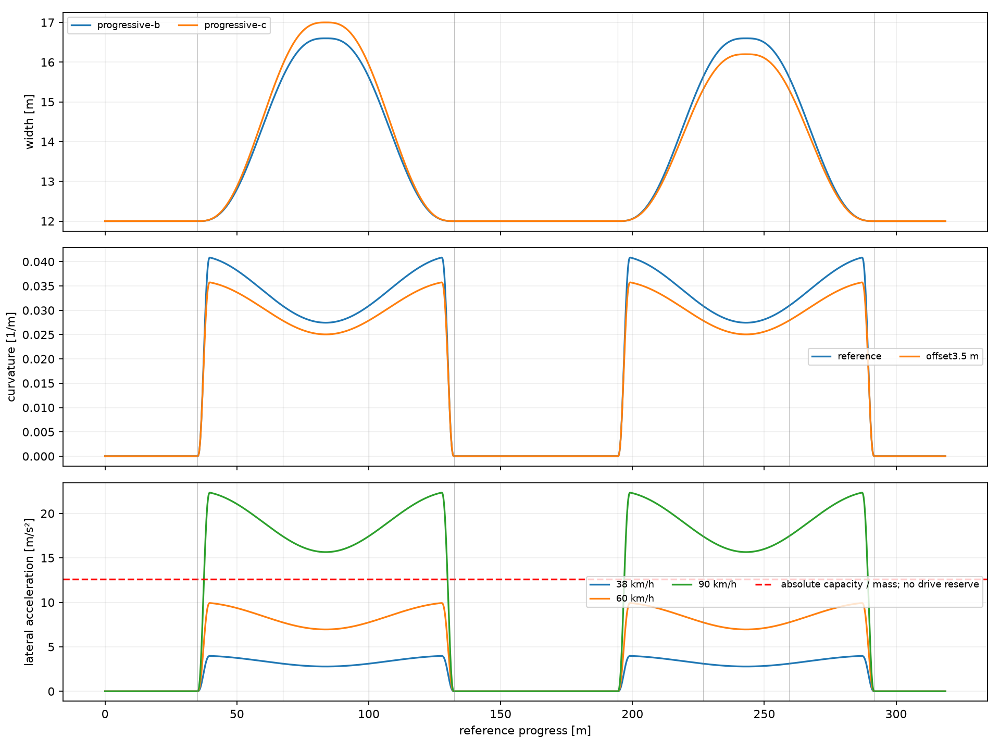
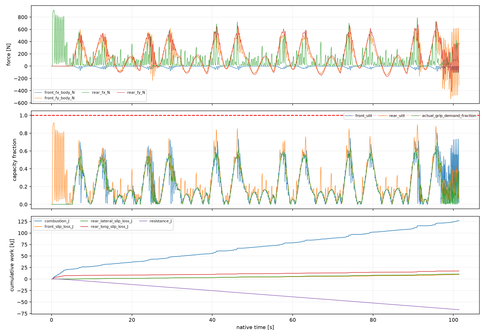
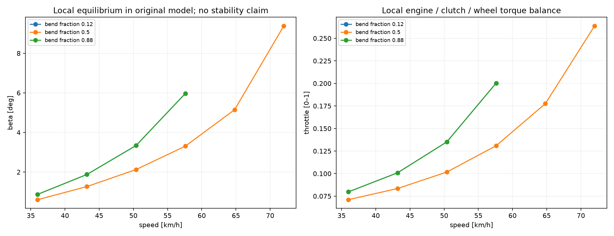
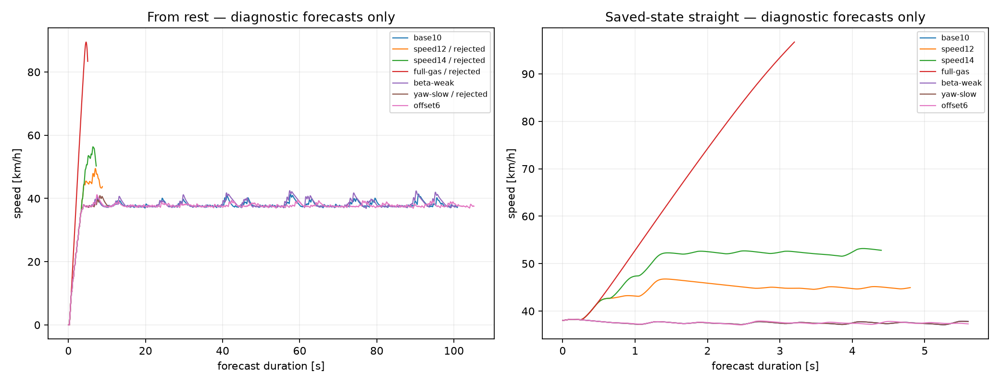
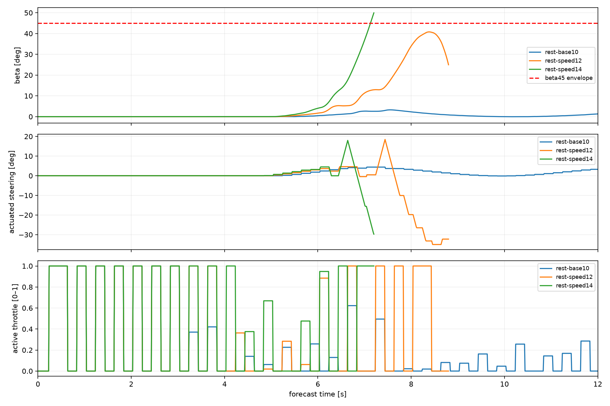

# Badanie #159 — geometria, potencjał fizyczny i ograniczenia AI

**PARTIAL: rozpoznano przyczyny wolnej jazdy; szybsza autonomia S3 nie została potwierdzona.** Baza to dokładny HEAD #158 / Draft PR #157: `9c94a21e37877fd82565fd309fd2850aeb23f341`. Nowe narzędzie jest PROVISIONAL, wymaga jawnej komendy i pozostaje OFF. Brak merge. Fizyka, produkcja, oba historyczne profile toru i zamrożone dowody pozostają niezmienione.

## Odpowiedzi na osiem pytań

1. **Tor nie jest potwierdzoną rekonstrukcją współczesnej Motoareny.** #158 używa progressive-b: 318,778750 m referencji, proste 62 m, identyczne łuki 97,389375 m i symetryczne maksimum szerokości 16,6 m. Progressive-c zmienia tylko szerokość na 17/16,2 m; krzywa referencyjna, oba łuki i długość pozostają takie same. Nie odtwarza więc przebudowy drugiego łuku. Brak danych geodezyjnych i profilu poprzecznego.

2. **Model ma zapas prędkości powyżej37–38 km/h.** Lokalna prognoza ze stanu na prostej osiąga96,71 km/h po około 58 m przy pełnym gazie. Oryginalne równania kontaktów, wału, sprzęgła i koła mają punkty lokalnej równowagi przy 57,6 km/h w ciasnej części łuku i72 km/h w środku, na offsecie3,5 m. Są to prognoza i punkty równowagi, nie bezpieczne ukończenia łuków. Historyczne #148 potwierdza 111,375 km/h na izolowanej prostej62 m od 70 km/h oraz około 148–151 km/h na długiej prostej w swoich warunkach. Nie wyznaczono globalnego Vmax obecnego biegu S.

3. **Bezpośrednie ograniczenie tempa to generator10 m/s i regulator prędkości.** `Settings158` deklaruje domyślnie12, ale `Generator158` jawnie przekazuje10 i CourseSeconds=1. Żądane przyspieszenie to `clamp((10−v)/1.2,−2,3)`. Działa także na prostych i odcina gaz po dojściu do celu. W25/50 wcześniej określonych stanów regulator żąda zwalniania i aktywny gaz daje ujemne przyspieszenie, podczas gdy identyczny stan przy gazie1 daje dodatnie. Jest to przyczynowy dowód lokalnej redukcji prędkości, nie certyfikat bezpiecznego pełnego gazu.

4. **Znacznie szybsze bezpieczne trzy okrążenia pozostają nierozstrzygnięte.** Próba samego celu 12 m/s traci prześwit,14 m/s przekracza β 45°. Pełny oryginalny planner12 m/s odmawia przed startem, ponieważ generator nie ma kompletnej legalnej rezerwy. Nie uruchamiano bezcelowej serii nowych światów. Wyniki #144/#148 są w starszym reżimie L i nie są certyfikacją S≥0,5 m.

5. **Obserwowane tempo ogranicza przede wszystkim AI, a niezawodność szybszego wariantu — interakcja AI, geometrii i dynamiki.** Budżet obu opon w nominalnych łukach jest wykorzystany średnio w około 26–29%, daleko od stałej saturacji. Nie oznacza to niezależnej rezerwy dla dowolnego napędu i yaw. Zwiększenie samego gazu zmienia wheelspin, Fy i moment skręcający; granice geometrii oraz pełna rezerwa terminalna nadal obowiązują. Nie przypisujemy tym przyczynom arbitralnych procentów czasu.

6. **Wyższa prędkość wymaga spójnego β, skrętu, wheelspinu i momentu napędu.** W ciasnym lokalnym punkcie przy 36→43,2→50,4→57,6 km/h równowagowe β rośnie 0,87→1,88→3,34→5,97°, κ około 0,032→0,039→0,055→0,096, a gaz 0,080→0,101→0,135→0,200. Combined slip zabiera Fy przy rosnącym Fx. Punkty są chwilowo zrównoważone także dla oryginalnego sprzęgła, lecz nie wykazano ich stabilności ani osiągalności z zatrzymanego startu. Wysokie straty historycznego K1 nie są automatycznie bilansem #158.

7. **Największy koszt to pełne warunkowe kontynuacje.** Zapisany wyłączny profil dziesięciu biegów przypisuje im 76.70% CPU profilowanego planowania. Niezależna certyfikacja pozostaje kosztowna i obowiązkowa. Samo generowanie nowych rezerw jest niewielką częścią tego profilu. Mikroprofil rozdziela prefiks0,24 s, inwersję Control158 i korektę Joint158; nie dodajemy go do pomiarów dawnych biegów.

8. **Następny PR: fizycznie spójny generator profilu prędkości i β, z istniejącą certyfikacją.** Na zamrożonym B wyznaczać wykonalne lokalne stany kontaktów i feed-forward yaw/β, przygotowywać wejście przed zmianą krzywizny, używać rzeczywistego aktuatora w inwersji i wspólnie korygować gaz oraz skręt. Parametry linii i prędkości mają generować propozycje w obecnym Runtime158; pełne 13/9, niezależny provider i oryginalny świat pozostają bramką. Szczegółowy zakres znajduje się niżej.

## A. Źródła i geometria

Oficjalna [karta zespołu Ekstraligi, sezon2026](https://ekstraliga.pl/plan-minimum-czyli-utrzymanie-sie-mamy-na-wyciagniecie-reki-wypowiedzi-ewinner-apatora-torun-z-czetor/druzyny/1/2026/info) potwierdza 318 m oraz12/12 m na prostych i17/16,2 m na łukach. [Podręcznik Ekstraliga Camp2023, s.6 PDF](https://cdn.speedwayekstraliga.pl/2023/06/ENG-Manual-Speedway-Ekstraliga-Camp-2023.pdf) potwierdza proste 62 m i długość318 m, lecz podaje 18 m na łukach. [Artykuł organizatora ligi](https://ekstraliga.pl/se/news/czy-podczas-pge-imme-im-zenona-plecha-padnie-nowy-rekord-toru) wyraźnie rozdziela początkowe 325 m i318 m po przebudowie drugiego łuku przed sezonem 2017. [Opis miejski](https://www.torun.pl/pl/sport-i-rekreacja/stadiony) nadal podaje 325 m i18 m; traktujemy go jako starsze dane, mimo obecnej dostępności strony. Źródła sprawdzono2026-11-02. Nie uzgadniamy sprzecznych szerokości przez uśrednienie.

|Wielkość|B w #158|C istniejący|Współczesne dane|
|---|---|---|---|
|Referencja / długość [m]|318,778750|318,778750|318; dokładne XY nieudostępnione|
|Proste [m]|35+27 / 62|35+27 / 62|62 / 62|
|Łuki [m]|97,389375 /97,389375|identyczne B|nieznany rozdział po przebudowie|
|Szerokość [m]|12 →16,6 /16,6|12 →17 /16,2|12 /17 /16,2|
|Minimalny R referencji [m]|około 24,48|identyczny B|niepotwierdzony pomiar|
|Minimalny R offset 3,5 [m]|około 27,98|identyczny B|niepotwierdzony pomiar|

Nominalne31 m nie jest stałym lokalnym promieniem profilu C2. Krzywizna ma rampę na pierwszych/ostatnich5% łuku i falowanie `1+0,2 cos(2πt)`: większe wymagania występują w częściach wejściowej i wyjściowej, a środek jest łagodniejszy. Trzy segmenty każdego łuku dzielą jego długość na równe części, ale nie są odrębnymi okręgami. Linia pomiarowa leży1 m od wewnętrznej granicy; rzeczywiste granice są przy offsecie−1 i width−1. Szerokość jest płynnie rozszerzana i zwężana kwintycznym smoothstepem. Nie znaleziono sztucznego zwężenia poniżej12 m ani skoku pozycji/kierunku/krzywizny na złączach. Gładkość konstrukcji nie potwierdza zgodności z obiektem.

Kontrola projekcja→XY→projekcja na 0,1 m daje maksymalnie 2.81 µm błędu referencji i3.91 µm offsetu w badanej linii3,5 m. Eksport przechowuje **dokładne wierzchołki poligonów** oryginalnego `CurveBoundaryAudit`, odczytane bez modyfikacji, a także próbki krzywej w double. Audytor odejmuje istniejące0,7 mm osłony cięciw i0,1 mm tolerancji numerycznej; nie zamieniono ich na dodatkową szerokość.

Na C te same zapisane trajektorie nr5 i8 miałyby swept odpowiednio 0,320489 i0,262811 m; pierwsze naruszenia występują przy 61,98 i95,21 s. To audyt granic tych samych stanów, **nie** nowe biegi ani8/10 autonomicznych ukończeń C. Historyczne10/10 na B pozostaje bez zmian. Nie dodano nowego kandydata geometrycznego, ponieważ dostępne szerokości nie wyznaczają rzeczywistego przebiegu. Ewentualna rekonstrukcja318 m wymaga osobnej tożsamości, pomiarów, testów i osobnej walidacji.

## B. Fizyka i bilans energii

Oryginalny model: m 147 kg, I 52,72097 kg·m², silnik 500cc z krzywą założoną w #116, statyczne µFz, koło i wał/sprzęgło #144. B=1852,338954 N, przód 854,925697 N, tył 997,413257 N; efektywne µ1,2845 jest parametrem modelu, bez kalibracji szutru. Opory40+0,20v² N, przełożenie 9, sprawność 0,94. Fizyka nie zawiera twardego ogranicznika37–38 km/h.

|Część łuku / offset 3,5|Rmin [m]|ay przy 38 [m/s²]|ay przy 60|ay przy 90|Granica skalarna [km/h]|
|---|---|---|---|---|---|
|1|27.98|3.98|9.93|22.34|67.60|
|2|35.89|3.10|7.74|17.41|76.56|
|3|27.98|3.98|9.93|22.34|67.60|

To konieczne granice `ay=v²κ`, `F=m·v²κ`, `v≤sqrt(B/(mκ))` dla lokalnej linii o stałym offsecie. Nie uwzględniają jednoczesnego Fx, momentu yaw, aktuatora, obrysu ani swept i nie są wykonalnym profilem jazdy. Dla zmiennej linii trzeba liczyć krzywiznę jej rzeczywistego XY, nie tylko road.Radius. Telemetria zawiera oba promienie i krzywiznę z natywnych zmian wektora prędkości. Przy90 km/h linia3,5 m w ciasnej części żąda około 3284 N przy 1852 N całkowitego budżetu. Nie wynika stąd niemożliwość dowolnej innej trajektorii.

|Nominalny #158|Cały bieg|Łuki|Proste|
|---|---|---|---|
|Czas [s]|101.390|64.250|37.140|
|Średnia prędkość [km/h]|37.834|38.712|36.315|
|Przód średnia utilizacja|0.203|0.264|0.098|
|Tył średnia utilizacja|0.244|0.290|0.164|
|Czas saturacji≥95% przód/tył [s]|0.000/0.000|0.000/0.000|patrz analysis.json|

Całobiegowe maksimum wheelspinu11,316 pojawia się podczas startu, przy małej prędkości mianownika. W łukach nominalnego maksimum jest0,644, średnia0,041. Nie należy przenosić maksimum startowego na sześć łuków. Pełny gaz nie oznacza natychmiast pełnej siły: skończone stany wału/koła i pasywne sprzęgło określają dostępny moment. Zamknięcie gazu nie jest dowodem ujemnego momentu; zapisujemy rzeczywisty znak momentu i bilans.

|Nominalny bilans|Cały bieg [kJ]|Łuki [kJ]|
|---|---|---|
|Spalanie|126.701535|77.984380|
|Praca przodu w translacji|-14.657615|-13.400354|
|Tył Fx w translacji|96.324254|62.916993|
|Tył Fy w translacji|-5.882439|-5.628098|
|Opory w translacji|-66.718343|-43.598088|
|Zmiana energii translacji|9.065893|0.290394|
|Strata poślizgu przodu|9.830033|8.897403|
|Strata boczna tyłu|10.707595|10.127699|
|Wheelspin wzdłużny|17.496717|8.682573|
|Ciepło sprzęgła|3.016393|0.195777|
|Straty przekładni|7.445805|4.666281|
|Straty łożyska|2.267819|1.487164|
|Reszta całego bilansu|0.000038|-0.000057|

Prace translacyjne i straty kontaktowe są różnymi rozkładami tego samego bilansu; nie dodaje się ich razem. Moment yaw jest liczony dokładnie raz w pracy punktów kontaktu. Interwał przecinający metę jest ważony rzeczywistą częścią czasu do mety. W nominalnym biegu opory odbierają 66,718 kJ, a spalanie dostarcza 126,702 kJ. Boczne straty przodu+tyłu to20,538 kJ, wheelspin17,497 kJ. Reszta całego bilansu to około 0,038 J. Nie jest to procentowa atrybucja winy kontrolera.

Siatka84 lokalizacji/prędkości znajduje62 punkty z resztą sił<0,01 N oraz sprawdzeniem momentów wału/koła i sprzęgła. Pozostałe punkty oznaczają brak znalezionego rozwiązania w skończonej siatce i numerycznym dopracowaniu, nie dowód niemożliwości fizycznej. Stany są syntetyczne, zero-dt i lokalne; nie wyznaczono stabilności, pochodnych stanu wzdłuż zmiennej krzywizny ani bezpiecznych przejść między nimi.

## C. Przyczynowa analiza #158

`Control158` wykorzystuje oryginalne zapytania Fx/Fy i momentu yaw, ale inwersja wykonuje tylko trzy naprzemienne bisekcje gaz/skręt dla chwilowego stanu. Żądany yaw łączy vκ, błąd poprzeczny, prędkość poprzeczną i **−β/BetaSeconds**. Nie ma fizycznie wyliczonego docelowego β(v,κ,Fx) ani dodatniego celu kontrolowanego driftu. `PreviewSeconds` w Settings158 nie jest odczytywany przez Action; `.24s` ActivationState propaguje nieodwracalną kolejkę, po czym sterowanie używa aktualnej krzywizny przyszłego stanu.

Cel10 m/s odpowiada36 km/h, ale jest żądaniem przyspieszenia propozycji, nie twardym ogranicznikiem stanu. Wykonywana komenda pochodzi z zachowanej rezerwy, korekty Feedback/Joint i pełnej certyfikacji, z opóźnioną aktywacją oraz skończonym stanem napędu. Stąd zmierzony poziom37–38 km/h nie musi równać się dokładnie36. Nie rozdzielono udziałów opóźnienia, przybliżonej inwersji i korekty rezerwy w tym niewielkim błędzie śledzenia. Przy10,6 m/s sam gaz 0 potrafi dawać słabsze zwalnianie niż żąda regulator, co jest widoczne w parowanych odpowiedziach.

`Response` w inwersji inicjuje prowizoryczny stan kierownicy proponowanym kątem (`new(steer)`), więc sama inwersja nie ocenia przejścia od rzeczywistego kąta przy ograniczeniu szybkości. Właściwa prognoza Runtime158 nadal używa oryginalnego aktuatora i może odrzucić tę propozycję. To zidentyfikowana różnica między modelem propozycji a pełną certyfikacją, bez zmiany prawa fizyki.

Cel3,5 m jest intencją regulatora, nie szyną. Nominalne rzeczywiste offsety sięgają około 1,16–10,99 m; znaczna część szerokości jest już odwiedzana przez korekty, lecz nie jest wybierana przez optymalizator czasu. Wariant offset 6 wydłuża prognozę do 105,2 s. Samo przesunięcie linii na zewnątrz nie daje automatycznie zysku.

`Feedback158` przy identycznym pełnym kluczu stanu zwraca własną komendę rezerwy. Inaczej propaguje osobno obie kolejki do aktywacji i uruchamia Joint158. Pending jest częścią klucza: zgodność pozycji/koła bez zgodności kolejki nie uprawnia do odtworzenia komendy. Przez0,24 s nowa akcja nie może zmienić ruchu; jeden krok0,2 s jest w całości nieodwracalny. Przy38 km/h daje to około 2,53 m aktywacji i4,64 m dla0,44 s do następnej spóźnionej korekty; przy 90 km/h odpowiednio 6 i11 m. To skala czasu reakcji, nie policzona odległość bezpiecznego hamowania.

|t [s]|V [km/h]|gaz aktywny|gaz proponowany|żądane a|a przy aktywnym|a przy gaz 1|
|---|---|---|---|---|---|---|
|4.0|38.00|0.0000|0.0000|-0.391|-0.243|0.230|
|8.0|39.63|0.0237|0.0000|-0.743|-0.425|0.025|
|10.0|38.23|0.0464|0.0000|-0.459|-0.119|0.335|
|14.0|38.48|0.0547|0.0000|-0.512|-0.111|0.333|
|16.0|38.20|0.0000|0.0000|-0.433|-0.338|0.137|
|18.0|38.00|0.0003|0.0000|-0.491|-0.366|0.106|
|22.0|37.56|0.0000|0.0000|-0.359|-0.398|0.069|
|26.0|38.46|0.0003|0.0000|-0.495|-0.398|0.078|

Wiersze zachowują ten sam pełny stan i oryginalne0,01 s kontaktu; gaz zmieniono wyłącznie jako argument zapytania. Są to lokalne kontrfaktyczne odpowiedzi modelu. Niezależna dłuższa prognoza prostej przy pełnym gazie potwierdza, że nie chodzi tylko o dodatnie przyspieszenie jednego kroku.

`Planner158` buduje skończone drzewo 13/9, wymaga pełnej rezerwy przez bieżący i następny łuk oraz dalszego odcinka za metą. Rezerwę odrzuca za obrys/swept0,5 m, β 45°, błąd fizycznej prognozy, nieosiągnięty terminal lub budżet. Generator dopuszcza maksymalnie 450 review/90 s rezerwy oraz4 nowe partie na decyzję; nie jest kompletnym przeszukiwaniem wszystkich poprawnych manewrów. Pierwsza odmowa generatora12 m/s występuje po 44 komendach przyref.75,374 m. Nominalny profil po podniesieniu celu narusza obrys; nie jest to dowód braku innych trajektorii.

Po pierwszym certyfikacie ranking próbuje najwyżej dwie dodatkowe propozycje, tylko przy wybranych przeglądach, wymaga co najmniej0,02 s zysku do wspólnego celu i nadal pełnego drzewa. Dostępne naprawy korzenia są małą siatką skrętu/gazu; szybsza poprawna trajektoria może nigdy nie zostać wygenerowana. Wzrost celu skraca możliwości przygotowania wejścia, natomiast sufiksy sprzężenia z poprzednim planem pozostają zachowawcze.

## D. Kontrolowane eksperymenty i bramki

Przed próbami zapisano [budżet](budget-plan.json):600 CPU-s diagnostyki, maksymalnie 48 kontynuacji lokalnych,2 próby certyfikatu; nowe światy dopiero za bramką poprawnej szybszej prognozy i pełnego certyfikatu. Wykonano14 prognoz,50 parowanych stanów kontaktu,84 lokalne punkty poszukiwania równowagi, jeden pełny probe planera i audyt granic10 istniejących przebiegów. **Nowych natywnych światów:0.** Pierwszy bootstrap nie miał pobranego zamrożonego choices.json; osobny mikroprofil odrzucono dla stanów spoza epoki review. Oba błędy zachowano; po pobraniu zależności i użyciu rzeczywistych review nie zmieniano fizyki ani danych #158.

Zachowane rachunki diagnostyczne: 30.593750 zmierzonych CPU-s oraz240 CPU-s zachowanej rezerwacji nieudanego bootstrapu; łączne obciążenie budżetu 270.593750 CPU-s jest poniżej600. Rezerwacja240 nie jest pomiarem zużycia CPU. Analiza zapisanych historii ma osobny pomiar w analysis-cost.json; kompilacje, testy i pobieranie danych nie są rolloutami badawczymi.

|Prognoza|Cel osiągnięty|Legalna lokalnie|Czas okna [s]|Vmax [km/h]|Powód|
|---|---|---|---|---|---|
|rest-base10|tak|tak|101.0|41.40|diagnostic geometric goal|
|rest-speed12|nie|nie|8.8|49.48|footprint reserve|
|rest-speed14|nie|nie|7.2|56.36|beta45 envelope|
|rest-full-gas|nie|nie|5.0|89.48|footprint reserve|
|rest-beta-weak|tak|tak|100.4|42.46|diagnostic geometric goal|
|rest-yaw-slow|nie|nie|10.4|40.90|footprint reserve|
|rest-offset 6|tak|tak|105.2|41.19|diagnostic geometric goal|
|straight-base10|tak|tak|5.6|38.28|diagnostic geometric goal|
|straight-speed12|tak|tak|4.8|46.77|diagnostic geometric goal|
|straight-speed14|tak|tak|4.4|53.19|diagnostic geometric goal|
|straight-full-gas|tak|tak|3.2|96.71|diagnostic geometric goal|
|straight-beta-weak|tak|tak|5.6|38.28|diagnostic geometric goal|
|straight-yaw-slow|tak|tak|5.6|38.28|diagnostic geometric goal|
|straight-offset 6|tak|tak|5.6|38.28|diagnostic geometric goal|

Warianty zmieniają osobno cel prędkości, wymuszenie gaz 1, BetaSeconds0,8→8, YawSeconds0,6→1,2 albo offset 3,5→6 m. Baza wszystkich porównań to10 m/s i CourseSeconds1. Okno prostej zaczyna się z zapisanego stanu po pierwszym łuku i kończy po 58 m; nie zawiera kolejnego pełnego łuku. Wariant β daje pełną prognozę 100,4 s zamiast101,0 s, ale mała różnica bez certyfikacji nie jest poprawą sportową. Nie wybrano nowego kontrolera do walidacji autonomicznej. Cele12/14 i stały pełny gaz tracą wykonalność, więc ich bramka natywna pozostaje zamknięta.

Diagnoza pierwszej porażki: przy celu 12 m/s ostatni przegląd przed naruszeniem ma v 43,32 km/h, β 37,67°, yaw 0,113 rad/s i offset 0,759 m. Następna prognozowana pozycja dochodzi do offsetu−1,083 m, przecinając granicę wewnętrzną. Żądany skręt wynosi około−20,21° przy gazie0; pozostaje też wcześniejsza nieodwracalna komenda. Lokalny popyt `v²/R` dla utrzymania tego offsetu wynosi tylko około 4,08 m/s², wobec 12,60 m/s² skalarnego budżetu. To nie jest dowód bieżącej swobody obu osi przy β 37,67°; pokazuje, że przyczyną nie jest sama wybrana prędkość na nominalnym promieniu. Przy celu 14 m/s przed naruszeniem β yaw rośnie do 1,87 rad/s i żądany jest graniczny skręt−35°. Najpierw tracona jest zgodność β/yaw/kierunku ruchu z wykonalnym wejściem, a później margines. Dokładne komendy, pending i chwile pierwszego naruszenia pozy/β są w `analysis.json/forecast_failure_diagnosis`.

## E. Pełne biegi oraz koszt

Wszystkie poniższe ukończenia są **zmierzonymi, istniejącymi wynikami #158**, ponownie analizowanymi w #159. Każdy obejmuje trzy okrążenia i sześć łuków od postoju, oryginalny ciągły Box2D i świeże13/9. Żadna prognoza ani lokalny punkt nie jest dodany do tej tabeli. Wszystkie historyczne DNF pozostają w [oryginalnym rejestrze](../robust-three-lap/trials.csv); #159 nie przepisuje ich wyników.

|Bieg #158|Trzy okrążenia [s]|Droga [m]|Swept min [m]|CPU bieg [s]|
|---|---|---|---|---|
|validation-v 6-new-0|101.390131|1065.507|1.704410|1177.906|
|validation-v 6-new-1|99.885698|1060.066|0.701900|1455.422|
|validation-v 6-new-2|100.724479|1056.282|1.682102|1351.719|
|validation-v 6-new-3|100.178572|1058.562|0.922673|1385.297|
|validation-v 6-new-4|101.042193|1057.269|1.575613|1323.812|
|validation-v 6-new-5|100.759126|1065.951|0.545645|1442.312|
|validation-v 6-new-6|100.792296|1058.007|1.074100|1332.797|
|validation-v 6-new-7|101.255337|1060.124|0.816080|1365.469|
|validation-v 6-new-8|101.404230|1067.055|0.517854|1381.219|
|validation-v 6-new-9|101.567664|1061.206|1.335546|1480.766|

Mediana 100.917244 s, zakres 99.885698–101.567664 s,10/10 ukończeń B. Gaz nominalny:0 przez 31.250 s,100% przez 1.200 s. [Pełne sześć łuków](../robust-three-lap/six-bends.csv), [proste](../robust-three-lap/straights.csv), [nowa telemetria100Hz](telemetry/) i [replay](Replay-159.html).

|Wyłączna faza planowania #158,10 biegów|CPU [s]|Udział profilu [%]|
|---|---|---|
|conditional_continuations|10246.890625|76.697|
|independent_preflight|1525.968750|11.422|
|recertification|1134.531250|8.492|
|outside_decision|415.203125|3.108|
|hierarchical_generation|31.671875|0.237|
|candidate_generation|5.265625|0.039|
|uncertainty_scenarios|0.406250|0.003|
|causal_reserve_generation|0.203125|0.002|

|Nowy mikroprofil,490 różnych review nominalnego #158|CPU razem [s]|CPU średnio [ms]|
|---|---|---|
|pending0.24-cold|2.953125|6.027|
|Control158.Action-warm-pending|0.343750|0.702|
|Joint158.Correct-distinct-native|0.171875|0.351|

Czas korekty Joint jest pomiarem oryginalnego podprogramu na różnych zapisanych stanach, z nominalnym kotwiczeniem i zadanym żądaniem yaw; nie odtwarza wszystkich rozgałęzień Feedback całego biegu. Czas Action używa już policzonego prefiksu. Pomiar CPU ma kwant procesu; ścienny jest zapisany osobno. Fazy #158 są wyłączne według CpuProfile147; nie dodajemy do nich podziału ról ani mikroprofilu. Średni cały bieg #158 kosztował1369,672 CPU-s, maksymalny callback12,719 s, z zachowanym narzutem historycznej wieloprocesowości. Koszt13/9 rośnie z liczbą review i długością każdej pełnej rezerwy;0,2 s przeglądu nie oznacza0,2 CPU-s. Nie wykonano pomiaru czterech zawodników.

## F. Wcześniejsze badania i rekomendacja

|Badanie|Warunki i reżim|Co wnosi do #159|
|---|---|---|
|#116|rolling start18 m/s, izolowana prosta; brak wału/sprzęgła #144|112,22 km/h po 62 m; nie przenosić tego wyniku na S3 od zera|
|#118|81 zapytań oryginalnej opony, zero światów|combined slip i lokalny niezerowy poślizg; µ i charakterystyka szutru niepotwierdzone|
|#144|ciągły Box2D od zera, trzy okrążenia; starszy L|K1 około 54,795 s; nie ma certyfikatu S≥0,5 m|
|#145|te same pełne historie i ograniczone interwencje; L|bilans bocznych strat i poprawa skoordynowanym gaz+skręt; nie nowy autonomiczny rekord S|
|#148|dokładna optymalizacja #147,53,989766 s; L|fizyka nie ogranicza prędkości do 38; koszt i zapas prostej; inny reżim bezpieczeństwa|
|#156|zapisane stany i lokalne świadki, S≥0,5 m|lokalne korzyści zależą od stanu i linii; brak nowego autonomicznego S3|
|#158|10 różnych warunków, trzy okrążenia od zera; pełne S13/9|potwierdzona niezawodność przy celu 10 m/s; baza obecnego audytu|

Zalecany kolejny PR powinien ograniczyć się do obecnego generatora oraz jego modelu propozycji, na niezmiennym B i przy niezmienionej fizyce. Najpierw odtworzyć lokalną prognozę 12 m/s i wykazać, że docelowy β/yaw oraz stopień skrętu pozostają osiągalne po pending0,24 s. Wykorzystać lokalne równowagi jako feed-forward, a koszt czasu wspólnego celu do wyboru profilu prędkości. Kontrolować prędkość na prostej zależnie od wykonalnej przyszłej rezerwy, zamiast jednego10 m/s. Wprowadzić ograniczoną wspólną korektę kilku przyszłych komend gaz/skręt w istniejącym Runtime158, z odtwarzanym starym planem jako fallbackiem i tą samą niezależną certyfikacją. Offsety wybierać jako niewielki zestaw parametrów manewru, z rzeczywistą krzywizną zmiennej linii, bez przymusu szerokiej jazdy.

Pierwszy eksperyment decyzyjny: ten sam legalny start B, zmiana wyłącznie feed-forward β/yaw i aktuatora w propozycji przy celu 12 m/s; przy niepowodzeniu zapisać pierwszy stan, siły, pending i brakującą rezerwę. Dopiero po pełnej szybszej prognozie oraz13/9 wykonać jeden natywny bieg3L/6łuków od zera. Po jego ukończeniu zamrozić kod, następnie co najmniej5 różnych wcześniej zapisanych warunków i identyczne pary z #158; każdy ABSTAIN/budżet/naruszenie to DNF. Osobno, po pomiarach, przygotować nową geometrię318 m; nie mieszać jej z tym eksperymentem sterowania.

## G. Odtwarzanie, dane i walidacja

Narzędzie nie ma domyślnej aktywacji ani ścieżki jazdy produkcyjnej. `dotnet run --project tools/geometry-speed-audit -c Release -- --geometry|--diagnostics|--certificates|--operating-points|--microprofile` zapisuje nowe dowody i odmawia nadpisania istniejących plików. Analiza: `python tools/geometry-speed-audit/analyze159.py`; wykresy: `python tools/geometry-speed-audit/render159.py` z matplotlib/numpy. Oryginalne natywne JSON.gz pozostają w `../robust-three-lap/final-v 6/native/`; SHA-256 i indeksy są w analysis/native-replay. `Replay-159.html` jest samodzielnym, działającym offline odtwarzaczem zapisanych stanów, bez nowego silnika.

Wersje nieudanych uruchomień i wszystkie nowe prognozy zachowano. [Manifest](evidence-manifest.json) pieczętuje dowody i źródła #159 oraz wejściowe natywne historie; [walidacja](VALIDATION.md) rozdziela lokalne testy i Windows CI. PASS testów nie jest PASS szybszej autonomii. Końcowy dokładny commit, numery wykonanych testów i link CI są publikowane po jego weryfikacji w opisie osobnego Draft PR i dostarczonym pliku Windows-CI-159.json, aby nie utworzyć późniejszego nietestowanego commitu z samym numerem CI.
