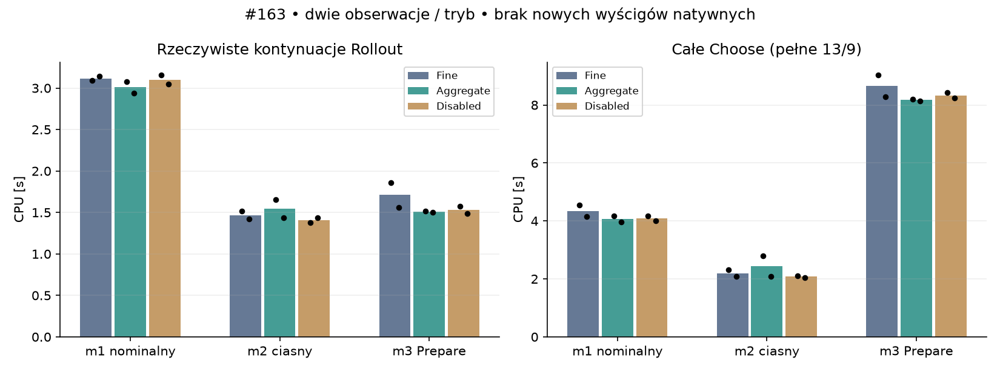
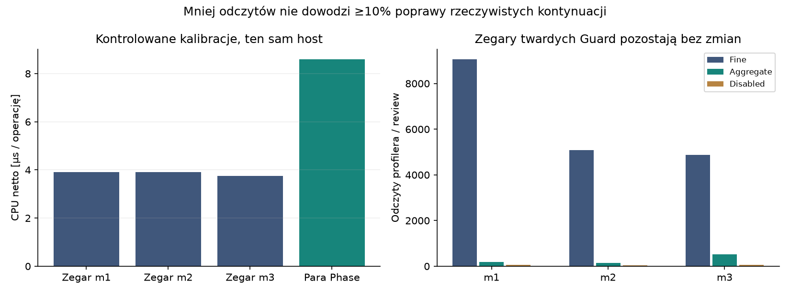

# Badanie #163 — koszt profilowania i fizycznych kontynuacji

**PARTIAL. Rekomendacja: odrzucić agregację jako opłacalną optymalizację planera.**
Eksperyment pozostaje PROVISIONAL i domyślnie OFF. Brama ≥10% nie została spełniona;
uruchomiono **zero nowych światów natywnych**. Nie ma nowego PASS S3 ani PASS wydajności wyścigu.

Baza PR: `2bb03d1e604a521202bd8f90aa70f8db0dc5632d` (#162). Implementacja
fizyki i planera odniesienia: `85a5ee3295c2dd983fbacb21859649f794cc5ba5` (#161).
ResponseCache162 nie jest używany. Pozostaje niezależne usprawnienie formatu dowodów162.

## Co wykazały istniejące dane

Sześć archiwalnych przejazdów161 pozostaje bez ponownych uruchomień. Zestawienie162
przypisało 5956 s z 9258,8125 s CPU planera do conditional_continuations (64,33%),
1411,609 s do hierarchical_generation, 808,766 s do niezależnego preflightu i
775,781 s do recertyfikacji. To podział CPU instrumentowanego, nie koszt samej fizyki.
Nieudany cache162 zwiększył sumę CPU pięciu porównywalnych światów o 2,44%; nie powielamy go.

Liczba ponad 11 mln odczytów jest statycznym dolnym oszacowaniem: dwa odczyty na każde
żądanie przejścia przez Step/Phase. Dochodzą fazy feedbacku i zegary twardych limitów.
Sama liczba wywołań nie dowodzi dominującego kosztu. Źródła147 otwierają i zamykają
fazę także wtedy, gdy jej nazwa jest identyczna. Każde otwarcie alokuje domknięcie
i obiekt IDisposable; każdy koniec odczytuje Process.TotalProcessorTime.

## Metoda i granice porównania

Wykonano dokładnie trzy zadeklarowane bloki, łącznie **94,734375 s CPU** wraz z
przygotowaniem, kontrolami, zapisem i kalibracją. Nie wykonano dodatkowych samodzielnych
sond certyfikacji. Każdy blok zawiera sześć rzeczywistych pełnych wywołań Choose,
po dwa Fine/Aggregate/Disabled w odwróconej kolejności. Łącznie 18 review13/9.

Autentyczne stany: native-dev, decyzja102, t=20,4 s; held-3, decyzja209, t=41,8 s;
held-2, decyzja344, t=68,8 s (kontekst użycia Prepare). Poprzednią nominalną taśmę
i dziewięć rezerw odtworzono oryginalną fizyką z zapisanych stanów i komend. Sprawdzono
ich bezpieczeństwo i cały poprzedni hash review. Archiwum ustala wejście i oczekiwany
wynik testu; nowe certyfikaty powstają przez świeży preflight, bez uznania archiwum za dowód.

Fine jest odpowiednikiem instrumentacji147 z dodatkowymi licznikami i wspólnym miernikiem.
Aggregate utrzymuje fazę przez całe Rollout; identyczne fazy Step/Feedback zwracają wspólny
pusty IDisposable. Disabled wyłącza jedynie pomiary faz. Wszystkie tryby zachowują
oryginalne pozycje i kod Guard, limity 60 CPU-s/32768 prognoz/2 mln kontaktów/512 błędów,
limit opcjonalnego K1 i zasady odmowy. Zewnętrzny limit bloku120 CPU-s również działa.

Wspólny miernik obejmuje całe rzeczywiste Rollout: propagację, feedback, bezpieczeństwo,
klucze i twarde kontrole. Ten sam zakres i dodatkowe odczyty występują we wszystkich
trybach. Nie sumować Ranges z tabelą faz: zakresy nachodzą na tę partycję. Agregacja
zmienia przypisanie kosztu narzutu do faz; zwykłe tabele faz nie są porównaniem przed/po.

Każdy trial otrzymuje nowy kontroler/Runtime i ten sam odtworzony portfel. Przygotowanie
jest poza czasem Choose; CPU zapisu i hashowania po Choose również. Alokacje całego
trial obejmują dodatkowo konstrukcję hasha, więc dokładniejsze porównanie alokacji dotyczy
Ranges. Pierwszy trial jest widoczny i może zawierać JIT/GC; nie było ukrytego rozgrzewającego
review. Odwrócenie kolejności ogranicza ten problem, ale dwie obserwacje nie dają istotności
statystycznej. Host to Windows10 / Ryzen5 3500X / SDK10.0.101, target net8.0, Release.
Cache kontrolera nie ma historii pełnego wyścigu; wynik nie reprezentuje kosztu całego S3.

## CPU przed i po

Wartości poniżej to mediany dwóch obserwacji, w sekundach CPU. Disabled oznacza
rzeczywistą pracę bez drobnej instrumentacji, **wciąż z pełnymi kontrolami budżetu**.

|Kontekst|Całe review Fine|Aggregate|Disabled|Kontynuacje Fine|Aggregate|Disabled|
|---|---:|---:|---:|---:|---:|---:|
|m1 nominalny|4,343750|4,062500|4,085938|3,117188|3,007812|3,101562|
|m2 ciasny|2,195312|2,445312|2,078125|1,468750|1,546875|1,406250|
|m3 Prepare|8,656250|8,171875|8,328125|1,710938|1,507812|1,531250|

W obu kolejnościach redukcja CPU wspólnych kontynuacji Fine→Aggregate wyniosła:

|Kontekst|Para1|Para2|Brama ≥10% w obu|
|---|---:|---:|---|
|m1|0,505%|6,468%|NIE|
|m2|−9,278%|−1,099%|NIE|
|m3|18,487%|4,000%|NIE|

Nie ma powtarzalnej poprawy spełniającej warunek dopuszczenia natywnego. W m3
conditional_continuations nie jest nawet lokalnie największym zakresem: poza Rollout
pozostaje około6,0–6,3 s CPU, a Fine przypisuje większość do hierarchical_generation.
Sam wybór historycznie dominującego zakresu nie uzasadnia ekstrapolacji na inne stany.
Zysk mediany m1 wynosi około3,5% dla kontynuacji; m2 ma regresję około5,3%.

## Koszt zegara, instrumentacji i pozostałej propagacji

Każdy blok zawiera100000 odczytów tego samego API i kontrolną pustą pętlę oraz20000
par otwarcie/zamknięcie Phase i kontrolny pusty IDisposable. Kolejność w m2 jest odwrotna.
Oba ramiona zawierają identyczne okresowe kontrole limitu bloku. Nie są to dodatkowe
bloki eksperymentalne; były zadeklarowane w planie tych trzech mikrobenchmarków.

|Zakres kalibracji|CPU netto|Koszt jednostkowy|Alokacja netto/jednostkę|
|---|---:|---:|---:|
|100000 odczytów, m1|0,390625 s|3,906 µs|80,056 B|
|100000 odczytów, m2|0,390625 s|3,906 µs|80,002 B|
|100000 odczytów, m3|0,375000 s|3,750 µs|80,002 B|
|20000 pełnych Phase, każdy blok|0,171875 s|8,594 µs|288,024 B|

CPU ma kwant około15,625 ms. Pusta pętla i pusty IDisposable dały0 ticków CPU,
co oznacza koszt poniżej rozdzielczości, a nie darmową operację. Pomiar wall i surowe
alokacje zachowano w każdym archiwum. Para Phase obejmuje dwa odczyty zegara,
aktualizacje słowników oraz obiekty scope; nie jest samą fizyką.

Odczyty profilera/review Fine→Aggregate: m1 **9058→180**, m2 **5090→144**,
m3 **4884→514**. Scope allocations:4497→58,2522→49,2411→226.
Te liczniki wykluczają zegary twardych Guard, które pozostają bez zmian.
Pomnożenie dokładnie11 mln przez lokalną cenę daje około41–43 s CPU i880 MB
przejściowych alokacji. To orientacyjna skala dolnego oszacowania liczby wywołań,
nie zmierzona oszczędność sześciu wyścigów ani górna granica ich narzutu.

Najczystszy dostępny pomiar pozostałej pracy to Disabled: wspólne kontynuacje
3,101562/1,406250/1,531250 s. Nie nazywamy tego kosztem samego kernela opon:
pozostają klucze, feedback, predykcje, bezpieczeństwo i niezmienione Guard. Różnica
Fine−Disabled w medianach tego zakresu wynosi0,015625/0,062500/0,179688 s;
obejmuje szum GC/JIT, więc nie jest dokładną dekompozycją addytywną.
Alokacje kontynuacji m1 wynoszą około2,293 GB Fine i2,292 GB Aggregate na review;
usunięcie scope to mały składnik wobec całej rzeczywistej pracy.

## Dokładna zgodność i niezależność

Wszystkie18 review mają identyczny hash Bits152.Review z archiwalnym161, pełne13 węzłów,
9 terminali i niezależny preflight. Hash zawiera jawne bity stanów, pending i akcji
zaakceptowanego drzewa oraz pełne stany/punkty/komendy nominalnej taśmy i rezerw,
parametry celów i wyniki bezpieczeństwa. To zgodność fizycznego certyfikatu, a nie tylko czasu mety.

|Kontekst|Dokładny SHA256 fizycznego review|
|---|---|
|m1|D355F69A3FB72662B094BD9FF64B1B73A825F26378B85CC1FFE4918CAE4144FD|
|m2|3419B810324F6A5C51E64CB07315C6F8267188D351D7AD03FF87B03CBAA09A86|
|m3|E799288AF7A8C9B0142FA69587791A9E79EAC2AB66AA68112137349EBF5CAC7F|

Liczby wywołań Guard są identyczne we wszystkich trybach:6494,3174,3483.
Pełne liczniki fizyki i cache też są identyczne; niezależna weryfikacja wykonuje
odpowiednio994/643/475 świeżych prognoz (dokładne liczniki w analysis.json).
Mechaniczny generator i test zachowują cały kod Guard. Żadnego wzoru fizycznego,
Box2D, pełnego13/9, pending, reakcji0,24 s, review0,2 s, marginesu0,5 m ani długości
rezerw nie zmieniono. Prepare i Recover pozostają w oryginalnym Generator161.

Hash nie obejmuje czasu CPU, diagnostycznych odrzuceń ani wszystkich wewnętrznych
stanów iteracyjnych niezaakceptowanych propozycji. Ich kod pozostaje oryginalny,
a liczniki pracy są zgodne; nie jest to osobny hash każdej tymczasowej ewaluacji.
Trzy konteksty nie dowodzą równości dla dowolnego wejścia ani zachowania przy granicy
60 CPU-s. Zachowano warunki odmowy, lecz realne przyspieszenie może zmienić moment
osiągnięcia limitu czasu. Tego badanie nie certyfikuje i nie zastępuje pięciu nowych S3.

## Następne konkretne wąskie gardło

W kontekście Prepare około6 s pozostaje poza optymalizowanymi Rollout. Fine wskazuje
hierarchical_generation; Generator161 wykonał trzy pełne manewry i168 fizycznych kroków.
Control161.Action wielokrotnie woła Predict dla oceny bazowej, coasting, pochodnych
steering/gas i prób Newtona. Te oryginalne prognozy propozycji nie są tożsame z
licznikiem TransitionRequests Runtime158. To następny konkretny cel osobnego,
kontrolowanego profilu: rozdzielić koszt tych rzeczywistych Predict, Equilibrium,
ActivationState i alokacji od kosztu akceptacyjnego Runtime158.Step, bez usuwania manewrów.

W pozostałych kontynuacjach do sprawdzenia są ExactKey147.State (MemoryStream,
BinaryWriter i Base64), kolejki/listy punktów PredictorA153 oraz wielokrotne
Clearance153.Check i materializacje tablic. Źródła pokazują te alokacje, lecz brak
profilu stosów alokacji nie pozwala nadać im dokładnych udziałów CPU. Boundary152
ma już przygotowane BVH, a Space161 buforuje geometrię per frame; nie zakładamy,
że cała geometria jest odbudowywana przy każdym kroku. Nie uruchamiamy czwartego badania.

## Dowody, architektura i przekazanie

Oryginalne162 EvidenceBundle162/bundle162 pozostają zamrożone jako osobny komponent
przechowywania: jeden ZIP na świat, policies.jsonl, indeks dokładnych SHA256 payloadów,
CRC i hashe źródeł. Brak nowych tysięcy plików i brak kopii starych archiwów. Nowe dane
to trzy małe gzip z pełnymi review i kalibracjami, plan, rozliczenia i manifest SHA256.
Manifest powstaje po pomiarach jako pieczęć integralności, nie jako wcześniejsza deklaracja.

Granica offline/online pozostaje z ARCHITECTURE.md162: kosztowne planowanie, niezależna
certyfikacja i dowody offline; docelowy kontroler online wymaga oddzielnych dowodów.
Nie zastępujemy certyfikacji uproszczoną kontrolą i nie promujemy tej optymalizacji.

Walidacja wydania: siedem testów modułowych C#163 podczas pracy, następnie jedna
końcowa regresja Draft C#/Python/Node na zamrożonym SHA i jeden Windows CI tego SHA.
Obejmuje pełne wykonanie shardów core+trajectory i discovery wszystkich czterech;
historyczne473 i four-rider48 pozostają discovery-only według niezmienionej polityki Draft.
Końcowe liczby, SHA i link CI znajdują się w osobnych Local-validation-163.json oraz
Windows-CI-163.json, aby ich publikacja nie tworzyła kolejnego commitu i CI.
