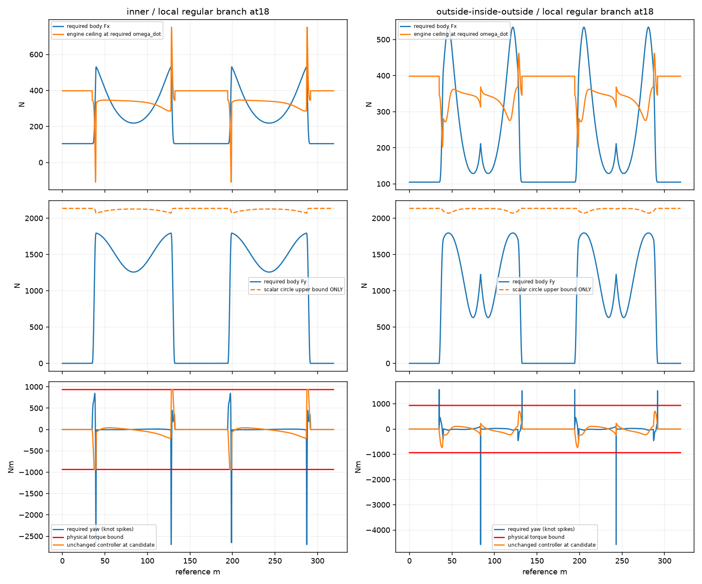
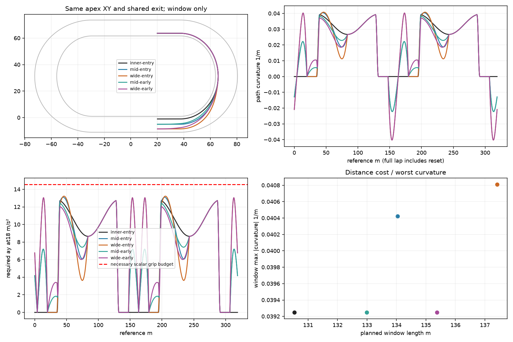
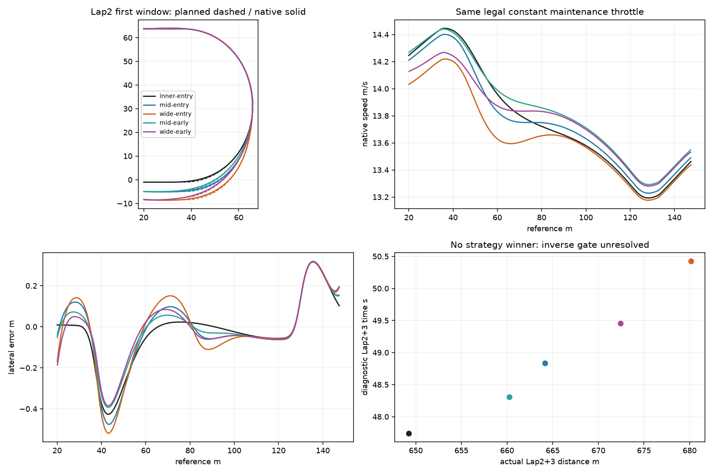
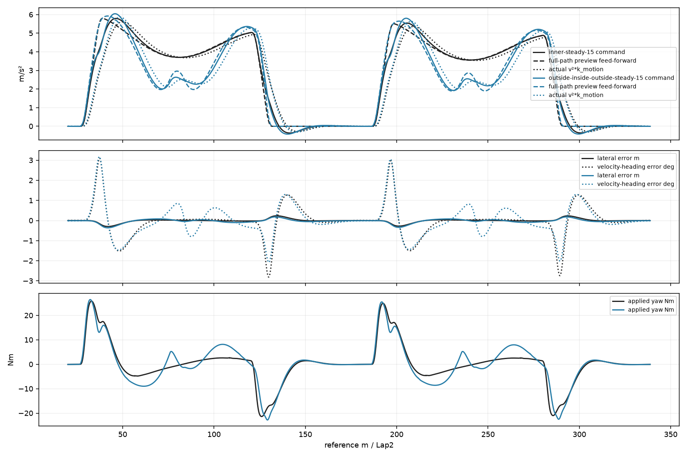

# Inverse Feasibility & Matched-Apex Validation (#105)

**Potwierdzono niezależne ograniczenie dynamiczne regularnej realizacji dokładnej OIO przy18m/s.** C2 w XY nie wystarcza temu modelowi: na wejściu i apexie skacze wymagany yaw rate ciała. Ponadto stan realizujący lokalny bilans sił potrzebuje miejscami niedostępnego momentu koła. Samo `v²κ≤a_grip` przechodzi dla OIO, ale nie stanowi dowodu wykonalności.

**Wykonalność w tolerancjach trackingu #104 pozostaje INCONCLUSIVE.** Nie utożsamiamy matematycznej przeszkody dokładnej Q(t) ze źródłem całego błędu rzędu metrów. Nie skonstruowano legalnego rozwiązania native dla zadanego stałego profilu; nie wolno jeszcze izolować pozostałego błędu regulatora na podstawie założenia, że rozwiązanie istnieje. Brak dowodu wadliwej opony lub silnika. **Ocena B:** audyt odrzuca nieuprawnione założenia, nie dostarcza zatwierdzonej linii wyścigowej.

Baza Draft #104, zweryfikowany lokalnie i przez GitHub HEAD `10f22806140189086860ed104009cd3da03a75e5`. Gałąź `experiment/inverse-feasibility-matched-apex`, jeden Draft do `experiment/racing-line-root-cause`, bez merge. Zamrożone progressive-b, fizyka #100, parametry #104, mass147kg / rzeczywista inertia52.720970kgm² z Box2D. Produkcyjne src/CoreSim, opona, wheel/engine/yaw equations, AI i gains niezmienione. Nowe dane inicjalizacji tylko opt-in/null domyślnie.

## Metoda i granice dowodu

W [InverseFeasibilityAudit.cs](../../tools/shared-world-speedway/InverseFeasibilityAudit.cs) solver dwóch niewiadomych β i ω wywołuje **oryginalne** `SlipCoupledDynamics.Forces`, które wywołuje `RearWheelDynamics.Evaluate`. Nie ma drugiej implementacji tyre law ani integratora ciała. Dla Q(s), v=const: `a=v²κ_path n_in`, `F_net=m a`; do wymaganej siły opony dochodzi oryginalny opór. Globalny wektor jest rzutowany na body forward/side. Rozwiązujemy lokalny bilans obu składowych; residual podano poniżej. Siatka reference≤0,05m, pochodne centralne. To regularna gałąź jazdy do przodu, |β|<1,5rad; solver lokalny nie certyfikuje wszystkich możliwych gałęzi ani pełnego układu.

Następnie `ω_dot=(v/|Q′|)dω/ds`, `T_drive=I_w ω_dot+r Fx+cω`; porównanie z **oryginalną** charakterystyką napędu próbkowaną przy rω, nie przy v. `r_body=vκ+(v/|Q′|)β′`, `τ_required=I_body dr_body/dt`. Sprawdzono fizyczny clamp B·0,5·TechniqueAuthority, zakres target slip wynikający z clamp0,95 oraz istniejący energy guard. Kolumny `required_target_slip` odwracają ten sam wzór yaw, bez wysyłania dodatkowego momentu do świata.

`Forces(dt=0)` służy wyłącznie lokalnemu ciągłemu prawu konstytutywnemu. Osobne wywołania **dt=10ms** przy legalnie obciętym Drive wyliczają rzeczywiste Fx/Fy, zmianę ω, komendę i wszystkie guardy. Obcięte wejście nie naprawia rozwiązania — zapis ujawnia rozbieżność. Lokalne stany nie są odtwarzane przez korektę XY/yaw/ω. Pełny dowód konstruktywny wymaga wspólnego rozwiązania kolejnych zaakceptowanych kroków z ciągłością wheel/body, następnie forward replay w Box2D. Tego dowodu nie uzyskano; jego brak nie jest zastąpiony modelem point-mass.

## 1. Warunki konieczne i pierwsze ograniczenia

|Krzywa / profil|max v²κ/a_grip|min/max Drive z inverse|max abs β °|max ω rad/s|max slip koła|max utilization|max residual N|
|---|---:|---:|---:|---:|---:|---:|---:|
|inner-inverse-15|0.607|0.207/0.607|5.370|48.440|0.070|0.608|0.0020|
|inner-inverse-18|0.874|0.016/2.773|13.280|68.706|0.294|0.876|0.0022|
|matched-inner-entry-inverse-18|0.874|0.016/2.773|13.280|68.706|0.294|0.876|0.0022|
|matched-mid-early-inverse-18|0.874|0.016/2.095|13.280|68.706|0.294|0.876|0.0022|
|matched-mid-entry-inverse-18|0.900|0.016/2.431|16.744|77.067|0.475|0.902|0.0022|
|matched-wide-early-inverse-18|0.897|0.016/2.751|15.984|75.001|0.430|0.898|0.0022|
|matched-wide-entry-inverse-18|0.909|-0.432/6.689|20.637|90.095|0.765|0.910|5.8660|
|outside-inside-outside-inverse-15|0.608|0.207/0.567|5.379|48.447|0.071|0.609|0.0021|
|outside-inside-outside-inverse-18|0.875|0.269/1.761|13.362|68.876|0.298|0.877|0.0020|

Budżet przyczepności14,546245m/s² / B≈2138,298N. Konieczny scalar grip **PASS** w obu krzywych przy18 oraz15m/s. Nie jest to pełny PASS inverse.

Każdy matched przy18 ma również naruszony konieczny warunek napędu na regularnej gałęzi. WIDE-ENTRY na resecie wymaga nawet ujemnego Drive (hamowania), którego nie dostarczono. Pierwsze miejsca wszystkich naruszeń są osobnymi wierszami `FirstEngineFailure/FirstYawFailure/FirstGuardFailure/FirstSteeringFailure` w analysis.json. Nie ma niezależnego hard limitu ω ani slip ratio koła: zakres dostępności wynika z oryginalnego rear-contact, energii, legalnego Drive i momentu silnika przy rω. Ścisły zakres target slide jest odczytywany z **oryginalnego Forces przy nasyconym żądaniu**, a nie przybliżony ze skalarnego grip.

|Constraint|Dowód / pierwsze miejsce|Przekroczenie / wynik|
|---|---|---|
|Ciągłość yaw rate, dokładna OIO18|s=35m, start zacieśniania, κ i β są ciągłe|Δr=0.165190rad/s; wymagany impuls 8.708977Nms, ograniczony moment≤935.505Nm nie może zrealizować skoku w zerowym czasie|
|Ta sama przeszkoda OIO15|s=35m|Δr=0.096471; impuls5.086048Nms; niższa dodatnia prędkość nie usuwa skoku|
|Napęd OIO18, regularna gałąź|pierwsza próbka s=38.097460m|T_required=114.666Nm > available113.040Nm, +1.627Nm; maksimum Drive1.761|
|Napęd inner18|pierwsza próbka s=37.847477m|T_required=117.451 > available113.605Nm; maksimum Drive2.773|
|Yaw torque / target slide|pełne CSV i wykres poniżej|lokalne przekroczenia; pochodna na węźle jest mesh-dependent, dlatego skok oceniono jednostronnie, nie przez pojedynczy pik Nm|
|Energy guard|oryginalny dt10ms + replays|guard zawsze zachowany w wysyłanej komendzie; brak dowodu, że wymagany inverse torque jest osiągalny, patrz `FirstGuardFailure` w analysis.json|
|Niższy profil|17/16 nie przechodzą zamrożonego zapasu20% napędu, wybrano15m/s|maksimum Drive≈0,61 na screenie; pełna siatka i yaw osobno. Bez idealnego hamowania: profil startuje przy15, nie obiecuje zjazdu z18|

### Dlaczego skok jest rzeczywisty

Quintic d(s) ma d′=d″=0 na wejściu, ale `d‴(35+)=-60·6,5/(48,694687...)³`, po lewej0. Stąd skok κ′=0.003377691/m². Na prostej równowaga sił daje β=0; na regularnej gałęzi pochodna normalnej siły względem β z oryginalnej funkcji wynosi17529.558N/rad. Implicit differentiation daje `Δβ′=m v² Δκ′/(∂F_normal/∂β)` i `Δr=v Δβ′`. To lokalne ograniczenie samego ruchu i momentu, niezależne od wyboru preview.

[entry-proof.json](inverse-feasibility-matched-apex/entry-proof.json) łączy analityczną trzecią pochodną quintic z numerycznym Jacobianem **oryginalnego** prawa. [knot-probes.json](inverse-feasibility-matched-apex/knot-probes.json) sprawdza h0,2→0,005m: OIO18 wejście Δr0,162102 przyh0,1 →0,165159 przyh0,01 →0,165191 przyh0,005, zgodne z0,165190. Inner przy tym samym wejściu dąży do0. Na apexie OIO18 Δr≈−0,518rad/s. β jest ciągła, ale jej pochodna nie; układ o ograniczonym momencie wymaga ciągłego r_body. Nie zaobserwowano skoku headingu, XY ani κ.

**Zakres tego FAIL jest ścisły:** dokładna ciągła Q(t), stałe18/15 i regularna gałąź rozwiązania sił. Nie jest to dowód niemożliwości przejazdu z błędem≤0,5/1m. Już na wejściu minimalny czas wygładzenia przy maksymalnym momencie to tylko9.31ms; nie przypisujemy temu automatycznie błędu metrowego. Native i tak stosuje siły odcinkami. Z kolei duży niedobór napędu w środku łuku jest niezależnym argumentem przeciw stałym18 na tym lokalnym rozwiązaniu. Dla inner15 oraz praktycznie wygładzonej OIO15 pełna konstruktywna wykonalność pozostaje **INCONCLUSIVE**.



Na wykresie Fx ceiling oznacza wynik bilansu momentu koła przy wymaganym ω_dot; górna granica Fy z koła przyczepności jest tylko konieczna, bez udawania legalnego rozwiązania tylnego kontaktu. Actual dt10ms i target slip/yaw/energy guard są w tych samych CSV. Piki wymaganej τ na węzłach nie są zbieżnym skończonym momentem — granicą jest impuls wykazany powyżej.

## 2. Matched-apex: niezależna geometria

Wszystkie pięć krzywych zamrożono przed porównaniami: trzy pozycje1/5/8,5m, dwa początki zacieśniania **na wejściu** albo **15m przed wejściem** (inner jest identyczny, zapisany raz). Minimum1m osiągają przy wspólnym anchorze s=83.694687486m, identycznym XY/stycznej/κ. Od tego miejsca do **15m za wyjściem** krzywe są identycznym d=1. Jest to wspólny apex-anchor z plateau, nie twierdzenie o unikalnym minimum offsetu. Drugi łuk jest lustrzany. Na pozostałych32m prostej C2 reset do pozycji wejścia; następne15m przed łukiem trzyma ją albo rozpoczyna early tightening. Koszt resetu wliczony w pełne okrążenie, wyłączony ze wspólnego okna20m→147.389375m. Szeroka pozycja na prostej nie oznacza szerokiego wyjścia.

Pełny footprint mieści się w okręgu1,05m; konserwatywne certyfikaty dowolnego yaw: banda minimum1,415m, kerb minimum0,915m. Między próbkami odjęto1-Lipschitz bound ruchu Q. Niezależne testy XY/κ/C2 oraz pełnych kapsuł sprawdzają zgodność. **Geometria PASS**, osobno od dynamicznej regularności yaw.

|Plan|L lap m|L okno m|max κ lap|max κ okno|min R lap m|max ay18|L/18 lap/okno s|
|---|---:|---:|---:|---:|---:|---:|---:|
|inner-entry|325.062|130.531|0.039249|0.039249|25.478|12.717|18.059/7.252|
|mid-entry|332.787|134.040|0.040424|0.040424|24.738|13.097|18.488/7.447|
|wide-entry|341.256|137.414|0.040809|0.040809|24.504|13.222|18.959/7.634|
|mid-early|330.678|132.986|0.039249|0.039249|25.478|12.717|18.371/7.388|
|wide-early|337.171|135.371|0.040256|0.039249|24.841|13.043|18.732/7.521|

**WIDE nie poprawia najgorszej krzywizny** tej zamrożonej rodziny. Ma lokalnie mniejszą κ we wcześniejszych fragmentach, lecz wspólny późny fragment inner zachowuje jego najgorszy promień, a dodatkowe przejścia mogą go pogorszyć. Początek15m wcześniej zmniejsza koszt względem wejścia na początku łuku, ale nie daje przewagi maxκ nad inner. To wynik dla tych jawnych krzywych i progressive-b, nie uniwersalny zakaz innych trajektorii.

Kolumna L/18 to **warunkowy czas kinematyczny**, bez silnika, a nie wykonalny czas przy tych samych ograniczeniach fizycznych. Żądany idealizowany czas pod **pełnymi** constraints pozostaje INCONCLUSIVE; podanie liczby po samym grip z idealnym hamowaniem byłoby niedozwolonym zastąpieniem testu. Nie uruchomiono ponownie point-mass #104 ani wheelspin ON/OFF.



## 3. Ograniczone forward replay i sterownik

Analiza i [replay-freeze](inverse-feasibility-matched-apex/replay-freeze.json) poprzedzają wszystkie siedem nowych światów. Użyto istniejącego path-preview #104, bez zmiany gains, oryginalnych sił, guardów,10ms/4substeps. Różne początkowe XY są wymagane. Przy reference20m, v18, body yaw wzdłuż prostej, yaw rate0, wheelω=55.845928rad/s i stałe Drive=0.26918706 dają równoważną **ustaloną równowagę na prostej**, sprawdzoną także rzeczywistym krokiem. Nie użyto wspólnego XY dla różnych offsetów. W łuku ta sama legalna przepustnica pozwala modelowi fizycznie zwalniać; nie utrzymuje18 sztuczną siłą. Dwa niższe kontrole #104 startują15m/s ze swoim oryginalnym straight maintenance Drive. Żaden zaakceptowany stan nie jest przestawiany. To próba konstruktywna z legalnym wejściem, która **nie realizuje zadanej Q(t) o stałej prędkości**; nie jest dowodem jej istnienia.

|Próba|RMS/max boczny m|RMS kierunku v °|entry/min/exit m/s|offset przy planned apex m|lag połowy s|tracking|safety|
|---|---:|---:|---:|---:|---:|---|---|
|matched-inner-entry-steady-18|0.136/0.426|0.998|14.200/13.086/13.106|1.020|—|PASS|PASS|
|matched-mid-entry-steady-18|0.178/0.475|1.409|14.157/13.121/13.140|0.971|-0.0081|PASS|PASS|
|matched-wide-entry-steady-18|0.243/0.661|1.947|13.975/13.069/13.089|0.932|0.0048|PASS|PASS|
|matched-mid-early-steady-18|0.160/0.392|1.285|14.189/13.178/13.196|0.988|-0.1545|PASS|PASS|
|matched-wide-early-steady-18|0.222/0.668|1.787|14.010/13.162/13.180|0.959|-0.0683|PASS|PASS|
|inner-steady-15|0.085/0.294|0.762|11.958/11.160/11.166|1.018|—|PASS|PASS|
|outside-inside-outside-steady-15|0.100/0.360|0.784|12.069/11.313/11.317|1.956|0.0177|PASS|PASS|

`phases.csv` podaje osobno oba łuki Lap2/3, rzeczywiste minimum offsetu i jego położenie, błąd XY w planowanym apexie oraz entry/min/exit. Minimum offsetu na wspólnym plateau nie musi być unikalnym apexem; nie podmieniamy nim shared XY anchor. Lateral/longitudinal/velocity-heading/body-heading i actual κ to te same niezależne obserwacje co #104, przy wspólnej zaakceptowanej reference. Różnica headingu ciała i kierunku prędkości jest slide.

Lag to czas przejścia rzeczywistego offsetu przez połowę zacieśniania minus czas zaplanowanego punktu połowy, interpolowany z10ms danych. Ujemny oznacza wyprzedzenie, inner nie ma takiego zdarzenia. `*-preview.csv` zapisuje pełne feed-forward κ oraz osobno jego a, pozycję, damping i rzeczywistą odpowiedź. Odtworzono je offline z zaakceptowanych wektorów, wywołując istniejące `Guidance`; zgodność sumy z pierwotnym żądaniem Forces≤0,0001m/s² jest sprawdzona w `preview-telemetry-verification.json`.

**Wszystkie siedem przejazdów zalicza progi trackingu #104 przy rzeczywiście osiągniętych niższych prędkościach:** matched około13,0–14,45m/s, para startująca15 około11,1–12,37m/s na lotnych próbkach. OIO ma w tej niższej próbie RMS0,100m / max0,360m i rzeczywiste minimum przy50,1% łuku. Jest to konstruktywny dowód legalnej **przybliżonej geometrii przy tych rzeczywistych prędkościach**, nie dowód narzuconego profilu15 ani18. Nie uzasadnia nowego tuningu gains: warunkowy test „legalna stała Q(t) + błąd kontrolera” nadal nie został spełniony.

|Próba|mean Fx/Fy N|mean abs slide °|max wheel slip|max utilization|yaw physical/energy clamp %|max applied yaw Nm|
|---|---:|---:|---:|---:|---:|---:|
|matched-inner-entry-steady-18|102.6/522.9|1.93|0.0338|0.515|0.00/0.00|32.64|
|matched-mid-entry-steady-18|102.5/512.2|2.09|0.0340|0.534|0.00/0.00|30.67|
|matched-wide-entry-steady-18|102.5/492.6|2.17|0.0350|0.534|0.00/0.00|38.65|
|matched-mid-early-steady-18|102.6/520.8|2.11|0.0336|0.488|0.00/0.00|26.90|
|matched-wide-early-steady-18|102.5/506.7|2.22|0.0348|0.463|0.00/0.00|38.90|
|inner-steady-15|78.6/376.0|1.35|0.0301|0.386|0.00/0.00|25.87|
|outside-inside-outside-steady-15|78.2/353.1|1.26|0.0297|0.404|0.00/0.00|26.48|




### Czas i bramka interpretacji

|Próba|Lap2+3 s|actual droga m|okno mean s/m|różnica Lap2/3|koszt drogi s|efekt prędkości s|czas strategii|
|---|---:|---:|---:|---:|---:|---:|---|
|matched-inner-entry-steady-18|47.742949|649.234|9.588/130.308|1.049%|0.000|0.000|INCONCLUSIVE|
|matched-mid-entry-steady-18|48.838998|664.158|9.841/133.766|1.050%|1.097|-0.001|INCONCLUSIVE|
|matched-wide-entry-steady-18|50.424140|680.136|10.166/137.095|1.049%|2.272|0.409|INCONCLUSIVE|
|matched-mid-early-steady-18|48.307002|660.232|9.716/132.786|1.105%|0.809|-0.245|INCONCLUSIVE|
|matched-wide-early-steady-18|49.460088|672.429|9.940/135.174|1.149%|1.706|0.011|INCONCLUSIVE|
|inner-steady-15|56.392079|649.794|11.317/130.448|1.929%|0.041|8.608|INCONCLUSIVE|
|outside-inside-outside-steady-15|60.791266|708.937|12.450/145.234|1.764%|4.390|8.658|INCONCLUSIVE|

To liczby **diagnostyczne**. Nie przeszła bramka inverse dla stałego profilu, a Lap2/3 nadal różnią się o podany procent; nie wykazano stanu okresowego. Ekran stabilności≤0,5% jest pomocniczą konwencją raportu **ustaloną po pomiarach**, nie zamrożonym kryterium akceptacji. Wynik inverse pozostaje nierozstrzygnięty niezależnie od tego ekranu. Nie przedłużano biegu ani nie wybierano liczby okrążeń pod korzystny wynik. W pełnym `analysis.json` tracking może PASS mimo INCONCLUSIVE czasu i inverse. Wynik lepszego trackingu po zwolnieniu nie dowodzi możliwości stałych15 na dokładnej Q(t).

Rozkład ΔT jest tożsamością z #104: `(L−L_inner)/vbar_inner + L(1/vbar−1/vbar_inner)`. Porównuje pierwsze pięć prób przy tej samej przepustnicy i starcie18. Dwie kontrole15 mają inne warunki; ich rozkład względem inner18 jest wyłącznie rachunkiem, bez wniosku o strategii. Nie wykazano, że ewentualna korzyść prędkości szerokiego ustawienia pokrywa dodatkową drogę. **Winner=None**.

## 4. Co rozstrzygnięto i co pozostaje

|Pytanie / bramka|Wynik|
|---|---|
|Geometria C2 i footprint|PASS dla wszystkich matched; nie oznacza dynamicznej regularności|
|Dokładna regularna OIO18|FAIL: najpierw skok wymaganego yaw rate przy s35, dalej niedostępny napęd|
|Dokładna regularna OIO15|FAIL skoku yaw; niższa prędkość usuwa niedobór napędu na screenie, nie całą przeszkodę|
|Pełna native inverse-feasibility w tolerancjach #104|INCONCLUSIVE: nie znaleziono wspólnego legalnego rozwiązania stanów/wejść dla Q(t); nie wykonano certyfikowanego globalnego shooting/optimal-control solve|
|Tracking|PASS/FAIL oddzielnie w tabeli, tylko rzeczywista wykonalna prędkość replay; nie walidacja stałych18/15|
|Czas strategii / prędkość kontra droga|INCONCLUSIVE, brak zaliczonej bramki inverse i stabilnego porównania|
|Czy WIDE ma korzystniejszą geometrię przy tym samym apexie?|Lokalnie mniejsze κ, ale maxκ nie lepsze i droga dłuższa w obu zamrożonych wariantach|
|Regulator czy fizyka?|#104 potwierdził błąd odniesienia regulatora. Tutaj potwierdzono niezależną niespójność dynamiczną dokładnej C2 OIO i niedobór napędu18 na regularnej gałęzi. Nie rozdzielono jeszcze przyczyn całego błędu tolerancji po preview|
|Czy opona / prędkość są wadliwe?|Brak takiego dowodu. Stałe18 nie są neutralnym fizycznie założeniem; bilanse, kontakty i ograniczenia przechodzą. Niedostępna żądana trajektoria nie dowodzi wadliwości modelu|

**Jeden następny PR:** opt-in generator **dynamicznie regularnej pełnej Q(s) z ciągłym κ′ (co najmniej C3 XY)**, w tych samych anchorach i na niezmienionym torze progressive-b, z bramką oryginalnego inverse yaw/engine. Wygładzać Q, także przy węzłach reference; samo zastąpienie offset quintic bez sprawdzenia pełnego XY nie wystarcza. Usuwa potwierdzony pierwszy skok wymaganego yaw rate, bez zmiany opony/yaw/gains. Nie obiecywać18 ani optymalizacji czasu. Acceptance: jednostronne r_body zgodne w tolerancji numerycznej na wszystkich węzłach; pełny10ms coupled solve z ciągłością ω/body i Drive0..1 oraz istniejącymi clamp/guardami; następnie forward bez korekt, z progami #104 i powtórzeniem bez obserwatorów. Jeżeli nie znajdzie się rozwiązania, pozostawić INCONCLUSIVE; dopiero **legalne rozwiązanie + błąd regulatora** uprawnia do wskazania kolejnego składnika sterowania. W tym PR nie ma podstaw do arbitralnej zmiany gains czy opony.

## Walidacja, bezpieczeństwo i reprodukcja

Każdy nowy replay przechodzi pełne kapsuły przy rzeczywistym yaw i konserwatywny between-step bound z #103; szczegóły min kerb/banda są w siedmiu JSON. Oryginalny body+wheel energy ledger ma residual<1J, yaw guard excess0, utilization≤1. Siły i momenty pochodzą wyłącznie z istniejącej ścieżki, Box2D jest jedynym integratorem. Zachowano wszystkie **439 historyczne SHA-256** oraz6 fingerprintów #103,1 kontrolę #104 i nową observed/plain parity.

|Próba|kerb min/bound m|banda min/bound m|energy residual J|yaw guard excess W|
|---|---:|---:|---:|---:|
|matched-inner-entry-steady-18|0.803/0.699|9.268/9.183|0.426300|0|
|matched-mid-entry-steady-18|1.399/1.310|5.481/5.396|-0.237891|0|
|matched-wide-entry-steady-18|1.377/1.284|1.960/1.879|-0.427364|0|
|matched-mid-early-steady-18|1.394/1.305|5.550/5.468|-0.115722|0|
|matched-wide-early-steady-18|1.386/1.296|2.097/1.997|0.023399|0|
|inner-steady-15|1.088/1.000|9.336/9.260|-0.037608|0|
|outside-inside-outside-steady-15|2.521/2.439|1.913/1.837|-0.133626|0|

Wersja robocza definicji resetu kończyła powrót dopiero przy następnym wejściu; preflight inicjalizacji wykrył, że reference20 nie jest wtedy ustaloną prostą. Poprawiono wspólny reset na32m, kończący się15m przed wejściem, **przed jakimkolwiek porównaniem matched replays**. Nie wybrano krzywej według czasu; zapisy pierwotnego preflight i ich hash są w `protocol-correction.json`. #104 i regularne inverse inner/OIO nie zmieniły się. Wszystkie końcowe matched geometry/inverse zamrożono ponownie przed siedmioma replay.

**71/71 celowanych C#,96/96 Python calibration (4 nowe),7/7 CI policy i12/12 Node; restore i Release --warnaserror poprawne.** Końcowy Windows CI podano w PR, wyniki lokalnego TRX w `targeted-tests.json`. Manifest obejmuje wszystkie nowe dowody. Surowe exporty odmawiają nadpisania. Korekta dwóch kolumn analitycznych target slide jest rejestrowana w `inverse-bound-correction.json`; wszystkie pozostałe kolumny sił/stanów oraz wszystkie native replays zachowują identyczne wartości. Python analizuje wyłącznie dane, nie implementuje fizyki. Istniejący replay viewer prezentuje #105 opt-in cases na progressive-b i planowane linie; bez nowej aplikacji.

```powershell
dotnet restore
dotnet build -c Release --no-restore --warnaserror
# Nowy pusty katalog, z root repo; każda faza musi się udać przed następną.
dotnet tools/shared-world-speedway/bin/Release/net8.0/shared-world-speedway.dll inverse-feasibility ../inverse-reproduction freeze
# Następnie: inverse, lower, geometry, replay-freeze, replay, verify, entry-proof, preview-telemetry
python tools/shared-world-speedway/inverse-feasibility-report.py --plots
python -m unittest discover -s tests/calibration -p test_inverse_feasibility.py
```

Raport czyta zapisany katalog docs/experiments/inverse-feasibility-matched-apex. --plots wymaga matplotlib, reszta standardowej biblioteki. Nie uruchamiać ponownie starych generatorów #99–104 do historycznych folderów.
