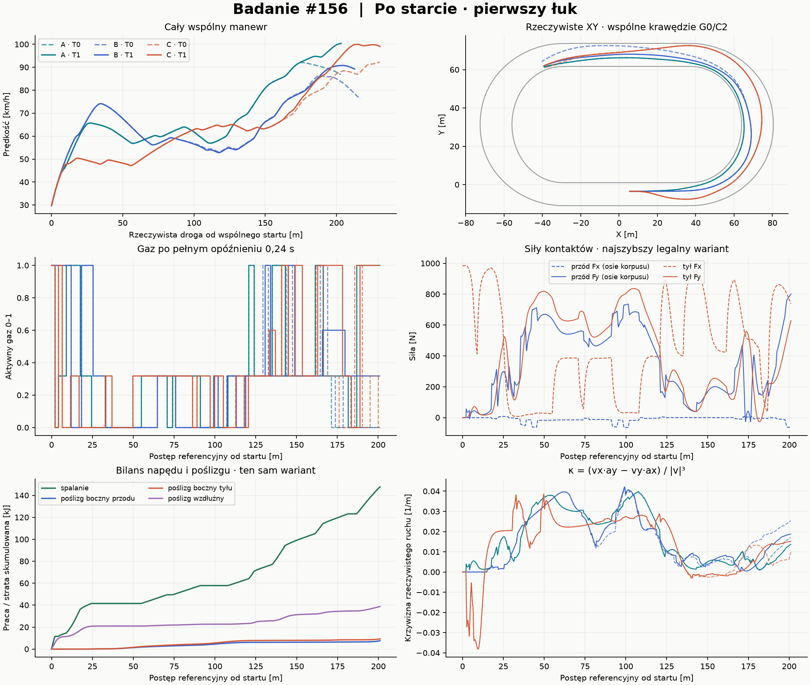
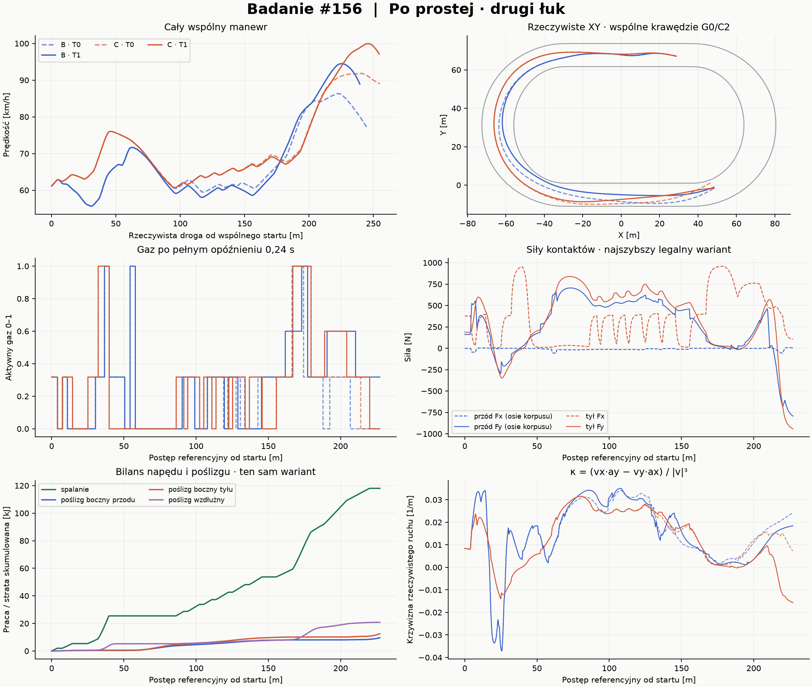
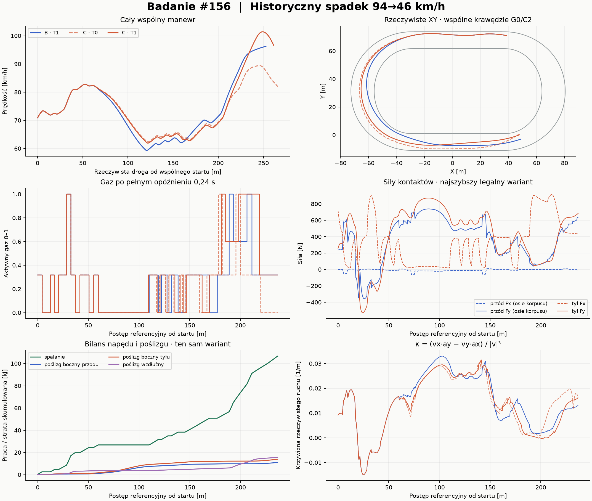
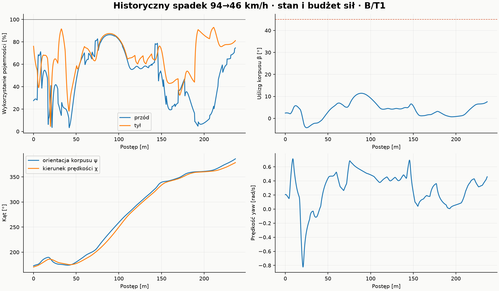

# Badanie #156 — linia jazdy, gaz czy fizyka?

**Wynik: lokalne świadki osiągalności potwierdzone w natywnym Box2D; brak jednej uniwersalnej przyczyny wolnej jazdy.** Po starcie wygrywa ciasna rodzina. Przed drugim łukiem szeroka rekompensuje drogę, ale po optymalizacji jej przewaga nad środkową wynosi tylko **0,018171 s**. W historycznym oknie nowa środkowa sekwencja pokonuje najlepsze legalne T0 o **0,555442 s / 4,256%**. Nie zmieniono fizyki. Transfer najlepszych sekwencji na późniejsze stany jest częściowy; nie rozwijano nowego autonomicznego planera i nie uruchomiono nowych pełnych biegów.

Baza: dokładnie `d1eda795c66a527d25f9ecebd22a6f82d30e5a9b`, HEAD Draft PR #154. Gałąź `experiment/line-throttle-physics-156`. Wszystkie nowe narzędzia są **OFF bez jawnej komendy**, brak merge. Reżim S oznacza cały fizyczny obrys i ciągły swept clearance ≥0,5 m, nie odległość środka motocykla.

## 1. Co dokładnie porównano

T0-rodzina zachowuje oryginalną siatkę akcji i funkcję celu **K1 z #144**: wariant B+F ma już usunięte preferencję gazu częściowego i koszt geometrycznej prędkości. Dodano wyłącznie diagnostyczną dopuszczalność rodziny i wymaganie S dla prognozy. Przy braku kandydata w korytarzu konstrukcja minimalizuje niedopasowanie korytarza; rzeczywista przynależność jest sprawdzana dopiero po wykonaniu. **T0-rodzina nie jest dosłownie niezmienionym autonomicznym AI.** Dlatego osobno odtworzono niezmienione `Policy144.Choose` z tych samych stanów jako `UNCONDITIONED`. Wszystkie trzy takie krótkie próby tracą certyfikat S; nie stanowią legalnego pełnego odniesienia czasowego.

T1 to ograniczona optymalizacja offline rzeczywistych sekwencji kierownicy i gazu. Najpierw badano impulsy przy końcu manewru, następnie jawnie zrównoważono przygotowanie, wejście, apex, wyjście i następną prostą. Sprawdzano także kompletne sekwencje innych rodzin jako punkty startowe. Wykonalne kandydatury danej rodziny porównuje **wyłącznie czas do wspólnego przekroju**. Nie ma nagrody za szerokość, gaz 1 ani minimum prędkości. Kary dotyczące niewykonalności służą tylko konstrukcji niepełnych kandydatur; nigdy rankingowi PASS.

Rodzinę wyznacza średni offset ważony rzeczywistą drogą w środkowych 20–80% łuku: A 0–3 m, B 3–7 m, C 7–12 m od referencji 1 m od wewnętrznej krawędzi. Nie narzucono stałego offsetu. Swobodne komendy dopuszczają szerokie wejście, zmianę apexu i wyjście na inną linię; XY i rzeczywista krzywizna rozstrzygają wykonanie. Pełna tabela jest w [matrix.csv](matrix.csv), wszystkie natywne próby — także gorsze, odmowy, ablacje i transfery — w [all-native.csv](all-native.csv).

|Stan|t źródła [s]|Początek ref. [m]|V pocz. [km/h]|Wejście [m]|Wyjście [m]|Wspólny cel [m]|
|---|---|---|---|---|---|---|
|first|1.6|5.44|29.48|35.00|132.39|206.39|
|second|10.2|138.62|61.09|194.39|291.78|365.78|
|historical|26.8|447.81|70.73|513.17|610.56|684.56|

Każde okno obejmuje przygotowanie, cały badany łuk, całą następną prostą 62 m oraz 12 m fizycznego wejścia w kolejny łuk. Historyczny początek 26,8 s leży przy końcu poprzedniego łuku i daje około 65 m do badanego wejścia. Początkowo rozważana próbka 28,6 s miała tylko 0,317 m odstępu i została odrzucona. Zapis pierwotnej inspekcji zachowano, ale nie użyto jej jako testu S.

Pełny stan pochodzi z zapisanej natywnej obserwacji: ciało, yaw, β, koło, wał, sprzęgło, aktywne sterowanie, uporządkowana kolejka pending i zegar przeglądów. **Każda nowa próba natywna odtwarza oryginalny prefiks od zatrzymanego startu; brak wstrzykiwania lub korekty ciała.** Wszystkie natywne porównania uzyskały identyczny klucz pełnego stanu początkowego. Reakcja pozostaje 0,24 s, decyzje co 0,2 s, aktuator 90°/s i ±35°, β45°. Dawny prefiks K1 historycznego stanu ma status L; margines S obowiązuje w całym nowym oknie od 26,8 s. Nie nazywamy wcześniejszego prefiksu legalnym S.

## 2. Macierz wyników natywnych A/B/C × T0/T1

∆drogi i ∆V̄ odnoszą się do najszybszego legalnego T0 w tym samym stanie: A dla pierwszego, C dla drugiego i historycznego. Gaz 0/P/1 to sekundy w badanym łuku. Straty B/W to boczne / wzdłużnego poślizgu w **całym wspólnym manewrze**; osobne opory i praca silnika są w CSV. CPU podano jako sumę obliczeń kandydatów v3/v4/v5 tej komórki / natywną walidację wybranego świadka. Cały ledger obejmuje ponadto zapis, wszystkie pozostałe próby, kontrole, pilota, analizę i rezerwy. Niepełny prefiks nie otrzymuje czasu pełnego manewru.

### Po starcie — pierwszy łuk

|Wariant|Czas [s]|∆drogi [m]|∆V̄ [%]|Vmin [km/h]|Gaz 0/P/1 [s]|Straty B/W [kJ]|βmax [°]|Sweep [m]|Wynik|CPU szuk./native [s]|
|---|---|---|---|---|---|---|---|---|---|---|
|A/T0|11.240|0.00|0.00|56.85|2.71/2.97/0.20|16.5/34.2|9.4|0.505|PASS|5.61 / 3.78|
|A/T1|11.176|0.10|0.62|56.85|2.71/2.97/0.20|16.8/38.8|16.6|0.542|PASS|47.77 / 3.56|
|B/T0|12.344|13.31|-2.97|53.17|4.40/2.23/0.00|25.5/46.0|17.3|0.599|PASS|5.11 / 3.80|
|B/T1|12.129|9.62|-2.94|52.79|4.40/2.15/0.00|21.4/47.2|18.9|1.531|PASS|47.36 / 4.36|
|C/T0|13.680|27.20|-6.83|47.18|2.67/5.26/0.00|12.9/25.8|6.6|0.522|PASS|5.59 / 4.02|
|C/T1|13.509|27.44|-5.55|47.18|2.67/5.26/0.00|18.6/35.7|29.0|0.661|PASS|47.20 / 4.45|

### Po prostej — drugi łuk

|Wariant|Czas [s]|∆drogi [m]|∆V̄ [%]|Vmin [km/h]|Gaz 0/P/1 [s]|Straty B/W [kJ]|βmax [°]|Sweep [m]|Wynik|CPU szuk./native [s]|
|---|---|---|---|---|---|---|---|---|---|---|
|A/T0|—|—|—|—|—/—/0.00|5.2/0.4|25.1|4.596|UNCERTAIN|1.64 / 3.14|
|A/T1|—|—|—|—|—/—/0.00|12.8/1.6|45.2|1.497|DNF|8.81 / 3.20|
|B/T0|13.251|-9.52|-5.39|59.49|3.60/2.68/0.12|27.1/13.2|16.3|1.024|PASS|6.25 / 5.94|
|B/T1|12.951|-15.63|-5.60|58.05|3.80/2.30/0.12|29.2/16.8|34.6|0.710|PASS|54.50 / 6.28|
|C/T0|13.023|0.00|0.00|60.66|3.51/3.20/0.00|23.1/18.8|11.9|0.530|PASS|6.12 / 5.78|
|C/T1|12.932|-0.60|0.47|60.66|3.50/3.20/0.00|22.1/20.8|19.2|1.882|PASS|55.08 / 6.11|

### Historycznie problematyczny łuk

|Wariant|Czas [s]|∆drogi [m]|∆V̄ [%]|Vmin [km/h]|Gaz 0/P/1 [s]|Straty B/W [kJ]|βmax [°]|Sweep [m]|Wynik|CPU szuk./native [s]|
|---|---|---|---|---|---|---|---|---|---|---|
|A/T0|—|—|—|—|—/—/0.00|12.0/0.9|34.9|1.083|UNCERTAIN|2.05 / 7.38|
|A/T1|—|—|—|—|—/—/0.00|18.0/3.2|45.6|1.083|DNF|14.50 / 7.67|
|B/T0|—|—|—|—|—/—/0.00|19.5/0.9|42.6|1.083|UNCERTAIN|1.11 / 7.59|
|B/T1|12.495|-12.97|-0.66|59.31|3.55/2.43/0.00|25.0/15.6|11.4|0.782|PASS|26.02 / 14.03|
|C/T0|13.051|0.00|0.00|62.31|3.93/2.60/0.00|29.7/11.7|15.8|0.576|PASS|5.42 / 10.05|
|C/T1|12.730|-4.59|0.75|61.91|3.78/2.60/0.00|30.8/23.6|35.3|0.782|PASS|46.39 / 13.36|

DNF w odrzuconych T1 A/B oznacza przekroczenie porównawczej obwiedni β45°, **nie stwierdzony upadek**. UNCERTAIN T0 oznacza odmowę dalszej konstrukcji przy dotąd bezpiecznym prefiksie. Natywny status „experiment timeout” dla kompletnego świadka to zaplanowany stop na wspólnym przekroju, nie sportowy DNF. Fizycznie osiągnięty cel i ciągły certyfikat, a nie tekst tego technicznego statusu, wyznaczają PASS. T1 B w historycznym stanie stał się legalny dopiero w poszerzonym przeszukiwaniu; wcześniejszy DNF jest zachowany.

Przy DNF/UNCERTAIN straty, β i sweep w tabeli opisują wyłącznie zaobserwowany prefiks, nie cały niezakończony manewr. Kontrole UNCONDITIONED kończą się przy min. odstępie pozy0,590/0,591/0,603 m i boundzie swept0,499/0,498/0,495 m: jest to brak certyfikatu ciągłego S, nie potwierdzone naruszenie pozy lub kontakt.

## 3. Czy wzrost prędkości pokrywa drogę?

Dla wspólnych przekrojów warunek równoważnego czasu wynosi `V̄_szeroka / V̄_węższa = L_szeroka / L_węższa`. Procent wymaganej poprawy to `100·(L_szeroka/L_węższa−1)`. Liczymy rzeczywistą drogę, a nie 2π razy żądany offset.

|Stan / gaz|Zmiana|Dodatkowa droga [m]|Wymagane ∆V̄ [%]|Osiągnięte ∆V̄ [%]|∆czasu [s]|
|---|---|---|---|---|---|
|first/T0|A→B|13.31|6.56|-2.97|1.104|
|first/T0|A→C|27.20|13.40|-6.83|2.441|
|first/T0|B→C|13.89|6.42|-3.98|1.337|
|first/T1|A→B|9.52|4.69|-3.54|0.953|
|first/T1|A→C|27.34|13.46|-6.13|2.333|
|first/T1|B→C|17.83|8.38|-2.69|1.380|
|second/T0|B→C|9.52|3.88|5.70|-0.227|
|second/T1|B→C|15.03|6.28|6.43|-0.018|
|historical/T1|B→C|8.38|3.32|1.41|0.235|

To rozdziela wyniki A i B z zadania: przed drugim łukiem występuje lokalny wynik A — C wygrywa z B. W historycznym oknie występuje wynik B — nowa B pokonuje C, a stałe preferowanie szerokości byłoby błędem. Po starcie żadna badana szeroka rodzina nie rekompensuje kosztu. Nie ma podstaw do globalnego wyniku C ani formalnego zakazu szybszej jazdy.

## 4. Gaz, kierownica i interakcja

Osobne ablacje wcześniejszych świadków v3/v4 zachowują identyczny stan i zegar: zmieniony tylko gaz, tylko kierownica albo oba komponenty. Nie są ablacjami późniejszego świadka v5; ta granica jest jawna.

|Stan / rodzina|Zmieniony komponent|Pełny czas [s]|βmax [°]|Sweep [m]|Wynik|
|---|---|---|---|---|---|
|first/A|T1-gas-only|—|9.37|0.463|UNCERTAIN|
|first/A|T1-steer-only|11.246|9.37|0.542|PASS|
|historical/C|T1-gas-only|—|45.07|0.576|DNF|
|historical/C|T1-steer-only|13.018|11.81|0.782|PASS|
|second/C|T1-gas-only|13.017|11.86|0.530|PASS|
|second/C|T1-steer-only|12.984|13.92|1.228|PASS|

Dla pierwszego A sama zmiana gazu traci swept reserve, sama kierownica kończy minimalnie wolniej niż T0, a para kończy o 0,063860 s szybciej. Dla historycznego C sam gaz przekracza β45°, sama kierownica jest legalna i daje mały zysk; para daje większy. To konstruktywny dowód interakcji, nie nakaz gazu 1. W końcowym drugim B czas poprawia się o 0,300204 s przy **0,2 s więcej gazu 0 w łuku**, mniejszej prędkości minimum i krótszej drodze. Więcej gazu i wyższe minimum nie są poprawnymi zastępnikami pełnego czasu. W historycznym C czas gazu 0 maleje o 0,144324 s; gaz pełny nie staje się dominującą strategią.

## 5. Siły, krzywizna, yaw i granice wnioskowania

Wszystkie kandydatury propaguje oryginalny kontakt #144 z oryginalnym silnikiem/wałem/sprzęgłem i wspólnym budżetem Fx/Fy tyłu. Narzędzie korzysta z istniejącego predyktora #153 i jego dokładnego stanu koła. Wybrane kompletne i negatywne sekwencje sprawdzono w oryginalnym natywnym Box2D. Pozostałe odrzucone kandydatury mają status prognoz, nie dowodów natywnych. Model A/B opony, μ, moc, masa147 kg, bezwładność52,72097 kg·m² i geometria nie były zmieniane.

Rzeczywistą krzywiznę liczymy z zaakceptowanych prędkości i przyspieszeń: `κ=(vx·ay−vy·ax)/|v|³`. Obejmuje ona fizyczną zmianę offsetu, apexu i kierunku ruchu. Nie używa `R_ref+offset` jako zamiennika trajektorii. W CSV są również Fx/Fy przodu w osiach korpusu, Fx/Fy tyłu, procenty osobnych budżetów, ψ, χ, β i yaw, praca spalania, poślizg boczny obu opon, poślizg wzdłużny, opory, ciepło sprzęgła oraz resztka energii. Dla pełnych PASS macierzy resztki zintegrowanego bilansu wynoszą mniej niż 0,4 J; nie dopisano hamulca lub korekty prędkości.

Opona przednia jest pasywna; moment yaw wynika z ramion kontaktów, nie z osobnego napędu yaw. Tylna pojemność dzieli się między Fx i Fy. W zbadanych pełnych manewrach występuje wykorzystanie bliskie granicy, ale sam szczyt wykorzystania nie dowodzi globalnego ograniczenia całej trajektorii. Przy gazie0 siły boczne i opory nadal odbierają energię. Zapisane straty wyjaśniają fizyczne zwalnianie; wybór sekwencji określa, jak długo układ w tym stanie pozostaje.

Ponownie wykorzystane optymistyczne granice #149: całkowita pojemność około1852 N, przy90 km/h potrzeba promienia około49,6 m, przy100 km/h około61,2 m przy oddaniu całego budżetu na skręt. G0/C2 ma lokalny minimalny promień referencji około24,479 m; stały maksymalny offset nie daje takiego zapasu w każdym miejscu. To ograniczenia **lokalne i optymistyczne dla wskazanej krzywizny**, nie globalny dowód dla zmiennej linii. Nowe świadki osiągają minima łuku59–62 km/h w historycznym oknie; nie wykazano utrzymania70–100 km/h w całym łuku ani skalibrowanego realizmu opony. Bez danych kontaktu i geodezji nie da się uczciwie przypisać całej luki tempa oponie, yaw lub krzywiźnie.

## 6. Odłożone stany i brama dalszego rozwoju

Odłożono rzeczywiste stany S0 z1,8 i10,4 s. Bez strojenia usunięto już przeszłe komendy z zamrożonej sekwencji i zachowano własną, niezmienioną kolejkę pending odłożonego stanu. To transfer otwartej sekwencji, **nie test nowej adaptacyjnej polityki**. Różnice pending pozostają fizycznie wiążące.

|Próba natywna|Czas [s]|Sweep [m]|βmax [°]|Wynik|
|---|---|---|---|---|
|held-first-A-T0-final|—|0.896|45.4|DNF|
|held-first-A-T1-final|—|0.896|45.4|DNF|
|held-first-B-refined-final|11.929|1.531|18.9|PASS|
|held-first-B-T0-final|12.144|0.599|17.3|PASS|
|held-first-B-T1-final|12.100|1.172|30.4|PASS|
|held-second-B-T0-final|—|0.446|16.7|UNCERTAIN|
|held-second-B-T1-final|—|0.446|16.7|UNCERTAIN|
|held-second-C-refined-final|—|0.493|2.6|UNCERTAIN|
|held-second-C-T0-final|—|0.493|2.6|UNCERTAIN|
|held-second-C-T1-final|—|0.493|2.6|UNCERTAIN|

Środkowa pierwszego łuku zachowuje lokalny zysk także po transferze. Najszybsza ciasna pierwszego i szeroka drugiego nie przechodzą wszystkich transferów; w drugim oknie jest utrata certyfikatu przed stwierdzonym naruszeniem pozy. **Brama rozwoju nowego autonomicznego algorytmu pozostaje zamknięta.** Nie promowano taśm, nie uruchomiono pełnych trzech okrążeń ani kolejnego większego planera.

## 7. Osiem odpowiedzi

1. **Czy za blisko krawężnika?** Niezmieniony K1 nie uzyskał pełnego ciągłego certyfikatu S w tych oknach. Nie jest to jednak uniwersalny powód wolnego tempa: najlepsza legalna rodzina po starcie jest ciasna, a historyczny prefiks zaczyna się blisko zewnętrznej.
2. **Czy szerzej daje większą prędkość?** Przed drugim łukiem C ma średnią łuku około65,9 km/h wobec62,2 km/h B/T1. Po starcie C jest wolniejsza także średnio.
3. **Czy rekompensuje drogę?** Tak lokalnie przed drugim łukiem; nie po starcie ani wobec nowego historycznego B. Po optymalizacji przewaga C nad B w drugim stanie wynosi tylko0,018171 s.
4. **Czy AI za mocno odpuszcza?** Nie wykazano, że każde odpuszczenie jest błędem ani że wystarczy globalnie zwiększyć gaz. Potwierdzono lepsze sekwencje przy tej samej fizyce; część wygrywa mimo dłuższego gazu0.
5. **Czy więcej gazu działa z odpowiednią kierownicą i ślizgiem?** Tak, lokalne wspólne zmiany bywają legalne i szybsze, gdy sama zmiana gazu traci margines lub β. Nie wykazano długiego pełnego gazu jako najlepszego rozwiązania tych łuków.
6. **Opona, yaw czy krzywizna?** Wszystkie oddziałują przez rzeczywiste kontakty. Nowe lepsze świadki wykluczają tezę, że fizyka narzuca dokładnie dotychczasowe wolne tempo. Nie wykluczają fizycznej przyczyny pozostałej luki do realizmu; kalibracja nadal jest konieczna.
7. **Ile bez zmiany fizyki?** Pierwszy stan0,063860 s (0,568%) względem najlepszego T0; drugi0,091067 s (0,699%); historyczny0,555442 s (4,256%) przez B/T1 zamiast najlepszego legalnego C/T0. Są to pełne wspólne manewry, nie wynik całego biegu ani nowego AI.
8. **Co zmienić w autonomicznym zawodniku?** Uczyć lub wybierać sprzężone punkty zmiany gazu i kierownicy, mierzyć czas do wspólnego następnego przygotowania, uwzględniać prawdziwą krzywiznę i zachowywać pending. Nie kodować preferencji kredy, szerokości ani pełnego gazu. Przed wdrożeniem trzeba wykazać adaptacyjne odzyskanie świadków na obu odłożonych stanach, z niezależnym swept preflight. Obecne badanie dostarcza danych i sekwencji do tego testu; nie implementuje kolejnego planera.

## 8. Wcześniejsza wiedza wykorzystana zamiast powtarzania

|Badania|Wniosek użyty w #156|Źródło|
|---|---|---|
|#101–103|Geometria C2 i taper szerokości; maksymalne szerokie plany potrafią nie wrócić przed zwężeniem. Zachowano G0/progressive-b.|[raport](../progressive-bend-width.md)|
|#104–105|Zadane Q(s), jego krzywizna i rzeczywiste wykonanie to różne rzeczy; przy zmiennym offsecie potrzebne są d′/d″, a granica yaw może wyprzedzać skalarną v²κ.|[raport](../inverse-feasibility-matched-apex.md)|
|#106–107|Stare pełnogazowe próby nie wykazały przewagi szerokiej; poślizg fizycznie rozprasza energię. Nie powtarzano starych macierzy mocy/gripu.|[raport](../full-throttle-slide-grip-audit.md)|
|#116–118|Silnik ma zapas na prostej; kierunek ruchu i orientacja różnią się. Poziom μ i combined slip pozostają bez kalibracji.|[raport](../tyre-surface-diagnostic.md)|
|#119–124|Wczesne przygotowanie może uratować łuk, ale poprawny target i safe entry nie gwarantują tempa ani kolejnego łuku. Zachowano sprzęgło/wał i realistyczną kolejkę.|[raport](../speed-line-rider-root-cause.md)|
|#131–135|Trening i dostępność pełnego gazu nie gwarantują lepszego pełnego czasu; dłuższe sekwencje wymagają natywnej walidacji.|[raport](../multi-action-planning/README.md)|
|#136–138|Zmiany yaw, kierownicy i gazu oddziałują. Pełny gaz bez właściwej kontynuacji nie daje powtarzalnego legalnego rozwiązania.|[raport](../throttle-steering-decoupling/README.md)|
|#139–140|Fenomenologiczne prawo opony i regularizacja muszą być odróżnione od integratora; separacja nie jest kalibracją.|[raport](../tyre-law-regularization/README.md)|
|#141–143|Koszt CPU jest bramą; samo usunięcie preferencji gazu daje mały efekt, zachłanny postęp może pogorszyć niezawodność. K1 już usuwa B/F.|[raport](../racing-constraints-speed/README.md)|
|#145–147|Zapisane94→46 km/h, pełne energie i łańcuchy komend; świadki skoordynowanych zmian istnieją, ale nie są nowym AI.|[raport](../corner-speed-loss/README.md)|
|#148–149|Oszczędności CPU nie poprawiają jazdy; lokalne Rmin24,479 m i niekalibrowana opona ograniczają interpretację. B opony miał wyższą Vmax, ale gorszy czas.|[raport](../tyre-physics-corner-limits/README.md)|
|#152–155|Wyniki L nie są S; pełny obrys0,5 m, sweep, pending i odmowy muszą pozostać jawne. Certyfikat13/9 nie dowodzi dobrego tempa.|[raport](../hierarchical-maneuvers/REPORT.md)|

Odczytano istniejące natywne K1, prefiks S0, prognozy/certyfikaty155, bilanse145 i audyt149. Nie regenerowano historycznych wielookrążeniowych testów ani map opon.

## 9. Zakres przeszukiwania, koszt i odtwarzanie

Przeszukano skończoną przestrzeń: siatka przeglądów0,2 s, impulsy1/3/6 przeglądów, gaz0/0,31820688/0,6/1, resztkowe zmiany kierownicy od±0,05° do±0,75° wokół rzeczywistych komend K1, różne indeksy początku oraz pary gaz/kierownica. Późniejsze przeszukanie obejmuje przygotowanie i wejście, nie tylko wyjście. Nie przeszukano wszystkich ciągłych sekwencji kierownicy do±35°, wszystkich czasów ani wszystkich krzywych XY. Żaden brak świadka nie jest globalnym dowodem niemożliwości. Wszystkie zyski są zarejestrowanymi sekwencjami, nie estymacją modelu punktowego.

|Zamknięty plik wyszukiwania|Zapisane oceny|
|---|---|
|matrix-first-v3.json|760|
|matrix-historical-v4.json|1025|
|matrix-second-v3.json|767|
|refine-first-v5.json|773|
|refine-historical-v5.json|776|
|refine-second-v5.json|667|

Koszt końcowy analizy i eksportu: **937.953 CPU-s rozliczonych /1200**. Zawiera130 CPU-s całej utraconej rezerwacji podczas błędu pełnego dysku oraz100 CPU-s jawnej rezerwy na inicjalizację wcześniejszych procesów przed dawnym Begin. Te230 s nie są bezpośrednim pomiarem CPU. Pozostałe wpisy są pomiarami procesów; po poprawce Begin obejmuje cały proces od zera. Ukończone pomiary, odrzucone wersje i zerowy urwany plik historycznej próby są zachowane. `disk-full-recovery.json` wyjaśnia odtworzenie ledgeru z następnych rezerwacji. Ostatnia rezerwa twardego limitu pozostaje niewykorzystana. Standardowe regresje i CI są poza budżetem eksperymentu, zgodnie z wcześniejszym protokołem repozytorium.

Nowych pełnych biegów: **0**. Każdy natywny świat to ograniczony prefiks i wspólny manewr albo jawna próba negatywna. Nie uruchamiano CEM, treningu losowego, nowych map gripu ani czterech zawodników.

Odtwarzanie z katalogu repozytorium: `dotnet restore tools/line-throttle-physics --locked-mode`, `dotnet build tools/line-throttle-physics -c Release --no-restore --warnaserror`. Komendy `--matrix fixture NOWA_ETYKIETA 100`, `--refine fixture NOWA_ETYKIETA 50`, `--native ścieżka NOWA_ETYKIETA` są jawne i kosztują nowy CPU. Nie używać etykiet zapieczętowanego badania. Do samego obejrzenia wyników wystarczy [samodzielny replay HTML](../../../tools/replay-viewer/study156.html); niczego nie symuluje. [Instrukcja narzędzia](../../../tools/line-throttle-physics/README.md).

## 10. Walidacja

Pełny lokalny Release warnings-as-errors, **2540 C# core/trajectory** — PASS. W pierwszym przebiegu trzy nowe testy wskazały zależność od bieżącego katalogu; narzędzie odnajduje teraz root repo od AppContext, bez zmiany fizyki. Wszystkie2536 wcześniejszych przypadków przeszły już pierwszy przebieg. Testy Python wykryły ponadto CRLF trzech historycznych źródeł skopiowanych przed ustawieniem checkout jak w CI; przywrócono dokładne bloby Git, bez zmiany oczekiwań lub danych. Pełne końcowe wyniki Python/Node, discovery i końcowy Windows CI są zapisane w `VALIDATION.md` oraz opisie Draft PR. Historical/four-rider mają odpowiedzialność discovery-only w Draft według niezmienionej polityki. Zielone CI nie rozszerza wyniku naukowego.
