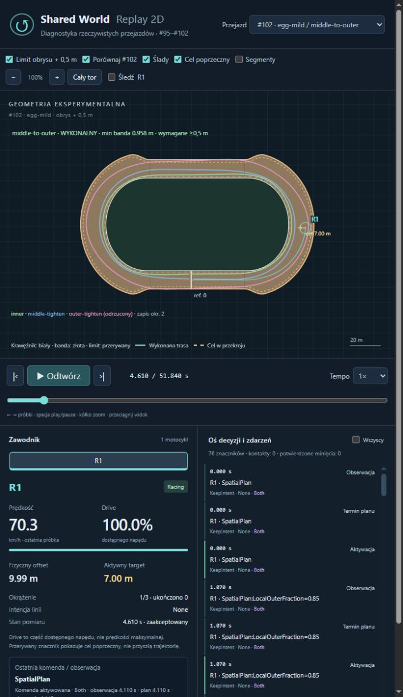
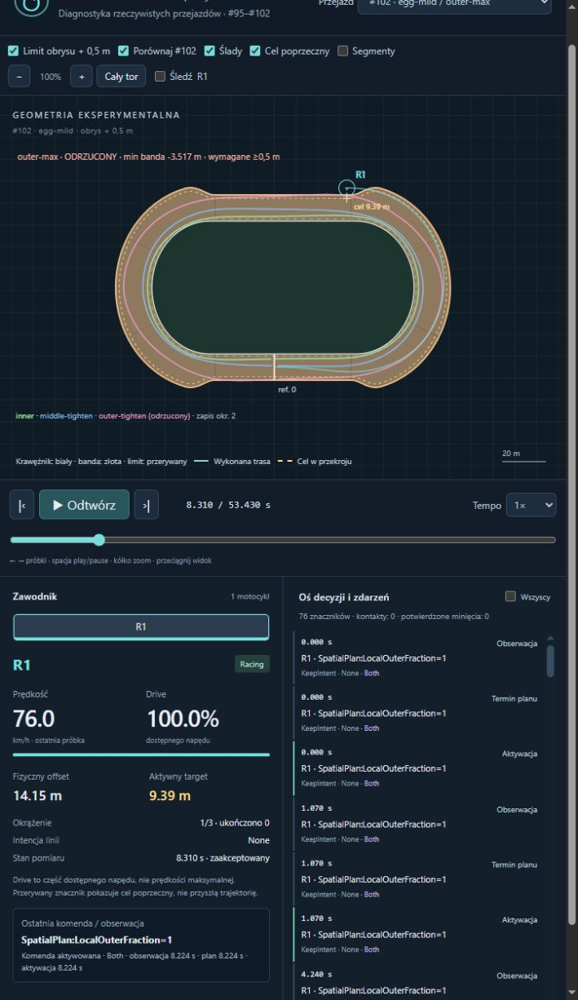

# Lokalny limit zewnętrznego offsetu (#102)

**A — kompletny eksperyment przestrzeni, z zachowanymi wynikami negatywnymi. PROVISIONAL.** Nowy limit dopuszcza target do około **13,985 m w szerokim łuku Egg Mild**, zamiast globalnego9,5m. Dotyczy pełnego mechanicznego obrysu, przy wymaganym prześwicie0,5m. Nie gwarantuje, że regulator wykona taki cel: `outer-max` i `outer-tighten` przecinają bandę na zwężeniu i są odrzucone. Ostrożny `middle-to-outer` jest wykonalny, przekracza9,5m rzeczywistym offsetem, lecz pozostaje wolniejszy od inner. Szersza jazda nie wygrała zamrożonego porównania.

Baza: Draft [#101](https://github.com/arturgladysz91/zuzel/pull/101), `experiment/track-geometry-variants`, HEAD `e27be466416dcba2f3b71bdbb1a5a989f01d43f7`. Gałąź `experiment/local-offset-limit`, target gałęzi #101. Bez merge. Opona, wheelspin, yaw, masa, wymiary, Egg Mild oraz produkcyjne `src/CoreSim` pozostają niezmienione.

## Definicja limitu i granice API

Dotychczasowe `.5 .. Frame.MinimumUsableWidthMeters-.5` dawało9,5m także tam, gdzie fizyczna banda leży na offset15,6m. `TrackFrame.MaximumSafeTargetOffsetMeters(referenceMeters)` korzysta teraz z **lokalnej odległości do rzeczywistej zewnętrznej krawędzi**. To nie jest odległość środka od bandy ani odjęcie samej połowy szerokości kierownicy. Zewnętrzny brzeg pochodzi z natywnych odcinków/łuków z łącznikami skoków szerokości baseline albo z niezmienionej krzywej i taperu #101. Nowy kod nie zmienia geometrii ani nie dodaje ściany do Box2D.

Wybrano dopuszczony w zadaniu **konserwatywny wariant geometryczny**, następnie niezależny audyt całych chassis/handlebar capsules. Natywny `SpeedwayBikeDimensions.Reference.BoundingRadiusMeters=1,05m` obejmuje cały motocykl **przy dowolnym yaw**, również90° i orientacji wstecznej. To świadomie bardziej zachowawcze od maksimum dopasowanego do konkretnego headingu. Nie deklarujemy najciaśniejszego matematycznie limitu dla motocykla ustawionego tangentem. Wymagane0,5m nie jest odejmowane drugi raz w planach.

Tablica dzieli lap reference na komórki≤5cm. W środku każdej komórki bisekcja szuka offsetu d, dla którego dolna granica odległości środka od bandy wynosi co najmniej:

`1,05 + 0,50 + (1 + κ_bound·d_outer_max)·Δs/2 + 0,0001 m`.

Przy stałym d szybkość punktu offsetowego względem s wynosi `1+κd`, a odległość od brzegu jest1-Lipschitz w XY. Zapas środka komórki certyfikuje więc jej cały zakres, nie tylko węzeł. κ_bound dla zamrożonych #101 shapes to0,1/m (testowane wartości są niższe), dla baseline dokładne1/R. Geometria odległości uwzględnia swoje dotychczasowe zapasy:0,1mm numerycznie oraz0,7mm na chord error dla shapes. Oddzielne0,1mm obejmuje pozycję float. Wynik float jest zaokrąglany do wewnątrz. Odczyt tablicy jest stały w komórce, deterministyczny i bez alokacji. Nie dodaje granic kroku solvera.

| Geometria | Limit na starcie m | Maksymalny limit m | Zapas ruchu w komórce m |
|---|---|---|---|
| egg-mild | 9.385103 | 13.985095 | 0.063996 |
| baseline | 9.412221 | 14.012225 | 0.037578 |

Nowe `EnableLocalOffsetLimit` jest **domyślnie OFF**, aby chronić domyślny baseline, stare fingerprinty i niezmieniony AI. W ON wymaga imposed-line slip dynamics oraz wyłączonego ruchu reaktywnego/taktycznego. Początkowy target jest sprawdzany lokalnie; przestrzenne komendy — przy landmarkzie i ponownie na rzeczywistym zaakceptowanym reference. Dla timed commands nie znamy przyszłego reference w konstruktorze: szeroki cel jest dopuszczany jako liczba, a pełna lokalna walidacja następuje przy aktywacji. Utrzymany literalny target jest sprawdzany przy każdym zaakceptowanym początku interwału; wejście w węższy obszar może go odrzucić. Nie jest po cichu obcinany. Nowa ścieżka nie ma twardego9,5m. Zamrożone ścieżki historyczne i AI zachowują dawny kontrakt — nie służą jako implementacja nowych szerokich planów.

Wewnętrzne minimum targetu0,5m i istniejący audyt kerbu≥0,05m pozostają bez zmian. Zmiana zakresu początkowego offsetu w ON dopuszcza lokalną fizyczną szerokość; wykonalność początkowego obrysu nadal podlega pełnemu audytowi.

## Plany i warunki zamrożone przed pomiarem

[freeze.json](local-offset-limit/freeze.json): neutralny profil, wszystkie umiejętności50, masa147kg z motocyklem, Neutral setup, Grip1/Ruts0/Moisture0,5. Te same siły/koło/yaw #100–#101, drive1, start ref0/offset5/v18m/s/yaw tangent, krok docelowy10ms, cztery substeps. Trzy pełne okrążenia; oceniany czas i droga to **Lap2+Lap3**. Egg Mild jest główną próbą; baseline ma tę samą małą kontrolę sześciu planów. Bez Medium i bez przeszukiwania nastaw.

Nowa polityka f oznacza `target=.5+f·(M(reference)-.5)` na każdym zaakceptowanym początku interwału. Jest autorską regułą przestrzenną, nie predykcją przyszłego ciała. Zmienia wyłącznie wejście `TargetOffsetMeters`, bez poprawek pozycji, yaw lub prędkości. Współczynniki i landmarki nie były dostrajane po wynikach.

| Plan | Straight / entry / apex / exit | Komendy |
|---|---|---|
| inner | 1 / 1 / 1 / 1 m | Historyczny #101, bez zmian |
| middle-tighten | 5 / 3 / 1 / 5 m | Historyczny #101; apex45%, exit80% |
| wide-tighten | 9,5 / 7 / 2 / 9,5 m | Historyczny #101; apex35%, exit80% |
| outer-max | M / M / M / M | Lokalne maksimum przez cały przejazd |
| outer-tighten | M / M / 5m / M | Apex40%, ponowne otwarcie75% |
| middle-to-outer | 5m / f0,85 / 7m / f0,75 | Apex40%, exit75%; po łuku z powrotem5m |

Entry przygotowywane15m przed łukiem; lokalna polityka rozwija się wraz z geometrią, zamiast żądać szerokiego targetu łuku na węższej prostej. Historyczne plany są jawnie odtwarzane w ich dawnym trybie limitu OFF jako kontrole #101, ale **otrzymują ten sam nowy audyt prześwitu0,5m**. Jest to konieczne dla bitowej kontroli i dlatego, że okrąg obejmujący każdy yaw bywa bardziej konserwatywny od rzeczywistego ustawionego obrysu (np. stary literalny target9,5m na prostej). Ich fizyka nie jest innym modelem. Dla nowych trzech planów lokalny limit jest ON.

Apex w tabeli komend i rzeczywista pozycja przy geometrycznych50% łuku to różne rzeczy. Plan `outer-tighten` żąda5m przy40%, ale w środku łuku fizyczny offset wciąż wynosi średnio11,936m. Nie zastępujemy go idealnym X/Y.

## Główne wyniki — Egg Mild

| Plan | Lap2+3 s | Droga lotna m | Entry/middle/exit m/s | Max następnej prostej m/s | Min kerb/banda m | Wykonalny |
|---|---|---|---|---|---|---|
| inner | 32.176386 | 646.497 | 22.962/18.981/18.802 | 21.840 | 0.1426/5.5992 | TAK |
| middle-tighten | 32.267617 | 672.034 | 23.475/19.842/19.823 | 22.539 | 2.1785/5.5992 | TAK |
| wide-tighten | 33.125616 | 709.382 | 23.922/19.838/20.609 | 23.086 | 3.6291/1.8360 | TAK |
| outer-max | 35.149043 | 786.089 | 24.431/21.718/21.250 | 23.522 | 5.5992/-3.5166 | ODRZUCONY † |
| outer-tighten | 34.784161 | 759.300 | 24.256/20.320/21.102 | 23.324 | 5.5992/-0.5707 | ODRZUCONY † |
| middle-to-outer | 34.179995 | 736.381 | 24.088/19.917/20.699 | 23.063 | 5.4827/0.9576 | TAK |

† Czasy odrzuconych planów pozostają diagnostyką i nie wchodzą do rankingu wykonalnych. Wszystkie12 światów ukończyło3lap; **8/12** spełnia pełne kryteria (4/6 na każdej geometrii). Równa liczba ukończonych okrążeń nie oznacza zachowania bandy. Rankingi wykonalnych na obu geometriach: inner, middle-tighten, wide-tighten, middle-to-outer.

| Plan | Rzeczywisty offset straight/entry/apex/exit m | Max offset / target m | Czas actual>9,5m s | Max slide ° | Max wheelspin κ | v_out exit m/s | Poszerzenie pierwsze12m |
|---|---|---|---|---|---|---|---|
| inner | 1.335/0.723/1.074/1.411 | 5.000/1.000 | 0.000 | 18.908 | 0.2259 | 1.351 | 0.228 |
| middle-tighten | 4.356/4.265/3.134/2.914 | 5.000/5.000 | 0.000 | 18.911 | 0.2094 | 2.952 | 1.091 |
| wide-tighten | 7.780/8.404/6.180/4.995 | 8.783/9.500 | 0.000 | 18.763 | 0.1894 | 4.255 | 1.839 |
| outer-max | 12.158/9.845/12.383/14.047 | 14.155/13.985 | 45.000 | 17.787 | 0.1662 | 0.544 | 0.021 |
| outer-tighten | 10.693/9.384/11.936/10.378 | 12.150/13.985 | 31.610 | 18.892 | 0.2219 | 3.470 | 0.810 |
| middle-to-outer | 8.112/5.782/9.563/9.368 | 9.997/11.962 | 5.420 | 18.802 | 0.1919 | 1.914 | 0.262 |

Entry/middle/exit, średni straight offset i następna prosta to średnie z czterech łuków Lap2–3; middle jest próbką najbliższą geometrycznym50%, exit pierwszą zaakceptowaną prostą. Straight offset pochodzi z12–45m za łukiem; maksimum speed obejmuje pierwsze45m. Poszerzenie jest maksymalnym wzrostem rzeczywistego offsetu przez pierwsze12m względem wyjścia. Droga jest z wykonanych XY z interpolacją przekroczeń, nie z targetu. Maksima slide/wheelspin/offset, czas>9,5m i minima bezpieczeństwa obejmują **całe3lap**, także rozruch od wspólnego offsetu5m. Wheelspin to maksymalny chwilowy rear-wheel slip ratio #100, bez nowej formuły.

Surowo `outer-max` wykorzystuje szerokość najbardziej: max actual14.155m, ponad9,5m przez45.00s. Jego polecenia nigdy nie wymagają naruszenia lokalnej certyfikowanej granicy; **ciało nie nadąża z wykonaniem zmiany**. Na końcu łuku fizyczna szerokość maleje16,6→12m na10m reference. Motocykl ma wtedy offset≈14m, a limit targetu wraca≈9,39m. Wynik to minimum bandy-3.5166m. Worst accepted stany i sąsiednie minima są zachowane w `measurements.json`, a cały odrzucony przejazd w CSV/JSON. Nie dodano odbicia od bandy ani korekty transformu.

Spośród nowych wykonalnych planów szerokość wykorzystuje `middle-to-outer`: max actual9.997m przez5.42s ponad dawnym limitem. Jego dwa lotne obiegi są o2.003609s wolniejsze od inner i o1.054379s od starego wide-tighten. Większa entry/exit speed nie rekompensuje drogi. Nie potwierdzono bezpiecznej, utrzymanej jazdy całego łuku dokładnie przy0,5m; test maksymalny ujawnił problem wykonania na zwężeniu.

## Kontrola baseline i porównanie z #101

| Plan | Baseline Lap2+3 s | Egg Mild Lap2+3 s | Mild−baseline s | Baseline banda min m | Wykonalny na obu |
|---|---|---|---|---|---|
| inner | 31.771572 | 32.176386 | 0.404813 | 5.5999 | TAK |
| middle-tighten | 32.082181 | 32.267617 | 0.185437 | 5.5999 | TAK |
| wide-tighten | 33.137874 | 33.125616 | -0.012259 | 1.8266 | TAK |
| outer-max | 35.127710 | 35.149043 | 0.021333 | -3.7678 | ODRZUCONY † |
| outer-tighten | 35.180844 | 34.784161 | -0.396683 | -1.0674 | ODRZUCONY † |
| middle-to-outer | 34.427886 | 34.179995 | -0.247892 | 0.7053 | TAK |

Wszystkie6 kontroli inner/middle-tighten/wide-tighten zachowuje **dokładny fingerprint, każdy lap time i sumę dwóch lotnych #101**. Mild nadal ma stratę middle−inner0,091231s i wide−inner0,949230s. Nowy bezpieczny middle-to-outer zyskuje na Mild względem baseline0,247892s, ale nie odwraca rankingu. Mocniejszy target nie jest automatycznie lepszą trasą. Stary wide nie przekraczał9,5m rzeczywistym offsetem nawet na Mild (max8,783m); nowe polityki rzeczywiście otworzyły wcześniej nietestowaną przestrzeń.

## Audyt bezpieczeństwa

Pełny dotychczasowy `RacingLineGeometry.Clearance` bada obie kapsuły przy rzeczywistym yaw, wszystkie zaakceptowane końce kroków i stan początkowy; nie tylko środek ani znormalizowaną linię. Outer wymaga≥0,5m, inner zachowuje≥0,05m; pozostały audyt #101 zachowuje completion, contact/crash, tyre budget, energię i powtarzalność lotnych okrążeń. Odrzucone przejazdy nie są wycinane z danych ani poprawiane po fakcie.

Dodatkowo dla tych **pojedynczych ciał bez kontaktów**, przy istniejącej sile i momencie utrzymanych przez interwał h, audyt odejmuje od mniejszego prześwitu obu końców:

`h/2·(max(speed_before,speed_after)+1,05·max(|ω_before|,|ω_after|))+0,012m`.

Najbliższy czasowo koniec jest odległy najwyżejh/2; prędkości środka i obrotu w bezkontaktowym held-force kroku są ograniczone końcami. Zapas12mm obejmuje przybliżenie headingu Box2D i float coordinates. To konserwatywna kontrola między zaakceptowanymi stanami dla tego zakresu; nie jest nowym solverem ani ogólnym CCD kontaktów. Przekroczenie tej dolnej granicy także odrzuca plan.

| Geometria / nowy plan | Min banda zaakceptowana m | Konserwatywna dolna granica interwałów m | Ocena |
|---|---|---|---|
| egg-mild / outer-max | -3.516639 | -3.635239 | ODRZUCONY † |
| egg-mild / outer-tighten | -0.570655 | -0.691371 | ODRZUCONY † |
| egg-mild / middle-to-outer | 0.957552 | 0.839838 | TAK |
| baseline / outer-max | -3.767765 | -3.888815 | ODRZUCONY † |
| baseline / outer-tighten | -1.067351 | -1.188666 | ODRZUCONY † |
| baseline / middle-to-outer | 0.705268 | 0.586357 | TAK |

Przy stałym pełnym footprint targetu testy obejmują wszystkie7 geometrii #101, width transitions, connectors, ujemny/lap-wrapped reference i yaw0/±0,3/±π/2/π. Każda badana taka poza ma outer≥0,5m. Jest to osobny dowód od wykonania planu przez dynamikę. Literalny target12m jest akceptowany w szerokim łuku i odrzucany na prostej, także jako timed input lub utrzymany po wejściu w taper. Helper nie obiecuje ochrony rzeczywistego ciała przez teleportację.

## Replay i zrzuty

[Uruchomiony viewer — bezpieczny middle-to-outer](http://127.0.0.1:8000/tools/replay-viewer/?case=local-egg-mild-middle-to-outer). [Odrzucony outer-max](http://127.0.0.1:8000/tools/replay-viewer/?case=local-egg-mild-outer-max). Serwer musi serwować root repo: `python -m http.server 8000 --bind 127.0.0.1`.

W dropdown są wszystkie12 nowych przejazdów. Każdy ładuje własny `*-geometry.json`, a stare replaye wracają do starej geometrii. Biała krawędź to kerb, złota banda; przerywana złota linia to **konserwatywny limit targetu pełnego obrysu +0,5m**, nie trajektoria. Zielony/niebieski/różowy ślad pokazuje zapisane drugie okrążenie inner/middle-tighten/outer-tighten (ten ostatni jawnie odrzucony). To porównanie oddzielnych przejazdów jednego zawodnika, nie sfabrykowany wspólny wyścig. R1 i jego aktywny ślad poruszają się wyłącznie według własnego CSV/yaw. Bez nowej dynamiki w JavaScript.

Dynamiczny target lokalnej polityki jest prezentowany z zapisanych próbek; viewer nie przewiduje jego kolejnych wartości. Oddzielne zmiany faz planu mają rzeczywiste czasy aktywacji. Można odtwarzać, przewijać, powiększać i śledzić motocykl istniejącymi kontrolkami. Etykieta bezpieczeństwa pochodzi z pełnego audytu, a nie z animacji≈0,1s.

Zrzuty pochodzą z rzeczywistego uruchomionego viewer, bez retuszu. Bezpieczny stan4,610s jest dokładnym punktem CSV (actual offset9,994863m, active target7m); odrzucony8,310s pokazuje motocykl poza bandą przy target9,39m. Potwierdzono wybór inner/middle/outer oraz działającą animację zegara i pozycji.




## Koszt, testy i ochrona danych

[performance.json](local-offset-limit/performance.json): .NET8 Release, Windows, tiered JIT OFF,5×100000 odczytów po10000 warmup. Tablica powstaje leniwie raz na TrackFrame; runtime nie liczy ponownie kapsuł/BVH/bisekcji. Zachowane są także realne koszty jej budowy i alokacji:

| Geometria | Budowa tablicy ms | Alokacje budowy B | Mediana odczytu µs | Alokacje /100000 |
|---|---|---|---|---|
| egg-mild | 183.597 | 2423712 | 0.029270 | 0 |
| baseline | 268.800 | 589280 | 0.028971 | 0 |

Docelowy cache to około25,5kB float caps; większe tymczasowe alokacje konstrukcji obejmują istniejący BVH/brzegi. Koszt≈0,18–0,27s na zimną tablicę jest istotny i nie jest ukryty za zerowym hot-path GC. Default OFF tablicy nie tworzy. Pomiary samego odczytu nie są kosztem całego świata.

[world-performance.json](local-offset-limit/world-performance.json): identyczny inner, ON/OFF samego nowego limitu, po jednym warmup obu wariantów i5 parach z przeplataną kolejnością, tiered JIT OFF. Fingerprint i solver calls w każdej parze są identyczne. Mediany:

| Geometria / limit | Konstrukcja ms | Sam Run ms | Razem ms |
|---|---|---|---|
| egg-mild / OFF | 2.503 | 53.595 | 56.323 |
| egg-mild / ON | 165.687 | 54.837 | 220.818 |
| baseline / OFF | 0.192 | 43.147 | 43.333 |
| baseline / ON | 240.002 | 43.540 | 283.867 |

Sam Run ma niewielki narzut, ale całość jednorazowego uruchomienia jest wyraźnie droższa przez budowę cache. Nie nazywamy tego bezkosztową zmianą. Początkowy pomiar z rozgrzewającym się tiered JIT przeniesiono do scratch i zastąpiono tą porównywalną metodą; nie służy do deklaracji przyspieszenia.

**37/37 celowanych C# +10/10 Node**, restore i Release całego rozwiązania z warnings-as-errors poprawne. Pięć nowych testów chroni lokalność i pełny footprint, zakazujące targety, rzeczywiste odrzucenie unsafe planu i certyfikację safe, baseline/repeat/reverse,0B w odczycie oraz eksport. Pozostałe32 chronią #99/#100/#101, sterowanie i replay; Node sprawdza każdą nową zapisaną pozycję/yaw oraz geometrię/limit. [validation.json](local-offset-limit/validation.json) zawiera przypadki i kontrole. Standardowe Draft Windows CI na końcowym HEAD: link/status w opisie PR.

Historyczne manifesty zachowały wszystkie hashe: {'autonomous-racing-line': 34, 'slip-coupled-dynamics': 63, 'slip-control-validation': 42, 'physics-driven-racing-line': 21, 'rear-wheel-dynamics': 88, 'track-geometry-variants': 43}. Produkcyjny CoreSim, równania opony/koła/yaw, ContactAdapter, wymiary, ExperimentalTrackShape i native geometry.json są niezmienione. Natywny eksport nadal zachowuje dawny hash. Nie uruchamiano ponownie pełnych historycznych audytów.

Eksperyment główny to12 zamrożonych warunków, dwie celowane próby observer parity oraz oddzielny koszt. Po dodaniu międzykrokowego audytu odtworzono tę samą macierz: wszystkie12 fingerprintów i zamrożone plany pozostały identyczne; nie poprawiano targetów po wyniku. Dane zawierają wszystkie4 odrzucone przejazdy, także ich pełne CSV/JSON i najgorsze stany. Reprodukcja wymaga nowego pustego katalogu; eksporter odmawia nadpisania istniejącego replay:

```powershell
dotnet restore SpeedwayManager.sln
dotnet build SpeedwayManager.sln -c Release --no-restore --warnaserror
dotnet run --project tools/shared-world-speedway -c Release --no-build -- local-offset-limit NEW_DIRECTORY freeze
dotnet run --project tools/shared-world-speedway -c Release --no-build -- local-offset-limit NEW_DIRECTORY measure
$env:DOTNET_TieredCompilation='0'
dotnet run --project tools/shared-world-speedway -c Release --no-build -- local-offset-limit NEW_DIRECTORY cost
dotnet run --project tools/shared-world-speedway -c Release --no-build -- local-offset-limit NEW_DIRECTORY world-cost
dotnet test tests/CoreSim.Tests/CoreSim.Tests.csproj -c Release --filter "FullyQualifiedName~LocalOffsetLimitTests|FullyQualifiedName~TrackGeometryVariantTests|FullyQualifiedName~PhysicsDrivenRacingLineTests|FullyQualifiedName~RearWheelDynamicsTests|FullyQualifiedName~SlipControlValidationTests|FullyQualifiedName~ReplayGeometryTests"
node --test tools/replay-viewer/replay.test.mjs
python tools/shared-world-speedway/local-offset-report.py
```

## Sześć odpowiedzi i jeden następny krok

1. **Czy pełna szerokość czyni wide wyraźnie bardziej konkurencyjnym?** Nie w tej zamrożonej próbie. Nowy bezpieczny plan jest wolniejszy od starych trzech; maksymalne dwa plany są odrzucone. Samo odblokowanie miejsca nie daje przewagi.
2. **Który wykorzystuje limit najlepiej?** Surowo outer-max (14,155m), ale niebezpiecznie. Spośród nowych wykonalnych middle-to-outer (9,997m, certyfikowana dolna granica bandy0,840m). Nie mylimy wysokości targetu z wykonaniem.
3. **Czy inner nadal dominuje?** Tak:32,176386s na Mild, middle-tighten tylko0,091231s wolniejszy. Oba są wykonalne przy zachowanym kryterium kerbu.
4. **Czy Egg Mild z pełną szerokością jest lepszym kandydatem niż w #101?** Dostaliśmy pełniejszą diagnozę, nie mocniejszy dowód przewagi. Mild pozostaje kandydatem; nowy wynik nie uzasadnia zmiany baseline ani deklaracji empirycznego realizmu.
5. **Czy fizyka sensownie korzysta z szerokiego entry/exit?** Umiarkowanie: middle-to-outer ma wyższe entry/exit speed od inner, ale większą drogę. Regulator nie wykonuje wystarczająco wcześnie przejścia z maksymalnie szerokiego łuku do węższej prostej. Mimo poprawnego targetu może opuścić pas; audyt to wykrywa. W tej próbie nie zmieniano równań, by ukryć wynik.
6. **Jedna rekomendacja: kalibracja planów.** Następny PR powinien zamrozić mały, jawny wariant wcześniejszego powrotu do szerokości prostej przed końcem taperu, przy niezmienionym regulatorze i geometrii. Ocenić jednocześnie bandę≥0,5m, rzeczywisty apex, v_out i drogę; nie stroić wyłącznie pod czas. Brak podstaw, by teraz zaostrzać Egg lub zmieniać oponę/yaw. Ocena A dotyczy kompletności przestrzennego eksperymentu, w tym uczciwie zachowanego niepowodzenia jazdy maksymalnej.
