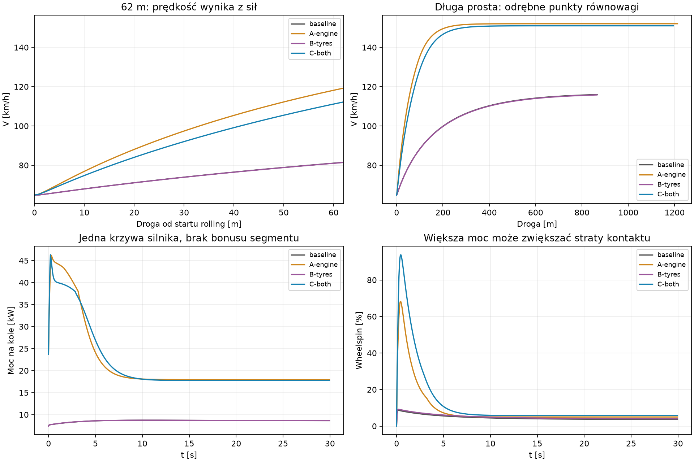
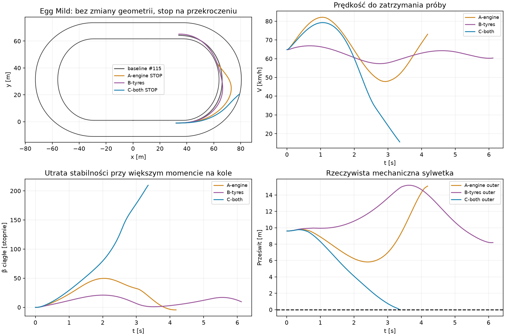

# Silnik 500 cm³, napęd i przyczepność — wariant implementacyjny PROVISIONAL

**Nowa fizyka działa i istotnie poprawia osiągi na prostej.** Po62 m od startu
z18 m/s wariant C osiąga112,22 km/h zamiast81,48 km/h. Nie ma limitera prędkości
pojazdu, dodatkowego przyspieszenia ani korekty pozycji. **Integracja z obecną
kontrolą łuku nie przechodzi:** C przekracza zewnętrzną granicę w pierwszym
łuku Egg Mild. Nie uruchomiono drugiego łuku, okrążenia ani8 okrążeń C.
Nowy model pozostaje za dwiema niezależnymi flagami OFF.

## Baza i rozdzielenie wariantów

Zweryfikowany otwarty Draft #115:
`experiment/adaptive-rider-decisions`, HEAD `d1325442e08233a9f44279c27410321f62a4a6e0`;
baza #114 `7f7ff47c926e2ecbd8a34f82abf27dbc0de14f77`, dalej #113
`fc5d184e95fa3d6d12c27abd59ab8de7e2630bee`. Jeden kolejny Draft na #115, bez merge.

| Wariant | Enable500CcEngine | EnableLoadBasedTyreGrip |
|---|---|---|
| #115 / baseline | OFF | OFF |
| A — nowy silnik | ON | OFF |
| B — nowe obciążenia/przyczepność | OFF | ON |
| C — oba | ON | ON |

Obie flagi domyślnie OFF, pomijane w historycznej serializacji. Wymagają dwóch
kontaktów #112, koła i kierownicy #113. Odrzucają transfer nacisku #114 oraz
stary `ExperimentalDrive` z mnożnikiem momentu. Brak nowego stanu wału/sprzęgła:
to mechanicznie sztywny pojedynczy bieg dla rolling startu. Start z postoju
z nowym silnikiem jest jawnie odrzucany, zamiast dodania ukrytego sprzęgła.

Geometria Egg Mild/progressive-b, masa147 kg, I52,72097 kg·m², gabaryty,
położenie osi+0,70/−0,60 m, koło0,33 m/I0,9 kg·m², opory, profil zawodnika,
gains #113 i decyzje #115 są identyczne. Dwa syntetyczne promienie i długa
prosta służą wyłącznie izolacji zjawisk; nie zastępują geometrii Egg Mild.
`src/CoreSim` i dotychczasowe kalibracje pozostają niezmienione.

## 1. Co ograniczało stary napęd

Przeanalizowano `LongitudinalDynamics`, `SegmentPhysics`, `RearWheelDynamics`,
`TwoContactBikeDynamics`, `SlipCoupledDynamics` oraz zaakceptowane kroki
`WorldRunner`. Stara siła na prostej jest referencyjną siłą przy16 m/s,
wyprowadzoną z zakresu1,6–3,2 m/s², umownej masy142 kg, setupu i nawierzchni.
Łuk ma osobny zakres1,2–2,8 m/s². Nad16 m/s siła maleje liniowo zgodnie
z `CalculatePositiveDriveEnvelopeMultiplier`; wywołanie następuje przy
**prędkości obwodowej koła**, więc wheelspin dodatkowo zmniejsza napęd.

Nie był to silnik o określonej pojemności, charakterystyce RPM ani mocy.
W izolowanej prostej jego maksymalna moc na kole wynosi8,73 kW, moment133,93 Nm.
Wyznaczona równowaga to116,78 km/h; po30 s osiąga116,00 km/h. Zatem wcześniejsze
83–85 km/h na Egg nie są twardym Vmax: istotne są krótka prosta, słaba moc
i ponowne straty w łukach. Na62 m od18 m/s uzyskuje tylko81,48 km/h.

Stary budżet `B=m·MaxSafeTurnSpeedForRadius²/R` zawiera referencyjne19 m/s,
umowne24 m promienia, umiejętności i setup. Ponieważ `Vsafe∝sqrt(R)`, R w B
w dużej części się redukuje; pozostaje kalibracja prędkości zakrętu jako
źródło dostępnej siły. Nowy wariant opony nie wywołuje tego helpera.

Nie zmieniono oporu `40+0,20·V²` N. W historycznych8 okrążeniach INNER #115
praca silnika wynosi1018,897 kJ; straty przodu390,415, tyłu boczne179,217,
wheelspinu83,163, opory338,194 kJ. Bilans pokazuje, dlaczego zwiększenie
samego gazu nie gwarantuje szybszego łuku.

## 2. Silnik, źródła i jawne założenia

[Oryginalna instrukcja JRM/JAWA889, str.12](https://www.jawa500.cz/element/simple/documents-to-download/c/9/82967b1759773d81.pdf)
podaje499 cm³,48–50 kW przy8500 obr./min i metanol. Użyto danych w kW;
wydruk ma niespójne przeliczenie bhp. To wiarygodny punkt odniesienia klasy500,
**nie deklaracja odwzorowania najnowszego silnika GP2026 ani pełna mapa hamowni**.

Potwierdzony punkt mocy uzupełnia poniższa **założona**, niezmierzona krzywa:

| obr./min | 0 | 2000 | 4000 | 6000 | 7500 | 8500 | 10000 | 11000 | 12000 |
|---|---:|---:|---:|---:|---:|---:|---:|---:|---:|
| Moment wału [Nm] |0|35|47|54|57|55|44|35|0|

Interpolacja liniowa, `P=T·ω`; szczyt około48,96 kW. Założenia o niskich
obrotach, spadku momentu i odcięciu przy12000 obr./min są jawne. Odcięcie
usuwa dodatni moment zapłonu; **nie przycina RPM koła ani prędkości motocykla**.
Nie jest zaleceniem bezpiecznego limitu mechanicznego konkretnego JRM.

`ωengine=i·ωwheel`, `Twheel=η·i·Tengine(RPM)·Drive`. Jedno i pozostaje stałe
podczas przejazdu i nie zależy od nazwy segmentu. Bazowe i=9, mapowanie
dotychczasowego setup.Gearing0..1 daje10..8. Są to jawne wartości startowe,
spójne z zakresem rzeczywistych kombinacji w
[tabeli przełożeń JK Speedway Service](https://www.speedwayservice.at/images/knowledge/JK_en_transmission-ratio.pdf);
nie dobrano ich do czasu okrążenia. Test pokazuje większy moment krótkiego
przełożenia przy małych obrotach koła i późniejszą przewagę długiego biegu.

η=0,94 jest założeniem sprawności przekładni, nie pomiarem danego motocykla.
`Wcrank=Wwheel/η`, `Ltransmission=Wcrank−Wwheel`. Moment jest oceniany przy
zaakceptowanym RPM; praca korzysta z rzeczywistego midpoint RPM istniejącego
solvera koła. Model pomija bezwładność wału i sprzęgło, zachowując dotychczasową
bezwładność koła. Nie ma osobnej mocy na prostej i w łuku ani mnożnika umiejętności
zawodnika w nowej charakterystyce mechanicznej.

W próbie prostej nowy moment na kole osiąga481,84 Nm, moc46,18–46,31 kW
w zaakceptowanych interwałach. Niewielka różnica od η·P przy początku kroku
wynika z midpoint RPM przy stałym momencie interwału, nie dodatkowej energii.

## 3. Opona i dostępna przyczepność

`µeffective=µreference·surface.EffectiveGrip`, `Bfront=µeffective·FzFront`,
`Brear=µeffective·FzRear`. Statyczne normalne obciążenia wynikają z równowagi
sił i momentów: `FzFront=mg·0,60/1,30`, `FzRear=mg·0,70/1,30`.
To46,15/53,85 zamiast umownego40/60; nie włącza transferu nacisku #114.

µreference=1,4 jest **niezweryfikowaną hipotezą efektywnego kontaktu bieżnik–grunt**,
nie zmierzonym współczynnikiem gumy ani ukrytym bonusem zakrętu.
Brak kalibracji empirycznej: [producent Mitas](https://www.mitas-moto.com/en/products/motorcycle-off-road-tires/speedway-tires/speedway)
opisuje wpływ karkasu i powierzchni styku, ale nie publikuje użytecznej krzywej
Fx/Fy/RPM/µ dla tej nawierzchni. **Nie przypisujemy producentowi wartości1,4.**
To otwarte ograniczenie modelu. W zamrożonych warunkach Grip1/ruts0/moisture0,5
EffectiveGrip=0,9175, µeffective=1,2845, B/m=12,601 m/s² — mniej niż stary
budżet około14,546 m/s². Nie zwiększano gripu w celu osiągnięcia zadanych liczb.

Pozostaje dyssypatywna, znormalizowana charakterystyka kontaktu: przód przeciwdziała
lokalnej prędkości bocznej w ramie skręconego koła; tył jednocześnie rozdziela
Brear między Fx i Fy według poślizgu wzdłużnego oraz bocznego. Istniejący
unikalny skalarny root koła uwzględnia reakcję Fx na obroty. Kąt poślizgu
wynika z `atan2(vside,vforward)`; nie ma narzuconego β ani mnożnika za ślizg.
Zachowano oryginalną regularizację0,12 i relaksację0,03 s.

Normy sił nie przekraczają µFz, obciążenia sumują się do mg i bilansują moment
statyczny. Całkowity budżet nie zależy od prędkości zakrętu, promienia, nazwy
segmentu ani umiejętności. Dwa punkty sił i r×F pozostają fizycznie te same.
W idealnym granicznym przypadku bez napędzania koła daje to górne oszacowanie
76,7/86,7 km/h dla promieni36/46 m. **To nierówność sił, nie zadana prędkość
ani dowód stabilnego wykonania łuku**; combined slip i regulator obniżają możliwości.

## 4. Zestaw porównawczy

W kolumnie #115 jest konfiguracja odniesienia z kierownicą #113 i wyłączonym
adaptacyjnym AI. Osiem okrążeń139,003 s pochodzi z zachowanego INNER; dawnych
145,837 s kontrolera adaptacyjnego nie mieszano z fizycznym porównaniem.
Wszystkie nowe próby zaczynają od18 m/s, z tym samym zawodnikiem i setupem.

| Parametr i kontekst | #115 | A: silnik | B: przyczepność | C: oba |
|---|---:|---:|---:|---:|
| V po62 m prostej [km/h] |81,48|119,26|81,41|**112,22**|
| V równowagi długiej prostej [km/h] |116,78|152,05|116,59|150,99|
| Średnie przyspieszenie0–2 s [m/s²] |1,602|6,530|1,594|5,384|
| Czas62 m [s] |3,037|2,394|3,039|2,505|
| V w środku łuku R36/R46 [km/h] |68,76/73,71|55,85/61,54†|66,25/72,57|—/50,99†|
| V na wyjściu R36/R46 [km/h] |71,07/77,35|90,88/—†|67,56/75,27|—†/—†|
| Max \|β\| w pierwszym Egg [°] |7,14|49,69†|20,91|179,98†|
| Max wheelspin pierwszego Egg [%] |12,64|304,48†|33,33|8934,69†|
| Pełne okrążenie/8okr., avg V [s;km/h] |17,39/139,003;71,96|nie wykonano|nie wykonano|**zablokowane bramką**|
| Min prześwit zewnętrzny pierwszego Egg [m] |8,948|5,821†|8,178|−0,029†|
| Koszt samej oceny sił, matched |1,000×|1,043×|1,012×|1,061×|

† Próba nieukończona; wartości środka łuku to wyłącznie osiągnięte stany
przed przekroczeniem, nie stabilna prędkość łuku ani wynik okrążenia.
R36/46 to osobne, sztywne kołowe fixtures o szerokościach12/16,6 m, pełnym
gazie i bez decyzji AI; wymaganie docelowego promienia nie koryguje ruchu.
Zaczynają z β=0, toczącym kołem i body yaw18/R rad/s; w obrębie każdego
promienia wszystkie warianty mają dokładnie ten sam stan początkowy.
Rzeczywista krzywizna pochodzi z różnicy kierunków wektora prędkości i drogi,
nie z przyjętego R. W środku R36 średni promień ruchu wynosi odpowiednio
36,99 /20,15 /43,95 m; C nie osiąga środka. Dlatego nie uznajemy A za
stabilną jazdę95 km/h po R36, mimo chwilowego peaku95,88 km/h.
CSV zawierają pełne Fx/Fy, α obu kół, β, RPM, wheelspin, κ i prześwity.

Wheelspin zachowuje definicję #100 względem **lokalnej prędkości wzdłużnej
tylnego kontaktu**. Gdy β zbliża się do90°, ten mianownik jest mały i iloraz
staje się bardzo duży. To nie8934% przekroczenia prędkości obrotowej silnika:
max RPM C na Egg wynosi11688. Jest to skrajna utrata stabilności i duży
poślizg względny; nie interpretujemy ilorazu jako efektywności napędu.

Na długiej prostej max wheelspin baseline/A/B/C to8,62/68,28/9,19/93,82%.
Większa moc realnie zwiększa napęd, ale słabszy budżet tyłu zwiększa wheelspin
i obniża przyspieszenie C względem A. To oczekiwany kompromis, nie błąd maskowany
zmianą gazu. Po30 s A/C osiągają równowagę; baseline/B nadal niewiele przyspieszają.
Równowagę wyznaczono osobno z bilansu momentu koła i sił, bez świata lub clampu V.



## 5. Egg Mild i konkretna przyczyna zatrzymania

- **A:** pierwsza próba zatrzymana na wewnętrznej krawędzi przy t4,19 s;
  min wewnętrzny−0,030 m, choć prześwit zewnętrzny jest dodatni.
- **B:** pierwszy łuk ukończony i bramka PASS przy t6,13 s;
  min wewnętrzny0,277 m, zewnętrzny8,178 m. Nie uruchamiano dalszych etapów B.
- **C:** zewnętrzna krawędź przekroczona przy t3,36 s; min−0,029 m,
  pierwsza bramka FAIL. Drugi łuk, pełne okrążenie i8 okrążeń nie zostały uruchomione.
- **Jedyna próba adaptacyjna C:** niezmieniony #115 opóźnia przekroczenie
  zewnętrznej krawędzi do t6,38 s, ale nie rozwiązuje problemu. To diagnostyka,
  nie kalibracja fizyki ani ukończony przejazd.

To czasy zatrzymania diagnostyki, **nie czasy ukończonych łuków po wypadnięciu**.
Nie wykonywano dalszych kroków po wykryciu przekroczenia.

[Odtworzenie zapisanych kontaktów](motorcycle-performance-500cc/loss-of-control.json)
daje dokładnie te same siły,0 różnicy i0 commitów. C przy0,5 s ma
Fx/Brear=0,926, Fy/Brear=0,320, body yaw0,826 rad/s, podczas gdy kierunek
prędkości zmienia się tylko0,275 rad/s. Przy1,0 s β=29,1°, body yaw1,248,
motion yaw0,483 rad/s. Kierownica nie jest jeszcze na limicie odpowiedzi:
**β rośnie, mimo że #113 realizuje dostępne żądanie obrotu nadwozia.**
Przy2,5 s żądanie momentu wychodzi poza dostępny zakres, a steering rate
staje się ograniczeniem; wtedy β jest już około125°.

Pierwsza przyczyna w tym stanie to **utrata stabilności kontaktu tylnego przy
dużym momencie i nieadekwatne sterowanie kierunkiem ruchu**. #113 utożsamia
docelową szybkość zmiany kierunku prędkości z body yaw, co jest poprawne dla
stałego β, ale tutaj β szybko narasta. Nie wykazano, że wystarczy zwiększyć
przyczepność, zmienić gains lub wymusić INNER. Przydatność parametru µ dla
rzeczywistego toru również nie została potwierdzona pomiarem.



Na wykresie β jest rozwinięty ciągle, aby przejście przez±180° nie tworzyło
pozornego skoku. Mechaniczny model nadal jest planarny, bez przechyłu i modelu
upadku przy dużym β; granica toru zatrzymuje audyt. Nie jest to walidacja
realistycznej jazdy z nadwoziem skierowanym przeciwnie do prędkości.

## 6. Energia i precyzja native

Siły opon przeciwdziałają lokalnemu ruchowi względnemu; rear Fx/Fy dzielą
jeden budżet. Większy wheelspin pochłania pracę, a nie ją dodaje.
Przykład30 s prostej C, kJ:

| Praca lub zmiana energii | C |
|---|---:|
| Wejście wału / praca na kole |682,418 /641,473|
| Strata przekładni |40,945|
| Strata poślizgu wzdłużnego |74,665|
| Łożysko / opory ruchu |10,575 /443,904|
| ΔK nadwozia / koła |105,469 /6,794|
| Residual native [J] |−65,874|

Brak kroków tworzących energię ponad pracę silnika i dotychczasowy próg
float. Niezależny ledger wszystkich16 prób wyjaśnia residual przez pracę
zmierzonego błędu impulsu native z różnicą maksymalnie4,1e−8 J.
Wysoka prędkość ujawnia kwantyzację float Box2D: przy32+ m/s dwa ULP
prędkości to około0,001122 Ns dla147 kg. Nawet **niezmieniony baseline**
przekracza dotychczasową diagnostyczną stałą0,001 Ns z wolniejszych przejazdów.

Nie zmieniono globalnych tolerancji. Raport prostej sprawdza jawne oszacowanie
czterech float dodawań prędkości plus błędu arytmetyki sił/massy; max udział
lokalnego limitu wynosi0,995. Dla prób łuku pozostają0,001 Ns i0,00003 Nms.
Sumaryczne ujemne residuale A/C−75,85/−65,87 J oznaczają małą numeryczną
stratę w fazie równowagi, około0,012/0,010% pracy koła, a nie dodatkową moc.
Różnice ledgeru C# z float dot products i niezależnego double także są zapisane
i sprawdzone względem skali pracy, nie arbitralnie ukryte.

Najmniejsza chwilowa strata przodu C w łuku to−0,000494 J: mały błąd
próbkowania siły/zaokrąglenia przy zerowym ruchu bocznym, nie ujemne tłumienie
w charakterystyce. Nie skorygowano go dodatkową siłą. Sumaryczne straty
i całkowity bilans są rozliczone niezależnie. Łączna strata obu opon jest
nieujemna w każdym zapisanym interwale; normy rzeczywistych sił pozostają
w pojemnościach kontaktów z jawnym oszacowaniem zaokrągleń float.

## 7. Koszt i odtworzenie

**16 światów torowych:**4 proste po30 s,8 krótkich kołowych łuków,3 pierwsze
łuki Egg A/B/C i1 próba adaptacyjna C. Nie powtarzano pełnej macierzy po
niepowodzeniu, nie uruchomiono tysięcy wariantów i nie cofnięto nowej fizyki.
Po41 celowanych testach zmiany dotyczyły już tylko audytu zapisanych stanów.

Wszystkie proste mają3000 kroków Box2D i3000 commitów koła, zero inwersji
kierownicy (jawnie utrzymana kierownica0, bez AI). Każdy rzeczywisty interwał
ma dokładnie jeden accepted step i commit; nie ma nowego świata w Forces.
W pierwszym Egg A/B/C wykonano420/615/337 kroków i19054/33635/16639 lokalnych
query kierownicy. Liczby z przerwanych prób nie są porównaniem wydajności pełnego biegu.

[Miarodajny pomiar sił](motorcycle-performance-500cc/matched-force-cost.json):195
tych samych stanów, osiem powtórzeń w serii, rozgrzewka i3 naprzemienne serie;
guidance i CSV zdekodowane przed pomiarem. Mediany dla1560 ocen:
5,708 /5,952 /5,775 /6,055 ms, czyli A+4,3%, B+1,2%, C+6,1% wobec baseline.
Jest to mały lokalny pomiar, bez progu CI i bez obietnicy tego samego narzutu
w zmienionej trajektorii. Wstępny `cost-with-guidance-preliminary.json` zawiera
koszt próbkowania ścieżki i nie jest podstawą tych procentów.
Równowaga, odtworzenie sił i pomiary kosztu używają0 dodatkowych światów/commitów.

```powershell
dotnet restore tests/CoreSim.Tests/CoreSim.Tests.csproj --locked-mode
dotnet build tests/CoreSim.Tests/CoreSim.Tests.csproj -c Release --no-restore --warnaserror
dotnet test tests/CoreSim.Tests/CoreSim.Tests.csproj -c Release --no-build --filter "FullyQualifiedName~MotorcyclePerformanceTests|FullyQualifiedName~PhysicalSteeringControlTests|FullyQualifiedName~DynamicAxleLoadTests|FullyQualifiedName~TwoContactBikeDynamicsTests|FullyQualifiedName~AdaptiveRiderControlTests"
$outDir = 'results/motorcycle-performance-recapture' # świeży katalog
foreach ($stage in @('freeze','straight','arcs','egg-first','diagnose','cost','adaptive')) {
  dotnet tools/shared-world-speedway/bin/Release/net8.0/shared-world-speedway.dll motorcycle-performance $outDir $stage
  if ($LASTEXITCODE -ne 0) { throw "Failed: $stage" }
}
# Przy zaliczeniu C: egg-second -> egg-lap -> egg-eight. Program egzekwuje bramki.
# Po kompresji raw CSV:
python tools/shared-world-speedway/motorcycle-performance-report.py --data $outDir --plots --compact
dotnet tools/shared-world-speedway/bin/Release/net8.0/shared-world-speedway.dll motorcycle-performance $outDir loss-of-control
python tools/shared-world-speedway/motorcycle-performance-report.py --data $outDir
```

`matplotlib` potrzebny tylko dla wykresów; analiza nie symuluje jazdy.
[analysis.json](motorcycle-performance-500cc/analysis.json), [protokół sprzed prób](motorcycle-performance-500cc/protocol.json),
[walidacja](motorcycle-performance-500cc/validation.json) i manifest zawierają szczegóły.
Zachowano **1015/1015** historycznych hashy, fingerprinty i prefiksy OFF.
Ostateczne standardowe Windows Draft CI dla końcowego HEAD jest w opisie PR.

## Odpowiedzi i jeden następny krok

1. **Stary napęd:** za mała rzeczywista moc, liniowy fade od16 m/s koła,
   odrębnie słabszy napęd łuku, krótka prosta i duże straty; nie twardy limit83 km/h.
2. **Nowy silnik:** spójne RPM→T→P i Twheel=ηiT; do około482 Nm i46 kW na kole,
   bez rozróżnienia nazwy segmentu, z jawnymi stratami i odcięciem momentu przy RPM.
3. **Nowe opony:** fizyczny µFz i statyczna równowaga osi, bez Vsafe jako źródła
   siły. Ta hipoteza nie zwiększa gripu; B/C mają mniej rezerwy niż stary model.
4. **Uślizg:** nadal odbiera energię; ledger obejmuje obie osie, rotację,
   koło, opory i przekładnię dokładnie raz.
5. **Osiągi:** tak —112,22 km/h po62 m w C, +30,74 km/h przy tych samych wejściach;
   bez wymuszania V. Stabilna jazda C80–95 km/h w łuku nie została wykazana.
6. **Dalszy wzrost:** budżet kontaktu i utrata stabilności tyłu, brak rozdzielenia
   body yaw od motion yaw przez #113, statyczne obciążenia oraz niezmierzone µ/opory.
   Wynik150 km/h na nieograniczonej prostej nie jest kalibracją rzeczywistego Vmax.
7. **Jeden następny krok:** rozdzielić w #113 sterowanie kierunkiem prędkości
   od obrotu nadwozia przy narastającym β, najpierw na zachowanych stanach C.
   Nie zmieniać do tego krzywej silnika ani µ, aby zamaskować błąd regulatora.

Nowa fizyka pozostaje za flagami OFF. Brak merge i brak promowania niezaliczonej jazdy.
