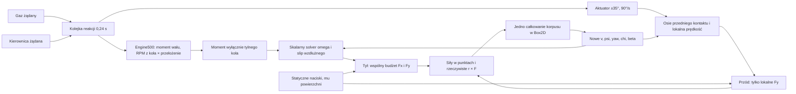

# Audyt równań i ścieżki sił #139

Baza: `713b0cc4274efbc430d51d0a3874a658defe240a`. Przeczytano implementacje TwoContactBikeDynamics, RearWheelDynamics, LoadBasedTyreGrip, SlipCoupledDynamics, Engine500, FreeRacingModel, WorldRunner i ContactAdapter. Wszystkie oryginalne źródła pozostają bez zmian. To audyt narzędziowego modelu 2D, nie pełna fizyka prawdziwego motocykla.

## Napęd, osie i znaki

Nie ma napędu przedniego koła. `Engine500.Evaluate` wyznacza moment na tylnym kole jako `Tcrank(rpm) * overallRatio * efficiency * throttle`. RPM jest sztywno związane z aktualnym omega tyłu. Przód otrzymuje `frontLeft * FyFront`; iloczyn tej siły z `frontForward` wynosi zero z dokładnością float. Składowa tej samej siły w osi **korpusu** może być niezerowa po skręceniu koła. Nie jest to moment ani moc napędowa silnika na przodzie.

Dla każdego kontaktu `v_contact = v_CoM + yawRate × arm`. Przód używa osi obróconych o fizycznie osiągniętą kierownicę. Tył używa osi korpusu. Znak Fy przeciwstawia się lokalnej prędkości bocznej. Zero przedniej siły jest przy `dot(v_front, frontLeft)=0`, a nie przy beta=0 ani przy kierownicy=0. Praca przedniego kontaktu jest niedodatnia: `F_front · v_front = -Bf * w_f² / sqrt(w_f²+d_f²)`.

`ContactAdapter.ForcesAtContacts` przykłada dokładnie dwie siły w punktach osi i opór w CoM. Nie dodaje drugiego momentu yaw. Box2D sam liczy r×F. Koło i aktuator commitują raz po tym samym rzeczywistym kroku. Nie ma zapisu yaw/beta jako polecenia sterującego. FreeRacingModel odtwarza niezatwierdzaną prognozę tych sił, kolejki i aktuatora; nie zastępuje natywnego dowodu.

## Co dokładnie oznacza prawo opon

Przód: `Fy_f = -Bf*w_f/sqrt(w_f²+d_f²)`, gdzie `d_f² = 0,12²*(u_f²+0,5²) + (B_total/m)²*0,03²`. To monotoniczna, gładka funkcja nasycenia. Nie jest dopasowaną do pomiaru charakterystyką opony żużlowej. Nie zawiera camber thrust, śladu pneumatycznego, momentu samonastawnego, ugięcia karkasu ani pamięci naprężenia kontaktu.

Tył po rozwiązaniu lokalnego równania środka kroku używa `a = slip_velocity/d_x`, `b = w_r/d_y`, `Fx = Br*a/sqrt(1+a²+b²)`, `Fy = -Br*b/sqrt(1+a²+b²)`. Zatem `Fx²+Fy² <= Br²`; zwiększony slip wzdłużny zmniejsza dostępne Fy przy ustalonej składowej bocznej. Obie siły pozostają na wspólnym budżecie, a nie na dwóch niezależnych limitach.

Jednocześnie `d_x² = 0,1²*(u_r²+0,5²) + [Br*(R²/Iw+1/m)*0,03]²`. Oznacza to, że **chwilowa zależność Fx/Fy od tego samego slip zależy także od bezwładności koła i numerycznego ogranicznika sztywności**. To weryfikowalna cecha założenia modelowego. Nie jest niezależnie skalibrowanym prawem opony. Mapa wrażliwości rozdziela ten efekt od późniejszego wpływu Iw na rozwój omega.

Nazwy `MinimumContactRelaxationSeconds` i `MinimumLateralRelaxationSeconds` nie oznaczają tutaj osobnego równania czasowego relaksacji siły. Wartości0,03s tworzą skalę/slope regulatora. W kodzie nie ma stanu Fy z prawem `tau*dFy/dt = Fy_steady-Fy`. Osobny wykres takiej relaksacji będzie wyłącznie hipotetyczną analizą, bez implementacji arbitralnego nowego modelu w natywnych światach.

## Dlaczego +592 / −456 Nm

W ostatnim przedziale D0-B z #138 duży boczny ruch przedniego kontaktu nasyca Fy blisko jego budżetu. Przy ramieniu0,70m daje to około+592Nm. Tył zużywa część swojego budżetu na Fx≈640N, więc Fy≈760N przy ramieniu0,60m daje tylko około−456Nm. Pozostaje+136Nm. Fx tyłu działa wzdłuż osi korpusu i przy współliniowym ramieniu nie daje bezpośredniego momentu yaw; jego wpływ jest przez sprzężenie Fx/Fy.

Przy jednakowym efektywnym mu i statycznym rozdziale obciążeń `a*Bf = b*Br`. Gdy obie boczne siły są prawie nasycone w tę samą stronę, napęd w kole tylnym odbiera część jego bocznego budżetu i łamie tę równowagę. Zmiana kierownicy musi wtedy wystarczająco zmniejszyć lub odwrócić przednią siłę. Nie musi się to udać w każdym stanie, ani po uwzględnieniu pełnej reakcji i szybkości aktuatora.

Równowaga momentów nie jest stabilnością: `betaDot = yawRate - chiDot`, `chiDot = cross(v,F)/(m*|v|²)`. Należy też sprawdzić `omegaDot = (T_drive - R*Fx - T_bearing)/Iw`, przyspieszenie i dalszy prześwit. Mapy podają wszystkie te reszty w punktach tau≈0.

## Naciski, masa, roll i ciało zawodnika

Aktualne147kg to77kg motocykla i70kg zawodnika testowego. Statyczne naciski wynikają z ramion0,70/0,60m: przód6/13, tył7/13. Wartość referencyjna mu1,4 jest efektywną hipotezą opona+nawierzchnia, przemnożoną przez lokalny EffectiveGrip, a nie zmierzonym współczynnikiem gumy na szutrze.

Przy płaskim quasi-statycznym przyspieszaniu transfer wynosi `DeltaRearFraction = ax*h/(g*L)`. Wysokość CoM h oraz ruch ciała są nieskalibrowane. Brak transferu może zawyżać przedni budżet podczas przyspieszania, ale nie wolno przypisać mu dowolnej poprawki. Diagnostyka zmienia pojedynczo statyczny podział lub geometrię i jawnie opisuje brak kalibracji.

Nie ma pochylenia, dynamicznej pracy ciałem, sterowania momentem przez kierownicę, sprzęgła ani niezależnej dynamiki wału silnika. Przednie omega, bezwładność rotacyjna i opór swobodnego toczenia nie są jawne. Pominięto zatem dodatkową energię `If*omega_f²/2` i efektywny bezwładny wkład `If/Rf²` podczas przyspieszania. Bez pomiaru If nie określamy jego udziału liczbowego. Nie może to być interpretowane jako przedni napęd. Efekty żyroskopowe przodu wiążą się z brakującymi stopniami swobody3D.

Wkład energii silnika, reakcja Fx na koło i tarcie łożysk są jawne. Monotoniczny lokalny solver wyznacza jedną parę koło–siła, ale poprawny bilans energii nie rozstrzyga realizmu rozkładu sił na szutrze.

## Empiria i granice danych

[Tabela źródeł i statusów](EMPIRICAL.md) rozróżnia specyfikację producenta, regulamin i rzeczywisty pomiar sił. Dokumentacja JRM podaje rozstaw1330mm i kotwicę silnika499cc/48–50kW przy8500rpm. Nie zawiera pełnej krzywej momentu ani CoM zespołu z zawodnikiem. Dane opon Mitas identyfikują rozmiary i konstrukcję, ale nie charakterystykę Fx/Fy w wysokim poślizgu na Motoarenie. Wartości bez takich pomiarów pozostają `UNCALIBRATED`.
