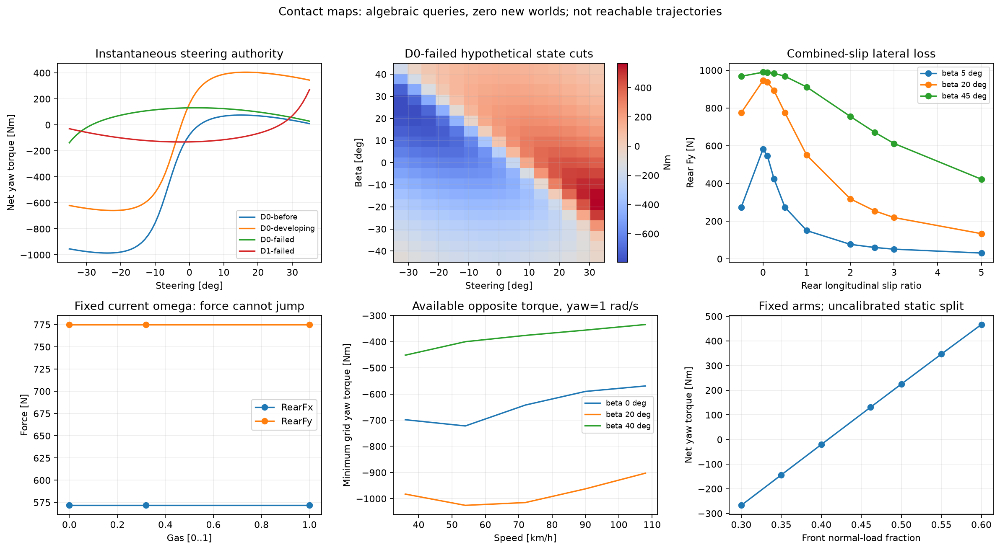
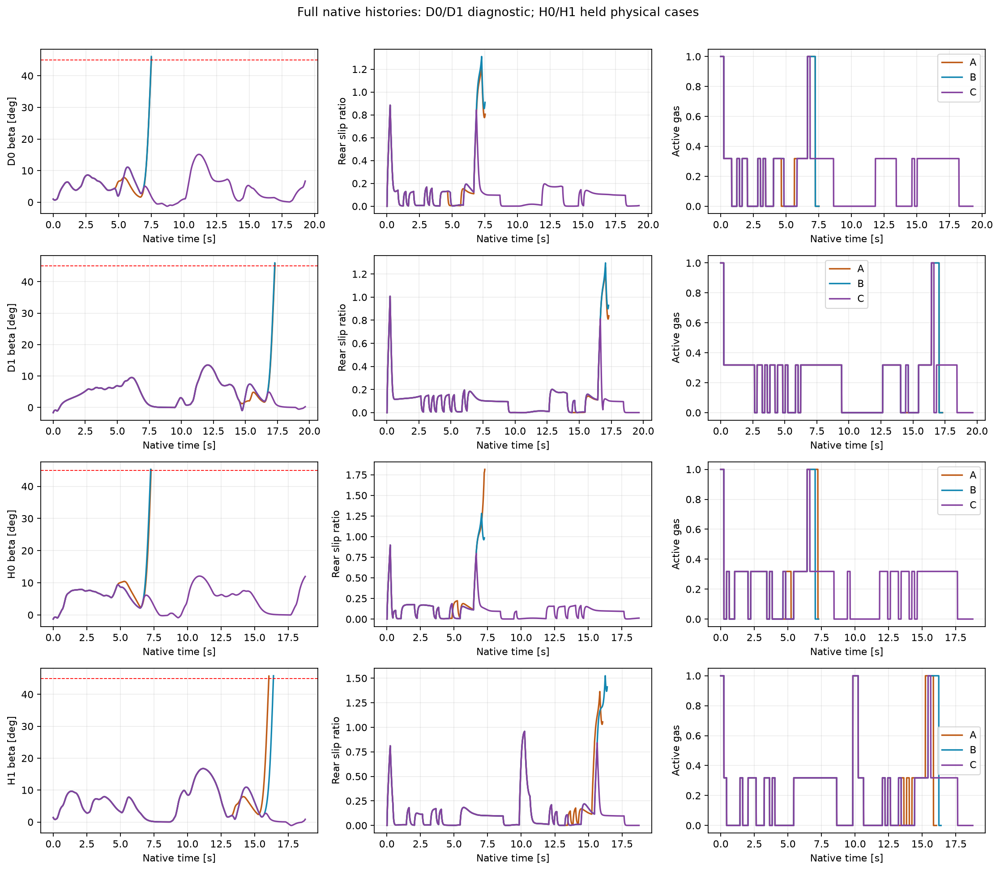
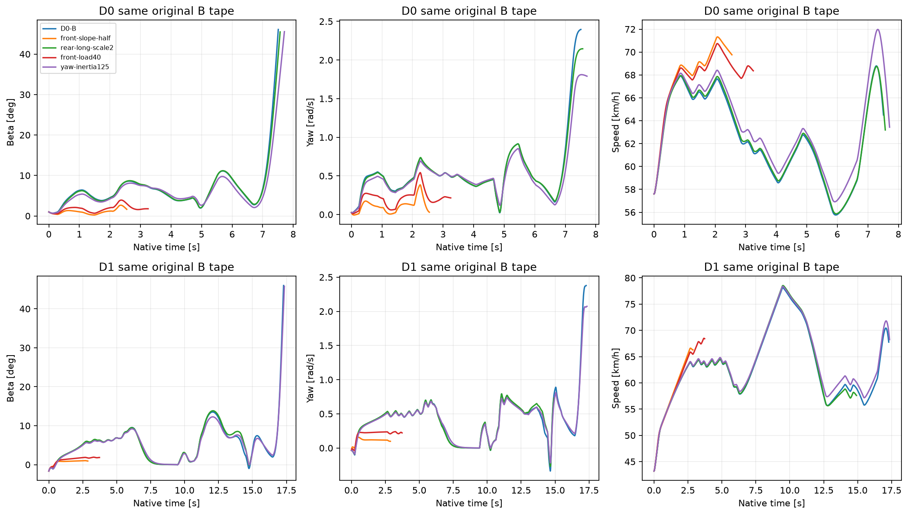
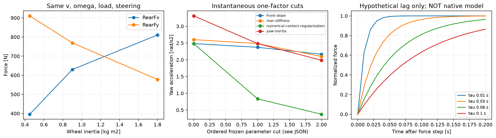

# PR #139 — Speedway Motorcycle Physics & Tyre Contact Validation

Audyt wskazuje dwa odrębne ograniczenia: długie wymuszenie gaz1 destabilizuje badane manewry, a obecne prawo opony zawiera nieskalibrowane sprzężenie charakterystyki sił z numeryką i bezwładnością koła. Nie znaleziono napędu przodu, błędu znaku osi ani podwójnego przyłożenia momentu. Krótkie korekty C umożliwiły legalną kontynuację w 4/4 różnych rodzinach stanów, w tym dwóch odłożonych do potwierdzenia. Samo wcześniejsze przygotowanie B: 0/4 ukończeń.

To nie dowodzi realizmu długiego żużlowego uślizgu. Ukończone C mają maksymalne β 12,09–16,74°, mały udział pełnego gazu i nie ustanawiają stabilnej gałęzi jazdy przy β≈46° / κ≈2,56. Nie dopasowano fizyki do czasu okrążenia ani do 110 km/h. Nie zmieniono produkcji, historycznych praw kontaktu, silnika, przełożenia, Motoareny, polityki #16015 ani zabezpieczeń.

## Dowody i odtwarzanie

- [Audyt równań i schemat ścieżki sił](AUDIT.md), [źródła i statusy parametrów](EMPIRICAL.md), [wszystkie tabele, w tym 16 DNF](TABLES.md).
- [Natywny odtwarzacz](../../../tools/replay-viewer/motorcycle-physics.html): A/B/C dla D0, D1, H0, H1 oraz wszystkie warianty i OFF; pełne historie, orientacja, prędkość, siły, momenty, wheelspin, prześwity.
- `native/`: wszystkie 22 pełne zapisy `.json.gz`, również nieudane; `native-manifest.json`: SHA256/rozmiar/fingerprint. `telemetry/`: CSV gzip każdego kroku; `viewer/`: bezstratne co do czasu i pozycji próbki prezentacyjne. Oryginalne pełne dane mają także pending queue, decyzje i aktywacje.
- `contact-maps.json.gz` i `contact-maps.csv.gz`: 3490 wierszy, 3951 zapytań łącznie z szukaniem pierwiastków i kontrolą benchmarku. **Zero światów Box2D** w mapach. Perturbowane kombinacje nie są dowodem osiągalności.
- `dnf.json`: ostatnie dwa stany i pełne siły dwóch ostatnich przedziałów każdego DNF; niczego nie wycięto. `native-summaries.json`, `steering-authority.json`, `sensitivity-comparison.json`, `claim-gates.json`: dane do weryfikacji wniosków.

Uruchamianie z katalogu głównego repozytorium:

```powershell
dotnet run --project tools/motorcycle-physics-validation -c Release -- --enable-physics-validation139 <nowy-katalog-dowodów> <nowy-katalog-raw> freeze
# maps, osobna ocena hipotezy i lock, preflight, diagnostic,
# sensitivity, osobny lock potwierdzenia, confirmation.
python tools/motorcycle-physics-validation/generate-sandbox.py --check
python tools/motorcycle-physics-report/report.py
python -m http.server 8018 --bind 127.0.0.1
```

CLI wymaga jawnego przełącznika; bez niego diagnostyka jest OFF. Do istniejącego katalogu zakończone etapy nie dodają nowych przebiegów, niedokończona rezerwacja blokuje retry, a zamrożone źródła są kontrolowane hashem. Nie odtwarzać macierzy do samego czytania raportu. Raportowanie czyta wyłącznie zapisane dane; wymaga matplotlib/numpy, bez fizyki ani prognoz.

## Protokół i rozdzielenie pul

Baza dokładnie `713b0cc4274efbc430d51d0a3874a658defe240a`, gałąź `experiment/motorcycle-physics-validation-139`. Pierwszy commit `b63f575` zamroził protokół, przypadki, parametry, siatki, sterowania i kryteria przed mapami i nowymi światami. `0d4c0fd` zamroził hipotezę natywną po mapach, przed preflight. Po dwóch OFF ujawniono błąd infrastruktury: manifest obejmował generowany AssemblyInfo, a testy szukały archiwum względem katalogu bin. Jawna poprawka `c71fd75` ma własne stare/nowe hashe w `infrastructure-amendment.json`; nie zmieniła równań ani eksperymentu i nie powtórzyła światów. Oryginalny protokół nie został przepisany. `146e2e6` zamroził wnioski diagnostyczne i brak adaptacji przed H0/H1.

|Pula|Rodzina|Profil|Badany łuk|v początkowe m/s|Offset m|Początkowy yaw rad/s|
|---|---|---|---:|---:|---:|---:|
|Diagnostyczna D0|D-B|progressive-b|1|16,00|5,00|+0,025|
|Diagnostyczna D1|D-C|progressive-c|2|12,00|7,00|−0,035|
|Potwierdzająca H0|V0|progressive-b|1|15,65|4,85|+0,019|
|Potwierdzająca H1|V1|progressive-c|2|17,85|6,35|−0,021|

Są to cztery różne fizyczne stany początkowe, nie cztery etykiety tej samej trajektorii. A/B/C danej rodziny mają identyczne pełne początkowe stany, omega, aktywne sterowanie i pending queue. Do aktywacji pierwszej interwencji trajektoria jest dokładnie zgodna z historycznym baseline. OFF D0/D1 odtwarza oryginalne fingerprinty bitowo. Wcześniejsze przygotowanie jest skutkiem natywnych sił przez całą historię, bez ustawiania β, yaw lub prędkości teleportacją.

A: przy obserwowanym zbliżeniu do wyjścia żądanie gaz1 na aktualnie aktywnej kierownicy przez 0,6 s żądań, potem zamrożone #134A. B: dodatkowo jedno wcześniejsze żądanie na 0,2 s przy pozostałych ≤40 m, częściowy gaz i połowa lokalnego kąta zerującego slip przodu, maksymalnie ±15°. C: identyczne przygotowanie i pierwsze żądanie gaz1, od kolejnego przeglądu zamrożone #134A ponownie wybiera oba kanały. Żadna nowa funkcja celu ani trening. Wszystko zachowuje kolejkę 0,24 s, przeglądy 0,2 s i aktuator 90°/s / ±35°. To ograniczony eksperyment sterowania, nie rekomendacja reguły cornerExit→gaz1 dla produkcji.

## Eksperyment A — siły i lokalna równowaga



Mapa potwierdza prawidłowy lokalny zwrot sił: przód ma zerowe Fx w swojej osi toczenia i niedodatnią pracę. Obrót kierownicy zmienia zarówno projekcję lokalnej prędkości, jak i kierunek Fy w świecie. Tył dzieli jeden budżet między Fx/Fy. Przy ustalonym v, omega i Fz gaz nie zmienia siły natychmiast; zmienia moment i omegaDot, a siły zmieniają się w kolejnym rzeczywistym przedziale. Płaska mapa Fx/Fy względem gazu w zapytaniu dt=0 jest więc oczekiwana.

W 93/100 zbadanych kombinacji prędkość–β–yaw siatka kierownicy ma momenty obu znaków lub zero; w 7/100 nie obejmuje zera. Przykład braku zera: v=15 m/s, β=10°, yaw=2,875 rad/s daje −1074,34…−11,04 Nm. Pełna lista jest w `steering-authority.json`. To ograniczone algebraiczne cięcia; nie dowodzi ani niemożliwości ruchu poza siatką, ani osiągalności dowolnej kombinacji.

W końcowym stanie D0-B #138 istnieje pierwiastek momentu przy kierownicy −28,507°, ale βDot=+2,197 rad/s, omegaDot=+13,194 rad/s², dv/dt=−3,043 m/s². Korpus nadal obraca się znacznie szybciej niż wektor prędkości. Sam stan końcowy już narusza β45°; nie przedstawiamy go jako legalnego startu. Pierwiastek nie ustanawia równowagi całego układu, a jego natychmiastowe osiągnięcie nie jest dozwolone przez reakcję i aktuator. Wcześniejszy D0-before ma pierwiastek +2,923°, βDot≈−0,00772, lecz omegaDot≈439 rad/s²: to także nie stan ustalony.

## Eksperyment B — przygotowanie i krótkie korekty



|Rodzina C|Gaz1 rzeczywiście aktywny na wyjściu|v wyjście km/h|v +20 m|v +40 m|v +62 m|Historyczna bramka dwóch łuków s|Pełna kolejna prosta|
|---|---|---:|---:|---:|---:|---:|---|
|D0|TAK|60,62|71,29|76,76|73,51|16,38|Certyfikowana|
|D1|TAK|62,97|71,21|76,69|73,47|16,80|Certyfikowana|
|H0|TAK|65,85|74,57|80,18|77,89|16,04|Certyfikowana|
|H1|TAK|59,00|69,59|76,23|73,06|15,86|Certyfikowana|

Dla D0/H0 punkty +20/+40/+62 dotyczą prostej po badanym pierwszym łuku; przebieg następnie przechodzi przez drugi łuk i pełną prostą po nim. Dla D1/H1 dotyczą prostej po badanym drugim łuku. Współrzędna końcowej dodatkowej bramki wynosi 353,77875 m, od wyjścia drugiego łuku 291,77875 m. Stary próg dwóch łuków pozostaje oddzielny. Niektóre DNF A/B przekroczyły stary próg, ale nie ukończyły dodatkowej prostej.

C potwierdza możliwość krótkiej aktywacji gaz1 i legalnej dalszej jazdy w aktualnym modelu. Nie mierzy maksymalnej prędkości ani jakości zawodnika. Największe β C wynosi 15,14° D0, 13,51° D1, 12,09° H0, 16,74° H1. Samo B nie spełniło zamrożonego kryterium poprawy przygotowania: wszystkie cztery B przekroczyły β45°. C i B są identyczne do wykonania pierwszych krótkich korekt; poprawy nie przypisujemy samej wcześniejszej pozycji. Wniosek jest o czasie ekspozycji i sterowaniu obu kanałów, nie o uniwersalnej przewadze dowolnego przygotowania.

Pełna prosta kończy się na wejściu w następny łuk. Potwierdzono legalne dotarcie do tego wejścia i zapisano prędkość oraz stan; nie certyfikowano przejazdu trzeciego łuku. Spadek prędkości między +40 a +62 m odpowiada dalszym zamrożonym poleceniom, nie jest nowym ogranicznikiem prędkości.

## Eksperyment C — wrażliwość, domyślnie OFF



Każdy wariant ma identyczny pełny stan początkowy i tę samą zamrożoną taśmę żądań oryginalnego B. Po końcu taśmy B użyto jawnie wcześniej ustalonej historycznej taśmy #134A w tym samym czasie absolutnym. To porównanie mechanizmów przy zadanym wejściu, bez reakcji nowej polityki na zmienioną fizykę. Wcześniejsze DNF nie dotarły do przygotowania; nie wolno z nich wnioskować o przygotowanym wyjściu.

|Wariant (2 światy każdy)|Jedyny mechanizm|Uzasadnienie testu|Wynik i ograniczenie|
|---|---|---|---|
|front-slope-half|d_f² ×4; dwukrotnie mniejsze nachylenie przy zerowym slip, ten sam limit|Oddzielić nachylenie od maksymalnej siły przodu|2 braki certyfikacji przed przygotowaniem. Mniejsze β nie oznacza lepszej stabilności toru. `UNCALIBRATED`.|
|rear-long-scale2|Współczynnik sztywności wzdłużnej 0,10→0,20|Sprawdzić podział Fx/Fy przy stałym wejściu|D0 β45° przy 7,57 s, D1 brak certyfikacji 14,91 s. Nie kalibracja.|
|front-load40|Udział nacisku przodu 0,4615→0,40, te same ramiona i mg|Wrażliwość na możliwe odciążenie przodu|2 braki certyfikacji przed przygotowaniem. To stały diagnostyczny podział, nie model transferu ani nowy CoM. `UNCALIBRATED`.|
|yaw-inertia125|Rzeczywiste I korpusu Box2D ×1,25|Sprawdzić rozwój yaw przy tych samych prawach sił|D0/D1 nadal β45° (7,71 / 17,35 s). Opóźnienie awarii nie dowodzi realizmu. `UNCALIBRATED`.|

Największe wczesne zmiany toru przy zadanej taśmie dały nachylenie przodu i podział nacisku, lecz oba kończyły się brakiem certyfikacji. I_yaw zmniejszało β w porównaniu w tej samej chwili (D0 o 14,62° przy 7,49 s), lecz później nadal następował DNF. Nie ma uczciwej globalnej kolejności „najlepszych parametrów”: czas obserwacji i przyczyny końca są różne. Wspólne chwile oraz Fx/Fy/momenty obu rozwiniętych trajektorii są w `sensitivity-comparison.json` i pełnej telemetrii.



Geometrię CoM (a=0,55…0,75 m przy L=1,30 m), numeryczną regularizację, nachylenie, I_yaw i I_koła zbadano dodatkowo algebraicznie. Zmiana geometrii obejmuje zgodny z nią statyczny rozdział nacisku — to jeden mechanizm CoM, nie niezależne dostrojenie dwóch parametrów. Nie przypisujemy tym mapom natywnego ukończenia. Czasowa relaksacja pozostaje osobną hipotezą: odpowiedzi `1-exp(-t/tau)` dla tau=0,01/0,03/0,06/0,10 s pokazują możliwy rozrzut, ale **nie są zmierzonymi parametrami ani wykonanym modelem opony**. Brak danych nie upoważnia do arbitralnego dodania lag do nowych światów.

Najbardziej konkretny problem założenia: w tym samym D0-failed, przy tych samych v, omega, Fz i kierownicy, I_koła=0,45 / 0,90 / 1,80 kg·m² daje Fx=395,76 / 629,70 / 810,74 N i Fy=910,59 / 769,32 / 577,83 N. Net torque=46,14 / 130,90 / 245,79 Nm. To zapytania dt=0, więc efekt nie wynika z nowej historii rozpędzania koła. Charakterystyka kontaktu zależy od członu `Br*(R²/Iw+1/m)*0,03`, użytego do ograniczania sztywności numerycznej. Jest to konkretna słabość rozdzielenia fizycznego prawa opony od numeryki. Nie oznacza dowodu, że dokładnie 760 N w rzeczywistości powinno mieć inną znaną wartość — takiego pomiaru brak.

## Odpowiedzi na 20 pytań

1. **Czy napęd jest wyłącznie z tyłu?** Tak. Engine500 przekazuje moment wyłącznie do skalarnego stanu omega tyłu. Przedni kontakt ma lokalne Fx=0 w granicy 0,001 N w mapach i dokładnie 0 N w odtworzonym benchmarku. Nie ma żądania ani siły napędu przodu.

2. **Czy przód zachowuje się jako nienapędzany?** Tak w sensie biernego bocznego kontaktu: siła przeciwstawia się lokalnemu slip, praca F·v≤0 (benchmark −8551,105 W). Skręcona siła ma składową wzdłuż korpusu, co nie jest napędem. Nie jest to jednak pełny model swobodnie obracającego się koła: brak omega, If i energii rotacyjnej przodu.

3. **Czy model przodu wystarcza?** Wystarcza do spójnego algebraicznie sterowania 2D w pokazanych małych/umiarkowanych uślizgach. Nie potwierdzono jego wystarczalności dla dużego α na szutrze. Brak pomiaru wysokiego slip, camber, momentu samonastawnego i relaksacji. Braku If nie da się rzetelnie uznać za nieistotny ani liczbowo obwinić za DNF bez pomiaru; pominięto wkład efektywnej masy If/Rf².

4. **Czy Fy przodu może być zawyżone?** Tak. Monotoniczne nasycenie bez spadku przy dużym α i stały Fz utrzymują duży boczny budżet. Realne odciążenie przy ax>0 mogłoby go zmniejszać. Brak danych nie rozstrzyga wielkości błędu ani nie uzasadnia dowolnego obniżenia mu. Siła jest prawidłowo skierowana w lokalnych osiach, co nie waliduje jej wartości.

5. **Dlaczego około +592 Nm?** W ostatnim natywnym przedziale D0-B #138 r×F przodu daje +591,93976 Nm: boczny kontakt bliski nasycenia przy ramieniu 0,70 m. Znak jest zgodny z prawoskrętnym r×F w przyjętym układzie. Odtworzenie z poprzedniego zaakceptowanego stanu i rzeczywistego dt ma błąd siły 0 N; nie porównywano myląco siły dt=0 z końcowego stanu.

6. **Dlaczego tył nie równoważy?** Fy≈760,38 N przy ramieniu 0,60 m daje −456,2279 Nm. Pozostały budżet zajmuje Fx≈640,16 N. Net +135,71185 Nm / I≈52,72097 daje rDot≈2,574 rad/s². Przy statycznych naciskach aBf=bBr, ale combined slip odbiera tyłowi boczną zdolność. Wzdłużne Fx na współliniowym tylnym ramieniu nie daje bezpośredniego yaw.

7. **Czy sprzężenie Fx/Fy jest fizycznie uzasadnione?** Jako jakościowy ograniczony wspólny budżet — tak; algebra gwarantuje Fx²+Fy²≤Br² i pasywność strat. Konkretny kształt krzywej, mu i zależność od obciążenia nie są skalibrowane do żużla. Dodatkowa zależność sił od Iw przez regulator jest zidentyfikowaną słabością, nie zmierzoną cechą opony.

8. **Czy wheelspin daje realistyczne ograniczenia?** W modelu wzrost slip przy stałym bocznym stanie ogranicza Fy i zwiększa straty; bardzo duże slip asymptotycznie utrzymuje Fx blisko budżetu, bez empirycznego peak/falloff czy prawa ścinania luźnego podłoża. Kierunek efektu jest sensowny, poziom przy κ≈2,56 pozostaje `UNCALIBRATED`. Nie potwierdzono stabilnego długiego zakresu żużlowego uślizgu.

9. **Czy moment silnika trafia prawidłowo na tył?** Implementacja jest spójna: T_w=throttle·T_crank(rpm)·ratio·eta, Iw·omegaDot=T_w−R·Fx−T_bearing. Ta sama float Fx trafia do reakcji koła i Box2D. Gaz zwiększa omega w testowanym wcześniejszym stanie; koło nie jest przycinane do prędkości korpusu. Krzywa przy RPM benchmarku ma już obniżony moment. Poprawna transmisja równania nie waliduje niezmierzonej mapy silnika.

10. **Czy rozwinąć sprzęgło/przełożenie?** Sztywne jedno przełożenie jest jawnym przybliżeniem rozpoczętej jazdy z załączonym sprzęgłem. Brak poślizgu sprzęgła i niezależnego I wału ogranicza starty oraz przejścia gazu. Nie ma podstaw do dodawania sprzęgła jako sposobu ratowania obecnych DNF bez danych RPM/omega. Najpierw identyfikacja kontaktu i pomiar napędu, potem zakres potrzebnej dynamiki.

11. **Czy statyczny Fz zaburza bilans?** Może. Przyspieszanie przesuwa obciążenie w tył o m·ax·h/L. Obecna stała proporcja 6/13 i 7/13 nie reaguje. Brak zmierzonego h i pozycji ciała uniemożliwia ilościową korektę. Wrażliwość front-load40 jest znacząca, lecz nie kalibruje transferu; na tej samej taśmie powoduje wcześniejszy brak certyfikacji.

12. **Czy brak roll i pracy ciałem ma znaczenie?** To istotne ograniczenie zakresu modelu. Nie ma możliwości zmiany CoM/Fz przez zawodnika, camber thrust ani sprzężenia żyroskopowego/roll–steer. Dwa punkty 2D mogą odtwarzać yaw i planar slip, lecz nie wszystkie mechanizmy prawdziwego kontrolowanego uślizgu. Nie wiemy, jaki byłby liczbowy udział każdego brakującego zjawiska w tych przejazdach.

13. **Czy jest lokalna równowaga momentów przy dużym gazie?** Tak w zapytaniach: pięć kotwic ma pierwiastek w ±35°, w tym D0-failed przy −28,507°. To dowód istnienia algebraicznego zera przy aktualnym omega, a nie osiągalnej kombinacji kompletnego stanu z opóźnionym sterowaniem.

14. **Czy jest dynamicznie stabilna?** Nie wynika to z zera momentu. D0-failed przy pierwiastku nadal ma βDot≈+2,20 rad/s i zmienia omega/speed. Nawet niemal zerowy moment w ostatnim przedziale niektórych nowych A/B nie powstrzymuje przekroczenia β45°, bo istniejący yaw jest za duży względem chiDot. C dowodzi skończonej legalnej kontynuacji, nie asymptotycznej stabilności wysokiego slip. Bez pełnej równowagi i analizy jej zaburzeń nie deklarujemy stabilnej gałęzi.

15. **Czy przygotowanie pomaga?** Zamrożone jedno przygotowanie B nie poprawiło legalnego ukończenia: 0/4, podobnie A. Nie wolno rozszerzać tego na wszystkie możliwe przygotowania. Wcześniejszy stan jest osiągalny i różny, lecz badana perturbacja nie usuwa problemu długiego impulsu gaz1.

16. **Czy krótkie korekty pomagają?** Tak dla badanych czterech rodzin: C 4/4, gaz1 aktywny na wyjściu, legalne dwa łuki i osobna następna prosta. Względem B zmienia się czas późniejszych poleceń, a nie fizyka ani ukryty stabilizator. Korekty uruchamiają się przyczynowo z pełnym opóźnieniem. Wynik nie oznacza, że pełny gaz jest bezpieczny w dowolnym stanie.

17. **Czy model zgadza się z rzeczywistymi danymi?** Kotwice masy minimalnej, rozstawu i mocy są zgodne co do skali z dostępnymi specyfikacjami. Brak odpowiednich pomiarów opon i zsynchronizowanej jazdy uniemożliwia pełną walidację dużego uślizgu. ±35° to ograniczenie sterownika, nie potwierdzony mechaniczny zakres. Nie wyprowadzamy realizmu z samej energii, ukończenia ani prędkości.

18. **Co jest nieskalibrowane?** Szczegółowa krzywa silnika i cutoff, rzeczywiste przełożenie/eta danego egzemplarza, masa zawodnika w stroju, CoM/h, rozdział i transfer Fz, I_yaw, I_koła, obciążony promień, mu i wpływ nawierzchni, nachylenie/kształt Fx/Fy, odpowiedź czasowa, trail/camber, opory toczenia i brakująca dynamika przodu. Pełne wartości, pewność i wymagane pomiary są w EMPIRICAL.md.

19. **Co poprawić najpierw?** Oddzielić materiałową charakterystykę combined slip od numerycznej regularyzacji zawierającej Iw, na podstawie pomiarów Fx/Fy(α,κ,Fz) na reprezentatywnym szutrze. Zachować solver i kontrolę energii jako wymagania numeryczne, nie jako źródło sztucznej charakterystyki opony. Równolegle zmierzyć Fz/CoM i Iw. Dopiero z tym uzasadniać transfer i ewentualną relaksację. Ten PR niczego arbitralnie nie podmienia.

20. **Czy wracać do treningu AI?** Można badać przyczynowe sterowanie w obecnym modelu jako eksperyment zachowania, lecz nie traktować go jako zweryfikowanej fizyki żużla ani trenować agresywnie do celu 100+ km/h z tezą, że szybszy wynik dowiedzie realizmu. Dla celu użytkownika priorytetem jest pomiar i rozdzielenie kontaktu od numeryki. Obecna pula H pozostaje wykorzystanym zbiorem potwierdzającym, nie nową pulą do strojenia.

## Koszt i walidacja

Łącznie **22/24 świata**, **160,75/450 s CPU**, **2 591 390 zapytań kontaktowych**, **28 290 prognoz**. Wliczono preflight, mapy, wszystkie epizody i ich prognozy; nie ma CEM, treningu, ponowienia historycznych macierzy ani nieukończonych rezerwacji. 2 OFF + 12 A/B/C + 8 wariantów. DNF: 11 przekroczeń β45°, 5 braków certyfikacji; bez dowiedzionego crossing w tej nowej puli. [Ledger](attempts.json) zawiera koszt każdej próby. Dwa pozostałe światy i większość CPU pozostawiono niewykorzystane.

Raportowanie/kompresja/wykresy nie uruchamiają fizyki; CPU udanych publikacji zapisuje `report-cost-history.json` (pierwsza 11,140625 s). Pierwsze uruchomienie raportu przerwano na porównaniu float w grupowaniu, po opublikowaniu danych; naprawiono tolerancję bez zmiany fizyki, światów ani wyników. Jego wall time 8,279 s; osobnego CPU tego błędu raportowania nie zmierzono. Build/test/CI nie są kosztem nowych epizodów.

Walidacja: `VALIDATION.md`. Cztery nowe testy C# sprawdzają pasywny przód, wpływ gazu, wspólny budżet i dokładny benchmark; sześć Python sprawdza zamrożenie, ledger, hashe, pełne próbki, kolejkę 0,24 s, oddzielne bramki i brak duplikatów; test odtwarzacza sprawdza brak interpolacji i ekstrapolacji DNF. Generator sprawdza, że izolowane kopie różnią się od oryginałów wyłącznie jawnymi podstawieniami.

## Werdykt

**MIXED**

W badanych manewrach wykazano ograniczenie sposobu sterowania: długie żądanie gaz1 zawodzi, a krótkie przyczynowe korekty umożliwiają legalną kontynuację. Samo przygotowanie B nie zostało potwierdzone jako poprawa. Jednocześnie zidentyfikowano konkretną słabość prawa kontaktu: jego chwilowe Fx/Fy zależą od Iw poprzez numeryczny regulator, a kluczowe charakterystyki żużlowej opony pozostają nieskalibrowane. Nie wykazano błędu napędu przedniego, znaku momentu ani podwójnego całkowania. Realizm stabilnego, dużego uślizgu na szutrze nadal wymaga danych empirycznych.
