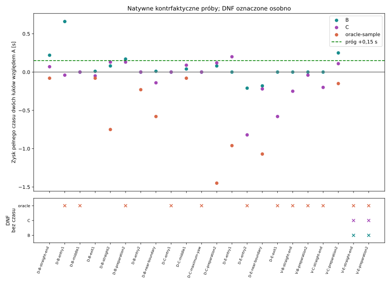
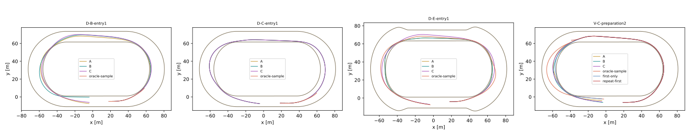

# PR #135 — Multi-Action Planning Feasibility

**INCONCLUSIVE**. PROVISIONAL, domyślnie OFF. Dokładna baza `999b08aa34ffed09d7ade720ee1f6f2c1422b5f4`, polityka **#134 A #16015**, oryginalne osiem wag, H09 i pełny gaz. Bez CEM, Track Awareness ani zmian CoreSim, geometrii, silnika, opon, reakcji i aktuatora. Wynik małego zbioru diagnostycznego nie jest walidacją gotowego kierowcy.

## 1. Jak działa pojedyncza decyzja?

`FreeLearningController.Choose()` prognozuje każdą akcję przez0,9s po pełnej reakcji i utrzymuje ją do końca, z wcześniej oczekującymi komendami. `Predict()` ma callback decyzji z przewidywanych obserwacji, ale #134 A go nie używa. W natywnym świecie A ponownie ocenia sterowanie co0,2s. Off odtworzył dokładny fingerprint #134 A N00; każdy kandydat ma test identyczności skopiowanej funkcji kosztu.

## 2. Czy utrzymana komenda powodowała zły wybór?

Liczba sparowanych wyników B/C z inną pierwszą akcją niż A i zyskiem co najmniej0,15s całych dwóch łuków: **1**. Konkretne dowody poniżej. To kontrfaktyczna dostępność lepszego manewru w ograniczonym zbiorze, nie dowód globalnej optymalności. `paired-results.json.gz` zachowuje dawną ocenę utrzymania tej pierwszej akcji i nową ocenę całej sekwencji.

| Stan | Wariant | A dwa łuki [s] | Próba [s] | Zysk [s] | Pierwsza akcja inna niż A |
| --- | --- | --- | --- | --- | --- |
| D-B-entry1 | B | 16.000 | 15.340 | 0.660 | False |
| V-C-preparation2 | B | 15.590 | 15.340 | 0.250 | True |
| D-B-straight-end | B | 16.000 | 15.780 | 0.220 | False |
| D-E-entry1 | C | 16.060 | 15.860 | 0.200 | False |
| D-B-preparation2 | B | 16.000 | 15.830 | 0.170 | False |

W czterech z pięciu powyższych korzystnych przypadków sekwencja tylko powtarza tę samą pierwszą akcję A. To dowód korzyści z chwilowego utrzymania komendy względem późniejszych korekt feedbacku, **nie samodzielny dowód potrzeby różnych kolejnych akcji**. Mocniejszy bezpośredni przypadek jest jeden: V-C-preparation2 B, gdzie A odrzuca pierwszą akcję −15°/gaz0, a planner wybiera ją z dalszą −5°/gaz1.

Po zakończeniu całej puli wykonano dwie dodatkowe kontrole mechanizmu, zamrożone przed ich wynikami w `mechanism-audit-plan.json`. Mają status **post-hoc diagnostic**, bez doliczania do niezależnych sukcesów i bez dostrajania planera:

| V-C-preparation2 | Dwa łuki [s] | Wynik |
| --- | --- | --- |
| Oryginalny A | 15.590 | completed |
| Wybrany B: −15°/gaz0 → −5°/gaz1 | 15.340 | completed |
| first-only | 15.490 | completed |
| repeat-first | DNF | control envelope |

Sama pierwsza akcja daje0,10s zysku, a dobrana druga kolejne0,15s. Powtórzenie pierwszej kończy się przekroczeniem β45° przy dodatnim prześwicie. W tym jednym stanie istnieje więc natywny dowód, że dalsza komenda ma znaczenie. Nadal nie jest to kilka niezależnych potwierdzeń architektury MPC.

## 3. Czy dwie decyzje pomagają?

Wyniki wszystkich przypadków, bez usuwania DNF:

| Pula | Ramię | Ukończenia | Zyski ≥0,15 s | Najgorsza strata na wspólnych ukończeniach [s] |
| --- | --- | --- | --- | --- |
| diagnostic | B | 16/16 | 3 | -0.210 |
| diagnostic | C | 16/16 | 1 | -0.820 |
| diagnostic | oracle-sample | 9/16 | 0 | -1.450 |
| confirm | B | 4/6 | 1 | 0.000 |
| confirm | C | 4/6 | 0 | -0.250 |
| confirm | oracle-sample | 1/6 | 0 | -0.150 |

## 4. Czy trzy dają dodatkową korzyść?

Porównanie B/C w tym samym stanie jest dostępne w każdej parze poniżej. Więcej gałęzi nie gwarantuje lepszego pełnego czasu; terminalny koszt H09 potrafi preferować krótkotrwałą poprawę, po której dalszy feedback jedzie gorzej. Zbiór trójek jest ograniczony, nie zawiera wszystkich możliwych manewrów.

## 5. Czy potwierdza to natywny Box2D?

Każda próba odtwarza cały świat od pierwotnego początku. Nie przybliżamy snapshotu. Po interwencji zachowany jest ten sam WorldRunner, nawierzchnia, wheel/steering, reakcja i nieodwołalna kolejka. Wszystkie sprawdzenia fizycznego prefiksu przed pierwszą aktywacją oraz żądań i aktywacji wymaganych przed końcem świata: True. Certyfikat całego obrysu, β45°, reverse/projection i testy energii są dokładnie odziedziczone; nie zaostrzano ani nie luzowano marginesów.

Pierwotny końcowy guard zatrzymał suite na V-E-preparation2 C: wymagał także aktywacji trzeciej komendy przypadającej po natywnym DNF. Zachowano `confirm-pairs-initial.json.gz` i pierwotne `ExactRequests=false`. Osobny `postflight-request-audit.json` sprawdza wyłącznie komendy przed końcem świata; późniejsza pending pozostaje niewykonana. Dopiero potem wykonano jedną pozostałą, już wcześniej wybraną próbkę oracle. Żadnego świata ani wyszukiwania nie powtórzono; zamrożony planner, pule i progi nie uległy zmianie. Hash kodu audytu jest zapisany oddzielnie.

## 6. Czy planner znajduje poprawy sam?

Tak oznaczone B/C wybrano wyłącznie na podstawie stanu przy obserwacji i H09, zapisując wybór przed natywnym wynikiem. Nie wybieramy B albo C po finale jako nowego sterownika. Oddzielny `sampled-oracle.json` to najlepszy rzeczywisty wynik w skończonym zbiorze A/B/C/dodatkowej próbki. Oracle nie jest wdrożoną polityką i nie dostraja planera.

## 7. Reakcja i pending

Reakcja pochodzi z `RiderController.ReactionSeconds(spec)`; dla tego zawodnika 0.24s. Żądania t/t+0,2/t+0,4 aktywują się t+0,24/t+0,44/t+0,64. Starsze pending aktywują się wcześniej i nie są anulowane. Kierownica nadal≤±35° i90°/s. Jedna sekwencja jest wybrana przy t; po jej żądaniach wraca autonomiczny #134 A na rzeczywistych obserwacjach. To przyczynowy prototyp planu lokalnego, nie pełne receding-horizon MPC przez cały bieg.

## 8. Co ogranicza bezpieczne manewry?

Pozostaje mała obwiednia modelu, opóźniony aktuator, nadchodząca zmiana krzywizny/szerokości oraz niezgodność krótkiej preferencji terminalnej z dalszym feedbackiem. Klasa SafeInHorizon nie dowodzi legalności całego łuku. DNF i przyczyny są w tabeli, bez nazywania przekroczenia β potwierdzonym fizycznym upadkiem. Brak nowych DNF dotyczy zamrożonych B/C; dodatkowa kontrola repeat-first ma własny nowy DNF i pozostaje jawnie odrębna.

## 9. Prosta, pierwszy i drugi łuk

Zamrożono16 stanów diagnostycznych i6 potwierdzających: koniec prostej, wejście/środek/wyjście łuku, prosta między łukami, przygotowanie i wejście drugiego, blisko granicy i maksimum yaw. Dokładne stany w plikach `*-states.json`; powtarzające się fazy mogą wskazać tę samą obserwację. Kryteria liczą unikalne pary(case,time), nie aliasy stanu. Pierwsza bramka jest mierzona pełnym obrysem; pełne czasy dotyczą drugiej bramki oraz dodatkowej1s legalnej kontroli po niej.

## 10. Geometria i transfer

Każda próba używa istniejącego progressive-b, progressive-c lub egg-asymmetric i własnego eksportu geometrii. Nie zakładamy idealnych półokręgów. B ma12→16,6→12m, C12→17/16,2→12m. Parametry apexu nie są pomiarami Motoareny. Zgodność komend z lokalnym gridem nie dowodzi przenoszalności jednego planu XY na inny tor: w każdej geometrii planner sam ocenia istniejące akcje.

Główne pule mają różne stany początkowe pomiędzy wariantami toru, więc nie izolują samej geometrii. Dodatkowo po wynikach zamrożono **kontrolowany transfer stałego manewru**: dokładnie ten sam start17,25m/s, offset6,15m, heading0,016rad, v boczna0,11m/s, yaw−0,03rad/s, wheel/steering/gaz i terminy9,0/9,2s; zmienia się wyłącznie istniejący wariant geometrii. Para C jest odczytana z zapisów,4 nowe światy obejmują A/ten sam plan na B i egg-asymmetric. Nie przeliczamy wyszukiwania na obcym torze i nie dobieramy nowego manewru po wynikach.

| Identyczny start i plan przy9,0/9,2s | A dwa łuki [s] | Plan z C [s] | Wynik planu |
| --- | --- | --- | --- |
| progressive-c | 15.590 | 15.340 | completed |
| progressive-b | 15.590 | 15.340 | completed |
| egg-asymmetric | 16.320 | DNF | uncertified interval |

To diagnostyka post-hoc, nie dodatkowa niezależna walidacja. `geometry-transfer-plan.json` powstał przed nowymi4 wynikami. Każdy początkowy stan fizyczny i odpowiedni prefiks interwencji sprawdzono na dokładną równość. Viewer zawiera oddzielne grupy transfer-progressive-b i transfer-egg-asymmetric; różnicy czasu lub DNF nie przypisujemy zmianie opon czy gazu.

Test odczytowy potwierdza obecną prostą35+27m, drugą62m i okrążenie≈318,78m. Uzgodnione31+31m pozostaje **osobnym zadaniem przywrócenia położenia start/meta** w `start-finish-follow-up.md`. Origin nadal(0,0), cztery neutralne pola A–D mają środki1,5/4,5/7,5/10,5m; bez bonusów i bez stałych pasów jazdy. #135 nie przesuwa startu, bandy ani kredy.

## 11. Koszt sekwencji

Maksimum jednego całego wyszukiwania: **0.531250s CPU / 5859 ocen kontaktu**; obejmuje ocenę bazowego gridu oraz≤12 par i≤24 trójek. `*-search.json.gz` ma koszt każdego stanu, liczbę prognoz, każdą gałąź i prognozowane punkty (jawnie oddzielone od Native). Koszt jednej liściowej prognozy można sprawdzić w `Prediction.ForceEvaluations`; H09 około90 przedziałów. CPU obejmuje lokalne wyszukiwanie, bez tworzenia świata Box2D. Maksimum obejmuje koszt zimnego procesu/JIT; nie zastępujemy zamrożonego progu późniejszą korzystniejszą medianą.

Osobny postflight `sequence-cost.json`:16 partii B/C na8 różnych obserwacjach, po1 warmup i20 powtórzeń. Zmierzony koszt jednej sekwencji: **0.003906…0.030469s CPU**, mediana **0.005469s**. Timer CPU jest kwantowany; są to średnie20 prognoz, nie sztuczna dokładność pojedynczego timera. Całe336 prognoz i warmupy wliczono do budżetu;0 dodatkowych światów. Pomiar nie zmienia wyboru ani werdyktu.

## 12. Przyszłych czterech zawodników

Przy5 obserwacjach/s i4 zawodnikach konserwatywna ekstrapolacja maksimum to **10.625 CPU-s na sekundę symulacji**, bez kosztu natywnej fizyki, ruchu rywali i interakcji. To ekstrapolacja, nie zmierzony bieg czterech zawodników. Możliwe są współdzielone prefiksy/pruning; nie obiecujemy przyspieszenia bez pomiaru.

## 13. Czy stara funkcja celu wystarcza?

Nie została nauczona wartości kontynuacji. Zachowaliśmy jej wagi i literalny wzór, odnosząc preferencje gazu/zmiany skrętu do pierwszej akcji; H09 terminalny postęp/kierunek/yaw pochodzi z całej sekwencji. Późniejsze kosztowne akcje mogą więc być za tanie w tej ocenie. To jawna granica prototypu, nie przemilczana nowa kara ani dowód, że wystarczy dodać gałęzie. Native rozstrzyga rzeczywisty czas i bezpieczeństwo.

## 14. Czy H09 wystarcza?

Trzecia komenda ma tylko0,26s skutku w H09. Cztery kontrolowane natywne próby utrzymują ostatnią akcję po sekwencji przez całeH09; dotychczasowe tolerancje XY0,1m, v0,2m/s, χ/ψ/β1°, steering1,5°, wheel2rad/s, yaw0,05rad/s, optimism0,1m pozostały bez zmian. W głównych próbach prognoza i Native zgadzają się tylko do aktywacji pierwszej przywróconej komendy A: porównujemy ten zgodny prefiks osobno. Różnica później jest zmianą sterowania, nie automatycznie błędem fizyki. Nie wydłużono MaximumHorizonSeconds i nie certyfikujemy całej przyszłości z H09.

## 15. Decyzja dotycząca #136

**INCONCLUSIVE** według progów zamrożonych w protokole przed próbami. Kryteria: `{"DiagnosticThree": true, "IndependentThree": false, "IndependentTwoGeometries": false, "NoNewCausalDNF": true, "PredictionPreflight": true, "PrefixAndQueue": true, "MatchedPrefixAccuracy": true, "SearchCpu": false, "SearchContacts": true}`. Diagnostyka: 4 unikalnych stanów zysku≥0,15s; niezależna pula: 1 w geometriach ['progressive-c']. Nowe causal DNF: 0. Oddzielne światy z jednego początku nie są niezależnymi osobnikami ani statystycznym dowodem gotowości. Nie otwieramy automatycznie #136. Następny pojedynczy eksperyment: zweryfikować wartość późniejszej kontynuacji na tych samych zamrożonych wagach i modelu, zanim zaczniemy duży trening lub domyślne MPC.

Koszt łącznie: **84 światów, 848.671875s CPU epizodów/wyszukiwań, 160842 prognoz, 14676592 ocen kontaktu, 121406 kroków**. Limity96/1400s/250k/25M. Budżet CPU wynika z6 światów preflight i zamrożonej formuły, nie z dostosowania po wynikach. Builds, testy, przygotowanie geometrii przed pomiarem epizodu, serializacja raw i ten raport są poza pomiarem epizodów; koszt raportu jest osobno. Nie zmierzono sumy CPU całych procesów z tym narzutem, więc783s ani późniejsza suma nie są takim pomiarem.

Pełny raw: `C:\Users\artur\Documents\Codex\2026-10-23\files-pasted-by-the-user-pr\work\multi-action-135-raw`. Dostęp lokalny; Git zawiera wszystkie agregaty, prognozy, hashe i wybrany bundle, **nie każdy pełny replay**. Historyczne dane i źródła #129–#134 pozostały bez zmian. `tools/run-multi-action.ps1` odtwarza etapy do świeżych katalogów. Standardowy Windows Draft CI i dokładny HEAD są w opisie PR, bez merge. Testy fizyki/OFF i nowe kontrakty muszą przejść przed publikacją.

## Wszystkie sparowane wyniki

Dodatni zysk oznacza szybszy legalny pełny przejazd; przy DNF nie ma legalnego czasu.

| Stan | Ramię | Pula | A [s] | Próba [s] | Zysk [s] | Wynik |
| --- | --- | --- | --- | --- | --- | --- |
| D-B-straight-end | B | diagnostic | 16.000 | 15.780 | 0.220 | completed |
| D-B-straight-end | C | diagnostic | 16.000 | 15.930 | 0.070 | completed |
| D-B-straight-end | oracle-sample | diagnostic | 16.000 | 16.080 | -0.080 | completed |
| D-B-entry1 | B | diagnostic | 16.000 | 15.340 | 0.660 | completed |
| D-B-entry1 | C | diagnostic | 16.000 | 16.040 | -0.040 | completed |
| D-B-entry1 | oracle-sample | diagnostic | 16.000 | DNF | DNF | control envelope |
| D-B-middle1 | B | diagnostic | 16.000 | 16.000 | 0.000 | completed |
| D-B-middle1 | C | diagnostic | 16.000 | 16.000 | 0.000 | completed |
| D-B-middle1 | oracle-sample | diagnostic | 16.000 | DNF | DNF | control envelope |
| D-B-exit1 | B | diagnostic | 16.000 | 15.990 | 0.010 | completed |
| D-B-exit1 | C | diagnostic | 16.000 | 16.050 | -0.050 | completed |
| D-B-exit1 | oracle-sample | diagnostic | 16.000 | 16.080 | -0.080 | completed |
| D-B-straight2 | B | diagnostic | 16.000 | 15.920 | 0.080 | completed |
| D-B-straight2 | C | diagnostic | 16.000 | 15.870 | 0.130 | completed |
| D-B-straight2 | oracle-sample | diagnostic | 16.000 | 16.750 | -0.750 | completed |
| D-B-preparation2 | B | diagnostic | 16.000 | 15.830 | 0.170 | completed |
| D-B-preparation2 | C | diagnostic | 16.000 | 15.870 | 0.130 | completed |
| D-B-preparation2 | oracle-sample | diagnostic | 16.000 | DNF | DNF | control envelope |
| D-B-entry2 | B | diagnostic | 16.000 | 16.000 | 0.000 | completed |
| D-B-entry2 | C | diagnostic | 16.000 | 16.000 | 0.000 | completed |
| D-B-entry2 | oracle-sample | diagnostic | 16.000 | 16.230 | -0.230 | completed |
| D-B-near-boundary | B | diagnostic | 16.000 | 15.990 | 0.010 | completed |
| D-B-near-boundary | C | diagnostic | 16.000 | 16.140 | -0.140 | completed |
| D-B-near-boundary | oracle-sample | diagnostic | 16.000 | 16.580 | -0.580 | completed |
| D-C-entry1 | B | diagnostic | 16.870 | 16.870 | 0.000 | completed |
| D-C-entry1 | C | diagnostic | 16.870 | 16.870 | 0.000 | completed |
| D-C-entry1 | oracle-sample | diagnostic | 16.870 | DNF | DNF | control envelope |
| D-C-middle1 | B | diagnostic | 16.870 | 16.830 | 0.040 | completed |
| D-C-middle1 | C | diagnostic | 16.870 | 16.780 | 0.090 | completed |
| D-C-middle1 | oracle-sample | diagnostic | 16.870 | 16.950 | -0.080 | completed |
| D-C-maximum-yaw | B | diagnostic | 16.870 | 16.870 | 0.000 | completed |
| D-C-maximum-yaw | C | diagnostic | 16.870 | 16.870 | 0.000 | completed |
| D-C-maximum-yaw | oracle-sample | diagnostic | 16.870 | DNF | DNF | control envelope |
| D-C-preparation2 | B | diagnostic | 16.870 | 16.790 | 0.080 | completed |
| D-C-preparation2 | C | diagnostic | 16.870 | 16.750 | 0.120 | completed |
| D-C-preparation2 | oracle-sample | diagnostic | 16.870 | 18.320 | -1.450 | completed |
| D-E-entry1 | B | diagnostic | 16.060 | 16.060 | 0.000 | completed |
| D-E-entry1 | C | diagnostic | 16.060 | 15.860 | 0.200 | completed |
| D-E-entry1 | oracle-sample | diagnostic | 16.060 | 17.020 | -0.960 | completed |
| D-E-entry2 | B | diagnostic | 16.060 | 16.270 | -0.210 | completed |
| D-E-entry2 | C | diagnostic | 16.060 | 16.880 | -0.820 | completed |
| D-E-entry2 | oracle-sample | diagnostic | 16.060 | DNF | DNF | uncertified interval |
| D-E-near-boundary | B | diagnostic | 16.060 | 16.240 | -0.180 | completed |
| D-E-near-boundary | C | diagnostic | 16.060 | 16.280 | -0.220 | completed |
| D-E-near-boundary | oracle-sample | diagnostic | 16.060 | 17.130 | -1.070 | completed |
| D-E-exit1 | B | diagnostic | 16.060 | 16.060 | 0.000 | completed |
| D-E-exit1 | C | diagnostic | 16.060 | 16.640 | -0.580 | completed |
| D-E-exit1 | oracle-sample | diagnostic | 16.060 | DNF | DNF | confirmed crossing |
| V-B-straight-end | B | confirm | 15.990 | 15.990 | 0.000 | completed |
| V-B-straight-end | C | confirm | 15.990 | 16.240 | -0.250 | completed |
| V-B-straight-end | oracle-sample | confirm | 15.990 | DNF | DNF | uncertified interval |
| V-B-preparation2 | B | confirm | 15.990 | 15.990 | 0.000 | completed |
| V-B-preparation2 | C | confirm | 15.990 | 16.030 | -0.040 | completed |
| V-B-preparation2 | oracle-sample | confirm | 15.990 | DNF | DNF | control envelope |
| V-C-straight-end | B | confirm | 15.590 | 15.590 | 0.000 | completed |
| V-C-straight-end | C | confirm | 15.590 | 15.790 | -0.200 | completed |
| V-C-straight-end | oracle-sample | confirm | 15.590 | DNF | DNF | control envelope |
| V-C-preparation2 | B | confirm | 15.590 | 15.340 | 0.250 | completed |
| V-C-preparation2 | C | confirm | 15.590 | 15.480 | 0.110 | completed |
| V-C-preparation2 | oracle-sample | confirm | 15.590 | 15.740 | -0.150 | completed |
| V-E-straight-end | B | confirm | DNF | DNF | DNF | uncertified interval |
| V-E-straight-end | C | confirm | DNF | DNF | DNF | uncertified interval |
| V-E-straight-end | oracle-sample | confirm | DNF | DNF | DNF | confirmed crossing |
| V-E-preparation2 | B | confirm | DNF | DNF | DNF | uncertified interval |
| V-E-preparation2 | C | confirm | DNF | DNF | DNF | uncertified interval |
| V-E-preparation2 | oracle-sample | confirm | DNF | DNF | DNF | uncertified interval |

[Protokół](protocol.json) · [Preflight](preflight.json) · [Koszt](attempts.json) · [Wszystkie pary](paired-times.csv) · [Oracle](sampled-oracle.json) · [Pełne metryki](native-quality.json.gz) · [Manifest raw](raw-manifest.json)

Dodatkowy audyt źródeł CI: `source-line-endings.json` wiąże oryginalne surowe SHA z hashami po jedynej normalizacji CRLF→LF. Lokalne core.autocrlf=true i CI=false różnią się bajtami końców linii. Wszystkie oryginalne surowe hashe sprawdzono przed utworzeniem tego odwzorowania; żadnych innych znaków kodu nie pomija się. Oryginalny protokół i locki źródeł zachowano. Odtworzenie do nowych katalogów zamraża bieżące bajty; wznowienie starego runu nadal wymaga zgodnych surowych źródeł.
