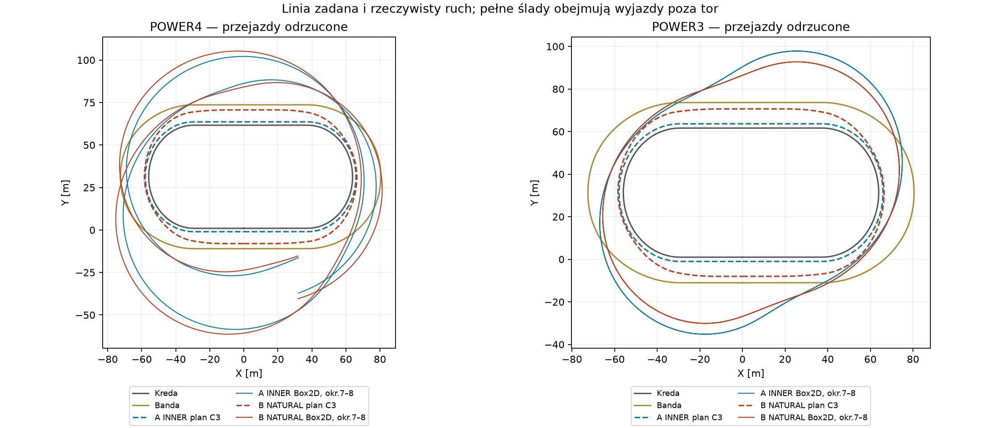
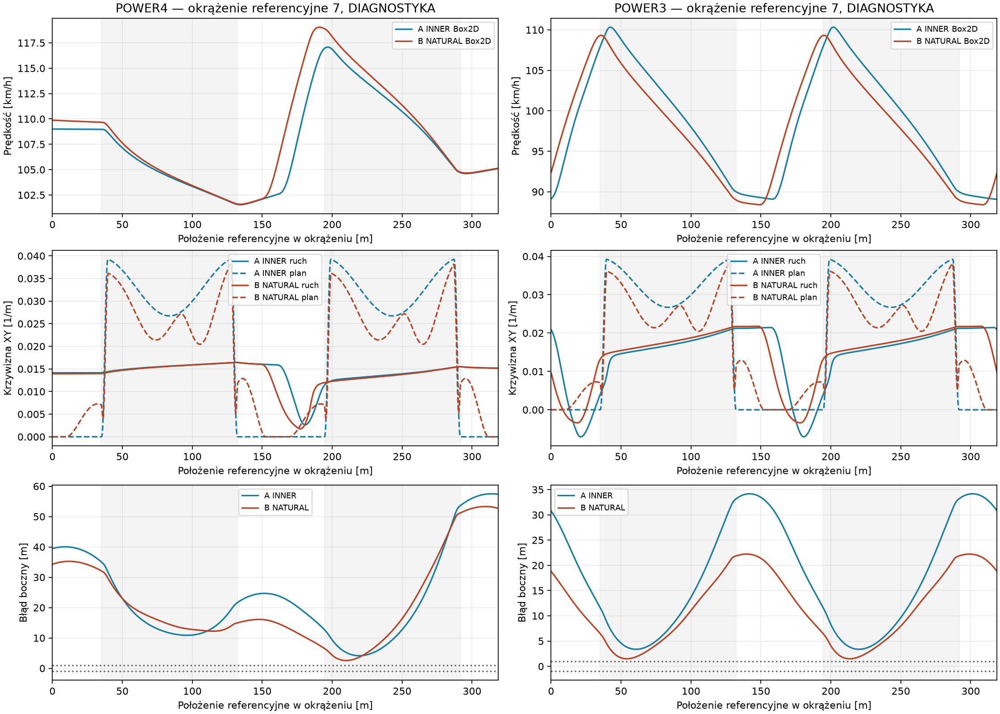

# Natural Racing Line vs INNER — jedna zamrożona hipoteza geometryczna

Status: **PROVISIONAL, eksperyment diagnostyczny. Żaden przejazd nie kwalifikuje się do rankingu.**
Zweryfikowana baza: Draft #109, `a5164d9daddb091eb86a2809792703941069fd56`, gałąź `experiment/full-contact-yaw-feedforward`. Bez merge, bez zmian `src/CoreSim`.

## Odpowiedź czasowa

Power4: B jest diagnostycznie **0,282433 s / 1,870% wolniejsza**. Power3: B jest diagnostycznie **0,468097 s / 2,997% szybsza**. **Nie ma zwycięzcy:** wszystkie cztery zapisy przekraczają fizyczną bandę, nie spełniają trackingu; Power4 dodatkowo nie jest okresowe. Krótszy czas Power3/B wynika z krótszej rzeczywistej pętli poza torem, a nie z większej średniej prędkości. Nie jest to przewaga poprawnie wykonanej linii B.

## Zamrożenie i uczciwość pary

[freeze.json](natural-racing-line-vs-inner/freeze.json) powstał przed pomiarem. A to dokładny `AuthoredRacingPath.Crossover(false)` z #106: także eksport geometrii jest identyczny bajtowo. B wykorzystuje ten sam konstruktor okresowej septic Hermite XY: wspólne P/P′/P″/P‴ w węzłach co ≤1 m, te same próbki źródłowe ±0,25/0,5 m. Produkcyjna geometria Egg Mild / progressive-b pozostaje identyczna.

Jedyna nowa hipoteza: outside offset **8 m**, apex **1,5 m**, rozpoczęcie zmiany **25 m przed wejściem**, apex **58% łuku**, outside **20 m za wyjściem**. Offset jest mierzony od istniejącej referencji, nie od fizycznej kredy. Dla każdego półokrążenia, z wejściem e=35 m i długością łuku b=97,3893749714 m: początek e−25, apex e+0,58b, koniec e+b+20. Źródło offsetu przechodzi 8→1,5→8 przez `S(u)=35u⁴−84u⁵+70u⁶−20u⁷`, potem utrzymuje 8 do kolejnego początku. Pełna krzywa XY, a nie sam offset, jest C3. Parametrów nie zmieniano po odczytaniu czasów. W dostępnym załączniku był opis rysunku, bez obrazu; B realizuje opis, nie digitalizację rysunku ani dowód realizmu.

**C3 i bezpieczny obrys nie oznaczają łagodnego profilu krzywizny.** B dziedziczy od źródłowej referencji wyraźne ramiona krzywizny przy wejściu/wyjściu: promień planu przy s≈35/38/40 m to około 142/46/28 m. Następnie promień ponownie rośnie przed apexem. Nie jest to monotoniczne zmniejszanie promienia aż do apexu; ta konkretna, nieoptymalizowana hipoteza ma ten istotny limit. Wczesna zmiana offsetu nie usuwa ramienia krzywizny XY.

Power4 ma dokładnie scale4 / ratio0,7 z #106; Power3 scale3 / ratio0,8. Drive=1 we wszystkich zaakceptowanych zapisach, Grip1/ruts0/moisture0,5, masa147 kg, krok0,01 s z odziedziczonymi krótszymi granicami. Ta sama opona, tylne koło, wheelspin, silnik, gains, yaw i bezpieczeństwo. #108 inverse **OFF**, #109 full yaw **OFF**; istniejące guidance/preview #106 pozostają w obu liniach takie same. Nie ma liftu, hamulca ani limitera prędkości.

Wspólny start: referencja32 m, heading0, v=(18,0) m/s, ω=18/0,33 rad/s; XY i target odpowiadają danej linii. B zaczyna na offset≈7,411845 m. Jego styczna wynosi wtedy **4,887°**, więc wspólny heading i prędkość nie są styczne do B. To jawny stan początkowy, nie korekta po rozpoczęciu jazdy. Cały transient wchodzi do audytu bezpieczeństwa; czas/tracking dotyczą ostatnich dwóch okrążeń.

[reuse-verification.json](natural-racing-line-vs-inner/reuse-verification.json): pełny snapshot początkowy A, w tym koło, jest dokładnie zgodny z #106 również przy zwykłej inicjalizacji rolling użytej dla B; 51 natywnych próbek pierwszych0,5 s obu silników zgadza się dokładnie dla XY/v/heading/Fx/Fy. Parametry są zgodne z zamrożeniem #106. Dlatego nie powtarzano ośmiookrążeniowego INNER. Dwa nowe główne światy: B/Power4 i — po odrzuceniu obu Power4 — B/Power3. [Gate Power3](natural-racing-line-vs-inner/power4-gate.json). Bez macierzy historycznej i optymalizacji.

## Kontrola geometrii przed fizyką

| Plan | Długość [m] | Min R XY [m] | Max abs κ [1/m] | Najniższa v z całego budżetu [km/h] | Dolna granica kreda [m] | Dolna granica banda [m] |
|---|---:|---:|---:|---:|---:|---:|
| crossover-inner | 325.061935 | 25.475414 | 0.039254 | 69.301 | 0.923080 | 8.923080 |
| natural-racing-line | 341.802425 | 26.180460 | 0.038196 | 70.253 | 1.417225 | 1.917225 |

B dodaje **16,740490 m / 5,150%** drogi planowanej, ale minimalny promień zwiększa tylko o **0,705046 m / 2,768%**. Obie geometrie przechodzą test pełnego motocykla przy dowolnym headingu: konserwatywny okrąg obrysu1,05 m przeciw całym krawędziom i zapas pomiędzy próbkami geometrii. Niezależny test sprawdza kapsuły w ośmiu orientacjach. To certyfikat **planu**, osobny od przejazdu.

Przy budżecie≈14,546 m/s² stała prędkość110/120 km/h wymaga R≥64,19/76,38 m. Sam punkt wejścia B (R≈142 m) tego nie wyklucza, ale dalsze R≈26–28 m wymaga spadku do około70–73 km/h nawet przy wykorzystaniu całego budżetu na normalną. Jest to warunek konieczny, nie prognoza zachowania aktualnego kontaktu pod pełnym gazem.

## Pełne porównanie A/B

Wszystkie wartości czasowe poniżej są **diagnostyczne**. Czas i droga to średnia okrążeń7–8, od przecięcia referencji32+6L do32+8L. Droga to całka po rzeczywistych natywnych odcinkach XY; końce okna są interpolowanymi przecięciami, nie dodatkową symulacją. Fazy to średnia dwóch ostatnich przejść danego łuku; Power4 nie jest okresowe, więc pojedyncze przejścia pozostają w [phases.csv](natural-racing-line-vs-inner/phases.csv). Dla uślizgu podano średnią czasową wartości bezwzględnej, nie znoszącą się średnią signed.

### Power4

| Parametr | A INNER CONSTANT | B NATURAL RACING LINE |
|---|---:|---:|
| Łuk 1: Wejście [km/h] | 107.446 | 107.821 |
| Łuk 1: 25% [km/h] | 112.343 | 113.559 |
| Łuk 1: 50% [km/h] | 109.808 | 110.849 |
| Łuk 1: 75% [km/h] | 107.677 | 108.576 |
| Łuk 1: Wyjście [km/h] | 105.241 | 105.914 |
| Łuk 2: Wejście [km/h] | 112.816 | 114.229 |
| Łuk 2: 25% [km/h] | 110.130 | 110.892 |
| Łuk 2: 50% [km/h] | 107.877 | 108.348 |
| Łuk 2: 75% [km/h] | 105.636 | 105.846 |
| Łuk 2: Wyjście [km/h] | 103.099 | 103.168 |
| Max na zawartej prostej, okr.7–8 [km/h] | — | — |
| Max na prostej, cały zapis, tylko zawarte próbki [km/h] | 118.869 | 116.686 |
| Max na prostej, okr.7–8, także poza torem [km/h] | 116.920 | 119.045 |
| Średni \|kąt uślizgu\|, okr.7–8 [°] | 17.157 | 16.866 |
| Max \|kąt uślizgu\|, okr.7–8 [°] | 18.672 | 18.677 |
| Rzeczywista droga / okrążenie [m] | 450.617 | 462.991 |
| Czas / okrążenie [s] | 15.101 | 15.383 |
| Max błąd boczny, okr.7–8 [m] | 57.507 | 53.315 |
| RMS błąd boczny [m] | 26.710 | 24.492 |
| RMS / kierunek prędkości do stycznej [°] | 19.223 | 14.554 |
| Max / kierunek prędkości do stycznej [°] | 42.427 | 40.055 |
| Min prześwit kreda, cały przejazd [m] | 1.329 | 3.190 |
| Min prześwit banda, cały przejazd [m] | -58.985 | -56.613 |
| Dolna granica między próbkami, kreda [m] | 1.210 | 3.058 |
| Dolna granica między próbkami, banda [m] | -59.142 | -56.773 |
| Rozrzut ostatnich 3 czasów max/min−1 [%] | 2.756 | 5.586 |
| 8 okrążeń referencyjnych | TAK | TAK |
| Pełne bezpieczeństwo | NIE — rzeczywisty wyjazd | NIE — rzeczywisty wyjazd |
| Okresowość ≤0,5% | NIE | NIE |
| Stabilna bezpieczna jazda przez 8 okrążeń | NIE | NIE |
| Walidacja / ranking | ODRZUCONY | ODRZUCONY |

### Power3

| Parametr | A INNER CONSTANT | B NATURAL RACING LINE |
|---|---:|---:|
| Łuk 1: Wejście [km/h] | 107.909 | 109.308 |
| Łuk 1: 25% [km/h] | 106.640 | 103.806 |
| Łuk 1: 50% [km/h] | 101.548 | 99.065 |
| Łuk 1: 75% [km/h] | 96.083 | 94.232 |
| Łuk 1: Wyjście [km/h] | 89.978 | 88.961 |
| Łuk 2: Wejście [km/h] | 107.908 | 109.309 |
| Łuk 2: 25% [km/h] | 106.639 | 103.808 |
| Łuk 2: 50% [km/h] | 101.547 | 99.066 |
| Łuk 2: 75% [km/h] | 96.082 | 94.233 |
| Łuk 2: Wyjście [km/h] | 89.977 | 88.961 |
| Max na zawartej prostej, okr.7–8 [km/h] | — | — |
| Max na prostej, cały zapis, tylko zawarte próbki [km/h] | 109.592 | 110.075 |
| Max na prostej, okr.7–8, także poza torem [km/h] | 107.904 | 109.308 |
| Średni \|kąt uślizgu\|, okr.7–8 [°] | 15.101 | 15.162 |
| Max \|kąt uślizgu\|, okr.7–8 [°] | 18.719 | 18.715 |
| Rzeczywista droga / okrążenie [m] | 424.771 | 409.326 |
| Czas / okrążenie [s] | 15.617 | 15.149 |
| Max błąd boczny, okr.7–8 [m] | 34.168 | 22.227 |
| RMS błąd boczny [m] | 21.388 | 13.989 |
| RMS / kierunek prędkości do stycznej [°] | 18.824 | 12.187 |
| Max / kierunek prędkości do stycznej [°] | 31.762 | 21.570 |
| Min prześwit kreda, cały przejazd [m] | 0.207 | 2.791 |
| Min prześwit banda, cały przejazd [m] | -32.230 | -26.274 |
| Dolna granica między próbkami, kreda [m] | 0.043 | 2.661 |
| Dolna granica między próbkami, banda [m] | -32.366 | -26.410 |
| Rozrzut ostatnich 3 czasów max/min−1 [%] | 0.001 | 0.000 |
| 8 okrążeń referencyjnych | TAK | TAK |
| Pełne bezpieczeństwo | NIE — rzeczywisty wyjazd | NIE — rzeczywisty wyjazd |
| Okresowość ≤0,5% | TAK | TAK |
| Stabilna bezpieczna jazda przez 8 okrążeń | NIE | NIE |
| Walidacja / ranking | ODRZUCONY | ODRZUCONY |

„—” dla prostej oznacza brak próbek z całym motocyklem zachowującym wymagane prześwity w końcowym oknie. Maksimum z całego zapisu może pochodzić z chwilowego ponownego znalezienia się na torze po wcześniejszym wyjeździe; nie jest certyfikatem bezpiecznego dojazdu. Prześwity używają końca native step i odpowiadającej mu prędkości, nie pozycji z początku tego kroku. Ujemne minimum bandy oznacza **zaobserwowane przecięcie**, a nie tylko brak certyfikatu między próbkami. Osiem przecięć licznika referencyjnego nie oznacza ośmiu prawidłowych okrążeń.

Kryteria są identyczne z #106: cały zapis inner≥0,05/outer≥0,5 m oraz dolne granice między krokami inner≥0/outer≥0,5 m; ostatnie2 RMS/max boczny≤0,5/1 m i RMS/max błędu kierunku prędkości≤3/10°; ostatnie3 czasy max/min≤1,005. Power3 jest okresowe **poza torem**, co nie wystarcza do walidacji.

## Droga kontra prędkość

Dla rzeczywistych Lₐ,Tₐ,Lᵦ,Tᵦ oraz średnich uₐ=Lₐ/Tₐ, uᵦ=Lᵦ/Tᵦ użyto dokładnej tożsamości: `ΔT=(Lᵦ−Lₐ)/uₐ + Lᵦ·(1/uᵦ−1/uₐ)`. Pierwszy składnik zmienia drogę przy prędkości A, drugi prędkość na drodze B. Jest to jawna dekompozycja kinematyczna zależna od tej kolejności, nie kontrfaktyczna symulacja ani dowód przyczynowy.

| Silnik | T INNER [s] | T NATURAL [s] | B−A [s] | B−A [%] | Składnik drogi [s] | Składnik prędkości [s] |
|---|---:|---:|---:|---:|---:|---:|
| power4 | 15.100905 | 15.383338 | +0.282433 | +1.870% | +0.414680 | -0.132247 |
| power3 | 15.617292 | 15.149195 | -0.468097 | -2.997% | -0.567866 | +0.099769 |

Power4 odzyskuje tylko0,132247 s z kosztu0,414680 s większej faktycznej drogi. Power3 B jedzie faktycznie **15,445268 m krócej** na pętli poza torem; mniejsza średnia prędkość kosztuje0,099769 s. Plan B był dłuższy, lecz nie został wykonany. Nie wolno interpretować tego jako korzystnej realizacji outside–inside–outside.

## Pierwsze ograniczenie: oddzielne mechanizmy i znaczniki czasu

[fixed-state-probes.json](natural-racing-line-vs-inner/fixed-state-probes.json) używa istniejącego solvera kontaktu #108 **wyłącznie offline**, z zapisanym v, ω, momentem silnika, budżetem i krokiem; zero Body Steps i Wheel Commits, kontroler OFF. Przeszukuje istniejący zakres β±45° i jego numeryczne ekstrema. „Nieosiągalne” dotyczy tego zamrożonego kontaktu i zakresu, z tolerancją0,25 N; rozwiązanie kontaktu nie dowodzi osiągalności kąta przez yaw ani wykonalności całego przejazdu.

| Zapis | Pierwszy request preview+PD poza obwiednią kontaktu [s] | Pierwsze v²κ planu poza obwiednią kontaktu [s] | Błąd boczny>1 m [s] | v² abs κ ponad cały budżet [s] | Pierwszy rzeczywisty wyjazd bandą [s] |
|---|---:|---:|---:|---:|---:|
| power4-inner | 0.350 | 0.360 | 1.330 | 0.370 | 4.950 |
| power4-natural | 0.180 | 0.440 | 1.200 | 3.140 | 5.290 |
| power3-inner | 0.400 | 0.370 | 1.760 | 0.390 | 9.420 |
| power3-natural | 0.200 | brak do progu tracking | 1.980 | 4.320 | 9.670 |

**Pierwsze potwierdzone ograniczenie B jest w torze sterowania/osiągalności żądanej siły normalnej, zanim nastąpi przekroczenie1 m:** Power4 przy0,18 s żąda2010,819 N wobec maksimum1997,765 N; Power3 przy0,20 s żąda2001,566 N wobec1993,668 N. Preview obejmuje rosnącą krzywiznę, a PD koryguje już początkowy błąd. To nie jest geometryczne przecięcie planu z bandą.

Przy pierwszym błędzie>1 m B/Power4 (1,20 s) plan potrzebuje1954,943 N i ma kontaktowy root β≈22,185°, ale legacy target≈19,423° daje tylko1907,8 N; aktualny kąt≈18,410° daje1884,1 N. Cały request sterownika2144,887 N jest wtedy poza kontaktowym maksimum1989,807 N. B/Power3 przy1,98 s ma wykonalne zarówno v²κ=1623,895 N, jak i request1778,037 N; root requestu≈11,803°, lecz legacy target≈10,181° daje1683,0 N. Jest więc konkretny dowód niedopasowania dawnego odwzorowania request→β do pełnego kontaktu z kołem; nie jest to dowód braku siły opony dla każdej chwilowej krzywizny B. Ten mechanizm jest zgodny z historycznym #108; nie włączano jego poprawki.

**Następnie pojawia się niezależne, rozstrzygające ograniczenie szybkości/krzywizny:** B/Power4 przekracza cały budżet przy3,14 s (14,591>14,546 m/s²), B/Power3 przy4,32 s (14,582>14,546). Żaden lepszy yaw ani inverse nie dostarczy v²κ większego niż cały budżet. B/Power4 faktycznie przekracza bandę przy5,29 s, B/Power3 przy9,67 s. Stan ma pamięć: siła chwilowo wystarczająca na samym wyjściu nie usuwa wcześniej zgromadzonego błędu pozycji i kierunku.

Nie rozstrzygamy ilościowo udziału wspólnego startu z różnicą stycznej4,887° versus samego preview w najwcześniejszym transiencie. Dokładny test rozstrzygający: **jeden krótki przejazd B/Power3 od referencji4 m** (przed turn-in10 m, styczna/heading/velocity0, identyczne18 m/s i rolling wheel), Drive1 i wszystkie obecne parametry; porównanie zdarzeń względem referencji35–66 m z zapisanym B. Zero zmiany regulatora i opony. Trzeba zachować różnicę prędkości na wejściu i równolegle przeliczyć obwiednię kontaktu, zamiast przypisać jej efekt inicjalizacji. Tego dodatkowego świata tutaj nie uruchamiano, ponieważ nie zmieni potwierdzonego późniejszego przekroczenia całego budżetu ani odrzucenia rankingu.

Siły spełniają native bilans impulsu: max residual<0,00113 Ns, momentu<0,000013 Nms; utilization<0,919, yaw guard excess=0, bilans energii wszystkich zapisów |residual|<1,15 J. Brak teleportowania, korekt prędkości, dodatkowych sił lub arbitralnych kar. Niższe od1 utilization samo nie dowodzi dostępności większej **normalnej**: znaczenie ma cały kontakt, kierunek siły, Fx i stan koła.

## Siedem odpowiedzi i następny krok

1. **Bezpieczne110–120 km/h? Nie wykazano.** B osiąga takie prędkości w zapisie, lecz cały przejazd jest odrzucony. Sam punkt wejścia ma duży promień; dalsze ramiona krzywizny nie są pokonywane zgodnie z planem. Pierwsze wejście z rozbiegu18 m/s ma tylko około67 km/h.
2. **Naturalna strata prędkości mimo pełnego gazu? Tak.** Na końcowych łukach Power3/B prędkość spada około109,309→88,961 km/h; Power4/B także zwalnia na części łuków. To rzeczywisty zapis Box2D, jednak utrata prędkości jest zbyt mała/późna dla wykonania planu.
3. **Płynne wyjście szerzej? Plan tak; ruch nie realizuje bezpiecznego wyjścia.** Offset B na końcu łuku Power3 wynosi około29,07 m wobec zaplanowanych≈6,92 m. To ucieczka poza bandę, nie poprawne naturalne otwieranie.
4. **Większy rzeczywisty promień? Nie ma uniwersalnego zysku.** W końcowym Power3 B ma min R ruchu≈46,01 m wobec≈47,05 m INNER; przy samym wejściu≈76,20 m wobec≈256,45 m. Promienie te opisują odrzucone pętle. Planowane minR B jest tylko nieznacznie większe niż A. Offset nie jest promieniem; κ liczono z XY i zmiany kierunku prędkości.
5. **Która szybsza? Brak ważnego rankingu.** Diagnostyczne delty są na początku i w tabeli; żadna nie jest czasem bezpiecznie wykonanej strategii.
6. **Czy większa prędkość spłaca drogę? Power4 nie; Power3 pozorny zysk pochodzi z krótszej faktycznej pętli poza torem.** Brak dowodu przewagi poprawnej linii B.
7. **Czy trzeba zmienić tor? Te dane tego nie dowodzą.** Oba plany mieszczą pełny motocykl. Ta linia B i obecny request/preview nie tworzą wykonalnego full-gas przejazdu110–120; nie dowodzi to niemożliwości każdej innej geometrii XY na tym torze. Brak dowodu błędnego modelu opony czy błędnej prędkości Box2D; jest dowód niedopasowania bieżących żądań, prędkości i krzywizny.

Rekomendacja: następny **mały PR diagnostyczny start/preview** z opisanym jednym krótkim testem B/Power3 przed turn-in oraz kontrolą ramienia κ i kontaktowego requestu. Dopiero rozdzielenie tego transienta uzasadni zmianę konstrukcji linii lub sterownika. Bez poszerzania toru, zwiększania Grip i optymalizatora. Nie rekomenduję traktować #108/#109 jako automatycznej naprawy: w tym zapisie występuje również żądanie ponad całkowity budżet.

## Wykresy i odtworzenie





Przerywane linie to plan, ciągłe to native Box2D. Szare obszary oznaczają referencyjne łuki. Pełne XY pokazuje również wszystkie wyjazdy poza tor; niczego nie docięto do bandy. SVG są obok PNG. Dane: [analysis.json](natural-racing-line-vs-inner/analysis.json), [surowe zapisy](natural-racing-line-vs-inner/), [manifest](natural-racing-line-vs-inner/manifest.json). Źródła A pozostają w #106; hashe konkretnych wejść są w analysis. Zachowano **881/881** historycznych hashy, w tym fingerprinty; nie uruchamiano dużych audytów historycznych.

Windows / PowerShell, z katalogu repozytorium, zawsze świeży katalog wyniku (eksporter odmawia nadpisywania):

```powershell
dotnet restore SpeedwayManager.sln
dotnet build SpeedwayManager.sln -c Release --no-restore
$outDir = 'results/natural-line-recapture'
foreach ($stage in @('freeze','geometry','verify','power4')) {
  dotnet run --no-build -c Release --project tools/shared-world-speedway -- natural-line $outDir $stage
}
python tools/shared-world-speedway/natural-racing-line-report.py --data $outDir gate
# Tylko jeśli gate.BothRejected=true:
dotnet run --no-build -c Release --project tools/shared-world-speedway -- natural-line $outDir power3
python tools/shared-world-speedway/natural-racing-line-report.py --data $outDir
dotnet run --no-build -c Release --project tools/shared-world-speedway -- natural-line $outDir probes
# Opcjonalnie pip install matplotlib, wyłącznie do odtworzenia wykresów:
python tools/shared-world-speedway/natural-racing-line-report.py --data $outDir --plots
```

Lokalna walidacja: Release `--warnaserror`, **10/10 C#**, **117/117 Python analizy**, **7/7 CI policy**, **13/13 Node**. Testy C3/pełnego obrysu/initial+native-prefix/original-force invariants i bramek rankingu; [validation.json](natural-racing-line-vs-inner/validation.json). Standardowe **Windows Draft CI** dla końcowego HEAD: wynik i link w opisie Draft PR. Nie wykonano merge.
