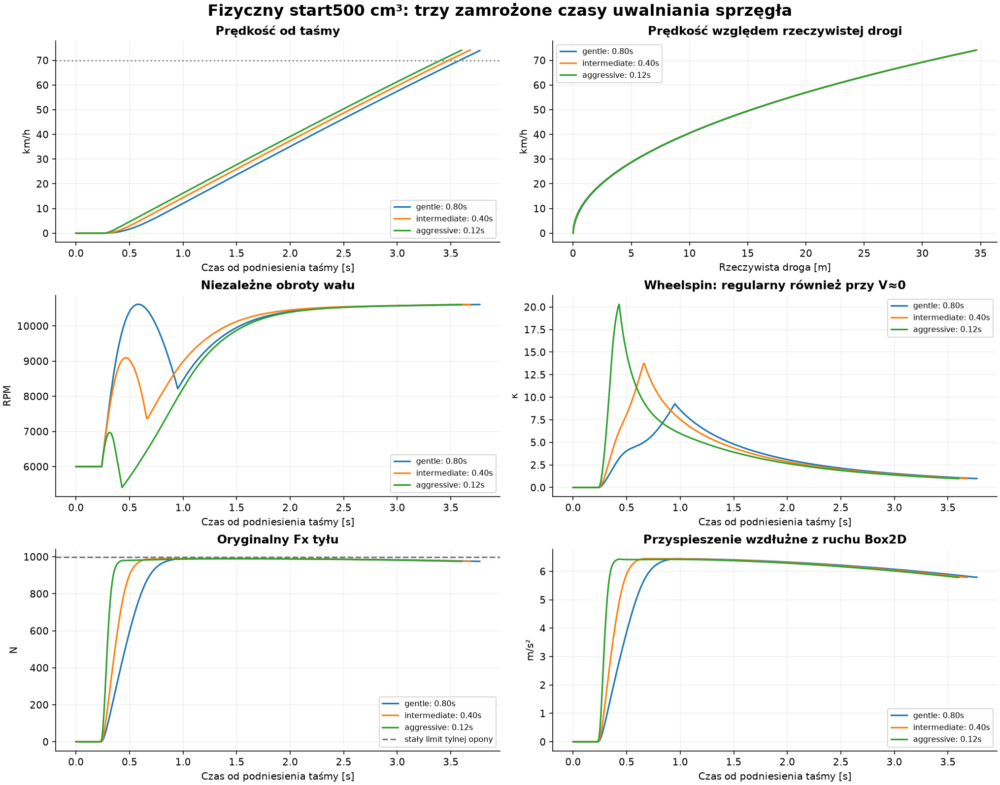
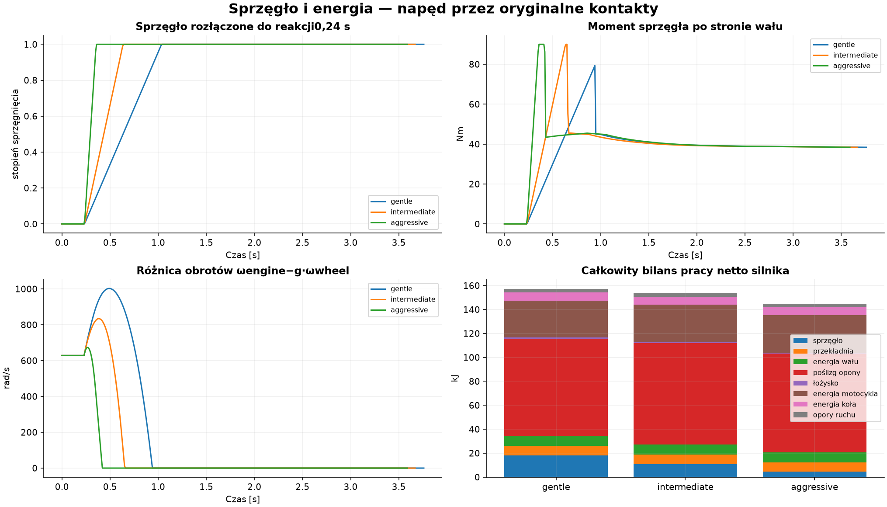

# #121 — fizyczny start 500 cm³ spod taśmy (PROVISIONAL)

**Tak: motocykl rusza od zera wyłącznie dzięki momentowi wału, sprzęgła i reakcji
oryginalnej tylnej opony.** Wszystkie trzy zamrożone warianty osiągają 70 km/h
przed łukiem, w 3,405–3,582 s od taśmy. Nie jest to jeszcze empirycznie skalibrowany
start prawdziwego żużla. Ograniczeniem po początkowym sprzęganiu jest przede
wszystkim niezmieniony, statyczny budżet tylnego kontaktu i duży wheelspin.

Baza: zweryfikowany HEAD Draft #120 `46129d74cf725c33d67040663262062ac9067281`,
[Windows CI SUCCESS](https://github.com/arturgladysz91/zuzel/actions/runs/39752049380).
Jeden nowy Draft, bez merge. `EnableEngineClutchStart` domyślnie OFF;
`EngineClutch` i snapshoty wału są pomijane w JSON OFF. Brak zmian mapy #116,
`RearWheelDynamics` #100, współczynników opony/µ, Egg Mild i regulatorów #117/#120.

**Co wykorzystano i co dodano**

Sprawdzono `Engine500`, `RearWheelDynamics`, `TwoContactBikeDynamics`, `WorldRunner`,
stary start w `RiderController`/`LongitudinalDynamics` i testy startu. Używany jest
istniejący `RiderController.TapeReactionSeconds`, dla neutralnego zawodnika 0,24 s.
Środek pola pochodzi z istniejącego `StartingGateGeometry`, z jego transformacją
od fizycznej krawędzi do referencji toru.
Stary empiryczny `CalculateStandingStartAvailableDriveForceNewtons` pozostaje
wyłącznie w starej gałęzi OFF. Nowy napęd nie dodaje żadnej siły do nadwozia:
jedynym wejściem napędowym kontaktu jest moment przekazany na tylne koło.

`EngineClutchState` przechowuje niezależne ωe, a `RearWheelState` nadal przechowuje
ωw. Nowy czysty solver momentu sprzęgła odpytuje **oryginalny** solver koła/opony;
nie uruchamia drugiego świata ani nie integruje zastępczego nadwozia.
Przedziały czasu są dzielone na istniejącym deadline reakcji, z uwzględnieniem
momentu podniesienia taśmy. Tylko po jednym kroku Box2D zatwierdza się koło, wał
i kierownicę. Próbne zapytania kierownicy dostają osobne niezatwierdzane stany wału.

Równania w zaakceptowanym interwale h:

- Je·(ωe_after−ωe_before)=h·(Te(ωe_mid,gas)−Tc).
- `Te` pochodzi z niezmienionego `Engine500.Torque`, przy midpoint RPM wału.
- |Tc|≤u·90 Nm; u rośnie liniowo po reakcji. Jeśli możliwa jest synchronizacja,
  solver wybiera Tc dający ωe_after=g·ωw_after. W przeciwnym razie sprzęgło ślizga
  się z ograniczonym momentem o znaku względnego ruchu.
- Dla napędu Tw=g·η·Tc, g=9, η=0,94; przy przenoszeniu wstecz Tw=g·Tc/η,
  aby przekładnia również wtedy pochłaniała energię.
- Strata sprzęgła = h·Tc·(ωe_mid−g·ωw_mid). Strata przekładni =
  h·(g·Tc−Tw)·ωw_mid. Praca netto wału = h·Te·ωe_mid.

Synchronizacja dotyczy końców interwału, aby nie wprowadzać naprzemiennego
odwracania poślizgu przy pozornym „zablokowaniu” midpoint. Nie nadpisuje się RPM
po rozwiązaniu. Bisection ma stały limit 48 iteracji; wyjście poza założenia
kierunku obrotu lub istotna ujemna strata kończy diagnostykę, zamiast klamrowania
stanu lub energii. Niewielkie ujemne reszty strat z zaokrągleń są raportowane.

Je=0,02 kg·m², pojemność 90 Nm i przebieg uwalniania są **PROVISIONAL**.
Krzywa #116 daje 48,96 kW przy 8500 RPM i pozostaje bez zmian. Po synchronizacji
obowiązuje to samo przełożenie i mapa, z nową fizyczną bezwładnością wału.
Chwilowy moment sprzęgła może przewyższać moment spalania: różnicę pokrywa
zmniejszenie energii obrotowej wału, a nie nowy punkt krzywej silnika.

Przed startem ωe odpowiada 6000 RPM, a sprzęgło jest rozłączone. Model operuje
momentem **netto** na wale: przy utrzymywanych obrotach przed reakcją jest on
zerowy — spalanie i wewnętrzne tarcie silnika równoważą się. Nie symulujemy paliwa
ani obu tych wewnętrznych prac osobno. Zewnętrzne RPM nie są stale wymuszane;
stan zachowuje początkowe 3,948 kJ energii wału. Po reakcji gaz wynosi 1, a wał
przyspiesza lub zwalnia z równania momentów. Nie dodano drugiej mapy ani regulatora
obrotów maskującego obciążenie.
Pole `throttle` oznacza ułamek dostępnego momentu **netto**, nie zmierzoną pozycję
przepustnicy. `combustion_work` w zapisie to mechaniczna praca netto na wale,
nie energia chemiczna paliwa. Faza utrzymywania obrotów jest więc idealizacją,
a nie osobno zweryfikowanym regulatorem biegu jałowego.

**Położenie i zegary**

T=0 to rzeczywiste podniesienie taśmy. Wspólna fizyczna linia startu/mety ma s=0.
Przednie koło stoi przy tej linii: CoM s=−1,03 m, ωw=0, V=0, brak prędkości bocznej
i yaw. Wybrano środek pola nr 2 z czterech pól po 3 m: 4,5 m od wewnętrznej
krawędzi fizycznej, czyli offset 3,5 m w niezmienionej konwencji referencyjnej.
Motocykl mieści się na prostej. Geometrii nie przesuwano ani nie wydłużano.

Na prostej jawnie trzymano fizyczną kierownicę 0°, aby podgląd #117 nie rozpoczynał
przygotowania do niezweryfikowanego łuku. Nie zmieniano żadnego regulatora ani
jego parametrów. Wszystkie próby zatrzymano z całą sylwetką przed początkiem łuku
s=35 m, po około 34,5–34,7 m rzeczywistej drogi. Dystans 60 m nie został przejechany.

Rozróżniamy trzy momenty:

1. Taśma: 0 s.
2. Decyzja zawodnika/rozpoczęcie uwalniania: istniejące 0,240 s.
3. Wykryte ruszenie: przekroczenie **jawnego progu V=0,01 m/s**, interpolowane
   z zaakceptowanych stanów. To robocza definicja obserwatora, nie właściwość opony.

Pierwszy dodatni ruch wszystkich wariantów występuje już w interwale
0,240–0,250 s. Czas do przekroczenia progu jest dłuższy; nie utożsamiamy go
z neurologicznym czasem reakcji. Dokładność interpolacji nie przekracza informacji
z próbkowania 10 ms i nie jest precyzją pomiaru rzeczywistej telemetrii.

| Wariant | Uwalnianie [s] | Reakcja [s] | Wykryte ruszenie od taśmy [s] | Mechaniczne opóźnienie detekcji po reakcji [s] | Pierwsza synchronizacja [s] |
|---|---:|---:|---:|---:|---:|
| spokojny | 0,80 | 0,240 | 0,2920 | 0,0520 | 0,95 |
| pośredni | 0,40 | 0,240 | 0,2802 | 0,0402 | 0,66 |
| agresywny | 0,12 | 0,240 | 0,2650 | 0,0250 | 0,42 |

Sprzęgło może zsynchronizować się przed końcem ruchu dźwigni, jeśli częściowy
docisk już wystarcza. Sam pełny docisk także nie oznacza natychmiastowej synchronizacji.

**Zmierzone osiągi — trzy konfiguracje bez dostrajania**

`protocol.json` zapisano przed próbami. Zmieniano wyłącznie czas uwalniania.
Pozostały ten sam silnik, początkowe 6000 RPM, Je, pojemność sprzęgła, zawodnik
147 kg razem z motocyklem, powierzchnia, kierownica, przełożenie i stan początkowy.

| Wariant | Do 30 km/h: od taśmy / od ruszenia [s] | Do 50 km/h: od taśmy / od ruszenia [s] | Do 70 km/h: od taśmy / od ruszenia [s] |
|---|---:|---:|---:|
| spokojny | 1,776 / 1,484 | 2,661 / 2,369 | 3,582 / 3,290 |
| pośredni | 1,674 / 1,394 | 2,559 / 2,279 | 3,481 / 3,200 |
| agresywny | 1,599 / 1,334 | 2,484 / 2,219 | 3,405 / 3,140 |

„Od ruszenia” w tej tabeli używa opisanego progu 0,01 m/s. Pierwszy dodatni ruch
występuje wcześniej niż detekcja tego progu. Z granic pierwszego dodatniego
interwału 0,240–0,250 s wynika osobny pomiar od fizycznego początku ruchu:

| Wariant | Do 30 km/h od fizycznego początku [s] | Do 50 km/h od fizycznego początku [s] | Do 70 km/h od fizycznego początku [s] |
|---|---:|---:|---:|
| spokojny | 1,526–1,536 | 2,411–2,421 | 3,332–3,342 |
| pośredni | 1,424–1,434 | 2,309–2,319 | 3,231–3,241 |
| agresywny | 1,349–1,359 | 2,234–2,244 | 3,155–3,165 |

Przedziały zachowują niepewność próbkowania początku ruchu; nie są czasami od
przekroczenia progu i nie wymagają kolejnej symulacji.
70 km/h osiągnięto po rzeczywistych 30,73 / 30,68 / 30,68 m.

| Wariant | V po 5 m | V po 10 m | V po 20 m | V po 30 m | V po 60 m | V po 2 s od taśmy | V na końcu próby |
|---|---:|---:|---:|---:|---|---:|---:|
| spokojny | 28,61 | 40,47 | 56,91 | 69,20 | nieosiągnięte | 35,11 | 73,94 |
| pośredni | 28,75 | 40,57 | 56,98 | 69,26 | nieosiągnięte | 37,43 | 74,18 |
| agresywny | 28,77 | 40,58 | 56,99 | 69,26 | nieosiągnięte | 39,14 | 74,09 |

Prędkości w km/h. Droga pochodzi z zaakceptowanych XY, nie z docelowej linii
ani prędkości zadanej. Zbieżność V względem dystansu pokazuje, że później niemal
ten sam Fx wykonuje podobną pracę; różnica uwalniania przesuwa głównie początek
efektywnego przyspieszania. Agresywny wariant zyskuje 0,177 s do 70 km/h względem
spokojnego. Nie wybierano „optymalnego” ustawienia spośród dodatkowych wartości.

| Miara | Spokojny | Pośredni | Agresywny |
|---|---:|---:|---:|
| Max moment netto silnika [Nm] | 56,78 | 56,99 | 56,97 |
| Max moment sprzęgła, strona wału [Nm] | 79,31 | 90,00 | 90,00 |
| Max moment na tylnym kole [Nm] | 670,98 | 761,40 | 761,40 |
| Max RPM silnika | 10616 | 10611 | 10610 |
| Końcowe RPM silnika / koła | 10611 / 1179 | 10611 / 1179 | 10610 / 1179 |
| Max wheelspin κ | 9,278 | 13,779 | 20,296 |
| Końcowe κ (ostatni początek kroku) | 0,989 | 0,982 | 0,985 |
| Max Fx tyłu [N] | 990,02 | 990,09 | 989,21 |
| Max wykorzystanie tylnego kontaktu | 99,259% | 99,265% | 99,177% |
| Max przyspieszenie wzdłużne [m/s²] | 6,444 | 6,448 | 6,429 |

κ zachowuje oryginalną regularyzację prędkości #100; duże liczby przy prawie
zerowej prędkości nie są nieskończonością ani procentem narastania β.
Wszystkie próbki były skończone. Na tej prostej Fy=0, a obie orientacje pozostają
zgodne z prostą; nie tworzono bocznych sił stabilizujących.

**Bilans całego układu**

ΔEbody+ΔEwheel+ΔEcrank = Wnet_engine − Lclutch − Lgear − Ltyre − Lbearing + Wresistance.
Stare pole `RearWheelStep.EngineWorkJoules` oznacza tutaj **pracę dostarczoną na
koło po sprzęgle/przekładni**, a nie dodatkową pracę spalania. Raport nie sumuje
jej drugi raz z pracą wału. Początkowa energia wału jest jawnie częścią stanu.

| Energia [kJ] | Spokojny | Pośredni | Agresywny |
|---|---:|---:|---:|
| Praca netto silnika | 157,197 | 153,663 | 144,840 |
| Zmiana energii wału | 8,398 | 8,400 | 8,397 |
| Zmiana energii nadwozia | 31,002 | 31,209 | 31,130 |
| Zmiana energii tylnego koła | 6,859 | 6,860 | 6,858 |
| Strata sprzęgła | 18,264 | 10,777 | 4,496 |
| Strata przekładni | 7,832 | 8,069 | 7,917 |
| Strata poślizgu opony | 81,173 | 84,624 | 82,368 |
| Strata łożyska | 0,823 | 0,850 | 0,812 |
| Strata oporów ruchu | 2,845 | 2,873 | 2,862 |
| Reszta bilansu [J] | −0,020715 | −0,090048 | −0,001839 |

Niezależny ledger używa rzeczywistych prędkości końców kroków i pracy sił w ich
punktach przyłożenia. Resztę wyjaśnia zmierzona praca błędu impulsu float Box2D;
niewyjaśniona część <2e−10 J. Równanie samego wału/sprzęgła/przekładni zamyka się
poniżej 1e−6 J. Najmniejsza strata sprzęgła w próbce ≈−2,7e−13 J jest resztą
double przy synchronizacji, zachowaną w danych bez klamrowania.

**Co ogranicza start i porównanie z rzeczywistością**

Na początku znaczenie ma docisk sprzęgła; potem dominuje **istniejący tylny
kontakt**. Jego pojemność wynosi około 997,41 N. Nawet pomijając opory i obie
bezwładności, daje to najwyżej 6,785 m/s² dla 147 kg i optymistyczne minimum
2,866 s do 70 km/h od początku ruchu. Żaden dobór sprzęgła nie ominie tej granicy
bez zmiany warunków kontaktu. W próbach Fx osiąga około 99,2% limitu, silnik
obraca się szybko, a większość pracy zamienia się w straty poślizgu.

Model nadal ma statyczny podział nacisków #116: brak przeniesienia nacisku do
tyłu, pitch i unoszenia przodu podczas startu. Nie włączano niezweryfikowanego
#114, nie zwiększano µ ani pojemności kontaktu. Brak też skalibrowanego gruntu
i spadku sił przy wielkim poślizgu, nierozstrzygniętych w #118. Dlatego można
potwierdzić mechanizm startu, ale nie końcową zgodność osiągów z prawdziwym torem.

[Oficjalny przewodnik Ekstraligi](https://ekstraliga.pl/se/news/telemetria-w-pge-ekstralidze-przewodnik)
liczy czas od rzeczywistego ruchu taśmy, a reakcję do początku ruchu motocykla;
podaje typowy zakres 0,18–0,28 s. Nasze 0,24 s jest **decyzją**, a wykryte ruszenie
0,265–0,292 s zawiera również odpowiedź mechaniczną i zależy od progu obserwatora.
Tych wielkości nie wolno utożsamiać przy dopasowaniu.

[Badanie reakcji, PLOS ONE 2023](https://journals.plos.org/plosone/article?id=10.1371/journal.pone.0281138)
analizuje 1261 rekordów; średnia seniorów wynosi 0,246 s, juniorów 0,258 s.
To także obserwacja reakcji wraz z ruchem sprzętu, nie czysta decyzja układu nerwowego.
We wstępie przywołano około 80 km/h w 2,4 s z wcześniejszej literatury. Jest to
**kontekst literaturowy**, nie zsynchronizowany zapis przyspieszania z tego badania.
Nasze 70 km/h w 3,4–3,6 s jest wyraźnie wolniejszym startem; nie dopasowywano
parametrów do tej przybliżonej liczby.

Wcześniejszy audyt [rzeczywistej telemetrii #40](../calibration/real-start-telemetry.md)
wykazał brak liczbowych TimeTo70 i V2s w dostępnych danych PGEE. Kategorii bramki
nie potraktowano jako prędkości; starszych syntetycznych 2,238 s do 70 km/h nie
uznano za realny pomiar. Nie ponawiano masowego pobierania ani historycznej macierzy.

**Gotowość do czterech zawodników i granice tej próby**

Stan wału i koła należy do zawodnika; solver nie ma globalnej pamięci i nie zna
Egg ani liczby zawodników. `WorldRunner` ma osobne instancje w tablicy w kanonicznej
kolejności ID. To fundament do ponownego użycia przez cztery motocykle we wspólnym
świecie. **Integracja czterech motocykli nie jest jeszcze gotowa ani wykonana:**
pozostaje jawne ograniczenie dwóch kontaktów do jednego zawodnika i przyszła
walidacja ich wspólnych kontaktów, decyzji oraz liczników.

Linia s=0 jest wspólna dla startu i mety. Próby nie liczą okrążeń. Test z żądaniem
jednego okrążenia sprawdza, że pierwsze krótkie przejechanie s=0 nie zapisuje mety;
tryb mety względem pozycji początkowej jest odrzucany dla tego startu. Nie wdrażano
pełnego wyścigu ani nowego sędziego/mety. Docelowa integracja musi liczyć cztery
pełne obiegi względem tej samej linii, z ustalonym punktem pomiaru przedniego koła;
obecny eksperyment nie certyfikuje jeszcze takiej obsługi finiszu.

**Walidacja i artefakty**

Najpierw zaliczono 6 lokalnych testów modelu: rozłączenie, strata sprzęgła,
przeniesienie wstecz, synchronizacja, mapa, blisko zera przy 5/10/20 ms i bilans.
Potem test ruszania z opóźnioną taśmą, brakiem ruchu przed reakcją, pojedynczym
commitem i deterministycznym replay. Dopiero potem trzy pełne odcinki prostej.
Powtórzenia celowanych testów używają tej samej konfiguracji; nie są nowymi
wariantami strojenia. Pełne zapisane siły wszystkich trzech prób odtwarzane są
statycznie, bez dodatkowych światów.
Pośredni wariant ma dodatkowo pełny natywny replay fingerprintu w teście
deterministyczności; nie zmienia on konfiguracji eksperymentu. Siły ze wszystkich
zapisów odtwarzają się dokładnie jako float; stan wału ma tolerancję 1e−9 rad/s
na rekonstrukcję double prędkości koła przez promień. Pierwszy nadmiernie ścisły
test równości double wykrył różnicę około 4,5e−13 rad/s; jego log również zachowano.

`*-drivetrain.csv.gz` zachowuje obroty przed/po, momenty, docisk, rzeczywisty gaz,
poślizg sprzęgła, pracę i straty. `*-telemetry.csv.gz` wyprowadza rzeczywistą drogę,
przyspieszenie wzdłużne i osiągi. `*-drivetrain` pole `accel` jest normą zmiany
prędkości; właściwa składowa wzdłużna jest wyliczona z natywnych vx w telemetrii.
Ostatni wiersz pochodnej w telemetrii powtarza ostatni interwał, nie wybiega poza stop.

Liczba interwałów: 377 / 368 / 360, tyle samo kroków Box2D, commitów koła i wału.
Liczba lokalnych zapytań oryginalnego kontaktu do rozwiązania sprzęgła:
14266 / 15208 / 15960 (bez zapytań granicznych świata). To koszt lokalnego
ograniczenia mechanicznego, bez rolloutów. Dokładność i wydajność przy czterech
motocyklach pozostają do sprawdzenia; nie kopiowano planera #115.

Analiza weryfikuje 1178 historycznych plików SHA-256 i niezmienione źródła
silnika, koła, opony, geometrii i obu regulatorów. Zachowane są fingerprinty OFF.
Końcowe testy celowane i Windows CI dla dokładnego HEAD są podane w opisie Draft PR.
