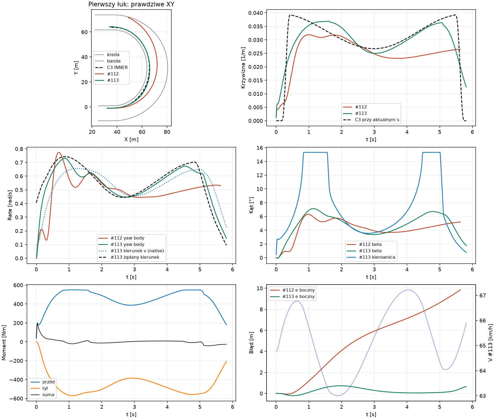
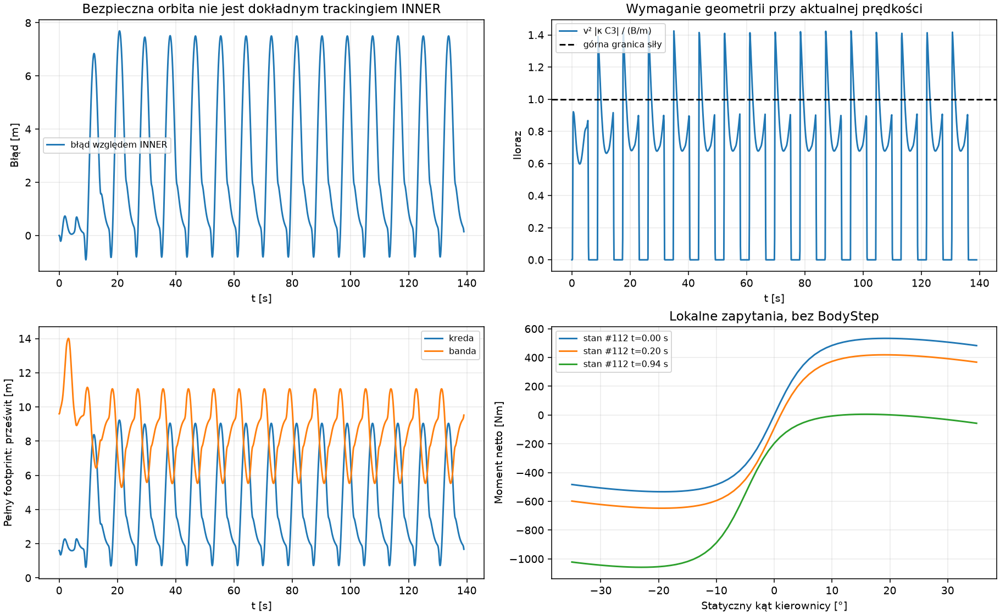

# PR #113 — fizyczne sterowanie kierownicą

**Pierwszy i drugi łuk oraz 8 okrążeń ukończone bez wyjazdu.** Poprawiono
regulator, zachowując kontakt, silnik, Grip i INNER. Dokładny tracking INNER
przy pełnym gazie nadal nie przechodzi kontroli. Wariant pozostaje PROVISIONAL/OFF.

Baza: zweryfikowany otwarty Draft #112,
`c5cd35e37e7f44d877067671577e4e4cddc56ccf`. Nowe
`EnablePhysicalSteeringControl=false` wymaga `EnableTwoContactBikeDynamics=true`;
obie flagi domyślnie OFF.

## 1. Dlaczego poprzednia kierownica nie skręcała skutecznie?

`headingError + atan(1.30*a_req/V²)` nie odwraca odpowiedzi kontaktów i nie
uwzględnia aktualnego body yaw rate. Przy 0,20 s heading wyprzedza styczną
o 1,717°: odejmuje to od kinematycznego feed-forward 2,341°, zostawiając
polecenie **0,624°**. Wykonane 0,664° daje **ujemny moment netto −34,5 Nm**,
choć potrzebne jest narastanie obrotu. To potwierdzony wczesny błąd sterowania.
`headingError` zawiera człon−β; sam w sobie nie dowodzi błędu, ale tutaj
nie reprezentuje wymaganej odpowiedzi nieliniowych kontaktów.

Stany #112: `ΩC3=VκC3`, `ΩPD=a_req/V` to **odtworzona intencja, nie zapisany
setpoint starego regulatora**. `ω` oznacza obrót bryły, `Ωv` obrót kierunku v
wynikający z sił. Natywne różnice między stanami:
[motion-comparison.csv](physical-steering-control/motion-comparison.csv).

| t [s] | κ C3 / ruch [1/m] | ΩC3 / ΩPD / ω / Ωv [rad/s] | β [°] | δ polecenie / użyte [°] |
|---:|---:|---:|---:|---:|
| 0,20 | 0,00070 / 0,00637 | 0,013 / 0,574 / 0,199 / 0,116 | 0,73 | 0,62 / 0,66 |
| 0,94 | 0,03721 / 0,03179 | 0,697 / 0,970 / 0,624 / 0,596 | 6,28 | 6,03 / 6,01 |
| 5,63 | 0,03815 / 0,02643 | 0,757 / 1,291 / 0,530 / 0,525 | 5,20 | 5,72 / 5,73 |

| t [s] | τ przód / tył / suma [Nm] | Największa suma w skanie ±35° [Nm] | δ przy tym maksimum [°] | Największa suma osiągalna w następnym kroku [Nm] |
|---:|---:|---:|---:|---:|
| 0,20 | 80,9 / −115,5 / −34,5 | 418,8 | 19 | 5,5 |
| 0,94 | 503,4 / −542,6 / −39,2 | 5,6 | 16 | −34,0 |
| 5,63 | 487,5 / −491,6 / −4,1 | 54,4 | 16 | 2,8 |

Skan statyczny: krok1°, bez BodyStep/commit. Ostatnia kolumna uwzględnia
rzeczywisty średni δ i limit90°/s. Większy skręt pomaga wcześnie; pełne35°
daje mniej momentu niż16–19°, wskutek obrotu kierunku siły przodu.

Przy pierwszym błędzie >1 m w0,94 s przód zużywa84,5% własnego budżetu,
a tył wytwarza przeciwny moment542,6 Nm. Odzyskanie ΩPD w istniejącym czasie
0,1 s wymagałoby182,5 Nm. Nawet hojna, ciągła górna granica **57 Nm** jest
niższa: `|τF|≤|rF|*BF`, a oryginalny monotoniczny root koła ogranicza rear Fy
przy całym możliwym przednim obciążeniu wzdłużnym ±BF.
[Pełne zapytania](physical-steering-control/diagnosis.json) i
[granice momentu](physical-steering-control/torque-upper-bounds.json).
To granica **szybkiego odzyskania tego stanu**, nie całego łuku. Błąd rośnie
do9,85 m w5,63 s; przy5,64 s obrys przekracza bandę. Limit35° nie był pierwszą przyczyną.

## 2. Co zmieniło się w sterowaniu?

Zachowano dotychczasowy preview C3, `a_req` i czasy odpowiedzi. Nowy regulator
wyznacza `r*=a_req/max(V,0.5)` oraz `τ*=I*(r*−ωBody)/0.1s`, po czym odwraca
**lokalną odpowiedź oryginalnych kontaktów** na δ. Stały skan32 przedziałów
i bisekcja uwzględniają niemonotoniczną odpowiedź, aktualny β,
prędkości obu osi, body yaw i obciążenie przodem w scalar midpoint tylnego koła.
Zapytania nie integrują świata i nie zatwierdzają stanu koła/kierownicy.

Nie ma celu heading=styczna ani β=0. Równość prędkości obrotu bryły i kierunku
v zakłada chwilowo stały, dowolny β. Niedostępny moment jest oznaczany;
wybierana jest najlepsza próbkowana odpowiedź. Brak całki i kumulacji błędu.
Limit±35° i90°/s pozostaje; zapis obejmuje żądanie, średni δ i stan po kroku.
Wszystkie momenty nadal pochodzą wyłącznie z `rF×FF+rR×FR` w Box2D.

## 3–4. Czy poprawiły się yaw/β i czy pierwszy łuk jest bezpieczny?

Przy0,20 s rzeczywisty body yaw wzrósł **0,199→0,432 rad/s**, a obrót kierunku
v **0,116→0,262 rad/s**. Przy0,94 s body yaw wynosi0,723 zamiast0,624 rad/s.
Nie chodzi o większy peak: maksimum body yaw pierwszej próby spadło
0,774→0,731 rad/s. Zniknęło wczesne prostowanie kierownicy i poprawił się przebieg.

| Próba | Koniec [s] | Max β [°] | Max δ użyte [°] | Min kreda / banda [m] | Dolne granice między próbkami [m] | Max błąd INNER [m] |
|---|---:|---:|---:|---:|---:|---:|
| #112, stop na bandzie | 5,64 | 6,31 | 8,26 | 1,522 / **−0,005** | 1,417 / −0,119 | 9,85 przed ostatnim krokiem |
| #113, pierwszy łuk + wyjście | 5,82 | 7,14 | 15,31 | 1,349 / 8,948 | 1,241 / 8,844 | 0,733 |
| #113, do wyjścia drugiego łuku | 14,52 | 8,02 | 15,31 | 0,620 / 6,427 | 0,492 / 6,323 | 6,845 |
| #113, 8 okrążeń | 139,01 | 8,07 | 15,31 | 0,620 / 5,296 | 0,492 / 5,192 | 7,694 |

Kolejność bramek: pierwszy łuk → drugi →8 okrążeń. Identyczny start #112:
ref32, XY(32,−1), v(18,0), heading/yaw/δ0, rolling omega18/0,33, Drive1.
Prefiksy prób są identyczne. Pełny obrys spełnia dotychczasowe marginesy
0,05/0,5 m i certyfikat między krokami; nie ma zaobserwowanego wyjazdu.

Na pierwszym łuku V=63,00–67,22 km/h, peak Fy przód/tył=814,69/951,31 N,
peak momentów osi=550,04/570,79 Nm. W8 okrążeniach: Vmax83,01 km/h,
Fy=820,32/983,72 N, momenty553,84/590,23 Nm. Peaki nie są jednoczesne.
Większy rzeczywisty skręt zwiększa rozpraszanie pracy przodu i naturalnie
obniża prędkość w pierwszym łuku; nie dodano hamulca ani limitera prędkości.

## 5. Regulator czy fizyczna charakterystyka kontaktów?

**Pierwszą potwierdzoną przyczyną był regulator; ten błąd usunięto.** Pozostaje
udowodniony twardy limit dla części żądań przy późniejszych prędkościach.
W drugim łuku, t8,97 s, V81,72 km/h i κC3=0,039239 wymagają20,22 m/s²,
przy dostępnym B/m=14,546 m/s². Ponieważ suma norm sił opon ≤B, a opór
jest równoległy do v, żadna kierownica nie odtworzy wtedy dokładnej C3.
W8 okrążeniach największy iloraz wymagana/dostępna siła wynosi1,431.

Bezpieczny ruch nie oznacza zaliczenia INNER. Udział pozostałych uproszczeń
regulatora (stały β, preview) nie został wyznaczony. **Nie wykazano wadliwości
opony ani silnika**; wykazano niezgodność części żądań krzywizny z uzyskaną prędkością.
Nie zmieniano Grip, opon, napędu, wheelspin,40/60, masy147 kg,
I52,72097 kg·m², osi+0,70/−0,60 m, CoM, toru ani linii.





## Energia, zgodność i odtworzenie

Praca punktowa zawiera rotację dokładnie raz; osobny yaw actuator ma0 wywołań.

| Energia [kJ poza residualem] | Pierwszy łuk | 8 okrążeń |
|---|---:|---:|
| Silnik | 39,25695 | 1018,89698 |
| Strata przodu / tyłu boczna / tyłu wzdłużna | 14,53301 / 8,39499 / 3,59726 | 390,41522 / 179,21738 / 83,16314 |
| Łożysko / praca oporów | 0,42378 / −11,15018 | 12,11619 / −338,19373 |
| ΔK bryły / koła | 0,85418 / 0,30349 | 14,66885 / 1,12092 |
| Residual C# [J] | −0,05223 | −1,56904 |

Niezależny ledger8 okrążeń daje−1,56837 J, wyjaśnione pracą błędu impulsu
native; niewyjaśniona różnica <3e−10 J. Python/C# różnią się <0,001 J
(float i zapis endpointów). Bramka używa dotychczasowych limitów impulsu
i tego rozliczenia, zamiast stałego cutoff1 J dla dowolnie długiego zapisu.
Brak kroków tworzących energię ponad pracę silnika/tolerancję float.
Max residual impulsu0,000624 Ns, momentu0,00000629 Nms; root koła <9,75e−9 m/s.

[analysis.json](physical-steering-control/analysis.json), CSV/CSV.gz i manifest
zawierają komplet danych. Zachowano **959/959** historycznych hashy,
fingerprint #112 B-left oraz prefiksy #106/#111. Bez historycznych macierzy.
Koszt:2 odpowiedzi po0,3 s i3 etapowe próby toru; query bez integracji,
testy regresji osobno. Pełny przejazd:13933 kroki,613865 lokalnych query
w zaakceptowanych interwałach, dodatkowe query h0 bez integracji.

Windows/PowerShell, świeży katalog wyników, z katalogu repozytorium:

```powershell
dotnet restore SpeedwayManager.sln
dotnet build SpeedwayManager.sln -c Release --no-restore --warnaserror
$outDir = 'results/physical-steering-recapture'
foreach ($stage in @('diagnose','freeze','torque-bounds','responses','first-bend','second-bend','eight-laps')) {
  dotnet run --no-build -c Release --project tools/shared-world-speedway -- physical-steering $outDir $stage
  if ($LASTEXITCODE -ne 0) { throw "Gate failed: $stage" }
}
# matplotlib potrzebny wyłącznie dla --plots:
python tools/shared-world-speedway/physical-steering-report.py --data $outDir --plots --compact
```

Lokalnie: Release --warnaserror bez ostrzeżeń,28/28 celowanych C#,
129/129 Python,7/7 CI policy,13/13 Node; audyt39 zamrożonych konsumentów.
[validation.json](physical-steering-control/validation.json).
Wynik standardowego Windows Draft CI dla końcowego HEAD będzie w opisie Draft PR.
Bez zmian wizualizacji, optymalizatora, produkcyjnego CoreSim i bez merge.
