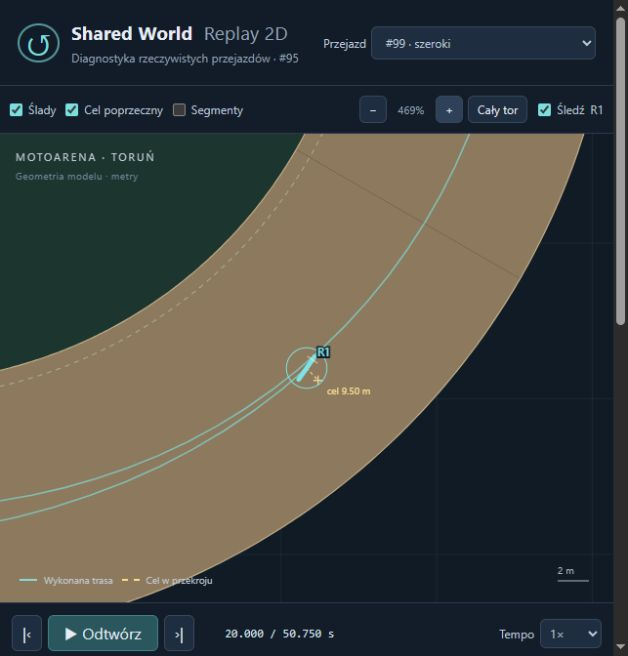

# Physics-Driven Racing Line (#99)

**PROVISIONAL — B: poprawny selektor ograniczonego zbioru; geometria blokuje wniosek o pełnej szerokości łuku.** Baza #98 `b01d819fddc9e81a30e961517c27f952bb96dad4`, Draft bez merge. Produkcyjne src/CoreSim, SlipCoupledDynamics, ContactAdapter, TrackFrame, scoring taktyczny i parametry domyślne pozostają bez zmian.

## Najpierw geometria

[Audyt zapisany przed porównaniami](physics-driven-racing-line/geometry-audit.json): referencja leży 1 m od kredy, zatem fizyczna krawędź wewnętrzna to offset −1 m. Prosta: krawędź zewnętrzna +11 m, usable 10 m. Łuk: +15,6 m, usable 14,6 m. Historyczny target max=9,5 m blokuje 4,6 m dodatkowego zakresu użytkowego łuku. Nie zmieniono go globalnie ani wprowadzonym interfejsem.

Wyprostowany motocykl przy target=9,5 m miałby 1,1 m prześwitu do bandy na prostej i 5,7 m na łuku. Rzeczywisty wynik zależy od obrysu: chassis 2,10×0,30 m oraz kierownica 0,80 m przesunięta o 0,65 m; obrót zwiększa poprzeczny zasięg. Blisko bandy oznacza w tym raporcie cały obrys w odległości ≤1,5 m, a nie konkretny offset. To próg diagnostyczny, nie bonus w celu.

Eksport natywny ma cztery skoki końców zewnętrznych krawędzi po 4,600000 m: ref35, 132,389375, 194,389375 i 291,778750. Krawędź wewnętrzna jest ciągła. Szerokość nie ma spline ani strefy przejścia. Stały fizyczny offset daje ciągłą pozycję motocykla, ale nie ciągłą gładką bandę. Samo podniesienie targetu do 14,1 m mogłoby zostawić motocykl poza progiem w momencie powrotu na prostą.

Dlatego wynik dotyczy jawnego podzbioru 0,5–9,5 m, a nie optimum całej fizycznej powierzchni. Nie rozszerzono targetów i nie uznano ich za odległość od bandy. Offline RacingLineGeometry mierzy dystans obu kapsuł do natywnych odcinków i łuków oraz konserwatywnie do odcinków łączących końce skoków szerokości. Nie dodaje band/sił do świata ani nie maskuje braku gładkiej geometrii. Analiza segment–łuk jest analityczna; odległości pomniejsza tylko zapas numeryczny 0,1 mm. Dodatkowy warunek wykonalności to 5 cm prześwitu. Sprawdzany jest cały motocykl, także zanim jego środek przekroczy granicę segmentu. Ocena B zachowuje tę blokadę niezależnie od zwycięzcy.

## Zbiór i selekcja

[Zamrożony plan, warunki i profile](physics-driven-racing-line/plans.json): 12 planów × 4 warunki = 48 podstawowych światów. Plan zawiera offset prostej/wejścia/apexu/wyjścia i kilka jawnych progów geometrycznych. Wszystkie podstawowe próby Drive=1. Bez losowania, dopisywania kandydatów po wynikach ani lokalnego przeszukiwania. Nazwa nie jest argumentem oceny: selektor używa rzeczywistych Lap2+Lap3, a tylko przy dokładnym remisie liczbowej definicji planu.

Każda próba zaczyna od ref0, offset5 m, 18 m/s, kierunku referencji, zerowego spinu i prędkości bocznej, target5, Drive1, neutralnego setupu i tej samej nawierzchni w obrębie porównania. Masa 70+77 kg. SHA dokładnych początkowych stanów jest identyczny w każdym warunku we wszystkich wariantach gazu i planach. Pierwsze okrążenie rozgrzewa/przygotowuje stan; dwa następne są celem, a ich różnica musi być ≤0,05 s. Nie przenosi się korzystnego stanu końcowego jednego planu do startu innego.

SpatialControlCommand jest osobnym, opcjonalnym interfejsem narzuconych poleceń ON. Kompilator zna geometrię i powtarza progi na trzech obiegach. Activate sprawdza wyłącznie bieżący zaakceptowany postęp; zmiana następuje na pierwszej granicy solvera po przekroczeniu progu. Nie dochodzi nowy krok ani predykcja czasu przekroczenia. Polecenia mają zerową zwłokę autorską, tak samo jak ControlCommand w #98; nie są decyzjami reaktywnej AI. Dotychczasowe opóźnienia AI i ControlCommand pozostają bez zmian. Kontrolę kolejności każdego zawodnika prowadzi oddzielny kursor. Nie ma rewindu, przesuwania ciał ani integracji AutonomousRacingLine ze slip ON.

Maksymalny przestrzenny overshoot aktywacji wynosi 0.249144 m, bez ujemnych przekroczeń poza śladową arytmetyką float. Log podaje próg, zaakceptowany postęp, czas i aktuatory. Największa różnica dwóch lotnych okrążeń wynosi 0.002561 s. Czas przekroczenia mety i dystans zamkniętego interwału są pomiarową interpolacją między wykonanymi stanami; nie stanowią nowej pozycji w symulacji.

| Plan | Prosta / entry / apex / exit m | Przygotowanie | Apex / exit cp | A: lap1 / lap2 / lap3 s | A: cel 2+3 s |
|---|---|---|---|---|---:|
| inner | 1/1/1/1 | 15 m przed lub cp 0 | 0.35/0.8 | 15.936241/15.599258/15.599273 | 31.198531 |
| middle | 5/5/5/5 | 15 m przed lub cp 0 | 0.35/0.8 | 16.555589/16.094167/16.094220 | 32.188386 |
| wide | 9.5/9.5/9.5/9.5 | 15 m przed lub cp 0 | 0.35/0.8 | 17.331497/16.708705/16.708788 | 33.417493 |
| wide-smooth-early | 9.5/7/4/9.5 | 15 m przed lub cp 0 | 0.35/0.8 | 16.788767/16.232397/16.232122 | 32.464519 |
| wide-smooth-short | 9.5/7/4/9.5 | 8 m przed lub cp 0 | 0.35/0.8 | 16.820950/16.255903/16.256127 | 32.512031 |
| wide-tighten | 9.5/7/2/9.5 | 15 m przed lub cp 0 | 0.35/0.8 | 16.781889/16.240557/16.240442 | 32.480999 |
| wide-late-tight | 9.5/7/1/9.5 | 0 m przed lub cp 0.05 | 0.55/0.85 | 17.202883/16.702071/16.701209 | 33.403280 |
| early-open-exit | 9.5/7/2/9.5 | 15 m przed lub cp 0 | 0.35/0.65 | 16.923738/16.397325/16.396315 | 32.793639 |
| middle-open | 5/7/4/8 | 15 m przed lub cp 0 | 0.35/0.8 | 16.719697/16.226042/16.225793 | 32.451835 |
| inner-open | 1/5/8/5 | 15 m przed lub cp 0 | 0.35/0.8 | 16.832650/16.435129/16.435298 | 32.870428 |
| wide-late-apex | 9.5/9.5/5/9.5 | 15 m przed lub cp 0 | 0.5/0.85 | 17.283281/16.697034/16.696569 | 33.393604 |
| middle-tighten | 5/3/1/5 | 15 m przed lub cp 0 | 0.45/0.8 | 16.164063/15.730770/15.730693 | 31.461462 |

## Wynik czasu, drogi i wyjścia

Wszystkie 48 podstawowych i 16 wariantów gazu kończą trzy obiegi, bez naruszeń obrysu, kontaktów i Crash. Zwycięża **inner**: target1 m przez cały cykl. To wynik ograniczonego zbioru, a nie twierdzenie o globalnie optymalnej linii. Nie nadano mu premii za kredę ani nie dodano bandzie bonusu. [Wszystkie okrążenia/czasy/odrzucenia](physics-driven-racing-line/results.csv), [pełny etap 1](physics-driven-racing-line/stage1.json).

| Warunek | inner lap2+3 s | middle s | wide s | wide-tighten s | Zwycięzca |
|---|---:|---:|---:|---:|---|
| A-neutral | 31.198531 | 32.188386 | 33.417493 | 32.480999 | inner |
| B-low-grip | 32.053337 | 33.010419 | 34.226635 | 33.261000 | inner |
| C-skill40 | 31.882653 | 32.906300 | 34.167895 | 33.209524 | inner |
| C-skill60 | 30.552275 | 31.512769 | 32.712930 | 31.798586 | inner |

A: legacy i canonical 50; B: ten sam zawodnik, Grip0,85/Ruts0/Moisture0,5, EffectiveGrip0,7675 zamiast 0,9175. C: dwa nieekstremalne profile 40/60 zmieniają istniejące legacy Speed/SlideControl i canonical Technique, pozostałe wartości 50, ta sama masa/setup/surface. To próba istniejących zależności, nie przypisanie osiągów prawdziwemu zawodnikowi. Zwycięzca nie zmienia się z warunkami; test zmiany nazw i kolejności ocen wyklucza wybór po nazwie. Czasy i wykonanie jednak zmieniają się zgodnie z modelem.

| A, plan | Droga lap2+3 m | Entry / min / exit m/s (pierwszy łuk lap2) | Max następnej prostej m/s | Min inner / outer m | Usage max | Slip loss 3 obiegi kJ |
|---|---:|---|---:|---|---:|---:|
| inner | 644.100 | 23.753/18.996/19.448 | 23.753 | 0.261/5.600 | 0.955341 | 206.746 |
| middle | 692.198 | 24.307/19.984/20.376 | 24.307 | 4.245/5.145 | 0.954552 | 206.120 |
| wide | 748.595 | 24.894/20.998/21.335 | 24.894 | 5.600/0.710 | 0.949531 | 204.686 |
| wide-tighten | 709.518 | 24.569/19.666/21.058 | 24.569 | 3.700/1.925 | 0.954743 | 203.397 |
| early-open-exit | 716.155 | 24.451/19.708/20.814 | 24.451 | 4.441/1.550 | 0.954723 | 206.311 |

Szeroki stały plan daje większą prędkość wyjścia i późniejszej prostej, ale wydłuża dwa lotne obiegi o około 104,5 m i przegrywa o 2,219 s. Szeroko→zacieśnienie odzyskuje część kosztu względem stałej zewnętrznej, jednak nadal przegrywa z wewnętrzną. Wcześniejsze otwarcie exit nie pomaga: większy koszt drogi i przejścia pozostaje. Budżet safe²/R pochodzi z istniejącego modelu; przy zbliżonej sile bocznej większy promień zwiększa speed mniej niż proporcjonalnie do długości łuku. To mechaniczne wyjaśnienie badanych wyników, a nie uniwersalna reguła realnego żużla.

## Fazy, uślizg i energia

Poniżej fazy lotnych okrążeń A (początek prostej = pierwsze 12 m za łukiem; przygotowanie = ostatnie 15 m przed nim). To obserwacje, bez dodatkowego sterowania w tych granicach. W przedziałach 3/2° liczymy odpowiednio jazdę wyłamaną przy rosnącej rzeczywistej speed oraz prawie wyprostowaną. Nie ma nagrody za mały kąt. [Wszystkie warunki/plany/fazy](physics-driven-racing-line/phases.csv), [każdy łuk](physics-driven-racing-line/corners.csv).

| Plan / faza | Śr./max abs α ° | Śr./max target ° | Śr. speed m/s | Śr. Fx/Fy N | Near outer udział | α≥3° i przyspieszanie s | α≤2° s |
|---|---|---|---:|---|---:|---:|---:|
| inner / straight-middle | 0.169/0.632 | 0.142/0.526 | 21.801 | 369.5/-10.3 | 0.0% | 0.000 | 6.410 |
| inner / preparation | 2.334/6.341 | 4.992/9.517 | 23.451 | 354.0/618.7 | 0.0% | 0.920 | 1.310 |
| inner / entry | 16.725/18.894 | 18.622/20.020 | 22.085 | 326.8/1947.0 | 0.0% | 0.000 | 0.000 |
| inner / middle-turn | 9.919/18.387 | 9.065/14.595 | 19.147 | 345.8/1717.8 | 0.0% | 1.560 | 0.000 |
| inner / exit | 7.322/8.466 | 6.722/8.691 | 19.061 | 345.3/1508.6 | 0.0% | 2.400 | 0.000 |
| inner / straight-start | 1.622/2.809 | 0.779/1.784 | 19.955 | 387.2/477.9 | 0.0% | 0.000 | 1.680 |
| wide / straight-middle | 0.152/0.567 | 0.154/0.971 | 23.260 | 355.6/-11.9 | 100.0% | 0.000 | 6.010 |
| wide / preparation | 2.265/5.041 | 4.385/6.301 | 24.632 | 342.7/622.5 | 84.2% | 0.882 | 1.160 |
| wide / entry | 12.246/18.220 | 13.049/19.777 | 23.572 | 311.3/1804.5 | 0.0% | 0.398 | 0.000 |
| wide / middle-turn | 8.886/9.985 | 8.885/9.803 | 21.522 | 325.6/1685.0 | 0.0% | 0.000 | 0.000 |
| wide / exit | 7.060/8.133 | 6.574/8.207 | 21.081 | 328.5/1494.8 | 4.1% | 2.200 | 0.000 |
| wide / straight-start | 1.551/2.822 | 0.619/1.518 | 21.740 | 370.2/458.6 | 100.0% | 0.000 | 1.590 |

Preview statycznej geometrii zaczyna żądać uślizgu przed wejściem, ale nie oznacza natychmiastowego wykonania kąta. Widać też utrzymujący się uślizg po wyjściu i jego wygaszenie dopiero na prostej. W części wyjścia motocykl jest jeszcze wyłamany i przyspiesza: nie należy utożsamiać dodatniej speed z pełnym wyprostowaniem. Wcześniejszy exit-target obniża żądanie boczne, ale nie nadaje niezależnie kąta oponie. Nie zmieniono obu czasów regulatora ani guardu yaw.

Praca jest rozłożona według faktycznie przyłożonych Fx/Fy, oporu i momentu oraz średniej zaakceptowanych prędkości danego kroku. ΔK zawiera translację i obrót. Osobno raportujemy modelową całkę straty bocznej z początku kroku. Bilans obejmuje pełne zaakceptowane wykonanie, z ewentualnym ostatnim fragmentem kroku za linią mety; cel czasu i droga zamknięta używają przekroczenia, a statystyki faz pomijają ułamki krańcowych próbek lotnego okna. Ich błąd czasowy jest ograniczony krokiem 10 ms.

| A, plan | W drive / lateral / resistance / yaw kJ | ΔK kJ | ΔK−W J |
|---|---|---:|---:|
| inner | 336.220/-203.601/-121.870/0.000 | 10.750 | 0.565308 |
| wide | 372.911/-201.365/-155.967/0.000 | 15.579 | 0.391237 |
| wide-tighten | 358.430/-200.283/-143.381/0.000 | 14.765 | -0.487260 |

Największa bezwzględna pozostałość w 64 przejazdach: 1.076695 J. Kryterium zamrożone przed pomiarem: max(5 J, 0,1% pracy napędu). Nie ma dodatkowej siły odśrodkowej, clampowania speed do idealnego promienia ani nowego źródła energii.

## Kontrolowany gaz

Przed pomiarem ustalono Drive1/0,7/0,4. Etap 2 dotyczy zwycięzcy etapu 1 oraz inner/wide, po usunięciu duplikatu zwycięzcy=inner: dwa plany × cztery warunki × dwa nowe poziomy =16 światów. Drive1 wykorzystuje już wykonane dane. Gaz jest obniżany od landmarku przygotowania do cp0,20, potem otwierany do 1; brak hamulca i niezależnego wheelspinu.

| Warunek / plan | Drive1 lap2+3 s | Drive0,7 s | Drive0,4 s |
|---|---:|---:|---:|
| A-neutral / inner | 31.198531 | 31.232313 | 31.391107 |
| A-neutral / wide | 33.417493 | 33.637683 | 33.946234 |
| B-low-grip / inner | 32.053337 | 32.031869 | 32.164856 |
| B-low-grip / wide | 34.226635 | 34.431089 | 34.723533 |
| C-skill40 / inner | 31.882653 | 31.937601 | 32.111729 |
| C-skill40 / wide | 34.167895 | 34.403657 | 34.732390 |
| C-skill60 / inner | 30.552275 | 30.568744 | 30.715494 |
| C-skill60 / wide | 32.712930 | 32.920804 | 33.212744 |

Tylko B/inner0,7 daje małą poprawę (~0,023 s na dwa obiegi); nie zwiększano liczby prób, aby ją dopasować. Nie jest to rekomendacja kalibracji gazu na podstawie milisekund. Pozostałe przymknięcia tracą czas. Wszystkie podstawowe próby były już wykonalne, więc ten zestaw nie dowodzi uratowania niewykonalnego łuku gazem. Mniejszy Drive zmienia późniejszą speed, kąt i offset, ale nie steruje niezależnie Fy w tym samym stanie. W pełnych tabelach faz można oddzielić utratę wejściową od wyjściowej; sam mniejszy kąt nie daje automatycznie lepszego czasu.

## Ujemna kontrola i replay

Oddzielna kontrola testowa target0,5 (nie dopisana do 12 kandydatów po poznaniu wyników): czas lotnych 31.099310 s, ale prześwit wewnętrzny -0.229984 m i 361 próbek naruszenia. Ten szybszy przejazd selektor odrzuca. Nie przesunięto motocykla z powrotem na tor. Jest zachowany jako replay odrzuconej kontroli.

Istniejący viewer ma tylko dodatkowe pozycje w liście: #99 wybrany, wewnętrzny, szeroki i odrzucona kontrola. CSV zawiera rzeczywiste X/Y i body heading. JSON zachowuje początek, zdarzenia, trzy indywidualne okrążenia, metę, energię i rzadsze rzeczywiste próbki α/target. Nie ma nowego renderera. Naprawa graniczna: komenda aktywowana dokładnie w t próbki (w tym t0) ma pierwszeństwo przed aktuatorami próbki sprzed Activate; pozycja pozostaje zapisana/interpolowana, bez teleportu. 7 testów Node obejmuje także ten przypadek i wszystkie zapisane pozy.

Uruchom z repo `python -m http.server 8766 --bind 127.0.0.1`, otwórz [viewer](../../tools/replay-viewer/index.html) przez HTTP i wybierz #99. Sprawdzono w przeglądarce wbudowanej: szeroki/odrzucony/wybrany, suwak, stan t0, śledzenie i zoom. [Widok szerokiego przejazdu](physics-driven-racing-line/replay-wide.png). Źródła: [selected](physics-driven-racing-line/selected.json), [inner](physics-driven-racing-line/inner.json), [wide](physics-driven-racing-line/wide.json), [rejected](physics-driven-racing-line/rejected.json) i odpowiadające pliki `*-accepted.csv`. Dwa aliasy selected/inner celowo mają tę samą trajektorię zwycięzcy; wszystkie trzy odtworzenia i normalny bieg bez diagnostyki zachowują fingerprint/kroki pierwotnego pomiaru.

## Koszt, regresje i odtworzenie

64 światy porównawcze: 3.154 s przechwytywania z istniejącymi obserwatorami oraz 3.918 s dodatkowej geometrii/metryk offline. Wybór z czterech list wyników: 0.895 ms. Zwykłe odtworzenie zwycięzcy: 27.605 ms, 4729 wywołań, 0 wywołań optymalizatora podczas biegu. To pojedynczy kontrolowany pomiar kosztu, nie szeroki benchmark. Osobno wykonano 3 krótkie warianty kontrolne przed pełną serią, 3 powtórzenia replay, jedno bez obserwatorów i ujemną kontrolę; nie powtarzano całego eksperymentu przy korektach metadanych replay.

33/33 celowane Release: 6 nowych +27 #97/#98/geometrii. Build Release --warnaserror: 0 warnings/errors. 7/7 Node. Bez nowych alokacji w Forces (kod niezmieniony; istniejący test 0 B). Puste plany przestrzenne zachowują bitowo OFF/ON #97/#98; niezmienione polecenie przestrzenne ma ten sam fingerprint i solver calls co brak poleceń. Testy chronią rzeczywiste krawędzie/kapsuły/skok szerokości, przyczynową aktywację, brak teleportu, identyczny początek, wybór po zmierzonym czasie, odrzucenie fizycznie niepoprawnego, powtórzenie i odwrócenie zawodników. Historyczne manifesty: {'autonomous-racing-line': 34, 'slip-coupled-dynamics': 63, 'slip-control-validation': 42}; wszystkie zgodne, bez nadpisania plików. Standardowe Draft Windows CI na końcowym HEAD: link/status w PR i dostarczeniu. [Walidacja](physics-driven-racing-line/validation.json).

Reprodukcja do nowego katalogu: `physics-line NEW freeze`, potem `physics-line NEW measure` przy Release narzędzia. `racing-line-report.py` tylko czyta dowody i sprawdza historyczne hashe; nie wykonuje fizyki ani ponownego wyboru. Eksporter odmawia nadpisania dowodów. Po pomiarze poprawiono wyłącznie wymagane metadane parsera replay (RiderId/Passes), bez ponownego liczenia ruchu; bieżący kod eksportu zawiera je od początku.

## Odpowiedzi i jeden następny krok

1. **Czy model preferuje bandę na prostej?** Nie w tym zamrożonym zbiorze. Inner wygrywa we wszystkich czterech warunkach; szeroki rzeczywiście zbliża obrys do bandy na prostej, ale nie na pełnej szerokości łuku. Nie wyprowadzamy z Motoareny statystyki realnych biegów.
2. **Dlaczego?** W badanej jednolitej nawierzchni dodatkowa droga przeważa wzrost prędkości wyjścia; ponadto brak gładkiej granicy i ograniczenie targetu uniemożliwiają ocenę pełnego zewnętrznego podejścia. Nie wiadomo, co wybrałby ten sam model na poprawionej całej geometrii.
3. **Szerokie wejście a następny odcinek?** Większa exit/straight speed jest zmierzona, lecz nie kompensuje kosztu całego cyklu. Mieszany plan poprawia szeroką kontrolę, ale przegrywa z inner.
4. **Ważność exit speed?** Przenosi się na następną prostą, jednak nie jest samodzielną funkcją celu; zamknięte dwa kolejne obiegi ujawniają koszt wcześniej przejechanej drogi.
5. **Regulator i wyłamanie?** Działa geometryczny preview i fizyczny powrót yaw, ale rzeczywisty kąt jest opóźniony i utrzymuje się na początku prostej. Wcześniejsze otwarcie nie poprawiło czasu; nie dowiedziono pełnego realizmu momentów ustawiania motocykla.
6. **Przymknięcie gazu?** Daje pośrednią kontrolę wykonania, głównie utratę tempa; niewielki wyjątek B0,7 nie uzasadnia nowego strojenia. Nie ma niezależnego wheelspinu.
7. **Blokada geometrii?** Tak dla pełnego wniosku o typowej zewnętrznej bandzie: skok4,6 m i niedostępny szerszy łuk. Konserwatywny podzbiór daje wiarygodne czasy, ale nie globalne optimum.
8. **Autonomia runtime?** Wybrany plan da się już tanio wykonywać jako normalne polecenia w jednym świecie, ale wieloświatowy selektor pozostaje offline. Stary scoring #95 nie został połączony z ON. Brakuje dowodu dla ciągłej, pełnej geometrii oraz adaptacyjnego wyboru w ruchu.

**Najważniejszy następny PR: ciągła, geometrycznie zweryfikowana zewnętrzna granica i jej lokalny bezpieczny zakres sterowania.** Powód pomiarowy to cztery udokumentowane skoki4,6 m oraz 4,6 m niedostępnego targetu łuku. Najpierw umożliwić uczciwe porównanie tej samej zamrożonej rodziny planów na całej powierzchni. Nie łączyć tego z przebudową opony, napędu, regulatora i AI. Dopiero potem można rozstrzygać brak preferencji bandy między sterowaniem a fizyką. Obecnie A=problem geometrii potwierdzony, B=opóźnienie sterowania zmierzone bez kalibracji, C=granice napędu/opony odziedziczone, D=selektor poprawny w ograniczonym zbiorze, E=brak podstaw do pełnego wniosku o realizmie.
