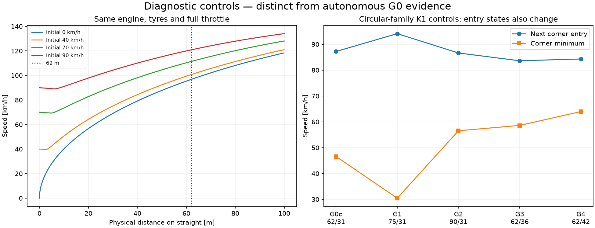
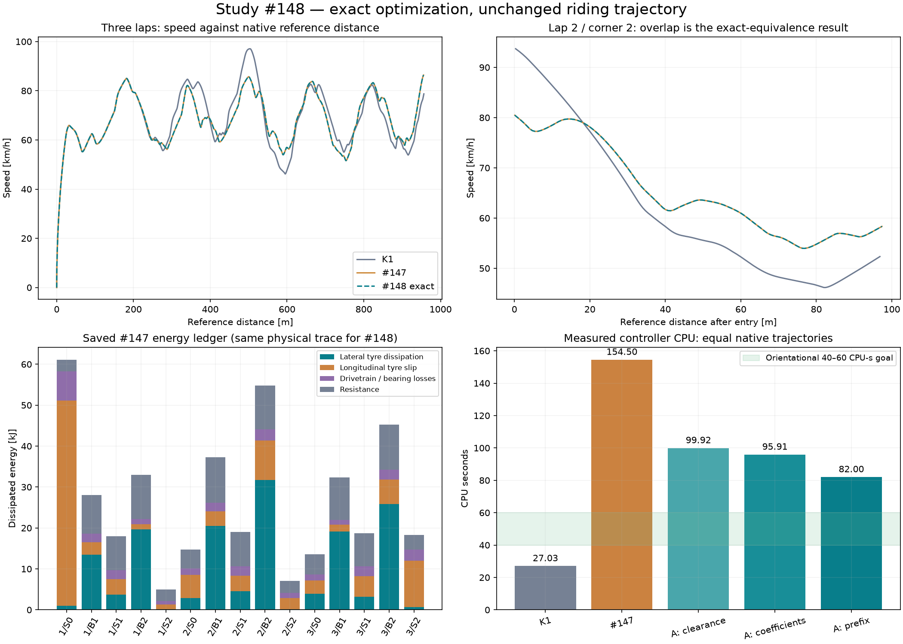

# Badanie #148 — wydajność planera i przyczyny wolnej jazdy

**Wynik: potwierdzona dokładna optymalizacja, cel 40–60 CPU-s nieosiągnięty.** Pełny autonomiczny przejazd zachowuje wszystkie 5412 próbki i 270 komend #147: trzy legalne okrążenia w **53,989766 s**. Sterownik zużywa **82,000 CPU-s zamiast 154,500**: o **46,926% mniej**, około 1,884× taniej. Maksimum decyzji spada z 21,266 do 10,281 CPU-s. Czas jazdy się nie poprawił. Fizyka, parametry i historyczne dane pozostały niezmienione.

Baza: Draft PR #146, `b92694ada648404bdd8180f8d02ac9138b67ac66`. Gałąź `experiment/planner-speed-root-cause-148`. Badanie #148 nie określa numeru PR przydzielonego przez GitHub. Draft, bez merge. Wszystkie eksperymentalne ścieżki domyślnie OFF.

## Przegląd PR #138–#146

|PR|Wniosek wykorzystany w tym badaniu|
|---|---|
|[#138](https://github.com/arturgladysz91/zuzel/pull/138)|Długie impulsy pełnego gazu nie dowodzą legalnej kontynuacji; ograniczenie dotyczy skończonych prób, nie wszystkich sekwencji.|
|[#139](https://github.com/arturgladysz91/zuzel/pull/139)|Ustalona zależność sił materiałowych od Iw; krótkie przyczynowe korekty kończą manewry, które przegrywa długi impuls.|
|[#140](https://github.com/arturgladysz91/zuzel/pull/140)|Oddzielenie prawa opony od numeryki poprawia separację, lecz kalibracja szutru pozostaje otwarta; wariant OFF nie zastępuje bazowej fizyki.|
|[#141](https://github.com/arturgladysz91/zuzel/pull/141)|Preflight zatrzymany przez koszt; brak podstaw do wniosku o poprawie całego przejazdu.|
|[#142](https://github.com/arturgladysz91/zuzel/pull/142)|Sama likwidacja preferencji może lokalnie pomóc; zachłanny Progress Only zawodzi 0/4.|
|[#143](https://github.com/arturgladysz91/zuzel/pull/143)|Usunięcie preferencji gazu: 12/12 ukończeń, tylko 0,29% zysku; szybsze kombinacje geometrii wprowadzają DNF.|
|[#144, badanie #145](https://github.com/arturgladysz91/zuzel/pull/144)|Bilans strat i legalna ręczna poprawa dowodzą ograniczenia planowania, bez dowodu skutecznej autonomii dwóch komend.|
|[#145, badanie #146](https://github.com/arturgladysz91/zuzel/pull/145)|Spójna terminalna kontynuacja poprawia badany łuk do 5,295 s, ale koszt zatrzymuje pełny dystans.|
|[#146, badanie #147](https://github.com/arturgladysz91/zuzel/pull/146)|Pierwsze pełne legalne trzy okrążenia: 53,989766 s, 154,5 CPU-s. To niezmienny punkt odniesienia.|

## Siedem odpowiedzi

1. **Czy proste 62 m są głównym problemem?** Ograniczają czas rozpędzania, ale nie wykazano, że są główną przyczyną wolnego tempa. Ten sam model na płaskiej prostej osiąga przy +62 m od 70 km/h **111,375 km/h**. Wariant G1 z prostą 75 m daje K1 wejście 94,130 km/h, po którym minimum spada do 30,442 km/h i łuk trwa 6,392 s. Dłuższa prosta sama nie rozwiązuje kontroli. Porównania G1–G4 należą do jawnie oddzielonej rodziny kołowej, bo zamrożony generator C2 odmawia innych wymiarów.

2. **Dlaczego kilka sekund bez gazu?** Gaz zmienia równocześnie Fx, Fy tylnej opony, wheelspin i moment yaw. Przy wejściu 29,4 s zarówno impuls 0,6 s, jak i krótki impuls 0,2 s z korektą kierownicy kończą się przekroczeniem eksperymentalnej obwiedni β45°. To nie potwierdzony upadek ani kontakt. Po szczycie łuku krótki impuls jest legalny, ale cały dystans zajmuje o 4,167 s więcej niż dobrana kontrola. Wcześniejsze odjęcie gazu w 28,4 s także pogarsza czas o 0,542 s. Nie wykazano, że wszystkie odpuszczenia są konieczne ani optymalne.

3. **Maksymalna legalna prędkość na obecnym torze?** W zachowanym pełnym legalnym K1 potwierdzono **97,076 km/h**, w #147 i dokładnym #148 **86,587 km/h**. Są to osiągnięte dolne granice możliwości, nie globalne maksimum. Dokładne maksimum dowolnej legalnej sekwencji pozostaje **INCONCLUSIVE**. Prędkość 148–151 km/h z długiej prostej jest osobną diagnostyką; nie jest prędkością legalnego przejścia przez łuk G0.

4. **Co najbardziej ogranicza lepsze okrążenie?** Bezpośrednio: długie wytracanie energii w łukach przez boczny poślizg/opory oraz straty wzdłużne. Przyczynowo: sprzężenie stanu wejścia, linii, yaw i napędu, ograniczenia statycznego modelu opon oraz endogenicznego ogona K1/H09. Nie rozdzielono tych przyczyn na wiarygodne udziały czasu; ustalenie jednego globalnego dominującego źródła pozostaje **INCONCLUSIVE**.

5. **Czy model opon zapewnia realistyczną szybką jazdę?** **INCONCLUSIVE.** Oryginalne prawo używane przez #144/#147 nadal ma wykrytą w #139 zależność chwilowych sił od Iw. Przy zerowym dt i tym samym stanie zmiana Iw 0,45→0,90→1,80 daje Fx 420,268→636,271→780,066 N oraz Fy tyłu 860,796→730,956→591,490 N, przy niezmienionym budżecie przyczepności. Poprawka rozdzielająca prawo opony z #140 jest osobnym wariantem OFF i nie została podmieniona do tego badania. Brakuje kalibracji szutru i przechylenia/poprzecznego profilu.

6. **Które obliczenia można usunąć?** Powtarzane projekcje znaków końców połączonego obrysu, gdy jego wnętrze jest już dowiedzione; nieużywany preview kierunku przy jawnym sterowaniu; wielokrotne liczenie niezmiennych współczynników solvera sprzęgła; osobne odtwarzanie wspólnych pierwszych 0,24 s dla każdego kandydata K1. Ostatnia zmiana usuwa **1 032 014 zapytań kontaktowych** bez zmiany prognoz i jazdy. Same duplikaty pełnych stanów są rzadkie.

7. **Następny krok?** Ograniczyć generowanie nowych ogonów i pełnych K1 za pomocą etapowego rankingu/admisyjnych ograniczeń, nadal certyfikując końcowy manewr i wykonanie. Równolegle skalibrować prawo Fx/Fy i przejścia na szutrze oraz rzeczywistą geometrię/banking. Potem walidować wspólny świat z rywalami. Projekcja kosztu samej kontroli czterech zawodników wynosi nadal około **6,08 CPU-s na sekundę symulowanego biegu** (4×82/53,989766), przed predykcją rywali. To oszacowanie liniowe, nie pomiar wspólnego biegu.

## Tabela 1 — wydajność i pełne ukończenia

|Wariant|3 okr. s|CPU sterownika s|Mediana /p95 /max CPU s|Prognozy /segmenty|Pełne K1|Kontakty prognoz|Ukończenia|Naruszenia|
|---|---:|---:|---|---:|---:|---:|---:|---|
|K1|54.794530|27.031250|0.093750 /0.140625 /0.312500|7404|274|669512|1/1|brak|
|#147|53.989766|154.500000|0.046875 /5.156250 /21.265625|72448|N/D; 1686 żądań|4584136|1/1|brak|
|A1: geometria|53.989766|99.921875|0.031250 /3.375000 /13.046875|72448|1643|4584136|1/1|brak|
|A2: współczynniki|53.989766|95.906250|0.031250 /3.218750 /12.421875|72448|1643|4584136|1/1|brak|
|A3: wspólny prefiks|53.989766|82.000000|0.031250 /2.781250 /10.281250|74091|1643|3552122|1/1|brak|

W #147 oryginalny summary nie zachował licznika pełnych wywołań K1: 1686 zawiera trafienia memo. Dokładne odtworzenia A mierzą 1643 wykonania i 43 seed-hit przy identycznej trajektorii/cache. Nie przedstawiamy 1643 jako odczytu brakującego historycznego licznika. K1 ma jeden pełny wybór na natywną decyzję (274).

W A3 **72448 niezmienionych braków trafienia cache** jest realizowanych jako 74091 fizycznych wywołań segmentów, ponieważ 1643 wspólne prefiksy są osobnymi odcinkami. Liczba wywołań funkcji rośnie, lecz zapytania kontaktowe spadają z 4584136 do 3552122. Nie ukrywamy tego zmianą definicji prognozy. Kierunek rankingu, wynik i pełne punkty prognoz są zachowane.

Koszt A3 poza kontrolerem — fizyka natywna, obserwacja i certyfikacja: **14.296875 CPU-s**; razem świat **96.296875 CPU-s**. Nie jest to osobny pomiar samego Box2D.Step. Trzy nowe pełne warianty A odtwarzają wszystkie próbki #147; nie jest to powtórzenie końcowej konfiguracji przy różnych wejściach. Każdy z A1/A2/A3 ma jedną pełną próbę.

## Dlaczego K1 uruchamia się setki razy

Planner146 tworzy świeży ogon przez cały bieżący i następny łuk do wspólnego celu. Każde 0,2 s takiego ogona wybiera K1 spośród zwykle 27 działań, prognozowanych przez 0,9 s. Gdy wariant beam dociera do końca odziedziczonej taśmy później lub w innym stanie, uruchamia dalsze K1, zamiast uznać wcześniejszą prognozę za nadal ważną. To fizycznie różne stany; bez dowodu nie można po prostu pożyczyć ich wyników.

W stanie 22,6 s #147/A ma 250 żądań seed. W zbadanym porównaniu zachowany sufiks odrzucono za przewidywany ruch wstecz, świeży seed za rezerwę obrysu, a dopiero korekty dają legalny plan. W 30 s zachowany sufiks narusza rezerwę, świeży K1 jest legalny. Zatem duża część kosztu jest regeneracją po utracie terminalnej wykonalności, a nie samą aktualizacją bieżącej komendy. To również kruchość długiej kontynuacji; mały błąd na najbliższej obserwacji nie gwarantuje identycznej wykonalności kilkanaście sekund później.

W całym A3 są 43 trafienia memo K1 i 197 trafień prognoz między przeglądami, wobec 1643 pełnych K1 i 83332 żądań prognozy. Większość z 10884 trafień jest wewnątrz decyzji/prefiksów. To pomiar, dlaczego sam kolejny cache podobnych stanów nie usuwa głównej przyczyny. Przy 30 s pojedynczy seed alokuje około 3,74 MB w starej ścieżce; profil 0/22,6/30/38,2 zapisuje dokładne bajty dla każdego wariantu. Pomiar mikrogranic geometrii wykazał 400 bajtów łącznie na serię, więc nie jest ona głównym źródłem alokacji. Nie przeliczamy bajtów na procent CPU bez pomiaru.

Historyczny wyłączny podział faz #147 przypisuje seedowi K1 86,655% CPU. Nowe profile oraz wyłączne fazy każdego dziennika A pozwalają oddzielić ten koszt od propagacji poza seedem, obsługi planu i certyfikacji. Nie sumujemy podziału według faz z podziałem według ról, bo obejmują te same operacje. Kwant czasu procesu 0,015625 s ogranicza dokładność krótkich pomiarów.

### Optymalizacja A — dokładna

- Dla połączonych osi kapsuł omijających obie granice, z CoM wewnątrz i Road wyznaczonym przez ten sam Frame.Project, końce są w tej samej składowej wnętrza. Oryginalne sprawdzenie znaku niczego nie zmienia. Przy braku dowodu działa oryginalny fallback; zachowano marginesy wielokątowej granicy i pełny obrys. Niezależny preflight nadal liczy oryginalne znaki.
- Przepływ predykcji ma jawny kąt kierownicy i brak obserwatorów sił. Preview idealnego kierunku/żądania lateralnego jest w nim nieużywany przez fizykę. Pomijamy wyłącznie to pole diagnostyczne; oryginalny kontakt natywny i jego telemetria są nienaruszone.
- Współczynniki odcinków krzywej momentu oraz liczniki/mianowniki stałe w jednym Prepare są liczone raz, z tą samą kolejnością arytmetyki. Pasywny solver, tolerancje, momenty i bilans energii pozostają takie same.
- K1 dzieli dokładny prefiks 0,24 s przed aktywacją nowego żądania. Każdy ogon ma własną rzeczywistą kolejkę, ten sam absolutny koniec horyzontu i dokładną kopię przewidzianej omega. Kopia nie przechodzi przez mnożenie/dzielenie promienia, które mogłoby zmienić bit. Nigdy nie dotyka ciała Box2D.
- Przed pełnymi próbami porównano wszystkie wartości prognoz i decyzji K1 dla czterech stanów oraz 8800 obrysów, także poza torem i przy obrocie. Pełne porównania decyzji 0/22,6/30 s zachowują wybraną komendę i końcowy stan. Wszystkie trzy A odtwarzają fingerprint `EA342AF146E248C411CB7C409D26AEFAB4ED79A307AD1D03D80AE9F5F478AAE0`.

### Optymalizacja B — zmiana algorytmu, odrzucona

Sprawdzono ogon, który co drugi przegląd ponawia ostatnie znane żądanie zamiast uruchamiać pełne K1. Wszystkie odcinki są nadal fizycznie propagowane i końcowo certyfikowane; bez certyfikatu nie wykonujemy komendy. W 22,6 s uzyskuje legalną odmienną sekwencję za 2,547 CPU-s, ale start 0 s nie ma legalnej kontynuacji (β45°), a 30 s kończy się abstain przez rezerwę obrysu. Dlatego nie uruchomiono pełnego B i nie przyznano mu sukcesu sportowego. Negatywne dane i CPU zachowano. Proste przerzedzenie decyzji ogona nie wystarcza.

## Tabela 2 — źródła strat prędkości

|Przyczyna|Dowody|Wpływ ustalony lub ograniczenie wniosku|Poprawa bez zmiany fizyki?|
|---|---|---|---|
|Geometria|C2 ma lokalny Rmin 24,479 m; G0c/G1–G4; płynne przejścia|G1 daje wejście 94,130 i minimum 30,442 km/h; wpływ na czas jest zależny od sterowania. Brak procentowego udziału.|Można poprawić przygotowanie/linię; nie zmieniamy bazowego toru.|
|Silnik i napęd|148–151 km/h na długiej prostej; 111,375 km/h przy +62 m od 70; mapa ~49 kW|Wyklucza twardy limit napędu przy 80 km/h. Wpływ rzeczywistej kalibracji sprzęgła pozostaje otwarty.|Tak: wykorzystanie mocy i ograniczenie wheelspin, bez podnoszenia mocy.|
|Opony i uślizg|Zero-dt Fx/Fy zmieniają się z Iw; statyczny budżet 1852,339 N; bilans strat|Znana wada konstytutywna, brak empirycznej kalibracji. Nie ustalono udziału czasu.|Sterowaniem częściowo; realizm prawa wymaga osobnego badania fizyki.|
|Zbyt wczesne odpuszczanie|Kontrolowane gaz0 w 28,4 s: +0,542 s; gaz1 przy wejściu: β45|Brak dowodu, że należy globalnie wcześniej/później odpuszczać.|Tak, ale tylko przez ocenę całego manewru.|
|Planowanie i horyzont|K1 H09 jako ogon; powtarzana utrata terminalnej wykonalności; sparse-tail abstain|Długi horyzont główny nie usuwa ograniczeń generatora ogona. Nie wykazano optimum.|Tak: lepsze kontynuacje, etapowe wyszukiwanie z pełną certyfikacją.|
|Nieoptymalna linia|Duża część legalnej szerokości niewykorzystana; maksimum offsetu w łuku 2/2 tylko 4,847 m|Szersza linia może utrzymać energię, ale wydłuża drogę. Brak dowodu jednej optymalnej linii.|Tak; nie narzucać zapisanej trajektorii.|
|Brak bankingu / statyczne Fz|Model jest płaski; Fz i rozdział osi statyczne|Wpływ na prawdziwą Motoarenę INCONCLUSIVE bez danych profilu i obciążeń.|Kontrola częściowo; walidacja fizyczna wymaga pomiarów.|

## Geometria: co faktycznie zostało zweryfikowane

G0 ma 318,77875 m linii odniesienia, proste 35+27 i 62 m, deklarowany promień 31 m oraz szerokości 12/16,6 m. To progresywny, niekołowy profil C2: κmax=0,040850768 1/m, więc lokalny promień odniesienia spada do 24,479344 m. Raport `geometry-audit.json` zawiera 2000 punktów krzywizny i wszystkie złącza. Położenie, kierunek i krzywizna przechodzą płynnie; nie stwierdzono gwałtownego skoku wymuszonego przez złącza G0. Szerokość również ma progresywne przejście.

Dla stałego offsetu promień wynosi 1/κ+offset. Przy szczytowej krzywiźnie krawędzie są około 23,479 i 40,079 m; legalny obrys i rezerwa ograniczają linię bardziej niż punkt materialny. W płaskim modelu całkowity budżet obu opon około 1852 N daje optymistycznie około **80,903 km/h** na zewnętrznej linii o stałym offsecie w tym miejscu. Utrzymanie 90 km/h wymagałoby 49,599 m. To punktowa granica stałej linii przy całym budżecie bocznym, bez napędu, nie dowód niemożliwości dowolnej zmiennej linii przez cały łuk.

Nie ma fizycznego bankingu ani pionowej dynamiki. Pełna legalna szerokość jest dostępna obrysowi; TargetOffset nie teleportuje motocykla ani nie przykuwa go do jednej linii przy jawnym sterowaniu. Linie szersze mogą nie być czasowo lepsze mimo wyższej prędkości. Bazowe 31 m i profil C2 nie są pomiarem geodezyjnym dzisiejszej Motoareny.

Generator zamrożonego profilu C2 wymaga dokładnie 35/62/27 i 318,77875 m. Dlatego G1–G4 powstały na istniejącej zamkniętej geometrii kołowej, wraz z kontrolą G0c o tych samych wymiarach 62/31. Rodzina kołowa ma skok krzywizny/szerokości na przejściu i nie jest zamiennikiem G0. Porównanie G0→G0c miesza profil krzywizny i przejścia; G0c→G1/G2 zmienia tylko długość, G0c→G3/G4 tylko promień. Stany wejściowe po autonomicznych decyzjach K1 naturalnie się różnią. Nie wyciągamy wniosku z samych sum czasu różnych długości.

|Wariant|Prosta /R m|Długość ref. m|Vmax km/h|Prosta przeciwległa: czas s, wej./wyj. km/h, gaz0 s|Łuk 2: czas s, minimum km/h, gaz0 s|
|---|---|---:|---:|---|---|
|G0|62 /31, C2|318.779|97.076|2.919; 65.247/80.719; 0.577|5.481; 55.657; 3.423|
|G0c|62 /31, kołowy|318.779|91.204|2.812; 65.790/87.226; 0.533|5.959; 46.579; 4.067|
|G1|75 /31|344.779|96.948|3.177; 49.387/94.130; 0.000|6.392; 30.442; 5.892|
|G2|90 /31|374.779|94.533|3.137; 59.092/86.646; 0.000|4.394; 56.539; 2.635|
|G3|62 /36|350.195|84.111|3.139; 59.268/83.630; 0.048|5.077; 58.604; 3.277|
|G4|62 /42|387.894|89.668|3.132; 64.906/84.317; 0.270|4.372; 63.972; 3.000|

G0: zachowany K1; G0c–G4: pięć nowych natywnych przejazdów K1 od zera, po jednym okrążeniu, wszystkie legalne. To diagnostyki wpływu geometrii i reakcji sterownika, nie pełne nowe wyniki sportowe.

## Możliwości napędu i kontrolowanych wejść

|Prędkość początkowa km/h|Czas do +62 m s|V przy +62 m km/h|Vmax w 10 s km/h|
|---:|---:|---:|---:|
|0.000|4.769|96.769|148.084|
|40.000|3.282|100.680|150.041|
|70.000|2.522|111.375|150.575|
|90.000|2.160|120.818|150.737|

To cztery kontrolowane okna na płaskiej prostej 1200 m, ze stałym gaz1 i skrętem 0. Pierwsze 62 m mają ten sam przekrój i prawa fizyczne co nasza prosta; nie dowodzi to bezpiecznej kontynuacji przy zakręcie po 62 m. Ruchome starty mają jawnie zgodne początkowe koło/wał i są diagnostyką, bez resetu w trakcie. Wynik `experiment timeout` oznacza tu koniec zaplanowanych 10 s, przy dodatnich certyfikatach, nie wyjazd ani ukończenie okrążenia.

|Wejściowy fixture km/h /offset m|Łuk 1 s|V wej./min./wyj. km/h|Następne 62 m ukończone?|
|---|---:|---|---|
|70.000 /2.000|5.712|67.804/57.180/62.287|tak|
|70.000 /8.000|6.352|67.804/54.274/60.248|tak|
|90.000 /2.000|6.298|87.873/52.814/56.868|tak|
|90.000 /8.000|6.002|87.873/60.666/74.618|tak|

Cztery 15-sekundowe okna na G0 z K1 kończą się bez naruszenia; każde obejmuje pierwszy łuk i następną prostą. Nie dowodzą utrzymania prędkości początkowej przez cały łuk ani pełnego dystansu od spoczynku. Nie podmieniano stanu istniejącego świata: są to jawne warunki początkowe oddzielnych diagnostyk.



## Przyczynowe testy gazu: pełny prefiks, wspólna kontrola

|Początek /wariant|Komenda i czas żądania|Wynik|Czas trzech s|Δ wobec własnej kontroli s|
|---|---|---|---:|---:|
|28.4 /control|przyczynowy K1|completed|53.954530|0.000000|
|28.4 /pulse|gaz 0.000, skręt 1.500° przez 0.6 s|completed|54.496340|0.541810|
|29.4 /control|przyczynowy K1|completed|53.954530|0.000000|
|29.4 /pulse|gaz 1.000, skręt 0.500° przez 0.6 s|experimental beta45 envelope|N/D|N/D|
|29.4 /short|gaz 1.000, skręt -15.000° przez 0.2 s|experimental beta45 envelope|N/D|N/D|
|32.8 /control|przyczynowy K1|completed|53.954530|0.000000|
|32.8 /pulse|gaz 1.000, skręt -5.000° przez 0.6 s|experimental beta45 envelope|N/D|N/D|
|32.8 /short|gaz 1.000, skręt -5.000° przez 0.2 s|completed|58.121859|4.167329|

Każdy przypadek rusza od zera i odtwarza cały zaakceptowany prefiks #147, weryfikując stan, koło, wał, skręt i kolejkę przy każdej decyzji. Potem kontrola oraz interwencja przechodzą na ten sam przyczynowy K1. Impuls nie anuluje pending i aktywuje się po 0,24 s. `short` dobiera kąt spośród aktualnych prognoz gaz1, bez przyszłych natywnych stanów; sama decyzja wymuszenia gaz1 jest diagnostyczna.

Trzy przekroczenia β45° zachowano; żadne nie jest potwierdzonym kontaktem ani naruszeniem granicy. Pozostałe interwencje ukończyły trzy okrążenia, lecz pogorszyły czas. Własna kontrola hybrydowa 53,954530 s nie jest nowym autonomicznym wynikiem: jej wcześniejszy prefiks pochodzi z zapisu. Te próby rozstrzygają tylko konkretne impulsy i pokazują koszt dalszej kontynuacji. Nie stanowią dowodu, że nie istnieje lepsza sekwencja.

## Telemetria i energia wszystkich prostych i łuków

CSV `147-telemetry.csv.gz` oraz `K1-telemetry.csv.gz` przechowują każde zaakceptowane 0,01 s: prędkość względem odległości, przyspieszenie, żądany/aktywny gaz i skręt, obroty wału/koła, sprzęgło, dostępne i wykorzystane moce, Fx/Fy, uślizg, yaw/β, wykorzystanie opon, promień ruchu, położenie i rozdzielony bilans energii. Obroty po stronie wyjściowej sprzęgła wynikają z omega koła i przełożenia 9; wejściowe to obroty wału. Przednie Fx w osi koła wynosi 0 z równania modelu; składowa w osi korpusu przy skręcie może być niezerowa.

Podział obejmuje 15 odcinków: startową część prostej 35 m, łuk 1, prostą 62 m, łuk 2 i końcową część prostej 27 m na każdym okrążeniu. Fragmenty 27+35 stanowią jedną prostą przez granicę okrążenia; nie ma resetu. `physical-analysis.json` zawiera całki prac i zakresy wszystkich wielkości.

|Okr./odcinek #147 = A3|Czas s|V wej./min./wyj. km/h|Gaz0 s|Boczna dyssypacja kJ|Wzdłużny poślizg kJ|
|---|---:|---|---:|---:|---:|
|1 /start/home-before-bend|3.676|0.000/0.000/65.609|0.476|0.945|50.148|
|1 /bend1|5.822|65.609/55.197/65.247|2.364|13.445|3.108|
|1 /back-straight|2.919|65.247/65.247/80.719|0.577|3.692|3.801|
|1 /bend2|5.553|80.719/56.149/57.667|4.023|19.619|1.299|
|1 /home-after-bend|1.570|57.667/57.667/68.096|0.000|0.199|1.052|
|2 /start/home-before-bend|1.651|68.096/68.162/78.057|0.751|2.874|5.628|
|2 /bend1|5.554|78.057/59.170/66.379|3.049|20.517|3.594|
|2 /back-straight|2.900|66.379/66.379/80.549|0.605|4.558|3.813|
|2 /bend2|5.606|80.549/53.960/58.342|3.595|31.673|9.747|
|2 /home-after-bend|1.493|58.342/58.342/72.687|0.000|0.165|2.744|
|3 /start/home-before-bend|1.587|72.687/72.730/81.648|0.290|3.917|3.241|
|3 /bend1|5.881|81.648/51.595/59.360|4.310|19.182|1.578|
|3 /back-straight|3.003|59.360/59.360/80.660|0.374|3.185|5.001|
|3 /bend2|5.466|80.660/57.805/63.929|3.426|25.806|6.053|
|3 /home-after-bend|1.310|63.929/63.929/86.585|0.000|0.641|11.367|

Cały #147/A3: boczna dyssypacja przodu **62.671 kJ**, tyłu **87.747 kJ**, wzdłużny poślizg **112.175 kJ**, opory **109.741 kJ**, sprzęgło **2.233 kJ**, przekładnia **27.007 kJ**. To różne kanały bilansu energii, nie procentowy podział przyczyn czasu. Nie dodajemy do nich ponownie prac sił na CoM. Błąd bilansu pojedynczego kroku nie przekracza około 0,01573 J.

Największe boczne straty to łuk 2/2 (~31,673 kJ); największe straty wzdłużne występują przy starcie (~50,148 kJ). Trzeci łuk 1 jest szczególnie wolny: 5,881 s i 4,310 s gaz0. Istotny jest także stan wyjścia, bo koszt przygotowania prostej/następnego łuku nie mieści się w samym czasie bieżącego łuku. Wszystkie sześć łuków, wraz z drogą, β, yaw, linią, odstępami i CPU są w `corners.csv`; fizyczne metryki A3 są dokładnie równe #147.



## Odniesienie do prawdziwej Motoareny

Oficjalne źródło Ekstraligi podaje 318 m i rekord Jacka Holdera 56,50 s na cztery okrążenia: [historia i rekordy Motoareny](https://ekstraliga.pl/se/news/motoarena-lubi-inauguracje-i-ma-swoja-historie). Daje to średnią prędkość odniesienia około 81,05 km/h. #147 ma 19,540 /17,203 /17,246 s na kolejnych okrążeniach, średnio około 63,77 km/h po linii odniesienia; ostatnie okrążenie odpowiada około 66,54 km/h. Prędkość po rzeczywistej szerszej drodze jest inna. Nie przeliczamy automatycznie trzech okrążeń na zmierzony wynik czterech.

Porównanie pokazuje lukę tempa, ale nie wskazuje samo w sobie jej przyczyny: brakuje zmierzonej lokalnej geometrii/bankingu, obciążeń i charakterystyk opon. Rekord nie był funkcją celu ani podstawą podnoszenia mocy/mu.

## Budżet, bezpieczeństwo i ograniczenia

Cały zachowany ledger: **600.421875 CPU-s /1500**, **24 nowe światy**. Z tego 8 s jest jawnie oznaczoną konserwatywną górną granicą po błędzie czytnika geometrii w postprocessingu (pojedynczy wątek, 7,673 s wall); reszta ma pomiar CPU procesu. Nowa finalizacja zapisuje koszt także po wyjątku. Nie przedstawiamy tej granicy jako pomiaru. Pozostało **899.578125 CPU-s**. Nie ma potrzeby zużywać reszty po rozstrzygających porównaniach.

24 światy to 3 pełne autonomiczne A, 5 geometrii K1, 4 proste, 4 kontrolowane wejścia oraz 8 dopasowanych diagnostyk gazu. Brak udanego pełnego B. Wszystkie porażki i zaplanowane timeouty zachowano. Dziennik końcowego A ma 270/270 zapisów fsync przed zwrotem komendy; łańcuch SHA-256 jest poprawny, wszystkie certyfikaty i kolejki zgodne. Minimum natywnego odstępu wewnętrznego/zewnętrznego wynosi 0,184870/1,375081 m, minimum ciągłego sweep 0,105992 m.

Nie zmieniono oryginalnych plików silnika, sprzęgła, opon, geometrii, masy ani parametrów. Nowe helpery są mechanicznie generowane i sprawdzane tekstowo, oddzielnie od zamrożonej natywnej fizyki. Kontrolę source/API oraz zakres walidacji opisują `source-proof.json` i [VALIDATION.md](VALIDATION.md). Źródła zmierzonego A3: commit `1e19a5a`; późniejsze zmiany dotyczą dodatkowych diagnostyk, testów, raportu i viewera oraz kontroli budżetu przed każdym pododcinkiem wspólnego prefiksu/ogona. Regresja wykryła brak tej osobnej kontroli; poprawiono ją bez zmiany równań/polityki. Zmierzone liczniki mają zapas do wszystkich limitów (source-proof.json). Nie wykonano kolejnego native po poprawce strażnika; pomiar CPU należy do 1e19a5a.

## Odtwarzanie

```powershell
dotnet restore SpeedwayManager.sln
dotnet build SpeedwayManager.sln -c Release --no-restore --warnaserror
dotnet test tests/CoreSim.Tests/CoreSim.Tests.csproj -c Release --no-build --filter "Shard=core|Shard=trajectory"
python -m unittest discover -s tests/calibration -p "test_*.py"
python -m unittest discover -s tools/ci -p "test_*.py"
node --test tools/replay-viewer/replay.test.mjs
python tools/planner-speed-root-cause/generate148.py --check
```

Jawne flagi diagnostyczne: `--profile148`, `--compare148`, `--geometry148`, `--capabilities148`, `--causal148`, `--maps148`. Pełne A: `--nativeA148`, `--nativeA2-148`, `--nativeA3-148`. Istniejących prób nie nadpisujemy; odtworzenie wymaga osobnego, jawnego budżetu/katalogu w nowym badaniu. Generatory raportów czytają zapisy i nie tworzą świata. Replay: `/tools/replay-viewer/?case=speed148&run=autonomous148-prefix&t=29`.
