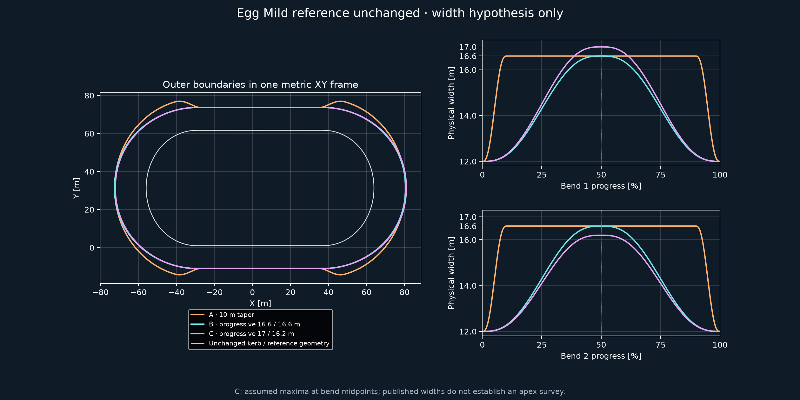
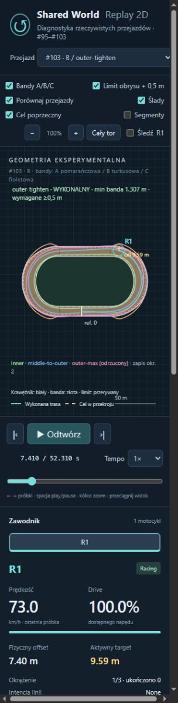
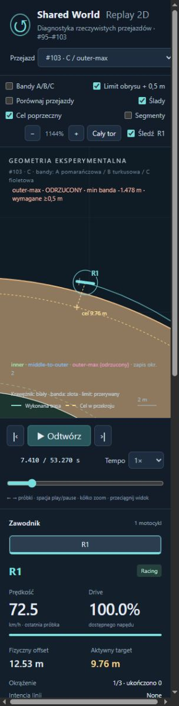

# Progressive Bend Width (#103)

**PROVISIONAL. Ocena B — wiarygodne porównanie geometrii i wynik częściowo pozytywny; maksymalna linia nadal niewykonalna.**
Stopniowe zwężanie pozwala wykonać niezmieniony `outer-tighten` z zapasem ponad0,5m, ale nie rozwiązuje `outer-max`.
Rekomendowany profil roboczy: **B**, bez twierdzenia o potwierdzonym realizmie Motoareny.

Baza: Draft #102 `experiment/local-offset-limit`, HEAD `4d65219367d8b27f51d3a5ea3ff2e1f517a6bcd1`.
Osobna gałąź `experiment/progressive-bend-width`, jeden Draft do #102, bez merge. Status końcowego CI i HEAD w PR.

## Zamrożone warunki i zakres

A to dokładny Egg Mild z #102:12m na prostych,16,6m w łukach, pierwsze/ostatnie10m taperu. Jego sześć wyników, geometria i replay są **odczytane z poprzedniego manifestu**, bez powtórzenia audytu.
B ma12→16,6→12m w każdym łuku, C12→17→12m na pierwszym i12→16,2→12m na drugim.
17/16,2m są założonymi maksimami w środku łuków. Publikowane szerokości nie potwierdzają położenia pomiarów ani profilu geodezyjnego; nie są tutaj przedstawiane jako pomiar apexu.

Na każdej połowie B/C `W=12+(Wmax−12)S(u)`, `S=6u⁵−15u⁴+10u³`; u rośnie0→1, następnie maleje1→0.
W, W′ i W″ są zgodne na środku i łączeniach z prostymi; pochodne szerokości wynoszą tam0.
Fizyczna banda to `E(s)=P(s)+(W(s)−1)n(s)`. Kerb `P(s)−n(s)` pozostaje ten sam.
Referencyjne P, heading, curvature i lap318,778749943m są dokładnie identyczne z #101, co sprawdzono na12000 punktach i gęstym audycie XY.
Nie zmieniono opony, wheelspin, sił, yaw, regulatora, masy, AI, nawierzchni ani produkcyjnego `src/` i domyślnego baseline.

Plany z #102 są użyte bez zmian:inner, middle-tighten, wide-tighten, outer-max, outer-tighten, middle-to-outer.
To te same polityki i punkty aktywacji; targety fraction nowych planów wynikają z lokalnego limitu danej bandy, a nie z dostrojenia planu.
Neutralny zawodnik A-neutral, Grip1/Ruts0/Moisture0,5, Drive1, fizyka #100, krok10ms/4substeps,3okrążenia, wspólny stan reference0/offset5/speed18.
Ocena czasu/drogi:Lap2+Lap3. Minima, maksima i naruszenia:całe3lap. Brak wyszukiwania planów, korekt XY/yaw lub fizycznej ściany.
[freeze.json](progressive-bend-width/freeze.json) powstał przed pomiarami. B/C×6 to12 nowych pełnych audytów; A tylko6 tanich kontroli fingerprintów.

## Geometria w XY


[Wektorowy SVG](progressive-bend-width/outer-width-comparison.svg). Biała kreda i linia referencyjna nie zmieniają się; wszystkie bandy są w jednym układzie metrycznym.
Gęsty audyt16000 punktów sprawdza regularność parametryzacji, kierunek stycznej, krzywiznę, sag oraz przecięcia nieprzyległych krawędzi metodą sweep bounding boxes + dokładny test odcinków.
Nie ma samoprzecięć, załamań ani poprzecznych łączników/ścian. Zarówno geometria eksportu, jak i audit odczytują tę samą funkcję W(s).

| Profil | max |E″| /m | max |κ_bandy| /m | min |E′| | max sag m | przecięcia | różnica reference |
| --- | --- | --- | --- | --- | --- | --- |
| A | 0.331900 | 0.179669 | 1.000000 | 0.0001026 | 0 | 0 |
| B | 0.175212 | 0.025460 | 1.000000 | 0.0000168 | 0 | 0 |
| C | 0.175234 | 0.025668 | 1.000000 | 0.0000172 | 0 | 0 |

Maksymalne różnice kierunku/krzywizny mierzone po obu stronach4mm otoczenia połączeń, łącznie ze środkiem łuku: B0,000110rad/0,00000478m⁻¹, C0,000110rad/0,00000520m⁻¹. To różnice w skończonym otoczeniu, nie skok w samym punkcie. Warunki analityczne szerokości i zerowa krzywizna/jej pochodna na końcach referencyjnego Egg Mild zapewniają zgodność przy prostych. Gęste testy na całej bandzie obejmują także węzły spline i dawne10m miejsca zmiany szerokości. Dla chord≤0,05m zachowany zapas0,7mm jest znacznie większy od zmierzonego sag≤0,0172mm B/C. Geometryczne boundy #101 nadal obowiązują:κ≤0,1/m, |κ′|≤0,1/m² oraz, dla B/C, |W′|<0,193 i |W″|<0,0122/m dają |E″|<2/m. Dowód używa `|E″|≤κ(1+κd)+|κ′|d+2κ|W′|+|W″|`, d≤16m.

## Czas, droga i bezpieczeństwo

† Czas odrzuconego planu jest wyłącznie diagnostyką, bez rankingu. Prześwity dotyczą pełnych kapsuł chassis+handlebar przy faktycznym yaw.

| Profil / plan | Lap2+3 s | droga m | banda min / interval m | kreda min / interval m | ocena |
| --- | --- | --- | --- | --- | --- |
| A / inner | 32.176386 | 646.497 | 5.5992 / 5.4971 | 0.1426 / — | TAK |
| A / middle-tighten | 32.267617 | 672.034 | 5.5992 / 5.4881 | 2.1785 / — | TAK |
| A / wide-tighten | 33.125616 | 709.382 | 1.8360 / 1.7039 | 3.6291 / — | TAK |
| A / outer-max | 35.149043 † | 786.089 | -3.5166 / -3.6352 | 5.5992 / — | ODRZUCONY |
| A / outer-tighten | 34.784161 † | 759.300 | -0.5707 / -0.6914 | 5.5992 / — | ODRZUCONY |
| A / middle-to-outer | 34.179995 | 736.381 | 0.9576 / 0.8398 | 5.4827 / — | TAK |
| B / inner | 32.176386 | 646.497 | 5.5992 / 5.4971 | 0.1426 / 0.0173 | TAK |
| B / middle-tighten | 32.267617 | 672.034 | 5.5992 / 5.4881 | 2.1785 / 2.0684 | TAK |
| B / wide-tighten | 33.125616 | 709.382 | 1.8360 / 1.7039 | 3.6291 / 3.5171 | TAK |
| B / outer-max | 35.099766 † | 771.154 | -1.2533 / -1.3680 | 5.5992 / 5.4970 | ODRZUCONY |
| B / outer-tighten | 34.471927 | 745.679 | 1.3071 / 1.1858 | 5.5992 / 5.4970 | TAK |
| B / middle-to-outer | 34.088568 | 726.058 | 2.4685 / 2.3532 | 5.3517 / 5.2162 | TAK |
| C / inner | 32.176386 | 646.497 | 5.5992 / 5.4971 | 0.1426 / 0.0173 | TAK |
| C / middle-tighten | 32.267617 | 672.034 | 5.5992 / 5.4881 | 2.1785 / 2.0684 | TAK |
| C / wide-tighten | 33.125616 | 709.382 | 1.8360 / 1.7039 | 3.6291 / 3.5171 | TAK |
| C / outer-max | 35.099922 † | 771.147 | -1.4782 / -1.5930 | 5.5992 / 5.4970 | ODRZUCONY |
| C / outer-tighten | 34.472424 | 745.675 | 1.2582 / 1.1374 | 5.5992 / 5.4970 | TAK |
| C / middle-to-outer | 34.090087 | 726.092 | 2.4224 / 2.3073 | 5.3465 / 5.2110 | TAK |

A4/6 safe, B5/6, C5/6. Wszystkie12 nowych światów kończy3okrążenia; ukończenie nie oznacza bezpieczeństwa.
Lokalny cache ponownie oblicza dystans do całej rzeczywistej bandy: okrąg R1,05m obejmuje obie kapsuły dla dowolnego yaw +0,5m marginesu + zapas komórki≤5cm/float/chord. C używa rzeczywistej maksymalnej szerokości17m również w boundzie komórki. Pełny footprint na granicach komórek przy12yaw jest sprawdzony osobno od dynamiki.

Dolna granica między krokami odejmuje od min obu końców `(max speed +1,05·max |angularVelocity|)·h/2+0,012m`. Ten sam bound policzono dla bandy i kredy. Dotyczy pojedynczego ciała bez kontaktów przy held force/torque; nie stanowi ogólnego CCD. Akceptacja wymaga banda≥0,5m także między krokami, kreda≥0,05m na zaakceptowanych stanach i brak przekroczenia kredy między krokami (bound≥0). Dla inner luźny bound kredy0,0173m certyfikuje brak przekroczenia, nie ciągłe0,05m. A nie miało audytu kredy między krokami w #102; znak — jawnie zachowuje to ograniczenie starej kontroli.
Pozostałe warunki #102: contact/crash, tyre budget, energy residual i powtarzalność Lap2/Lap3. Niezmienione trzy literalne plany mają dokładnie te same fingerprinty co A, mimo zmiany szerokości; powierzchnia jest jednorodna, a droga/dynamika zależą od tej samej reference.

## Wykonane offsety i prędkości obu łuków

Każdy wiersz to średnia tego samego łuku z Lap2/Lap3 (pierwszy:segment1, drugi:segment5). Entry = pierwszy zaakceptowany stan łuku, middle = najbliższy geometrycznym50%, exit = pierwsza zaakceptowana prosta; kolejna prosta = max speed pierwsze45m. Są to rzeczywiste stany, nie targety. [corners.csv](progressive-bend-width/corners.csv) zawiera oddzielne72 rekordy, bez uśredniania okrążeń.

| Profil / plan / łuk | offset entry/middle/exit m | speed entry/middle/exit m/s | max prosta m/s | v_out exit m/s |
| --- | --- | --- | --- | --- |
| A / inner / 1 | 0.723/1.074/1.411 | 22.962/18.981/18.802 | 22.135 | 1.352 |
| A / inner / 2 | 0.723/1.074/1.411 | 22.961/18.981/18.802 | 21.545 | 1.351 |
| A / middle-tighten / 1 | 4.265/3.134/2.917 | 23.475/19.843/19.825 | 22.812 | 2.953 |
| A / middle-tighten / 2 | 4.265/3.134/2.910 | 23.476/19.841/19.822 | 22.266 | 2.951 |
| A / wide-tighten / 1 | 8.405/6.180/4.993 | 23.923/19.838/20.609 | 23.334 | 4.254 |
| A / wide-tighten / 2 | 8.402/6.180/4.998 | 23.921/19.838/20.610 | 22.839 | 4.256 |
| A / outer-max / 1 | 9.845/12.381/14.047 | 24.431/21.718/21.250 | 23.752 | 0.545 |
| A / outer-max / 2 | 9.845/12.384/14.047 | 24.431/21.718/21.250 | 23.292 | 0.544 |
| A / outer-tighten / 1 | 9.383/11.932/10.382 | 24.257/20.312/21.101 | 23.563 | 3.468 |
| A / outer-tighten / 2 | 9.385/11.939/10.374 | 24.255/20.327/21.103 | 23.086 | 3.473 |
| A / middle-to-outer / 1 | 5.784/9.567/9.369 | 24.088/19.923/20.699 | 23.315 | 1.912 |
| A / middle-to-outer / 2 | 5.780/9.558/9.367 | 24.088/19.911/20.699 | 22.811 | 1.915 |
| B / inner / 1 | 0.723/1.074/1.411 | 22.962/18.981/18.802 | 22.135 | 1.352 |
| B / inner / 2 | 0.723/1.074/1.411 | 22.961/18.981/18.802 | 21.545 | 1.351 |
| B / middle-tighten / 1 | 4.265/3.134/2.917 | 23.475/19.843/19.825 | 22.812 | 2.953 |
| B / middle-tighten / 2 | 4.265/3.134/2.910 | 23.476/19.841/19.822 | 22.266 | 2.951 |
| B / wide-tighten / 1 | 8.405/6.180/4.993 | 23.923/19.838/20.609 | 23.334 | 4.254 |
| B / wide-tighten / 2 | 8.402/6.180/4.998 | 23.921/19.838/20.610 | 22.839 | 4.256 |
| B / outer-max / 1 | 9.341/10.872/11.782 | 24.110/21.814/20.655 | 23.401 | -0.258 |
| B / outer-max / 2 | 9.341/10.881/11.782 | 24.110/21.814/20.655 | 22.910 | -0.258 |
| B / outer-tighten / 1 | 8.959/10.403/8.667 | 24.129/20.474/20.749 | 23.437 | 2.284 |
| B / outer-tighten / 2 | 8.959/10.407/8.666 | 24.128/20.490/20.750 | 22.950 | 2.285 |
| B / middle-to-outer / 1 | 5.454/8.368/8.013 | 23.896/20.025/20.269 | 23.101 | 0.981 |
| B / middle-to-outer / 2 | 5.452/8.372/8.011 | 23.898/20.029/20.265 | 22.586 | 0.998 |
| C / inner / 1 | 0.723/1.074/1.411 | 22.962/18.981/18.802 | 22.135 | 1.352 |
| C / inner / 2 | 0.723/1.074/1.411 | 22.961/18.981/18.802 | 21.545 | 1.351 |
| C / middle-tighten / 1 | 4.265/3.134/2.917 | 23.475/19.843/19.825 | 22.812 | 2.953 |
| C / middle-tighten / 2 | 4.265/3.134/2.910 | 23.476/19.841/19.822 | 22.266 | 2.951 |
| C / wide-tighten / 1 | 8.405/6.180/4.993 | 23.923/19.838/20.609 | 23.334 | 4.254 |
| C / wide-tighten / 2 | 8.402/6.180/4.998 | 23.921/19.838/20.610 | 22.839 | 4.256 |
| C / outer-max / 1 | 9.317/11.017/11.955 | 24.111/21.859/20.651 | 23.399 | -0.370 |
| C / outer-max / 2 | 9.363/10.729/11.607 | 24.108/21.768/20.659 | 22.910 | -0.145 |
| C / outer-tighten / 1 | 8.946/10.548/8.749 | 24.140/20.523/20.728 | 23.425 | 2.243 |
| C / outer-tighten / 2 | 8.970/10.259/8.584 | 24.116/20.440/20.769 | 22.959 | 2.323 |
| C / middle-to-outer / 1 | 5.446/8.487/8.061 | 23.899/20.003/20.261 | 23.101 | 0.979 |
| C / middle-to-outer / 2 | 5.460/8.261/7.963 | 23.894/20.065/20.269 | 22.585 | 1.016 |


## Ruch poprzeczny, slide i wheelspin

Pełne10ms obserwacje v_out (velocity·road.Outward), slide i prześwitów są w nowych plikach `*-dynamics.csv`. Wheelspin to niezmieniony instantaneous rear-wheel slip ratio #100; maksimum wszystkich natywnych obserwacji jest w measurements.json. Dla A zachowujemy istniejące v_out na wyjściu; pełnego maksimum nie dorabiamy z rzadkiego replaya.

| Profil / plan | max actual offset m | czas actual>9,5m s | v_out exit / max |v_out| m/s | max slide ° | max wheelspin κ |
| --- | --- | --- | --- | --- | --- |
| A / inner | 5.000 | 0.00 | 1.351 / — | 18.908 | 0.22592 |
| A / middle-tighten | 5.000 | 0.00 | 2.952 / — | 18.911 | 0.20945 |
| A / wide-tighten | 8.783 | 0.00 | 4.255 / — | 18.763 | 0.18936 |
| A / outer-max | 14.155 | 45.00 | 0.544 / — | 17.787 | 0.16622 |
| A / outer-tighten | 12.150 | 31.61 | 3.470 / — | 18.892 | 0.22189 |
| A / middle-to-outer | 9.997 | 5.42 | 1.914 / — | 18.802 | 0.19194 |
| B / inner | 5.000 | 0.00 | 1.351 / 3.414 | 18.908 | 0.22592 |
| B / middle-tighten | 5.000 | 0.00 | 2.952 / 3.501 | 18.911 | 0.20945 |
| B / wide-tighten | 8.783 | 0.00 | 4.255 / 4.563 | 18.763 | 0.18936 |
| B / outer-max | 12.765 | 38.65 | -0.258 / 2.904 | 18.074 | 0.17108 |
| B / outer-tighten | 10.479 | 8.23 | 2.284 / 2.825 | 18.888 | 0.21882 |
| B / middle-to-outer | 8.633 | 0.00 | 0.990 / 2.149 | 18.911 | 0.19502 |
| C / inner | 5.000 | 0.00 | 1.351 / 3.414 | 18.908 | 0.22592 |
| C / middle-tighten | 5.000 | 0.00 | 2.952 / 3.501 | 18.911 | 0.20945 |
| C / wide-tighten | 8.783 | 0.00 | 4.255 / 4.563 | 18.763 | 0.18936 |
| C / outer-max | 13.072 | 38.67 | -0.258 / 2.914 | 18.148 | 0.17216 |
| C / outer-tighten | 10.634 | 8.22 | 2.283 / 2.831 | 18.900 | 0.22109 |
| C / middle-to-outer | 8.755 | 0.00 | 0.998 / 2.165 | 18.912 | 0.19559 |


## Naruszenia i przyczyna

W A oba maksymalne plany zawodziły przy późnym10m zwężeniu. W B/C outer-tighten żąda5m przy40% i zdąża schować rzeczywisty obrys przed prostą. Outer-max stale śledzi lokalne maksimum: na malejącej bandzie cel już wraca, ale motocykl ma wciąż offset większy od bezpiecznego. Pierwsze naruszenie jest jeszcze w łuku, mimo stopniowego zwężania; sama zmiana bandy nie zapewnia wykonania.

| Profil | pierwsze outer<0,5: t / ref / offset / target | v_out / slide | najgorsze: t / ref / offset / target | outer / interval m |
| --- | --- | --- | --- | --- |
| B | 6.270 / 106.216 / 12.734 / 12.021 | 0.310 / 8.865 | 7.460 / 122.772 / 12.199 / 9.652 | -1.2533 / -1.3680 |
| C | 6.250 / 105.816 / 13.029 / 12.324 | 0.370 / 8.893 | 7.460 / 122.550 / 12.465 / 9.690 | -1.4782 / -1.5930 |

Najgorsze stany obu outer-max wypadają pod koniec pierwszego łuku (~90%); szerokość spada już ku12m. W B przy offset12,199m target jest9,652m, rzeczywisty v_out≈−0,981m/s: powrót już trwa, lecz jest spóźniony. C na szerszym pierwszym łuku zwiększa wcześniejsze wyniesienie i osiąga gorszy min outer. Odrzucenia OuterClearanceBelow0.5m i OuterIntervalClearanceBelow0.5m pozostają jawne. Pełne trzy okrążenia, wszystkie zapisane pozycje/yaw, najgorsze stany i10ms dynamika pozostają dostępne; brak teleportacji, przycięcia trasy lub zmiany planów pod wynik.

## Przewaga inner i różnica B/C

| Profil | safe plan | plan−inner s | droga−inner m |
| --- | --- | --- | --- |
| A | middle-tighten | 0.091231 | 25.538 |
| A | wide-tighten | 0.949230 | 62.885 |
| A | middle-to-outer | 2.003609 | 89.884 |
| B | middle-tighten | 0.091231 | 25.538 |
| B | wide-tighten | 0.949230 | 62.885 |
| B | outer-tighten | 2.295541 | 99.183 |
| B | middle-to-outer | 1.912182 | 79.561 |
| C | middle-tighten | 0.091231 | 25.538 |
| C | wide-tighten | 0.949230 | 62.885 |
| C | outer-tighten | 2.296038 | 99.178 |
| C | middle-to-outer | 1.913701 | 79.595 |

B/C nie zmieniają zwycięzcy. Trzy literalne plany są identyczne, nowe bezpieczne middle-to-outer jest około1,912s wolniejsze, a outer-tighten około2,296s wolniejszy od inner w B. Większa entry/exit speed nie rekompensuje dłuższej drogi. B/C różnią się numerycznie, ale maksymalna różnica czasu nowego bezpiecznego planu wynosi tylko1,519ms na dwa lotne okrążenia; to niewielki efekt w tej macierzy, bez twierdzenia o istotności statystycznej lub przewadze na prawdziwym torze. Bezpieczeństwo ma tę samą klasyfikację. C daje outer-max na pierwszym łuku mniejszy margines o0,225m.

## Sześć odpowiedzi i następny krok

1. **Częściowo:** progressive rozwiązuje wyjazd outer-tighten, lecz outer-max nadal ma naruszenie bandy.
2. **B vs C:** małe różnice czasu, taka sama klasyfikacja5/6. Niesymetryczne maksima nie dają tu istotnej korzyści.
3. **Szeroka linia:** można bezpiecznie używać offsetów>9,5m; outer-tighten i middle-to-outer są wykonalne z ciągłym outer bound≥0,5m. Nie dowiedziono utrzymywania maksymalnej linii tuż przy0,5m.
4. **Inner:** zachowuje czas i przewagę; poprawa bezpieczeństwa szerokich planów nie usuwa ich kosztu dłuższej drogi.
5. **Ograniczenie:** geometria wpływa na dostępną przestrzeń, ale po usunięciu późnego zwężenia outer-max nadal jest ograniczony wykonaniem polecenia przez niezmienione sterowanie i dynamikę. To nie dowód błędnej opony ani zbyt małego yaw.
6. **Profil B:** rekomendowany do dalszej pracy jako prostsza, symetryczna hipoteza. C pozostaje wariantem czułości; brak potwierdzonej geodezji.

**Jeden konkretny następny krok:** na zamrożonym B przetestować plan z wcześniejszym powrotem z lokalnego maksimum, przed malejącą połową łuku, bez zmian opony/yaw/regulatora. Ten eksperyment nie wykonuje takiej kalibracji.

## Replay i geometrie

Istniejący [replay viewer](http://127.0.0.1:8000/tools/replay-viewer/?case=width-b-outer-tighten) ma18 opcji A/B/C×6, rzeczywisty kerb/bandę/limit oraz checkbox band A/B/C w jednym XY. Poniżej jest jeden widok porównujący trzy bandy i szerokości obu łuków.
[A inner](http://127.0.0.1:8000/tools/replay-viewer/?case=width-a-inner), [B middle-to-outer](http://127.0.0.1:8000/tools/replay-viewer/?case=width-b-middle-to-outer), [C outer-max odrzucony](http://127.0.0.1:8000/tools/replay-viewer/?case=width-c-outer-max).
Ślady porównawcze to zapisane drugie okrążenia oddzielnych przejazdów inner/middle-to-outer/outer-max. R1 wykonuje własny CSV i heading. To nie wspólny wyścig. JS nie symuluje ruchu ani nie wylicza nowych targetów. Częstotliwość replay≈0,1s nie zastępuje audytu10ms.




Zrzuty pokazują dokładne zaakceptowane próbki CSV7,410s (bez interpolacji); C jest celowo powiększone istniejącą kamerą, aby uwidocznić pełny motocykl poza bandą. Selektory A inner/B middle-to-outer/C outer-max oraz postęp odtwarzania i yaw zweryfikowano w przeglądarce.

## Koszt i walidacja

.NET8 Release Windows, tiered JIT OFF, rozgrzanie kodu,5 niezależnych konstrukcji; mediana. Osobno utworzenie referencyjnej geometrii/BVH, lokalny cache i hot path. Cache odczytywany100000razy/trial; projection+width+preview10000razy/trial. Pomiar nie obejmuje renderowania ani offline audytu kapsuł.

| Profil | geometria ms / B | cache ms / B | odczyt cache µs / B | project+width+preview µs / B |
| --- | --- | --- | --- | --- |
| A | 3.088 / 2306072 | 165.936 / 2423632 | 0.029042 / 0 | 4.804630 / 0 |
| B | 3.055 / 2306104 | 164.093 / 2423632 | 0.029615 / 0 | 4.749210 / 0 |
| C | 3.052 / 2306104 | 164.310 / 2423632 | 0.029143 / 0 | 4.759630 / 0 |


Koszt zimnego cache pozostaje istotny; brak nowych solver boundaries, limit jest statyczną tablicą. [performance.json](progressive-bend-width/performance.json) zachowuje wszystkie próby, alokacje i runtime.

Restore i Release --warnaserror poprawne; **42/42 C# i11/11 Node**. Nowe testy: identyczna reference, C2 W, XY tangent/curvature/sag/self-intersection, projection, każda krawędź komórki i pełny footprint12yaw, safety safe/unsafe, deterministyczny observer repeat, własne geometry/limit i0B lookup. Kontrole starego baseline, #100/#101/#102 i stare replaye pozostają w zestawie. [validation.json](progressive-bend-width/validation.json) zawiera podsumowanie, a [targeted-tests.json](progressive-bend-width/targeted-tests.json) rzeczywiste42 wyniki wyodrębnione z końcowego TRX. SHA-256 eksportów są w manifest.json.

**6/6 A** zachowało fingerprinty #102; B/C mają4 dodatkowe obserwowane powtórzenia. **326/326 historycznych plików** zachowało SHA-256: {'autonomous-racing-line': 34, 'slip-coupled-dynamics': 63, 'slip-control-validation': 42, 'physics-driven-racing-line': 21, 'rear-wheel-dynamics': 88, 'track-geometry-variants': 43, 'local-offset-limit': 35}. `src/`, RiderController, ContactAdapter i równania opony/koła/yaw niezmienione. Brak pełnego ponownego uruchamiania historycznych audytów. Standardowe Draft Windows CI: końcowy wynik i link w opisie PR.

Reprodukcja z root repo (nowy, pusty katalog zamiast nadpisywania dowodów):

```powershell
dotnet restore
dotnet build -c Release --no-restore --warnaserror
dotnet tools/shared-world-speedway/bin/Release/net8.0/shared-world-speedway.dll progressive-width ../progressive-reproduction freeze
dotnet tools/shared-world-speedway/bin/Release/net8.0/shared-world-speedway.dll progressive-width ../progressive-reproduction measure
$env:DOTNET_TieredCompilation='0'
dotnet tools/shared-world-speedway/bin/Release/net8.0/shared-world-speedway.dll progressive-width ../progressive-reproduction cost
node --test tools/replay-viewer/replay.test.mjs
python -m http.server 8000 --bind 127.0.0.1
```

`progressive-width-report.py --plots` czyta zapisane dane i wymaga matplotlib wyłącznie do PNG/SVG. Bez --plots generuje tabele/CSV/manifest standardową biblioteką. A jest czytane z local-offset-limit; nie jest kopiowane ani nadpisywane. Eksporter symulacji odmawia nadpisania freeze, replaya i pomiarów. Wartości czasu i czasy wykonania cache nie są źródłem decyzji domenowej.
