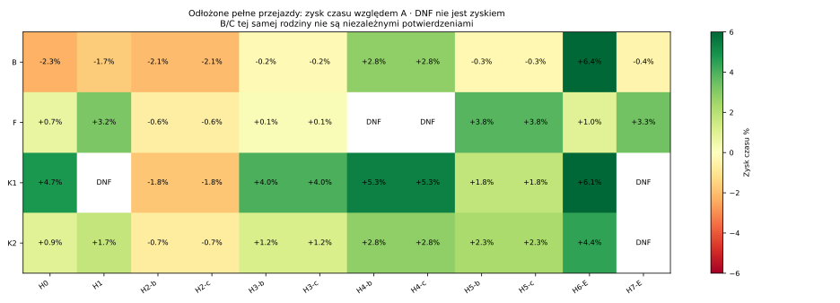
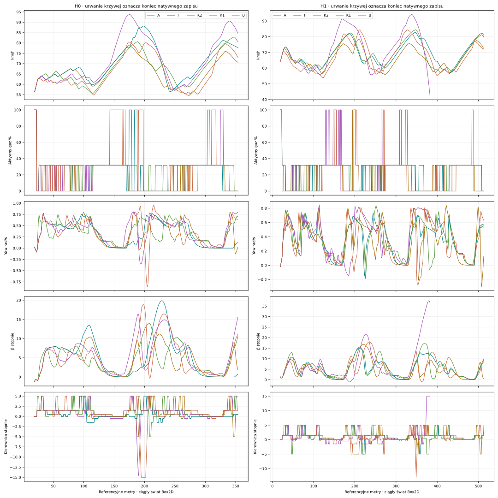

# #143 — Comprehensive Racing Constraints Audit & Autonomous Speed Optimization

**PARTIAL.** Baza dokładnie `0da21bc92ee541b6611e19f1d4bd2e3866b283ca`. Domyślnie OFF, bez CEM, bez merge. Oryginalne fizyka, silnik, opony, mu, masa/I, Box2D, tor i polityka A #16015 bez zmian.

Najlepszy odłożony wariant bez dodatkowego DNF: **B**, 12/12 ukończeń przy A 12/12; średni zysk pełnego czasu ważony równo rodzinami **0.29%**. Zakres pojedynczych sparowanych efektów -2.26…6.39%. Nie ukrywamy strat ani niższych efektów od celu5%.

## Co faktycznie zbadano

40 pełnych izolowanych A–H/I/R na D0/D1 i dwóch nowych początkach S0/S1. A–I mają identyczny H09, przestrzeń gazu i kierownicy, reakcję.24s i review.2s. R oddzielnie dodaje skończony sprawdzian odzyskiwania do1.7s, bez zmiany pierwszych dostępnych akcji. Wszystkie warianty samodzielnie wybierają sterowanie przez CAŁY zakres; nie są podmianą jednej decyzji.

Po tych wynikach zamknięto kombinacje F+B, F+E, B+E i F+B+E oraz dwa połączenia z R. Ponieważ C/D bez kierunku/yaw miały0/4, przed finałem dodano ich osobne kombinacje z R; poprzednie konfiguracje i wyniki zachowano. To test zastępowania części stabilizującej roli prognozą konsekwencji, nie argument za świętością starych wag. R może jednak jawnie wrócić do A — nie dowodzi to całkowitego usunięcia danej preferencji z każdego fallbacku.

Przed jakimkolwiek światem finałowym zamknięto F/K2/K1 oraz obowiązkowy globalny B. Dwanaście par stan/geometria zawiera OSIEM rodzin fizycznych: znane historycznie H0/H1, cztery nowe rodziny na B/C oraz dwie nowe na egg-asymmetric. B/C tej samej rodziny są ważone łącznie, nie podwójnie. Nie strojono na finale. Zakres jest taki sam jak#142: badany łuk,62m, cały kolejny łuk i dalsze62m; rodziny rozpoczynające badanie od drugiego wyjścia mają również trzeci łuk.

## Ograniczenia i rekomendacje

|Ograniczenie|Uzasadnienie fizyczne?|Efekt usunięcia offline|Pełna jazda izolowana|Rekomendacja|
|---|---|---|---|---|
|Preferencja częściowego gazu|Nie, koszt odejścia od31,82%|4/28 zmienionych|4/4, średni sparowany zysk 0.01%|Ocena globalna i finał B; większy gaz sam nie jest korzyścią.|
|Kierunek χ vs przyszła styczna|Preferencja, nie warunek β=0|16/28 zmienionych|0/4, średni sparowany zysk N/D%|Nie usuwać samodzielnie w obecnej strukturze; wynik nie dowodzi konieczności wagi4 dla każdego sterownika.|
|Yaw vs prędkość×krzywizna|Preferencja, nie prawo opony|26/28 zmienionych|0/4, średni sparowany zysk N/D%|Nie usuwać samodzielnie z held-H09; R częściowo ratuje, lecz nie daje uniwersalnej alternatywy.|
|Zmiana kierownicy|Preferencja obok rzeczywistego aktuatora|0/28 zmienionych|4/4, średni sparowany zysk -0.21%|Wpływ zależy od kontekstu; K2 vs F izoluje usunięcie E przy już usuniętym F.|
|GeometrySpeedWeight i rezerwa.8|Heurystyka, nie granica sił|0/28 zmienionych|4/4, średni sparowany zysk 2.37%|Ocenić według odłożonego F, zachowując natywne guardy; brak automatycznej promocji na bazie D0.|
|Clearance/Uncertain margins|Rezerwy ostrożności|2/28 zmienionych|1/4, średni sparowany zysk 0.46%|Sprawdzone zmniejszenie marginesów nie jest bezpiecznym zamiennikiem oceny kontynuacji.|
|Przygotowanie geometrii|Niecertyfikowane oszacowanie|H: 0/18 zmienionych|4/4, średni sparowany zysk 1.23%|Znany tor i fizycznie osiągnięty offset pomagają w części przypadków; nie są zadaną linią.|
|Pierwszeństwo Safe nad Uncertain|Hierarchia implementacji|2/28 zmienionych|0/4, średni sparowany zysk N/D%|Ważony score bez tej hierarchii wymaga lepszego sprawdzianu kontynuacji; Uncertain samo nie jest DNF.|
|β45°|Nieskalibrowana obwiednia eksperymentalna|Oddzielono od wyniku yaw|Diagnostyki60°/bez progu poniżej|Nie uznawać przejazdu za realnie poprawny tylko po usunięciu detektora.|
|Obrys, siły, aktuator, energia|Ograniczenia zaimplementowanego modelu|Niezmienione w głównym porównaniu|Weryfikowane native|Zachować; realny obrys i mechanika nie są arbitralną karą.|

Dokładne równania, źródła kodu, ograniczona siatka±15° wobec mechanicznych±35°, kolejka, regularyzacja opony i guardy: [pełna mapa AUDIT.md](AUDIT.md).28 obserwacji offline to tylko dwie rodziny. Brak zmiany offline nie dowodzi globalnej zbędności: F zmieniało0/28 lokalnych wyborów, a mimo to zmieniało pełne autonomiczne przejazdy.

## Kombinacje i konsekwencje — pula selekcji

|Wariant|Usunięte preferencje / dodatkowa kontynuacja|Ukończenia|Średni zysk czasu tylko wspólnie ukończonych par|
|---|---|---:|---:|
|H|H|4/4|1.23%|
|I|oryginalny score, bez pierwszeństwa Safe|0/4|N/D%|
|K1|B+F|4/4|1.44%|
|K2|E+F|4/4|2.12%|
|K3|B+E|2/4|-0.66%|
|K4|B+E+F|3/4|-1.06%|
|KR-C|C + R (możliwy fallback A)|1/4|3.62%|
|KR-D|D + R (możliwy fallback A)|3/4|-6.46%|
|KR1|E+F + R (możliwy fallback A)|4/4|-0.76%|
|KR2|B+E+F + R (możliwy fallback A)|3/4|0.54%|
|R|F + R (możliwy fallback A)|4/4|-0.90%|

Kombinacje nie są sumą efektów pojedynczych: B+E kończy2/4, a dodanie F daje3/4; F+E kończy4/4 w selekcji, lecz11/12 w finale. R poprawia ukończenia bez yaw z0/4 do3/4 i bez kierunku z0/4 do1/4, z zastrzeżeniem fallbacku. H nie wszedł do zamrożonego top3 i nie ma niezależnego finału; jego4/4 nie uzasadnia promocji.

## Odłożone pełne przejazdy

|Wariant|Ukończone / A|Nowe DNF|Średni zysk czasu na rodzinę|Min…max zysku w parach|
|---|---:|---:|---:|---:|
|B|12/12 / 12/12|0|0.29%|-2.26…6.39%|
|F|10/12 / 12/12|2|1.64%|-0.64…3.84%|
|K1|10/12 / 12/12|2|3.35%|-1.82…6.06%|
|K2|11/12 / 12/12|1|1.81%|-0.71…4.42%|

|Przypadek|A s|F s|K2=F+E s|K1=F+B s|B s|
|---|---:|---:|---:|---:|---:|
|H0|18.712|18.586|18.535|17.825|19.135|
|H1|27.555|26.677|27.083|N/D|28.016|
|H2-b|18.471|18.588|18.602|18.807|18.851|
|H2-c|18.471|18.588|18.602|18.807|18.851|
|H3-b|27.820|27.780|27.484|26.708|27.872|
|H3-c|27.820|27.780|27.484|26.708|27.872|
|H4-b|18.780|N/D|18.257|17.775|18.256|
|H4-c|18.780|N/D|18.257|17.775|18.256|
|H5-b|28.424|27.333|27.772|27.926|28.502|
|H5-c|28.424|27.333|27.772|27.926|28.502|
|H6-E|19.519|19.333|18.657|18.337|18.271|
|H7-E|27.887|26.953|N/D|N/D|27.997|

N/D to brak legalnego pełnego czasu, nie0. Wszystkie pary, przyczyny stopów i różnice rzeczywistej drogi: [held-pairs.csv](held-pairs.csv). Wyszukiwanie i wybór wariantów oparto wyłącznie na wcześniejszej puli; powyższa tabela nie służy do wyboru nowej polityki po finale.

|Wariant — tylko odłożone ukończone|Śr. badane wyjście km/h|Śr.+40m km/h|Śr.+62m km/h|Aktywny gaz1 %|Max β°|Min fizyczny gap m|Kontakty motocykli / naruszenia obrysu|Śr. różnica drogi vs A m|
|---|---:|---:|---:|---:|---:|---:|---:|---:|
|A|63.32|77.12|71.92|1.25|16.74|0.2001|0 / 0|N/D|
|B|61.36|81.48|76.60|6.33|30.20|0.2003|0 / 0|5.12|
|F|63.93|78.02|78.81|1.54|19.87|0.2003|0 / 0|3.44|
|K1|63.44|85.06|86.05|6.30|26.12|0.2004|0 / 0|2.40|
|K2|63.91|78.22|78.67|1.90|29.80|0.2003|0 / 0|1.93|

Prędkości pochodzą z tych samych przekrojów każdego przypadku; średnie opisowe różnych zakresów nie zastępują par. Gaz1 obejmuje wspólne odziedziczone0,24s początkowego Drive=1; osobne żądania i aktywacje są w logach. Zysk czasu może pochodzić ze skrócenia drogi — w CSV podano też zmianę średniej fizycznej prędkości. Pełne wejścia/wyjścia każdego łuku, środek prostej31m, +20/+40/+62m, gaz żądany/aktywny, percentyle β/yaw/wheelspin, Fx/Fy i utilization są w results.json i natywnych CSV.

Największa prędkość w legalnie ukończonych głównych próbach wynosi 96.38km/h. Wyższe wartości przed DNF pozostają oddzielne i nie są sukcesem sportowym. Wartości100km/h nie narzucano ani nie premiowano.

## Zatrzymania, predyktor i CPU

Zachowano 35 nieukończonych światów, w tym osobne diagnostyki detektorów. W głównej puli było25 zatrzymań na niecertyfikowanym interwale i3 na β45; bez potwierdzonego przekroczenia obrysu. [all-stops.json](all-stops.json) zawiera kategorię, ostatnie100ms sił/stanu, chwilowy gap, certyfikat, β i ostatnie decyzje. Odziedziczona nazwa pola `PhysicalDnf` obejmuje także niepewny certyfikat i β — nie jest dowodem fizycznego wypadku. Wiążące rozróżnienie zawierają `StopCategory` i `FailureClassification`. Adapter tej próby solo nie zawiera fizycznej ściany; licznik rzeczywistych kontaktów dotyczy motocykli, a naruszenie geometrii raportujemy osobno.

|Diagnostyka|Ten sam fizyczny prefiks|Wynik dalszej jazdy|Max β°|Chwilowe naruszenie obrysu|
|---|---|---|---:|---|
|beta-60-D0-D|True|uncertified interval|46.54|False|
|beta-none-D0-D|True|uncertified interval|46.54|False|
|beta-60-D1-D|True|reverse|45.27|False|
|beta-none-D1-D|True|reverse|45.27|False|
|beta-60-S1-D|True|control envelope|60.96|False|
|beta-none-S1-D|True|no progress|166.29|False|
|refined-D0-C|True|uncertified interval|15.46|False|
|refined-D0-G|True|completed|13.29|False|

Sterownik w diagnostykach β zachowuje oryginalną ocenę prognoz, w tym dawną klasyfikację β45. Zmieniono wyłącznie moment zatrzymania natywnego detektora, nie opony, akcje ani punktację. Refined jest oddzielnym wyjaśnieniem niepewnego sweepu; nie podmienia wyniku głównego.

Weryfikacja predyktora: [predictor-check.json](predictor-check.json) sprawdza wspólne pierwsze0,4s przed aktywacją kolejnej rzeczywistej komendy+.44. Nie porównuje fałszywie końca held-H09 z natywnym replanowaniem. Dobre dopasowanie tego prefiksu nie certyfikuje dalszego manewru ani realnej opony. Uzgodnienie prognozowanej akcji odzyskania z późniejszym wyborem i fallbacki A: [recovery-agreement.json](recovery-agreement.json).

Główny koszt: **146 światów, 1366.562 CPU-s, 398162 prognoz, 36576668 ocen kontaktu**. Budżet160/1800 nie został zwiększony. To rezerwacje całych epizodów, prognozy, podsumowania i serializacja raw/CSV oraz offline; zapis zbiorczego indeksu, build/testy, końcowe formatowanie i Git mają osobny zakres. Nie ma limitu.2s na decyzję. Dodatkowy koszt read-only prognoz walidacyjnych i pakowania zapisano osobno.

|Wariant — held|Średnie CPU/dec|Pierwsza decyzja świata — zakres|Późniejsze CPU/dec|Średnie prognozy/dec|
|---|---:|---:|---:|---:|
|A|0.0843|0.0469…0.3906|0.0845|27.01|
|B|0.0864|0.0469…0.0781|0.0866|27.01|
|F|0.0858|0.0469…0.0781|0.0860|27.00|
|K1|0.0853|0.0469…0.0625|0.0862|27.02|
|K2|0.0838|0.0469…0.0781|0.0840|27.02|

|Powtórzenia D0|Pierwsza decyzja procesu|Śr. CPU/dec w trzech światach|Fingerprint każdej trajektorii zgodny z pierwotną|
|---|---:|---|---|
|A|0.4531|0.0990, 0.0827, 0.0791|True|
|F|0.0781|0.0821, 0.0818, 0.0797|True|

Pierwsza decyzja kolejnego świata nie zawsze jest zimnym JIT procesu; w osobnym procesie benchmarku zimna jest pierwsza decyzja A, F następuje po A. Sześć dodatkowych powtórzeń kontroluje ustaloną pracę i determinizm. Nie stwierdzono poważnej regresji kosztu wybranych wariantów; ok.0,08–0,10 CPU-s/dec nadal oznacza istotny koszt. Procesowy czas Windows jest skwantowany. Nie jest to pomiar biegu czterech rywali;20 takich decyzji/s to jedynie ekstrapolacja kosztu wyszukiwań.

## Odpowiedzi końcowe

1. **Co można usunąć całkowicie?** Globalne usunięcie preferencji gazu B zachowało12/12 ukończeń, ale średni efekt wyniósł tylko 0.29%, z zyskami i stratami zależnymi od stanu. To uzasadnia dalsze porównywanie B, nie twierdzenie o istotnej ogólnej poprawie. Dla pozostałych kar nie mamy równie niezawodnego potwierdzenia pełnej jazdy. Domyślny sterownik pozostaje bez zmian.

2. **Co osłabić/zastąpić?** Geometryczny speed hint, yaw/kierunek i marginesy są heurystykami. Lepsza ocena konsekwencji może zastąpić część ich roli; obecny skończony R jest tylko częściowo skuteczny i korzysta z fallback A. Nie wykazano, że każdą dawną wagę należy zachować ani że wystarczy ją wyzerować.

3. **Co jest konieczne?** Spójność sił, stanów, energii, rzeczywistego obrysu i fizyczna realizacja komend. β45,20% reserve i enum Uncertain nie są prawami fizyki; zmiana ich detektorów lub rankingów nie wystarcza do uznania nowej jazdy za empirycznie poprawną.

4. **Największy problem?** W badanym modelu koszty faktycznie wpływają na pełną jazdę, a zysk jednego przypadku nie przenosi się automatycznie. H09 zakłada utrzymanie komendy i nie obejmuje całej prostej/kolejnego łuku; R sprawdza tylko kilka odzyskiwań. Siatka działań nie wykorzystuje całych±35°. Oryginalna opona nadal nie jest empirycznie skalibrowana; nie maskujemy tego zmianą nagrody.

5. **Czy może szybciej i legalnie?** Tak w części sparowanych pełnych prób; końcowy zakres i wielkość efektu to B / 0.29% przy 12/12 ukończeń. Straty, nowe DNF innych wariantów i zakres generalizacji pozostają jawne.

6. **Co dalej?** Rozwijać najlepszy niezawodny wariant B jako odizolowany eksperyment, porównując nadal z A. Dalszą stabilizację badać przez krótsze przyczynowe korekty i ocenę konsekwencji, a siatkę sterowania i kalibrację opon w oddzielnych testach. Bez CEM i bez automatycznego włączania do produkcji.

## Odtwarzanie i dane

Z głównego katalogu repozytorium: `powershell -File tools/racing-constraints/run.ps1 -Evidence work/repro143/results.json -Raw work/repro143/raw -Python python`. Wymaga świeżej ścieżki, .NET 8 oraz matplotlib/numpy do wykresów. Etapy i rezerwacje są jawne; przerwana rezerwacja nie jest automatycznie powtarzana. CI wyłącznie sprawdza zachowane dane i kod, bez ponownego uruchamiania całego badania.

W Git jest 146 natywnych CSV gzip (63.6 MB), logi wszystkich decyzji i wybrane pełne replaye. Pozostałe pełne JSON pozostały lokalnym cache; ich SHA są w wynikach. Komenda odtwarzająca tworzy je ponownie, nie dopasowuje wag. Pakowanie przeniosło logi bezstratnie, nie zmieniło wyników. Osobne koszty analizy: [predyktor](predictor-check.json), [raport](report-cost.json).

[Audyt równań i historii](AUDIT.md) · [Wyniki/protokół/hashe](results.json) · [Odłożone pary](held-pairs.csv) · [Wszystkie CSV i SHA](telemetry-manifest.json) · [Logi decyzji](decision-logs.json.gz) · [Walidacja](validation.json) · [Replay lokalny](http://127.0.0.1:8017/tools/replay-viewer/?case=constraints143)

**Werdykt: PARTIAL.**
