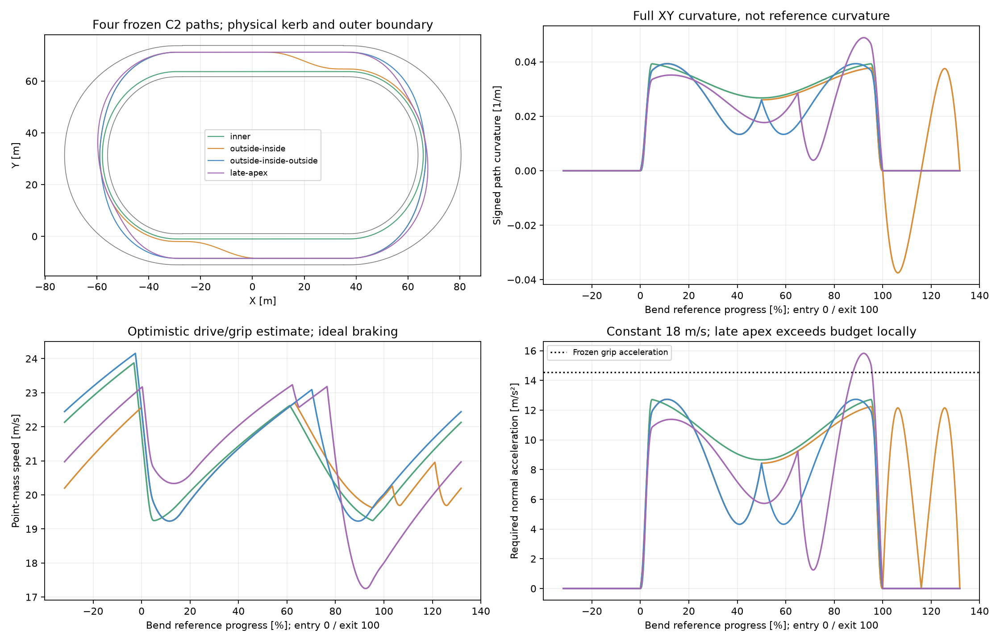
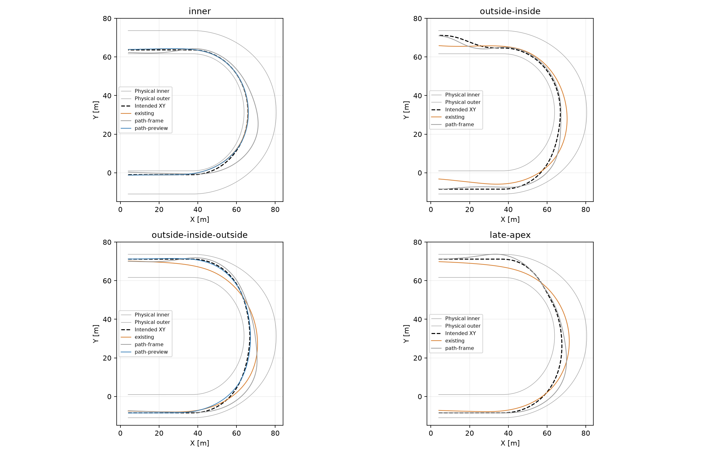
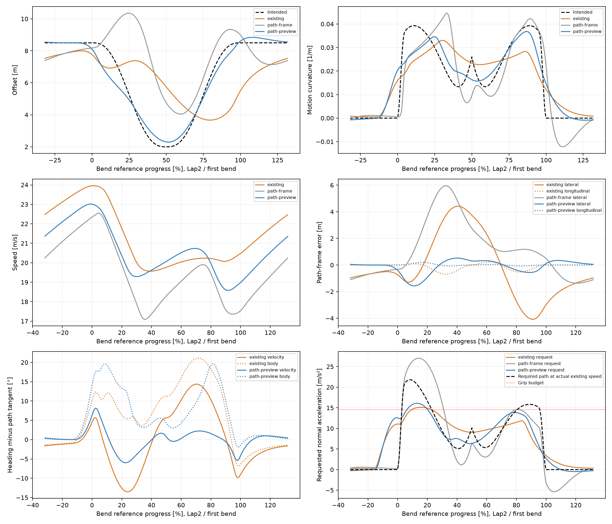
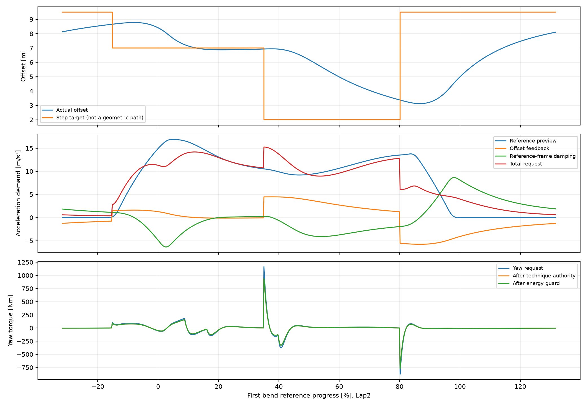

# Racing Line Root-Cause Audit (#104)

**Pierwsze potwierdzone ograniczenie sterowania: kontrakt target-offset i preview opisują reference P(s), zamiast pełnej zadanej Q(s).** Skok „apex2m przy35%” nie definiuje wykonanego apexu.

**Potwierdzono dwa niezależne ograniczenia:** (1) zamrożone gładkie outside–inside nie mają tutaj przewagi czasowej nawet w uproszczonym modelu idealnego prowadzenia; (2) regulator nie realizuje zadanej krzywej i używa niewłaściwego odniesienia dla jej krzywizny oraz zamierzonej prędkości poprzecznej. Nie wykazano wadliwości opony ani charakterystyki prędkości.

Pierwsza potwierdzona rozbieżność sterowania występuje **w żądaniu przyspieszenia, przed oponą i limitem yaw**: dla idealnego stanu na krzywej błąd pozycji wynosi zero, ale regulator nadal tłumi celowy ruch d′(s) i korzysta z preview reference zamiast całej trajektorii. Kontrolna zmiana samego układu odniesienia i preview silnie poprawia tracking. Nie przechodzi jednak pełnej zamrożonej bramki; pozostałego błędu nie przypisujemy arbitralnie oponie.

Baza: Draft #103, `9ae0117e90c8076634c8838d9cfee59111ed9ef7`, gałąź `experiment/racing-line-root-cause`, jeden Draft do `experiment/progressive-bend-width`, bez merge. `progressive-b`, referencyjne XY/krzywizna, banda, kerb, opona, wheelspin, silnik, AI, masa i wszystkie parametry regulatora są zamrożone. Default nie używa nowych wejść. Produkcyjne `src/` i `RiderController` niezmienione.

## Pytania, zakres i zamrożenie

Wykorzystano istniejące pomiary #99–#103. Nie powtórzono historycznych macierzy. Nowe pełne capture to cztery ciągłe krzywe × dwa tryby prowadzenia, jeden recapture `wide-tighten` potrzebny do sił/yaw co10ms oraz dwa dodatkowe testy preview. Ostatnie dwa zamrożono osobno **przed** pomiarami, z hashem pierwotnych dziewięciu wyników: [freeze](racing-line-root-cause/freeze.json), [preview-freeze](racing-line-root-cause/preview-freeze.json). Żadnej krzywej, siły ani stałej nie zmieniono po wyniku. Dodatkowe tanie kontrole to sześć fingerprintów #103 oraz dwa powtórzenia bez obserwatorów.

Neutralny zawodnik z #103, masa147kg, jednorodny Grip1/Ruts0/Moisture0,5, Drive1, fizyka #100, krok10ms/4substeps, trzy okrążenia. Dla nowych krzywych start reference4m (31m przed pierwszym łukiem), offset na danej krzywej, v18m/s, yaw wzdłuż prostej, angularVelocity0. To wspólny protokół bez początkowego błędu pozycji; kontrolerzy danej krzywej mają ten sam stan. Lotne okrążenia mierzone od tej samej pozycji startowej. Legacy zachowuje własny start0/offset5m z #103, bez porównywania jego rozruchu z nowymi krzywymi.

Zamrożona bramka trackingu na Lap2+Lap3: RMS poprzeczny≤0,5m, maksimum≤1m, RMS kierunku prędkości względem stycznej≤3°, maksimum≤10°. To jawny próg diagnostyczny, nie nowy balans. Yaw motocykla nie jest utożsamiony z kierunkiem prędkości; slide wymaga różnicy tych kątów.

## 1. Jawne krzywe geometryczne

`Q(s)=P(s)+d(s)n_out(s)`, gdzie P to niezmieniona reference progressive-b. Użyto C2 quintic smoothstep na każdym przejściu, z d′=d″=0 na węzłach:

- **inner:** d=1m na całym obiegu.
- **outside–inside:** wejście8,5m, minimum2m przy50% łuku, utrzymane do wyjścia; powrót do8,5m na pierwszych31m następnej prostej.
- **outside–inside–outside:**8,5→2→8,5m przez obie połowy łuku. Apex50% wynika z symetrii geometrycznej B i lustrzanych warunków wejścia/wyjścia, bez wyboru po czasie.
- **late-apex:** ta sama amplituda, minimum przy65%, zamrożona czułość na późniejszy apex.

Każda linia jest ciągłą krzywą XY, nie sekwencją skokowych targetów. W świecie aktualizowane jest tylko próbkowanie tej funkcji na istniejących accepted boundaries; nie dodaje się solver steps ani nie przesuwa ciała. Dwa narożniki są lustrzane, a d(s) periodyczne co pół okrążenia.

Pełna krzywizna pochodzi z pochodnych Q, nie z `1/(R_ref+d)`:

`A=1+κ_ref d; |Q′|=sqrt(A²+d′²)`

`κ_path=[A(κ_ref A−d″)+d′(κ_ref′d+2κ_ref d′)] / |Q′|³`.

Pochodne d są analityczne. κ_ref′ pochodzi z centralnej różnicy zamrożonego spline ±1mm; niezależny test różnic skończonych całego XY sprawdza κ_path, metrykę, C2 oraz domknięcie. Wszystkie d≥1 są zewnętrznymi normalnymi do wypukłej reference; `1+κ_ref d>0`, projekcja daje tę samą reference i nie ma samoprzecięć. To geometryczne sprawdzenie regularności, a nie wynik trackingu.

| Krzywa | droga/lap m | max |κ| /m | min promień m | max a_y przy18 m/s | min v_grip m/s | bound kerb / banda m |
| --- | --- | --- | --- | --- | --- | --- |
| inner | 325.062 | 0.039249 | 25.478 | 12.717 | 19.251 | 0.923 / 8.923 |
| outside-inside | 344.996 | 0.039291 | 25.451 | 12.730 | 19.241 | 1.915 / 1.415 |
| outside-inside-outside | 354.858 | 0.039291 | 25.451 | 12.730 | 19.241 | 1.915 / 1.415 |
| late-apex | 354.771 | 0.048839 | 20.475 | 15.824 | 17.258 | 1.915 / 1.415 |

Wszystkie cztery przechodzą **geometrię i footprint**, także dla dowolnego yaw: okrąg1,05m obejmuje chassis+kierownicę. Minimalny dystans środka do całej bandy/kerb pomniejszono o okrąg, zapasy chord/float i `max|Q′|·Δs/2`; próbki≤5cm. Nie są to punkty ograniczone wyłącznie szerokością przekroju. Pełne kapsuły sprawdzono dodatkowo dla12yaw.

Zamrożony budżet `a_grip=14,546245m/s²` pochodzi z tej samej zdolności Grip1 co #100. `v_grip=sqrt(a_grip/|κ_path|)`, `a_y=v²|κ_path|`. Trzy pierwsze krzywe spełniają **konieczny** warunek przy18m/s; late-apex lokalnie wymaga15,824>14,546 i potrzebuje mniejszej prędkości. Warunek siły normalnej nie dowodzi jeszcze wykonalności całego układu Fx/Fy/wheel/yaw przy Drive1. Bezpieczeństwo przestrzenne i wykonalność dynamiczna są oceniane osobno.

Outside–inside–outside ma niemal ten sam najgorszy promień co inner (25,451 vs25,478m) i dłuższą drogę o29,796m/lap. Są odcinki z łagodniejszą krzywizną, ale przejścia do/z apexu oddają ten zysk. Nie ma podstaw, by zakładać korzyść całego obiegu z samego szerokiego wejścia. Wniosek dotyczy tych jawnych krzywych, nie wszystkich możliwych linii na tym torze.

## 2. Niezależny szacunek prędkości i czasu

Offline point-mass używa pełnej κ_path, zamrożonego budżetu, eksportowanej charakterystyki dostępnego napędu F(v) prosta/łuk oraz oporu z CoreSim. Przejścia prędkości spełniają `v_next²≤v²+2a_tΔl`, z `a_t≤min(F_engine/m,sqrt(a_grip²−a_y²))−F_resistance/m`. Powtarzane przejście w przód/wstecz daje periodyczny profil. **Idealne hamowanie z koła przyczepności jest założeniem optymistycznym** — aktualny Drive1 nie ma takiego sterowania. Model pomija wheelspin, zależne od slide straty, transjenty i actuator yaw; nie jest prognozą Box2D ani próbą wheelspin OFF. Nie używa kar/bonusów. To prosty, jawny punkt odniesienia dla samej drogi, krzywizny i dostępnej mocy.

| Krzywa | czas/lap s | dwa lotne s | min/max v m/s | różnica siatki10cm−5cm s/lap |
| --- | --- | --- | --- | --- |
| inner | 15.384395 | 30.768789 | 19.246 / 23.876 | 0.000902 |
| outside-inside | 16.636129 | 33.272259 | 19.230 / 22.704 | 0.001095 |
| outside-inside-outside | 16.744663 | 33.489325 | 19.230 / 24.157 | 0.000712 |
| late-apex | 17.041650 | 34.083301 | 17.251 / 23.234 | 0.001144 |

Nawet ten idealizowany model daje inner przewagę: OIO30m dodatkowej drogi nie odzyskuje czasem prędkości. Kod sprawdza zbieżność i ograniczenia dyskretne; test analitycznego okręgu odtwarza `T=2πsqrt(R/a_grip)`, a brak napędu nie daje samoczynnego przyspieszenia. Eksporty `*-geometry.csv`, `*-point-mass.csv`, [point-mass-summary](racing-line-root-cause/point-mass-summary.json) oddzielają geometrię od rzeczywistych przejazdów.



## 3. Zadana i wykonana trajektoria

Tryby:

- **existing:** oryginalny regulator, tylko ciągły target d(s) zamiast skoków.
- **path-frame:** izolowany wariant z bieżącą κ_path i błędami w układzie trajektorii, bez preview. Zachowany także tam, gdzie pogarsza wynik i narusza kerb/bandę. Usunięcie wyprzedzenia było dodatkową różnicą, więc nie użyto go jako dowodu przeciw krzywej lub oponie.
- **path-preview:** dwie dodatkowe kontrole przywracają dokładnie dotychczasowy reference lookahead `2·YawResponseSeconds=0,7s`; heading i długość łuku preview pochodzą teraz z całego Q(s). Błędy pozycji/prędkości są w aktualnej stycznej/normalnej Q. Te same T, tyre law, wheel, motor, clamp0,95, yaw authority i energy guard. Brak dopasowania parametrów.

Błąd poprzeczny i wzdłużny to projekcje `X_actual−Q(s_actual_reference)` na normalną/styczną Q; oba są mierzone przy tej samej zaakceptowanej reference. Nie są błędem względem arbitralnego harmonogramu czasu. Na zmiennej d(s) błąd offsetu ma również składową wzdłuż stycznej trajektorii. Nie wykorzystano najbliższego punktu, który z definicji zerowałby składową wzdłużną. Różnicę tempa jazdy ocenia osobno crossing time i speed.

Rzeczywista κ ruchu = zmiana headingu prędkości / wykonana droga w accepted interval. Yaw ciała, kierunek prędkości i zadana styczna są trzema osobnymi wielkościami. Tabele trackingu dotyczą Lap2+Lap3; safety obejmuje całe3lap.

| Przypadek | RMS/max poprz. m | RMS wzdłużny m | RMS kierunku v ° | RMS yaw−styczna ° | tracking | safety |
| --- | --- | --- | --- | --- | --- | --- |
| inner-existing | 0.461 / 1.266 | 0.000 | 2.234 | 9.193 | FAIL | PASS |
| inner-path-frame | 2.848 / 6.165 | 0.000 | 6.610 | 9.739 | FAIL | FAIL |
| outside-inside-existing | 2.795 / 5.416 | 0.333 | 8.385 | 9.725 | FAIL | PASS |
| outside-inside-path-frame | 1.267 / 2.751 | 0.282 | 5.732 | 8.128 | FAIL | PASS |
| outside-inside-outside-existing | 2.489 / 4.419 | 0.270 | 7.580 | 10.232 | FAIL | PASS |
| outside-inside-outside-path-frame | 2.555 / 5.965 | 0.406 | 6.462 | 9.393 | FAIL | PASS |
| late-apex-existing | 2.449 / 4.377 | 0.266 | 7.674 | 11.137 | FAIL | PASS |
| late-apex-path-frame | 1.770 / 3.945 | 0.231 | 5.300 | 8.490 | FAIL | FAIL |
| legacy-wide-tighten | — / — | — | — | — | skoki targetu | PASS |
| inner-path-preview | 0.456 / 1.235 | 0.000 | 2.320 | 9.095 | FAIL | PASS |
| outside-inside-outside-path-preview | 0.548 / 1.573 | 0.061 | 2.745 | 9.450 | FAIL | PASS |

Nie uznano poprawy za zaliczenie progu. OIO path-preview: RMS≈0,548m, max≈1,573m; RMS kierunku≈2,745°, ale przestrzenne progi nadal niespełnione. Także inner ma lokalny błąd>1m przy szybkim wejściu. Nie ma tutaj dowodu, że dowolny z tych regulatorów dokładnie realizuje wszystkie geometrycznie bezpieczne linie przy aktualnym Drive1.




## 4. Potwierdzony mechanizm przed limitem siły

Oryginalny [SlipCoupledDynamics](../../tools/shared-world-speedway/SlipCoupledDynamics.cs) liczy:

`a_request = v_ref_tangent²·κ_reference_preview + (d_actual−target)/T² + 2·v_out_reference/T`, `T=0,65+4·0,1=1,05s`.

Po tym żądaniu dopiero następują clamp±0,95 budżetu, przeliczenie target slip, yaw actuator i rzeczywiste siły opony. Preview używa headingu reference, a nie d′/d″. Przy idealnej realizacji Q(s) offset error=0, ale `v_out_reference=d′·ds/dt` nie jest zerem. Regulator traktuje więc zamierzony ruch jak ruch do wytłumienia. Właściwe zero błędu prędkości jest normalne do **stycznej Q**, nie P.

Poniższa kontrola jest czysto kinematyczna: rzeczywisty stan umieszczony dokładnie na OIO z prędkością18m/s styczną do Q, bez błędu pozycji. To nie siłowa korekta Box2D ani nowa symulacja. Wymagane a_n pochodzi z pełnej κ_path. To samo żądanie jest niezależnie sprawdzone bezpośrednim wywołaniem oryginalnej funkcji Forces w teście C#.

| % łuku | d m | wymagane a_n | reference preview | tłumienie v_out | żądanie stare | błąd żądania |
| --- | --- | --- | --- | --- | --- | --- |
| 30 | 4.068 | 7.610 | 8.349 | -6.856 | 1.493 | -6.117 |
| 70 | 4.068 | 7.610 | 9.441 | 6.856 | 16.297 | 8.687 |

Wymagana siła normalna jest w tych stanach poniżej budżetu; zła komenda istnieje już przed ograniczeniem i przed odpowiedzią opony/yaw. Poprawa RMS2,49→0,55m po dostarczeniu pełnej geometrii przy identycznych pozostałych prawach jest interwencją potwierdzającą znaczenie tego mechanizmu. Nie dowodzi, że sam ten wariant usuwa cały błąd.

## 5. Siły, yaw, opóźnienie i apex

`Fx/Fy` poniżej są rzeczywistymi siłami w osiach motocykla; wymaganie `v²κ_path` przy aktualnym v jest osobnym warunkiem. Udział required>budget oznacza, że w tych punktach nie da się podążać po zadanej κ z taką prędkością nawet idealną siłą. Nie oznacza błędu tyre law. Yaw force clamp i energy guard są liczone osobno od stałego skalowania Technique≈0,875.

| Przypadek | mean Fx/Fy N | max wheelspin | near grip ≥95% | required>budget | steer clamp | yaw force/energy clamp % |
| --- | --- | --- | --- | --- | --- | --- |
| inner-existing | 332.432 / 1111.599 | 0.2258 | 0.00 | 10.44 | 13.52 | 0.00 / 0.00 |
| inner-path-frame | 337.367 / 966.588 | 0.2646 | 0.00 | 10.30 | 22.98 | 0.28 / 0.00 |
| outside-inside-existing | 326.755 / 1087.826 | 0.2145 | 0.00 | 16.16 | 10.10 | 0.00 / 0.00 |
| outside-inside-path-frame | 347.240 / 856.789 | 0.2774 | 0.00 | 5.29 | 23.65 | 0.18 / 0.00 |
| outside-inside-outside-existing | 321.569 / 1134.952 | 0.2129 | 0.00 | 23.34 | 12.66 | 0.00 / 0.00 |
| outside-inside-outside-path-frame | 336.618 / 904.942 | 0.2597 | 0.00 | 10.22 | 26.16 | 0.21 / 0.00 |
| late-apex-existing | 320.686 / 1144.591 | 0.2031 | 0.00 | 22.23 | 9.78 | 0.00 / 0.00 |
| late-apex-path-frame | 337.289 / 916.257 | 0.2595 | 0.00 | 17.23 | 30.12 | 0.16 / 0.00 |
| legacy-wide-tighten | 320.260 / 1158.809 | 0.1894 | 0.00 | — | 8.06 | 0.12 / 0.00 |
| inner-path-preview | 332.278 / 1111.263 | 0.2267 | 0.00 | 10.65 | 13.66 | 0.00 / 0.00 |
| outside-inside-outside-path-preview | 327.980 / 1074.279 | 0.2206 | 0.00 | 11.18 | 13.04 | 0.00 / 0.00 |

Osiągnięty apex to minimum **rzeczywistego** offsetu wewnątrz łuku, nie polecenie. Dla OI d=2 jest docelowym plateau od połowy łuku; dla inner brak pojedynczego apexu. Opóźnienie połowy zacieśniania mierzy pierwsze przekroczenie rzeczywistego d=5,25m względem miejsca/czasu, gdzie ciągła krzywa przechodzi przez5,25m. Próbkowanie10ms ogranicza rozdzielczość opóźnienia; nie jest to dopasowana stała czasowa regulatora.

| Przypadek | d rzeczywisty35/50/80% m | minimum d m | miejsce min % | lag połowy: s / reference m |
| --- | --- | --- | --- | --- |
| outside-inside-existing | 6.461 / 5.321 / 3.126 | 2.679 | 92.8 | 1.533 / 25.138 |
| outside-inside-path-frame | 4.878 / 2.312 / 2.569 | 2.262 | 100.0 | 0.674 / 8.820 |
| outside-inside-outside-existing | 7.201 / 5.743 / 3.669 | 3.669 | 79.4 | 1.745 / 28.791 |
| outside-inside-outside-path-frame | 8.963 / 4.760 / 7.577 | 4.046 | 59.7 | 1.571 / 21.677 |
| late-apex-existing | 7.338 / 6.481 / 3.790 | 3.556 | 87.5 | 1.750 / 29.583 |
| late-apex-path-frame | 8.446 / 3.785 / 4.258 | 2.499 | 63.9 | 0.842 / 11.617 |
| legacy-wide-tighten | 6.928 / 6.177 / 3.383 | 3.123 | 86.7 | — / — |
| outside-inside-outside-path-preview | 3.504 / 2.306 / 6.059 | 2.296 | 51.4 | -0.156 / -2.607 |

Legacy wide-tighten jest odtworzony bitowo z #103: żądanie2m przy35% nie wyznacza geometrycznego apexu. Pełny10ms zapis pokazuje opóźnienie wykonania i przełączenie na9,5m przy80%, zanim ciało zrealizuje zacieśnianie. [phases.csv](racing-line-root-cause/phases.csv) zachowuje oba łuki osobno dla Lap2/Lap3, entry/middle/exit speeds, offsety i wszystkie crossing times; ostatnie legacy okno za metą jest jawnie niepełne i wyłączone ze średniej okien.

Konkretne chwile legacy, pierwszy łuk Lap2, pierwszy zaakceptowany stan na/za danym landmarkiem:

| % łuku | t s | offset m | target m | v m/s | preview a | offset a | damping a | żądanie a |
| --- | --- | --- | --- | --- | --- | --- | --- | --- |
| 35 | 20.49 | 6.930 | 2.000 | 21.007 | 10.533 | 4.472 | 0.268 | 15.273 |
| 50 | 21.35 | 6.171 | 2.000 | 19.839 | 9.333 | 3.783 | -3.841 | 9.275 |
| 80 | 23.02 | 3.369 | 9.500 | 19.897 | 13.533 | -5.561 | -1.941 | 6.032 |

Parametr zewnętrznego feedbacku T=1,05s celowo spowalnia zmianę linii względem yaw. W idealnym przybliżeniu PD o natychmiastowej sile i stałym układzie odniesienia odpowiedź skokowa ma `1−(1+t/T)exp(−t/T)`; połowę ruchu osiąga po≈1,678T=1,76s. Rzeczywiste układy tyre/yaw dodają dynamikę, więc nie traktujemy tego jako ścisłej identyfikacji, ale skok dopiero przy35% nie jest deklaracją osiągnięcia2m przy50%. Przesunięcie przyszłego targetu bez ciągłej d(s) i jej pochodnych nie definiuje oczekiwanego outside–inside–outside.



## 6. Czas i droga: cały obieg oraz wejście–łuk–prosta

Okno od31m przed wejściem do31m za wyjściem obejmuje jeden łuk i obie połowy sąsiednich prostych. Cztery pełne okna dokładnie pokrywają dwa lotne obiegi nowych prób. Czas i droga są z rzeczywistych XY/crossingów, bez podstawiania idealnego d(s). Wynik bez zaliczonego trackingu nie jest czasem wykonania zaplanowanej linii. Odrzucona safety pozostaje diagnostyką.

| Przypadek | Lap2+3 s | droga lotna m | okno średnio s/m | Δdroga / v_inner s | efekt średniej v s |
| --- | --- | --- | --- | --- | --- |
| inner-existing | 32.176569 | 646.496 | 8.044 / 161.624 | 0.000 | 0.000 |
| inner-path-frame | 35.423098 | 685.684 | 8.856 / 171.421 | 1.950 | 1.296 |
| outside-inside-existing | 33.852536 | 698.825 | 8.463 / 174.706 | 2.604 | -0.929 |
| outside-inside-path-frame | 38.598186 | 703.204 | 9.650 / 175.801 | 2.822 | 3.599 |
| outside-inside-outside-existing | 33.421966 | 709.843 | 8.355 / 177.461 | 3.153 | -1.907 |
| outside-inside-outside-path-frame | 38.264359 | 739.993 | 9.566 / 184.998 | 4.653 | 1.434 |
| late-apex-existing | 33.329034 | 711.560 | 8.332 / 177.890 | 3.238 | -2.086 |
| late-apex-path-frame | 37.851112 | 731.549 | 9.463 / 182.887 | 4.233 | 1.441 |
| legacy-wide-tighten | 33.125616 | 709.382 | 8.281 / 177.343 | 3.130 | -2.181 |
| inner-path-preview | 32.203850 | 647.514 | 8.051 / 161.878 | 0.051 | -0.023 |
| outside-inside-outside-path-preview | 34.356657 | 704.639 | 8.589 / 176.160 | 2.894 | -0.714 |

Rozkład czasu jest tożsamością `ΔT=(L−L_inner)/v̄_inner + L(1/v̄−1/v̄_inner)`, z rzeczywistym v̄=L/T. Nie jest obietnicą fizycznego utrzymania speed inner na innej trasie. Oddziela koszt drogi od zmiany tempa. Poprawniejsze zacieśnienie nie gwarantuje szybszego czasu: stary kontroler wykonuje inną, gładszą i mniej ciasną linię niż Q. Nie wolno przypisywać jej czasu planowanemu outside–inside–outside.

## 7. Bezpieczeństwo i energia wszystkich prób

Pełne kapsuły przy rzeczywistym yaw: accepted inner≥0,05m / outer≥0,5m. Między krokami bound z #103 odejmuje `(max speed+1,05·max |spin|)h/2+0,012m`; wymagany brak przekroczenia kredy i≥0,5m bandy. Dotyczy odizolowanego bezkontaktowego ciała, nie ogólnego CCD.

| Przypadek | kerb min/bound m | banda min/bound m | safety | energy residual J |
| --- | --- | --- | --- | --- |
| inner-existing | 0.149 / 0.024 | 8.971 / 8.862 | PASS | -0.331 |
| inner-path-frame | -0.057 / -0.167 | 7.420 / 7.312 | FAIL | -0.535 |
| outside-inside-existing | 3.212 / 3.102 | 2.099 / 1.988 | PASS | -0.220 |
| outside-inside-path-frame | 2.078 / 1.969 | 1.764 / 1.648 | PASS | 0.329 |
| outside-inside-outside-existing | 4.188 / 4.072 | 2.099 / 1.988 | PASS | 0.160 |
| outside-inside-outside-path-frame | 3.074 / 2.967 | 1.424 / 1.323 | PASS | 0.176 |
| late-apex-existing | 4.080 / 3.965 | 2.099 / 1.988 | PASS | -0.744 |
| late-apex-path-frame | 2.572 / 2.461 | -0.369 / -0.468 | FAIL | 0.151 |
| legacy-wide-tighten | 3.629 / 3.517 | 1.836 / 1.704 | PASS | 0.537 |
| inner-path-preview | 0.184 / 0.057 | 8.944 / 8.835 | PASS | 0.286 |
| outside-inside-outside-path-preview | 2.716 / 2.603 | 1.763 / 1.653 | PASS | -0.450 |

Nie usunięto nieudanych path-frame inner i late-apex, ich pełne trajektorie są zachowane. Wszystkie próby kończą3lap, tyre budget≤1 i dotychczasowy audyt całego układu body+wheel zamyka bilans. Yaw guard excess pozostaje0. To walidacja spójności obliczeń, nie empiryczna kalibracja rzeczywistej opony.

## Rozstrzygnięcie i jeden następny PR

1. **Geometria:** w tej rodzinie nie znaleziono podstaw do oczekiwanej przewagi outside–inside. OIO ma korzystniejsze fragmenty κ, lecz prawie nie poprawia najgorszego promienia i wydłuża drogę. To nie dowód, że żadna inna linia może być lepsza.
2. **Tracking:** obecny regulator nie wykonuje tych krzywych. Pierwszy potwierdzony błąd leży w reprezentacji i żądaniu: brak κ całej d(s) i tłumienie celowej prędkości poprzecznej jako błędu. Nie trzeba hipotezy o wadliwej oponie, żeby go odtworzyć.
3. **Force/yaw:** część stanów przy aktualnych szybkich prędkościach przekracza konieczny budżet v²κ, lecz zła komenda występuje także w idealnych stanach poniżej budżetu. Limity yaw/energii oraz grip są rozdzielone w tabelach; nie nazywamy ich wspólnie „brakiem AI”.
4. **Opona/prędkość:** brak rozstrzygającego dowodu wadliwości. Idealny point-mass nie uwzględnia strat slide/wheel i hamuje idealnie. Różnica czasu do niego nie jest testem poprawności opony. Nie uruchomiono wheelspin ON/OFF ani dopasowania napędu, ponieważ tracking nie przeszedł bramki.
5. **Nierozstrzygnięte:** po path-preview nadal pozostaje błąd. Nie wykazano jeszcze istnienia pełnego, zgodnego z rzeczywistym tyre/engine/yaw rozwiązania dla Q(t) przy aktualnym Drive1; sam warunek a_y≤a_grip jest konieczny, ale niewystarczający.

**Jeden minimalny następny PR: kontrakt ciągłej trajektorii C2 dla imposed-line controller, z referencją stycznej, κ, d′ i d″ oraz tym samym horyzontem preview, default OFF.** Usuwa potwierdzony brak informacji i błędny układ odniesienia, zamiast stroić oponę lub czasy. Nie promować obecnego prototypu jako gotowej poprawki trackingu.

Dokładny test akceptacyjny i rozstrzygający pozostałą niepewność: dla zamrożonego OIO przy18m/s (z limitowaniem tylko tam, gdzie nie istnieje rozwiązanie) wyznaczyć inverse-feasibility **oryginalnych** równań poślizgu/koła: wymagane globalne F=m·a, body slip, Fx/Fy, omega/engine torque i yaw torque wraz z energy guard. Bez dodatkowych sił, korekty XY lub zmiany parametrów. Jeśli rozwiązanie0≤Drive≤1 i legalny yaw istnieją w całym oknie, odegrać je w tym samym Box2D i wymagać zamrożonego trackingu. Istniejące rozwiązanie + błąd prowadzenia oznacza actuator/preview tracking; brak rozwiązania wskazuje konkretny constraint Fx/Fy/engine/yaw i wymaganą mniejszą prędkość. To test wykonalności, bez optymalizacji czasu i bez obwiniania modelu opony. Ten PR dostarcza dane wejściowe i progi, ale nie twierdzi, że rozwiązał to jeszcze nierozstrzygnięte zadanie.

## Walidacja, pochodzenie i reprodukcja

**47/47 celowanych C#,3/3 nowych testów analizy,11/11 Node; restore i Release --warnaserror poprawne.** [targeted-tests.json](racing-line-root-cause/targeted-tests.json) zawiera rzeczywiste wyniki końcowego TRX. Celowane testy geometrii, C2/κ przez niezależne różnice XY, pełnych kapsuł12yaw/projekcji, perfect-state żądania wywołanego wprost w oryginalnym Forces, izolacji opcji, poprawy i nadal niezaliczonego trackingu oraz obserwowanego/plain determinism. Analiza ma osobne testy analitycznego circle, granicy braku napędu i bramki wheelspin. Status standardowego Draft Windows CI na końcowym HEAD jest w PR. `metadata-correction.json` rejestruje poprawkę etykiety/flag dwóch preview capture; pozycje, siły, czasy i fingerprinty nie zmieniły się. Hash oryginalnych dziewięciu wyników z preview-freeze jest zachowany.

**6/6 fingerprintów progressive-b #103 bez zmian;2/2 nowych plain repeats bitowo zgodnych. 377/377 historycznych plików** zachowało SHA-256: {'autonomous-racing-line': 34, 'slip-coupled-dynamics': 63, 'slip-control-validation': 42, 'physics-driven-racing-line': 21, 'rear-wheel-dynamics': 88, 'track-geometry-variants': 43, 'local-offset-limit': 35, 'progressive-bend-width': 51}. Nowy manifest obejmuje surowe CSV/JSON oraz analizę/wykresy. Wszystkie surowe eksporty odmawiają nadpisania plików. Default nie korzysta z AuthoredRacingPath ani diagnosticPathGuidance; stare wymiary, opona/koło/silnik/AI, parametry i geometrie nie zostały zmienione. Nowy warunkowy blok modyfikuje wyłącznie żądanie diagnostycznego kontrolera, przed niezmienionym clamp/tyre/yaw. Stare API przy opcjach null/false zachowuje dotychczasowy rachunek.

```powershell
dotnet restore
dotnet build -c Release --no-restore --warnaserror
# Użyć nowego pustego katalogu; wykonywać z root repo.
dotnet tools/shared-world-speedway/bin/Release/net8.0/shared-world-speedway.dll racing-line-root-cause ../root-reproduction freeze
dotnet tools/shared-world-speedway/bin/Release/net8.0/shared-world-speedway.dll racing-line-root-cause ../root-reproduction geometry
dotnet tools/shared-world-speedway/bin/Release/net8.0/shared-world-speedway.dll racing-line-root-cause ../root-reproduction measure
dotnet tools/shared-world-speedway/bin/Release/net8.0/shared-world-speedway.dll racing-line-root-cause ../root-reproduction preview-freeze
dotnet tools/shared-world-speedway/bin/Release/net8.0/shared-world-speedway.dll racing-line-root-cause ../root-reproduction preview
dotnet tools/shared-world-speedway/bin/Release/net8.0/shared-world-speedway.dll racing-line-root-cause ../root-reproduction verify
python tools/shared-world-speedway/racing-line-root-cause-report.py --plots
python -m unittest discover -s tests/calibration -p test_racing_line_root_cause_estimate.py
```

Raport analizuje zapisany katalog docs/experiments/racing-line-root-cause; --plots wymaga matplotlib, pozostała analiza używa standardowej biblioteki. Reprodukcja surowych capture do osobnego katalogu nie nadpisuje dowodów. Kontrole historyczne czytają istniejące #103 i nie uruchamiają dawnych macierzy. Koszt wykonania obserwatorów i offline quadrature nie wpływa na fizykę ani fingerprint.
