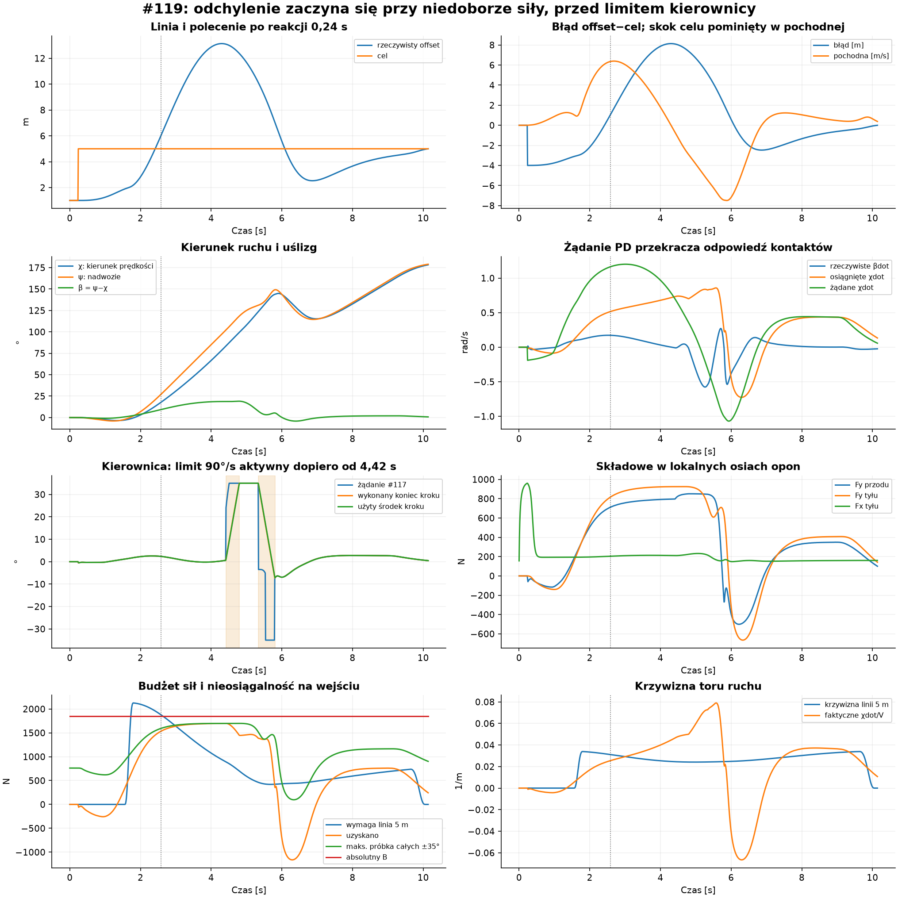
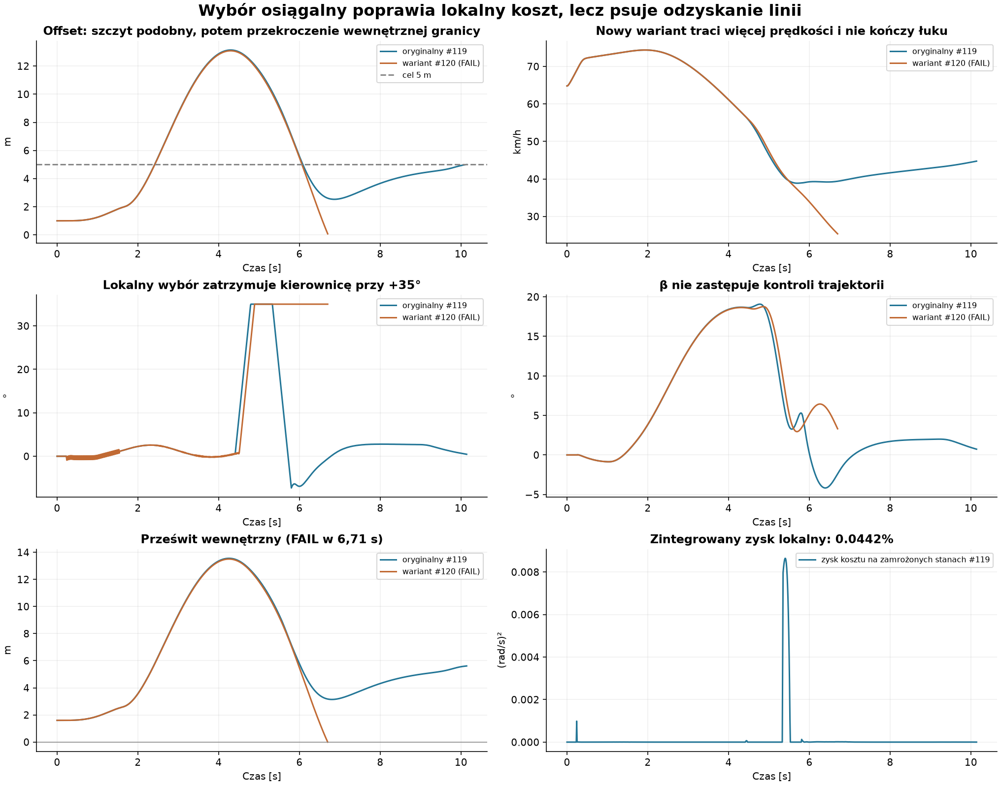

# #120 — dlaczego motocykl nie utrzymuje linii 5 m? (PROVISIONAL)

**Pierwszym rzeczywistym ograniczeniem w zapisanym wejściu #119 jest fizyczna
nieosiągalność wymaganego skrętu przy tej prędkości i stanie kontaktów. Duży
początkowy błąd nie wynika głównie z wyboru kierownicy poza osiągalnym zakresem.**
Regulator i podgląd mają również ograniczenia: nie przygotowują wykonalnego
dojścia do celu, a późniejsza korekta prowadzi do dużego przeregulowania.
Nie ustalono procentowego udziału tych zjawisk w całym błędzie 8,14 m.

Wariant wyszukujący wyłącznie osiągalną kierownicę **pogarsza odzyskanie linii**:
jedyny nowy przejazd kończy się przekroczeniem wewnętrznej granicy w 6,71 s.
Nie rekomendujemy włączania tego wariantu. Nie zwiększano gazu i nie wykonywano
kolejnych prób, drugiego łuku ani pełnych okrążeń.

Baza: dokładny HEAD Draft #119 `8a218fc8cb8be3460c8e42116789ece8ff576498`,
ze [zweryfikowanym Windows CI](https://github.com/arturgladysz91/zuzel/actions/runs/39744471978).
Jeden kolejny Draft na tej bazie, bez merge. Silnik #116, opony, µ, geometria,
gaz, parametry sterowania i źródło `TravelDirectionSteering.cs` #117 zachowane.
Nowy `EnableReachableTravelDirectionSteering` domyślnie OFF, pomijany w JSON OFF.

**A — cały udany zapis #119, bez nowego świata**

Wykorzystano wszystkie 1017 zaakceptowanych interwałów wariantu **combined**,
bez dodatkowego ogona AI. Początek s=4 m, V=18 m/s, offset=1 m, koło toczące się,
β=0, ψdot=0, kierownica=0. Jedno polecenie aktywuje w 0,24 s cel 5 m i gaz 0,15;
do tego momentu gaz wynosi 1, dokładnie jak w #119. Żaden stan nie był ustawiany
podczas ruchu. Odtworzenie czterech składowych kontaktów i wykonanej kierownicy:
**maksymalny błąd 0 N i 0 rad**. Zero kroków Box2D i zero commitów koła.

`saved-state-comparison.csv.gz` zawiera target/actual offset, e i edot, χ, ψ, β,
βdot, żądane/osiągnięte χdot, żądanie, początek, koniec i użyty midpoint kierownicy,
aktywność limitera, Fy obu opon, Fx tyłu, obie krzywizny, rozkład żądania PD
i odpowiedzi globalnego oraz osiągalnego wyszukiwania. `native-response.csv.gz`
niezależnie wyprowadza χdot i βdot z rzeczywistych końców kroków. Maksymalna
różnica chwilowego χdot sił i skończonego Δχ/dt świata wynosi 0,003214 rad/s;
nie są to dwie identyczne definicje pochodnej.

e=actual−target. Między zmianami celu edot=v·outward; sam skok target 1→5 m
nie jest fizyczną prędkością boczną. Dlatego nie nazywamy początkowych −4 m
utratą kontroli. Jawny próg istotnego **nowego przeregulowania na zewnątrz**:
actual≥6 m i edot>0. Pierwszy taki zapis jest w **2,58 s**, s=53,382 m:
actual=6,024 m, edot=6,350 m/s, β=9,303°. Cel został wcześniej przecięty w 2,42 s,
już z edot=6,093 m/s. Maksimum 13,1376 m pojawia się w 4,30 s; edot≈0,
ale wcześniej zgromadzony ruch boczny wymagał rzeczywistej zmiany kierunku.

Siła normalna oznacza składową prostopadłą do **prędkości**, nie do nadwozia.
χdot=cross(v,Fnet)/(mV²), β=wrap(ψ−χ), βdot=ψdot−χdot, kactual=χdot/V.
Krzywizna odniesienia to lokalna geometryczna linia stałego offsetu 5 m:
k5=kshape/(1+5·kshape); N5=mV²k5. Sam cel offsetu w #119 nie jest gotową,
ciągłą trajektorią przejściową. N5 nie obejmuje dodatkowej korekty błędu PD.

| t [s] | actual [m] | N5 [N] | absolutny B [N] | maksimum próbkowane ±35° [N] | uzyskano [N] | χdot żądane / uzyskane [rad/s] |
|---|---:|---:|---:|---:|---:|---:|
| 2,00 | 2,827 | 2098,04 | 1852,34 | 1312,74 | 1060,11 | 0,9594 / 0,3491 |
| 2,58 | 6,024 | 1877,88 | 1852,34 | 1593,33 | 1533,55 | 1,1633 / 0,5151 |
| 3,00 | 8,664 | 1638,86 | 1852,34 | 1661,48 | 1639,34 | 1,2008 / 0,5705 |
| 4,30 | 13,138 | 939,95 | 1852,34 | 1696,68 | 1695,53 | 0,7850 / 0,7168 |

Między **1,73 a 2,63 s** N5 przekracza nawet B=1852,34 N. To ograniczenie
niezależne od wyszukiwania kierownicy: żadna orientacja sił w niezmienionych
kontaktach nie daje więcej niż suma ich pojemności. W zakresie **1,67–2,97 s**
N5 przekracza także maksimum próbkowane przy zamrożonym stanie nadwozia/koła.
Drugie jest wynikiem skończonego próbkowania; nie jest ścisłym maksimum ciągłym.
Żadne z tych stwierdzeń nie dowodzi, że inna, wcześniejsza historia sterowania
i prędkości nigdy nie pozwoliłaby jechać 5 m od krawędzi.

W 2,00 s Fx tyłu wynosi tylko 195,72 N, a κ=0,05071. Przy tym aktualnym Fx
korzystna górna granica normalnej składowej, po projekcji względem β, wynosi
1843,83 N: Bfront+sqrt(Brear²−Fx²)|cosβ|+max(0,Fx·sinβ).
Nawet ten optymistyczny pułap jest mniejszy od 2098,04 N. Nie jest to obietnica
siły natychmiast dostępnej: rzeczywiste Fy przodu/tyłu to 507,63/543,47 N;
ich wykorzystanie pojemności wynosi 59,38% i 57,91% (tył łącznie Fx/Fy).
Do wytworzenia większego Fy potrzeba zmiany lokalnych prędkości kontaktów
i orientacji, a nie samej niewykorzystanej części koła sił. Napęd nie zużywa
w tym momencie większości budżetu. Po aktywacji gazu 0,15 wheelspin wygasa
stopniowo; zapis zachowuje ten proces, bez natychmiastowego zerowania koła.

Rozdzielenie przyczyn:

| Zjawisko | Co wynika z zapisu i równań |
|---|---|
| Niewykonalny ruch przy bieżącej prędkości | N5>B przez 0,90 s; to pierwsza twarda granica na wejściu. |
| Planowanie/podgląd | Cel 5 m aktywuje się wcześnie, ale na wejściu actual≈1,89 m. Istniejący podgląd około 0,7 s i PD nie tworzą wykonalnego przejścia ani harmonogramu narastania krzywizny. Nie zmieniano ich. |
| Wybór kierownicy | W 2 s globalne żądanie≈2,256° jest wykonane w tym samym kroku. Brak aktywnego limitera. Wybór osiągalny zmienia wynik nieznacznie. |
| Bezwładność i skończona odpowiedź | W 2 s ψdot=0,4910, χdot=0,3491, βdot=0,1419 rad/s. Moment przodu 355,07 i tyłu −326,08 Nm dają tylko 28,99 Nm netto, czyli ψddot≈0,550 rad/s² przy I=52,721 kg·m². Kierownica nie ustawia χ ani ψ natychmiast. |
| Późniejsze przeregulowanie | Gdy maleje N5, pozostają e i edot. W 3 s żądanie PD odpowiada 3450 N, mimo że utrzymanie samej linii wymaga 1639 N. Korekta błędu także musi mieścić się w dostępnych siłach. |

W 2 s składniki żądanego przyspieszenia PD wynoszą: feed-forward 14,112,
korekta pozycji −1,971 i tłumienie ruchu na zewnątrz +7,678 m/s². Suma 19,819
m/s² odpowiada 2913,46 N. W 2,58 s samo tłumienie wynosi już 12,095 m/s².
To wyjaśnia, dlaczego późniejszy zapas dla geometrycznej krzywizny nie zapewnia
natychmiastowego powrotu na linię.

**B — porównanie kierownicy na zachowanych stanach**

#117 ocenia 33 kąty w całym ±35° oraz 16 doprecyzowań, minimalizując
J=(χdot−χdot_request)²+q²+excess², q=ψdot+0,1·τ/I−χdot.
Następnie ogranicza żądanie do 90°/s i oblicza odpowiedź dla fizycznego midpoint.
W kroku 10 ms koniec kierownicy może zmienić się najwyżej o 0,9°.

Nowy wariant używa dokładnie tego samego J, horyzontu i 51 zapytań. Przeszukuje
wyłącznie osiągalne **końce** kierownicy, oceniając oryginalne kontakty przy
δused=(δbefore+δafter)/2. Nie miesza końca kroku z rzeczywiście użytym kątem.
Zakres diagnostycznych min/max w decyzji nowego wariantu jest osiągalny w tym
interwale; w #117 obejmuje pełny zakres mechaniczny. Flagi `unreachable` tych
wariantów mają więc różne domeny i nie służą bezpośredniemu rankingowi.

Na zachowanych stanach #119 zintegrowany koszt spada z 2,992087 do 2,990763,
czyli tylko **0,04425%**. 860 stanów ma poprawę większą niż 1e−9; 4 mają pogorszenie
nie większe niż 2,52e−8 wskutek skończonej siatki/float. W 27 stanach kierunki
ruchu są przeciwne. Nie jest to dowód globalnej optymalności ani stabilności.
W #119 limiter działa dopiero **4,42–4,80 i 5,34–5,81 s**, po szczycie odchylenia.

Przykład późniejszego konfliktu, t=5,40 s: #117 wybiera −3,486°, ale fizycznie
przechodzi z 29,600° do 28,700°. Wariant lokalny wybiera 30,500°. J maleje
z 1,618344 do 1,609700, a χdot z 0,83554 do 0,83140 rad/s; żądanie wynosi
−0,41287 rad/s. Drobna poprawa najbliższej odpowiedzi odsuwa kierownicę od
odległej gałęzi, do której #117 próbuje dojść. Dlatego konieczna była jedyna
próba dynamiczna, a nie uznanie algebraicznego kosztu za sukces.

**C — jeden zamrożony wariant, bez dostrajania**

`protocol.json` zapisano przed próbą. Nowy wariant zmienia wyłącznie domenę
wyszukiwania i uwzględnia midpoint przy ocenie kandydata. Oba przebiegi mają
identyczne pełne stany początkowe i identyczne zdarzenie polecenia po 0,24 s.
Próba używa tego samego `CornerEntryAudit.Execute`, świata, sił i kryteriów stopu.

| Miara | Zapis #119 | Osiągalny wariant #120 |
|---|---:|---:|
| Wynik | cały pierwszy łuk, bezpiecznie | FAIL: wewnętrzna granica, 6,71 s, s=92,522 m |
| Max actual offset [m] | 13,1376 | 13,0829 |
| Max bezwzględny błąd do 5 m [m] | 8,1376 | 8,0829 |
| RMS do 5 m, cały zapis [m] | 3,9175 | 4,7339 (zapis krótszy) |
| RMS, wspólne pierwsze 6,71 s [m] | 4,7147 | 4,7339 |
| RMS, tylko łuk do końca dostępnego zapisu [m] | 3,9630 | 4,9863 (brak wyjścia) |
| Prześwit inner/outer, próbki [m] | 1,5992 / 1,8583 | −0,00733 / 1,9151 |
| Prześwit konserwatywny inner/outer [m] | 1,4907 / 1,7609 | −0,06080 / 1,8177 |
| Max abs(β) [°] | 19,0701 | 18,7611 |
| Końcowe βdot [rad/s] | −0,02621 | −0,19396 (wcześniejszy stop) |
| V wejście / środek / wyjście [km/h] | 74,0455 / 47,0815 / 44,5782 | 74,0448 / 48,3507 / brak |
| V minimum, wraz ze stanem końcowym [km/h] | 38,8623 | 25,2586 |
| Rzeczywista droga [m] | 153,355 | 111,023 (stop przed wyjściem) |
| Max wykorzystanie przód/tył | 99,509% / 96,255% | 99,494% / 96,255% |
| Średnie w czasie wykorzystanie przód/tył | 50,233% / 57,088% | 69,185% / 71,906% (krótszy zapis) |
| Zaakceptowane interwały | 1017 | 672 |
| Zapytania regulatora | 51867 | 34272 |

Maksymalny błąd zmniejsza się o **0,0547 m (0,67%)**, ale to nie jest użyteczna
poprawa: RMS wspólnego czasu rośnie, przejazd nie kończy łuku i traci więcej
prędkości. Nowy regulator pozostaje przy +35° do stopu, gdy #117 od 5,34 s
przestawia kierownicę w przeciwną stronę. To zaobserwowane pogorszenie odzyskania
trajektorii, mimo małego/ograniczonego β. Sam stabilny uślizg nie zapewnia linii.

Bilans niezależnie przeliczono ze stanów i pracy sił; nie ponawiano historycznych
testów energii. Wartości dla całych zapisów mają różny czas i drogę:

| Energia [kJ] | #119, 10,15 s | #120, 6,71 s |
|---|---:|---:|
| Praca silnika | +38,9352 | +31,6579 |
| Straty boczne przód / tył | 16,3829 / 14,8945 | 20,3002 / 15,1230 |
| Strata poślizgu wzdłużnego | 5,5884 | 5,3225 |
| Łożysko | 0,5498 | 0,4469 |
| Praca oporów | −14,5982 | −11,6960 |
| Zmiana energii ciała / koła | −12,4482 / −0,6303 | −20,1585 / −1,0725 |
| Reszta bilansu [J] | +0,125845 | −0,175730 |

Reszta jest wyjaśniona zmierzoną pracą błędu impulsu float świata; niewyjaśniona
część <2e−10 J. Brak nadmiaru energii ponad pracę silnika, dodatkowych sił,
hamowania czy korekt stanów. Dla **tego samego czasu 6,71 s** straty boczne #119
wynoszą 30,2297 kJ, a #120 już 35,4233 kJ (+17,18%). Kierownica utrzymywana na
niekorzystnej gałęzi zwiększa straty, zamiast zachowywać prędkość.

Koszt algorytmu: oba warianty wykonują **51 zapytań regulatora + 1 zastosowanie
kontaktów na zaakceptowany interwał**. To odpowiednio 52884 i 34944 ewaluacji
kontaktów; dodatkowo 2/1 ewaluacje graniczne świata, każda z tą samą strukturą
zapytań. Mniejsza suma #120 wynika z wcześniejszego FAIL. Zapisany czas samego
solver Box2D to 34,680/31,285 ms (0,0341/0,0466 ms na interwał); pojedyncze próby
o innej długości i rozgrzaniu nie dają wiarygodnego pomiaru przyspieszenia całego
regulatora. Nie wykonywano dodatkowych przejazdów benchmarkowych.

**Zakres wniosku i dalsza decyzja**

Na pytanie „regulator czy fizyczna nieosiągalność?” odpowiedź dla zapisanego
wejścia brzmi: **pierwsza i główna przyczyna utraty linii na wejściu to niewykonalny
skręt przy uzyskanej prędkości; hipoteza głównego błędu globalne ±35° → limiter
nie potwierdziła się.** Późniejsza jakość odzyskania zależy już silnie od regulatora,
co wykazała negatywna próba #120. Nie wolno z tego wyciągać wniosku, że obecny
regulator jest ostatecznie poprawny ani że żądana linia jest globalnie niemożliwa
dla każdej wcześniejszej decyzji.

Pozostawić #117, wariant #120 OFF. Następna uzasadniona praca dotyczy wykonalnego
przygotowania krzywizny/linii i odpowiedzi w czasie, z uwzględnieniem dostępnych
sił oraz obrotu nadwozia. Ten eksperyment nie uzasadnia zwiększania gazu,
zmiany opon ani włączania kosztownego planera. Nie zmieniano parametrów po FAIL.

**Odtwarzalność i weryfikacja**

- `probe.csproj` w katalogu danych odtwarza zapisane #119 i porównuje obie domeny
  wyszukiwania. Wszystkie siły pochodzą z oryginalnego `TwoContactBikeDynamics`;
  żadnego świata na kandydata. 105768 ewaluacji kontaktów łącznie, w tym 1017
  dodatkowych zapytań wyłącznie do raportowania kosztu, zero commitów/kroków świata.
- `reachable-steering ... freeze`, a następnie `... trial` zapisują jedyną próbę;
  eksport odmawia nadpisania. Zapis zachowuje również nieudany wynik.
- `reachable-steering-report.py --plots --compact` analizuje istniejące dane,
  weryfikuje 1163 historyczne pliki SHA-256 i niezmienione źródła fizyki/#117,
  bilans pracy i impulsów, limity sił, 90°/s oraz identyczny początek/polecenie.
- Celowane testy 23/23: cały nowy zapis sił odtworzony dokładnie bez kolejnego
  przejazdu ON; osiągalne midpointy, dt=0, 51 zapytań, brak commitów, domyślne OFF
  i zależności. Istniejący test #119 zachowuje dokładny fingerprint combined
  `6D76ADBCAE18C30367FD72F13749C6DEED795876672CB03063C1665A774EFFFE`.
- Fingerprint jedynej nowej próby:
  `5FD41DB3550E034D98AEDC35BA5DCAD392908D1B3237E60DC232EE68E448C70F`.
  Finalne Windows CI jest wymagane, bo dodano wykonywalny wariant eksperymentalny;
  wynik dla dokładnego HEAD znajduje się w statusie i opisie Draft PR.
