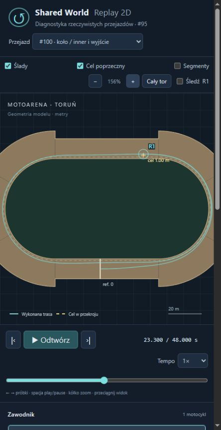

# Rear Wheel Dynamics (#100)

**PROVISIONAL — A: powtarzalny eksperyment dynamiki koła i sprzężenia sił. Bez potwierdzenia empirycznej charakterystyki prawdziwej opony.** Baza #99 `d504e3d252216eef0393d2ea2df2c0f64c7a6b87`, gałąź `experiment/rear-wheel-dynamics`, Draft bez merge. Nowe wymagania zastąpiły rozpoczęty eksperyment H1/H2; tamte warianty nie wchodzą do PR.

## Wynik

Koło buksuje wskutek momentu i własnej bezwładności. Przymknięcie gazu ogranicza κ oraz odzyskuje część tylnej siły bocznej. W podstawowym porównaniu nie powoduje to większego wynoszenia na wyjściu ani zmiany zwycięzcy. Motocykl wcześniej traci nieco prędkości, a zachowany regulator i przód utrzymują ciasny plan. Nie dopasowywano parametrów, żeby wygrała zewnętrzna linia.

## Równania, parametry i znaczenie

[Konfiguracja zapisana przed pomiarami](rear-wheel-dynamics/configuration.json). Wszystkie parametry są jawnie PROVISIONAL. R=0,33 m, Iw=0,9 kg·m², rear share=0,60, front share=0,40, κ-scale=0,10, regularizacja prędkości=0,5 m/s, minimalna relaksacja kontaktu=0,03 s, lepki opór łożyska=0,02 N·m·s. R jest założonym promieniem efektywnym; Iw odpowiada cienkiemu pierścieniowi 8,26 kg przy tym R, a nie zmierzonemu kołu żużlowemu. Nie dodajemy tej masy do niezmienionej masy Box2D. Podział 40/60 zastępuje stałe obciążenia; nie ma transferu obciążenia.

```text
Iw * dω/dt = Tdrive − Fx*R − c*ω
κ = (R*ω − u) / sqrt(u² + u0²)              [bezwymiarowe]
B = m * safe² / radius                     [N, ten sam odziedziczony budżet]
Br = 0.6*B; Bf = 0.4*B
δy² = 0.12²*(u²+0.5²) + (B/m*0.03)²        [niezmienione #97]
A = R²/Iw + 1/m                            [1/kg]
δx² = 0.10²*(u²+0.5²) + (Br*A*0.03)²
a = (R*ω − u)/δx; b = w/δy
Fx = Br*a/sqrt(1+a²+b²)
Fy,rear = −Br*b/sqrt(1+a²+b²)
Fy,front = −Bf*w/sqrt(w²+δy²)
Fy = Fy,front + Fy,rear
```

Przód nie zależy od κ. Siły obu wkładów są przyłożone do COM, z zachowaniem istniejącego skutecznego aktuatora yaw; nie udajemy dwóch fizycznych punktów styku. Każdy wkład zużywa tylko swoją część budżetu. Norma wypadkowej nie przekracza B z nierówności trójkąta, a sam tył nie przekracza Br. Fx ma znak prędkości poślizgu; −Fy·w i Fx·(Rω−u) są nieujemnymi stratami. Nie ma procentowej kary od Drive ani dodatkowej siły na zewnątrz.

δx jest efektywną podatnością kontaktu, także zabezpieczeniem sztywnego sprzężenia przy małym u: Br*A/δx ≤1/0,03s. Parametr jest stały przy krokach 5/10/20 ms, bez clampowania ω. Przy 20 m/s dominuje już częściowo składnik relaksacji, więc numerycznych wartości κ nie należy przedstawiać jako zmierzonego wheelspinu realnej opony. Model ma łagodną saturację Fx, bez gałęzi spadku po maksimum. Koło szybsze przenosi coraz większą część tylnego budżetu wzdłużnie, zmniejszając tylną Fy.

Zachowano stare reference force i jednobiegowy envelope. Available torque=R·Favailable(Rω), requested torque=R·Freference·Drive·(1−impairment), delivered torque=R·Favailable(Rω)·Drive·(1−impairment). Envelope jest próbkowane na prędkości obwodowej napędzanego koła, przez co wheelspin zmniejsza dostępny moment tego samego przełożenia. Nie ma osobnego silnika ani sprzęgła. Stare Fx jest zastąpione siłą kontaktu, nigdy dodane drugi raz.

Rozdzielenie prędkości koła, slip ratio, bocznego kąta oraz regularizacji ma odniesienie w [dokumentacji pojazdów PhysX](https://nvidia-omniverse.github.io/PhysX/physx/5.6.1/docs/Vehicles.html) i [parametrach obliczania poślizgu](https://nvidia-omniverse.github.io/PhysX/physx/latest/_api_build/structPxVehicleTireSlipParams.html). To odniesienie strukturalne, nie źródło kalibracji naszych liczb ani użycie drugiego silnika fizyki.

## Dyskretyzacja i energia

Box2D jako jedyny zmienia pozycje, prędkości i orientacje. Scalar ω należy do tego samego świata; inicjalizacja jest dokładnie uinitial/R. Najpierw ustalamy rzeczywisty interwał: istniejący UntilCurvatureChange korzysta z chwilowej siły przy granicy, bez aktualizacji ω. Dopiero dla ostatecznego h przygotowujemy kontakt i zmianę koła. Koło zatwierdzamy raz po tym samym b2World_Step. Daleko od granic nie ma dodatkowej ewaluacji. OFF zachowuje dokładnie dotychczasową kolejność działań.

Kontakt jest rozwiązywany w środku interwału z zamrożonymi zaakceptowanymi osiami. Dla ωmid=(ω0+h(T−RFx)/(2Iw))/(1+hc/(2Iw)) i umid=u0+h(Fx+Fres,forward)/(2m), smid=Rωmid−umid. Unikalne równanie skalarne z+H·Br·z/sqrt(D²+z²)=|S| ma dodatnią pochodną; maksymalnie 8 iteracji Newtona, start od stycznej w zerze. W praktyce ~kilka prostych operacji i pierwiastków, bez nowego świata, predykcji pozycji lub wywołania solvera. Do reakcji koła używamy dokładnie float Fx wysłanej do Box2D. Fx·smid≥0. Nie czytamy przyszłego stanu Box2D do wyznaczenia siły. Wyliczenie umid jest lokalną dyskretyzacją kontaktu z efektywną masą, nie zatwierdzeniem ruchu nadwozia.

Energia E=½mv²+½Ibody·yawRate²+½Iw·ω². Praca napędu=T·ωmid·h; opór koła=c·ωmid²·h. Straty wzdłużne liczymy z rzeczywistej średniej prędkości nadwozia na starych osiach; osobno zapisujemy wynik konstytutywny. Boczne straty i opory używają rzeczywistych średnich zaakceptowanych prędkości. Bilans: ΔE=Wengine−Llong−Llat−Lbearing+Wresistance+Wyaw+ε. Yaw jest ujawnioną pracą skutecznego aktuatora, a jego dotychczasowy kwadratowy guard w nowej gałęzi uwzględnia również zmianę energii koła, reakcję kontaktu i rzeczywiste h. Nie zmieniono pętli sterowania ani jej parametrów. W 12 przejazdach guard nie obcinał momentu; osobne testy aktywują ograniczenie i chronią brak energii przy Drive0.

| 3 okrążenia inner | Wengine kJ | Llong kJ | Llat kJ | Lbearing kJ | Wres kJ | Wyaw kJ | ΔEbody kJ | ΔEwheel kJ | ε J |
|---|---|---|---|---|---|---|---|---|---|
| historical | 336.220 | 0.000 | 203.601 | 0.000 | -121.870 | 0.000 | 10.750 | 0.000 | 0.565308 |
| wheel | 356.185 | 33.848 | 188.798 | 4.330 | -119.182 | 0.000 | 9.237 | 0.791 | -0.231971 |

Max |ε| w głównych przejazdach: **0.954941 J**. Max residual kontaktu po float Fx: 9.75e-09 m/s. To jawny błąd numeryczny, nie strata fizyczna. Energia koła nie jest drugi raz napędem nadwozia.

## Charakterystyka kontaktu

[Pełna siatka](rear-wheel-dynamics/contact-curves.json): B=1800 N, m=147 kg, u=0/5/20/30 m/s, α=0/15/30°, κ od −1 do 5. Poniżej u=20, α=15°, bez integracji:

| κ | Fx N | Fy,rear N | Fy,front N |
|---|---|---|---|
| 0 | 0.0 | 983.7 | 655.8 |
| 0.05 | 96.6 | 979.8 | 655.8 |
| 0.1 | 190.9 | 968.2 | 655.8 |
| 0.2 | 365.1 | 925.8 | 655.8 |
| 0.5 | 721.5 | 731.9 | 655.8 |
| 1 | 943.6 | 478.6 | 655.8 |
| 2 | 1040.4 | 263.9 | 655.8 |
| 5 | 1073.4 | 108.9 | 655.8 |

## Prosta i faktyczny wheelspin

[5 kontrolowanych prób](rear-wheel-dynamics/straight-comparison.json). Toczenie bez gazu: κ około 0,00055; nadwozie zwalnia, a małe dodatnie Fx pochodzi z tracącej energię rotacji koła. Przy starcie opóźnienie taśmy pozostaje stare. Następnie moment przyspiesza koło i kontakt jednocześnie napędza nadwozie. Brak instant resetu przy odjęciu gazu:

| próba | t s | v m/s | Rω m/s | RPM | κ | Fx N | T N·m | Ewheel J |
|---|---|---|---|---|---|---|---|---|
| launch | 0.50 | 1.730 | 13.339 | 386.0 | 6.446 | 1182.9 | 472.1 | 735.2 |
| launch | 0.75 | 3.715 | 19.029 | 550.6 | 4.086 | 1221.4 | 440.0 | 1496.3 |
| launch | 1.00 | 5.719 | 21.120 | 611.2 | 2.683 | 1221.3 | 417.7 | 1843.3 |
| launch | 1.20 | 7.310 | 21.874 | 633.0 | 1.988 | 1213.9 | 409.7 | 1977.2 |
| launch | 1.50 | 9.660 | 22.597 | 653.9 | 1.337 | 1196.0 | 402.1 | 2110.0 |
| launch | 1.90 | 12.695 | 23.547 | 681.4 | 0.854 | 1161.5 | 392.0 | 2291.1 |
| launch-cut | 0.50 | 1.730 | 13.339 | 386.0 | 6.446 | 1182.9 | 472.1 | 735.2 |
| launch-cut | 0.75 | 3.715 | 19.029 | 550.6 | 4.086 | 1221.4 | 440.0 | 1496.3 |
| launch-cut | 1.00 | 5.719 | 21.120 | 611.2 | 2.683 | 1217.7 | 167.1 | 1843.3 |
| launch-cut | 1.20 | 7.030 | 10.124 | 293.0 | 0.439 | 665.6 | 188.9 | 423.6 |
| launch-cut | 1.50 | 8.074 | 10.401 | 301.0 | 0.288 | 542.7 | 188.9 | 447.1 |
| launch-cut | 1.90 | 9.401 | 11.738 | 339.7 | 0.248 | 542.6 | 188.9 | 569.3 |
| launch-stress | 0.50 | 1.293 | 13.935 | 403.2 | 9.121 | 866.8 | 396.0 | 802.4 |
| launch-stress | 0.75 | 2.718 | 21.647 | 626.4 | 6.850 | 883.1 | 345.7 | 1936.3 |
| launch-stress | 1.00 | 4.151 | 24.957 | 722.2 | 4.976 | 885.4 | 316.2 | 2573.7 |
| launch-stress | 1.20 | 5.296 | 26.178 | 757.5 | 3.926 | 885.4 | 305.3 | 2831.9 |
| launch-stress | 1.50 | 7.005 | 27.009 | 781.6 | 2.849 | 884.0 | 297.9 | 3014.3 |
| launch-stress | 1.90 | 9.262 | 27.431 | 793.8 | 1.959 | 880.8 | 294.1 | 3109.3 |

Na Grip0,85 przy t1s κ=2,971 wobec 2,683 na Grip1. Stress Grip0,35 daje κ=4,976 przy t1s, bez ręcznej inicjalizacji buksującego koła. [Dłuższy start aż w łuk](rear-wheel-dynamics/launch-through-corner.json) dochodzi do κ=0.525 już w rzeczywistym łuku; cały motocykl pozostaje na torze (minimum 5.126 m). To dodatkowa pojedyncza kontynuacja scenariusza startowego, nie kandydat w porównaniu lotnych okrążeń.

## Gaz: identyczny zaakceptowany prefiks

[Próby przyczynowe](rear-wheel-dynamics/throttle-probes.json) i [płaska tabela](rear-wheel-dynamics/throttle-results.csv). Każdy model odtwarza własny dokładny prefiks nadwozia i koła; modele mają identyczny początek, lecz po rozbieżności dynamiki nie udajemy identycznego stanu między nimi. Wybór stanu według zamrożonej reguły cp≥0,20 i |α|≥15° daje stary t10,52 s, nowy t10,73 s. Stan wyjścia jest pierwszą zaakceptowaną prostą po pierwszym łuku. Nie przemieszczano ani nie przywracano ciał ręcznie.

Nowy model / corner, statyczne zapytanie przy h=0: Fx=320.456 N i Fy=1976.106 N dla wszystkich Drive; zmienia się tylko moment. Siły w tabeli t0 są średnimi dyskretyzacji pierwszego niezerowego interwału, więc mogą już nieznacznie różnić się od chwilowych.

| corner Drive | Δt s | κ | Fx N | Fy N | α ° | vout m/s | offset m |
|---|---|---|---|---|---|---|---|
| 0.4 | 0 | 0.2030 | 311.3 | 1978.3 | 18.91 | 0.559 | 0.075 |
| 0.4 | 0.2 | 0.1158 | 178.1 | 2003.2 | 18.97 | 0.675 | 0.198 |
| 0.4 | 0.5 | 0.0859 | 158.1 | 1939.9 | 15.15 | 0.475 | 0.375 |
| 0.4 | 1 | 0.0505 | 145.7 | 1602.7 | 7.96 | 0.069 | 0.481 |
| 0.7 | 0 | 0.2030 | 315.1 | 1977.4 | 18.91 | 0.559 | 0.075 |
| 0.7 | 0.2 | 0.1642 | 252.9 | 1990.8 | 18.94 | 0.674 | 0.198 |
| 0.7 | 0.5 | 0.1442 | 253.0 | 1942.5 | 15.93 | 0.499 | 0.378 |
| 0.7 | 1 | 0.0878 | 241.3 | 1658.4 | 8.78 | 0.134 | 0.507 |
| 1 | 0 | 0.2030 | 319.0 | 1976.5 | 18.91 | 0.559 | 0.075 |
| 1 | 0.2 | 0.2113 | 323.7 | 1975.0 | 18.90 | 0.676 | 0.198 |
| 1 | 0.5 | 0.2046 | 338.1 | 1941.0 | 16.86 | 0.536 | 0.383 |
| 1 | 1 | 0.1296 | 331.9 | 1707.3 | 9.76 | 0.204 | 0.541 |

Nowy model / exit, statyczne zapytanie przy h=0: Fx=320.553 N i Fy=791.107 N dla wszystkich Drive; zmienia się tylko moment. Siły w tabeli t0 są średnimi dyskretyzacji pierwszego niezerowego interwału, więc mogą już nieznacznie różnić się od chwilowych.

| exit Drive | Δt s | κ | Fx N | Fy N | α ° | vout m/s | offset m |
|---|---|---|---|---|---|---|---|
| 0.4 | 0 | 0.0763 | 304.8 | 792.6 | 2.85 | 1.722 | 1.410 |
| 0.4 | 0.2 | 0.0337 | 151.1 | 571.9 | 1.95 | 0.743 | 1.660 |
| 0.4 | 0.5 | 0.0322 | 149.5 | 273.1 | 0.90 | -0.124 | 1.736 |
| 0.4 | 1 | 0.0316 | 148.7 | -6.4 | -0.02 | -0.509 | 1.537 |
| 0.7 | 0 | 0.0763 | 314.5 | 791.7 | 2.85 | 1.722 | 1.410 |
| 0.7 | 0.2 | 0.0579 | 257.6 | 566.6 | 1.95 | 0.753 | 1.661 |
| 0.7 | 0.5 | 0.0548 | 254.5 | 271.7 | 0.91 | -0.109 | 1.741 |
| 0.7 | 1 | 0.0526 | 251.3 | -4.3 | -0.01 | -0.507 | 1.547 |
| 1 | 0 | 0.0763 | 324.3 | 790.7 | 2.85 | 1.722 | 1.410 |
| 1 | 0.2 | 0.0823 | 360.8 | 559.6 | 1.95 | 0.765 | 1.662 |
| 1 | 0.5 | 0.0770 | 355.4 | 270.0 | 0.91 | -0.090 | 1.747 |
| 1 | 1 | 0.0723 | 348.1 | -0.7 | -0.00 | -0.501 | 1.560 |

Niższy gaz ogranicza obrót z rzeczywistą bezwładnością; w łuku po 0,2s odzysk Fy wynosi około 28 N (1,4% całości). Po 1s różnica Fy ma przeciwny znak, ponieważ zmieniły się także α, speed i żądanie regulatora. Nie wolno tego późniejszego porównania utożsamiać z samą krzywą opony. Stary model ma identyczne Fy po natychmiastowej zmianie Drive, a późniejsze różnice pochodzą wyłącznie z ruchu i regulatora.

## Lotne okrążenia, droga i bezpieczeństwo

Tylko trzy zamrożone plany × dwa modele × dwie nawierzchnie =12 światów. Wszystkie mają identyczny stan początkowy nadwozia, neutralny profil/setup, 10ms i oryginalne landmarki. Brak selektora lub nowych kandydatów. Lotne to Lap2+Lap3; każdy wiersz obejmuje trzy rzeczywiste okrążenia. [Pełne metryki](rear-wheel-dynamics/results.csv), sześć indywidualnych łuków i prędkości wejście/środek/wyjście są w Evaluation.Corners każdego JSON.

| warunek | plan | model | lap2+3 s | droga m | vmin łuk m/s | max α ° | max κ | κ≥0,2 s | min gap in/out m |
|---|---|---|---|---|---|---|---|---|---|
| A-neutral | inner | historical | 31.198531 | 644.100 | 18.996 | 18.89 | 0.000 | 0.000 | 0.261/5.600 |
| A-neutral | middle-tighten | historical | 31.461462 | 669.294 | 19.423 | 18.90 | 0.000 | 0.000 | 2.058/5.600 |
| A-neutral | wide-tighten | historical | 32.480999 | 709.518 | 19.666 | 18.81 | 0.000 | 0.000 | 3.700/1.925 |
| B-low-grip | inner | historical | 32.053337 | 646.361 | 18.329 | 18.88 | 0.000 | 0.000 | 0.291/5.600 |
| B-low-grip | middle-tighten | historical | 32.240361 | 670.033 | 18.899 | 18.88 | 0.000 | 0.000 | 2.075/5.600 |
| B-low-grip | wide-tighten | historical | 33.261000 | 709.727 | 19.102 | 18.85 | 0.000 | 0.000 | 3.681/1.888 |
| A-neutral | inner | wheel | 31.771572 | 645.118 | 18.742 | 18.91 | 0.216 | 2.250 | 0.399/5.600 |
| A-neutral | middle-tighten | wheel | 32.082181 | 671.494 | 19.217 | 18.77 | 0.192 | 0.000 | 2.285/5.600 |
| A-neutral | wide-tighten | wheel | 33.137874 | 711.938 | 19.476 | 18.81 | 0.214 | 1.120 | 3.874/1.827 |
| B-low-grip | inner | wheel | 32.636015 | 646.746 | 18.278 | 18.90 | 0.226 | 3.480 | 0.428/5.600 |
| B-low-grip | middle-tighten | wheel | 32.894823 | 671.898 | 18.674 | 18.90 | 0.202 | 0.530 | 2.281/5.600 |
| B-low-grip | wide-tighten | wheel | 33.948324 | 712.212 | 18.906 | 18.86 | 0.221 | 1.560 | 3.866/1.787 |

Wszystkie 12 wykonalne: pełne kapsuły,≥0,05m prześwitu, brak kontaktu/upadku, budżet, energia i powtarzalność lotnych ≤0,05s. Zachowano pełną geometrię krawędzi z #99, wraz ze skokiem szerokości 4,6m i target max9,5m. Ten PR nie rozstrzyga optimum całej fizycznej szerokości toru. Jednolite obniżenie Grip1→0,85 spowalnia wszystkie trzy plany; kolejność pozostaje inner, middle-tighten, wide-tighten.

## Wyjście: ostatnie 25m łuku i pierwsze 25m prostej

Każdy `*-exits.csv` zapisuje wszystkie faktycznie zaakceptowane interwały obu okien, z X/Y, heading/travel, niezależnymi α/κ, ω/RPM, Fx/frontFy/rearFy/Fy/B, momentami obu etapów guardu, żądaniem regulatora, targetem, rzeczywistymi prześwitami i Drive. Nie jest to telemetria przerzedzona do renderowania. Wielkości sił są przy stanie przed krokiem; pozycja replay jest z rzeczywiście zaakceptowanego CSV.

| pierwsze wyjście Lap2 | vexit | vout | offset | dodatkowe wyniesienie m | |vout|≤0,1 po s | zwrot po s | boczny impuls N·s |
|---|---|---|---|---|---|---|---|
| historical | 19.448 | 1.815 | 1.156 | 0.381 | 0.457 | 0.507 | -318.26 |
| wheel | 19.158 | 1.758 | 1.337 | 0.358 | 0.438 | 0.488 | -318.10 |

Na tym wyjściu Fy to około797 N w starym i787 N w nowym modelu przy B≈2138 N; regulator żąda odpowiednio529 i537 N do wewnątrz. W początkach prostej pozostaje więc znaczny zapas siły, κ nowego koła wynosi tylko0,077, a przód wnosi321N z całkowitych787N. Boczne impulsy obu przejazdów wynoszą około−318N·s. Zmiana prędkości poprzecznej jest odtworzona sumą impulsów bocznych, napędu i oporu z błędem poniżej kilku µm/s. To siły wygaszają bezwładny ruch na zewnątrz; nie ma osobnej siły odśrodkowej na prostej.

Odpowiedź na główne pytanie jest **nie dla tych zamrożonych prób**: nowy wheelspin nie zwiększa dodatkowego poszerzenia wyjścia. Motocykl wchodzi wolniej, ma nieco mniejszy vout, a regulator nadal kompensuje różnicę; nowy offset w samym punkcie wyjścia jest o około0,181m większy. Nie jest to natychmiastowe odzyskanie kontroli: około0,49–0,51s do odwrócenia ruchu. Przód i pozostały tylny budżet wystarczają przy małym κ na wyjściu. Sama zmiana dynamiki koła nie dowodzi, że dawna przewaga kredy była błędem opony.



## Granice, kontakt i przypadki niewykonalne

[Stabilność](rear-wheel-dynamics/stability.json), [jawna klasyfikacja](rear-wheel-dynamics/stability-results.csv): 6 przypadków ×5/10/20ms. Zero, małe u, start, duża prędkość, jazda bez napędu i Grip0,35 pozostają skończone. Max κ startu około10 wynika z małego mianownika przy prawie stojącym pojeździe; nie oznacza 10× dużej prędkości jazdy. Brak clampu, resetu lub oscylacji koła; krzywe, równanie reakcji i energia mają oddzielne testy. Duża prędkość35m/s przekracza pełny obrys toru: około−0,761/−0,801/−0,892m, zachowana jako CapsuleClearance, nie uznana za bezpieczny przejazd.

[Dodatkowy stress w łuku](rear-wheel-dynamics/corner-stress.json): identyczne nadwozie przy ref65/speed25/Grip0,35, Drive1→0,4 po1s. Oba modele fizycznie wyjeżdżają poza tor (outer minimum−7,026m/−7,416m); pełne trajektorie i powody odrzucenia pozostają w CSV/JSON. To przeciążony test, nie dowód wyższości nowej opony ani wynik porównania planów. Oddzielny naturalny start do łuku daje większe κ≈0,525 i pozostaje bezpieczny; nie inicjalizowano nienaturalnego wheelspinu.

Test kontaktu ma 410 rzeczywistych interwałów po upadku. Impuls Box2D zmienia nadwozie, ω nie jest wyrównywane: następny krok oblicza nowy κ z rzeczywistych prędkości. Crashed odcina moment i kontakt opony z napędem, koło wybiega z oporem łożyska. To jawny terminalny proxy, nie pełna mechanika motocykla leżącego na torze. Każdy zawodnik zachowuje własny stan, a odwrócenie kolejności daje ten sam fingerprint.

## Koszt i walidacja

[Pomiar Release](rear-wheel-dynamics/performance.json): .NET8, tiered JIT wyłączony; 10k warmup, 5×100k ocen sił, po warmup 5 pełnych solo i istniejącego czteroosobowego D1 dla każdej flagi. Baseline to dokładna ścieżka #99-compatible w tym samym pliku wykonywalnym, z fingerprintami #99 sprawdzonymi niezależnie; nie osobna kompilacja #99. Nie interpretujemy małych różnic jako przyspieszenia.

| pomiar | koło ON | mediana | alokacje | solver calls |
|---|---|---|---|---|
| Forces | False | 0.325108 µs/call | 0 B/call | — |
| Forces | True | 0.523344 µs/call | 0 B/call | — |
| solo /3 laps | False | 35.060 ms | 9665680 B/run | 4729 |
| solo /3 laps | True | 31.726 ms | 10031168 B/run | 4815 |
| D1 /4 | False | 105.215 ms | 16760736 B/run | 6825 |
| D1 /4 | True | 110.650 ms | 17423040 B/run | 7001 |

Ocena sił rośnie około61%; całe D1 około5,2%, przy około2,6% większej liczbie kroków potrzebnych do wolniejszego ukończenia tych samych4okrążeń. Solo w tym pomiarze wychodzi szybciej o~9,5%; rozrzut i kolejność pomiarów nie uzasadniają deklaracji przyspieszenia. Nowa fizyka nie dodaje stałej liczby substepów/wywołań Box2D: solver calls zmieniają się wraz z czasem jazdy oraz istniejącymi partycjami. D1 ma165 dodatkowych ocen przy granicach na7001kroków, bez dodatkowego solvera. Alokacje w Forces=0B zarówno historycznie, jak i z kołem; przyrost pamięci świata pochodzi z dłuższego wykonania, dodatkowych hashy/snapshotów i niewielkiego stanu per rider.

Główne 12 światów: 1168.8ms przechwytywania +1057.3ms analizy, 59078 solver calls i59208 ocen sił. Osobno12 krótkich prób gazu,5 prostych,18 granicznych,1 kontakt/upadek,2 przeciążone łuki i1 start do łuku. Jeden pilot przed porównaniem. Eksporty odmawiają nadpisania; replay/raport używają już policzonych stanów. Bez pełnych historycznych audytów lub wyszukiwania linii.

**44/44 celowanych Release**, 8/8 Node; warnings-as-errors bez ostrzeżeń i błędów. Testy chronią dokładne OFF/ON #97–#99, 11 nowych przypadków wheel dynamics, współdzielony budżet, dysypację, prawdziwy wheelspin, brak podwójnego napędu, identyczny prefiks, 5/10/20ms, granicę skracającą krok, kontakt/upadek, powtarzalność, prawdziwy wyjazd poza tor i0B. Manifesty historyczne: {'autonomous-racing-line': 34, 'slip-coupled-dynamics': 63, 'slip-control-validation': 42, 'physics-driven-racing-line': 21}. Standardowe Draft Windows CI uruchamiane na końcowym HEAD; link i faktyczny status w PR/finalnym dostarczeniu. [Walidacja](rear-wheel-dynamics/validation.json).

Korekta samej diagnostyki: podczas taśmy nie ma obserwacji yaw/inertia. Pierwszy kolektor dzielił w nieużywanym maksimum guardu przez0; oznaczono te pomocnicze agregaty jako null i poprawiono kolektor. [Dokładne hashe korekty](rear-wheel-dynamics/diagnostic-correction.json). Żadna pozycja, ω, siła, praca lub główny bilans nie zmieniły się; nie powtarzano fizyki. Pełne główne przejazdy i testy aktywnego guardu są poprawne.

## Replay i odtworzenie

Istniejący viewer #96 ma tylko dodatkowe pozycje w katalogu, bez nowego renderera lub paneli. Body CSV/JSON pozostają kompatybilne; niezależna telemetria koła jest w Telemetry oraz pełnych `*-trace.csv`/`*-exits.csv`. Wybierz #100 stary/inner, koło/inner i wyjście, szeroki, wheelspin/start lub wheelspin/łuk. Sprawdzono nowy przejazd w przeglądarce, ustawienie czasu, skalę i rzeczywistą pozycję; Node sprawdza każdy zapisany punkt wszystkich5replayów.

```powershell
dotnet restore SpeedwayManager.sln
dotnet build SpeedwayManager.sln -c Release --no-restore --warnaserror
dotnet run --project tools/shared-world-speedway -c Release --no-build -- rear-wheel NEW freeze
dotnet run --project tools/shared-world-speedway -c Release --no-build -- rear-wheel NEW measure
dotnet run --project tools/shared-world-speedway -c Release --no-build -- rear-wheel NEW stability
dotnet run --project tools/shared-world-speedway -c Release --no-build -- rear-wheel NEW stress
dotnet run --project tools/shared-world-speedway -c Release --no-build -- rear-wheel NEW launch-corner
$env:DOTNET_TieredCompilation='0'
dotnet run --project tools/shared-world-speedway -c Release --no-build -- rear-wheel NEW benchmark
node --test tools/replay-viewer/replay.test.mjs
python -m http.server 8766 --bind 127.0.0.1
```

Otwórz [istniejący viewer](../../tools/replay-viewer/index.html) przez HTTP. Skrypt rear-wheel-report.py czyta tylko zapisane dowody, sprawdza historyczne hashe i generuje tabele/raport; nie uruchamia ruchu ani dobierania parametrów.

## Osiem odpowiedzi i jeden następny PR

1. **Czy występuje rzeczywisty wheelspin?** Tak: ω jest niezależne, równanie momentów zamyka się w każdym zaakceptowanym kroku; na lotnych inner κmax≈0,216, na starcie do łuku≈0,525.
2. **Czy gaz może odebrać tylną Fy?** Tak po zmianie ω/κ w czasie; w identycznym stanie h0 nie ma niefizycznego natychmiastowego osłabienia. Przód pozostaje niezależny od κ.
3. **Czy wyjście naturalnie poszerza się bardziej?** Nie w głównej serii. Dodatkowe poszerzenie inner spada0,381→0,358m; offset samego wyjścia rośnie1,156→1,337m, prędkość jest mniejsza.
4. **Czy nadal można trzymać ciasny łuk na pełnym gazie?** Tak w tym modelu i obecnej geometrii. Przód, zachowany regulator i umiarkowany κ wystarczają; nowy stan nie wymusza zewnętrznej linii.
5. **Co ze speed?** Pierwszy łuk Lap2 inner: entry23,753→23,149m/s, minimum18,996→18,742, exit19,448→19,158.
6. **Przewaga inner?** W neutralnych dwóch lotnych nad wide-tighten rośnie1,282→1,366s; nad middle-tighten0,263→0,311s. Niższy grip nie zmienia kolejności.
7. **Czy przymknięcie odzyskuje grip?** Tak: w stanie łuku po0,2s κ0,211→0,116, Fy1975→2003N; nie gwarantuje to szybszego całego obiegu. Po starcie Drive1→0,4 redukuje κ2,683 do0,439 po0,2s bez resetu ω.
8. **Czy uproszczenie wystarczy?** Tak do dalszych przyczynowych testów gazu i trajektorii, przy fladze OFF. Nie wystarczy do deklaracji realizmu ilościowego bez danych o oponie i obciążeniu osi. Brak silnika, sprzęgła, transferu obciążenia, przechyłu3D, dwóch punktów styku i ich naturalnego yaw ogranicza wnioski.

**Jeden następny PR: referencyjne pomiary i kalibracja charakterystyki κ–Fx/Fy tylnego kontaktu przy ustalonym obciążeniu.** Najpierw zweryfikować skalę poślizgu i sił oraz wpływ jawnej relaksacji30ms. Wyniki nie uzasadniają teraz strojenia do zwycięstwa bandy ani równoczesnej przebudowy geometrii, AI i silnika. Domyślna flaga pozostaje false.
