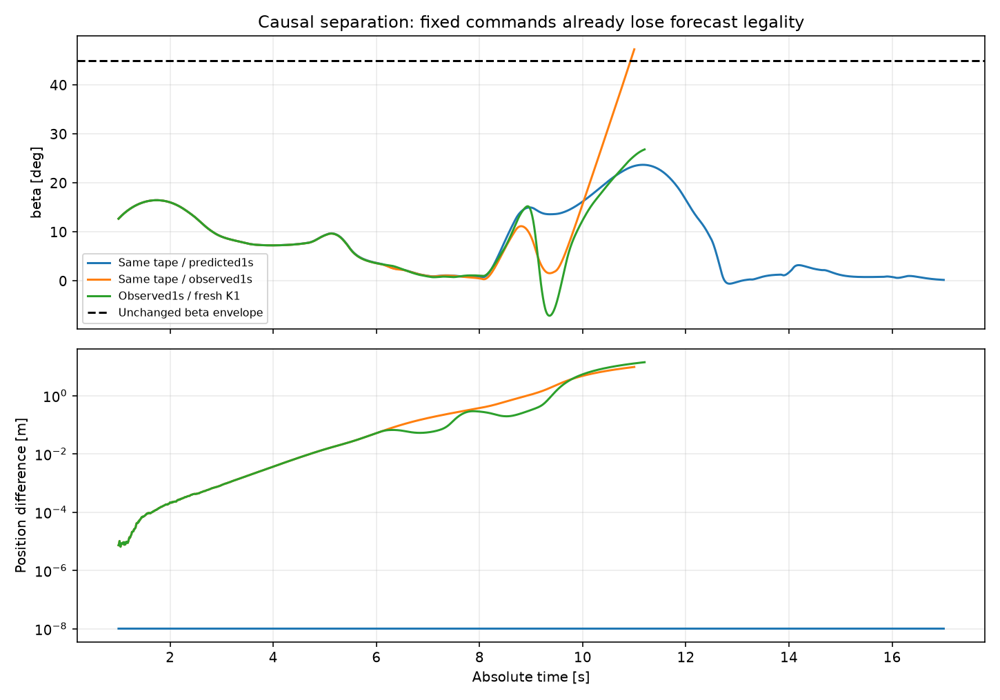
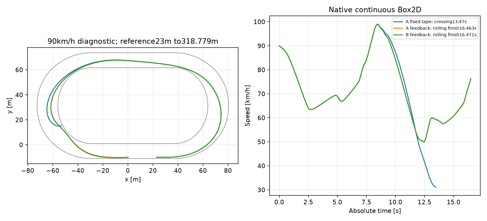
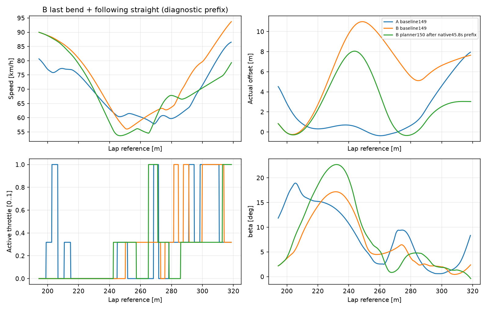
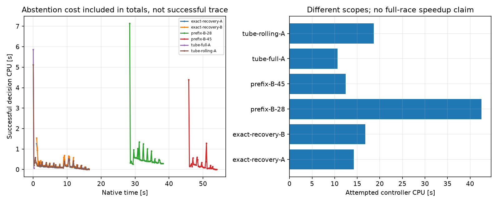

# Badanie #150 — Robust Autonomous Racing Planner

**PARTIAL.** Odzyskano dokładny przypadek odmowy po1,0s na obu modelach, lecz nowy sterownik nie ukończył trzech okrążeń ze startu. Pełna próba A odmówiła po0,4s; pełnej próby B nie uruchomiono po niepowodzeniu bramek. Wszystkie nowe algorytmy pozostają OFF. Baza: PR148, `8aedd292bda2de5742952f4ddc280f873f5a517c`; Draft PR149, bez merge.

## 1. Przyczyna odmowy starego planera

Rozdzielono fizykę A i B od nazw kontrfaktycznych A–E. Oryginalny pełny plan z0,8s odtworzono punkt po punkcie. Przesunięcie tego samego planu do jego **przewidywanego** stanu1,0s pozostaje legalne. Przesunięcie do **rzeczywiście zaobserwowanego** stanu1,0s z identycznymi przyszłymi komendami traci legalność. Kolejka jest identyczna. W tym przypadku nowy ogon K1 nie jest przyczyną: nie zmieniła się ani jedna komenda przed utratą legalności.

| Model | Kontrfaktyczny plan | Legalny | Pierwsza inna komenda s | Pierwszy odrzucony punkt s | β max ° | Powód |
|---|---|---|---|---|---|---|
| A | A-original-fixed | True | N/D | N/D | 23.699 | legal complete forecast |
| A | B-predicted-shift-fixed | True | N/D | N/D | 23.699 | legal complete forecast |
| A | C-observed-shift-fixed | False | N/D | 10.930 | 47.275 | beta45 envelope |
| A | D-fresh-K1 | False | 5.800 | 11.120 | 26.842 | footprint reserve |
| A | D-observed-shift-append-K1 | False | N/D | 10.930 | 47.275 | beta45 envelope |
| A | E-crank-1 | True | N/D | N/D | 23.700 | legal complete forecast |
| A | E-heading--1 | False | N/D | 9.360 | 26.142 | footprint reserve |
| A | E-heading-1 | False | N/D | 10.870 | 49.507 | beta45 envelope |
| A | E-wheel-1 | True | N/D | N/D | 23.708 | legal complete forecast |
| B | A-original-fixed | True | N/D | N/D | 23.699 | legal complete forecast |
| B | B-predicted-shift-fixed | True | N/D | N/D | 23.699 | legal complete forecast |
| B | C-observed-shift-fixed | False | N/D | 10.930 | 47.277 | beta45 envelope |
| B | D-fresh-K1 | False | 5.800 | 11.120 | 26.852 | footprint reserve |
| B | D-observed-shift-append-K1 | False | N/D | 10.930 | 47.277 | beta45 envelope |
| B | E-crank-1 | True | N/D | N/D | 23.700 | legal complete forecast |
| B | E-heading--1 | False | N/D | 9.360 | 26.142 | footprint reserve |
| B | E-heading-1 | False | N/D | 10.870 | 49.507 | beta45 envelope |
| B | E-wheel-1 | True | N/D | N/D | 23.702 | legal complete forecast |

Dla identycznej taśmy błąd XY przekracza1mm po3,11s, a β przekracza45° po10,93s. Zmiana samego headingu o wcześniej zmierzony błąd daje odrzucenie po10,87s, znak przeciwny narusza rezerwę obrysu po9,36s. Same wheel/crank pozostają legalne. Skutki pozycji/prędkości zależą od znaku i modelu: pełne rozbicie E zapisano w `diagnosis-safe/` i `analysis.json`. Nie jest to dowód chaosu rzeczywistego motocykla. To dowód wrażliwości długiej otwartej prognozy na wektor błędu obserwacja–predyktor oraz dyskretną integrację. Różnica7,9µm sama nie wystarcza do przypisania winy fizyce.

Świeżo regenerowany K1 zmienia komendę dopiero po5,8s (krok24 po1s): skręt0,5° zamiast0°, ten sam gaz częściowy. To osobna gałąź dyskretna. Dopisanie K1 za pełną taśmą nic nie zmienia, ponieważ odrzucenie występuje przed końcem taśmy. Natywne wykonanie stałej taśmy, bez regenerowania K1, przekracza obrys po13,47s(A)/13,48s(B), przy β≈30,24°. Różne momenty i mechanizmy odrzucenia prognozy oraz natywnego świata potwierdzają ograniczenie długiego certyfikatu modelowego. Natywny przebieg zachowuje pełny prefiks i kolejkę. Pierwszą przerwaną próbę diagnostyczną oraz jej koszt zachowano; raw `diagnosis-summary.json` porównywał A z B indeksem z przesunięciem0,2s. W tabeli użyto poprawnego wyrównania po absolutnym czasie w `analyze150.py`.

## 2. Zaimplementowany eksperyment

Ograniczone deterministyczne wyszukiwanie dwóch poziomów: maksymalnie36 pełnych kandydatów, po dwa lokalne edity, każdy do dwóch kolejnych decyzji, rozdzielone między bieżący stan, przyszłe przejścia geometrii i okolice pierwszego ryzyka. Każdy edit łączy gaz i skręt; kąty obejmują oryginalną siatkę i ogólną regułę środków sąsiednich kątów. Dopuszczono do trzech różnych pełnych planów, bez wymogu posiadania trzech, oraz próg0,02s przy zachowaniu bezpiecznego incumbenta. Tani optymistyczny dolny limit czasu korzysta z niezmienionego limitu siły i geometrii; pruningi są jawne. Nie ma losowania, CEM, premii za prędkość ani kary za szerokość.

Kryterium to czas do tego samego przekroju geometrycznego za łukiem; legalność obejmuje kolejny manewr. Propagacja zachowuje istniejący silnik, sprzęgło, wheel state, opony, Box2D, geometrię, limit zmiany skrętu, decyzje0,2s i prawdziwe opóźnienie0,24s. Drugi niezależny replay całego wybranego kontraktu pomija cache fizyki i lokalnych pochodnych.

Sprzężenie zwrotne śledzi trajektorię powstałą z własnej poprzedniej prognozy. Lokalna odpowiedź yaw jest obliczana zapytaniami niezmienionego modelu kontaktu; stała czasowa0,88s wynika z2×(0,24+0,2). To wybór konstrukcyjny, nie wyznaczona optymalna waga. Gaz bazowej polityki zachowano; przestrzeń propozycji obejmuje także edity gazu. Dwa skończone scenariusze błędu to ±skorelowany **uprzednio zmierzony** wektor1review; plik kalibracji zawiera wyłącznie delty, bez absolutnych przyszłych stanów/komend. Skala przy małej prędkości wynika z regularizacji wheel modelu. Nie stanowi to globalnie skalibrowanego przedziału odporności.

## Tabela A — odporność i konkretne blokady

| Stan | Stary / pochodzenie | Nowy wynik | Nominalne/odporne | Checkpoint ref m | β max ° | Sweep m | CPU s |
|---|---|---|---|---|---|---|---|
| A / dokładny1,0s | stary: abstain1,0s | lokalny koniec 16.463s | 1/1 | 318.932 | 23.686 | 0.235 | 14.250 |
| B / dokładny1,0s | stary: abstain1,0s | lokalny koniec 16.471s | 1/1 | 318.969 | 23.609 | 0.191 | 16.812 |
| A /22,6s | stary repair/retain | prognoza 6.661s | 1/1 | 672.465 | 29.958 | 0.112 | 1.406 |
| B /22,6s | stary repair/retain | prognoza 6.830s | 1/1 | 673.322 | 18.398 | 0.084 | 0.641 |
| A-12.8 | własny stan native149 | certyfikat / bez nowego świata | 3/3 | 514.041 | 17.956 | 0.100 | 3.984 |
| A-28.4 | własny stan native149 | STUDY150_ABSTAIN: abstain: no robust complete continuation | 1/0 | N/D (odrzucony) | 29.463 | 0.123 | 6.000 |
| B-28.4 | własny stan native149 | certyfikat / bez nowego świata | 1/1 | 832.526 | 29.334 | 0.081 | 5.625 |
| B-39.4 | własny stan native149 | certyfikat / bez nowego świata | 1/1 | 959.799 | 17.172 | 0.123 | 4.688 |
| B-45.8 | własny stan native149 | certyfikat / bez nowego świata | 7/7 | 959.298 | 22.697 | 0.116 | 2.641 |
| robust150-prefix-B-28 | natywny prefiks | technical invariant: STUDY150_ABSTAIN: abstain: no robust complete continuation / 38.400s | 4/0 | 669.623 | 23.871 | 0.118 | 42.547 |
| robust150-prefix-B-45 | natywny prefiks | completed / 54.130s | ostatni: True | 956.521 | 23.872 | 0.115 | 12.453 |
| robust150-tube-full-A | start0 | technical invariant: STUDY150_ABSTAIN: abstain: no robust complete continuation / 0.400s | 3/0 | 0.065 | 0.000 | 4.095 | 10.625 |

Checkpoint w natywnym wierszu oznacza najdalszy rzeczywiście zaakceptowany legalny stan. W odrzuconej prognozie koniec nie jest legalnym checkpointem. Pełne początki i wszystkie odrzucenia są zapisane; tabela nie zamienia końca nielegalnej prognozy w dowód osiągalności. Wybrane plany odrzucano z powodów footprint reserve, beta45, reverse motion i braku certyfikatu sweep. Rozkład wszystkich przyczyn oraz nominalne i odporne zbiory są w `analysis.json.plan_audits`. Na0,4s istnieją trzy nominalne legalne kontynuacje, ale zero odpornych. Odrzucenie dotyczy odległego obrysu; obserwowany motocykl nadal ma4,099m zapasu. Audyt kolejnej obserwacji przesunął błędy do przewidywanego następnego stanu, zachował niezmienną kolejkę i sprawdził alternatywę retained/fresh: żaden korzeń nie pokrywa wszystkich skończonych scenariuszy. Nie dowodzi to fizycznego braku bezpiecznego sterowania poza badaną klasą polityk.

Odzyskanie dokładnego1s wykorzystuje własny poprzedni plan0,8s jako diagnostyczną historię. Nie podano właściwego skrętu ani chwili przełączenia. Oba modele są bez kontaktów i naruszeń obrysu. Odcinek zaczyna się w ruchu90km/h przy23m i kończy na pierwszym przekroczeniu318,779m: 295,779m referencji, nie pełny bieg. Dodatkowa świeża próba rollingA ukończyła16,429048s. Nie przetestowano powtórzenia każdego nowego świata; sparowane A/B i333 dokładne replays sprawdzają kontrakty, nie zastępują powtarzalności natywnego pełnego biegu.

## 3. Spójność, błędy prognozy i negatywne hipotezy

Wszystkie333 wybrane kompletne kontrakty odtworzono bez cache: pełne sekwencje komend są dokładnie identyczne i nominalnie legalne. Przy każdym wykonaniu pierwsza komenda zgadza się z wybranym kontraktem, a pending queue została porównana z natywną historią i opóźnieniem0,24s. Zmiana wartości komendy przy tym samym kontrakcie jest jawną reakcją sprzężenia na nową obserwację; nie jest porzuceniem zapowiedzianej korekty bez oceny. Należy rozróżniać identyczność przewidywanych wartości komend od tożsamości ponownie certyfikowanej polityki sprzężenia.

| Próba | Decyzje | Ten sam kontrakt | Kotwice | Literalnie zgodna następna komenda | Max błąd XY kolejnej prognozy m |
|---|---|---|---|---|---|
| exact-recovery-A | 78 | 68 | 8 | 1/77 | 0.261397 |
| exact-recovery-B | 78 | 67 | 9 | 1/77 | 0.261357 |
| prefix-B-28 | 50 | 30 | 9 | 0/49 | 0.239348 |
| prefix-B-45 | 42 | 29 | 9 | 0/41 | 0.248817 |
| tube-full-A | 2 | 1 | 1 | 1/1 | 0.000000 |
| tube-rolling-A | 83 | 74 | 8 | 1/82 | 0.258882 |

Nie ukryto błędu: następne XY potrafi odbiegać około0,26m. Niezależny replay sprawdza model i kontrakt, nie zgodność dalekiej prognozy z Box2D. Dzienniki zawierają pełny stan przed decyzją, rankingi wszystkich alternatyw, pełne wybrane sekwencje, certyfikaty, prognozowane speed/β/yaw, czas do celu, faktyczne komendy/aktywacje i przyczyny zmiany. Przewidywany exit speed w widoku pochodzi z najbliższego zapisanego punktu0,1s; surowe kotwice mają pełną rozdzielczość.

Po pierwszej nieudanej pełnej próbie sprawdzono odrębnie wyrównanie referencji po drodze zamiast czasu, liniaryzację na faktycznym punkcie pracy wheel, oraz wspólną lokalną inwersję yaw/slip korygującą gaz i skręt. Te kontrolowane hipotezy nie uratowały0,4s i nie poprawiły pokrycia pięciu odłożonych stanów (nadal4/5). Nie uruchomiono kolejnych pełnych prób tych wariantów. Główna blokada to mało różnorodne bezpieczne przyszłe polityki i brak potwierdzonej recourse na następnej obserwacji; limit36 i K1 jako generator ogona nadal ograniczają przestrzeń. Część pożądanego problemu projektowego pozostaje nierozwiązana.

## Tabela B — pełny dystans i wszystkie sześć łuków

| Sterownik/model | Zakres | 3okr czas s | Koniec / powód | CPU sterownika s | Min sweep m |
|---|---|---|---|---|---|
| baseline149-final148 | baseline149 | 53.990 | 53.990 / completed | 83.156 | 0.106 |
| separated149-autonomous | baseline149 | 54.235 | 54.240 / completed | 107.531 | 0.118 |
| robust150-tube-full-A | full autonomous attempt | N/D | 0.400 / technical invariant: STUDY150_ABSTAIN: abstain: no robust complete continuation | 10.625 | 4.095 |
| nowyB | nie uruchomiono | N/D | nieudane bramki | N/D | N/D |

| Model / próba | Łuk | Czas s | V wej/min/wyj km/h | Droga m | Gaz0/cz/1 s | β° / yaw rad/s | Offset min/max m | Min wew/zew m | CPU s |
|---|---|---|---|---|---|---|---|---|---|
| A stary | 1.1 | 5.822 | 65.6 / 55.2 / 65.2 | 97.715 | 2.364 / 3.457 / 0.000 | 10.613 / 0.905 | -0.378 / 1.794 | 0.205 / 8.772 | 2.188 |
| A stary | 1.2 | 5.553 | 80.7 / 56.1 / 57.7 | 100.119 | 4.023 / 1.530 / 0.000 | 13.338 / 0.663 | -0.302 / 3.576 | 0.227 / 6.855 | 2.000 |
| A stary | 2.1 | 5.554 | 78.1 / 59.2 / 66.4 | 102.046 | 3.049 / 2.305 / 0.200 | 12.668 / 0.738 | -0.297 / 7.795 | 0.246 / 2.706 | 43.516 |
| A stary | 2.2 | 5.606 | 80.5 / 54.0 / 58.3 | 99.873 | 3.595 / 1.410 / 0.600 | 29.455 / 1.109 | -0.394 / 4.847 | 0.185 / 5.560 | 12.000 |
| A stary | 3.1 | 5.881 | 81.6 / 51.6 / 59.4 | 100.625 | 4.310 / 1.400 / 0.171 | 15.444 / 0.895 | -0.269 / 4.558 | 0.318 / 5.854 | 1.828 |
| A stary | 3.2 | 5.466 | 80.7 / 57.8 / 63.9 | 100.272 | 3.426 / 1.600 / 0.440 | 18.932 / 0.862 | -0.368 / 4.525 | 0.206 / 5.935 | 1.266 |
| B stary | 1.1 | 5.822 | 65.6 / 55.2 / 65.2 | 97.714 | 2.364 / 3.457 / 0.000 | 10.613 / 0.905 | -0.378 / 1.794 | 0.204 / 8.772 | 2.594 |
| B stary | 1.2 | 5.553 | 80.7 / 56.1 / 57.7 | 100.119 | 4.023 / 1.530 / 0.000 | 13.338 / 0.663 | -0.301 / 3.575 | 0.227 / 6.855 | 2.312 |
| B stary | 2.1 | 5.501 | 78.1 / 60.1 / 63.8 | 101.516 | 3.049 / 2.252 / 0.200 | 12.668 / 0.733 | -0.353 / 7.796 | 0.217 / 2.705 | 37.172 |
| B stary | 2.2 | 6.101 | 85.7 / 53.2 / 65.7 | 111.511 | 2.800 / 3.230 / 0.071 | 23.872 / 0.857 | -0.334 / 10.292 | 0.256 / 4.897 | 20.078 |
| B stary | 3.1 | 5.674 | 82.9 / 55.8 / 65.5 | 104.493 | 3.508 / 1.966 / 0.200 | 12.967 / 0.720 | -0.265 / 4.520 | 0.272 / 6.808 | 21.109 |
| B stary | 3.2 | 6.165 | 90.0 / 56.0 / 74.6 | 116.844 | 3.335 / 2.430 / 0.400 | 17.190 / 0.731 | -0.248 / 10.990 | 0.304 / 4.205 | 1.734 |
| A nowy | 1.1 | N/D | N/D / N/D / N/D | N/D | N/D / N/D / N/D | N/D / N/D | N/D / N/D | N/D / N/D | N/D |
| A nowy | 1.2 | N/D | N/D / N/D / N/D | N/D | N/D / N/D / N/D | N/D / N/D | N/D / N/D | N/D / N/D | N/D |
| A nowy | 2.1 | N/D | N/D / N/D / N/D | N/D | N/D / N/D / N/D | N/D / N/D | N/D / N/D | N/D / N/D | N/D |
| A nowy | 2.2 | N/D | N/D / N/D / N/D | N/D | N/D / N/D / N/D | N/D / N/D | N/D / N/D | N/D / N/D | N/D |
| A nowy | 3.1 | N/D | N/D / N/D / N/D | N/D | N/D / N/D / N/D | N/D / N/D | N/D / N/D | N/D / N/D | N/D |
| A nowy | 3.2 | N/D | N/D / N/D / N/D | N/D | N/D / N/D / N/D | N/D / N/D | N/D / N/D | N/D / N/D | N/D |

NowyB ma N/D dla każdego z sześciu łuków; nie ma pełnego przejazdu. CPU łuku sumuje pomiary decyzji **wewnątrz łuku**, nie obejmuje wcześniejszego planowania ani całej abstencji. Źródłem odniesienia są niezmienione pomiary149, bez ponownego świata150.

| Diagnostyka z natywnym prefiksem | Łuk | Czas s | Δ względem własnegoB s | V wej/min/wyj km/h | Droga m | Gaz0/cz/1 s | β° / yaw | CPU decyzji w łuku s |
|---|---|---|---|---|---|---|---|---|
| robust150-prefix-B-28 | 2.2 | 6.101 | 0.000048 | 85.7 / 53.2 / 65.7 | 111.516 | 2.800 / 3.230 / 0.071 | 23.871 / 0.857 | 17.828 |
| robust150-prefix-B-45 | 3.2 | 5.868 | -0.296748 | 90.0 / 53.7 / 67.7 | 107.602 | 3.535 / 1.933 / 0.400 | 22.698 / 0.792 | 6.672 |

PrefiksB45,8 kończy cały zapis po54,121619s: −0,113324s względem staregoB, ale nowy kontroler odpowiada wyłącznie za końcówkę. Łuk3.2 trwa5,868077s zamiast6,164824s (−0,296748s), droga107,602m zamiast116,844m (−9,242m), wyjście67,688 zamiast74,603km/h. Zysk w samym łuku częściowo znika na dalszym rozpędzaniu. Nie jest to poprawa pełnego autonomicznego czasu. Łuk2.2 po prefiksie28,4s pozostaje6,100897s, Δ+0,000048s.

## 4. Dlaczego B nadkłada drogi i co z ręcznym benchmarkiem

Dla2.2: A99,873m/B111,511m (+11,639m), B jest wolniejszy o0,495347s. Dla3.2: A100,272m/B116,844m (+16,573m), B wolniejszy o0,699258s. Większa prędkość wejścia i wyjścia B nie kompensuje dodatkowej drogi. Kryterium starego planera już porównuje czas do wspólnego geometrycznego celu: problemem nie jest jawna nagroda za szerokość.

Na22,6s w A odziedziczony plan traci legalność, co uruchamia naprawę i daje beam2: skręt0°/gaz częściowy, przewidywane6,728242s do wspólnego celu. W B odziedziczony plan jest legalny, więc przeszukiwanie nie jest uruchamiane: rozważono tylko jednego kandydata, skręt0,5°/gaz0, przewidywane6,829956s. Mała różnica fizyki otwiera więc odmienne **zbiory dostępnych planów**. Nowy planner rozważa obie gałęzie niezależnie od legalności incumbenta w okresowych/geometrycznych wyszukiwaniach; na22,6s oba modele certyfikują ciąg dalszy (6,660672s/6,829910s prognozy), ale brak natywnej pełnej próby potwierdzającej te czasy.

Ręczna poprawaB53,784509s korzysta z natywnego prefiksu zapisanych komendA pod fizykąB. To inne wejście niż własny autonomiczny stanB28,4s. Oryginalna siatka nie zawiera1°/gaz częściowy. Ogólne środki sąsiednich kątów w150 obejmują1° z różnicą2×10⁻⁹rad wynikającą z float; nie jest to bitowo identyczna akcja. Dodanie bliskiej komendy nie reprezentuje automatycznie całej późniejszej polityki świeżegoK1 użytej w ręcznej diagnostyce. Probe150 na **dokładnie tym samym ręcznym stanie wejścia**, bez podania akcji, odmawia: brak odpornej kompletnej kontynuacji. Nie udowodniono odzyskania benchmarku przez generator ani optymalnego rankingu. To ograniczenie klasy ogona/propozycji, a nie dowód nieosiągalności.

## 5. Koszt i profil

| Próba / zakres | CPU cały eksperyment | CPU prób wyboru | p50/p95/max s | PełneK1 | Fizyczne prognozy | Kontakty z inverse | Hity predykcji/requests |
|---|---|---|---|---|---|---|---|
| baseline149-final148 | 97.812 | 83.156 | 0.031 / 2.672 / 10.344 | 1643 | 74091 | 3552122 | 10884/83332 |
| separated149-autonomous | 123.016 | 107.531 | 0.047 / 4.484 / 7.547 | 1568 | 72714 | 3425856 | 11044/82190 |
| robust150-exact-recovery-A | 18.922 | 14.250 | 0.125 / 0.484 / 1.453 | 23 | 21217 | 505883 | 14624/35818 |
| robust150-exact-recovery-B | 21.797 | 16.812 | 0.156 / 0.625 / 1.703 | 21 | 20977 | 498617 | 15055/36011 |
| robust150-prefix-B-28 | 52.094 | 42.547 | 0.438 / 1.250 / 10.703 | 284 | 48096 | 1434373 | 10907/58719 |
| robust150-prefix-B-45 | 25.938 | 12.453 | 0.141 / 0.562 / 4.469 | 59 | 11866 | 342453 | 11609/23416 |
| robust150-tube-full-A | 10.984 | 10.625 | 4.516 / 4.516 / 6.031 | 210 | 7103 | 406758 | 3890/10783 |
| robust150-tube-rolling-A | 23.031 | 18.672 | 0.141 / 0.406 / 5.328 | 83 | 26626 | 693317 | 10371/36914 |

Mediany w surowym result obejmują wywołania wraz z abstencją. Surowy p95 używa indeksu floor((n−1)×0,95); widok udanych decyzji używa nearest-rank. Pełne sekwencje odrzuconych alternatyw zapisano dopiero w końcowym audycie22,6s; wcześniejsze dzienniki mają ich rankingi i liczbę akcji, a nie każdą odrzuconą taśmę. Koszt prób wyboru obejmuje inicjalizację, zapis planów/dziennika i końcową odmowę; koszt zwróconych decyzji jest osobno. Replays niezależne, korekty, odrzucone eksperymenty i postprocessing są w `budget.json`; nie doliczano historycznego149 jako nowego. Liczniki są rzeczywiste, trafienia cache dokładnie kluczowane stanem/kolejką/modelem. Nie zapisano zegarów CPU osobno dla każdego K1/kontaktu/beam: czasów tych nie estymujemy z liczników. Profil pokazuje rzeczywiste sumy i rozkład wywołań; brak podziału czasu wewnątrz wywołania jest ograniczeniem pomiaru.

Na dokładnym recoveryA 14,250CPU-s/15,463s nowego sterowania to około0,92 rdzenia, B około1,09. Naiwna suma czterech niezależnych zawodników to około3,7–4,4 rdzenia na te **lokalne odcinki**, z p95 rzędu0,5–0,6s przekraczającym okres decyzji0,2s. Nie uwzględnia interakcji ani gorszych stanów; pełny nowyA spędza10,625CPU-s na pierwszych0,4s. To nie jest gotowe na czterech zawodników w czasie rzeczywistym. Następny krok: causal recourse generująca różne polityki na następnym rzeczywistym stanie, dedykowane CPU timery per rola, a dopiero po pozytywnych bramkach nowy pełny bieg. Nie potrzeba dalszego strojenia mocy lub μ.

## 6. Jednoznaczne odpowiedzi

1. Stary legalny plan traci legalność po zastąpieniu przewidywanego1s rzeczywistym1s przy identycznej kolejce i identycznych przyszłych komendach; długa otwarta trajektoria wzmacnia błąd modelu/integracji.
2. Oba mechanizmy istnieją, ale odmowa odziedziczonej taśmy nie wymaga nowegoK1. Dyskretna zmiana K1 po5,8s i odmienna dostępność search przy22,6s są osobnymi przyczynami.
3. Tak lokalnie: dokładny1s A/B odzyskano autonomicznym sprzężeniem i zakończono diagnostyczny odcinek legalnie. Nie dowodzi to trzech okrążeń.
4. Częściowo: ostatni łukB po legalnym prefiksie jest krótszy/szybszy. Łuk2.2 bez poprawy, ręczny benchmark nieodnaleziony, pełny start nadal blokuje certyfikat odporności.
5. B zatrzymuje inną legalną politykę i nie otwiera naprawy, którąA uruchamia; większa prędkość nie płaci za dodatkowe11–17m.
6. Nie potwierdzono pełnej autonomicznej poprawy naA aniB. NowyA abstain0,4s, nowyB N/D. Wynik PARTIAL.
7. Koszt dokładnie zapisano dla zakresów w tabeli; brak gotowości produkcyjnej i brak pełnego kosztu nowego biegu. Potrzebne jest pokrycie recourse i profilowanie ról przed skalowaniem do czterech.

## 7. Odtwarzanie i walidacja

`tools/robust-autonomous-racing/README.md` podaje jawne flagi; ponowne eksperymenty wymagają osobnego katalogu wyników/nowej nazwy, bo istniejące próby są chronione przed nadpisaniem. `analyze150.py <unikalna-etykieta>` i `report150.py <unikalna-etykieta>` przetwarzają tylko zapisane wyniki i księgują CPU. Pełna telemetria: native gzip plus CSV.gz; decyzje: hash-chain JSONL; polityki: `plans/`; kontrfakty: `diagnosis-safe/`; pełne rankingi22,6: `critical22-*.json.gz`. Provenance przechowuje SHA surowych wyników i kanoniczne SHA niezmienionej fizyki. Pośrednie wersje algorytmu są opisane SourceHashes w result i historią commitów; pilot rolling używał query h0, dalsze próbyh0,01. Niezależny audyt odtworzył właściwą wersję polityki każdej próby.

Replay: [pełna próbaA](http://127.0.0.1:8018/tools/replay-viewer/?case=robust150&run=robust150-tube-full-A&t=0.4), [lokalne recoveryA](http://127.0.0.1:8018/tools/replay-viewer/?case=robust150&run=robust150-exact-recovery-A&t=1), [ostatni łukB po prefiksie](http://127.0.0.1:8018/tools/replay-viewer/?case=robust150&run=robust150-prefix-B-45&t=46). Domyślny nowy replay pokazuje odmowę pełnego startu. Brak wizualnej kontroli browsera: backend CUA nie inicjalizował sesji; widoki sprawdzono przez Node/HTTP, a wykresy jako PNG.

Wyniki testów i WindowsCI są osobno w `validation.json`; statusu nie wolno interpretować jako sportowego PASS. Fizykę, produkcyjne parametry i wyniki145–149 zachowano bez zmian.

Budżet końcowy (ledger z eksportem): **441.453125 CPU-s / 8 nowych światów**. Kompilacja, testy i CI są poza budżetem eksperymentów. Wszystkie rezerwacje zakończone; nie uruchamiano dalszych światów po negatywnych bramkach.
