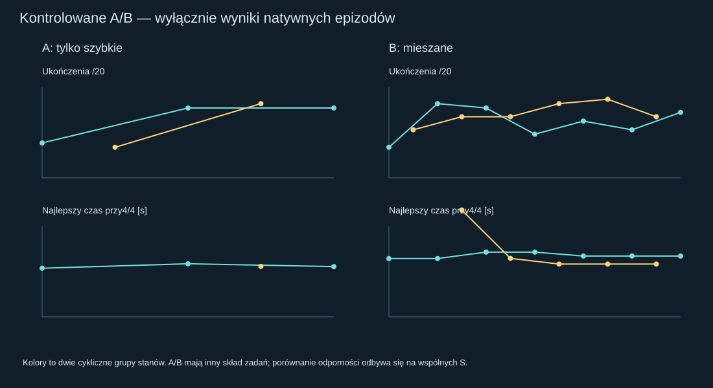
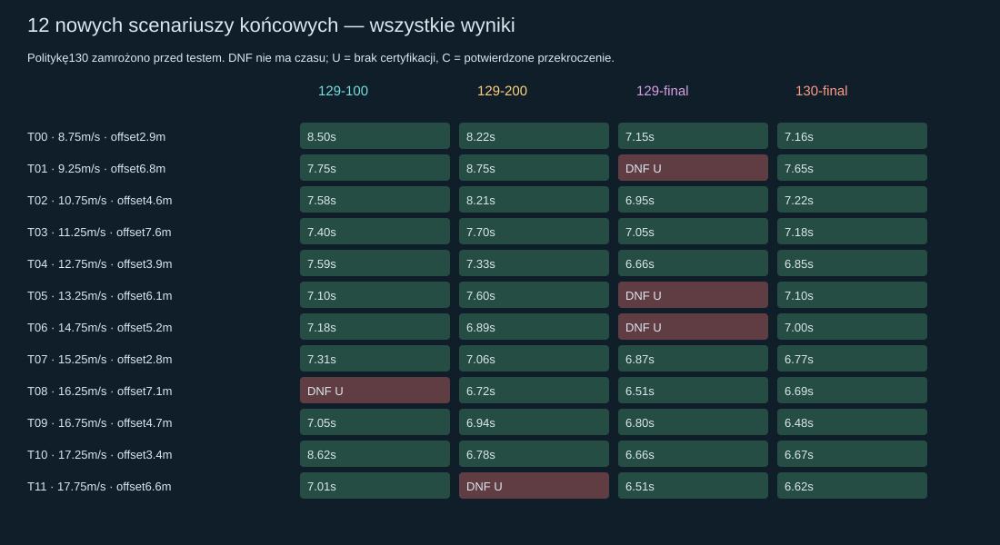
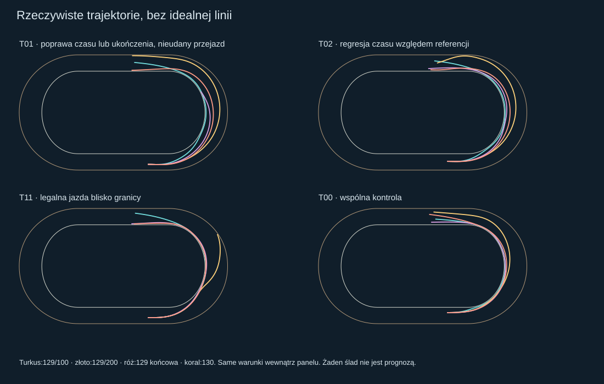

# Robust Free Racing Learning #130 — PARTIAL

**Werdykt PARTIAL:** wybrana przed testem polityka uzyskała12/12 nowych ukończeń wobec11/12 najlepszych starszych referencji. Mieszany B nie pokonał A w selekcji, a ciągła próba dwóch łuków nie została ukończona w obwiedni wiarygodności modelu. Poprawa pojedynczego łuku jest rzeczywista; pełne trwałe umiejętności nie są jeszcze wykazane.

Status **PROVISIONAL**. Jeden zawodnik, oryginalny model Box2D, tryb uczenia domyślnie OFF. Wynik odnosi się do tej płaskiej symulacji, nie jest kalibracją prawdziwego motocykla. [Draft PR #130](https://github.com/arturgladysz91/zuzel/pull/130), bez merge, baza dokładnie `9470f63a11ccc31e6c7bdb862743d11e4be053d4` (#129). Dokładny nowy HEAD i standardowy Windows CI są w opisie PR.

## 1. Czy potwierdzono zapominanie?

Potwierdzono regresję generalizacji #129: stare znane holdouty zmieniły się z3/3 po100/200 na2/3 w końcu. Nie dowodzi to samo w sobie zapominania wcześniejszych zadań treningowych: #129 po awansie nigdy ich ponownie nie mierzył. Architektura dopuszczała zapominanie, ale korelacja wag, agresywności i regresji nie jest dowodem przyczynowym. Ten eksperyment używa powracających grup i osobnych wspólnych scenariuszy selekcyjnych, aby mierzyć tę hipotezę.

Wagi końcowe161 miały Direction/Throttle/Progress na maksimum i SteeringChange na minimum. Na tym samym starym stanie9m/s, offset4m obserwujemy:

| #129 · ten sam stan9/4 | β max [°] | Droga do bramki [m] | Droga całkowita [m] | Suma zmian żądanego skrętu [°] | Zmiany ≥5° | Skrajne wagi |
|---|---:|---:|---:|---:|---:|---|
| after-100 | 6.367 | 115.370 | 134.599 | 58.500 | 3 | SteeringChangeWeight |
| after-200 | 9.016 | 120.523 | 138.746 | 34.000 | 0 | brak |
| final | 19.750 | 129.625 | 149.862 | 96.000 | 6 | DirectionWeight, ThrottleWeight, ProgressWeight, SteeringChangeWeight |

Większy uślizg i dłuższa droga współwystępują z agresywniejszymi żądaniami. Nie uznajemy samej kontry ani dużego kontrolowanego β za błąd. Suma zmian kierownicy nie jest liczbą oscylacji całej trajektorii; obie miary raportujemy osobno.

## 2. Co doprowadziło do regresji #129?

Na zapisanym DNF14/5 odtworzono dokładnie wszystkie 35 decyzji głównego regulatora0,6s. W1,0s krótki horyzont wybierał+1,5° i gaz0. Przy ocenie0,9s ta sama akcja była niepewna, z przyszłym prześwitem−0,341m; dostępne−1,5° i gaz0 było bezpieczne w horyzoncie, z przyszłym prześwitem+0,379m. To najwcześniejsza taka różnica w zadeklarowanym przeszukaniu zapisanych obserwacji, nie dowód globalnie najwcześniejszego zagrożenia.

Kontrolowany natywny eksperyment zmienił tylko tę jedną komendę, dopuścił ją po pełnych0,24s i potem wrócił do oryginalnego sprzężenia0,6s. Wynik: **6.53s**, cały obrys i1s legalnej kontynuacji. Nie była potrzebna nowa, dokładniejsza certyfikacja w żadnym kroku tego udanego przejazdu. Jest to przyczynowy dowód osiągalnej lepszej kontynuacji z tamtego stanu. Nie dowodzi, że jeden konkretny skrajny parametr wyjaśnia całą regresję na innych stanach.

Jednoparametrowe ablacjie przy1,0s, z wartościami wag po200: DirectionWeight→3.784: 1.50° / gaz0.000; ThrottleWeight→2.151: 1.50° / gaz0.000; ProgressWeight→1.548: 1.50° / gaz0.000; SteeringChangeWeight→0.014: 1.50° / gaz0.000. To wpływ lokalny; nie przedstawiamy ich jako pełnych kontrfaktycznych przejazdów. [Audyt wszystkich obserwacji](audit129.json), [koszt i wczesne ablacjie](horizon-cost.json).

## 3. Czy DNF14m/s był rzeczywistym wyjazdem?

**W6,92s: brak certyfikacji, nie potwierdzone przecięcie bandy.** Punkt miał0,086492m prześwitu, lecz stary dolny bound przedziału−0,005703m. Diagnostyczny certyfikat tuby wokół cięciwy pozy/orientacji zachował stare odliczenia geometrii i dodał0,5mm na float. Uwzględnia granicę odchylenia |a|h²/8, odpowiednik yaw i błąd integracji obrotu, wyłącznie dla izolowanego ciała pod niezmiennym wrench w oryginalnych podkrokach. Dla tego przedziału dolna granica wynosi **0.08295m**.

Mały natywny test zachował bitowo identyczny stary prefiks: **True**. Po bezpiecznie certyfikowanej kontynuacji oryginalne sterowanie doprowadziło do **potwierdzonego przekroczenia w6.94s**. Stary detektor zatrzymał próbę około20ms wcześniej, ale nie wyjaśnia to niezdolności ukończenia.

Główne A/B, selekcja i wszystkie końcowe testy nadal używają dokładnie starej konserwatywnej reguły. Nie poluzowano marginesów. Klasyfikacja rozdziela potwierdzone przekroczenie (ujemny prześwit poza dodatkowym1,6mm przedziałem niepewności), brak certyfikacji, brak bezpiecznego kandydata i wyjście poza odziedziczoną obwiednię modelu β45°. Ostatnie nie jest automatycznie dowodem realnego upadku motocykla. [Natywna diagnostyka](boundary-diagnostic.json).

## 4. Czy mieszanie zwiększyło powtarzalność?

Start obu strategii: najnowsza polityka161, wybrana jako ostatni checkpoint, bez ponownego doboru według starych holdoutów. Ten sam seed1302026, CEM, osiem zakresów, ranking,0,6s, reakcja i fizyka. Każdy kandydat dostaje cztery identyczne dla konkurentów stany. Różni się tylko skład: A cztery trudne; B dwa trudne, jeden umiarkowany, jeden utrwalający. Dwie grupy powracają co drugą generację.

Po równych100+100 próbach wspólna selekcja dała: seed **4/6**, najlepszy A **6/6**, B **6/6**. B poprawił się wobec seeda, lecz sam taki remis ukończeń A/B nie dowodzi przewagi mieszania. To jeden seed i ograniczona pula stanów; model selection na S jest oceną doboru, nie niezależnym dowodem końcowym.

| Polityka | ID | Ukończenia | Najgorszy czas przy wszystkich ukończonych [s] | Najgorszy postęp DNF [m] | Min certyfikat [m] |
|---|---:|---:|---:|---:|---:|
| A | 1020 | 6/6 | 7.680 | — | 0.107 |
| A | 1000 | 4/6 | — | 84.179 | -0.036 |
| B | 2022 | 6/6 | 8.440 | — | 0.117 |
| B | 2000 | 4/6 | — | 84.179 | -0.036 |
| seed | 0 | 4/6 | — | 84.179 | -0.036 |

## 5. Czy poprawił czas bez większej liczby niepowodzeń?

Ranking obu strategii jest identyczny: ukończenia, najgorszy legalny postęp DNF, rozkład potwierdzonych/control, najgorszy i średni czas dopiero przy wszystkich ukończeniach. Czasy w koszykach50/25ms pozwalają preferować rzeczywisty certyfikowany zapas przy podobnej szybkości, potem stan na wyjściu. Średni czas z pominięciem DNF nigdy nie jest głównym celem. Nie ma nagrody za konkretny offset ani kary za każdy skręt kontrujący.

Końcowy test wykazuje też koszt szybkości: w **6/12 przypadkach** nowa polityka jest wolniejsza o ponad0,05s od najszybszego legalnego wyniku którejś starszej referencji na tym samym przypadku. To porównanie opisowe per przypadek, nie wdrożona hybryda polityk. Pełna tabela zachowuje każdą taką regresję; poprawa ukończeń nie oznacza poprawy każdego czasu.

Surowych czasów treningowych A i B nie porównujemy jako równych zadań: ich scenariusze celowo różnią się. Wspólne S oraz T dają porównanie na tych samych warunkach. Rozszerzenie B ma większy budżet niż A, więc efekt dalszych prób nie jest czystym efektem mieszania.

## 6. Ile wykonano epizodów?

A: **100**, B: **260** natywnych epizodów treningowych. Faza równego A/B to100 na wariant; rozszerzenie B: 160. [Wszystkie generacje i kandydaci A](generations-A.json), [B](generations-B.json), [wszystkie rezerwacje i wyniki](attempts.csv).

Przed próbami zamrożono maksima: A100, B300, selekcja72, końcowy test48, diagnostyka8, dwa łuki3; razem531 światów, CPU2600s,38mln ocen kontaktu, epizod30CPU s, generacja150CPU s. Podstawa: #129 zużył1347,95CPU s i18,32mln ocen na442 światach. Bufory w rezerwacji pozostawiają czas na dokończenie diagnostyki i testów. Rezerwacja jest przed utworzeniem świata, także przy DNF. [Protokół](protocol.json).

| Wariant / generacja | Grupa cyklu | Ukończenia /20 | Najlepsza polityka | Ukończenia /4 | Najgorszy czas przy4/4 [s] | CPU generacji [s] |
|---|---:|---:|---:|---:|---:|---:|
| A/0 | 0 | 8 | 1000 | 4 | 6.690 | 42.062 |
| A/1 | 1 | 7 | 1009 | 2 | — | 56.391 |
| A/2 | 0 | 16 | 1011 | 4 | 7.300 | 73.344 |
| A/3 | 1 | 17 | 1017 | 4 | 6.940 | 74.203 |
| A/4 | 0 | 16 | 1020 | 4 | 6.910 | 67.828 |
| B/0 | 0 | 7 | 2000 | 4 | 8.020 | 47.547 |
| B/1 | 1 | 11 | 2005 | 3 | — | 64.266 |
| B/2 | 0 | 17 | 2010 | 4 | 8.020 | 77.062 |
| B/3 | 1 | 14 | 2019 | 4 | 14.680 | 71.969 |
| B/4 | 0 | 16 | 2022 | 4 | 8.900 | 83.109 |
| B/5 | 1 | 14 | 2025 | 4 | 8.040 | 73.203 |
| B/6 | 0 | 10 | 2030 | 4 | 8.900 | 66.172 |
| B/7 | 1 | 17 | 2037 | 4 | 7.260 | 77.891 |
| B/8 | 0 | 13 | 2040 | 4 | 8.360 | 65.969 |
| B/9 | 1 | 18 | 2045 | 4 | 7.260 | 72.703 |
| B/10 | 0 | 11 | 2050 | 4 | 8.360 | 56.031 |
| B/11 | 1 | 14 | 2055 | 4 | 7.260 | 66.281 |
| B/12 | 0 | 15 | 2060 | 4 | 8.360 | 70.266 |

## 7. Wybór przed niezależnym testem

B zakwalifikował się do rozszerzenia: **True**, wyłącznie według S i zamrożonej reguły. W archiwum są wszystkie polityki kandydackie i osobno niezmienne referencje40/72/161. Nie ma hybrydy przełączającej polityki według prędkości. Do finałowej selekcji weszły ostatni incumbent i najlepszy archiwalny zwycięzca powracającej grupy z każdego wariantu, plus seed jako bezpieczny fallback. Poprzednie dobre polityki nie znikają przy awansie.

Wybrano **A, ID1020**, na sześciu S, zanim uruchomiono jakikolwiek T. Liczba światów testowych przy zapisie wyboru: **0**. [Zamrożona polityka i hash](selected-policy.json), [reguła rozszerzenia](extension-decision.json), [finałowa selekcja](final-selection.json).

| Polityka | ID | Ukończenia | Najgorszy czas przy wszystkich ukończonych [s] | Najgorszy postęp DNF [m] | Min certyfikat [m] |
|---|---:|---:|---:|---:|---:|
| A | 1020 | 6/6 | 7.680 | — | 0.107 |
| A | 1000 | 4/6 | — | 84.179 | -0.036 |
| B | 2060 | 6/6 | 7.860 | — | 0.110 |
| B | 2000 | 4/6 | — | 84.179 | -0.036 |
| seed | 0 | 4/6 | — | 84.179 | -0.036 |

## 8. Nowy niezależny test

Wszystkie12 kombinacji zapisano w protokole przed nowymi światami. Nie są dokładnymi stanami treningu, selekcji ani starymi trzema holdoutami. Żaden wynik T nie zmienia CEM, progów, shortlisty, momentu zakończenia ani polityki. Stare holdouty użyto jedynie do jawnego audytu #129.

| ID | v [m/s] | Offset [m] | s [m] | v boczna [m/s] | Heading [rad] | Yaw [rad/s] |
|---|---:|---:|---:|---:|---:|---:|
| T00 | 8.750 | 2.900 | 22 | 0.080 | 0.015 | 0.020 |
| T01 | 9.250 | 6.800 | 22 | -0.120 | -0.025 | -0.015 |
| T02 | 10.750 | 4.600 | 22 | 0.150 | -0.020 | 0.025 |
| T03 | 11.250 | 7.600 | 22 | -0.180 | 0.030 | -0.020 |
| T04 | 12.750 | 3.900 | 22 | 0.100 | 0.025 | -0.030 |
| T05 | 13.250 | 6.100 | 22 | -0.080 | -0.015 | 0.020 |
| T06 | 14.750 | 5.200 | 22 | 0.160 | -0.030 | -0.015 |
| T07 | 15.250 | 2.800 | 22 | -0.120 | 0.020 | 0.030 |
| T08 | 16.250 | 7.100 | 22 | 0.180 | 0.030 | -0.020 |
| T09 | 16.750 | 4.700 | 22 | -0.100 | -0.020 | 0.025 |
| T10 | 17.250 | 3.400 | 22 | 0.140 | -0.025 | 0.015 |
| T11 | 17.750 | 6.600 | 22 | -0.150 | 0.015 | -0.025 |

| Nowy test · v / offset | #129 po100 | #129 po200 | #129 końcowa | #130 wybrana |
|---|---:|---:|---:|---:|
| T00 · 8.75 / 2.9 | 8.50s | 8.22s | 7.15s | 7.16s |
| T01 · 9.25 / 6.8 | 7.75s | 8.75s | DNF: uncertified interval | 7.65s |
| T02 · 10.75 / 4.6 | 7.58s | 8.21s | 6.95s | 7.22s |
| T03 · 11.25 / 7.6 | 7.40s | 7.70s | 7.05s | 7.18s |
| T04 · 12.75 / 3.9 | 7.59s | 7.33s | 6.66s | 6.85s |
| T05 · 13.25 / 6.1 | 7.10s | 7.60s | DNF: uncertified interval | 7.10s |
| T06 · 14.75 / 5.2 | 7.18s | 6.89s | DNF: uncertified interval | 7.00s |
| T07 · 15.25 / 2.8 | 7.31s | 7.06s | 6.87s | 6.77s |
| T08 · 16.25 / 7.1 | DNF: uncertified interval | 6.72s | 6.51s | 6.69s |
| T09 · 16.75 / 4.7 | 7.05s | 6.94s | 6.80s | 6.48s |
| T10 · 17.25 / 3.4 | 8.62s | 6.78s | 6.66s | 6.67s |
| T11 · 17.75 / 6.6 | 7.01s | DNF: uncertified interval | 6.51s | 6.62s |
| Legalne ukończenia | 11/12 | 11/12 | 9/12 | 12/12 |

## 9. Czy #129 po200 pozostaje mocnym punktem odniesienia?

Po200 uzyskał tutaj **11/12**, nowa wybrana polityka **12/12**. Najlepsza liczba ukończeń dowolnej starszej referencji: **11/12**. Regresja liczby ukończeń wobec starszej: **False**. Rekord pojedynczego czasu nie zastępuje tego porównania. Starsze40/72/161 zostały porównane, a nie ponownie wybrane według znanych dawnych holdoutów.

| Nowy końcowy test | Ukończenia | Najgorszy czas przy12/12 [s] | Najgorszy postęp DNF [m] |
|---|---:|---:|---:|
| 129-100 | 11/12 | — | 50.356 |
| 129-200 | 11/12 | — | 79.013 |
| 129-final | 9/12 | — | 60.721 |
| 130-final | 12/12 | 7.650 | — |

## 10. Dwa kolejne łuki

Warunek był zamrożony:12/12 nowych testów bez regresji ukończeń wobec starszych. Decyzja: **True** — 12/12 sealed single-bend tests, no completion regression. Jeżeli warunek nie przeszedł, nie uruchomiono kosztownego finału. Ewentualny zapis dwóch łuków jest jednym ciągłym WorldRunner, bez resetu ciała, koła, gazu, kierownicy, kontrolera i kolejki; nie ma oddzielnych trajektorii dla zakrętów. [Decyzja](two-bend-decision.json).

Rzeczywisty wynik: **control envelope**, czas epizodu10.35s, legalny postęp193.44m, maksymalneβ45.235°, minimalny certyfikowany prześwit0.1068m. Nie zaliczono bramki dwóch łuków i nie podano jej czasu. Przekroczenie obwiedniβ45° nie jest potwierdzonym uderzeniem w bandę ani dowodem rzeczywistego upadku; dalszy ruch wykracza poza przyjętą wiarygodność modelu.

## 11. Płynność i realizm w modelu

Poniżej porównanie czterech rzeczywistych przejazdów z identycznego, reprezentatywnego stanu **T01**. Dane obejmują cały epizod i1s kontroli na wyjściu; minimum v w łuku liczone jest osobno. DNF nie ma czasu bramki ani prędkości wyjścia. Prędkość wejścia różni się od prędkości początkowej, bo silnik pracuje już na dojeździe.

| Metryka · wspólny stan T01 | #129 po100 | #129 po200 | #129 końcowa | #130 |
|---|---:|---:|---:|---:|
| Legalny postęp [m] | 133.468 | 135.033 | 77.533 | 135.392 |
| Czas bramki [s] | 7.750 | 8.750 | — | 7.650 |
| Prędkość wejścia [m/s] | 12.674 | 12.718 | 13.926 | 13.948 |
| Prędkość wyjścia [m/s] | 18.048 | 19.405 | — | 18.947 |
| β max [°] | 10.570 | 7.625 | 19.171 | 10.270 |
| Droga całego epizodu [m] | 136.853 | 161.829 | 85.466 | 149.325 |
| Gaz średni [0–1] | 0.290 | 0.290 | 0.446 | 0.365 |
| Udział pełnego gazu [0–1] | 0.027 | 0.025 | 0.046 | 0.028 |
| Oscylacje ≥1m, algorytm129 | 1 | 4 | 0 | 0 |
| Min certyfikat swept [m] | 0.115 | 0.115 | -0.003 | 0.159 |
| CPU epizodu [s] | 3.422 | 4.406 | 2.156 | 3.766 |
| Minimum v w łuku [m/s] | 12.674 | 12.718 | 13.926 | 13.948 |
| Min chwilowy prześwit kreda [m] | 0.203 | 6.420 | 0.097 | 0.274 |
| Min chwilowy prześwit banda [m] | 3.707 | 0.223 | 3.641 | 3.588 |
| Maksimum |yaw| [rad/s] | 0.890 | 0.598 | 1.091 | 0.690 |
| Suma zmian żądanego skrętu [°] | 62.500 | 8.000 | 54.000 | 73.000 |
| Maksymalna zmiana żądania [°] | 10.000 | 3.000 | 13.500 | 6.500 |
| Praca silnika [J] | 56848.759 | 66997.455 | 67596.964 | 89580.718 |
| Bilans strat energii [J] | 31428.477 | 37314.575 | 46560.472 | 54951.473 |
| Maksimum siły przedniej opony [N] | 754.009 | 643.117 | 759.632 | 759.582 |
| Maksimum siły tylnej opony [N] | 938.469 | 938.469 | 967.861 | 938.785 |

Praca silnika i straty pochodzą z każdego oryginalnego RearWheelStep i bilansu energii ciała+koła, nie z animacji. Kierownica, yaw i siły są rzeczywiście zastosowane w natywnych przedziałach. Liczba dużych zmian żądania i liczba poprzecznych nawrotów nie są równoważne; naturalna zmiana szerokości przejazdu nie dowodzi zbędnego zygzakowania. Wynik nie ustanawia globalnej optymalności ani fizycznej kalibracji do prawdziwego żużla.

## 12. Viewer i dostępność danych

Uruchom z katalogu repo `python -m http.server 8012`, potem [T01](http://127.0.0.1:8012/tools/replay-viewer/?case=robust-learning&run=test-130-final-T01) · [T02](http://127.0.0.1:8012/tools/replay-viewer/?case=robust-learning&run=test-130-final-T02) · [T11](http://127.0.0.1:8012/tools/replay-viewer/?case=robust-learning&run=test-130-final-T11) · [T00](http://127.0.0.1:8012/tools/replay-viewer/?case=robust-learning&run=test-130-final-T00). [Oddzielna diagnostyka jednej komendy](http://127.0.0.1:8012/tools/replay-viewer/?case=robust-learning&run=diagnostic-one-command).

Wybór scenariusza zachowuje identyczny stan dla porównywanych polityk. Można niezależnie włączać ślady, zmieniać politykę i przewijać wspólny czas. Wszystkie XY i orientacje są zapisane natywnie. Panel i wykresy pokazują prędkość, oba gazy i skręty, β/ψ/χ, yaw, obie siły, energię, prześwity i pending. Statyczne nakładki przedstawiają całe zapisane przejazdy; żadna nie jest prognozą.

W Git znajduje się **19 wybranych replayów w jednym pliku gzip**, protokół, wszystkie metryki, generacje, archiwa, raport i hashe. Pełne **450 surowe replaye** są lokalne, nieśledzone przez Git:

`C:\Users\artur\Documents\Codex\2026-10-23\files-pasted-by-the-user-pr\work\robust-free-racing-130-raw`

[Manifest pełnych surowych danych](raw-manifest.json), [manifest plików PR](manifest.json), [indeks reprezentatywnych przejazdów](index.json). Z samego Git nie można odczytać każdego pełnego surowego zapisu. Można zweryfikować istniejący lokalny plik według SHA256 albo odtworzyć eksperyment według kodu, seeda, scenariuszy i polityk. Polityka i natywne stany są deterministyczne; CPU i skompresowane hashe z polami pomiarowymi nie muszą być identyczne na innym komputerze.

## 13. Całkowity koszt eksperymentu

**450 światów Box2D**, **1429.953s CPU**, **315,663 prognoz**, **19,415,734 ocen konstytutywnych kontaktu**, **338,182 kroków natywnych**. Krótkich prognoz nie policzono jako światów. Wliczono diagnostykę, osobne pomiary horyzontu i końcowe powtórzenie deterministyczności. Kompilacja, CI, agregacja, rendering i eksport po pomiarze epizodu są poza tą liczbąCPU; nie jest to całkowity czas pracy komputera.

Podział światów: `{'diagnostic': 5, 'offline': 0, 'selection': 36, 'test': 48, 'train-A': 100, 'train-B': 260, 'two-bends': 1}`. [Analiza](analysis.json), [rezerwacje przed każdym światem](attempts.json). Powtórzone pomiary tego samego seeda pod ID archiwum i fallbacku pozostają jawnie policzone, nie znikają z kosztu.

Koszt0,9s sprawdzono offline na tych samych35 zapisanych obserwacjach po jednym wywołaniu rozgrzewającym każdej ścieżki, w kolejności0,6s potem0,9s. Stosunek CPU0,9/0,6: **1.109**, ocen kontaktu: **1.501**. To pomiar tej konkretnej maszyny i partii, możliwe są efekty JIT/cache; nie jest to obietnica stałego kosztu produkcyjnego.

| Horyzont | Obserwacje | CPU po rozgrzaniu [s] | Oceny kontaktu | Prognozy kandydatów |
|---:|---:|---:|---:|---:|
| 0.6 | 35 | 3 | 38401 | 636 |
| 0.9 | 35 | 3.328 | 57633 | 636 |

Dokładność na27 zapisanych kontynuacjach starych trzech polityk, horyzonty0,3/0,6/0,9s: **True**. Sprawdzenie nowej zamrożonej polityki po teście: **True**. Progi bez zmian: XY0,1m; v0,2m/s; χ/β1°; kierownica1,5°; koło2rad/s; yaw0,05rad/s; optymizm prześwitu0,1m. Powtórzenie natywnego fingerprintu: **True**. [Nowe kontynuacje](post-prediction.json), [deterministyczność](determinism.json).

## 14. Ograniczenia

* Jeden seed A/B i niewielka pula selekcyjna nie dają statystycznego dowodu przyczynowego przewagi mieszania. Dalszy B ma większy budżet niż A; oddzielamy to od równych początkowych100+100.
* Końcowy test jest niezależny od doboru, ale zawiera tylko12 stanów tej samej geometrii i nawierzchni. Nie dowodzi odporności na pogodę ani inny tor.
* Główna certyfikacja nadal jest konserwatywna i może odrzucić legalny przedział. Dokładniejszy dowód zastosowano tylko w małej izolowanej diagnostyce, z jawnymi założeniami. Nie podwyższano statystyki ukończeń przez poluzowanie marginesów.
* Odziedziczona obwiednia β≤45° ogranicza wiarygodność modelu; nie jest uniwersalnym fizycznym progiem upadku. Nie dodano kary za dążenie do uślizgu ani za każdą kontrę.
* Brak dowodu globalnie optymalnej linii. Pełne surowe dane są lokalne; dostępność w Git ogranicza się do jawnie wybranego podzbioru i agregatów.
* Pierwszy audyt końcowych prognoz wybrał początek łuku z mikrokroku zdarzenia krzywizny, a dziewięć końców horyzontów nie istniało w zapisanej siatce. To brak porównywalnej próbki, nie zmierzony błąd predyktora. Zachowano [pierwszy audyt](post-prediction-initial.json) i cały jego koszt. Osobny audyt wybiera tylko początki z rzeczywistymi endpointami0,3/0,6/0,9s; nie interpoluje ich ani nie zmienia progów. [Opis korekty](post-audit-alignment.json). Nie uruchomiono ponownie światów ani treningu.
* Nie uruchomiono historycznej macierzy ani rywalizacji czterech zawodników. Wyniki i protokoły #129 pozostały bez modyfikacji.

## 15. Jeden następny eksperyment

**Porównać0,6s z0,9s na tych samych mieszanych grupach treningowych i tej samej procedurze selekcji, z nowym zamrożonym testem.** Uzasadnienie jest konkretne: dłuższy horyzont wskazał wcześniejszą osiągalną alternatywę, jedna taka komenda uratowała stary DNF w natywnym świecie, a prognozy mieszczą się w ustalonych progach. Obecne główne A/B go nie zmieniało, więc wyników sposobu treningu nie pomylono z horyzontem. Cena obliczeniowa została zmierzona powyżej; pojedynczy uratowany przypadek nie gwarantuje generalizacji.

## Odtworzenie i zabezpieczenia

`dotnet build SpeedwayManager.sln -c Release --warnaserror`, następnie z katalogu repo wywołuj `dotnet tools/shared-world-speedway/bin/Release/net8.0/shared-world-speedway.dll robust-learning NOWY_KATALOG_AGREGATÓW NOWY_KATALOG_RAW ETAP` w kolejności `freeze`, `audit`, `diagnose`, `preflight`, `train`, `select`, `test`. Nie nadpisuj zamrożonych danych. Dodatkowe narzędzie `dotnet run --project tools/robust-learning-audit -c Release -- KATALOG_AGREGATÓW KATALOG_RAW cost`, potem `post`, mierzy koszty offline, powtórzenie i zgodność nowej polityki. Agregator Python nie uruchamia symulacji.

Przed nowym treningiem przeszły33 celowane testy C#, bez ostrzeżeń w buildzie. Obejmują wspólny CEM, kohorty, brak przecieku, ranking DNF, OFF, starą reakcję i ograniczenia, budżety, legalność początkową i odtworzenie decyzji #129. Pełny standardowy Windows Draft CI i dokładny commit są w PR. [Dokładne odwracalne rozszerzenia](source-extensions.json) chronią stare działanie i domyślneOFF. Nie zmieniono sił, przyczepności, silnika, masy, bezwładności, geometrii ani aktuatora.
