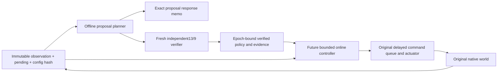

# Study162 — planning, verification and game control boundaries

PROVISIONAL, tools-only, default OFF. Base85a5ee3295c2dd983fbacb21859649f794cc5ba5.
This is an architecture proposal for game integration; the current experiment
continues to perform the full expensive decision and fresh verifier every review.

The proposal planner owns its exact response memo. Keys include all IEEE state
bits, full ordered pending, candidate gas and steering. The instance fixes rider,
geometry, surface, physics parameters and predictor version. Storage is cleared
at each review and bounded at32768 entries. Clearing changes work, never values.
This memo supplies proposals only; Runtime158's independent provider has separate
storage, propagates unique prefixes itself, compares search results and checks
all13 nodes and9 complete terminal reserves. No interface accepts a proposal
cache entry as a verified result. Physically invalid commands and exceptions are
never cached as success.

A future game controller should accept only the immutable current observation,
causal geometry/target information and a versioned offline policy hint. Its
output is a requested command, with the existing0.24s delay,0.2s review and actual
steering actuator. It must not write body poses or transplant a future tape into
the native world. Offline plans and stored evidence are hints for a new epoch;
geometry/configuration changes, a different queue or an unmatched observation
invalidate any old verification association.

A verified object must carry its exact start-state key, configuration/source
hashes, observation epoch, finite branch coverage, full reserve goals, node/tape
hashes and verifier provenance. The consumer checks these fields. A serialized
object loaded from disk is historical evidence; it is not a fresh certificate.
The finite9-branch tree also does not establish continuous-state robustness or
coverage of rivals, deforming surface or other game conditions.

The current3s-scale CPU decision cannot be marketed as an online0.2s certified
controller. A future bounded controller is **uncertified** until a corresponding
bounded verifier, deadline behavior and new matched native validation prove it.
Missing/stale coverage or a deadline miss returns ABSTAIN to the research harness;
no artificial continuation is used to hide it. Game-facing fallback behavior
requires a separately approved domain design and evidence.

## Evidence lifecycle

One ZIP per native world contains a single cross-review compressed
`policies.jsonl`, full native100Hz states, journal, result, sources and a record
index. SHA256 covers each exact compact UTF8 policy payload. ZIP CRC covers
entries; a Git-pinned external manifest covers the entire bundle. Readers verify
all layers before using data. JSON whitespace is not used as numerical identity;
full typed physical hashes and native motion fingerprints retain the original
bit-level comparisons. Old161 files and trees remain immutable.

For future studies, retain the small schema, manifest, source/configuration
references and scientific summary in Git. Place large immutable content-addressed
bundles in a durable artifact store with two replicas and documented retention;
pin SHA256/size/location in Git and test download + full reconstruction before
accepting the storage location. Short-lived CI artifacts alone are insufficient.
CAS objects may share geometry and repeated tape suffixes by hash, with explicit
ordering and immutable metadata. Never deduplicate by approximate state, rounded
coordinates, incomplete pending or a hash without checking its referenced bytes.

The present PR keeps a bounded number of bundles in Git so its new evidence has
the same durable checkout availability as the base. It avoids thousands of small
archives and measures the resulting file/byte reduction. No historical evidence
is moved or erased. Reproducibility covers domain states/actions/policy hashes;
wall time, CPU ticks and allocator/cache internals are measurements, not expected
bit-identical outputs on every machine.
