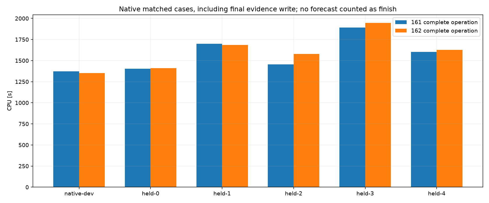
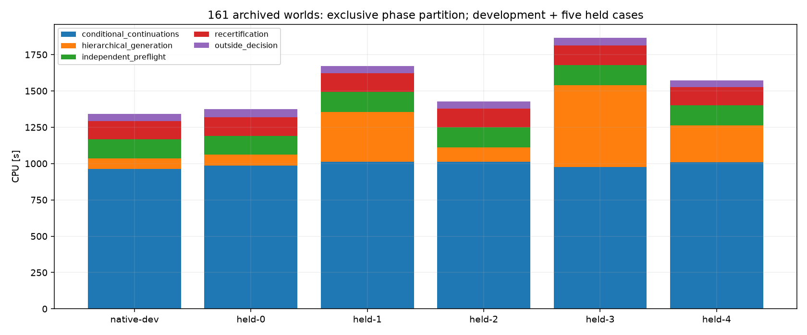
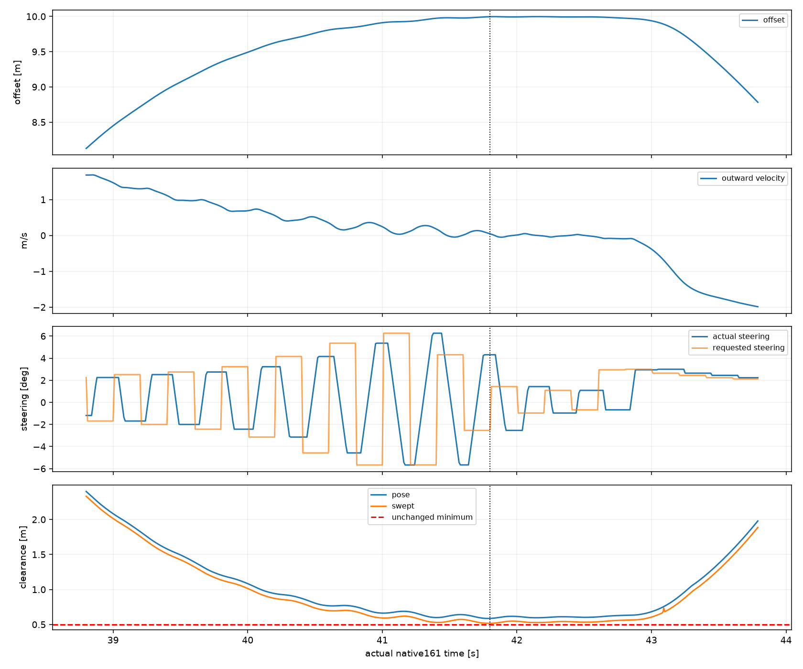
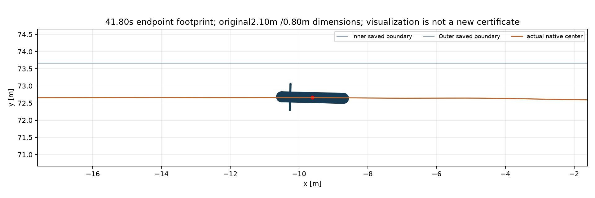

# Badanie #162 — koszt autonomii S3 i słaby margines

**Wydajność: PARTIAL. Zachowanie S3: PASS.** Dokładna baza `85a5ee3295c2dd983fbacb21859649f794cc5ba5`. PROVISIONAL, domyślnie OFF, osobny Draft PR, bez merge.

W pięciu parach suma pełnego CPU wzrosła o 2,44%, a mediana o 1,68%. Memo nie jest potwierdzoną poprawą wydajności i pozostaje eksperymentem OFF. Zachowano5/5 legalnych ukończeń i identyczne zachowanie.

## Wynik i zakres pomiaru

Odczytano sześć istniejących światów #161 bez ich ponownego uruchomienia. Nowe światy: 6, odłożone: 5/5, DNF odłożonych: 0. Mediana mety: 79,602830 s. Każdy zaakceptowany krok nowego biegu musi otrzymać świeże13/9 i niezależny preflight, po czym dodatkowo porównuje się pełny hash fizycznego review z archiwum161. Pełny fingerprint natywnej trajektorii także musi być identyczny. Archiwum służy wyłącznie asercji po podjęciu decyzji; nie dostarcza komend ani certyfikatów planera.

PASS wydajności wymaga pełnego porównywalnego natywnego S3, sukcesu i zamrożenia kodu przed pięcioma nowymi walidacjami, zachowania5/5 oraz niższej sumy i mediany CPU planera i całej operacji w tych pięciu parach. Kryteria zapisano przed nowymi wynikami odłożonymi. Pojedyncze regresje kosztu pozostają w tabeli. Jeden pomiar na deterministyczny warunek nie daje estymacji wariancji ani istotności statystycznej. Prognozy, trafienia cache i kompresja plików samodzielnie nie dają PASS.

|Próba|Status|S3 [s]|CPU161 [s]|CPU162 [s]|Zmiana [%]|Planer161 [s]|Planer162 [s]|Swept [m]|
|---|---|---|---|---|---|---|---|---|
|native-dev|S3|79,867832|1370,781|1351,750|-1,39|1342,719|1323,625|0,575523|
|held-0|S3|79,867832|1403,266|1409,656|0,46|1374,750|1380,297|0,575523|
|held-1|S3|79,183502|1700,469|1686,000|-0,85|1672,875|1658,688|0,923779|
|held-2|S3|79,602830|1455,938|1579,812|8,51|1428,766|1550,016|0,806946|
|held-3|S3|80,248174|1892,453|1945,844|2,82|1865,578|1917,922|0,517402|
|held-4|S3|79,584803|1601,562|1628,516|1,68|1574,125|1600,203|0,592945|

Pięć par, suma CPU całej operacji: 8053,688 → 8249,828 s; mediana: 1601,562 → 1628,516 s. Suma CPU samego planera: 7916,094 → 8107,125 s.

|Etap pięciu par|CPU161 [s]|CPU162 [s]|
|---|---|---|
|candidate_generation|1,328|1,484|
|causal_reserve_generation|0,594|0,938|
|conditional_continuations|4994,516|5131,203|
|hierarchical_generation|1336,109|1361,562|
|independent_preflight|680,000|683,172|
|outside_decision|253,797|259,438|
|recertification|649,438|669,062|
|uncertainty_scenarios|0,312|0,266|

Warunki pochodzą z wcześniej zdefiniowanej piątki161 i były dostępne w profilu; nowe wyniki162 są odłożone względem zamrożonego kodu, bez strojenia po ich poznaniu.

CPU całej operacji pochodzi z zakończonego budget-journal CpuSeconds w obu badaniach, obejmując końcowy zapis dowodów. W162 pole ChargedCpuSeconds w wyniku jest wcześniejszym snapshotem, przed końcową serializacją bundle; obie wartości zachowano. Planer i callback raportowane są osobno. Nowy zapis jest wydajnościową zmianą I/O, cache jest zmianą kosztu propozycji; żadna z nich nie zmienia celu sportowego.

## Gdzie kosztuje161

|Etap — partycja wyłączna|CPU sześciu światów [s]|Udział [%]|
|---|---|---|
|conditional_continuations|5956,000|64,33|
|hierarchical_generation|1411,609|15,25|
|independent_preflight|808,766|8,74|
|recertification|775,781|8,38|
|outside_decision|304,188|3,29|
|candidate_generation|1,500|0,02|
|causal_reserve_generation|0,609|0,01|
|uncertainty_scenarios|0,359|0,00|

`CpuProfile147.Phase` przełącza jedną aktywną fazę: te fazy można sumować. `Operations` jest osobną partycją i nie dodaje się jej do faz. To doprecyzowuje opis z raportu161 sugerujący zagnieżdżone czasy. Granularność zegara i narzut profilera pozostają częścią pomiaru; brak oddzielnego czasu dla każdego wywołania Response w historycznych danych.

|Próba161|Decyzje|Pełne rezerwy: liczba komend min/med/max|Manewry wygenerowane|CPU manewrów [s]|
|---|---|---|---|---|
|native-dev|400|11/91.0/146|15|75,328|
|held-0|400|11/91.0/146|15|76,000|
|held-1|396|12/90.0/148|78|340,016|
|held-2|399|11/91/147|24|97,516|
|held-3|402|11/91.0/147|129|565,047|
|held-4|398|11/91.0/146|51|255,453|

Każda komenda rezerwy obejmuje0,2 s. Łącznie zachowano 1911584 komend dziewięciu pełnych rezerw. Biegi rozwojowy i held-0 mają identyczny warunek, więc sześć profili nie oznacza sześciu niezależnych warunków.

## Powtórzenia i granica niezależności

|Próba161|Prognozy Runtime|Świeże niezależne|Search hits|Independent hits|Rollout hits|Powtórzone ID rezerw|
|---|---|---|---|---|---|---|
|native-dev|481201|320388|443631|3602|8|6|
|held-0|481201|320388|443631|3602|8|6|
|held-1|504411|314302|439474|3566|10|6|
|held-2|524887|318290|433649|3593|10|6|
|held-3|491612|323375|453842|3620|8|6|
|held-4|533250|319163|430342|3584|8|6|

W każdym świecie pierwszy review zawiera sześć powtórzeń identycznego ID rezerwy, wynikających z identycznych wczesnych obserwacji przed reakcją. Sprawdzono identyczność pełnej krotki Start + uporządkowane Actions + Goal + SafetyGoal, a nie wyłącznie ID taśmy (repeat-inputs161.json). Istniejący verification/verifiedRollouts cache już współdzieli takie wejścia wewnątrz świeżego preflightu; nie ma powodu ponownie usuwać węzłów13/9. Prawie wszystkie późniejsze dziewięć rezerw ma różne początki lub komendy. Identyczna taśma gaz–skręt z innym stanem lub pending nie jest identyczną prognozą.

Ponowne propagowanie wyniku wyszukiwania przez osobny provider jest zamierzoną recertyfikacją. Tych obliczeń nie wolno zastąpić search cache. Można współdzielić niezmienną geometrię/configuration oraz dokładne wyniki propozycji w jednym kontrolerze; świeża weryfikacja posiada własną przestrzeń cache i czas życia. Cross-review i przybliżone klucze nie są wprowadzane. Liczniki Runtime nie obejmują wszystkich predykcji propozycji ani kosztu primed prefixes; zera SearchMemo/IndependentMemo nie oznaczają braku całej fizyki lub braku nadrzędnego cache.

Osobny powtarzalny narzut widoczny w kodzie: Step/Feedback otwierają fazę CPU na każdym kroku; samo Step oznacza co najmniej 11365972 odczytów process.TotalProcessorTime przy wejściu/wyjściu scope, poza Guard. To liczba wywołań wynikająca z kodu i licznika, nie zmierzony udział CPU. Przeniesienie niezmiennej fazy na zakres całego rollout i pomijanie zagnieżdżeń tej samej fazy jest kandydatem na następny kontrolowany eksperyment. Nie zmieniano teraz instrumentacji ani twardego sprawdzania budżetu.

## Konkretna optymalizacja i kontrolowane próby

Control162.Response opakowuje identyczną oryginalną arytmetykę kontaktu dokładnym memo pełnego stanu IEEE, gazu i skrętu. Każda instancja wiąże stałą specyfikację, fizykę, nawierzchnię i geometrię. Cache jest czyszczony co review i ograniczony do32768 wpisów. Wyjątki nie tworzą wpisów. Runtime158 i pełny kod niezależnego certyfikatu pozostają oryginalne; generator nadal liczy Track, Prepare i Recover. Cztery adaptery mają mechaniczną kontrolę generacji.

|Certyfikat od zatrzymanego startu|CPU operacji [s]|CPU planera [s]|Hash fizyczny|Response request/hit/eval|
|---|---|---|---|---|
|c1-original|18,266|17,969|E712AF6B5C5D2871|oryginalny161|
|c2-response-memo|17,875|17,562|E712AF6B5C5D2871|5220/3638/1582|

Pełna diagnostyka trzech manewrów od startu do3 okrążeń i32 m rezerwy ma identyczne akcje, pełne stany i wyniki bezpieczeństwa jak istniejąca diagnostyka161. Dwa nowe certyfikaty mają ten sam pełny hash fizyczny13/9; każdy odtworzono świeżo. Mała różnica CPU tej pary nie zastępuje porównania świata.

native-dev: Response {"Requests": 1752474, "Hits": 219212, "Evaluations": 1533262, "CapacityClears": 0}; mediana callbacku 3,031 → 3,016 s.

held-0: Response {"Requests": 1752474, "Hits": 219212, "Evaluations": 1533262, "CapacityClears": 0}; mediana callbacku 3,148 → 3,141 s.

held-1: Response {"Requests": 1701408, "Hits": 199313, "Evaluations": 1502095, "CapacityClears": 0}; mediana callbacku 3,242 → 3,227 s.

held-2: Response {"Requests": 1691460, "Hits": 193648, "Evaluations": 1497812, "CapacityClears": 0}; mediana callbacku 3,375 → 3,641 s.

held-3: Response {"Requests": 1731048, "Hits": 212935, "Evaluations": 1518113, "CapacityClears": 0}; mediana callbacku 3,203 → 3,273 s.

held-4: Response {"Requests": 1645872, "Hits": 182488, "Evaluations": 1463384, "CapacityClears": 0}; mediana callbacku 3,328 → 3,375 s.

W rozwiniętym świecie nominalnym hit rate wynosi około12,5%, mimo69,7% w krótkim certyfikacie startowym. Większość stanów przyszłych ma różne wejścia; trafienia cache nie są pomiarem zaoszczędzonego CPU. Budowa pełnych kluczy i alokacje dodają pracę. Historyczne/native pary nie są naprzemiennym A/B z kontrolą rdzenia i taktowania; wpływu planisty OS oraz warunków wykonania nie odseparowano. Pełny koszt obejmuje również dodatkowe asercje zgodności i zmieniony zapis I/O. Oddzielny czas planera wyklucza zapis bundle.

## Prepare i Recover nie są darmowe ani dowiedzione jako zbędne

W natywnym root nowa generacja wybierała Track, lecz held-2 przy68,8 s zawiera zaakceptowany węzeł12/depth2/sign−1 ze źródłem Prepare. W tej generacji Track i Prepare miały remis przybycia69,2 s; rozstrzygała deterministyczna kolejność nazw. Oba były legalne, więc ten zapis nie dowodzi konieczności Prepare, ale obala utożsamianie braku komendy root z brakiem wpływu na cały certyfikat. Recover również pozostaje oceniany. Nie usunięto żadnego wariantu; nowe biegi porównują pełne wyniki wszystkich wygenerowanych manewrów z161. Nie wykonywano serii ablacji tylko dla wykorzystania limitu.

## Swept0,517402 m — dokładne miejsce i mechanizm

held-3, próbka 4186, koniec przedziału **41,80 s**, przedział 41,79–41,80 s. Okrążenie2, **prosta po trzecim łuku i przed czwartym**, segment4; referencja 495,776285 m. To nie punkt na łuku. Próbka jest końcem kroku fizycznego przed kolejną decyzją41,8 s. XY=(-9,608160, 72,659386) m; θ=3,116499200 rad (178,562251°), χ=3,138105301 rad, β=-0,021606116 rad, yaw=0,175788060 rad/s. Prędkość 13,467869 m/s, offset 9,996366 m, składowa na zewnątrz 0,046967110 m/s.

Minimum obrysu obu końców przedziału=0,586164345 m. Oryginalny bound odejmuje `(dt/2)*(maxSpeed +1.05*maxAbsYaw) +0.0005`, łącznie 0,068762432 m, dając **0,517401914 m**. Nad progiem0,5 m pozostaje tylko 17,402 mm. Minimum obrysu końców przypada na poprzednią próbkę41,79 s; endpoint41,80 s ma już nieco większy pose gap.

Sterowanie pochodziło z `endogenous primitive feedback; full physical replay`, przy ustawieniach Track. Komenda z41,4 s (skręt+0,07524982 rad, gaz0,08432508) była aktywna; komenda z41,6 s (−0,044330407 rad, gaz0,080399185) czekała do41,84 s. Pełna kolejka pozostaje w tightest161.json. Zaakceptowana nominalna prognoza41,4 s miała minimum swept0,517417144 m, a41,6 s0,517424941 m. Wąski margines był więc przewidziany i dopuszczony przez certyfikat.

Dane pokazują wcześniej nagromadzony dryf do zewnętrznej krawędzi. Feedback śledzi własną zachowaną taśmę, a selekcja wymaga legalności i czasu do celu, bez nagrody za dodatkowy zapas. Szeroki obrys kierownicy oraz odejmowany bound ruchu sprawiają, że położenie środka nie wystarcza do oceny bezpieczeństwa. Nie wykonano ablacji przypisującej cały efekt jednej korekcie. Cache zachowuje tę samą trajektorię i ten sam słaby margines; nie jest poprawką bezpieczeństwa. Zwiększenie miękkiego zapasu lub inny wybór linii zmieniałby AI i wymaga nowego budżetu walidacji.

## Architektura offline i przyszłego sterowania w grze

Planowanie propozycji i świeży verifier są oddzielnymi właścicielami danych. Wynik offline ma wersję konfiguracji, źródeł, epoki, pełnego stanu/pending, zakresu gałęzi i hashów. Przyszły bounded controller może korzystać z policy hint, lecz nie dziedziczy starego certyfikatu przy nowej obserwacji. Obecny koszt nadal przekracza review0,2 s. Uproszczony online controller pozostaje niecertyfikowaną propozycją architektury; wymaga własnych dowodów, obsługi deadline i nowych natywnych prób. Pełny kontrakt i diagram są w ARCHITECTURE.md.

## Przechowywanie dowodów

Kontrolowany, wyłącznie odczytowy test held-3: 402 osobnych archiwów →1 skonsolidowany strumień; 6876393 →6500686 bajtów (5,46% mniej). Odtworzono dokładnie 402 oryginalnych payloadów UTF8. Stare gzip-container hashes pozostają provenance, oryginalne pliki są niezmienione.

Dowody runtime sześciu światów (bez pochodnych CSV/replay/raportu): 2419 →12 plików, 81011597 →67317831 bajtów. Nowy zestaw korzysta z Git-pinned kodu i jego hashów zamiast sześciu kopii źródeł; stare kontenery pozostają niezmienione.

Nowe światy zapisują po jednym ZIP z jednym kompresowanym strumieniem policies.jsonl, pełnymi100Hz stanami, dziennikiem, wynikiem, źródłami i indeksem. Każdy payload ma SHA256 i długość, wpisy ZIP mają CRC, a cały bundle hash w manifeście Git. Nie dokładamy tysięcy małych archiwów. Docelowo duże niezmienne CAS bundles mogą trafić do trwałego magazynu z replikacją i pinami w Git; krótkotrwałe artefakty CI nie wystarczą do pełnej odtwarzalności.

## Budżet, testy i ograniczenia

|Rodzaj|Liczba|CPU pełnej operacji [s]|
|---|---|---|
|diagnostic|1|46,219|
|certificate|2|36,141|
|native|6|9601,578|

Limit3 diagnostyk i2 osobnych certyfikacji; profilowanie6 zapisanych światów uruchomiło0 nowych. Dopiero konkretna optymalizacja i pełne bramy dopuściły jeden bieg rozwojowy; pięć odłożonych wymaga jego legalnego, tańszego sukcesu i freeze. Każdy DNF lub budżet pozostaje w wyniku i zamyka kolejne starty. Nie zwiększano progów, parametrów ani liczby prób.

Testy modułowe11/11 obejmują dokładny klucz, queue/wheel/crank/steer, wyłączenie cache, invalid commands, niecacheowanie awarii i wszystkie cztery fizyczne narożniki gaz–skręt. Pełna lokalna regresja jest wykonywana raz na końcowym SHA. Końcowe potwierdzenia local/Windows CI są dostarczane poza Git i w opisie Draft PR, bez dodatkowego commitu dla identycznej walidacji.

Pozostaje koszt oryginalnych długich fizycznych prognoz, pełnych rezerw i niezależnej weryfikacji. Bezpośredni koszt Response nie był osobno mierzony w historycznych profilach; CPU przed/po jest pomiarem, a potencjalny zysk kolejnych pomysłów pozostaje hipotezą. Dalsze bezpieczne kierunki to tańsza reprezentacja dokładnych kluczy i niezmienne precomputations geometrii; adaptacyjne pomijanie manewrów lub rzadsza certyfikacja zmieniałyby zakres zachowania/dowodu i nie są wdrożone.
