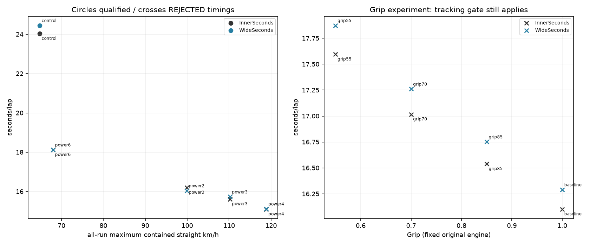
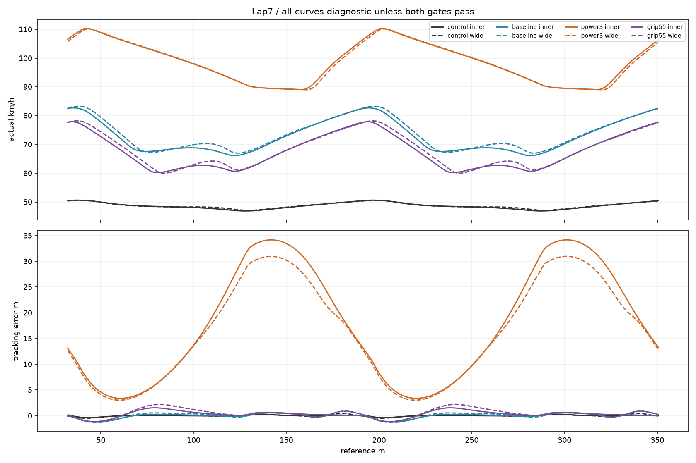
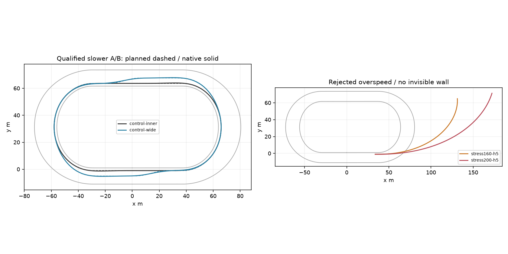
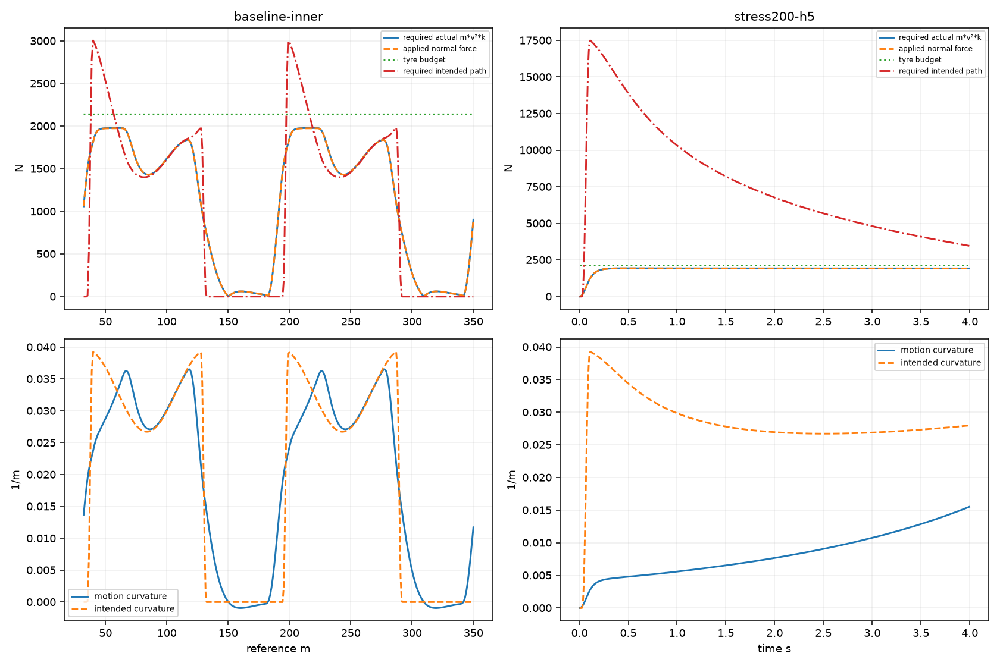
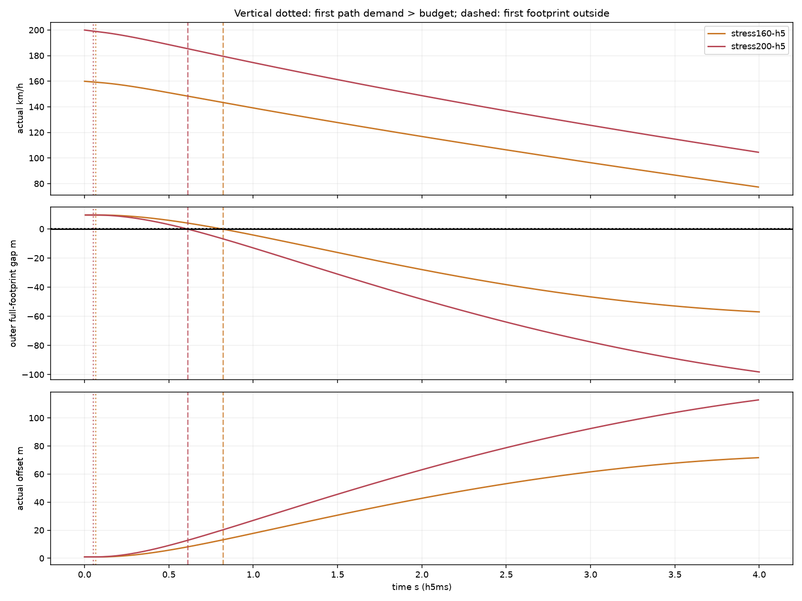

# Speed, Grip & Racing Line Crossover Experiment (#106)

**Nie wykazano poprawnego punktu przecięcia.** W zamrożonej macierzy pełnego napędu żadna para A/B nie spełnia jednocześnie trackingu, bezpieczeństwa i okresowości. Pozorna wygrana B dla power2 pochodzi z odrzuconych tras poza torem. Jedyna dopuszczona para — wolniejsza kontrola wykonalności — daje INNER przewagę **0.418283 s/lap**. Nie jest to dowód, że crossover nie istnieje przy innym, fizycznie wykonalnym sterowaniu.

**Nadmierna prędkość jest prawidłowo wynoszona.** Przy starcie 200 km/h pierwszy pełny footprint przecina bandę po około 0,61 s przy 185,48 km/h; promień rzeczywistego ruchu ≈ 202 m, planowany ≈ 30 m. Dostępna siła zakrzywia prędkość zbyt słabo, aby wykonać plan. Nie dodano siły odśrodkowej, hamulca, teleportacji, limitera prędkości ani ściany bandy.

Ocena **B**: powtarzalny audyt zależności prędkość–krzywizna–siła i poprawne odrzucenie niewykonanych linii; brak zatwierdzonej kalibracji lub crossoveru. Baza Draft #105 **3dd410254e7957b1e5d8604c82eff4b229a28d75**, zweryfikowana lokalnie i zdalnie. Jeden Draft z `experiment/speed-grip-line-crossover` do `experiment/inverse-feasibility-matched-apex`, bez merge. Produkcyjne `src/CoreSim` i dane kalibracyjne niezmienione.

## 1. Dane rzeczywiste oraz zakres wniosków

[Oficjalny przewodnik telemetrii](https://ekstraliga.pl/se/news/telemetria-w-pge-ekstralidze-przewodnik) opisuje maksima mierzone w biegu i odnotowane w testach 140 km/h **w Tarnowie**. Wskazuje też, że maksima często przypadają na wejścia w łuki. Nie publikuje numerycznej krzywej wejście/środek/wyjście dla Motoareny;140 km/h nie jest lokalnym targetem łuku tego toru.

[Oficjalny opis Motoareny](https://ekstraliga.pl/se/news/czy-podczas-pge-imme-im-zenona-plecha-padnie-nowy-rekord-toru) podaje długość 318 m i opublikowany rekord czterech okrążeń 56,50 s. Iloraz 1272/56,50 ≈ 22,513 m/s (81,048 km/h) jest średnią po nominalnej linii pomiarowej, **nie prędkością w łuku**, a rzeczywista droga motocykla może być dłuższa. Progressive-b jest wcześniejszym modelem badawczym, bez geodezyjnego potwierdzenia rzeczywistej krzywizny i nachylenia toru.

Wykorzystano istniejący `RealWorldCalibrationDataset.ParseCsv` i niezmieniony snapshot pge-v1. 5328 rekordów CleanPhysics: Vmax P10/P50/P90/P99=109.7/114.8/119.4/122.9 km/h. Dokładne, osobne selektory źródła:

- Toruń, 2025:289 clean rekordów; Vmax mediana 113,4 i P99 ≈ 119,96 km/h, flying-lap mediana 14,82 s.
- Motoarena im. Mariana Rosego, 2026:407 clean rekordów; mediana 113,7 i P99 ≈ 119,58 km/h, flying-lap mediana 14,87 s.

Są to obwiednie tego snapshotu, nie limity ani pomiary prędkości wewnątrz łuku. `curve_speed` / `speed_2s` w snapshotcie są **rankingami pól**, nie indywidualną prędkością. SHA pliku i pełne grupy zapisano w [real-evidence.json](speed-grip-line-crossover/real-evidence.json). Nie dopisano syntetycznych danych telemetrycznych.

## 2. Zamrożone A/B: pełne C3 XY

Tor: niezmienione progressive-b. A utrzymuje offset ≈ 1 m. B trzyma 1 m przez wejście i apex 50%; od apexu otwiera do 5 m przy exit+10 m, utrzymuje 5 m do exit+25 m, potem wraca do 1 m przy następnym entry−5 m. Początek pierwszego świata reference 32 m, offset 1 m,18 m/s: nie ma początkowego wyjazdu na zewnątrz przed pierwszym łukiem. Takie samo prawo path-preview i wszystkie gains dla A/B.

Rozszerzono istniejący `AuthoredRacingPath`, bez równoległego systemu geometrii. B używa źródłowego septic smoothstep `35u⁴−84u⁵+70u⁶−20u⁷`. **Całe XY**, również nad węzłami C2 reference, jest okresowym interpolantem septic Hermite: wspólne P/P′/P″/P‴ na węzłach co ≤ 1 m, stałe jet samples±0,25/0,5 m. Nie wystarczyłoby wygładzić tylko d(s), co wykazał #105. Nowe funkcje są opt-in, stare cztery rodziny oraz matched-apex #105 zachowują poprzedni rachunek i fingerprinty.

Testy sprawdzają wszystkie węzły, domknięcie, niezależne różnice XY/κ, ciągłość κ′ po długości **pełnego Q**, brak wczesnego otwarcia i pełne kapsuły przy wielu yaw. Geometryczne certyfikaty dowolnego yaw: banda minimum ≈ 4,919 m, kerb ≈ 0,923 m. Faktyczne bezpieczeństwo ocenia osobno rzeczywisty yaw/ślad.

|Plan|Długość/lap m|max abs κ /m|min R m|Geometry|
|---|---:|---:|---:|---|
|A INNER|325.061935|0.03925353|25.4754|PASS|
|B INNER CORNER / WIDE STRAIGHT|331.474354|0.04048117|24.7028|PASS|

B dodaje 6,412 m/lap. Otwarcie zmniejsza fragmenty krzywizny na wyjściu, lecz powrót na krótkiej prostej ma własny koszt krzywizny. To jedna sensowna, umiarkowana linia 5 m, nie maksymalny offset ani zoptymalizowana trasa. Wolniejsze native A/B dowodzą jej praktycznej wykonalności przy osiągniętych prędkościach, bez korekt stanu. C3 nie gwarantuje wykonalności przy dowolnym v.

## 3. Silnik, przełożenie i procedura

[freeze.json](speed-grip-line-crossover/freeze.json) powstał przed pomiarami. Macierz: oryginalny napęd oraz cztery mocniejsze konfiguracje. `TorqueScale`=2, 3, 4, 6; odpowiednie `FinalRatio`=0,9/0,8/0,7/0,6. Koło, inertia, opona, opór `40+0,20v²`, masa 147kg i regulator są zamrożone. Modyfikuje się wyłącznie engine envelope i jego fizyczne przełożenie, w narzędziowym `WorldParameters.ExperimentalDrive`, null/OFF domyślnie.

`F_available_new(v_wheel)=TorqueScale·q·F_original(q·v_wheel)`; stąd moc na wale skaluje się przez TorqueScale, a q zamienia moment na prędkość obrotową. Nadal jeden bieg, oryginalna funkcja fade i oryginalny rear contact. Delivered torque jest ograniczony envelope przy **rω**, nie przy prędkości chassis. Zwiększenie mocy nie zwiększa B ani limitu Fx. Wyjściowa siła na ciało nadal pochodzi wyłącznie z `RearWheelDynamics.Evaluate`; nie dodaje się drugiej siły silnika.

Pełny Drive 1, Grip 1,18 m/s rolling start, 8lap, nominalnie10 ms/4substeps. Te same warunki A/B. Prędkości łuków są wynikiem Box2D, nie profilem zadanym. Osiem okrążeń zamrożono przed wynikami; analizowane końcowe dwa, okresowość końcowych trzech ≤ 0,5%. Historyczne macierze nie są powtarzane.

Osobna para `control-*` używa starej równowagi prostej 18 m/s i stałego maintenance Drive ≈ 0,269187. To wymagane poprawne przykłady i konstruktywna kontrola C3, **nie zamiennik próby pełnego napędu** ani sposób przypisania wolnego wyniku silnikowi o nowej mocy.

|Konfiguracja / linia|max na zawartej fizycznie prostej km/h|max gdziekolwiek km/h|max a netto m/s²|max delivered shaft kW|max wheel slip|max utilization|yaw physical/energy clamp %|
|---|---:|---:|---:|---:|---:|---:|---:|
|baseline-inner|82.72|82.72|1.665|8.448|0.227|0.936|0.00/0.00|
|baseline-wide|83.09|83.24|1.665|8.437|0.228|0.936|0.00/0.00|
|power2-inner|98.91|98.91|3.580|17.447|0.420|0.928|0.00/0.00|
|power2-wide|99.87|99.87|3.580|17.414|0.408|0.928|0.00/0.00|
|power3-inner|109.59|110.58|4.974|26.229|0.485|0.920|0.00/0.00|
|power3-wide|110.18|110.28|4.974|26.223|0.485|0.920|0.00/0.00|
|power4-inner|118.87|123.69|5.846|34.956|0.529|0.912|0.00/0.00|
|power4-wide|118.43|123.64|5.846|34.933|0.529|0.912|0.00/0.00|
|power6-inner|67.99|134.22|6.863|52.478|0.559|0.890|0.00/0.00|
|power6-wide|67.99|134.22|6.863|52.478|0.559|0.890|0.00/0.00|

Nie osiągnięto kontrolowanego, bezpiecznego zakresu130–140 km/h. Power3 dochodzi do około 110 km/h, power4 do około 119 km/h na jeszcze zawartej fizycznie prostej, ale następne przejazdy nie wykonują zadanej linii. Power6 osiąga134 km/h **poza torem**, a jego poprawnie zawarty start ma tylko ≈ 68 km/h. Nie wolno używać134 jako Vmax poprawnego przejazdu. Źródła ograniczeń: skończona długość 62 m, niższa prędkość wyjściowa, tylny budżet Fx ≤ 0,6B, wheelspin/shaft fade, opór oraz wymaganie następnego łuku. Oryginalny baseline ma max ≈ 82,7 km/h i szczyt delivered power ≈ 8,45 kW; sam nie odtwarza obserwowanego rozkładu Vmax.

Nawet optymistyczna granica przyspieszenia prosto wynosi `0,6B/m−F_res/m`, czyli maksymalnie8,727 m/s² przed oporem przyGrip1; to konieczna górna granica, nie przewidywany profil motocykla. Wyników mocy/accel nie nazywamy pomiarem rzeczywistego silnika. Ten eksperyment rolling nie kalibruje reakcji lub0–70 km/h ze startu.

## 4. Główna tabela crossover i bramki

Pierwsze przekroczenie koniecznego `v²·abs(κ_path) > B/m` występuje przed błędem bocznym ponad 1 m w każdej parze pełnego napędu. W baseline A jest to 8,70 s wobec 8,85 s, w power3 już 0,39 s wobec 1,76 s. W tym stanie zadana linia wymaga niedostępnej siły nawet przed uwzględnieniem napędu. Yaw physical/energy clamp pozostaje 0%; nie ma dowodu, że zwiększenie momentu yaw usunie ten brak siły. To potwierdzone ograniczenie przy tym profilu prędkości; nie dowód, że każdy mniejszy błąd preview pochodzi wyłącznie z overspeed.

|Próba|pierwsze a_path>B/m s|pierwszy błąd>1 m s|max slide °|max abs Fx/Fy N|util ≥95% / demand ≥95%B, % końcowych 2 lap|
|---|---:|---:|---:|---:|---:|
|baseline-inner|8.700|8.850|18.91|365.4/1976.6|0.0/13.7|
|baseline-wide|8.800|8.940|18.91|365.3/1977.2|0.0/15.2|
|power2-inner|4.730|5.540|18.78|655.1/1926.0|0.0/62.1|
|power2-wide|4.190|5.300|18.79|649.8/1927.7|0.0/60.2|
|power3-inner|0.390|1.760|18.72|892.1/1875.5|0.0/76.9|
|power3-wide|0.390|1.760|18.72|893.8/1875.2|0.0/77.8|
|power4-inner|0.370|1.330|18.69|1035.7/1831.0|0.0/88.2|
|power4-wide|0.370|1.330|18.69|1029.0/1830.8|0.0/88.3|
|power6-inner|0.360|1.060|18.60|1139.4/1692.4|0.0/100.0|
|power6-wide|0.360|1.060|18.60|1139.4/1692.4|0.0/100.0|

Near-grip oznacza utilization ≥0,95, a demand to surowe żądanie sterowania ponad 0,95B, nie dodatkowa siła. Oryginalna konstytutywna opona oddaje mniej niż cały skalarny B także przy dużym slide; utilization poniżej 1 nie gwarantuje wykonalności planu. Pełne Fx/Fy, yaw requested/authority/energy i wheelspin są zachowane dla każdego native kroku.

Warunki rankingu: pełne 8 lap, cały przejazd bezpieczny (accepted kerb ≥ 0,05 m / banda ≥ 0,5 m i konserwatywny between-step bound ≥ 0 / ≥ 0,5 m), końcowe trzy czasy max/min ≤ 1,005, ostatnie dwa tracking RMS ≤ 0,5 m/max ≤ 1 m i kierunek v RMS ≤ 3°/max ≤ 10°. Obie strony muszą przejść. To zamrożone progi #104/#105, nie kara dla INNER.

|Konfiguracja / Drive|max prostej lotnej zawartej km/h|Grip|INNER s/lap|WIDE STRAIGHT s/lap|B−A s/lap|Wynik|
|---|---:|---:|---:|---:|---:|---|
|control / 0.269187|50.601|1.00|24.030905|24.449189|+0.418283|INNER|
|baseline / 1.000000|83.093|1.00|16.101921|16.289981|+0.188060|ODRZUCONE: footprint/between-step; tracking|
|power2 / 1.000000|99.709|1.00|16.200281|16.042509|-0.157772|ODRZUCONE: footprint/between-step; tracking|
|power3 / 1.000000|—|1.00|15.617292|15.731368|+0.114076|ODRZUCONE: footprint/between-step; tracking|
|power4 / 1.000000|—|1.00|15.100905|15.119879|+0.018974|ODRZUCONE: footprint/between-step; not periodic within0.5%; tracking|
|power6 / 1.000000|—|1.00|18.121462|18.121462|+0.000000|ODRZUCONE: footprint/between-step; tracking|
|grip85 / 1.000000|81.470|0.85|16.538094|16.751680|+0.213585|ODRZUCONE: tracking|
|grip70 / 1.000000|79.806|0.70|17.017016|17.260626|+0.243610|ODRZUCONE: tracking|
|grip55 / 1.000000|78.077|0.55|17.594764|17.872878|+0.278114|ODRZUCONE: tracking|

**Wszystkie czasy odrzucone są wyłącznie diagnostyczne.** Maksimum w tej tabeli dotyczy końcowych dwóch lotnych okrążeń; „—” oznacza brak fizycznie zawartych próbek. Wcześniejsza tabela napędu pokazuje osobno maksimum całego świata, włącznie z przejściem początkowym. Po opuszczeniu toru projekcja na reference może nadal zliczać „okrążenia”; nie oznacza to prawidłowego przejechania toru. Whole-run safety/tracking wykluczają takie czasy. Nie użyto ich jako przecięcia. Przy baseline B rzeczywiste accepted minima pozostają dodatnie, ale between-step bound nie certyfikuje kredy — to **brak certyfikatu**, nie stwierdzenie zaobserwowanego przecięcia kredy.

|Próba|RMS/max lateral m|RMS/max kierunku v °|kerb min/bound m|banda min/bound m|łączny ranking|
|---|---:|---:|---:|---:|---|
|control-inner|0.133/0.399|0.99/3.75|1.085/0.995|9.266/9.181|PASS|
|control-wide|0.184/0.487|1.55/4.03|0.991/0.901|5.346/5.261|PASS|
|baseline-inner|0.456/1.235|2.32/7.59|0.184/0.057|8.925/8.816|FAIL|
|baseline-wide|0.535/1.311|3.36/9.10|0.112/-0.016|5.051/4.940|FAIL|
|power2-inner|7.745/12.820|10.01/16.35|-0.093/-0.241|-3.317/-3.431|FAIL|
|power2-wide|7.436/12.492|10.38/16.82|-0.171/-0.320|-4.550/-4.664|FAIL|
|power3-inner|21.388/34.168|18.82/31.76|0.207/0.043|-32.230/-32.366|FAIL|
|power3-wide|19.564/30.961|15.94/28.47|0.237/0.073|-32.668/-32.804|FAIL|
|power4-inner|26.710/57.507|19.22/42.43|1.329/1.210|-58.985/-59.142|FAIL|
|power4-wide|25.291/54.553|17.34/41.49|1.263/1.087|-60.907/-61.066|FAIL|
|power6-inner|59.684/83.518|14.02/28.88|1.374/1.252|-73.958/-74.157|FAIL|
|power6-wide|58.217/83.397|12.75/28.88|1.374/1.252|-73.958/-74.157|FAIL|
|grip85-inner|0.471/1.204|2.44/7.52|0.213/0.090|8.958/8.851|FAIL|
|grip85-wide|0.594/1.275|3.46/8.94|0.147/0.020|5.066/4.958|FAIL|
|grip70-inner|0.542/1.171|2.64/7.45|0.244/0.123|8.967/8.862|FAIL|
|grip70-wide|0.726/1.423|3.65/8.78|0.180/0.057|5.062/4.956|FAIL|
|grip55-inner|0.723/1.534|3.02/7.40|0.275/0.157|8.963/8.861|FAIL|
|grip55-wide|1.007/2.197|4.06/8.62|0.219/0.098|5.031/4.929|FAIL|

Nie wykonano dodatkowego wyszukiwania granicy, ponieważ nie ma dwóch dopuszczonych punktów o przeciwnym znaku ΔT. Wniosek **INCONCLUSIVE dla istnienia crossoveru**, nie uniwersalne „INNER zawsze wygrywa”.



## 5. Prędkości obu łuków i prostych

Wszystkie wartości są z rzeczywistych prędkości. `phases.csv` podaje **osobno obydwa łuki** Lap7/8, wejście,25/50/75%, minimum, wyjście i każdą kompletną następną prostą. Poniżej średnia czterech łuków i maksima obu prostych. „—” oznacza brak fizycznie zawartych lotnych próbek danej prostej, nie zero ani osiągnięcie targetu. Linie odrzucone zachowują diagnostyczne landmarki projekcji; nie są prędkościami wykonanej strategii.

|Próba|max prosta1/2 km/h|entry|25%|50%|75%|min|exit|średnia km/h|actual m/lap|
|---|---:|---:|---:|---:|---:|---:|---:|---:|---:|
|control-inner|50.598/50.601|50.60|49.19|48.41|47.81|46.88|46.96|48.63|324.648|
|control-wide|50.506/50.509|50.51|49.10|48.34|48.21|47.11|47.14|48.70|330.740|
|baseline-inner|82.715/82.716|82.72|72.76|68.07|68.28|66.09|67.79|72.38|323.757|
|baseline-wide|83.093/83.093|83.09|74.45|67.73|70.31|66.98|68.27|73.01|330.350|
|power2-inner|98.064/98.064|97.80|90.48|82.27|73.56|67.95|72.47|82.21|369.931|
|power2-wide|99.708/99.709|99.71|92.76|84.49|75.46|69.46|73.82|83.81|373.466|
|power3-inner|—/—|107.91|106.64|101.55|96.08|90.00|89.98|97.92|424.771|
|power3-wide|—/—|107.19|106.80|101.70|96.17|89.99|89.97|97.72|427.009|
|power4-inner|—/—|110.13|111.24|108.84|106.66|103.30|104.17|107.43|450.617|
|power4-wide|—/—|110.25|111.56|109.24|106.98|103.52|104.40|107.64|452.072|
|power6-inner|—/—|133.99|133.07|132.34|131.81|131.32|131.32|132.49|666.941|
|power6-wide|—/—|133.99|133.07|132.34|131.81|131.32|131.32|132.49|666.941|
|grip85-inner|81.168/81.167|81.17|71.44|65.80|66.53|64.35|66.10|70.63|324.490|
|grip85-wide|81.461/81.470|81.47|73.08|65.33|68.43|64.97|66.45|71.19|331.262|
|grip70-inner|79.587/79.587|79.59|70.10|63.35|64.72|62.59|64.39|68.85|325.457|
|grip70-wide|79.806/79.806|79.82|71.71|62.78|66.45|62.59|64.62|69.35|332.483|
|grip55-inner|77.899/77.899|77.89|68.65|60.41|62.66|60.21|62.53|66.90|326.956|
|grip55-wide|78.077/78.075|78.08|70.31|60.01|64.15|60.01|62.66|67.37|334.474|

Bezpieczny i śledzący kontrolny INNER osiąga wejście ≈ 50,60 / środek ≈ 48,41 / wyjście ≈ 46,96 km/h. Baseline pełnego napędu, choć zawarty, nie przechodzi dokładnego trackingu: ≈ 82,72 /68,07 /67,79 km/h. Nie przedstawiamy żadnej z tych liczb jako oficjalnej telemetrii Motoareny. Konieczna grip-only prędkość w najciaśniejszym miejscu Q_A przyGrip1 wynosi ≈ 69,3 km/h; nie jest pełnym dowodem osiągalności z yaw/wheel/napędem.




## 6. Faktyczna siła boczna i ekstremalne wejścia

Raportujemy **dwa różne wymagania**: `m·v²·abs(κ_actual)` z wykonanego ruchu oraz `m·v²·abs(κ_path)` potrzebne do zadanej linii przy tej prędkości. Pierwsze jest porównane z normalną składową **rzeczywiście przyłożonego globalnego F**, drugie z budżetem opony. Body Fy samo nie jest całym force-normal, ponieważ obrócone Fx także wnosi składową normalną. Kierunek ruchu, heading ciała i slide są osobne.

Native `*-forces.csv.gz` zawiera F_global, Δv/h, Δω/h, torque, prawdziwą pracę silnika i straty. Jest oryginalny scalar wheel, Box2D jest jedynym integratorem. Nie ma osobnej siły odśrodkowej ani niewidzialnego hamulca. Przy nadmiernym v rzeczywista κ maleje (duży promień), a ślad odchodzi od planu i przekracza granicę.

|Próba|t: required path>B|t: błąd>1 m|t: pierwszy footprint poza bandą|v wtedy km/h|R_actual m|a_path/a_actual m/s²|
|---|---:|---:|---:|---:|---:|---:|
|stress160-h20|0.0800|0.2800|0.8200|143.46|121.60|52.09/13.10|
|stress160-h10|0.0700|0.2700|0.8200|143.42|121.42|51.74/13.09|
|stress160-h5|0.0650|0.2650|0.8200|143.40|121.34|51.56/13.09|
|stress200-h20|0.0600|0.2200|0.6200|185.23|202.08|88.44/13.14|
|stress200-h10|0.0500|0.2100|0.6100|185.49|202.47|88.41/13.13|
|stress200-h5|0.0500|0.2050|0.6100|185.48|202.37|88.12/13.13|

To initialized stress 160/200, Drive 0, oryginalna fizyka. Prędkość nie jest utrzymywana, ale także nie spada do prędkości bezpiecznej przed bandą. Przy200/h5 w chwili naruszenia a_path ≈ 88,12 m/s², actual ≈ 13,13 m/s², B/m ≈ 14,546 m/s², utilization ≈ 0,943. Opona nie dostarcza88 m/s²; motocykl jedzie po znacznie większym promieniu. Tym samym wszystkie pięć kontroli z pytania o „200 po ciasnym łuku” ma konkretną odpowiedź: prędkość nadal wysoka, rzeczywista krzywizna mała, siły nie przekraczają B, Δv wynika z zapisanych F, a pomiar pokazuje wyjazd poza tor.

Inicjalizację stresu skorygowano **przed pierwszym stress replay** z reference 34 na 33,75 m: C3 interpolation zaczyna wygładzać przed reference join; dotychczasowy guard równowagi odrzucił nienulową pochodną przy 34. [extreme-freeze.json](speed-grip-line-crossover/extreme-freeze.json) zapisuje wybór najbliższego dokładnie płaskiego punktu siatki0,25 m wyłącznie z geometrii. Prędkość i ω są tylko legalnym stanem początkowym; później brak resetu.




### Krok, round-off i energia

|Próba|różnica XY przy 0,5 s względem5 ms m|v przy 0,5 s km/h|pierwszy zewnętrzny footprint t s|
|---|---:|---:|---:|
|stress160-h20|0.006186|151.0842|0.8200|
|stress160-h10|0.002103|151.0630|0.8200|
|stress160-h5|0.000000|151.0538|0.8200|
|stress200-h20|0.007964|188.6279|0.6200|
|stress200-h10|0.002610|188.6137|0.6100|
|stress200-h5|0.000000|188.6066|0.6100|

Zmniejszenie20→10→5 ms daje zbieżność pozycji do milimetrów oraz tego samego naruszenia; podawany czas jest pierwszym accepted endpointem, z bracketingiem pojedynczego interwału w analysis.json. Safety dodatkowo używa konserwatywnego bound całego footprintu między krokami, z prędkością i yaw. Nie traktujemy dodatnich endpointów jako wystarczającego CCD.

Istniejący event solver czasem dzieli nominalny10 ms na kroki mikrosekundowe. Dzielenie float32 Δv przez 6 µs daje lokalnie pozorny residual37,52 N; odpowiada to jedynie0,000225 N·s. Dlatego raportujemy też **residual impulsu**, nie ukrywamy krótkich kroków. Maksimum wszystkich 24 prób: ≤ 0.001246 N·s, czyli ≤ 0.00000847 m/s różnicy w kroku. Jest to skala float32, nie dodatkowa siła. W stress h5 residual siłowy ≤ 0,379 N, a h-convergence potwierdza wynik. Dla yaw osobno zapisano residual impulsu kątowego.

Cały ledger body+wheel: maksymalny abs residual energii=3.087544 J, guard excess0 i utilization ≤ 1. Brak niewyjaśnionego dopływu energii; nie dowodzi to empirycznej poprawności opony. Obserwacje/phase extraction/wykresy nie wpływają na stany.

## 7. Grip przy zamrożonym napędzie

Po macierzy zgodnie z regułą [surface-freeze](speed-grip-line-crossover/surface-freeze.json) wybrano oryginalny baseline: żaden silnik nie miał obu boundary-certified przejazdów. Nie ma fizycznie uzasadnionego, poprawnego 130–140, które można zamrozić. Grip 1 wykorzystuje istniejące dwa wyniki baseline, nowe są tylko 0,85/0,70/0,55. Napęd, Drive 1 i regulator nie zmieniają się.

Oddzielny fixed-state probe przy 18 m/s mierzy mapowanie wartości parametru na **oryginalną siłę**. Moisture0,5 i Ruts0 sprawiają, że EffectiveGrip nie jest równy deklarowanemu Grip. Kolumna Fx dotyczy tego samego wheel-slip stanu1,1·u, beta0; pełne probe w łuku beta0,15 także w JSON.

|Grip|EffectiveGrip|B N|B/m m/s²|Fx prosta N|available wheel torque Nm|konieczny v przy max κ_A km/h|
|---|---:|---:|---:|---:|---:|---:|
|1.00|0.9175|2138.298|14.5462|411.446|128.250|69.30|
|0.85|0.7675|2006.717|13.6511|405.132|124.393|67.13|
|0.70|0.6175|1876.453|12.7650|398.085|120.536|64.92|
|0.55|0.4675|1734.613|11.8001|389.434|116.679|62.42|

Spadek Grip 1→0,55 zmniejsza B o około 18,9%, a nie45%; to wynik istniejącego nieliniowego capability, **Grip nie jest współczynnikiem μ**. Dostępny moment napędu też maleje, a rear contact reaguje na oba kierunki. W native baseline A max prostej spada 82,72→77,90 km/h, RMS trackingu rośnie 0,456→0,723 m; B 0,535→1,007 m. Niższa prędkość może polepszyć clearance mimo mniejszej dostępnej siły, dlatego bezpieczeństwo samo nie dowodzi większej przyczepności. Te dane nie kalibrują realnego μ; bez rzeczywistej krzywej łuków nie można uznać absolutnego Grip za błędny ani dobrać go do czasu.

## 8. Droga, prędkość i straty

Tożsamość `ΔT=(L_B−L_A)/vbar_A + L_B(1/vbar_B−1/vbar_A)` rozdziela actual distance od actual mean speed. Straty slip podano na metr, żeby dłuższej trasy nie mylić automatycznie z gorszą oponą. Nie ma arbitralnych bonusów lub kar. W `phases.csv` są okna od3 m przed wejściem przez łuk do 3 m przed następnym wejściem, które partycjonują dwa lotne obiegi; pełne proste i oba łuki mają osobne landmarki.

|Para|koszt drogi s/lap|efekt prędkości s/lap|lateral slip J/m A/B|interpretacja|
|---|---:|---:|---:|---|
|control|+0.450952|-0.032668|27.078/26.905|ranking dopuszczony|
|baseline|+0.327892|-0.139833|208.668/205.539|diagnostyka, bez rankingu|
|power2|+0.154809|-0.312582|388.242/379.672|diagnostyka, bez rankingu|
|power3|+0.082298|+0.031778|462.961/463.929|diagnostyka, bez rankingu|
|power4|+0.048774|-0.029800|514.367/513.977|diagnostyka, bez rankingu|
|power6|+0.000000|+0.000000|534.230/534.230|diagnostyka, bez rankingu|
|grip85|+0.345145|-0.131560|206.046/203.264|diagnostyka, bez rankingu|
|grip70|+0.367409|-0.123800|203.127/200.695|diagnostyka, bez rankingu|
|grip55|+0.404544|-0.126430|200.294/198.028|diagnostyka, bez rankingu|

W dopuszczonej wolniejszej parze B odzyskuje tylko około 0,0327 s dzięki średniej prędkości, wobec ≈ 0,4510 s kosztu drogi. Mniejsze straty slide B nie rekompensują dodatkowej drogi. Dla pełnego napędu nie wolno na tej podstawie ogłosić zwycięzcy: trajektorie nie są wykonane. Zamiast kolejnego strojenia linii audyt wskazuje overspeed względem jej siły i ograniczenie dostępnych wejść.

## Odpowiedzi, rekomendacja i jeden następny krok

1. **Realizm prędkości:** baseline ≈ 82,7 km/h nie odtwarza mediany Vmax ≈ 113–114 km/h Motoareny w snapshotcie. Mocniejsze napędy mają osiągi bliższe tym maksimom, ale nie dają poprawnego przejazdu planu. Przyspieszenie rolling jest zmierzone w tabeli, nie podmienione na dane 0–70.
2. **Prosta:** ograniczają ją engine/shaft fade przy rω, dostępny tylny Fx, wheelspin, opór, skończona prosta i prędkość wyjścia. Zwiększenie momentu nie zwiększa przyczepności.
3. **Łuki:** jedyne kwalifikowane ślady mają około 47–51 km/h; pełny baseline wykonuje około 66–83 km/h, lecz przekracza próg trackingu. Grip-only najciaśniejszy punkt to około 62–69 km/h w badanym Grip; pełna fizyczna/praktyczna obwiednia pozostaje niezatwierdzona.
4. **Overspeed:** tak, utrzymuje dużą prędkość, zwiększa promień i wychodzi poza bandę; numeryka i F→Δv to potwierdzają. Nie ma niefizycznego ciasnego łuku przy 200.
5. **Grip kontra regulator/silnik:** mapa Grip→B i moment jest spójna z obecnym modelem; brak dowodu błędu siły lub ukrytego actuatora. Absolutna kalibracja Grip pozostaje nieustalona. Potwierdzony problem eksperymentu pełnego napędu to żądanie κ przy v wymagającym niedostępnego a oraz brak ograniczania napędu do przyszłej wykonalności; pozostały błąd preview trzeba oceniać dopiero przy legalnym profilu.
6. **Crossover:** nie uzyskano dopuszczonego przecięcia; istnienie przy innych legalnych profilach INCONCLUSIVE. Poprawna wolniejsza kontrola wygrywa INNER. Nie fabrykujemy granicy z odrzuconego power2.
7. **Dalsza kalibracja:** zachować Grip 1 jako kontrolę i 0,85/0,70/0,55 jako jawne sensitivity, nie podnosić go w celu utrzymania 110–140 w ciasnej. Docelowa obwiednia Vmax do sprawdzenia najpierw ≈ 109–120 km/h wynika z lokalnych rekordów snapshotu,130–140 traktować jako zewnętrzną obwiednię,160/200 tylko stress. Badane power2/3 (szczyty delivered ≈ 17/26 kW) oraz zmierzone szczyty przyspieszenia netto 3,58/4,97 m/s² są kandydatami do kolejnej diagnozy napędu, nie zatwierdzonym balansem; wymagane rolling acceleration musi mieścić się w zmierzonym rear-traction/opór, bez nowych hamulców. Nie rekomendujemy wdrożenia żadnego nowego mnożnika ani Grip na podstawie odrzuconego czasu.

**Jeden następny PR:** opt-in longitudinal feasibility preview dla `Drive∈[0,1]`, wykorzystujący pełną Q(s), oryginalne wheel/engine i rzeczywiście dostępne wytracanie prędkości po odjęciu gazu. Zapobiega potwierdzonemu przyspieszaniu do niewykonalnego wejścia. Bez speed clamp, nowego hamulca, dodatkowych sił, zmiany opony lub gains. Acceptance: planowany i native profil zgodne w granicach oryginalnego napędu/energii, A/B bezpieczne i śledzące przez 8 lap, a dopiero potem ranking. Jeżeli samo roll-off nie wystarcza na 62 m, raportować brak wykonalnej prędkości zamiast wymuszać target.

## Dostarczenie i walidacja

24 nowe jednoosobowe światy:10 engine,2 kontrolne,6 nowych Grip (Grip 1 reuse),6 stress/convergence. Bez czterech motocykli, kontaktów lub taktycznego AI. Licznik `AiUpdates` oznacza istniejący zegar; decyzje taktyczne, pary, kontakty i manewry AI wynoszą 0. Fizyczne równania opony/koła/yaw nie zmieniają się; nowa gałąź engine opt-in tylko dla pojedynczej C3 trajektorii. Surowe 10 ms CSV są kompresowane bez utraty danych, accepted CSV ≈ 0,1 s służą viewerowi.

**505/505 historycznych SHA-256 zachowanych**,6 fingerprintów #103,1 #104,1 #105 oraz nowa observed/plain parity. `verification.json` i `targeted-tests.json` dokumentują kontrolę. Standardowe końcowe Draft Windows CI jest podane w PR. Testy obejmują wszystkie C3 węzły/κ′, niezależne XY, footprint, mechanikę przełożenia, brak speed resetu, body/wheel force/energy budget, naturalne wyniesienie, tracking i determinizm. Nie powtarzano dawnych wielkich macierzy.

Istniejący replay viewer ma trzy aliasy: `?case=crossover-viewer-inner`, `?case=crossover-viewer-wide` (kwalifikowane wolniejsze kontrole) i `?case=crossover-viewer-stress` (200/h5, odrzucony). Pokazuje oryginalne accepted poses i planowane C3, nie prognozę.

```powershell
dotnet restore
dotnet build -c Release --no-restore --warnaserror
# Nowy pusty katalog, każda faza przed następną:
dotnet tools/shared-world-speedway/bin/Release/net8.0/shared-world-speedway.dll speed-grip-crossover ../crossover-reproduction freeze
# Kolejno: geometry, real-data, controls, engines, surface-freeze, surfaces,
# extreme-freeze, extremes, probes, verify
python tools/shared-world-speedway/speed-grip-crossover-report.py --data ../crossover-reproduction --plots
```

Python nie implementuje fizyki ani nie zmienia ciał. --plots wymaga matplotlib; analiza i testy używają standardowej biblioteki. Nowe surowe eksporty odmawiają nadpisania, stare dowody i dataset pozostają bez zmian. Bez --data analiza czyta dostarczony katalog repozytorium; z --data analizuje świeży katalog reprodukcji i zapisuje raport obok niego.
