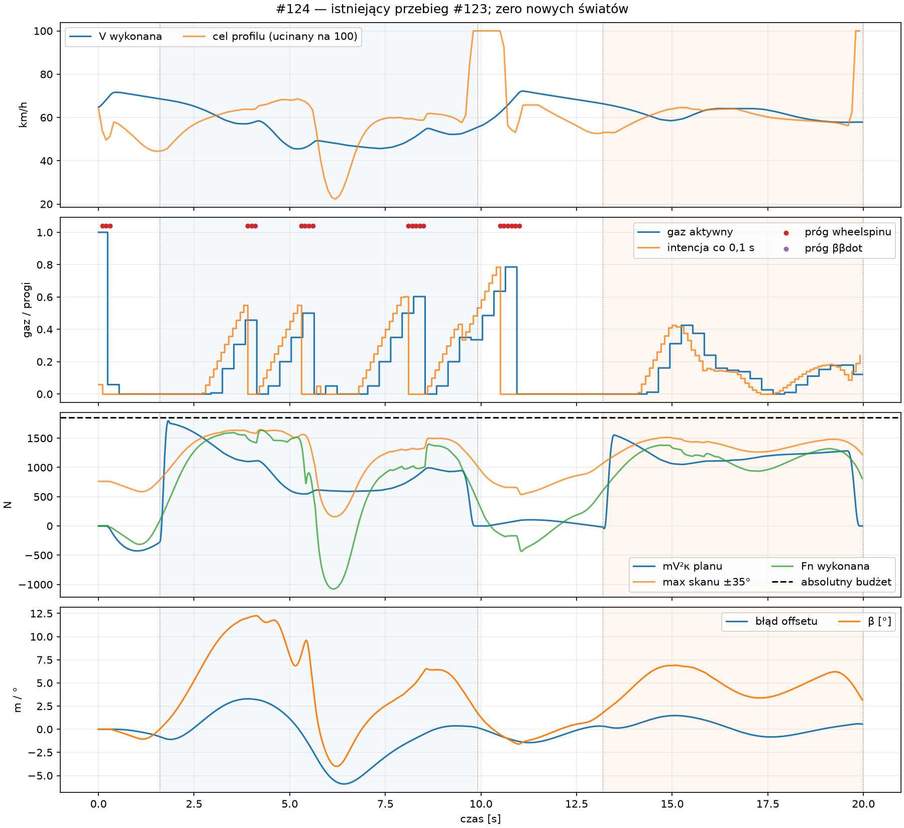
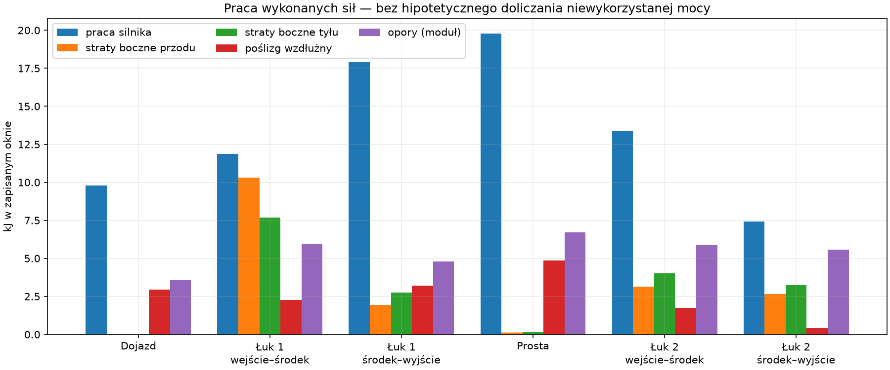

# #124 — przyczyny utraty prędkości, błędów linii i korekt zawodnika

**Najlepiej udokumentowanym ograniczeniem rozwoju jazdy jest obecnie brak wspólnego, przyczynowego planowania trajektorii, gazu i osiągalnej odpowiedzi kontaktów.** W #123 nie brakuje mocy znamionowej na prostej. Zawodnik wybiera jedną z dwóch krzywych, nie zmienia jej w łuku i steruje gazem według chwilowej obwiedni. Ta obwiednia nie przewiduje wykonania kolejki ani przyszłego rozwoju poślizgu. Regulator #117 reaguje na powstający błąd, lecz nie gwarantuje odzyskania linii. Nie wykazano, że sama zmiana algorytmu zapewni docelowe, realistyczne prędkości.

**Decyzja:** najpierw mały, weryfikowalny krok w algorytmie zawodnika. Dane nie uzasadniają dopasowywania µ ani przebudowy opony dla poprawienia tego wyniku. Empiryczna poprawność opony pozostaje nierozstrzygnięta.

Baza: otwarty Draft [#123](https://github.com/arturgladysz91/zuzel/pull/123), dokładnie `c625de6faaeafb1d1ddb86f0598b61642c1452e5`, z poprawnym [Windows CI](https://github.com/arturgladysz91/zuzel/actions/runs/39781343841). Rodzic: #122 `f9d4dd7d8d09a755830c716c3f34af9e7daecc58`; dalej #120 → #119 → #118 → #117 → #116 → #115. #121 jest osobną gałęzią i nie jest integrowany. Jeden Draft, bez merge. Status wniosków projektowych: **PROVISIONAL**.

## A. Stan projektu i zakres dowodów

Ten audyt uruchomił **zero światów Box2D, zero kroków ciała i zero commitów koła**. Nowy [adapter C#](speed-line-rider-root-cause/Program.cs) wykonał 295 oryginalnych zapytań kontaktu h=0: 200 obserwacji #123 oraz 35/60 obserwacji nieudanych A/B #122. Maksymalna różnica od zapisanych Fx/Fy wynosi **0 N**. Odtworzył każdy składnik polityki gazu; wszystkie zapisane żądania ON są zgodne z rekonstrukcją w tolerancji 1e−7. C #122 to pierwsze 100 obserwacji #123, sprawdzone bez ponownego odpytywania kontaktu.

[Skrypt analizy](../../tools/shared-world-speedway/root-cause-report.py) czyta wszystkie 2002 zaakceptowane interwały #123, oryginalne skany kierownicy, 200 profili, 48 rozkazów i zaakceptowane końce kroków. Używa istniejącego niezależnego ledgera pracy; nie uruchamia historycznych funkcji `analyze()` ani ich eksportów. Dokładnie 993 pierwsze wiersze i obserwacje C pozostają zgodne z #122. Fingerprint C: `A44925BFD8741A5E6ECA89EB9D635EFF27BC0AC1857227EB5F55D718F24E62A9`; cały #123: `33741F49880FADBCA5C7ECE240B32EF0017463A30B1BF85B32E06131D5CD4A03`.

| Historia i raport | Potwierdzone / wykorzystanie w tym audycie | Granica wniosku |
|---|---|---|
| [#97](slip-coupled-dynamics.md), [#98](slip-control-validation.md) | Rzeczywiste siły i straty poślizgu; opóźnienie zacieśniania nie pochodziło od guardu energii. | Historyczny kontakt i yaw; nie przenosić tamtego podziału sił na #123. |
| [#99](physics-driven-racing-line.md), [#100](rear-wheel-dynamics.md) | Pełny obrys jest kryterium niezależnym od ukończenia; ω jest stanem, odjęcie gazu go nie resetuje; Fx/Fy współdzielą mianownik. | Stare moc/sterowanie. |
| [#101](track-geometry-variants.md), [#102](local-offset-limit.md), [#103](progressive-bend-width.md) | Krzywizna i rzeczywiste zwężanie decydują o użytecznej szerokości. Legalny target nie gwarantuje wykonania. | Egg/progressive-b nie ma kalibracji geodezyjnej realnego toru. |
| [#104](racing-line-root-cause.md) | Udowodniony dawny błąd ramy odniesienia/preview; pełna Q(s) poprawiła tracking. Dłuższa szeroka droga nie dawała automatycznie zysku czasu. | Obecne path guidance już używa ramy Q; nie zgłaszać starego błędu jako nadal obecnego. |
| [#105](inverse-feasibility-matched-apex.md), [#106](speed-grip-line-crossover.md) | C2 i mV²κ poniżej budżetu nie wystarczają; ograniczenia momentu/ω/yaw oraz dodatni koszt drogi. Overspeed prawidłowo wynosi poza tor. | Ścisły dowód skoku yaw dotyczy dawnej równowagi i dokładnej Q(t), nie obecnego błędu metrowego. |
| [#107](full-throttle-slide-grip-audit.md) | Straty są skutkiem wykonanych sił; istnieje dawny okresowy drift, lecz bez potwierdzenia empirycznego opony. | Inna fizyka yaw i napędu; brak dowodu stabilnego szybkiego #123. |
| [#108](coupled-slip-inverse.md), [#109](full-contact-yaw-feedforward.md) | Małe korekty odwrotności i yaw nie zaliczyły pełnych bramek. | Niewielki spadek RMS nie jest dowodem poprawnego sterowania ani bezpieczeństwa. |
| [#112](two-contact-bike-dynamics.md), [#113](physical-steering-control.md) | Dwa kontakty i rzeczywiste r×F; udokumentowany błędny wczesny moment kierownicy, usunięty przez inwersję odpowiedzi. | Bezpieczne dawne osiem okrążeń nie kalibruje nowego silnika. |
| [#115](adaptive-rider-decisions.md) | Zmienne decyzje, tanie kopie stanów i rozdzielenie prognozy od wykonania; bramka bezpieczeństwa FAIL. | Brak obecnej reakcji i inna konfiguracja fizyki; patrz E. |
| [#116](motorcycle-performance-500cc.md), [#117](controlled-slip-travel-direction.md), [#118](tyre-surface-diagnostic.md) | Moc zwiększa wheelspin, nie µFz. ψ i χ są odrębne. Istnieją lokalne ruchy z uślizgiem, ale wejście Egg przy pełnym gazie zawodzi. | Brak empirycznej krzywej opony/gruntu i certyfikatu szybkiego Egg. |
| [#119](feasible-500cc-corner-entry.md), [#120](reachable-steering-line-tracking.md) | Wczesne przygotowanie daje bezpieczny łuk. Wczesny brak sił jest realny; wyszukiwanie tylko osiągalnej kierownicy pogarsza późniejsze odzyskanie. | Brak rozstrzygnięcia procentowego udziału regulatora w całym błędzie. |
| [#122](feasible-path-speed-planning.md), [#123](continuous-corner-planning.md) | C przechodzi pierwszy łuk, kontynuacja przechodzi dwa bez resetu, z bilansem energii i reakcją. | Jeden start, jeden zawodnik, zamrożony tor; bez potwierdzenia realizmu, optymalności i kolejnych okrążeń. |

W #123 wejście/minimum/wyjście wynoszą **68,62/45,48/54,92 km/h** i **66,33/57,74/57,84 km/h**. RMS błędu w oknach łuków: **2,770/0,766 m**, maksimum **5,906/1,475 m**. Konserwatywne prześwity w łukach są dodatnie: wewnętrzny/zewnętrzny **2,547/1,735 m** i **4,627/3,769 m**. Globalne minimum wewnętrzne 1,490 m jest na dojeździe. To potwierdza ograniczony przejazd, nie gotową jazdę wyścigową.

## B. Diagnoza przyczyn

| Objaw | Przyczyna lub hipoteza | Konkretny dowód | Pewność |
|---|---|---|---|
| Słaby pierwszy skręt mimo legalnej geometrii | Stan kontaktów/obrotu nie dostarcza potrzebnej odpowiedzi; plan nie zapewnia wcześniejszego dojścia do niej. | #123 t=2,00: wymaganie planu 1735 N, pełny skan 1097 N, wykonane 677 N, budżet 1852 N; gaz już 0, κ≈0,0011. | Wysoka dla niedoboru w zapisanym skanie; brak certyfikatu całej ciągłej dziedziny δ. |
| Duże późniejsze korekty | Regulator próbuje odzyskać narosłe położenie/prędkość boczną; plan pozostaje stały. | t=5,40: plan +546 N, PD −1520 N, ruch boczny względem Q −6,41 m/s. t=6,42: błąd −5,906 m, wykonana siła −862 N przy planie +592 N. | Wysoka dla przebiegu i rozbieżnych żądań; udział konkretnego członu kosztu #117 nierozstrzygnięty. |
| Gaz piłuje | Twardy próg κ, zmienny cel obwiedni i pamięć narastająca podczas oczekiwania współdziałają z opóźnieniem. | 16 zmian kierunku zmian gazu w aktywacjach; 95/200 ocen przy zajętej kolejce; cztery dodatnie aktywacje po nowszym sygnale cięcia. | Wysoka dla mechanizmu czasowego; zysk po naprawie niezmierzony. |
| Brak reakcji trajektorii na utratę wykonalności | Replanning jest obsługą cyklu łuków, nie adaptacją w łuku. | `ContinuousCornerPlanning.Advance` czeka na pełne opuszczenie łuku; `Observe` nie zmienia `Path`. | Pewne z kodu. |
| Profil wygląda zachowawczo, a mimo to powstaje błąd | `ResponseCeiling` interpoluje chwilową odpowiedź do górnej granicy; nie przewiduje β, yaw, ω, kolejki ani odzyskania linii. | `NoCertifiedCoastSolution` w 145/200 ocen; t=6,40 cel spada do 7,583 m/s przy obecnym V=13,177. | Pewne co do algorytmu; wielkość możliwej poprawy otwarta. |
| Szeroka linia bywa wolniejsza | Dłuższa droga i koszt zmiany linii; nie każda szeroka krzywa ma łagodniejsze najgorsze przejście. | #104 długość inner/OIO 325,062/354,858 m; najgorsze promienie 25,478/25,451 m. | Wysoka dla badanych krzywych, nie wszystkich możliwych linii. |
| Prędkości nadal niezadowalające | Zmierzone straty + mały/oscylujący napęd; czy opona rozprasza za dużo względem żużla — brak danych. | Pierwsza połowa łuku: boczne 17,989 kJ; cały #123 średni gaz 0,1555. | Wysoka wewnątrz modelu; realizm nieustalony. |

### Budżet, odpowiedź kontaktów i moment rozbieżności

Używamy `Fn=dot(Fnet,n_velocity)=mVχdot`, a wymaganie geometryczne to `mV²κ_path`. Znak jest zachowany, moduł porównywany z budżetem. To wymaganie dokładnej krzywizny przy danej V, **nie dowód, że cały przejazd z tolerancją błędu jest niemożliwy**. Stan leżący poza Q i z innym kierunkiem wymaga dodatkowo odzyskania położenia i prędkości normalnej. Porównanie z samym mV²κ tego nie obejmuje.

Przód/tył mają w tej konfiguracji **854,926/997,413 N**, łącznie **1852,339 N**. Ani razu geometryczne wymaganie #123 nie przekracza tej sumy; największe wynosi **1797,142 N**. Suma pojemności to luźna granica wektorowa. Nie wymusza dostępnej lokalnej α, zwrotu siły, momentu r×F ani czasu dojścia kierownicy.

Zapisany skan #117 zawiera 33 kąty ±35° oraz lokalne refinements, oryginalny kontakt skończonego kroku i niezmieniony stan ciała/koła. Przekroczenie jego odpowiedzi przez plan, z tolerancją 1 N, występuje w oknach **1,71–2,72; 5,77–6,70; 13,38–14,03 s** — razem **2,59 s**. To wynik numerycznego próbkowania, nie ścisły dowód maksimum po wszystkich δ. Żądanie PD wychodzi poza zapisaną obwiednię przez **6,85 s**: 1,43–3,76; 4,74–6,05; 8,32–8,64; 12,92–14,68; 17,90–19,03 s. Nie należy liczyć tych okien jako czasu całkowitej niewykonalności jazdy: część obejmuje korektę błędu, nie samą krzywiznę Q.

W t=2,00 s: V=18,735 m/s; β=1,884°; lokalne α tylnego kontaktu=−2,511°; βdot(h0)=0,0967 rad/s; ω koła=56,806 rad/s; wheelspin=0,001115. Tylny Fx(h0)=4,60 N, Fy=338,04 N. Po uwzględnieniu bieżącego Fx górna granica wynosi jeszcze 1851,94 N. Brak skrętu w tym stanie **nie jest skutkiem zabrania całej przyczepności przez napęd**. Dziewięć kątów h0 daje 1096,51 N; trzy próbki kątów osiągalnych na końcu 10 ms dają około 754,23 N; pełniejszy zapisany skan finite-step 1096,55 N; wykonany finite-step 676,80 N. Trzy próbki nie są certyfikowanym maksimum po osiągalnym przedziale ani siłą rzeczywiście zastosowaną przez midpoint kierownicy.

Limiter 90°/s działa dopiero **4,15–4,57 i 4,94–5,42 s**, razem 0,90 s, wyłącznie w pierwszym łuku. Nie wyjaśnia początku niedoboru siły. W drugiej części odzyskania może mieć znaczenie. Bezwładność działa także wtedy, gdy limiter nie jest aktywny: trzeba rozwinąć yaw i lokalną prędkość boczną, a nie tylko przestawić δ.

Wcześniejsze rozpoczęcie **potencjalnie** pomaga: #119 oraz interwencja C #122 dają konstruktywne, bezpieczne przejazdy przy mniejszej prędkości. Nie określa to ostatniego bezpiecznego momentu ani wykonalności szybszej linii. Brakuje sprawdzonej predykcji wspólnej dynamiki i co najmniej jednej bezpiecznej, szybszej realizacji przy niezmienionych warunkach. Samo odjęcie napędu nie usuwa pędu lub energii koła.

### Co dokładnie potrafi obecny wybór linii — siedem odpowiedzi

1. **Przed łukiem:** `PreparedCornerPlan` buduje tylko preferowane 5 m i alternatywne 8,5 m. Obie ścieżki mają ten sam sposób wyznaczania początku/końca przejścia z reakcji i topologii. Pełny obrys sprawdza z zapasem, a wybór porównuje maksymalny iloraz oszacowania toczenia i 85% budżetu. Aktualne XY/offset/V/ω i pending wpływają na przygotowanie, lecz nie ma dynamicznej predykcji wykonania kandydatów. C wybiera 8,5 m, drugi łuk 5 m.
2. **W łuku:** zmienia gaz i bieżącą kierownicę, target próbuje kolejnych punktów tej samej Q(s). Nie wybiera nowej Q. Nowa generacja powstaje dopiero po pełnym opuszczeniu łuku; w #123 przygotowanie 9,91 s, aktywacja 10,15 s.
3. **Rozpoznanie problemu:** dostępne są sygnały przekroczenia obwiedni, `NoCertifiedCoastSolution` i brak odpowiedzi #117. Nie ma z nich pełnego testu wykonalności/odzyskiwalności trajektorii ani przejścia do innej linii. `NoCertifiedCoastSolution` jest komunikatem o braku certyfikacji, nie dowodem niemożliwości i nie automatycznym planem ratunkowym.
4. **Inna linia z bieżącego stanu:** między łukami wybiera ponownie z dwóch intentów; podczas łuku tego nie robi. β, βdot, yaw i kierownica są obserwowane dla gazu/odpowiedzi, ale nie są propagowanym stanem oceny przyszłego manewru. Nie ma rozwiązania wspólnego „który kierunek i gaz osiągniemy po reakcji”.
5. **C2:** zapewnia ciągłość pozycji, stycznej i κ, lecz nie κ′ ani ograniczenia tempa wymaganej odpowiedzi. Nowa jednostronna kontrola oryginalnej Q daje na początku pierwszego przejścia s=8,682907 m: κ′ z 0 do około **−0,0010661 m⁻²**; na końcu s=83,694687: **−0,00056829 → około 0**. Dla następnej krzywej wartości są mniejsze: +0,00017856 i +0,00012136 m⁻² po właściwej stronie węzła. Wynik jest zbieżny dla h=0,1/0,01/0,001 m. To ostrzeżenie o regularności żądania; nie dowód, że te węzły powodują cały błąd 5,91 m. #105 udowodnił silniejszy skutek dla dawnego dokładnego rozwiązania, którego tutaj nie kopiujemy. Samo wygładzenie do C3 również nie certyfikuje sił i odpowiedzi.
6. **Czas szerokiej linii:** dla stałego dodatniego offsetu wypukłej zamkniętej reference dodatkowa długość to 2πd; zmiana offsetu dodaje koszt d′ i może zacieśnić przejścia. #102: faktyczne XY dwóch lotnych okrążeń inner 646,497 m /32,176 s, wide-tighten 709,382 m /33,126 s. #115: 2778,80 →3009,12 m, średnia prędkość rośnie, czas pogarsza się o 6,834 s. Są to porównania **wewnątrz tamtych konfiguracji**. W #123 droga wejście–wyjście CoM wynosi 122,729/114,785 m; całe XY 331,834 m, mimo końcowego postępu reference tylko 288,982 m od startu. Nie ma obecnie porównania dwóch równie bezpiecznych, równie dobrze śledzonych szybkich linii #123.
7. **Kontrakt docelowy:** planner przekazuje Q, styczną, κ/κ′, dopuszczalny błąd, przestrzeń pełnego obrysu i prognozowany zakres czasu/sił; gaz i kierownica dostają tę samą prognozę stanu po pending i reakcji. Sterowanie zwraca osiągalną odpowiedź/jej niepewność oraz możliwość odzyskania prześwitu. Brak odpowiedzi odrzuca lub osłabia zamiar; nie zwiększa siły ani nie resetuje stanu.

## C. Gaz, chronologia i straty prędkości



### Co ogranicza gaz

`PreparedCornerPlan.Observe` liczy podtrzymanie z aktualnych strat bocznych i oporów podzielonych przez dostępną moc na kole. Dodaje `0,16·(Vtarget−V)`, ogranicza wynik do 0..1, a przy celu >100 m/s żąda 1. Następnie `|wheelspin|>0,25` lub `β·βdot>0,05` wymusza intencję zero. Wzrost **prywatnej intencji** ogranicza do 0,05 na ocenę co 0,1 s; spadek może być natychmiastowy. To nie jest ograniczenie fizycznego tempa ruchu przepustnicy.

`WorldRunner` najpierw aktywuje dojrzały pending, potem aktualizuje politykę; nowy rozkaz przyjmuje tylko do pustej kolejki, z datą +0,24 s. Zajęty pending nie jest anulowany. Dlatego pamięć polityki może się zmienić kilka razy przed wykonaniem wcześniejszej wartości. To zachowuje przyczynowość i terminy, lecz bieżąca polityka nie ocenia skutku takiego opóźnienia.

| Diagnoza ocen | C #122, 100 ocen | Cały #123, 200 ocen |
|---|---:|---:|
| Próg wheelspinu aktywny |15|21|
| Próg ββdot aktywny |0|0|
| Gaz zero z samego profilu/feedbacku, bez progów |33|66|
| Narastanie ograniczone rampą |46|62|

Kategorie rampy i przyczyny cięcia nie są sumą rozłącznych czasów. #122A ma 3 progi wheelspinu, 0 ββdot i 28 zer z profilu w 35 ocenach, ale **Throttle=false**: rzeczywisty gaz pozostaje 0,15 po reakcji. #122B ma odpowiednio 10/0/25 w 60 ocenach. Rejestrowanie żądania nie znaczy jego wykonania.

W #123 jest 48 przyjętych rozkazów, 47 aktywowanych do końca i jeden oczekujący. 95/200 ocen zastaje zajęty slot. Gaz aktywny wynosi zero przez **7,80 z 19,98 s**; średnia całego przebiegu 0,15545. Próg ββdot **nie wyjaśnia tych oscylacji**. Czternaście z 21 ocen wheelspinu ucięło dodatnie żądanie sprzed progu; w pozostałych już profil żądał zera. Nie jest to dowód, że próg można bezpiecznie usunąć.

| Obserwacja → intencja | Kolejka / wykonanie | Fizyczna odpowiedź |
|---|---|---|
| t=0: 0,05826; t=0,10/0,20: zero | Pierwszy rozkaz nadal aktywuje 0,05826 w 0,24; zero przyjęte 0,30 aktywuje 0,54. | W 0,24 V=19,164 m/s, κ=0,802, Fx=958 N. W 0,54 V nadal 19,882 m/s. |
| t=5,30: κ=0,25463, intencja zero | Oczekuje 0,50000, aktywuje 5,34; cięcie przyjęte 5,40 wykona się 5,64. | W 5,34 κ=0,26218, β=8,61°, Fx=410 N. W kolejnych 0,24 s V rośnie o 0,608 m/s. |
| t=8,10/8,20: zero po κ>0,25 | Rozkaz z 8,00 aktywuje 0,60255 w 8,24. | κ=0,28277, Fx=598 N; +0,827 m/s w kolejnych 0,24 s. |
| t=10,40: 0,78542; t=10,50/10,60: zero | Nadal aktywuje 0,78542 w 10,64; zero przyjęte 10,70 aktywuje 10,94. | W 10,64 κ=0,32787, Fx=814 N; +1,268 m/s w kolejnych 0,24 s. |

Ostatnia kolumna opisuje rzeczywisty ciągły przebieg; zmiana V nie jest izolowanym skutkiem jednej aktywacji. **Cztery dodatnie aktywacje po nowszym progu** są dowodem konfliktu czasowego obserwacji i intencji, nie uzasadnieniem natychmiastowego omijania reakcji. Przy 5,30 sygnał cięcia czeka 0,34 s do wykonania, przy 10,50 — 0,44 s. Dochodzi jeszcze mechaniczne uspokojenie ω. Brak zmiany terminu pending nie jest błędem sam w sobie.

Źródłem gwałtownych zmian jest też `target=min(SpeedLimit)` tylko w horyzoncie **V·3 s**, z punktami co 2 m. Cały profil jest eksportowany dalej, lecz steruje tylko to minimum. Nie jest to profil prędkości osiągalny przez integrację przyszłego sterowania. W 10,50 minimum dotyczy łagodnego przejścia na prostej: Vtarget=56,98 **m/s**, ograniczający punkt 10 m dalej. W 10,60 do horyzontu wpada wejście drugiego łuku: cel 25,72 m/s, punkt 52 m dalej; w 10,70 cel 15,62 m/s, 54 m dalej. W 10,50 wheelspin już nakazał zero, więc sam ten skok celu nie jest pierwszą przyczyną tamtego cięcia.

W 6,40 s ograniczający punkt jest bieżący: skan h0 daje tylko 230,82 N w wymaganym dodatnim zwrocie, cel spada do 7,583 m/s. To wiąże gaz z chwilowym stanem odzyskiwania kierunku; mała lokalna odpowiedź nie wyznacza optymalnej prędkości całej przyszłej trajektorii. W `Observe` obliczenie pracy podczas przyszłej reakcji nadal używa `currentDrive·maxPower·0,24`, bez zawartości kolejki. Konstruktor kontynuacji zna pending przy wstępnym porównaniu dwóch linii, lecz ten kontrakt nie obejmuje kolejnych ocen gazu.

### Gdzie ubywa energia

Tabela pochodzi z **wykonanych sił i zaakceptowanych końców**, nie z h0. Okna zaczynają się na pierwszej zaakceptowanej próbce po landmarku i dzielą się przy najbliższej następnej próbce środka: 5,47/16,58 s. Wyjście obejmuje cały obrys do 9,91/19,98 s; dlatego prędkości końcowe okna minimalnie różnią się od interpolowanego wyjścia CoM w A. Pełne liczby i reszty są w [audit.json](speed-line-rider-root-cause/audit.json).

| Okno | V pocz.→koniec km/h | Droga XY m | Gaz średni | W silnika kJ | L boczne przód+tył kJ | L wzdłużne kJ | Opory kJ | ΔE ciała kJ |
|---|---:|---:|---:|---:|---:|---:|---:|---:|
| Dojazd 0–1,60136 s |64,80→68,62|31,030|0,161|9,777|0,071|2,940|3,573|+2,888|
| Łuk 1: wejście–środek |68,62→46,67|62,675|0,135|11,853|17,989|2,253|5,945|−14,348|
| Łuk 1: środek–pełne wyjście |46,67→55,45|61,146|0,191|17,898|4,690|3,204|4,788|+5,084|
| Między łukami |55,45→66,33|60,994|0,188|19,778|0,267|4,849|6,719|+7,515|
| Łuk 2: wejście–środek |66,33→64,11|58,677|0,155|13,392|7,153|1,747|5,869|−1,640|
| Łuk 2: środek–pełne wyjście |64,11→57,85|57,312|0,099|7,423|5,884|0,407|5,566|−4,331|



Największa utrata występuje w pierwszej połowie łuku 1: **17,989 kJ strat bocznych**, czyli około 1,52× całej dostarczonej tam pracy silnika. Korekty toru ruchu kosztują energię przez oryginalne siły kontaktu. W drugiej połowie prędkość wraca, lecz słaby tracking osiąga największy błąd do wewnątrz. Drugi łuk ma mniejsze błędy i straty boczne, jednak w drugiej połowie nadal zwalnia: 7,423 kJ napędu nie pokrywa bocznych + oporów + pozostałych strat. Nie ma dowodu narastającej awarii przez dwa łuki, ale nie ma też utrzymania prędkości wyjściowej równej wejściowej.

Cały #123: Wengine=80,121 kJ, boczne przód/tył=18,180/17,874 kJ, wzdłużne=15,400 kJ, łożysko=1,219 kJ, opory=32,459 kJ. ΔE ciała/koła=−4,833/−0,179 kJ. Reszta +0,097721 J jest wyjaśniona zmierzoną pracą błędu impulsu float; nowe okna mają niewyjaśnioną resztę <1e−6 J. Energia ciała zawiera translację i obrót. Nie odejmować strat drugi raz od napędu.

**Fizyka versus polityka:** rozpraszanie jest zmierzone fizycznie. Mała dostarczona praca i zero gazu są zmierzonym wykonaniem polityki. „Utracona moc”, którą można bezpiecznie odzyskać, nie jest zmierzoną wielkością: większy gaz zmieni ω/κ, podział Fx/Fy, tor ruchu i straty. Nie można dodać różnicy do Drive1 do tego ledgera i uznać jej za przyszły wzrost V. Lepsza linia/sterowanie mogą zmniejszyć straty i pozwolić wcześniej napędzać, lecz wielkość zysku wymaga porównywalnego przejazdu.

## D. Wyjazdy poza tor i model opony

**Mocne dowody ograniczenia sił:** #106 overspeed 200 km/h ma rzeczywisty promień około 202 m zamiast planowanych 30 m; pierwszy obrys narusza bandę około 0,61 s. W zapisanym #116 t=0,50 potrzeba **2415,44 N** dla lokalnego promienia 25,635 m przy V=20,524 m/s, wobec **1852,34 N** całego budżetu. #118 pokazuje, że nawet po uspokojeniu koła odjęcie gazu w tym stanie nie odzyskuje brakującej siły. #119/#120: wymaganie linii w t=2,00 wynosi **2098,04 N**, ponownie ponad budżetem. Sama lepsza kierownica nie wykona tej samej krzywizny z tą V.

**Mocne dowody błędów sterowania:** #104 wykazał błędne tłumienie zamierzonego ruchu w ramie reference już przed limitem opony. #112/#113: w t=0,20 stara kierownica dawała moment **−34,5 Nm**, mimo potrzeby rozwijania yaw; poprawa odpowiedzi bez zmiany opony usunęła tę wczesną wadę i pozwoliła bezpiecznie przejechać. Nie należy powtórnie naprawiać tych usuniętych błędów w #117. #120 jest ważnym kontrprzykładem: lokalnie mniejszy koszt reachable-only nie gwarantuje odzyskania, jego jedyny przejazd naruszył kredę w 6,71 s.

**Niejednoznaczne źródło całej awarii:** nieudane szerokie #102/#103, niezaliczone #108/#109, A/B #122 oraz sama granica marginesu #115 nie dowodzą wadliwej opony. A #122 (nowa Q, gaz 0,15) narusza zewnętrzną w 3,44 s; B (nowy gaz, stare 5 m) wewnętrzną w 5,97 s; C (oba) przechodzi. To dowód potrzeby współpracy planu i gazu dla tych wariantów, nie izolacja jednej przyczyny wszystkich wyjazdów. W #123 lokalne niedobory odpowiedzi są potwierdzone, mimo braku przekroczenia absolutnej sumy; ich procentowego udziału względem preview/kosztu #117 nie zidentyfikowano.

Aktualny tył h0 ma postać `Fx=Br·a/√(1+a²+b²)`, `Fy=−Br·b/√(1+a²+b²)`, gdzie a opisuje poślizg wzdłużny z własną regularizacją, b boczny kontaktu. Przód ma własne monotoniczne Fy we własnej skręconej ramie; lokalne prędkości uwzględniają yaw×ramię. Przy stałym drugim poślizgu własna siła saturuje; nie ma skalibrowanej gałęzi spadku po maksimum. Malejące Fy przy rosnącym Fx jest **combined slip**, nie symulacją ścinania podłoża. Przód nie oddaje bezpośrednio swojego budżetu tylnemu Fx.

#118: dla u≈20,23 m/s i αr=10° zwiększenie κ z 0,1 do 1 obniża |Fy| z **793,87 do 289,64 N**, a Fx rośnie z 255,82 do 933,34 N. W stanie #116 pełny napęd ma około 333,09 Nm, a Br·r≈329,15 Nm przed łożyskiem — łatwo nasyca kontakt. Nie jest to dowód niewłaściwego rozdziału µFz; to ilościowa relacja obecnego silnika i kontaktu. αr nie jest β: np. #123 t=2,00 ma odpowiednio −2,511° i +1,884°.

Brakuje ścinania i przemieszczania gruntu, zagłębiania opony, historii deformacji/relaksacji materiału oraz empirycznej charakterystyki sił przy dużych poślizgach. Składnik numeryczny minimalnej relaksacji 30 ms istotnie kształtuje krzywą (w badanym #118 stanie 78,1% δx²), lecz nie jest zmierzonym modelem gruntu. Taki monotoniczny kontakt jest uproszczeniem ogólnego tarcia; sam niski lub wysoki budżet nie czyni go wiarygodną oponą na żużlu. Zachowania twardej, bardzo śliskiej i luźnej nawierzchni nie można skalibrować wyłącznie zmianą µ.

**Co można rozstrzygnąć:** równania i straty działają zgodnie z modelem; przy pewnych prędkościach siły są za małe do żądanej krzywizny. **Czego nie można:** czy prawdziwy żużel powinien dawać inne µ, szczyt, optymalny α lub mniejsze straty. Brakuje wiarygodnych pomiarów sił vs κ/α/nacisk dla określonej opony i materiału oraz trajektorii/prędkości na porównywalnej geometrii. #107 i #118 pozostawiają to otwarte. Bez nich ani „opona za słaba”, ani „wystarczy samo AI do realizmu” nie są potwierdzone.

## E. Architektura przyszłego zawodnika i ponowna ocena #115

Z #115 warto zachować: przegląd po zaakceptowanym snapshotcie, małą deterministyczną listę intentów wraz z dotychczasowym, odrzucane kopie ω/δ, oryginalne siły r×F, ocenę rzeczywistego postępu i pełnego obrysu, histerezę zmiany wyboru oraz jawne oznaczenie awaryjnego wyboru. Nie przenosić gotowych progów i wyników na #123: tam nie było silnika #116, µFz #116 ani regulatora kierunku #117.

Pięć maksymalnych alternatyw #115 to: utrzymanie, gaz 1 przy obecnym offsecie, gaz 1 o 1,5 m szerzej, gaz 0,55 o 1,5 m ciaśniej oraz 0,55 przy obecnym offsecie. Predykcja 0,6 s ma 30 kroków po 20 ms, inwersję kierownicy co 100 ms; wykonanie ma około 10 ms i inwersję co krok. Nie było zidentyfikowanego ograniczenia błędu tej prognozy ani gwarantowanego manewru odzyskania prześwitu poza jej końcem. `PredictedSafe` sprawdza obrys i dodatni postęp; nadmierne żądanie siły jest karą w wyniku, nie twardym odrzuceniem. Gdy nie ma bezpiecznego kandydata, wybiera najmniejsze naruszenie i oznacza `Emergency` — **to nie jest bezpieczny fallback**.

W danych #115 jest **110 awaryjnych decyzji z 730**. Już w 9,6 s wybrana szersza intencja nadal wymaga do 1,384× budżetu. Przy 22,0 s wybór częściowego gazu poprawia przewidywany zewnętrzny prześwit do 0,911 m, nadal poniżej wymaganych 1 m prognozy. Wykonanie nie narusza bandy w próbkach, lecz konserwatywny margines **0,470845 <0,5 m** obala bramkę. Nie stwierdzamy, że wszystkie problemy pochodzą tylko z długości horyzontu: ograniczone alternatywy i niespójność predykcja–wykonanie również nie były rozstrzygnięte.

Koszt historyczny: 106290 ocen sił predykcji, 1031688 zapytań inwersji prognoz, 109833 ocen geometrii; łącznie z wykonaniem około **2,96×** rozwiązań kontaktu względem tamtego odniesienia. Lokalne 3449 ms/730 ocen ≈4,72 ms/ocenę to pomiar diagnostyczny, nie benchmark obecnej konfiguracji. Dla kontekstu kosztu architektury #123 zapisuje 2600 zapytań planera +2 cyklu planu, wobec 104364 zapytań kontaktów wykonania; same review zajęły 340,1 ms/200. Nie porównujemy tych czasów jako kontrolowanego benchmarku.

**Najważniejsza różnica aktywacji:** `AdaptiveRiderControl.Predict` od razu ustawia hipotetyczne Drive/Target; `WorldRunner` po `Decide` od razu przypisuje realne Drive/Target. #115 omijał w tej gałęzi kolejkę +0,24 s. Nie wolno go włączyć jako gotowej adaptacji dla #123. Przyszła predykcja musi najpierw wykonać niezmienialny prefiks z aktualnym gazem, pending i ich terminami, dopiero potem badać skutki nowej decyzji. Nie wolno zakładać zniknięcia κ podczas reakcji.

Obecna architektura umożliwia **kontrolowane rozszerzenie**, lecz nie bezpieczny prosty przełącznik. `ContinuousCornerPlanning` potrafi łączyć ścieżki i przenosić pamięć/pending bez resetu; `WorldRunner` ma accepted-state review, granice deadline i pojedynczy commit. Potrzebny jest wspólny kontrakt obserwacja → odroczona intencja → aktywacja → tracking. Nowa Q musi mieć przyszły splice i zgodność z zachowaną Q oraz osiągalnym stanem; sam C2 prefix nie dopasowuje automatycznie prędkości bocznej motocykla. Geometryczna/szeregowa obwiednia jest filtrem kandydatów, a nie certyfikatem ich wykonania.

## F. Rekomendacje i decyzja o #125

Maksymalnie trzy zmiany, w tej kolejności; każda eksperymentalna/OFF, bez zmiany kontaktu, silnika i #117:

| Zmiana | Uzasadnienie i spodziewany efekt | Ryzyko | Minimalne obalenie/potwierdzenie |
|---|---|---|---|
| **1. Przyczynowa ocena intencji po kolejce i reakcji** | Propagować accepted β/yaw/ω/δ oraz aktualny/pending gaz, następnie ocenić nowy zamiar. Unikać zlecania wzrostu, którego przyszły stan już wymaga cięcia; wspólny stan dla gazu i linii. | Przybliżona prognoza może być optymistyczna; koszt wielokrotnej inwersji. | Na zapisanym prefiksie 10,40–11,20 s odtworzyć terminy 10,64/10,94 i narastanie κ; porównać χ, β, ω i obrys, nie tylko V. Brak zgodności kończy etap przed native. |
| **2. Ograniczona zmiana Q także przed i w łuku** | Zachować dotychczasowy zamiar oraz najwyżej dwie połączone, łagodniejsze alternatywy; oceniać tor odzyskania, nie tylko odległe maksimum offsetu. Ma zmniejszyć błąd i boczne straty. | C2 może nadal żądać zbyt szybkiej zmiany odpowiedzi, a szersza droga pogorszyć czas. | Na stanach przed 1,71 s i odzyskiwania 5,77–6,70 sprawdzić siły, tempo δ, obrys i ciągłość; odrzucić opcję bez pokrycia opóźnienia i możliwości odzyskania. Dopiero porównywalny przejazd może dowieść poprawy. |
| **3. Zastąpić twarde minimum celu oceną osiągalnego profilu wspólnego manewru** | Uwzględnić przyszły łuk przed jego wejściem do V·3 s oraz energię koła/oporów; podtrzymanie gazu i ewentualna histereza mają wynikać z prognozy, nie z samego przesunięcia progu 0,25. | Zbyt mały konserwatyzm spowoduje późne cięcie; zbyt duży pogłębi wolną jazdę. | Zachowane 10,50–10,70 ujawnia skok punktu ograniczającego; 6,40 ujawnia chwilowy cel 7,58 m/s. Nowa intencja musi wyjaśnić oba, bez deklarowania osiągalnego hamowania, którego model nie ma. |

**Dokładny mały zakres #125:** najpierw punkt 1 jako walidowany, domyślnie wyłączony moduł prognozy i kontrakt aktywacji. Użyć zachowanych okien #123: rozwijanie skrętu 1,40–2,80 s, odzyskanie 5,30–6,70 s oraz kolejka/nowy łuk 10,40–11,20 s. Z góry zamrozić tolerancje prognoza–wykonanie i limit zapytań; nie dobierać ich po wyniku. Dodać najwyżej utrzymanie plus dwie wspólne alternatywy linii/gazu, z reakcją i pending w prognozie, bez uruchamiania #115. Brak bezpiecznej opcji oznacza brak dowodu wykonalności, a nie deklarację bezpiecznego `Emergency`.

Jeżeli ten moduł przejdzie weryfikację zapisów, dopuścić **jeden** ciągły native od dokładnego startu C do pełnego wyjścia drugiego łuku lub pierwszego naruszenia, z #123 jako istniejącym odniesieniem. Bez strojenia po wyniku, bez dodatkowych światów na kandydata, pełnych okrążeń i rywali. Wymagać dodatnich konserwatywnych prześwitów, bilansu energii i kontrolowanego β, mierzyć błąd Q, boczne/wzdłużne straty, aktywacje, rzeczywistą drogę i prędkości. Zysk V przy naruszeniu marginesu lub gorszym odzyskaniu jest FAIL. Jeśli prognoza nie przejdzie pierwszego etapu, zakończyć bez nowej jazdy. Punkty 2/3 rozszerzać tylko w granicach tego małego sprawdzanego kontraktu, nie budować pełnego optymalizatora czasu.

**Odpowiedzi końcowe:**

1. **Największe obecnie udokumentowane ograniczenie:** planowanie zamierzonej linii i gazu nie przewiduje wspólnej odpowiedzi dynamicznej po reakcji i kolejce. Największa zmierzona strata prędkości wiąże się z rzeczywistymi stratami bocznymi podczas słabego trackingu. Nie ustalono jednego procentowego „winowajcy” całego wyniku.
2. **Sam algorytm zawodnika może:** wcześniej przygotować osiągalny skręt, uwzględniać pending, wybrać łagodniejszą trajektorię i ograniczyć zbędne korekty/oscylacje. #119–#123 dowodzą, że decyzje zmieniają bezpieczeństwo i wynik przy tej samej fizyce. Wielkość dalszego zysku jest nieznana.
3. **Bez zmiany fizyki nie uzyskamy:** odpowiedzi spoza rzeczywistych sił/momentów ani zjawisk gruntu nieobecnych w równaniach. Odwzorowanie ścinania, zagłębiania i empirycznej krzywej po maksimum wymaga fizyki/danych. Nie wykazano, że ich dodanie jest teraz konieczne do poprawienia tych dwóch łuków.
4. **Czy zaczynać adaptacyjny planner:** tak, wystarcza dowodów dla małego eksperymentalnego kontraktu prognozy i adaptacji; nie wystarcza dla ogłoszenia go bezpiecznym, szybszym lub empirycznie realistycznym. Nie włączać starego #115.
5. **Następny krok:** #125 w powyższym zakresie: walidacja przyczynowej prognozy na trzech zapisanych oknach, najwyżej trzy wspólne intenty, najwyżej jeden porównywalny ciągły przejazd po zaliczeniu prognozy. Bez zmiany opony/µ i bez obietnicy docelowej prędkości.

### Artefakty i odtworzenie audytu

[audit.json](speed-line-rider-root-cause/audit.json) zawiera wszystkie nowe okna i hashe wejść; [decision-timeline.csv](speed-line-rider-root-cause/decision-timeline.csv) pełne 200 ocen wraz z progami, pending i punktem profilu ograniczającym cel; [activation-timeline.csv](speed-line-rider-root-cause/activation-timeline.csv) aktywacje i odpowiedź; [force-timeline.csv](speed-line-rider-root-cause/force-timeline.csv) wszystkie 2002 porównania sił. [probe.json](speed-line-rider-root-cause/probe.json) obejmuje rekonstrukcję A/B i jednostronne κ′; [manifest](speed-line-rider-root-cause/manifest.json) zabezpiecza nowe artefakty. Nie zmieniono żadnych historycznych zapisów, parametrów, flag ani źródeł wykonania. Wszystkie 14 kanonicznych hashy źródeł z protokołu #123 są zgodne. Nie uruchamiano ponownie szerokich historycznych audytów.

```powershell
dotnet run --project docs/experiments/speed-line-rider-root-cause/probe.csproj -c Release -- docs/experiments/speed-line-rider-root-cause
python tools/shared-world-speedway/root-cause-report.py --plots
```

Adapter kompiluje się w Release bez ostrzeżeń; jego asercje sprawdzają oryginalne siły i politykę gazu. Analiza sprawdza prefix, źródła, opóźnienia każdej aktywacji oraz ledgery nowych okien. Żadne z tych poleceń nie uruchamia świata. Standardowe Windows Draft CI jest pozostawione bez zmian; jego testy regresji nie są nowym eksperymentem jazdy #124. Dokładny końcowy HEAD i wynik CI wskazuje opis PR.
