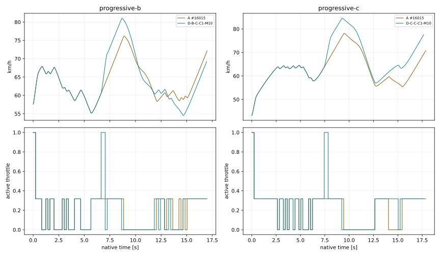

# #136 — Speedway Speed & Throttle Root Cause

**MIXED · diagnostyka, PROVISIONAL, domyślnie OFF.** Bez zmian fizyki, wag AI, produkcyjnego CoreSim, toru i bez treningu CEM. Baza `faadcba0652e0661de57e201d05fedb0ab4a52d0`.

Wykryto jednocześnie ograniczenia wyboru akcji i ograniczenia bieżącego stanu fizycznego. „MIXED” opisuje mechanizm tych prób; nie zatwierdza opon jako skalibrowanego modelu realnego żużla. Żaden pojedynczy sukces offline nie jest wyuczonym zachowaniem AI. **DIAGNOSIS PASS; PERFORMANCE EVIDENCE niepotwierdzone.** To nie jest diagnoza błędu równań fizyki.

Po zamknięciu potwierdzono dokładne fingerprinty wszystkich4 baz względem #135 (baseline-reproduction.json). Dodatkowy surowy przejazd #134 A #16015 N00 odczytano bez nowych światów i sprawdzono jego SHA256 wobec oryginalnego ledgeru (historical-reuse.json).

## Metoda i definicje

Protokół, źródła i reguły wyboru zamrożono przed światami. D-B/D-C to dwa dotychczasowe, różne początki #135; preflight odtworzył oba fingerprinty dokładnie. V-B/V-C są osobną pulą, otwartą po diagnostic-lock. Nie traktujemy różnych początków B/C jako izolowanego pomiaru wpływu samej geometrii. Historyczny transfer #135 pozostaje oddzielnym dowodem.

Geometryczny koniec łuku to TrackFrame.SegmentStartMeters(4) / (8), wynikający z istniejącej jajowatej geometrii. Bramka ukończenia pełnego obrysu leży dalej: koniec drugiego łuku +3m oraz +1s legalnej kontynuacji. Nie są to te same pomiary. Interwencje przy pierwszej decyzji co0,2s z pozostałą fizyczną drogą stałego offsetu <=20/15/10/5m; 0 oznacza pierwszą decyzję po granicy. Dokładne położenia są w states.json, odchylenia nie są ukrywane.

A = oryginalne #134 A #16015, H09, stara funkcja i pełna przestrzeń gazu. B = jedno żądanie gaz1 z kierownicą A, następnie A. D = diagnostycznie powtarzany gaz1 do exit+20m z kierownicą A. C = jedna sekwencja trzech komend wybrana offline spośród15 opcji przez oryginalny koszt H09, potem A. Wszystkie żądania przechodzą przez0,24s i prawdziwą kolejkę. Starsze pending pozostają. Nie ma nowej polityki ani pełnego MPC.

Wartości w tabelach są pierwszym natywnym accepted sample na/po wskazanym przekroju, z rzeczywistą pozycją w JSON. Nie interpolujemy prędkości lub trajektorii. N/D oznacza brak zmierzonego przekroju przed końcem świata, a nie zero. Po drugim łuku zapis trwa tylko przez odziedziczony czas kontroli; nie jest to pomiar całych następnych62m. Próby prostej osobno pokrywają rzeczywiste62m.

## 1. Dlaczego średnio około20% gazu?

Profil jest zależny od początku. Poniższe udziały są całkami czasu aktywnego gazu, uwzględniają fizyczne aktywacje, nie liczbą decyzji.

| Przejazd / obszar | Średni gaz | 0% | (0,50)% | [50,99)% | [99,100]% | średnia km/h |
|---|---:|---:|---:|---:|---:|---:|
|baseline-D-B / whole|18.56%|44.71%|53.88%|0.00%|1.41%|63.88|
|baseline-D-B / corner1|14.74%|53.67%|46.33%|0.00%|0.00%|61.47|
|baseline-D-B / exit1 +/-5 reference m|31.82%|0.00%|100.00%|0.00%|0.00%|60.95|
|baseline-D-B / straight-between|21.22%|33.32%|66.68%|0.00%|0.00%|70.28|
|baseline-D-B / corner2|13.70%|56.94%|43.06%|0.00%|0.00%|61.85|
|baseline-D-B / exit2 +/-5 reference m|31.82%|0.00%|100.00%|0.00%|0.00%|63.62|
|baseline-D-C / whole|21.34%|35.81%|62.84%|0.00%|1.34%|63.01|
|baseline-D-C / corner1|22.75%|28.52%|71.48%|0.00%|0.00%|61.72|
|baseline-D-C / exit1 +/-5 reference m|31.82%|0.00%|100.00%|0.00%|0.00%|63.94|
|baseline-D-C / straight-between|20.48%|35.64%|64.36%|0.00%|0.00%|72.89|
|baseline-D-C / corner2|13.50%|57.59%|42.41%|0.00%|0.00%|60.94|
|baseline-D-C / exit2 +/-5 reference m|31.82%|0.00%|100.00%|0.00%|0.00%|62.11|
|baseline-V-B / whole|21.17%|36.49%|62.10%|0.00%|1.41%|64.37|
|baseline-V-B / corner1|22.80%|28.36%|71.64%|0.00%|0.00%|62.07|
|baseline-V-B / exit1 +/-5 reference m|31.82%|0.00%|100.00%|0.00%|0.00%|67.13|
|baseline-V-B / straight-between|19.95%|37.31%|62.69%|0.00%|0.00%|75.16|
|baseline-V-B / corner2|14.40%|54.76%|45.24%|0.00%|0.00%|61.90|
|baseline-V-B / exit2 +/-5 reference m|31.82%|0.00%|100.00%|0.00%|0.00%|62.86|
|baseline-V-C / whole|20.20%|42.19%|55.15%|0.00%|2.65%|65.48|
|baseline-V-C / corner1|20.39%|35.93%|64.07%|0.00%|0.00%|64.62|
|baseline-V-C / exit1 +/-5 reference m|31.82%|0.00%|100.00%|0.00%|0.00%|65.30|
|baseline-V-C / straight-between|25.76%|33.07%|60.39%|0.00%|6.54%|73.46|
|baseline-V-C / corner2|12.43%|60.93%|39.07%|0.00%|0.00%|61.98|
|baseline-V-C / exit2 +/-5 reference m|31.82%|0.00%|100.00%|0.00%|0.00%|60.46|
|final-134-A-progressive-c-N00 / whole|21.36%|35.75%|62.91%|0.00%|1.34%|59.92|
|final-134-A-progressive-c-N00 / corner1|23.52%|26.07%|73.93%|0.00%|0.00%|57.67|
|final-134-A-progressive-c-N00 / exit1 +/-5 reference m|31.82%|0.00%|100.00%|0.00%|0.00%|61.13|
|final-134-A-progressive-c-N00 / straight-between|21.48%|32.49%|67.51%|0.00%|0.00%|70.52|
|final-134-A-progressive-c-N00 / corner2|11.76%|63.04%|36.96%|0.00%|0.00%|59.64|
|final-134-A-progressive-c-N00 / exit2 +/-5 reference m|31.82%|0.00%|100.00%|0.00%|0.00%|58.74|

Akcje dostępne w tym eksperymencie mają gaz0, około0,318 lub1 (oraz bieżącą aktywną komendę). Średnia około0,2 wynika z czasu spędzonego na0 i częściowym gazie; nie oznacza stałej fizycznej przepustnicy20%. Dokładne pierwsze odpuszczenie, pierwsze żądanie/aktywacja1, czas gaz0, przełączenia i odległości po wyjściu: [throttle-profiles.json](throttle-profiles.json).

## 2–4. Dlaczego gaz1 jest rzadki i czy przegrywa przez funkcję celu?

W20 zamrożonych obserwacjach końców obu łuków porównano wszystkie te same kierownice × gaz0/0,318/1. Klasa pełnego gazu przy kierownicy wybranej przez A: `{'SafeInHorizon': 18, 'Unsafe': 2}`. Przyczyny prognoz: `{'inner footprint crossing': 2, 'closing extrapolation below .1m': 2}`.

**18 obserwacji:** gaz1 przy tej samej kierownicy ma tę samą klasę bezpieczeństwa oraz większy przewidywany postęp, lecz przegrywa wynikiem. W **0** z nich samo usunięcie różnicy kary throttle odwróciłoby porównanie tej pary. To audyt algebraiczny bez zmiany sterownika i bez natywnego dowodu ukończenia dla usuniętej wagi.

**Główny mechanizm w tym zbiorze to koszt terminalnego yaw w prognozie utrzymanej akcji, nie sama preferencja gaz0,318.** Choose() nie przewiduje normalnych kolejnych korekt co0,2s: po reakcji utrzymuje badany gaz i kierownicę aż do końcaH09. Podwyższony napęd zmienia rozkład Fx/Fy i moment tylnego kontaktu; przewidywane yaw potrafi wzrosnąć do około2,3rad/s jeszcze poniżej beta45. Duża waga yaw odrzuca tę perspektywę. Rzeczywisty krótki impuls B wraca do A i ma inne późniejsze komendy. Nie nazywamy tej różnicy automatycznie błędem fizyki predyktora.

Przykład D-B, pierwszy łuk, nominalne10m: częściowy gaz daje postęp14,8517m,63,6931km/h, yaw-cost0,2541 i score−14,6145. Gaz1 przy tej samej kierownicy daje15,4996m,68,9377km/h i nadal SafeInHorizon, ale yaw-cost59,2588, throttle1,3074 i score44,4168 (22.miejsce). Geometry-speed i clearance-cost wynoszą0 dla obu. To konkretny powód odrzucenia; nie etykieta Unsafe.

Kara throttle wynosi około0,2848 dla gaz0,0 dla gaz0,31820689 i1,3074 dla gaz1. Jej nadmierna siła jako samodzielna przyczyna NIE została potwierdzona: żaden z18 porównanych wyborów nie odwraca się po samym odjęciu tej różnicy. Progress jest normalizowany0,6/0,9. Najpierw wybierana jest klasa Safe/Uncertain/Unsafe, dopiero potem koszt. Yaw nie ma osobnego twardego progu, a NoSafeContinuation znaczy brak Safe w skończonej siatce H09, nie fizyczny dowód braku wszystkich manewrów.

[costs.json](costs.json) podaje dla KAŻDEJ akcji postęp, km/h poH09, klasę, direction/yaw/throttle/geometry/steering/clearance/unsafe/progress, sumę i ranking. Suma jest sprawdzona względem niezmienionego Choose(). [score-findings.json](score-findings.json) wskazuje konkretne pary; beta45, banda, kreda i margines ekstrapolacji mają oddzielne przyczyny.

## 5. Kiedy wydać polecenie?

Nie ma jednego bezpiecznego punktu niezależnego od stanu. Żądanie musi poprzedzać wyjście o co najmniej rzeczywisty ruch w0,24s; przy70km/h to4,67m, przy100km/h6,67m, zanim doliczymy fazę przygotowania. Odległości są kinematycznym objaśnieniem, nie wpisanymi w AI progami. Poniżej wszystkie zmierzone interwencje; dla C żądanie gaz1 jest drugą komendą,0,2s po przygotowaniu.

| Próba | żądanie1 s | aktywacja s | gaz wyjście | km/h wyjście | po20m | po40m | czas2łuki | zysk s | wynik |
|---|---:|---:|---:|---:|---:|---:|---:|---:|---|
|D-B-B-C1-M20|5.60|5.84|0.00|56.64|63.12|70.74|16.36|-0.36|completed|
|D-B-B-C1-M15|5.80|6.04|0.32|62.01|65.56|72.85|16.49|-0.49|completed|
|D-B-C-C1-M15|6.00|6.24|0.32|67.02|76.11|80.95|15.75|0.25|completed|
|D-B-B-C1-M10|6.20|6.44|0.32|63.94|70.78|73.67|16.14|-0.14|completed|
|D-B-C-C1-M10|6.40|6.64|1.00|61.57|74.93|81.05|15.95|0.05|completed|
|D-B-B-C1-M5|6.60|6.84|0.32|61.01|72.48|78.55|16.09|-0.09|completed|
|D-B-B-C1-M0|6.80|7.04|0.32|61.01|73.02|78.96|16.06|-0.06|completed|
|D-B-B-C2-M20|14.60|14.84|0.32|62.32|65.31|N/D|15.96|0.04|completed|
|D-B-B-C2-M15|15.00|15.24|0.32|67.49|73.68|N/D|15.97|0.03|completed|
|D-B-C-C2-M15|15.20|15.44|1.00|67.60|74.64|N/D|15.98|0.02|completed|
|D-B-B-C2-M10|15.20|15.44|0.00|66.76|72.53|N/D|15.98|0.02|completed|
|D-B-C-C2-M10|15.40|15.64|1.00|64.89|71.62|N/D|15.99|0.01|completed|
|D-B-B-C2-M5|15.60|15.84|0.32|63.67|74.21|N/D|16.00|0.00|completed|
|D-B-B-C2-M0|15.80|16.04|0.32|63.67|74.48|N/D|16.00|0.00|completed|
|D-C-B-C1-M20|6.40|6.64|0.32|61.71|69.30|75.60|16.76|0.11|completed|
|D-C-D-C1-M20|6.40|6.64|N/D|N/D|N/D|N/D|N/D|N/D|uncertified interval|
|D-C-B-C1-M15|6.60|6.84|0.32|67.79|73.00|79.70|16.71|0.16|completed|
|D-C-D-C1-M15|6.60|6.84|1.00|70.34|87.89|79.58|N/D|N/D|control envelope|
|D-C-C-C1-M15|6.80|7.04|0.32|69.15|75.02|80.10|16.75|0.12|completed|
|D-C-B-C1-M10|7.00|7.24|0.32|66.41|75.57|80.84|16.56|0.31|completed|
|D-C-D-C1-M10|7.00|7.24|1.00|66.42|84.40|N/D|N/D|N/D|control envelope|
|D-C-C-C1-M10|7.20|7.44|1.00|64.09|79.10|84.49|16.65|0.22|completed|
|D-C-B-C1-M5|7.20|7.44|1.00|64.07|75.73|80.91|16.81|0.06|completed|
|D-C-D-C1-M5|7.20|7.44|1.00|64.07|82.71|88.91|N/D|N/D|control envelope|
|D-C-B-C1-M0|7.60|7.84|0.32|63.95|76.02|80.94|16.71|0.16|completed|
|D-C-D-C1-M0|7.60|7.84|0.32|63.95|79.65|85.95|16.28|0.59|completed|
|D-C-B-C2-M20|15.40|15.64|0.32|59.16|63.06|N/D|16.85|0.02|completed|
|D-C-D-C2-M20|15.40|15.64|N/D|N/D|N/D|N/D|N/D|N/D|control envelope|
|D-C-B-C2-M15|15.80|16.04|0.32|65.87|72.32|N/D|16.83|0.04|completed|
|D-C-D-C2-M15|15.80|16.04|1.00|67.92|N/D|N/D|N/D|N/D|control envelope|
|D-C-C-C2-M15|16.00|16.24|1.00|66.94|75.33|N/D|16.84|0.03|completed|
|D-C-B-C2-M10|16.00|16.24|0.32|65.99|72.25|N/D|16.84|0.03|completed|
|D-C-D-C2-M10|16.00|16.24|1.00|66.46|N/D|N/D|N/D|N/D|control envelope|
|D-C-C-C2-M10|16.20|16.44|1.00|64.22|69.60|N/D|16.85|0.02|completed|
|D-C-B-C2-M5|16.40|16.64|0.32|62.20|73.37|N/D|16.86|0.01|completed|
|D-C-D-C2-M5|16.40|16.64|0.32|62.20|76.68|N/D|16.86|0.01|completed|
|D-C-B-C2-M0|16.80|17.04|0.32|62.20|73.58|N/D|16.87|0.00|completed|
|D-C-D-C2-M0|16.80|17.04|0.32|62.20|76.69|N/D|16.87|0.00|completed|
|V-B-B-C2-M20|14.60|14.84|0.32|66.43|73.67|N/D|15.93|0.06|completed|
|V-B-C-C1-M15|6.20|6.44|1.00|71.32|80.67|83.91|16.07|-0.08|completed|
|V-C-B-C1-M10|6.00|6.24|1.00|66.81|72.19|77.15|16.08|-0.49|completed|
|V-C-C-C1-M10|6.20|6.44|0.32|65.38|74.07|77.29|15.79|-0.20|completed|

[events.json](events.json) zawiera moment i stan wydania gaz1, rzeczywistą aktywację, stan5m przed/za geometryczną granicą, beta/yaw/clearance i dokładny stan DNF. Przekroczenie45° to odziedziczone wyjście poza obwiednię kontroli, nie automatycznie fizyczny upadek.

## 6–7. Wykonalność gaz1 i wcześniejsza kierownica

Poniższe legalne próby z pełnym gazem na wyjściu i dodatnim zyskiem wybrano retrospektywnie z zamrożonego zbioru (najszybsza taka próba w każdej geometrii). Kryterium prezentacji jest jawnie inne niż zamrożony wybór do niezależnego potwierdzenia. Porównanie nie oznacza nowego autonomicznego AI. Każdy wariant ma zgodny natywny prefiks do aktywacji pierwszej zmienionej komendy.

### progressive-b — D-B-C-C1-M10

|Pomiar|Obecne AI|Manewr diagnostyczny|
|---|---:|---:|
|Gaz5m przed wyjściem|0.32|0.32|
|Gaz na geometrycznym wyjściu|0.32|1.00|
|Prędkość wyjścia km/h|61.01|61.57|
|Po20m km/h|68.87|74.93|
|Po40m km/h|75.99|81.05|
|Maksimum zmierzone na prostej km/h|76.19|81.07|
|Czas dwóch łuków s|16.00|15.95|
|Maksymalne beta stopnie|9.24|12.70|
|Minimalny certyfikowany prześwit m|0.1134|0.1170|
|Ukończenie|PASS|PASS|

### progressive-c — D-C-C-C1-M10

|Pomiar|Obecne AI|Manewr diagnostyczny|
|---|---:|---:|
|Gaz5m przed wyjściem|0.32|0.32|
|Gaz na geometrycznym wyjściu|0.32|1.00|
|Prędkość wyjścia km/h|63.95|64.09|
|Po20m km/h|71.59|79.10|
|Po40m km/h|78.11|84.49|
|Maksimum zmierzone na prostej km/h|78.12|84.59|
|Czas dwóch łuków s|16.87|16.65|
|Maksymalne beta stopnie|13.51|14.54|
|Minimalny certyfikowany prześwit m|0.1469|0.1172|
|Ukończenie|PASS|PASS|

Stan fizyczny i przygotowanie są istotne: utrzymanie gaz1 z tym samym feedbackiem kierownicy może przekroczyć beta45 albo granicę obrysu. Zestaw C sprawdza15 sekwencji kierownicy, a nie tylko stały kąt; wybór następuje w H09 przed wynikiem native. Nie narzucono offsetu ani idealnej linii. Brak sukcesu tych15 sekwencji nie dowodzi globalnej niemożliwości. DNF z większą prędkością nie jest sukcesem.

## 8. Dlaczego prędkość spada w łuku?

Podczas gaz0 napęd nie kompensuje oporu i pracy dysypacyjnej obu opon. Przy skręcie część budżetu tylnego kontaktu zajmuje siła boczna, a duży gaz może zwiększać wheelspin zamiast użytecznego Fx; front i rear działają w różnych lokalnych prędkościach i generują rzeczywisty moment yaw. Poniższy bilans rozdziela pracę napędu od strat całego układu, nie zakłada z góry winy silnika.

|Baza / obszar|Praca na kole J|Straty układu J|Tylny slip wzdłużny J|Przód bocznie J|Tył bocznie J|Opór J|max rear util|
|---|---:|---:|---:|---:|---:|---:|---:|
|baseline-D-B/corner1|20530.3|25416.7|2087.5|6035.0|7507.7|9725.8|0.819|
|baseline-D-B/straight|18969.2|11927.7|1660.2|1232.7|1521.3|7306.5|0.827|
|baseline-D-B/corner2|19399.7|24433.8|2178.2|5273.2|6873.2|10010.9|0.820|
|baseline-D-C/corner1|35614.5|29824.1|3974.6|6575.6|8455.3|10713.0|0.866|
|baseline-D-C/straight|18387.0|9896.4|1578.7|189.8|253.6|7621.2|0.453|
|baseline-D-C/corner2|19237.6|29058.5|2415.4|7174.0|9214.3|10187.8|0.907|
|baseline-V-B/corner1|33383.5|27616.6|3893.9|5854.8|7894.4|9878.0|0.832|
|baseline-V-B/straight|18379.9|13586.6|1598.7|1762.9|2025.5|7987.5|0.879|
|baseline-V-B/corner2|20710.5|28879.7|2373.7|6891.6|9240.2|10309.7|0.905|
|baseline-V-C/corner1|30600.9|32860.0|3987.9|7687.0|10715.1|10404.7|0.880|
|baseline-V-C/straight|25728.9|14773.4|3208.8|1656.6|1945.9|7728.8|0.978|
|baseline-V-C/corner2|17383.4|32005.0|3376.5|7220.8|11073.2|10266.9|0.976|
|final-134-A-progressive-c-N00/corner1|32870.1|24644.2|3814.5|5047.2|6663.6|9025.9|0.846|
|final-134-A-progressive-c-N00/straight|19211.5|11475.9|1670.7|925.3|1333.5|7331.1|0.819|
|final-134-A-progressive-c-N00/corner2|15954.8|25444.9|2034.4|6105.2|7733.0|9518.7|0.866|

## 9–10. Czy można przekroczyć100km/h i jakie jest przyspieszenie?

Osiem kontrolowanych światów na rzeczywistej prostej62m progressive-c. Starty to czyste toczenie omega=v/0,33, z fizycznie powiązanym obrotem silnika; nie przenosimy starego wheelspin ze stanu o innej prędkości. Oryginalna aktywna komenda startowa to gaz1 przez wspólne0,24s, później działa żądany gaz. To jawna część porównania, nie ukryta natychmiastowa aktywacja.

|Start km/h|Gaz żądany|10m|20m|30m|40m|50m|62m|
|---:|---:|---:|---:|---:|---:|---:|---:|
|60|0.318|69.21|72.89|76.31|79.55|82.69|86.14|
|60|1.000|70.99|80.71|89.28|96.55|103.15|110.17|
|70|0.318|78.31|81.62|84.59|87.45|90.20|93.26|
|70|1.000|79.26|87.88|95.40|102.22|108.20|114.55|
|80|0.318|87.32|90.29|92.87|95.40|97.76|100.39|
|80|1.000|87.94|95.45|102.09|108.24|113.57|119.30|
|90|0.318|96.23|98.91|101.08|103.11|105.08|107.24|
|90|1.000|96.61|103.19|109.12|114.40|119.22|124.28|

Przyspieszenia wzdłuż osi motocykla przy gaz1, min/max/ostatnie m/s²: `[{'InitialKph': 60, 'Min': 0.3957175510211993, 'Max': 5.882326530612668, 'Final': 4.666881632653428}, {'InitialKph': 70, 'Min': 0.28741460544297165, 'Max': 5.698189455782761, 'Final': 4.447570068027622}, {'InitialKph': 80, 'Min': 0.15384409523889242, 'Max': 5.473092517007373, 'Final': 4.176897278912369}, {'InitialKph': 90, 'Min': -0.019534986393759002, 'Max': 5.195701156463098, 'Final': 3.797184761905317}]`.

Nie utożsamiamy izolowanej zdolności przyspieszania z legalnym przygotowaniem kolejnego łuku: AI może potrzebować odpuścić jeszcze na prostej. Oryginalny silnik500cc, krzywa i przełożenie9, sprawność0,94, statyczny grip i opory są zgodne z bazą #135. Historyczne119,3/151km/h pochodziły z innych fixture/stanów; nie są wymaganym wynikiem tego owalu. Prosta nie została wydłużona.

## 11. Czy energia i przyczepność są wiarygodne?

Przeszedł odziedziczony guard energii oraz sił/aktuatora. Każdy accepted interval zachowuje pracę na kole, energię translacyjną/obrotową motocykla i0,9kgm² koła. CSV zawiera rzeczywisty moment na kole, dostępny moment wału, RPM, moc dostępną i rzeczywistą pracę/dt, Fx/Fy, utilization, slip, opory i przyspieszenia. Dostępna moc wału z Engine nie jest automatycznie mocą wykorzystaną; throttle i prędkość koła mają znaczenie.

Bilans liczbowy i dissipative contact nie stanowią walidacji realnego podłoża. µ(surface), sztywności/relaksacja i część krzywej silnika pozostają PROVISIONAL. Z tych prób nie wynika potrzeba arbitralnego zwiększenia gripu ani mocy. Nie wykryto uzasadnienia do podmiany fizyki; realistyczne przyspieszanie w uślizgu wymaga osobnej empirycznej walidacji.

## 12–13. Zysk czasu i potwierdzenie na obu geometriach

|Pula potwierdzająca|Manewr|A s|Próba s|Zysk s|Gaz wyjście|km/h wyjście A/próba|Wynik|
|---|---|---:|---:|---:|---:|---:|---|
|V-B|B C2 20m|15.99|15.93|0.06|0.32|62.91/66.43|completed|
|V-B|C C1 15m|15.99|16.07|-0.08|1.00|67.16/71.32|completed|
|V-C|B C1 10m|15.59|16.08|-0.49|1.00|65.33/66.81|completed|
|V-C|C C1 10m|15.59|15.79|-0.20|0.32|65.33/65.38|completed|

Pełny pakiet kryteriów PERFORMANCE nie jest automatycznie spełniony przez sam zysk czasu. Z 4 prób held **0** ma równocześnie legalne ukończenie, dodatni zysk czasu, gaz1 na wyjściu i wyższą prędkość wyjścia. Dalsze kryterium wyższej prędkości na prostej wymaga dostępnego wspólnego przekroju. Próby tego samego początku nie są niezależnymi zawodnikami.

## 14. Wszystkie DNF

[dnf.json](dnf.json) zachowuje każdy nieukończony wariant, stan końcowy i minima certyfikacji. „Uncertified interval” odróżniamy od obserwowanego przekroczenia bandy/kredy. Nie odrzucamy porażek po wyniku.

## 15. Co poprawić dalej?

**MIXED.** Skończony audyt potwierdza odrzucanie gaz1 przede wszystkim przez koszt yaw przy utrzymanej komendzie H09, obok rzeczywistych ograniczeń stabilności stanów podczas dłuższego gaz1. Native pokazuje legalny pełny gaz na wyjściu w obu geometriach, ale wybrane poprawy nie przenoszą się na held stany. Nie ma dowodu, że brak mocy ogranicza przyspieszanie z60–70km/h na62m; nie ma też dowodu błędu charakterystyki opony. Następny PR powinien najpierw sprawdzić zgodność terminalnej oceny yaw z krótkimi fizycznymi korektami i przygotowaniem, z niezmienionym napędem i gripem. Samo obniżenie ThrottleWeight nie rozwiązuje wykazanego mechanizmu. Nie wdrażać reguły cornerExit→1 ani pełnego MPC. PERFORMANCE EVIDENCE: NIEPOTWIERDZONE.

## Koszt, odtwarzanie i ograniczenia

54 nowych światów Native; **425.437500s CPU** epizodów i offline audytu, 9562224 ocen kontaktu, 104823 prognoz. Limity54/1400s/25M/250k. Preflight2 światy maksymalnie20s CPU każdy; oba przeszły. Czas buildów/testów, geometrii przed timerem epizodu i raportowania jest poza tą sumą; report-cost.json mierzy raport osobno. Brak CEM i historycznej wielkiej macierzy.

Surowe dane WSZYSTKICH nowych światów są w native/, CSV z interwałami i siłami w telemetry/. Gaz jest stanem right-continuous przy znaczniku czasu; siły/moc/przyspieszenie w wierszu odnoszą się do ostatniego ukończonego przedziału force_interval_start/seconds. Nie mieszaj tych czasów na krawędzi aktywacji. Także accepted podkroki krótsze niż10ms pozostają w zapisie. All raw SHA256 w raw-manifest.json.

Uruchom tools/run-speed-throttle.ps1 do świeżych katalogów (Python z matplotlib). Guard źródeł odmawia kontynuacji po zmianie kodu. Po wszystkich światach przeniesiono WYŁĄCZNIE dispatch CLI do osobnego narzędzia z --enable-speed-throttle, aby przywrócić historycznie zamrożony wspólny Program.cs. Pozostałe różnice źródeł to CRLF→LF. Wszystkie wykonane bajty źródeł są w executed-sources.json.gz; packaging-audit.json wykazuje brak zmiany metod fizyki, sterownika i diagnostyki. Nie nadpisano protokołu ani diagnostic-lock; stary zapis nie jest wznawiany po przepakowaniu. Świeże odtworzenie zamraża obecne bajty. Testy i Windows CI są raportowane oddzielnie w validation.json/opisie PR; brak pomiaru nie jest PASS.

[Replay viewer](../../../tools/replay-viewer/?case=speed-throttle) · [protokół](protocol.json) · [stany](states.json) · [koszty](costs.json) · [pary](paired-results.json) · [telemetria](raw-manifest.json)

