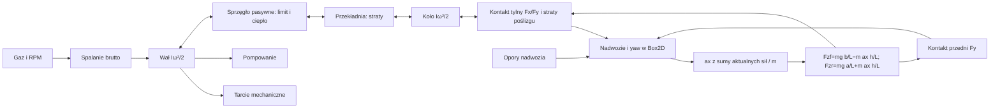

# H26 — audyt przed implementacją

Baza: 26b2103bf9d710b8d1ec8831352e753c6e7480b0. Tryb domyślny H25 pozostaje bez zmian.

1. HandlingContact używa LoadBasedTyreGrip.Budget: mg i ramiona .70/.60 m; dla 147 kg Fzf=665.57 N, Fzr=776.50 N. GripScale=1.25 daje μ≈1.606 na badanej nawierzchni. Przedni budżet ogranicza Fy, tylny wspólny okrąg Fx/Fy. Opór nadwozia działa osobno.
2. DynamicAxleLoad istnieje, ale H25 go nie wywołuje. Starsze #176 używało poprzedniego przyspieszenia; nie stanowi walidacji H26.
3. Engine500 to mapa momentu netto/brake. Wał ma I=.01 kgm²; lepkościowe, ograniczone sprzęgło jest dwukierunkowe. Sprawność przekładni jest odwracana przy ujemnym momencie. Gaz=0 przy domyślnym zerowym CrankDrag nie rozprasza energii w silniku; energia wału może nadal napędzać koło.
4. Istnieją już opór nadwozia 40+.20v², opór łożyska koła, ciepło sprzęgła, straty przekładni i kontaktu. Nie dodajemy ich powtórnie. Nie odejmujemy ponownie strat od pełnogazowej mapy netto.

Plan: quasi-statyczny implicit solve ax z sił obecnego kroku, zachowanie mg i μ. Brak pitch, zawieszenia i jazdy na jednym kole; brak dodatniego rozwiązania dwóch kontaktów oznacza jawny błąd odciążenia, bez ukrytego clampu. Test dt i reszty przed światem natywnym.

Nominalne h=.55 m jest NIEZWALIDOWANĄ hipotezą ze środka zakresu .45–.65 i starszego #176. Wrażliwość obejmie .45/.50/.55/.60/.65. Nie jest to pomiar motocykla żużlowego.

Proponowana rodzina strat wału: cM=.003, cP=.005 Nm·s, skala .5/1/1.5. Moment netto u*Tmap−(1−u)cMω−(1−u)²cPω. Raport energetyczny rozdziela u*(Tmap+cMω) spalania brutto, cMω tarcia oraz cP(1−u)²ω pompowania. Przy u=1 zostaje identyczna mapa netto. Rozdział M/P i wielkość strat są HIPOTEZĄ, bez pomiaru motoring torque; .008ω odpowiada tylko wcześniejszej hipotezie #187.

Źródła: [JAWA 889, instrukcja producenta](https://www.jawa500.cz/element/simple/documents-to-download/c/9/82967b1759773d81.pdf) potwierdza klasę silnika i moc przy 8500 RPM, nie daje mapy zamkniętej przepustnicy. [SAE 2023-01-0416](https://saemobilus.sae.org/papers/experimental-characterization-mechanical-loss-components-a-single-cylinder-spark-ignition-engine-progressive-disassembly-method-2023-01-0416) opisuje rozdzielanie składników strat silnika jednocylindrowego, bez kalibracji JAWA. Sprzęgło symulatora pozostaje modelem PROVISIONAL, nie zmierzonym sprzęgłem konkretnego silnika.

Limit 8 nowych światów natywnych. Testy równania/kontaktów i tanie predykcje nie tworzą świata. H25/L/E/LE na tych samych komendach to diagnostyka przeniesienia, osobna od nauki H26.
